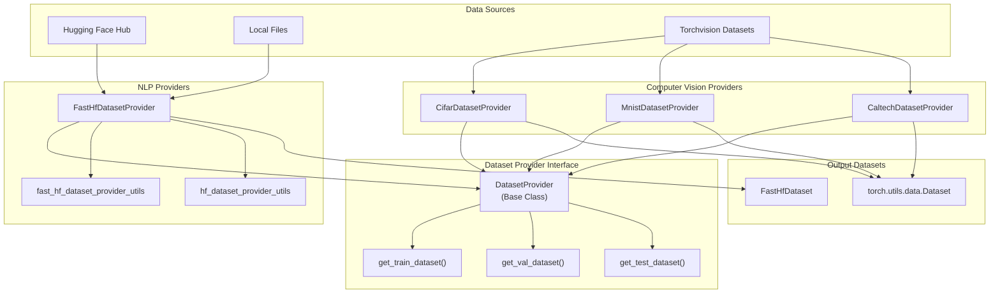
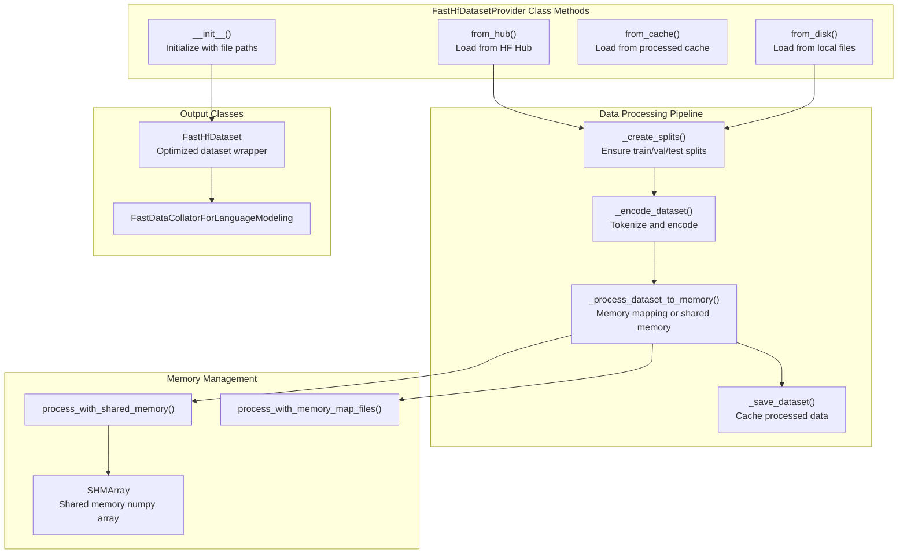
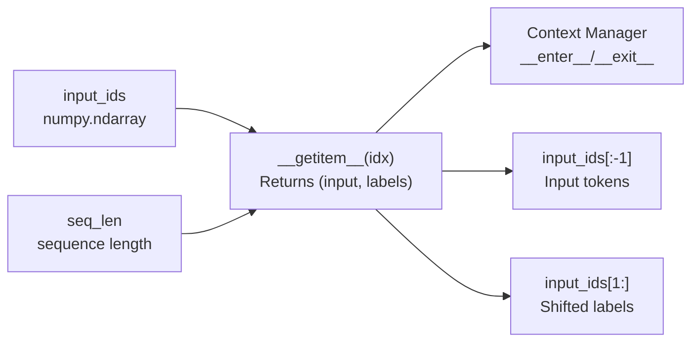
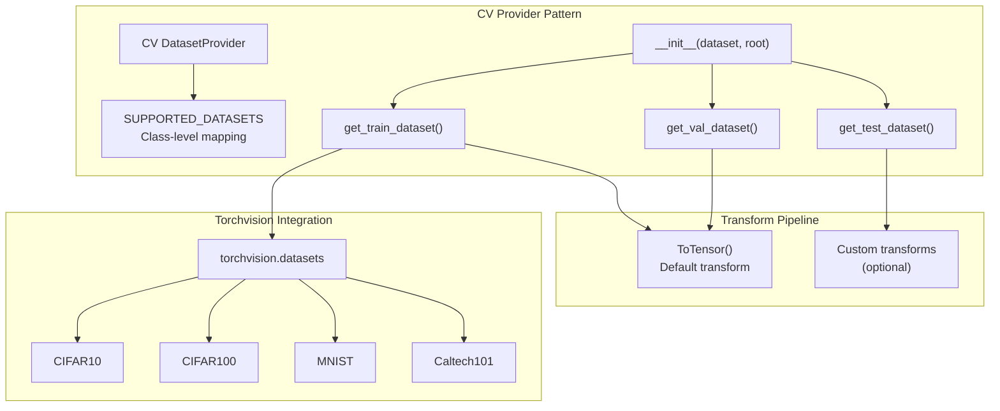

<!-- source: DeepWiki mcp.deepwiki.com · repo microsoft/archai · page 5.1 Dataset Providers · fetched 2026-10-26 -->

# Dataset Providers

<details>
<summary>Relevant source files</summary>

The following files were used as context for generating this wiki page:

- [.github/workflows/lint-run-unit-tests.yaml](.github/workflows/lint-run-unit-tests.yaml)
- [.github/workflows/run-notebook-tests.yml](.github/workflows/run-notebook-tests.yml)
- [archai/common/delimited_text.py](archai/common/delimited_text.py)
- [archai/datasets/cv/caltech_dataset_provider.py](archai/datasets/cv/caltech_dataset_provider.py)
- [archai/datasets/cv/cifar_dataset_provider.py](archai/datasets/cv/cifar_dataset_provider.py)
- [archai/datasets/cv/mnist_dataset_provider.py](archai/datasets/cv/mnist_dataset_provider.py)
- [archai/datasets/nlp/fast_hf_dataset_provider.py](archai/datasets/nlp/fast_hf_dataset_provider.py)
- [archai/datasets/nlp/fast_hf_dataset_provider_utils.py](archai/datasets/nlp/fast_hf_dataset_provider_utils.py)
- [archai/datasets/nlp/hf_dataset_provider_utils.py](archai/datasets/nlp/hf_dataset_provider_utils.py)
- [confs/datasets/cifar100.yaml](confs/datasets/cifar100.yaml)
- [docs/contributing/unit_tests.rst](docs/contributing/unit_tests.rst)

</details>


Dataset providers in Archai implement a standardized interface for loading, preprocessing, and serving training data to neural architecture search algorithms and model training pipelines. They abstract away the complexities of different data formats and sources while providing optimized data loading capabilities for both computer vision and natural language processing tasks.

For information about training infrastructure that consumes these datasets, see [Training Infrastructure](#5.2). For details about how datasets are used in specific task implementations, see [Computer Vision Tasks](#6.1) and [Natural Language Processing Tasks](#6.2).

## Architecture Overview

The dataset provider system follows a layered architecture with specialized implementations for different domains and performance requirements:



Sources: [archai/datasets/nlp/fast_hf_dataset_provider.py:41-66](), [archai/datasets/cv/cifar_dataset_provider.py:17-43](), [archai/datasets/cv/mnist_dataset_provider.py:17-44](), [archai/datasets/cv/caltech_dataset_provider.py:17-42]()

## Core Dataset Provider Interface

All dataset providers implement the abstract `DatasetProvider` interface, which defines three key methods for accessing different data splits:

| Method | Purpose | Returns |
|--------|---------|---------|
| `get_train_dataset()` | Provides training data | `torch.utils.data.Dataset` |
| `get_val_dataset()` | Provides validation data | `torch.utils.data.Dataset` |
| `get_test_dataset()` | Provides test data | `torch.utils.data.Dataset` |

The base interface ensures consistent behavior across different data domains while allowing specialized implementations to optimize for their specific requirements.

Sources: [archai/datasets/nlp/fast_hf_dataset_provider.py:21](), [archai/datasets/cv/cifar_dataset_provider.py:11]()

## NLP Dataset Providers

### FastHfDatasetProvider

The `FastHfDatasetProvider` is the primary dataset provider for natural language processing tasks, offering high-performance data loading with advanced memory management features:



Sources: [archai/datasets/nlp/fast_hf_dataset_provider.py:41-435](), [archai/datasets/nlp/fast_hf_dataset_provider_utils.py:26-65]()

#### Key Features

**Memory Optimization**: The provider supports both shared memory (`multiprocessing.shared_memory`) and memory-mapped files for efficient data access across multiple processes [archai/datasets/nlp/fast_hf_dataset_provider_utils.py:88-131]().

**Automatic Data Splitting**: When validation or test splits are missing, the provider automatically creates them using configurable split ratios [archai/datasets/nlp/fast_hf_dataset_provider.py:73-91]().

**Flexible Data Sources**: Supports loading from:
- Hugging Face Hub datasets via `from_hub()` [archai/datasets/nlp/fast_hf_dataset_provider.py:277-387]()
- Local dataset files via `from_disk()` [archai/datasets/nlp/fast_hf_dataset_provider.py:176-275]()
- Pre-processed cache via `from_cache()` [archai/datasets/nlp/fast_hf_dataset_provider.py:389-416]()

**Advanced Tokenization**: Includes utilities for different tokenization strategies:
- `tokenize_concatenated_dataset()` for continuous text processing [archai/datasets/nlp/hf_dataset_provider_utils.py:75-107]()
- `tokenize_contiguous_dataset()` for fixed-length sequences [archai/datasets/nlp/hf_dataset_provider_utils.py:110-145]()
- `tokenize_nsp_dataset()` for next-sentence prediction tasks [archai/datasets/nlp/hf_dataset_provider_utils.py:148-188]()

### FastHfDataset Class

The `FastHfDataset` class provides optimized data access for language modeling tasks:



Sources: [archai/datasets/nlp/fast_hf_dataset_provider_utils.py:26-65]()

## Computer Vision Dataset Providers

The computer vision dataset providers offer simplified interfaces to standard torchvision datasets with consistent API patterns:

### Supported CV Datasets

| Provider Class | Supported Datasets | Base Library |
|---------------|-------------------|--------------|
| `CifarDatasetProvider` | CIFAR-10, CIFAR-100 | torchvision |
| `MnistDatasetProvider` | MNIST, Fashion-MNIST, KMNIST, QMNIST | torchvision |
| `CaltechDatasetProvider` | Caltech-101, Caltech-256 | torchvision |

### CV Provider Architecture



Sources: [archai/datasets/cv/cifar_dataset_provider.py:17-79](), [archai/datasets/cv/mnist_dataset_provider.py:17-81](), [archai/datasets/cv/caltech_dataset_provider.py:17-74]()

### CV Provider Implementation Pattern

All CV providers follow a consistent implementation pattern:

1. **Dataset Mapping**: Each provider defines a `SUPPORTED_DATASETS` dictionary mapping string names to torchvision dataset classes [archai/datasets/cv/cifar_dataset_provider.py:20-23]()

2. **Initialization**: The constructor validates the dataset name and stores configuration [archai/datasets/cv/mnist_dataset_provider.py:27-44]()

3. **Fallback Behavior**: When validation or test splits are unavailable, providers return training data with appropriate warnings [archai/datasets/cv/caltech_dataset_provider.py:62-74]()

## Configuration and Usage

### Dataset Configuration Files

Dataset providers are typically configured through YAML files that specify dataset parameters:

```yaml
__include__: './dataroot.yaml'

dataset:
  name: 'cifar100'
  n_classes: 100
  channels: 3
  max_batches: -1
  storage_name: 'cifar-100-python'
```

Sources: [confs/datasets/cifar100.yaml:1-8]()

### Memory Management Configuration

The `FastHfDatasetProvider` includes sophisticated memory management options:

| Feature | Configuration | Purpose |
|---------|---------------|---------|
| Shared Memory | `use_shared_memory=True` | Multi-process data sharing |
| Memory Mapping | `mmap_mode="r"` | Efficient file access |
| Data Type Optimization | `dtype=np.uint16/np.int32` | Memory usage optimization |
| Cache Directory | `cache_dir="cache"` | Persistent storage location |

The provider automatically selects appropriate data types based on tokenizer vocabulary size [archai/datasets/nlp/fast_hf_dataset_provider.py:221]() and disables shared memory on Windows during testing [archai/datasets/nlp/fast_hf_dataset_provider.py:70]().

Sources: [archai/datasets/nlp/fast_hf_dataset_provider.py:176-275](), [archai/datasets/nlp/fast_hf_dataset_provider_utils.py:34-38]()

## Performance Optimizations

### Shared Memory Implementation

For high-performance scenarios, the `FastHfDatasetProvider` implements shared memory data access through the `SHMArray` class:


Sources: [archai/datasets/nlp/fast_hf_dataset_provider_utils.py:67-86](), [archai/datasets/nlp/fast_hf_dataset_provider_utils.py:88-131]()

### Context Management

The `FastHfDataset` implements proper resource cleanup through context management, automatically closing memory maps when the dataset goes out of scope [archai/datasets/nlp/fast_hf_dataset_provider_utils.py:47-52]().

Sources: [archai/datasets/nlp/fast_hf_dataset_provider_utils.py:47-65](), [archai/datasets/nlp/fast_hf_dataset_provider.py:126-131]()

---

