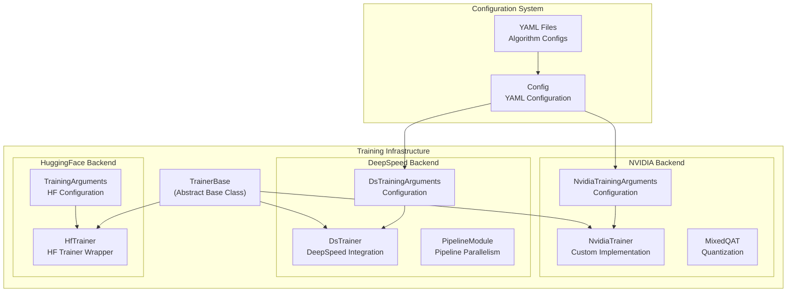
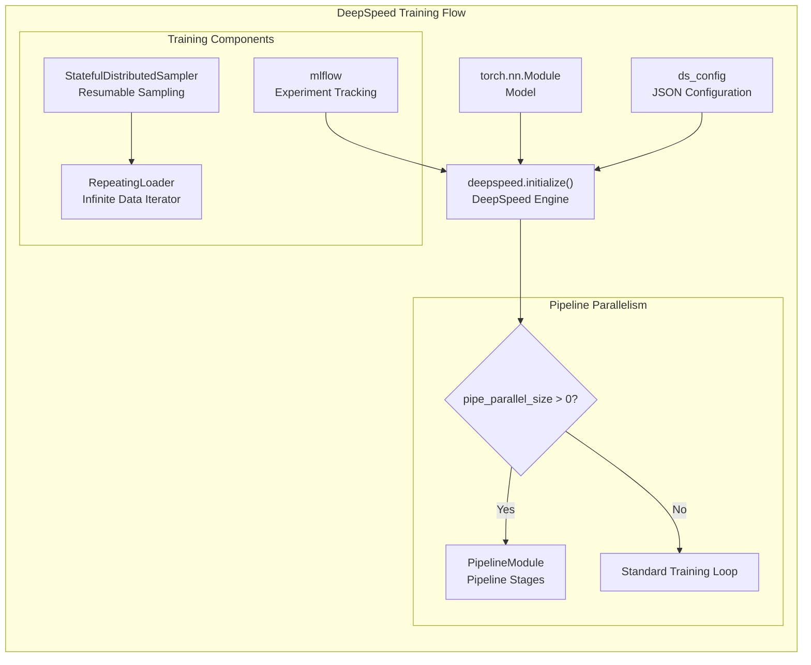
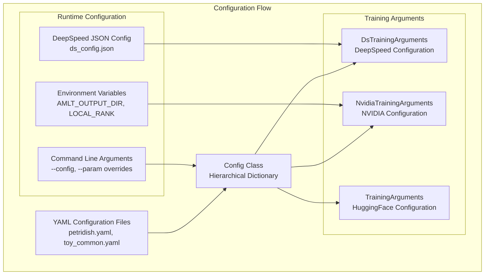
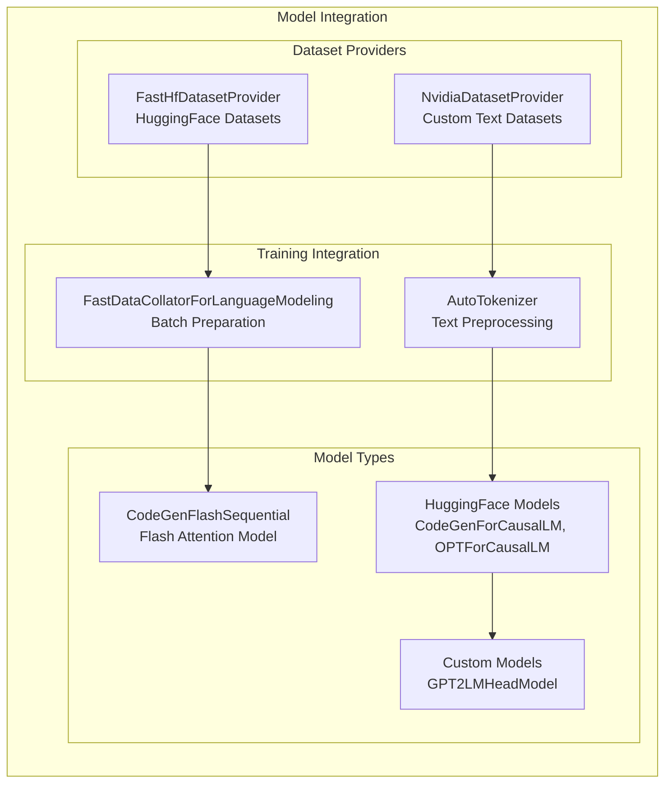

<!-- source: DeepWiki mcp.deepwiki.com · repo microsoft/archai · page 5.2 Training Infrastructure · fetched 2026-10-26 -->

# Training Infrastructure

<details>
<summary>Relevant source files</summary>

The following files were used as context for generating this wiki page:

- [.vscode/settings.json](.vscode/settings.json)
- [archai/common/__init__.py](archai/common/__init__.py)
- [archai/common/config.py](archai/common/config.py)
- [archai/common/distributed_utils.py](archai/common/distributed_utils.py)
- [archai/common/file_utils.py](archai/common/file_utils.py)
- [archai/common/ordered_dict_logger.py](archai/common/ordered_dict_logger.py)
- [archai/common/timing.py](archai/common/timing.py)
- [archai/datasets/cv/face_synthetics.py](archai/datasets/cv/face_synthetics.py)
- [archai/datasets/nlp/nvidia_dataset_provider.py](archai/datasets/nlp/nvidia_dataset_provider.py)
- [archai/datasets/nlp/nvidia_dataset_provider_utils.py](archai/datasets/nlp/nvidia_dataset_provider_utils.py)
- [archai/datasets/nlp/tokenizer_utils/bbpe_tokenizer.py](archai/datasets/nlp/tokenizer_utils/bbpe_tokenizer.py)
- [archai/datasets/nlp/tokenizer_utils/gpt2_tokenizer.py](archai/datasets/nlp/tokenizer_utils/gpt2_tokenizer.py)
- [archai/datasets/nlp/tokenizer_utils/tokenizer_base.py](archai/datasets/nlp/tokenizer_utils/tokenizer_base.py)
- [archai/datasets/nlp/tokenizer_utils/word_tokenizer.py](archai/datasets/nlp/tokenizer_utils/word_tokenizer.py)
- [archai/discrete_search/search_spaces/nlp/tfpp/modeling_codegen_flash.py](archai/discrete_search/search_spaces/nlp/tfpp/modeling_codegen_flash.py)
- [archai/trainers/nlp/ds_trainer.py](archai/trainers/nlp/ds_trainer.py)
- [archai/trainers/nlp/ds_training_args.py](archai/trainers/nlp/ds_training_args.py)
- [archai/trainers/nlp/nvidia_trainer.py](archai/trainers/nlp/nvidia_trainer.py)
- [archai/trainers/nlp/nvidia_training_args.py](archai/trainers/nlp/nvidia_training_args.py)
- [confs/algos/petridish_toy.yaml](confs/algos/petridish_toy.yaml)
- [docker/Dockerfile.flash](docker/Dockerfile.flash)
- [scripts/eval/README.md](scripts/eval/README.md)
- [scripts/eval/deepspeed/evaluate_human_eval.py](scripts/eval/deepspeed/evaluate_human_eval.py)
- [scripts/eval/hf/evaluate_human_eval.py](scripts/eval/hf/evaluate_human_eval.py)
- [scripts/eval/requirements.txt](scripts/eval/requirements.txt)
- [scripts/trainers/README.md](scripts/trainers/README.md)
- [scripts/trainers/deepspeed/.gitignore](scripts/trainers/deepspeed/.gitignore)
- [scripts/trainers/deepspeed/ds_config.json](scripts/trainers/deepspeed/ds_config.json)
- [scripts/trainers/deepspeed/train_codegen.py](scripts/trainers/deepspeed/train_codegen.py)
- [scripts/trainers/hf/train_codegen.py](scripts/trainers/hf/train_codegen.py)
- [scripts/trainers/hf/train_opt.py](scripts/trainers/hf/train_opt.py)
- [scripts/trainers/nvidia/train_gpt2.py](scripts/trainers/nvidia/train_gpt2.py)
- [setup.cfg](setup.cfg)

</details>


This document covers the training infrastructure within Archai, which provides multiple backends for training neural networks with support for distributed computing, mixed precision, and various optimization strategies. The training infrastructure is designed to support both Neural Architecture Search (NAS) experiments and standalone model training.

For information about dataset loading and preprocessing, see [Dataset Providers](#5.1). For details about specific NAS algorithms that utilize this training infrastructure, see [Search Algorithms](#4.1).

## Training Backend Architecture

Archai provides three main training backends, each optimized for different use cases and hardware configurations:



Sources: [archai/api/trainer_base.py](), [archai/trainers/nlp/ds_trainer.py:73-140](), [archai/trainers/nlp/nvidia_trainer.py:108-152](), [archai/trainers/nlp/ds_training_args.py:15-77](), [archai/trainers/nlp/nvidia_training_args.py:72-249]()

## DeepSpeed Training Backend

The `DsTrainer` class provides integration with Microsoft DeepSpeed for large-scale distributed training with advanced optimization features:



Key features of the DeepSpeed backend:

- **Stateful Distributed Sampling**: The `StatefulDistributedSampler` class [archai/trainers/nlp/ds_trainer.py:38-71]() enables resuming training from checkpoints by tracking consumed samples
- **Pipeline Parallelism**: Automatic conversion to `PipelineModule` when `pipe_parallel_size > 0` [archai/trainers/nlp/ds_trainer.py:111-121]()
- **Mixed Precision**: Built-in FP16 support through DeepSpeed configuration [scripts/trainers/deepspeed/ds_config.json:2-5]()
- **Experiment Tracking**: Integration with MLFlow for logging metrics [archai/trainers/nlp/ds_trainer.py:134]()

Sources: [archai/trainers/nlp/ds_trainer.py:73-140](), [archai/trainers/nlp/ds_training_args.py:15-77](), [scripts/trainers/deepspeed/train_codegen.py:124-143]()

## NVIDIA Training Backend

The `NvidiaTrainer` provides a custom training implementation optimized for NVIDIA hardware with support for various quantization techniques:

```mermaid
graph TB
    subgraph "NVIDIA Training Pipeline"
        subgraph "Initialization"
            ModelSetup["Model Setup<br/>model.to(device)"]
            OptimizerCreation["_create_optimizer()<br/>SGD, Adam, LAMB, JITLamb"]
            SchedulerCreation["_create_scheduler()<br/>Cosine, InvSqrt, Constant"]
            ScalerCreation["_create_scaler()<br/>GradScaler for FP16"]
        end
        
        subgraph "Quantization Support"
            QATSetup["_setup_qat()<br/>prepare_with_qat()"]
            MixedQATSetup["MixedQAT<br/>Mixed Quantization"]
        end
        
        subgraph "Distributed Training"
            DDPSetup["DistributedDataParallel<br/>DDP Strategy"]
            DataParallelSetup["DataParallel<br/>DP Strategy"]
        end
        
        subgraph "Training Loop"
            DataLoader["_get_dataloader()<br/>LMOrderedIterator/LMMultiFileIterator"]
            TrainingStep["_training_step()<br/>Gradient Accumulation"]
            EvaluationStep["_evaluation_step()<br/>Validation"]
            CheckpointSave["save_checkpoint()<br/>Model State Persistence"]
        end
        
        ModelSetup --> OptimizerCreation
        OptimizerCreation --> SchedulerCreation
        SchedulerCreation --> ScalerCreation
        ScalerCreation --> QATSetup
        QATSetup --> MixedQATSetup
        MixedQATSetup --> DDPSetup
        DDPSetup --> DataParallelSetup
        DataParallelSetup --> DataLoader
        DataLoader --> TrainingStep
        TrainingStep --> EvaluationStep
        EvaluationStep --> CheckpointSave
    end
```



The NVIDIA backend includes specialized features:

- **Multiple Optimizers**: Support for `SGD`, `Adam`, `Adagrad`, `Lamb`, and `JITLamb` [archai/trainers/nlp/nvidia_trainer.py:213-232]()
- **Advanced Schedulers**: Cosine annealing, inverse square root, and cyclic cosine decay [archai/trainers/nlp/nvidia_trainer.py:239-275]()
- **Quantization Aware Training**: Full QAT and Mixed QAT support [archai/trainers/nlp/nvidia_trainer.py:276-282]()
- **Flexible Data Loading**: Specialized iterators for different dataset formats [archai/trainers/nlp/nvidia_trainer.py:185-211]()

Sources: [archai/trainers/nlp/nvidia_trainer.py:108-628](), [archai/trainers/nlp/nvidia_training_args.py:72-249](), [scripts/trainers/nvidia/train_gpt2.py:48-82]()

## Configuration System Integration

The training infrastructure integrates with Archai's hierarchical configuration system through YAML files and command-line arguments:



The configuration system supports:

- **Hierarchical Includes**: YAML files can include other configurations using `__include__` [confs/algos/petridish_toy.yaml:3]()
- **Environment Variable Resolution**: Automatic expansion of environment variables in configuration values [archai/common/config.py:82-87]()
- **Command Line Overrides**: Runtime parameter modification through `--param` arguments [archai/common/config.py:79-80]()
- **Type-Safe Conversion**: Automatic type conversion based on original configuration values [archai/common/config.py:149-162]()

Sources: [archai/common/config.py:32-178](), [confs/algos/petridish_toy.yaml:1-9](), [archai/trainers/nlp/ds_training_args.py:78-92]()

## Model and Dataset Integration

The training infrastructure seamlessly integrates with various model architectures and dataset providers:



Key integration components:

- **Flash Attention Models**: Optimized transformer implementations with `CodeGenFlashSequential` [archai/discrete_search/search_spaces/nlp/tfpp/modeling_codegen_flash.py:210-249]()
- **Fast Dataset Loading**: `FastHfDatasetProvider` for efficient HuggingFace dataset processing [scripts/trainers/deepspeed/train_codegen.py:92-98]()
- **Specialized Data Collators**: `FastDataCollatorForLanguageModeling` for language modeling tasks [scripts/trainers/hf/train_codegen.py:58]()

Sources: [scripts/trainers/deepspeed/train_codegen.py:86-144](), [scripts/trainers/hf/train_codegen.py:54-104](), [archai/discrete_search/search_spaces/nlp/tfpp/modeling_codegen_flash.py:210-249]()

## Distributed Training Capabilities

All training backends support distributed training with different strategies and optimizations:

| Backend | Distributed Strategy | Features |
|---------|---------------------|----------|
| DeepSpeed | Automatic via `deepspeed.initialize()` | ZeRO optimization, Pipeline parallelism, Mixed precision |
| NVIDIA | DDP, DataParallel | Custom distributed utilities, Manual synchronization |
| HuggingFace | Built-in HF Trainer | Automatic multi-GPU, Gradient accumulation |

The distributed training infrastructure includes:

- **Synchronization Utilities**: `sync_workers()` context manager for coordinating distributed operations [archai/common/distributed_utils.py:132-152]()
- **Collective Operations**: `all_reduce()` for aggregating metrics across processes [archai/common/distributed_utils.py:80-129]()
- **Environment Detection**: Automatic detection of distributed environment variables [archai/trainers/nlp/nvidia_training_args.py:219-239]()

Sources: [archai/common/distributed_utils.py:12-153](), [archai/trainers/nlp/nvidia_trainer.py:283-297](), [archai/trainers/nlp/ds_trainer.py:104]()

## Example Usage Patterns

The training infrastructure supports various usage patterns through the provided scripts:

```bash
# DeepSpeed training with pipeline parallelism
deepspeed scripts/trainers/deepspeed/train_codegen.py \
    --ds_config_path ds_config.json \
    --pipe_parallel_size 4

# NVIDIA distributed training
python -m torch.distributed.run --nproc_per_node=4 \
    scripts/trainers/nvidia/train_gpt2.py \
    --strategy ddp --global_batch_size 256

# HuggingFace training with evaluation
python scripts/trainers/hf/train_codegen.py \
    --max_steps 1000 --eval_steps 100
```

Each script demonstrates different aspects of the training infrastructure:

- **DeepSpeed Scripts**: Show pipeline parallelism and ZeRO optimization configuration [scripts/trainers/deepspeed/train_codegen.py:124-143]()
- **NVIDIA Scripts**: Demonstrate custom training loops with quantization support [scripts/trainers/nvidia/train_gpt2.py:48-82]()
- **HuggingFace Scripts**: Illustrate standard transformer training patterns [scripts/trainers/hf/train_codegen.py:54-104]()

Sources: [scripts/trainers/README.md:48-83](), [scripts/trainers/deepspeed/train_codegen.py:86-144](), [scripts/trainers/nvidia/train_gpt2.py:48-82](), [scripts/trainers/hf/train_codegen.py:54-104]()

---

