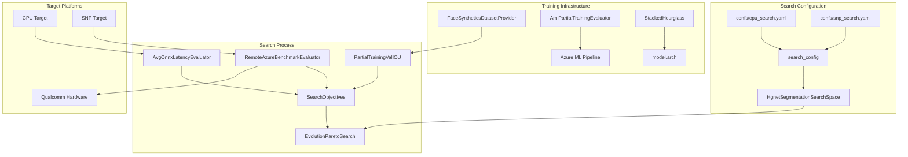
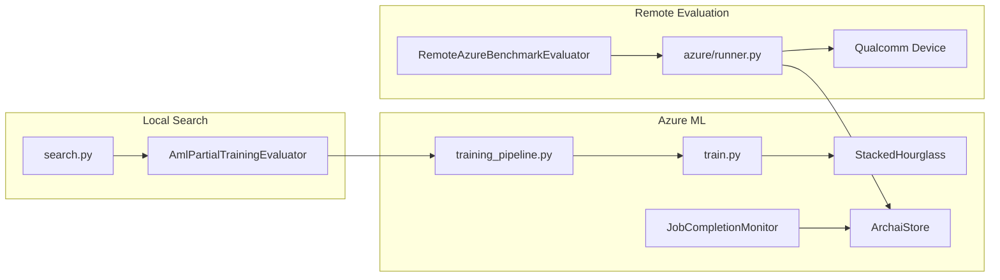
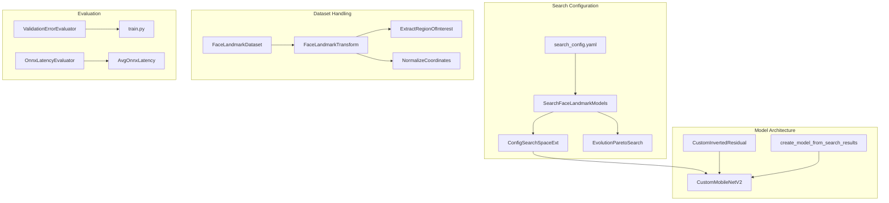
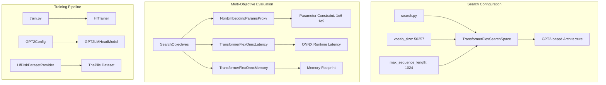
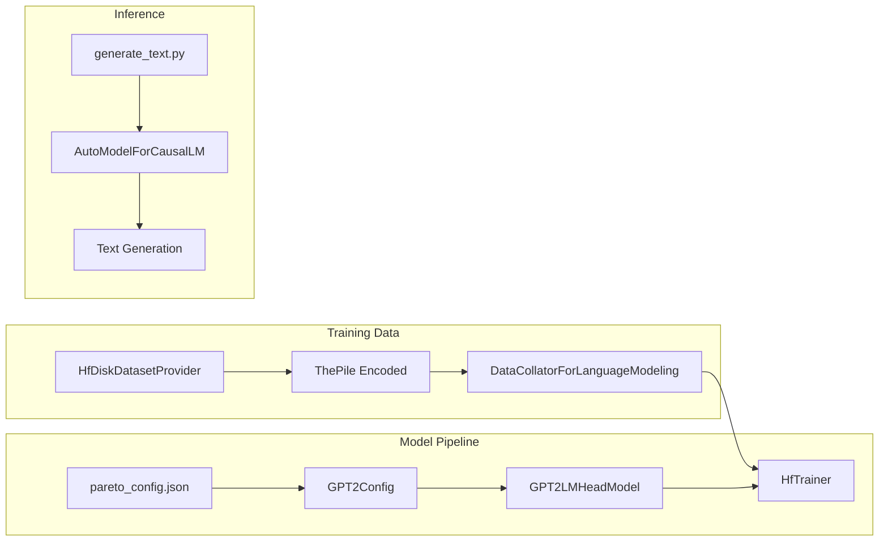

<!-- source: DeepWiki mcp.deepwiki.com · repo microsoft/archai · page 6 Tasks and Applications · fetched 2026-10-26 -->

# Tasks and Applications

Relevant source files

The following files were used as context for generating this wiki page:

- [.gitignore](.gitignore)
- [archai/common/monitor.py](archai/common/monitor.py)
- [archai/discrete_search/evaluators/nlp/__init__.py](archai/discrete_search/evaluators/nlp/__init__.py)
- [archai/discrete_search/evaluators/nlp/parameters.py](archai/discrete_search/evaluators/nlp/parameters.py)
- [archai/discrete_search/evaluators/nlp/transformer_flex_latency.py](archai/discrete_search/evaluators/nlp/transformer_flex_latency.py)
- [archai/discrete_search/evaluators/nlp/transformer_flex_memory.py](archai/discrete_search/evaluators/nlp/transformer_flex_memory.py)
- [archai/discrete_search/evaluators/remote_azure_benchmark.py](archai/discrete_search/evaluators/remote_azure_benchmark.py)
- [archai/onnx/__init__.py](archai/onnx/__init__.py)
- [archai/onnx/config_utils/__init__.py](archai/onnx/config_utils/__init__.py)
- [archai/onnx/config_utils/codegen_onnx_config.py](archai/onnx/config_utils/codegen_onnx_config.py)
- [archai/onnx/config_utils/gpt2_onnx_config.py](archai/onnx/config_utils/gpt2_onnx_config.py)
- [archai/onnx/config_utils/onnx_config_base.py](archai/onnx/config_utils/onnx_config_base.py)
- [archai/onnx/export.py](archai/onnx/export.py)
- [archai/onnx/export_utils.py](archai/onnx/export_utils.py)
- [archai/onnx/onnx_forward.py](archai/onnx/onnx_forward.py)
- [archai/onnx/onnx_loader.py](archai/onnx/onnx_loader.py)
- [archai/onnx/optimization.py](archai/onnx/optimization.py)
- [docs/advanced_guide/cloud/azure/notebooks/multi_node_search/scripts/train.py](docs/advanced_guide/cloud/azure/notebooks/multi_node_search/scripts/train.py)
- [tasks/face_segmentation/.vscode/launch.json](tasks/face_segmentation/.vscode/launch.json)
- [tasks/face_segmentation/README.md](tasks/face_segmentation/README.md)
- [tasks/face_segmentation/aml.py](tasks/face_segmentation/aml.py)
- [tasks/face_segmentation/aml/azure/change_schema.py](tasks/face_segmentation/aml/azure/change_schema.py)
- [tasks/face_segmentation/aml/azure/loop.sh](tasks/face_segmentation/aml/azure/loop.sh)
- [tasks/face_segmentation/aml/azure/runner.py](tasks/face_segmentation/aml/azure/runner.py)
- [tasks/face_segmentation/aml/docker/quantizer/Dockerfile](tasks/face_segmentation/aml/docker/quantizer/Dockerfile)
- [tasks/face_segmentation/aml/docker/quantizer/quantizer.template.yaml](tasks/face_segmentation/aml/docker/quantizer/quantizer.template.yaml)
- [tasks/face_segmentation/aml/images/animation.gif](tasks/face_segmentation/aml/images/animation.gif)
- [tasks/face_segmentation/aml/images/final_results.png](tasks/face_segmentation/aml/images/final_results.png)
- [tasks/face_segmentation/aml/images/iteration10.png](tasks/face_segmentation/aml/images/iteration10.png)
- [tasks/face_segmentation/aml/images/pareto.gif](tasks/face_segmentation/aml/images/pareto.gif)
- [tasks/face_segmentation/aml/notebooks/results.ipynb](tasks/face_segmentation/aml/notebooks/results.ipynb)
- [tasks/face_segmentation/aml/readme.md](tasks/face_segmentation/aml/readme.md)
- [tasks/face_segmentation/aml/training/aml_training_evaluator.py](tasks/face_segmentation/aml/training/aml_training_evaluator.py)
- [tasks/face_segmentation/aml/training/onnx_latency.py](tasks/face_segmentation/aml/training/onnx_latency.py)
- [tasks/face_segmentation/aml/training/readme.md](tasks/face_segmentation/aml/training/readme.md)
- [tasks/face_segmentation/aml/training/training_pipeline.py](tasks/face_segmentation/aml/training/training_pipeline.py)
- [tasks/face_segmentation/aml/util/pareto.py](tasks/face_segmentation/aml/util/pareto.py)
- [tasks/face_segmentation/aml/util/setup.py](tasks/face_segmentation/aml/util/setup.py)
- [tasks/face_segmentation/assets/snp_pareto_evolution.png](tasks/face_segmentation/assets/snp_pareto_evolution.png)
- [tasks/face_segmentation/confs/aml_search.yaml](tasks/face_segmentation/confs/aml_search.yaml)
- [tasks/face_segmentation/search.py](tasks/face_segmentation/search.py)
- [tasks/face_segmentation/train.py](tasks/face_segmentation/train.py)
- [tasks/face_segmentation/train_pareto.py](tasks/face_segmentation/train_pareto.py)
- [tasks/facial_landmark_detection/README.md](tasks/facial_landmark_detection/README.md)
- [tasks/facial_landmark_detection/dataset.py](tasks/facial_landmark_detection/dataset.py)
- [tasks/facial_landmark_detection/latency.py](tasks/facial_landmark_detection/latency.py)
- [tasks/facial_landmark_detection/model.py](tasks/facial_landmark_detection/model.py)
- [tasks/facial_landmark_detection/quantizable_model.py](tasks/facial_landmark_detection/quantizable_model.py)
- [tasks/facial_landmark_detection/search.py](tasks/facial_landmark_detection/search.py)
- [tasks/facial_landmark_detection/search_config.yaml](tasks/facial_landmark_detection/search_config.yaml)
- [tasks/facial_landmark_detection/search_results_with_full_validation_error.csv](tasks/facial_landmark_detection/search_results_with_full_validation_error.csv)
- [tasks/facial_landmark_detection/search_space.py](tasks/facial_landmark_detection/search_space.py)
- [tasks/facial_landmark_detection/train.py](tasks/facial_landmark_detection/train.py)
- [tasks/facial_landmark_detection/train_candidate_models.py](tasks/facial_landmark_detection/train_candidate_models.py)
- [tasks/facial_landmark_detection/transforms.py](tasks/facial_landmark_detection/transforms.py)
- [tasks/facial_landmark_detection/utils.py](tasks/facial_landmark_detection/utils.py)
- [tasks/text_generation/README.md](tasks/text_generation/README.md)
- [tasks/text_generation/assets/pareto_zero_shot_eval.png](tasks/text_generation/assets/pareto_zero_shot_eval.png)
- [tasks/text_generation/generate_text.py](tasks/text_generation/generate_text.py)
- [tasks/text_generation/search.py](tasks/text_generation/search.py)
- [tasks/text_generation/train.py](tasks/text_generation/train.py)
- [tests/discrete_search/evaluators/nlp/test_parameters.py](tests/discrete_search/evaluators/nlp/test_parameters.py)
- [tests/discrete_search/evaluators/nlp/test_transformer_flex_latency.py](tests/discrete_search/evaluators/nlp/test_transformer_flex_latency.py)
- [tests/discrete_search/evaluators/nlp/test_transformer_flex_memory.py](tests/discrete_search/evaluators/nlp/test_transformer_flex_memory.py)

This page documents the specific application domains and task implementations built on the Archai framework. These tasks demonstrate how to apply neural architecture search to real-world problems across computer vision and natural language processing domains, providing concrete examples of multi-objective optimization for deployment-ready models.

For information about the core NAS algorithms and search spaces, see [Neural Architecture Search](#4). For details about data handling and training infrastructure, see [Data and Training](#5).

## Task Architecture Overview

Archai tasks are structured as complete applications that combine search spaces, algorithms, and evaluators to solve domain-specific problems. Each task demonstrates end-to-end workflows from architecture search through training and deployment.

### Task Integration with Core Framework

```mermaid
graph TB
    subgraph "Archai Core Framework"
        A["EvolutionParetoSearch"] --> B["SearchObjectives"]
        C["DiscreteSearchSpace"] --> D["ArchaiModel"]
        E["ModelEvaluator"] --> F["AsyncModelEvaluator"]
    end
    
    subgraph "Face Segmentation Task"
        G["HgnetSegmentationSearchSpace"] --> C
        H["PartialTrainingValIOU"] --> E
        I["RemoteAzureBenchmarkEvaluator"] --> F
        J["AmlPartialTrainingEvaluator"] --> F
        K["search.py"] --> A
        K --> B
    end
    
    subgraph "Facial Landmark Detection Task"
        L["ConfigSearchSpaceExt"] --> C
        M["ValidationErrorEvaluator"] --> E
        N["OnnxLatencyEvaluator"] --> E
        O["search.py"] --> A
        P["FaceLandmarkDataset"] --> Q["Dataset"]
    end
    
    subgraph "Text Generation Task"
        R["TransformerFlexSearchSpace"] --> C
        S["NonEmbeddingParamsProxy"] --> E
        T["TransformerFlexOnnxLatency"] --> E
        U["TransformerFlexOnnxMemory"] --> E
        V["search.py"] --> A
    end
```

Sources: [tasks/face_segmentation/search.py:15-34](), [tasks/facial_landmark_detection/search.py:15-24](), [tasks/text_generation/search.py:6-18]()

## Computer Vision Applications

### Face Segmentation

The face segmentation task demonstrates multi-objective NAS for semantic segmentation models targeting both accuracy and deployment efficiency across different hardware platforms.

#### Key Components and Workflow

Sources: [tasks/face_segmentation/search.py:28-190](), [tasks/face_segmentation/confs/cpu_search.yaml](), [tasks/face_segmentation/confs/snp_search.yaml]()

The face segmentation task implements a comprehensive search targeting multiple objectives:

- **Validation IOU**: Measured using `PartialTrainingValIOU` with the Face Synthetics dataset
- **Model Size**: Constrained via `TorchNumParameters` evaluator  
- **CPU Latency**: Evaluated using `AvgOnnxLatencyEvaluator` for ONNX inference
- **SNP Latency**: Measured on Qualcomm hardware via `RemoteAzureBenchmarkEvaluator`

The search space is based on `HgnetSegmentationSearchSpace`, which implements a Stacked Hourglass architecture with configurable downsample, upsample, and skip operations.

#### Azure ML Integration

Sources: [tasks/face_segmentation/aml/training/aml_training_evaluator.py:27-141](), [tasks/face_segmentation/aml/training/training_pipeline.py:54-99](), [archai/discrete_search/evaluators/remote_azure_benchmark.py:18-216]()

### Facial Landmark Detection

The facial landmark detection task focuses on efficient architectures for facial keypoint localization using MobileNetV2-based search spaces.

#### Search Space and Configuration

The task uses `ConfigSearchSpaceExt` which extends `DiscreteSearchSpaceMobileNetV2` with evolutionary operators. Key parameters include:

- **Architecture Parameters**: Expansion ratio (`e_range`), repetition (`r_range`), kernel size (`k_range`)
- **Scaling Parameters**: Channel and depth multipliers  
- **Training Configuration**: Defined in `search_config.yaml` with dataset paths and hyperparameters

Sources: [tasks/facial_landmark_detection/search.py:57-139](), [tasks/facial_landmark_detection/search_space.py:111-308](), [tasks/facial_landmark_detection/dataset.py:17-90]()

#### Quantization-Aware Training

The task supports quantization-aware training (QAT) through `CustomQuantizableMobileNetV2`:

- **QAT Setup**: Implemented in `setup_qat()` function with `fbgemm` quantization config
- **Partial Quantization**: Supports skipping layers from quantization via `qat_skip_layers` parameter
- **Model Creation**: `create_model_from_search_results()` handles both regular and quantizable model instantiation

Sources: [tasks/facial_landmark_detection/train.py:153-166](), [tasks/facial_landmark_detection/search_space.py:92-108]()

## Natural Language Processing Applications

### Text Generation

The text generation task demonstrates architecture search for transformer-based language models with multi-objective optimization targeting parameter efficiency, latency, and memory usage.

#### TransformerFlex Search Space

Sources: [tasks/text_generation/search.py:95-140](), [tasks/text_generation/train.py:41-108](), [archai/discrete_search/evaluators/nlp/parameters.py:13-47]()

The text generation task implements three key evaluators:

1. **`NonEmbeddingParamsProxy`**: Counts non-embedding parameters as a proxy for model perplexity
2. **`TransformerFlexOnnxLatency`**: Measures ONNX inference latency with configurable sequence lengths
3. **`TransformerFlexOnnxMemory`**: Evaluates memory footprint during ONNX inference

#### Model Training and Evaluation

The training pipeline supports:

- **Pre-encoded Datasets**: Uses `HfDiskDatasetProvider` for efficient data loading
- **Hugging Face Integration**: Leverages `HfTrainer` with custom training arguments
- **Text Generation**: Provides `generate_text.py` for inference with pre-trained models

Sources: [tasks/text_generation/train.py:60-108](), [tasks/text_generation/generate_text.py:26-51]()

## Task Execution Patterns

### Common Search Workflow

All tasks follow a consistent pattern using Archai's discrete search framework:

1. **Configuration Loading**: Tasks use YAML configuration files defining search parameters
2. **Search Space Instantiation**: Domain-specific search spaces extend base classes
3. **Objective Definition**: `SearchObjectives` combines multiple evaluators with constraints
4. **Algorithm Execution**: `EvolutionParetoSearch` drives the multi-objective optimization
5. **Result Processing**: Pareto-optimal architectures are saved for further training

### Distributed Execution Support

Tasks support distributed execution through:

- **Ray Integration**: `RayParallelEvaluator` enables parallel model evaluation
- **Azure ML Pipelines**: Cloud-based training and evaluation workflows
- **Remote Benchmarking**: Hardware-specific evaluation on target devices

Sources: [tasks/face_segmentation/search.py:51-189](), [tasks/facial_landmark_detection/search.py:87-139](), [tasks/text_generation/search.py:95-140]()

---

