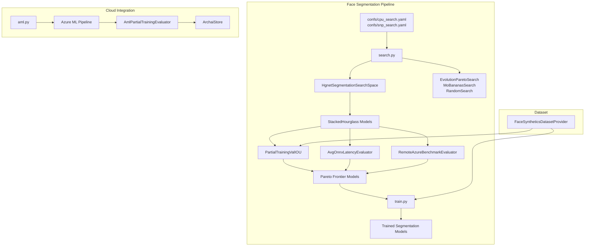
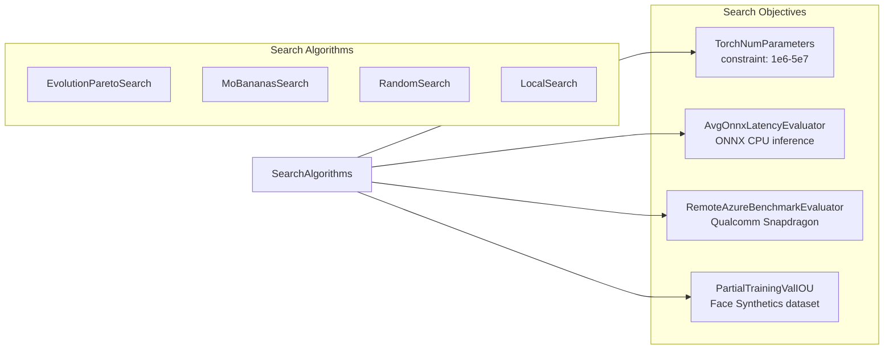
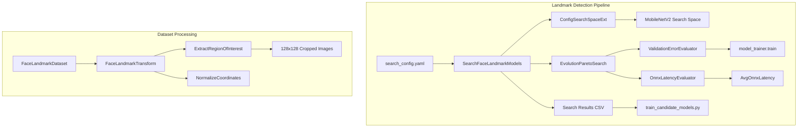
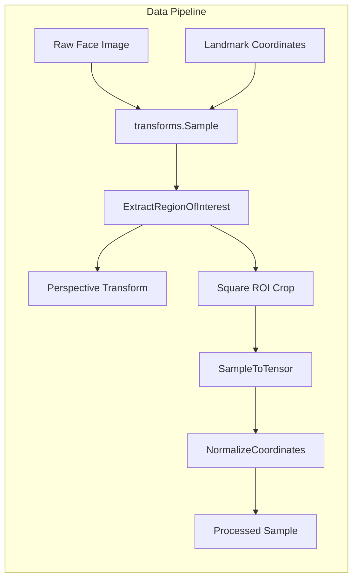
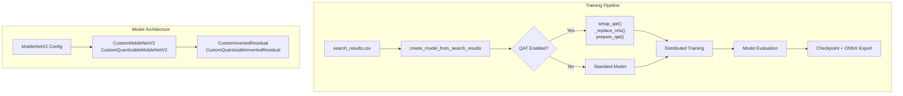
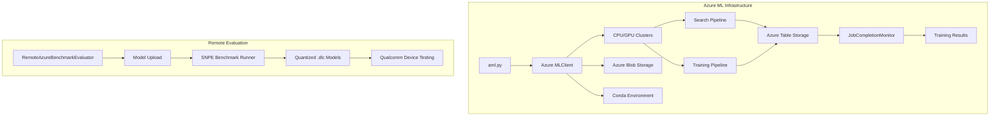

<!-- source: DeepWiki mcp.deepwiki.com · repo microsoft/archai · page 6.1 Computer Vision Tasks · fetched 2026-10-26 -->

# Computer Vision Tasks

<details>
<summary>Relevant source files</summary>

The following files were used as context for generating this wiki page:

- [.gitignore](.gitignore)
- [archai/common/monitor.py](archai/common/monitor.py)
- [archai/discrete_search/evaluators/remote_azure_benchmark.py](archai/discrete_search/evaluators/remote_azure_benchmark.py)
- [docs/advanced_guide/cloud/azure/notebooks/multi_node_search/scripts/train.py](docs/advanced_guide/cloud/azure/notebooks/multi_node_search/scripts/train.py)
- [tasks/face_segmentation/.vscode/launch.json](tasks/face_segmentation/.vscode/launch.json)
- [tasks/face_segmentation/README.md](tasks/face_segmentation/README.md)
- [tasks/face_segmentation/aml.py](tasks/face_segmentation/aml.py)
- [tasks/face_segmentation/aml/azure/change_schema.py](tasks/face_segmentation/aml/azure/change_schema.py)
- [tasks/face_segmentation/aml/azure/loop.sh](tasks/face_segmentation/aml/azure/loop.sh)
- [tasks/face_segmentation/aml/azure/runner.py](tasks/face_segmentation/aml/azure/runner.py)
- [tasks/face_segmentation/aml/docker/quantizer/Dockerfile](tasks/face_segmentation/aml/docker/quantizer/Dockerfile)
- [tasks/face_segmentation/aml/docker/quantizer/quantizer.template.yaml](tasks/face_segmentation/aml/docker/quantizer/quantizer.template.yaml)
- [tasks/face_segmentation/aml/images/animation.gif](tasks/face_segmentation/aml/images/animation.gif)
- [tasks/face_segmentation/aml/images/final_results.png](tasks/face_segmentation/aml/images/final_results.png)
- [tasks/face_segmentation/aml/images/iteration10.png](tasks/face_segmentation/aml/images/iteration10.png)
- [tasks/face_segmentation/aml/images/pareto.gif](tasks/face_segmentation/aml/images/pareto.gif)
- [tasks/face_segmentation/aml/notebooks/results.ipynb](tasks/face_segmentation/aml/notebooks/results.ipynb)
- [tasks/face_segmentation/aml/readme.md](tasks/face_segmentation/aml/readme.md)
- [tasks/face_segmentation/aml/training/aml_training_evaluator.py](tasks/face_segmentation/aml/training/aml_training_evaluator.py)
- [tasks/face_segmentation/aml/training/onnx_latency.py](tasks/face_segmentation/aml/training/onnx_latency.py)
- [tasks/face_segmentation/aml/training/readme.md](tasks/face_segmentation/aml/training/readme.md)
- [tasks/face_segmentation/aml/training/training_pipeline.py](tasks/face_segmentation/aml/training/training_pipeline.py)
- [tasks/face_segmentation/aml/util/pareto.py](tasks/face_segmentation/aml/util/pareto.py)
- [tasks/face_segmentation/aml/util/setup.py](tasks/face_segmentation/aml/util/setup.py)
- [tasks/face_segmentation/assets/snp_pareto_evolution.png](tasks/face_segmentation/assets/snp_pareto_evolution.png)
- [tasks/face_segmentation/confs/aml_search.yaml](tasks/face_segmentation/confs/aml_search.yaml)
- [tasks/face_segmentation/search.py](tasks/face_segmentation/search.py)
- [tasks/face_segmentation/train.py](tasks/face_segmentation/train.py)
- [tasks/face_segmentation/train_pareto.py](tasks/face_segmentation/train_pareto.py)
- [tasks/facial_landmark_detection/README.md](tasks/facial_landmark_detection/README.md)
- [tasks/facial_landmark_detection/dataset.py](tasks/facial_landmark_detection/dataset.py)
- [tasks/facial_landmark_detection/latency.py](tasks/facial_landmark_detection/latency.py)
- [tasks/facial_landmark_detection/model.py](tasks/facial_landmark_detection/model.py)
- [tasks/facial_landmark_detection/quantizable_model.py](tasks/facial_landmark_detection/quantizable_model.py)
- [tasks/facial_landmark_detection/search.py](tasks/facial_landmark_detection/search.py)
- [tasks/facial_landmark_detection/search_config.yaml](tasks/facial_landmark_detection/search_config.yaml)
- [tasks/facial_landmark_detection/search_results_with_full_validation_error.csv](tasks/facial_landmark_detection/search_results_with_full_validation_error.csv)
- [tasks/facial_landmark_detection/search_space.py](tasks/facial_landmark_detection/search_space.py)
- [tasks/facial_landmark_detection/train.py](tasks/facial_landmark_detection/train.py)
- [tasks/facial_landmark_detection/train_candidate_models.py](tasks/facial_landmark_detection/train_candidate_models.py)
- [tasks/facial_landmark_detection/transforms.py](tasks/facial_landmark_detection/transforms.py)
- [tasks/facial_landmark_detection/utils.py](tasks/facial_landmark_detection/utils.py)

</details>


This document covers the computer vision applications built on the Archai framework, focusing on Neural Architecture Search (NAS) implementations for image-based tasks. The primary computer vision tasks include face segmentation and facial landmark detection, both demonstrating multi-objective optimization for accuracy and deployment constraints.

For information about Natural Language Processing tasks, see [Natural Language Processing Tasks](#6.2). For details about the underlying NAS framework, see [Neural Architecture Search](#4).

## Overview

Archai provides two main computer vision task implementations that demonstrate practical applications of neural architecture search:

| Task | Description | Search Space | Key Objectives |
|------|-------------|--------------|----------------|
| Face Segmentation | Semantic segmentation of facial regions | HourglassNet-based | IoU accuracy, inference latency, model size |
| Facial Landmark Detection | Keypoint detection for facial landmarks | MobileNetV2-based | Validation error, ONNX latency |

Both tasks support local execution, distributed training via Ray, and cloud deployment through Azure ML integration.

Sources: [tasks/face_segmentation/README.md:1-97](), [tasks/facial_landmark_detection/README.md:1-82]()

## Face Segmentation

### Architecture Overview

The face segmentation task implements multi-objective NAS for semantic segmentation models using the Face Synthetics dataset. The system optimizes for Intersection Over Union (IoU), inference latency, and model parameters.



### Search Space and Configuration

The face segmentation task uses a configurable HourglassNet-based search space with multiple block types:

- **Downsample blocks**: Control spatial resolution reduction and channel expansion
- **Skip blocks**: Provide residual connections across resolution levels  
- **Upsample blocks**: Restore spatial resolution for segmentation output
- **Operation choices**: `conv3x3`, `conv5x5`, `conv7x7` convolutions

Search parameters are defined in YAML configuration files:

```yaml
search_space:
  name: hgnet
  params:
    num_classes: 18
    img_size: [256, 256]
    num_blocks: 5
    downsample_block_max_ops: 4
    skip_block_max_ops: 2
    upsample_block_max_ops: 4
```

Sources: [tasks/face_segmentation/search.py:22-78](), [tasks/face_segmentation/confs/aml_search.yaml:1-26]()

### Search Algorithm and Objectives

The search process uses multiple algorithms with configurable objectives:



The `SearchObjectives` system manages constraints and objectives:

- **Model Size Constraint**: 1M to 50M parameters
- **CPU Latency Objective**: ONNX inference time (max 0.3s for CPU, 0.185s for Snapdragon)
- **Validation IoU Objective**: Segmentation accuracy on Face Synthetics dataset

Sources: [tasks/face_segmentation/search.py:86-140](), [tasks/face_segmentation/search.py:28-34]()

### Training and Evaluation

The training pipeline supports both local and distributed execution:


Training components:

- **`PartialTrainingValIOU`**: Local partial training evaluator using Face Synthetics dataset
- **`AmlPartialTrainingEvaluator`**: Azure ML distributed training evaluator
- **`SegmentationTrainingLoop`**: PyTorch Lightning training module
- **MLflow integration**: Automatic logging and model registration

Sources: [tasks/face_segmentation/search.py:142-174](), [tasks/face_segmentation/train.py:80-140](), [tasks/face_segmentation/aml/training/aml_training_evaluator.py:27-146]()

## Facial Landmark Detection

### Architecture Overview

The facial landmark detection task demonstrates NAS for keypoint detection using a MobileNetV2-based search space. The system optimizes for validation error and ONNX inference latency.



### Search Space Configuration

The MobileNetV2-based search space allows fine-grained architecture control:

```yaml
# Search space parameters
r_range: [1, 2, 3, 4]           # repeat counts
e_range: [2, 3, 4, 5, 6]        # expansion ratios  
k_range: [3, 5, 7]              # kernel sizes
channel_mult_range: [0.25, 0.5, 0.75, 1.0, 1.25]
depth_mult_range: [0.25, 0.5, 0.75, 1.0, 1.25]
```

The `ConfigSearchSpaceExt` class implements evolutionary operations:

- **`random_sample()`**: Generates initial population with seed models
- **`mutate()`**: Modifies block configurations (expansion ratio, kernel size, repeats)
- **`crossover()`**: Combines architectures from parent models
- **`_create_uniq_arch()`**: Ensures unique architecture generation with SHA1 hashing

Sources: [tasks/facial_landmark_detection/search_space.py:111-355](), [tasks/facial_landmark_detection/search_config.yaml:19-27]()

### Data Processing Pipeline

The landmark detection system includes specialized data transformations:



Key transformation classes:

- **`ExtractRegionOfInterest`**: Applies perspective transformation to crop face regions
- **`NormalizeCoordinates`**: Converts pixel coordinates to [-1, 1] range
- **`SampleToTensor`**: Converts NumPy arrays to PyTorch tensors
- **`FaceLandmarkDataset`**: Handles Face Synthetics dataset loading with automatic download

Sources: [tasks/facial_landmark_detection/transforms.py:24-137](), [tasks/facial_landmark_detection/dataset.py:17-89]()

### Training and Quantization Support

The training pipeline supports advanced features including Quantization Aware Training (QAT):



Training features:

- **Distributed training**: Multi-GPU support via `torchrun`
- **Quantization support**: QAT with configurable layer skipping
- **Advanced optimizers**: AdamW, SGD, RMSprop with learning rate scheduling
- **Model export**: Automatic ONNX conversion for deployment

Sources: [tasks/facial_landmark_detection/train.py:153-496](), [tasks/facial_landmark_detection/search_space.py:92-108]()

## Azure ML Integration

Both computer vision tasks support cloud execution through Azure ML integration:



Azure ML components:

- **`configure_store()`**: Sets up Azure Storage account connections
- **`start_training_pipeline()`**: Creates distributed training pipelines
- **`JobCompletionMonitor`**: Tracks distributed job completion
- **`RemoteAzureBenchmarkEvaluator`**: Manages remote device evaluation

Sources: [tasks/face_segmentation/aml.py:88-198](), [tasks/face_segmentation/aml/training/training_pipeline.py:54-162](), [archai/common/monitor.py:14-151]()

## Performance Results

### Face Segmentation Results

The face segmentation task achieves Pareto-optimal trade-offs between accuracy and latency:

| Model ID | Iteration | ONNX Latency (s) | Validation mIOU |
|----------|-----------|------------------|-----------------|
| d650d48b | 9 | 0.070 | 0.88 |
| 07d670b8 | 6 | 0.035 | 0.87 |
| 0cf21056 | 8 | 0.027 | 0.85 |
| 1531903d | 6 | 0.022 | 0.85 |

### Facial Landmark Detection Results

The landmark detection task demonstrates quantization-aware training effectiveness:

- **Floating-point model error**: 0.0197
- **Quantized model error**: 0.0203 (minimal degradation)
- **Search space coverage**: 4 seed models + evolutionary mutations
- **Multi-objective optimization**: Error vs. latency trade-offs

Sources: [tasks/face_segmentation/README.md:75-96](), [tasks/facial_landmark_detection/README.md:70-74]()

---

