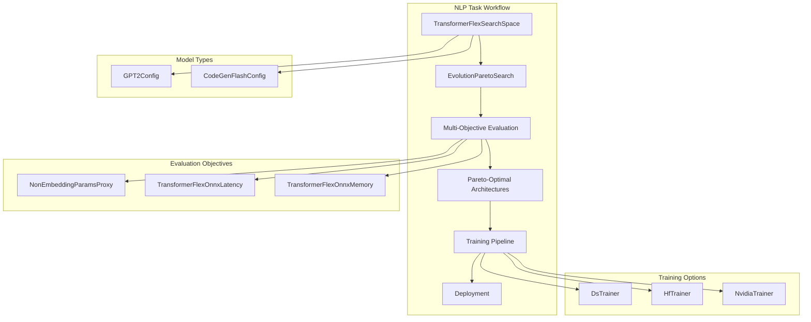
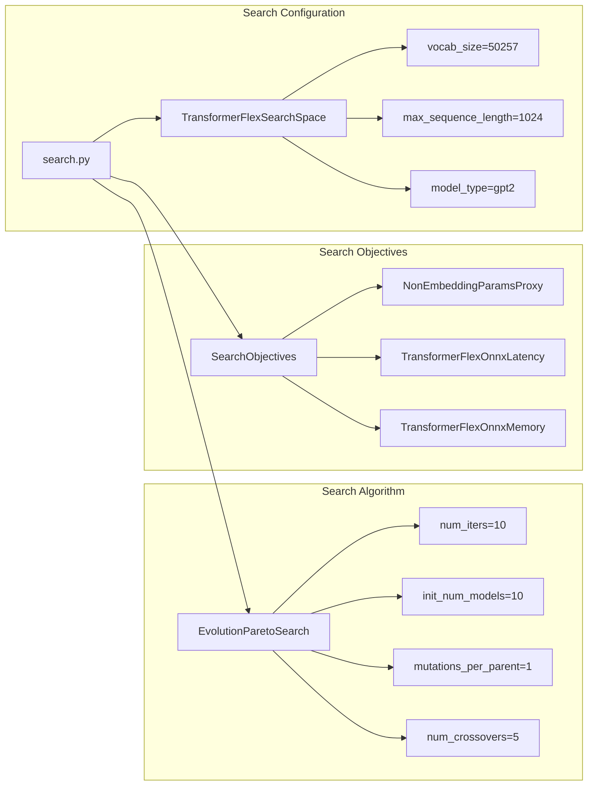
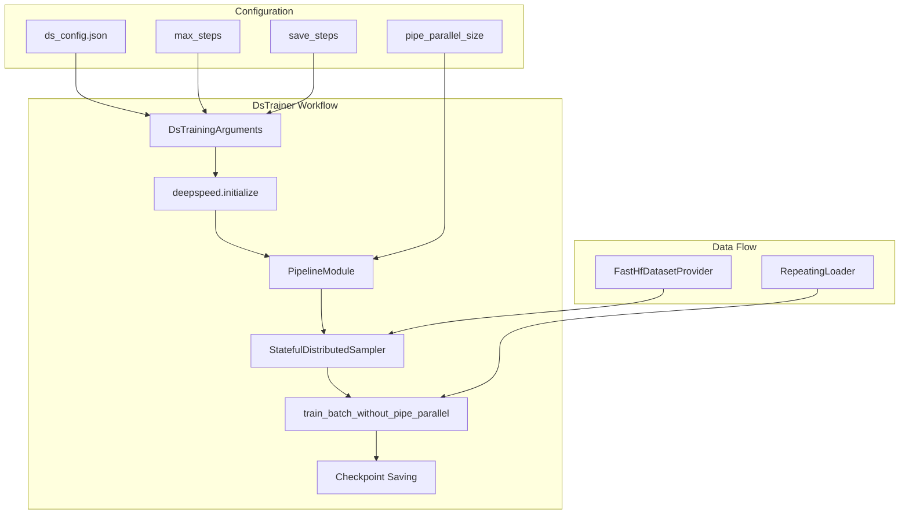
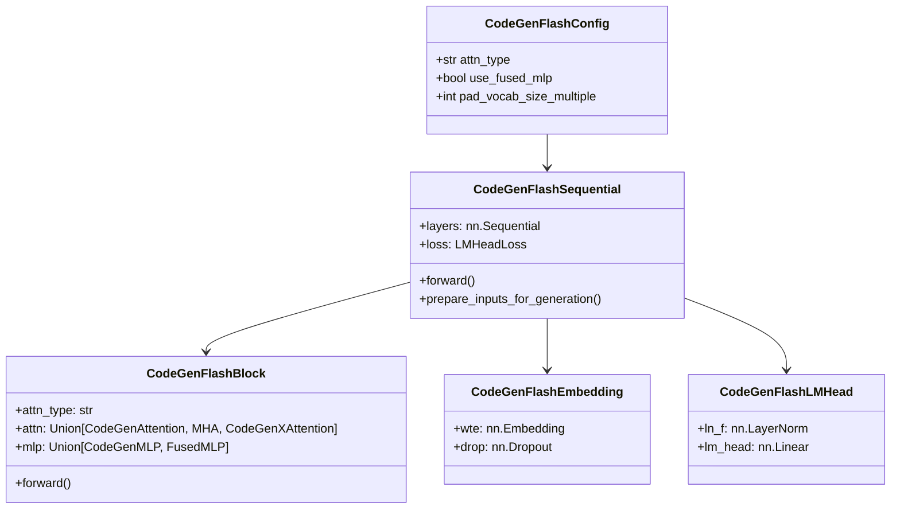
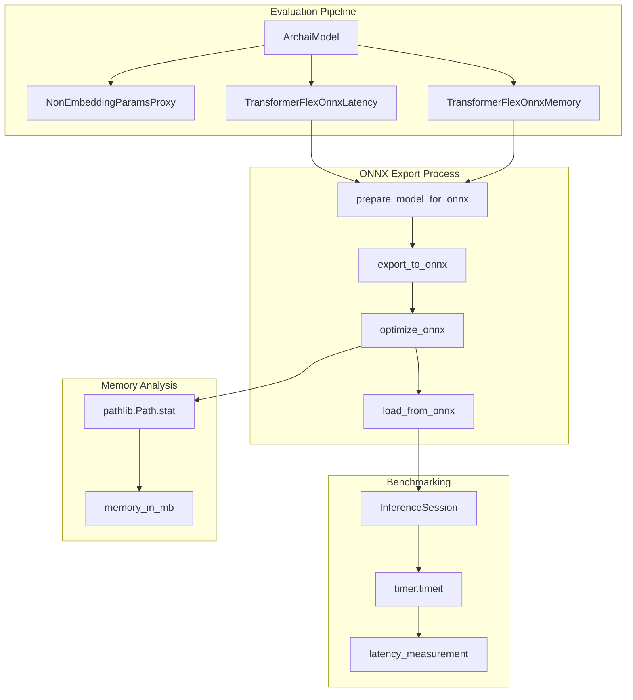

<!-- source: DeepWiki mcp.deepwiki.com · repo microsoft/archai · page 6.2 Natural Language Processing Tasks · fetched 2026-10-26 -->

# Natural Language Processing Tasks

<details>
<summary>Relevant source files</summary>

The following files were used as context for generating this wiki page:

- [archai/discrete_search/evaluators/nlp/__init__.py](archai/discrete_search/evaluators/nlp/__init__.py)
- [archai/discrete_search/evaluators/nlp/parameters.py](archai/discrete_search/evaluators/nlp/parameters.py)
- [archai/discrete_search/evaluators/nlp/transformer_flex_latency.py](archai/discrete_search/evaluators/nlp/transformer_flex_latency.py)
- [archai/discrete_search/evaluators/nlp/transformer_flex_memory.py](archai/discrete_search/evaluators/nlp/transformer_flex_memory.py)
- [archai/discrete_search/search_spaces/nlp/tfpp/modeling_codegen_flash.py](archai/discrete_search/search_spaces/nlp/tfpp/modeling_codegen_flash.py)
- [archai/onnx/__init__.py](archai/onnx/__init__.py)
- [archai/onnx/config_utils/__init__.py](archai/onnx/config_utils/__init__.py)
- [archai/onnx/config_utils/codegen_onnx_config.py](archai/onnx/config_utils/codegen_onnx_config.py)
- [archai/onnx/config_utils/gpt2_onnx_config.py](archai/onnx/config_utils/gpt2_onnx_config.py)
- [archai/onnx/config_utils/onnx_config_base.py](archai/onnx/config_utils/onnx_config_base.py)
- [archai/onnx/export.py](archai/onnx/export.py)
- [archai/onnx/export_utils.py](archai/onnx/export_utils.py)
- [archai/onnx/onnx_forward.py](archai/onnx/onnx_forward.py)
- [archai/onnx/onnx_loader.py](archai/onnx/onnx_loader.py)
- [archai/onnx/optimization.py](archai/onnx/optimization.py)
- [archai/trainers/nlp/ds_trainer.py](archai/trainers/nlp/ds_trainer.py)
- [archai/trainers/nlp/ds_training_args.py](archai/trainers/nlp/ds_training_args.py)
- [docker/Dockerfile.flash](docker/Dockerfile.flash)
- [scripts/eval/README.md](scripts/eval/README.md)
- [scripts/eval/deepspeed/evaluate_human_eval.py](scripts/eval/deepspeed/evaluate_human_eval.py)
- [scripts/eval/hf/evaluate_human_eval.py](scripts/eval/hf/evaluate_human_eval.py)
- [scripts/eval/requirements.txt](scripts/eval/requirements.txt)
- [scripts/trainers/README.md](scripts/trainers/README.md)
- [scripts/trainers/deepspeed/.gitignore](scripts/trainers/deepspeed/.gitignore)
- [scripts/trainers/deepspeed/ds_config.json](scripts/trainers/deepspeed/ds_config.json)
- [scripts/trainers/deepspeed/train_codegen.py](scripts/trainers/deepspeed/train_codegen.py)
- [scripts/trainers/hf/train_codegen.py](scripts/trainers/hf/train_codegen.py)
- [scripts/trainers/hf/train_opt.py](scripts/trainers/hf/train_opt.py)
- [scripts/trainers/nvidia/train_gpt2.py](scripts/trainers/nvidia/train_gpt2.py)
- [setup.cfg](setup.cfg)
- [tasks/text_generation/README.md](tasks/text_generation/README.md)
- [tasks/text_generation/assets/pareto_zero_shot_eval.png](tasks/text_generation/assets/pareto_zero_shot_eval.png)
- [tasks/text_generation/generate_text.py](tasks/text_generation/generate_text.py)
- [tasks/text_generation/search.py](tasks/text_generation/search.py)
- [tasks/text_generation/train.py](tasks/text_generation/train.py)
- [tests/discrete_search/evaluators/nlp/test_parameters.py](tests/discrete_search/evaluators/nlp/test_parameters.py)
- [tests/discrete_search/evaluators/nlp/test_transformer_flex_latency.py](tests/discrete_search/evaluators/nlp/test_transformer_flex_latency.py)
- [tests/discrete_search/evaluators/nlp/test_transformer_flex_memory.py](tests/discrete_search/evaluators/nlp/test_transformer_flex_memory.py)

</details>


This document covers the Natural Language Processing (NLP) capabilities within the Archai framework, focusing on neural architecture search for language models, training infrastructure, and evaluation methods. The primary NLP application is text generation using transformer-based architectures, with support for multi-objective optimization considering accuracy, latency, memory, and parameter efficiency.

For computer vision tasks, see [Computer Vision Tasks](#6.1). For general neural architecture search concepts, see [Neural Architecture Search](#4).

## Overview

Archai's NLP capabilities center around discovering optimal transformer architectures for text generation through the Lightweight Transformer Search (LTS) methodology. The framework supports end-to-end workflows from architecture search to training and deployment, with particular emphasis on finding Pareto-optimal solutions that balance multiple objectives.



**NLP Architecture Search and Training Workflow**

Sources: `tasks/text_generation/search.py:95-140`, `archai/discrete_search/search_spaces/nlp/transformer_flex/search_space.py`, `archai/discrete_search/algos/evolution_pareto.py`

## Text Generation Task

The primary NLP application implements Lightweight Transformer Search (LTS) for discovering efficient text generation architectures. The implementation provides a complete pipeline from architecture search to model deployment.

### Architecture Search Configuration

The text generation task uses `TransformerFlexSearchSpace` with `EvolutionParetoSearch` to find architectures optimized for multiple objectives:



**Text Generation Search Configuration**

The search process configures three main objectives with specific constraints:

| Objective | Evaluator Class | Constraint Range | Purpose |
|-----------|----------------|------------------|---------|
| Parameters | `NonEmbeddingParamsProxy` | 1M - 1B | Proxy for model complexity |
| Latency | `TransformerFlexOnnxLatency` | Lower is better | ONNX inference speed |
| Memory | `TransformerFlexOnnxMemory` | Lower is better | ONNX model size |

Sources: `tasks/text_generation/search.py:105-124`, `archai/discrete_search/evaluators/nlp/parameters.py:13-47`, `archai/discrete_search/evaluators/nlp/transformer_flex_latency.py:29-147`

### Model Gallery Results

The LTS process produces a gallery of Pareto-optimal architectures with varying trade-offs. The search results demonstrate architectures ranging from 1.06M to 49.85M non-embedding parameters, with corresponding latency measurements from 0.008s to 0.230s.

Notable results include `gpt2_ddf63c1125f1fed5a7dd3537f640834187719996` with 13.32M parameters achieving competitive performance with only one-third the resources of larger models.

Sources: `tasks/text_generation/README.md:9-31`

### Training Pipeline

The discovered architectures can be trained using multiple backends. The training process loads Pareto-optimal configurations and applies standard language modeling training:

```python
# Example configuration loading
with open(args.pareto_config_path, "r") as f:
    pareto_config = json.load(f)

config = GPT2Config(n_positions=1024, bos_token_id=0, eos_token_id=0, **pareto_config)
model = GPT2LMHeadModel(config=config)
```

The training script supports both pre-encoded datasets for efficiency and direct dataset loading through `HfDiskDatasetProvider` or `HfHubDatasetProvider`.

Sources: `tasks/text_generation/train.py:66-71`, `tasks/text_generation/train.py:89-98`

## Training Infrastructure

Archai provides multiple training backends to support different scales and deployment scenarios for NLP models.

### DeepSpeed Integration

The `DsTrainer` class provides DeepSpeed integration for large-scale distributed training with features including:

- **Pipeline Parallelism**: Automatic model partitioning across devices
- **Zero Redundancy Optimizer**: Memory-efficient training with ZeRO stages
- **Mixed Precision**: FP16 training with automatic scaling
- **Gradient Accumulation**: Configurable micro-batching



**DeepSpeed Training Architecture**

The `DsTrainer` handles both pipeline and data parallel training modes, with automatic checkpoint management and MLflow integration for experiment tracking.

Sources: `archai/trainers/nlp/ds_trainer.py:73-141`, `archai/trainers/nlp/ds_training_args.py:15-76`, `scripts/trainers/deepspeed/train_codegen.py:124-143`

### HuggingFace Trainer Integration

The framework provides `HfTrainer` for standard transformer training workflows with seamless integration to the HuggingFace ecosystem:

```python
trainer = HfTrainer(
    model=model,
    args=training_args,
    data_collator=collator,
    train_dataset=encoded_train_dataset,
    eval_dataset=encoded_val_dataset,
)
```

Sources: `tasks/text_generation/train.py:89-95`, `scripts/trainers/hf/train_codegen.py:95-103`

## Model Architectures

### CodeGen Flash Implementation

The `CodeGenFlashSequential` model provides an optimized implementation with multiple attention backends and fused operations:



**CodeGen Flash Model Architecture**

The implementation supports three attention types:
- **default**: Standard `CodeGenAttention`
- **flash**: Optimized `MHA` with flash attention
- **xformers**: Memory-efficient attention via `CodeGenXAttention`

The model architecture enables efficient training and inference through fused operations and optimized attention mechanisms.

Sources: `archai/discrete_search/search_spaces/nlp/tfpp/modeling_codegen_flash.py:23-44`, `archai/discrete_search/search_spaces/nlp/tfpp/modeling_codegen_flash.py:120-177`, `archai/discrete_search/search_spaces/nlp/tfpp/modeling_codegen_flash.py:210-248`

## Evaluation Framework

### Multi-Objective Evaluation

The NLP evaluation framework implements several specialized evaluators for assessing transformer architectures:



**NLP Model Evaluation Workflow**

### Parameter Counting

The `NonEmbeddingParamsProxy` evaluator counts trainable parameters excluding embedding layers, serving as a proxy for model perplexity:

```python
def evaluate(self, model: ArchaiModel, budget: Optional[float] = None) -> float:
    total_params = sum(
        param.numel() for param in model.arch.parameters() if not self.trainable_only or param.requires_grad
    )
    
    embed_params = sum(
        sum(param.numel() for param in module.parameters())
        for module in model.arch.modules()
        if isinstance(module, tuple(self.exclude_cls))
    )
    
    return total_params - embed_params
```

Sources: `archai/discrete_search/evaluators/nlp/parameters.py:35-47`

### ONNX-Based Performance Evaluation

The framework provides ONNX-based latency and memory evaluation for deployment-focused optimization:

- **`TransformerFlexOnnxLatency`**: Measures inference latency using ONNX Runtime
- **`TransformerFlexOnnxMemory`**: Calculates model file size after ONNX export and optimization

Both evaluators support GPU acceleration and various optimization levels.

Sources: `archai/discrete_search/evaluators/nlp/transformer_flex_latency.py:89-147`, `archai/discrete_search/evaluators/nlp/transformer_flex_memory.py:70-96`

### HumanEval Code Generation Assessment

For code generation tasks, the framework integrates HumanEval evaluation:

```python
results = evaluate(
    lm=hf_model,
    task_dict={
        "human_eval": HumanEval(
            n_samples=args.n_samples,
            temperature=args.temperature,
            pass_at_k=args.pass_at_k,
        )
    },
)
```

Sources: `scripts/eval/deepspeed/evaluate_human_eval.py:119-128`, `scripts/eval/hf/evaluate_human_eval.py:91-100`

## Data Processing

### Fast Dataset Providers

The `FastHfDatasetProvider` enables efficient dataset loading and preprocessing for large-scale training:

```python
dataset_provider = FastHfDatasetProvider.from_hub(
    "wikitext",
    dataset_config_name="wikitext-103-raw-v1",
    tokenizer=tokenizer,
)
train_dataset = dataset_provider.get_train_dataset(seq_len=2048)
```

The provider supports caching, distributed loading, and automatic tokenization for improved training efficiency.

Sources: `scripts/trainers/deepspeed/train_codegen.py:92-98`, `scripts/trainers/hf/train_codegen.py:60-67`

## Text Generation and Deployment

### Inference Pipeline

The framework supports text generation using discovered architectures through the standard HuggingFace interface:

```python
model = AutoModelForCausalLM.from_pretrained(
    args.pre_trained_model_path, 
    subfolder=args.pre_trained_model_subfolder
)
outputs = model.generate(
    inputs["input_ids"],
    attention_mask=inputs["attention_mask"],
    do_sample=True,
    temperature=0.8,
    top_p=0.95,
    max_new_tokens=128,
)
```

### ONNX Export and Optimization

Models can be exported to ONNX format for deployment optimization with support for:
- Weight sharing between embedding and output layers
- Graph optimization using ONNX Runtime
- Multiple precision formats (FP16, INT32)

Sources: `tasks/text_generation/generate_text.py:34-48`, `archai/onnx/export.py:112-174`, `archai/onnx/optimization.py:20-102`

---

