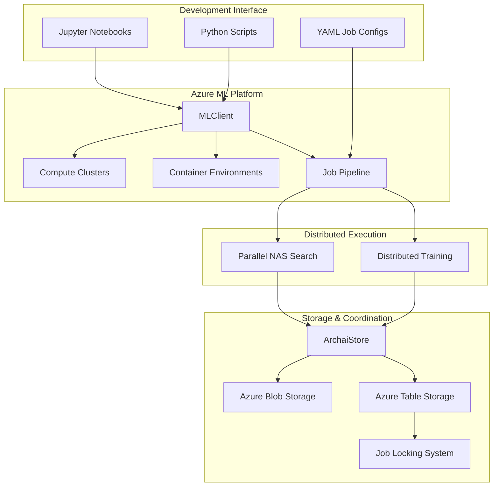
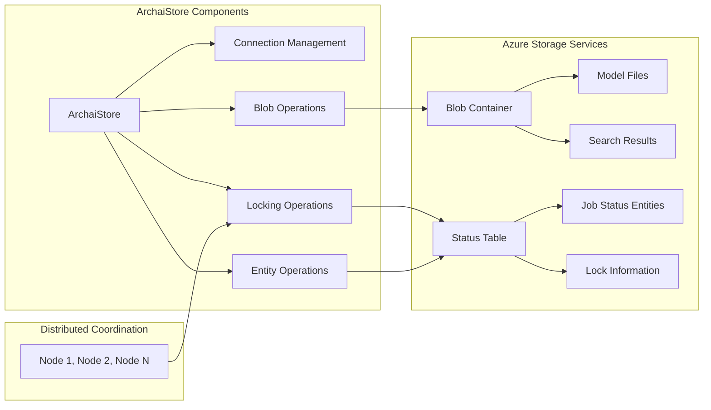
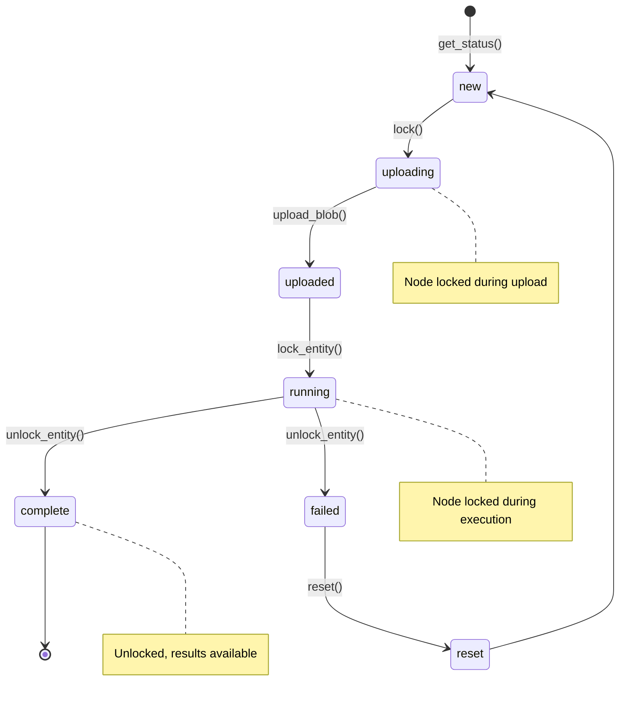
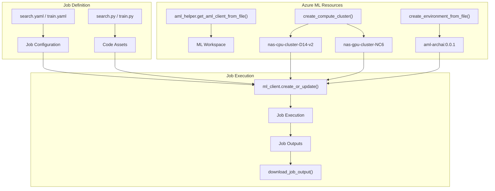
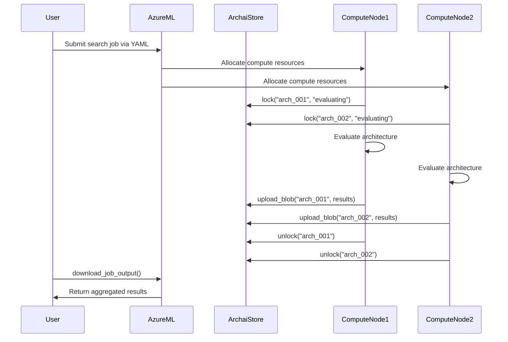
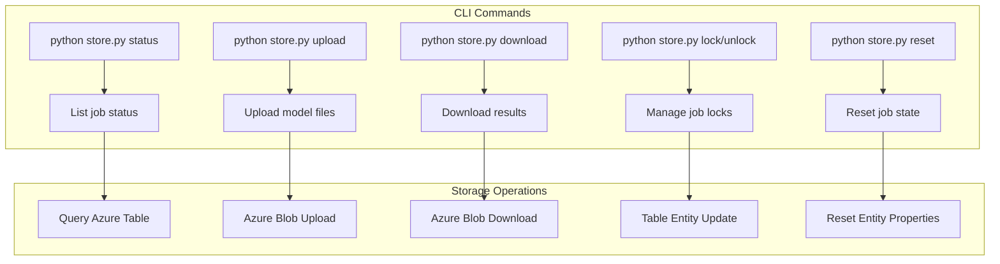

<!-- source: DeepWiki mcp.deepwiki.com · repo microsoft/archai · page 7 Cloud and Distributed Computing · fetched 2026-10-26 -->

# Cloud and Distributed Computing

<details>
<summary>Relevant source files</summary>

The following files were used as context for generating this wiki page:

- [archai/common/store.py](archai/common/store.py)
- [docs/advanced_guide/cloud/azure/notebooks/quickstart/conda.yaml](docs/advanced_guide/cloud/azure/notebooks/quickstart/conda.yaml)
- [docs/advanced_guide/cloud/azure/notebooks/quickstart/main.py](docs/advanced_guide/cloud/azure/notebooks/quickstart/main.py)
- [docs/advanced_guide/cloud/azure/notebooks/quickstart/quickstart.ipynb](docs/advanced_guide/cloud/azure/notebooks/quickstart/quickstart.ipynb)
- [docs/advanced_guide/cloud/azure/notebooks/text_generation/conda.yaml](docs/advanced_guide/cloud/azure/notebooks/text_generation/conda.yaml)
- [docs/advanced_guide/cloud/azure/notebooks/text_generation/src/generate_text.py](docs/advanced_guide/cloud/azure/notebooks/text_generation/src/generate_text.py)
- [docs/advanced_guide/cloud/azure/notebooks/text_generation/src/generate_text.yaml](docs/advanced_guide/cloud/azure/notebooks/text_generation/src/generate_text.yaml)
- [docs/advanced_guide/cloud/azure/notebooks/text_generation/src/search.py](docs/advanced_guide/cloud/azure/notebooks/text_generation/src/search.py)
- [docs/advanced_guide/cloud/azure/notebooks/text_generation/src/search.yaml](docs/advanced_guide/cloud/azure/notebooks/text_generation/src/search.yaml)
- [docs/advanced_guide/cloud/azure/notebooks/text_generation/src/train.py](docs/advanced_guide/cloud/azure/notebooks/text_generation/src/train.py)
- [docs/advanced_guide/cloud/azure/notebooks/text_generation/src/train.yaml](docs/advanced_guide/cloud/azure/notebooks/text_generation/src/train.yaml)
- [docs/advanced_guide/cloud/azure/notebooks/text_generation/text_generation.ipynb](docs/advanced_guide/cloud/azure/notebooks/text_generation/text_generation.ipynb)
- [tests/common/test_store.py](tests/common/test_store.py)

</details>


This document covers Archai's cloud computing and distributed execution capabilities, focusing on Azure Machine Learning integration, distributed storage systems, and job coordination mechanisms. These features enable researchers to scale Neural Architecture Search experiments across multiple compute resources and manage large-scale distributed workloads.

For information about the core NAS algorithms that can be distributed using these systems, see [Search Algorithms](#4.1). For details about local training infrastructure, see [Training Infrastructure](#5.2). For specific cloud-enabled applications, see [Tasks and Applications](#6).

## Architecture Overview

Archai's cloud and distributed computing system is built around three main components: Azure ML integration for compute orchestration, a distributed storage system for job coordination, and mechanisms for parallel execution across multiple nodes.



Sources: [archai/common/store.py:1-737](), [docs/advanced_guide/cloud/azure/notebooks/quickstart/quickstart.ipynb:1-567](), [docs/advanced_guide/cloud/azure/notebooks/text_generation/text_generation.ipynb:1-559]()

## Core Storage and Coordination System

The `ArchaiStore` class provides the foundation for distributed job coordination by combining Azure Blob Storage for artifacts with Azure Table Storage for job status management and distributed locking.



The `ArchaiStore` implements a distributed job queue system where each job corresponds to a row in the Azure Table Storage with associated files in Blob Storage. The system uses node-based locking to coordinate work across multiple machines.

Sources: [archai/common/store.py:23-737](), [archai/common/store.py:290-363]()

## Job Lifecycle and State Management

Jobs in the distributed system follow a well-defined lifecycle managed through the table storage entities, with atomic operations ensuring consistency across distributed workers.



The state transitions are managed through key methods in `ArchaiStore`:
- `get_status()` creates or retrieves job entities
- `lock()` and `unlock()` provide distributed coordination  
- `upload_blob()` and `download()` handle artifact management
- `update_status_entity()` tracks job progress

Sources: [archai/common/store.py:170-258](), [archai/common/store.py:290-363](), [archai/common/store.py:274-289]()

## Azure ML Integration Workflow

The Azure ML integration provides a complete workflow for submitting and managing distributed NAS experiments through programmatic APIs and declarative YAML configurations.



Sources: [docs/advanced_guide/cloud/azure/notebooks/quickstart/quickstart.ipynb:69-286](), [docs/advanced_guide/cloud/azure/notebooks/text_generation/src/search.yaml:1-29](), [docs/advanced_guide/cloud/azure/notebooks/text_generation/src/train.yaml:1-17]()

## Distributed Search Execution Example

A typical distributed NAS workflow combines the storage coordination system with Azure ML's compute resources to enable parallel architecture evaluation across multiple nodes.



This pattern enables fault-tolerant distributed execution where nodes can crash and restart without losing work, as the locking mechanism in `ArchaiStore` prevents duplicate work and enables recovery.

Sources: [docs/advanced_guide/cloud/azure/notebooks/quickstart/main.py:1-56](), [docs/advanced_guide/cloud/azure/notebooks/text_generation/src/search.py:1-132](), [archai/common/store.py:290-315]()

## Configuration and Environment Management

Cloud deployments use standardized configuration patterns to ensure reproducible execution across different environments and compute targets.

| Component | Configuration File | Purpose |
|-----------|-------------------|---------|
| Conda Environment | `conda.yaml` | Python dependencies and package versions |
| Search Job | `search.yaml` | NAS algorithm parameters and compute resources |
| Training Job | `train.yaml` | Model training configuration and GPU allocation |
| Azure ML Workspace | `config.json` | Workspace connection and authentication |

The environment specification in `conda.yaml` ensures consistent package versions across all compute nodes:

```yaml
name: nas-env
channels:
  - conda-forge
dependencies:
  - python=3.10
  - pip
  - pip:
    - "archai[cv,nlp] @ git+https://github.com/microsoft/archai.git"
```

Sources: [docs/advanced_guide/cloud/azure/notebooks/quickstart/conda.yaml:1-8](), [docs/advanced_guide/cloud/azure/notebooks/text_generation/conda.yaml:1-8](), [docs/advanced_guide/cloud/azure/notebooks/text_generation/src/search.yaml:1-29]()

## Command-Line Interface for Storage Operations

The `ArchaiStore` provides a comprehensive command-line interface for managing distributed jobs and artifacts, enabling both programmatic and manual interaction with the storage system.



The CLI supports operations like `python store.py status --locked` to find locked jobs, `python store.py upload model.onnx` to upload artifacts, and `python store.py unlock --node nodename` to release locks from failed nodes.

Sources: [archai/common/store.py:569-736](), [archai/common/store.py:600-627](), [archai/common/store.py:654-691]()

## Testing and Validation

The distributed storage system includes comprehensive tests that validate the core coordination mechanisms using real Azure Storage services.

Key test scenarios in `test_store()` include:
- Entity lifecycle management through `get_status()` and `update_status_entity()`
- Blob upload/download operations via `upload_blob()` and `download()`
- Distributed locking behavior with `lock()`, `unlock()`, and lock ownership checks
- Concurrent access patterns and conflict resolution

Sources: [tests/common/test_store.py:1-72](), [tests/common/test_store.py:44-63]()

# Cloud and Distributed Computing

This document covers Archai's cloud computing and distributed execution capabilities, focusing on Azure Machine Learning integration, distributed storage systems, and job coordination mechanisms. These features enable researchers to scale Neural Architecture Search experiments across multiple compute resources and manage large-scale distributed workloads.

For information about the core NAS algorithms that can be distributed using these systems, see [Search Algorithms](#4.1). For details about local training infrastructure, see [Training Infrastructure](#5.2). For specific cloud-enabled applications, see [Tasks and Applications](#6).

## Architecture Overview

Archai's cloud and distributed computing system is built around three main components: Azure ML integration for compute orchestration, a distributed storage system for job coordination, and mechanisms for parallel execution across multiple nodes.

**High-Level Cloud Architecture**


Sources: [archai/common/store.py:1-737](), [docs/advanced_guide/cloud/azure/notebooks/quickstart/quickstart.ipynb:1-567](), [docs/advanced_guide/cloud/azure/notebooks/text_generation/text_generation.ipynb:1-559]()

## Core Storage and Coordination System

The `ArchaiStore` class provides the foundation for distributed job coordination by combining Azure Blob Storage for artifacts with Azure Table Storage for job status management and distributed locking.

**ArchaiStore Component Architecture**


The `ArchaiStore` implements a distributed job queue system where each job corresponds to a row in the Azure Table Storage with associated files in Blob Storage. The system uses node-based locking to coordinate work across multiple machines.

Sources: [archai/common/store.py:23-737](), [archai/common/store.py:290-363]()

## Job Lifecycle and State Management

Jobs in the distributed system follow a well-defined lifecycle managed through the table storage entities, with atomic operations ensuring consistency across distributed workers.

**Job State Transition Diagram**


The state transitions are managed through key methods in `ArchaiStore`:
- `get_status()` creates or retrieves job entities
- `lock()` and `unlock()` provide distributed coordination  
- `upload_blob()` and `download()` handle artifact management
- `update_status_entity()` tracks job progress

Sources: [archai/common/store.py:170-258](), [archai/common/store.py:290-363](), [archai/common/store.py:274-289]()

## Azure ML Integration Workflow

The Azure ML integration provides a complete workflow for submitting and managing distributed NAS experiments through programmatic APIs and declarative YAML configurations.

**Azure ML Job Submission Flow**


Sources: [docs/advanced_guide/cloud/azure/notebooks/quickstart/quickstart.ipynb:69-286](), [docs/advanced_guide/cloud/azure/notebooks/text_generation/src/search.yaml:1-29](), [docs/advanced_guide/cloud/azure/notebooks/text_generation/src/train.yaml:1-17]()

## Distributed Search Execution Example

A typical distributed NAS workflow combines the storage coordination system with Azure ML's compute resources to enable parallel architecture evaluation across multiple nodes.

**Distributed NAS Execution Sequence**


This pattern enables fault-tolerant distributed execution where nodes can crash and restart without losing work, as the locking mechanism in `ArchaiStore` prevents duplicate work and enables recovery.

Sources: [docs/advanced_guide/cloud/azure/notebooks/quickstart/main.py:1-56](), [docs/advanced_guide/cloud/azure/notebooks/text_generation/src/search.py:1-132](), [archai/common/store.py:290-315]()

## Configuration and Environment Management

Cloud deployments use standardized configuration patterns to ensure reproducible execution across different environments and compute targets.

| Component | Configuration File | Purpose |
|-----------|-------------------|---------|
| Conda Environment | `conda.yaml` | Python dependencies and package versions |
| Search Job | `search.yaml` | NAS algorithm parameters and compute resources |
| Training Job | `train.yaml` | Model training configuration and GPU allocation |
| Azure ML Workspace | `config.json` | Workspace connection and authentication |

The environment specification in `conda.yaml` ensures consistent package versions across all compute nodes:

```yaml
name: nas-env
channels:
  - conda-forge
dependencies:
  - python=3.10
  - pip
  - pip:
    - "archai[cv,nlp] @ git+https://github.com/microsoft/archai.git"
```

Sources: [docs/advanced_guide/cloud/azure/notebooks/quickstart/conda.yaml:1-8](), [docs/advanced_guide/cloud/azure/notebooks/text_generation/conda.yaml:1-8](), [docs/advanced_guide/cloud/azure/notebooks/text_generation/src/search.yaml:1-29]()

## Command-Line Interface for Storage Operations

The `ArchaiStore` provides a comprehensive command-line interface for managing distributed jobs and artifacts, enabling both programmatic and manual interaction with the storage system.

**Storage CLI Command Structure**


The CLI supports operations like `python store.py status --locked` to find locked jobs, `python store.py upload model.onnx` to upload artifacts, and `python store.py unlock --node nodename` to release locks from failed nodes.

Sources: [archai/common/store.py:569-736](), [archai/common/store.py:600-627](), [archai/common/store.py:654-691]()

## Testing and Validation

The distributed storage system includes comprehensive tests that validate the core coordination mechanisms using real Azure Storage services.

Key test scenarios in `test_store()` include:
- Entity lifecycle management through `get_status()` and `update_status_entity()`
- Blob upload/download operations via `upload_blob()` and `download()`
- Distributed locking behavior with `lock()`, `unlock()`, and lock ownership checks
- Concurrent access patterns and conflict resolution

Sources: [tests/common/test_store.py:1-72](), [tests/common/test_store.py:44-63]()

---

