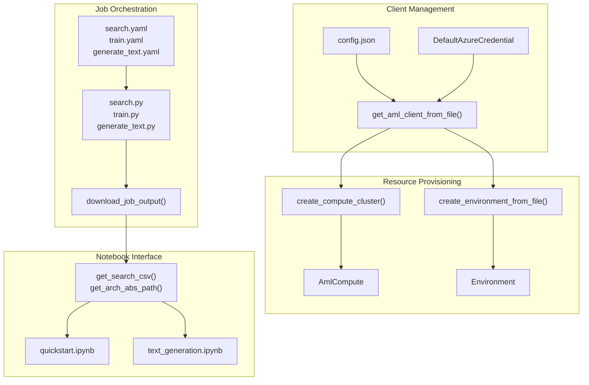
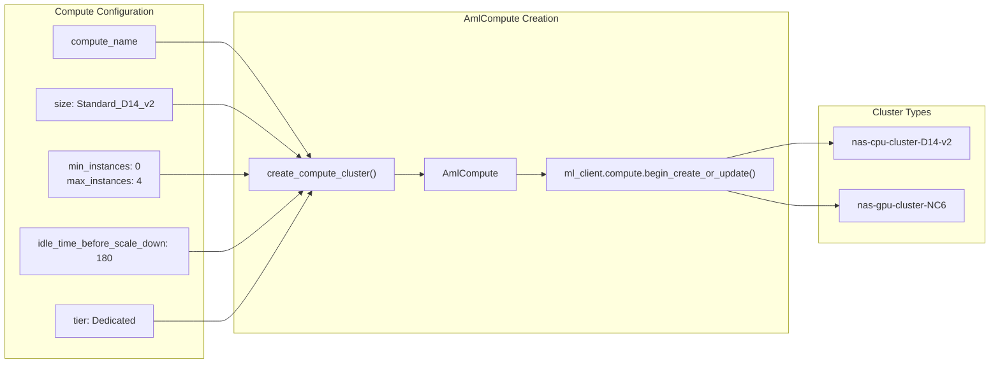
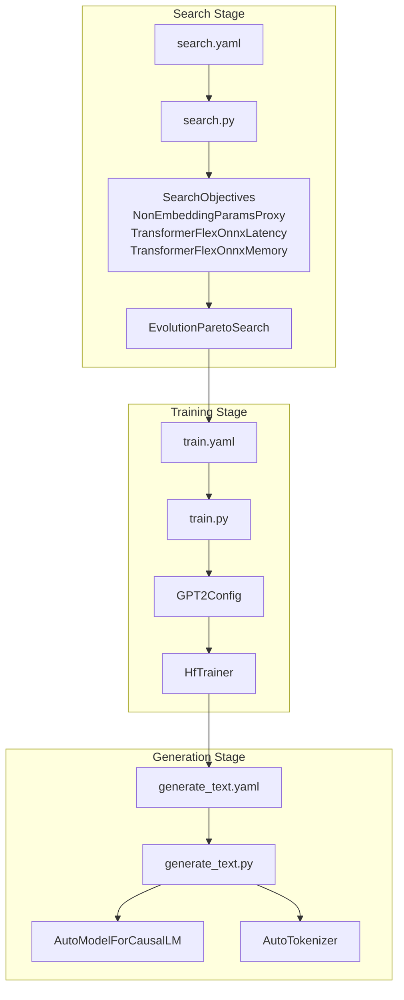
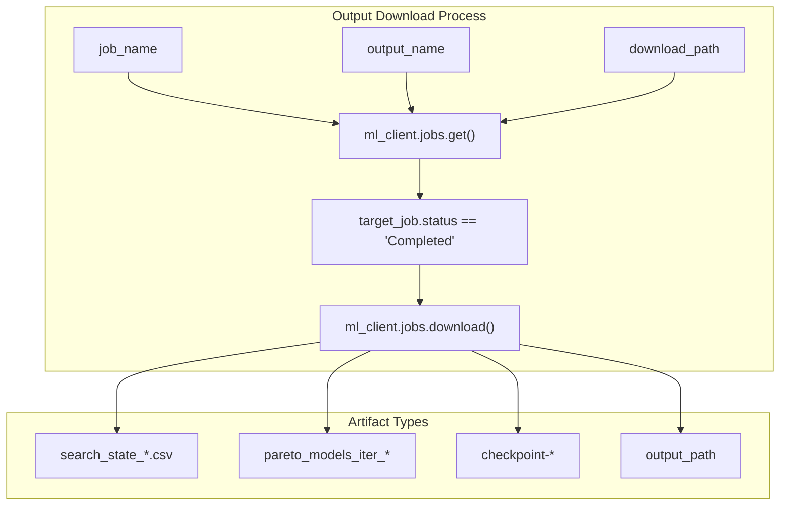
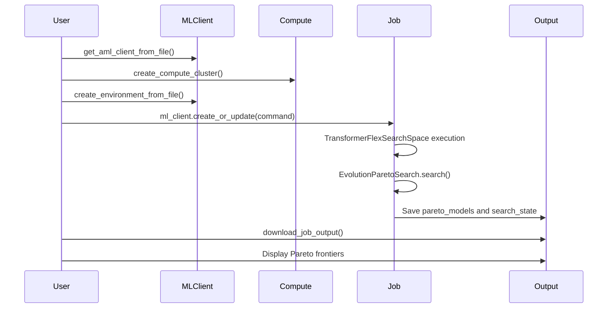

<!-- source: DeepWiki mcp.deepwiki.com · repo microsoft/archai · page 7.1 Azure ML Integration · fetched 2026-10-26 -->

# Azure ML Integration

<details>
<summary>Relevant source files</summary>

The following files were used as context for generating this wiki page:

- [archai/common/azureml_helper.py](archai/common/azureml_helper.py)
- [archai/common/notebook_helper.py](archai/common/notebook_helper.py)
- [docs/advanced_guide/cloud/azure/notebooks/quickstart/conda.yaml](docs/advanced_guide/cloud/azure/notebooks/quickstart/conda.yaml)
- [docs/advanced_guide/cloud/azure/notebooks/quickstart/main.py](docs/advanced_guide/cloud/azure/notebooks/quickstart/main.py)
- [docs/advanced_guide/cloud/azure/notebooks/quickstart/quickstart.ipynb](docs/advanced_guide/cloud/azure/notebooks/quickstart/quickstart.ipynb)
- [docs/advanced_guide/cloud/azure/notebooks/text_generation/conda.yaml](docs/advanced_guide/cloud/azure/notebooks/text_generation/conda.yaml)
- [docs/advanced_guide/cloud/azure/notebooks/text_generation/src/generate_text.py](docs/advanced_guide/cloud/azure/notebooks/text_generation/src/generate_text.py)
- [docs/advanced_guide/cloud/azure/notebooks/text_generation/src/generate_text.yaml](docs/advanced_guide/cloud/azure/notebooks/text_generation/src/generate_text.yaml)
- [docs/advanced_guide/cloud/azure/notebooks/text_generation/src/search.py](docs/advanced_guide/cloud/azure/notebooks/text_generation/src/search.py)
- [docs/advanced_guide/cloud/azure/notebooks/text_generation/src/search.yaml](docs/advanced_guide/cloud/azure/notebooks/text_generation/src/search.yaml)
- [docs/advanced_guide/cloud/azure/notebooks/text_generation/src/train.py](docs/advanced_guide/cloud/azure/notebooks/text_generation/src/train.py)
- [docs/advanced_guide/cloud/azure/notebooks/text_generation/src/train.yaml](docs/advanced_guide/cloud/azure/notebooks/text_generation/src/train.yaml)
- [docs/advanced_guide/cloud/azure/notebooks/text_generation/text_generation.ipynb](docs/advanced_guide/cloud/azure/notebooks/text_generation/text_generation.ipynb)

</details>


This document covers Archai's integration with Azure Machine Learning (Azure ML) for distributed neural architecture search workloads. The integration provides compute orchestration, job management, environment provisioning, and result collection capabilities for running NAS experiments at scale in the cloud.

For storage and state management components that work with Azure ML, see [Storage and State Management](#7.2). For distributed training implementations, see [Distributed Training and Execution](#7.3).

## Core Integration Components

The Azure ML integration is built around several key components that handle different aspects of cloud-based NAS execution:



Sources: [archai/common/azureml_helper.py:11-27](), [archai/common/azureml_helper.py:30-73](), [archai/common/azureml_helper.py:76-116](), [archai/common/notebook_helper.py:9-28]()

## Client Authentication and Configuration

Azure ML operations are managed through the `MLClient` interface, with authentication handled via Azure's default credential chain:

| Component | Function | Location |
|-----------|----------|----------|
| **MLClient Factory** | `get_aml_client_from_file()` | [archai/common/azureml_helper.py:11-27]() |
| **Credential Provider** | `DefaultAzureCredential` | [archai/common/azureml_helper.py:20]() |
| **Configuration Source** | `config.json` workspace file | [docs/advanced_guide/cloud/azure/notebooks/quickstart/quickstart.ipynb:69]() |

The client factory creates authenticated connections to Azure ML workspaces using configuration files that specify subscription, resource group, and workspace details.

Sources: [archai/common/azureml_helper.py:11-27](), [docs/advanced_guide/cloud/azure/notebooks/quickstart/quickstart.ipynb:69-71]()

## Compute and Environment Management

### Compute Cluster Provisioning

Azure ML compute clusters are provisioned dynamically with configurable specifications:



Sources: [archai/common/azureml_helper.py:30-73](), [docs/advanced_guide/cloud/azure/notebooks/text_generation/text_generation.ipynb:111-115]()

### Environment Configuration

Environments are created from Conda specifications with base Docker images:

| Parameter | Default Value | Purpose |
|-----------|---------------|---------|
| **custom_env_name** | `"aml-archai"` | Environment identifier |
| **conda_file** | `"conda.yaml"` | Dependency specification |
| **image** | `"mcr.microsoft.com/azureml/openmpi3.1.2-ubuntu18.04:latest"` | Base Docker image |
| **version** | `"0.1.0"` | Environment version |

The environment creation process uses the `Environment` entity with Conda file specifications that include Archai installation with optional dependencies:

```yaml
name: nas-env
channels:
  - conda-forge
dependencies:
  - python=3.10
  - pip
  - pip:
    - "archai[cv,nlp] @ git+https://github.com/microsoft/archai.git"
```

Sources: [archai/common/azureml_helper.py:76-116](), [docs/advanced_guide/cloud/azure/notebooks/quickstart/conda.yaml:1-8]()

## Job Workflow Orchestration

### NAS Pipeline Components

The Azure ML integration supports multi-stage NAS workflows through YAML job definitions and corresponding Python execution scripts:



Sources: [docs/advanced_guide/cloud/azure/notebooks/text_generation/src/search.yaml:1-29](), [docs/advanced_guide/cloud/azure/notebooks/text_generation/src/search.py:91-131](), [docs/advanced_guide/cloud/azure/notebooks/text_generation/src/train.py:36-89]()

### Job Parameter Configuration

Each job stage accepts configurable parameters through Azure ML's input system:

**Search Stage Parameters:**
- `model_type`: Model architecture type (e.g., "gpt2")
- `num_iters`: Number of search iterations 
- `init_num_models`: Initial population size
- `max_unseen_population`: Maximum unseen models per iteration
- `mutations_per_parent`: Mutations generated per Pareto member
- `num_crossovers`: Crossovers generated per iteration

**Training Stage Parameters:**
- `arch_config_path`: Path to architecture configuration file
- `output_dir`: Training output directory

**Generation Stage Parameters:**
- `pre_trained_model_path`: Path to trained model
- `hub_tokenizer_path`: Hugging Face tokenizer identifier
- `prompt`: Text generation prompt

Sources: [docs/advanced_guide/cloud/azure/notebooks/text_generation/src/search.yaml:4-12](), [docs/advanced_guide/cloud/azure/notebooks/text_generation/src/train.yaml:4-7](), [docs/advanced_guide/cloud/azure/notebooks/text_generation/src/generate_text.yaml:4-9]()

## Output and Artifact Management

### Job Output Collection

Azure ML job outputs are collected through the `download_job_output()` function, which handles job completion verification and artifact retrieval:



Sources: [archai/common/azureml_helper.py:120-145](), [archai/common/notebook_helper.py:9-28]()

### Notebook Integration Helpers

The `notebook_helper` module provides utilities for processing downloaded artifacts in Jupyter environments:

| Function | Purpose | Key Parameters |
|----------|---------|----------------|
| `get_search_csv()` | Extracts search state from CSV files | `output_path`, `iteration_num` |
| `get_arch_abs_path()` | Resolves architecture file paths | `archid`, `downloaded_folder`, `iteration_num` |

These functions automatically locate the latest iteration results when `iteration_num=-1` is specified, supporting iterative NAS workflows.

Sources: [archai/common/notebook_helper.py:9-28](), [archai/common/notebook_helper.py:31-51]()

## Example Workflow Implementation

### Quickstart Example

The quickstart notebook demonstrates a basic NAS workflow using Azure ML:



The quickstart executes a simplified NAS workflow with `TransformerFlexSearchSpace`, `EvolutionParetoSearch`, and multi-objective optimization using `NonEmbeddingParamsProxy`, `TransformerFlexOnnxLatency`, and `TransformerFlexOnnxMemory` evaluators.

Sources: [docs/advanced_guide/cloud/azure/notebooks/quickstart/quickstart.ipynb:202-211](), [docs/advanced_guide/cloud/azure/notebooks/quickstart/main.py:10-54]()

### Text Generation Pipeline

The text generation notebook implements a complete three-stage pipeline:

1. **Architecture Search**: Uses `EvolutionParetoSearch` with `TransformerFlexSearchSpace`
2. **Model Training**: Employs `HfTrainer` with `GPT2LMHeadModel` 
3. **Text Generation**: Utilizes `AutoModelForCausalLM` for inference

Each stage operates as an independent Azure ML job with defined inputs and outputs, enabling modular execution and result sharing between stages.

Sources: [docs/advanced_guide/cloud/azure/notebooks/text_generation/text_generation.ipynb:205-207](), [docs/advanced_guide/cloud/azure/notebooks/text_generation/src/search.py:117-131](), [docs/advanced_guide/cloud/azure/notebooks/text_generation/src/train.py:79-89]()

---

