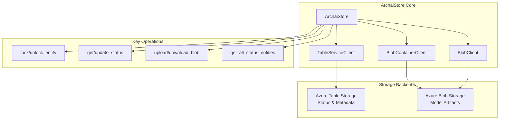
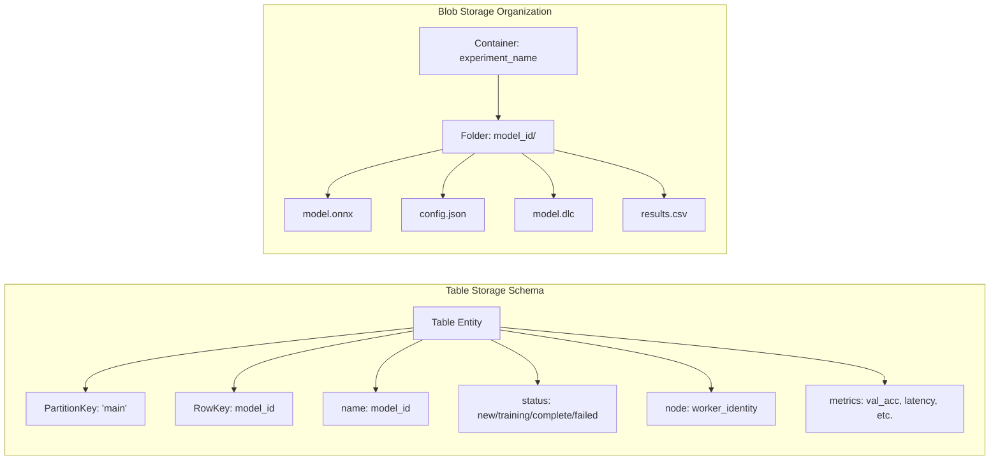
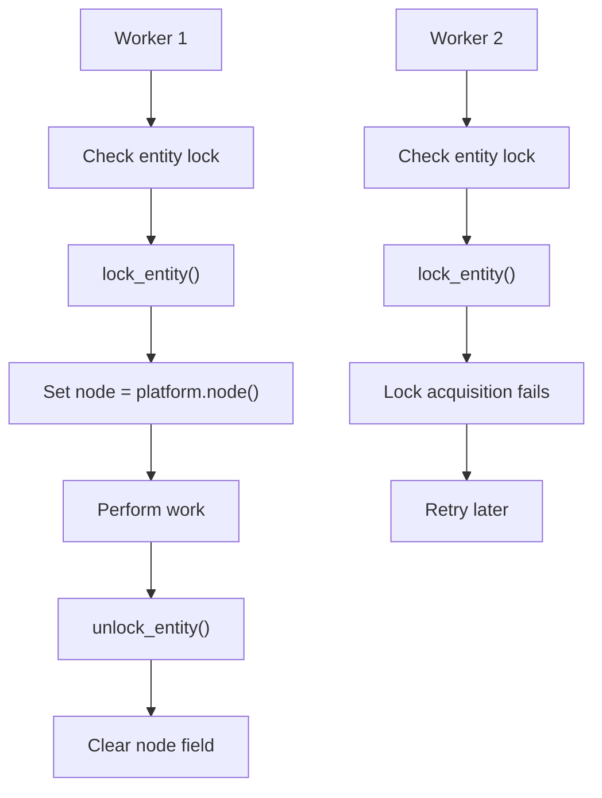
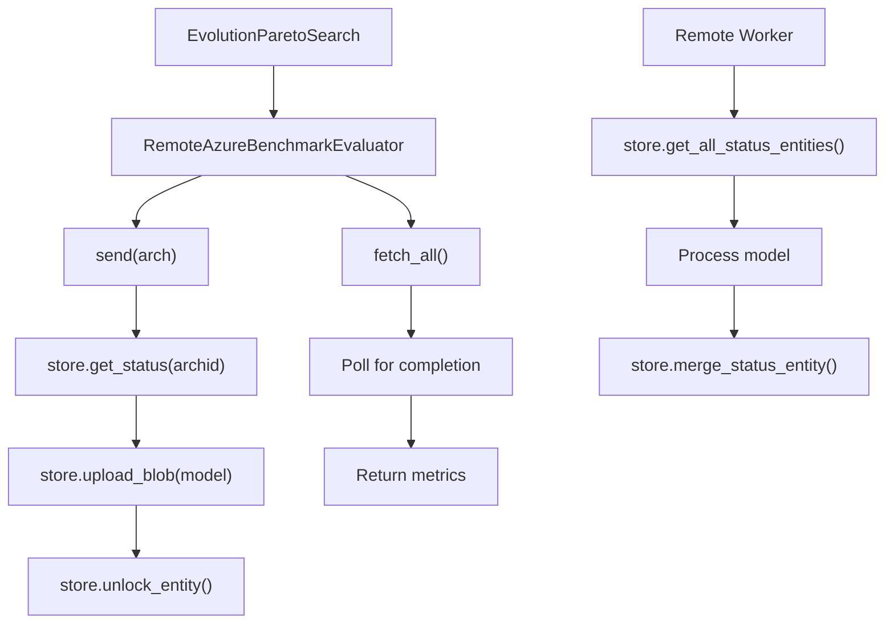
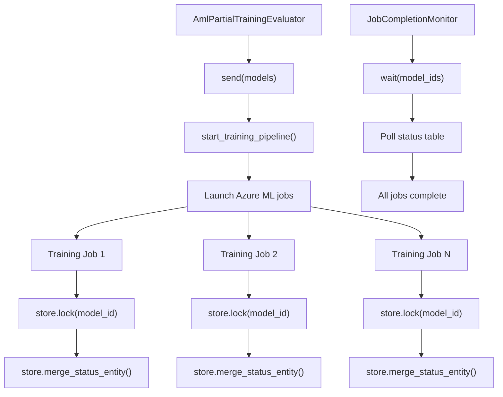
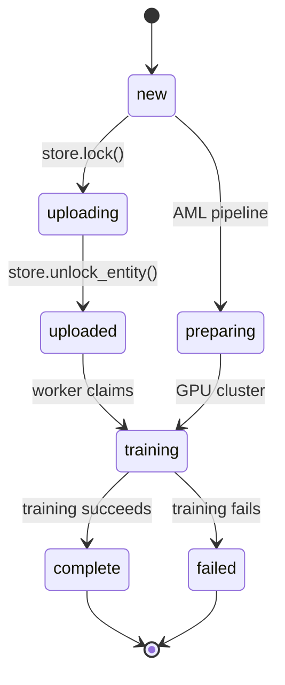

<!-- source: DeepWiki mcp.deepwiki.com · repo microsoft/archai · page 7.2 Storage and State Management · fetched 2026-10-26 -->

# Storage and State Management

<details>
<summary>Relevant source files</summary>

The following files were used as context for generating this wiki page:

- [.gitignore](.gitignore)
- [archai/common/monitor.py](archai/common/monitor.py)
- [archai/common/store.py](archai/common/store.py)
- [archai/discrete_search/evaluators/remote_azure_benchmark.py](archai/discrete_search/evaluators/remote_azure_benchmark.py)
- [docs/advanced_guide/cloud/azure/notebooks/multi_node_search/scripts/train.py](docs/advanced_guide/cloud/azure/notebooks/multi_node_search/scripts/train.py)
- [tasks/face_segmentation/.vscode/launch.json](tasks/face_segmentation/.vscode/launch.json)
- [tasks/face_segmentation/README.md](tasks/face_segmentation/README.md)
- [tasks/face_segmentation/aml.py](tasks/face_segmentation/aml.py)
- [tasks/face_segmentation/aml/azure/change_schema.py](tasks/face_segmentation/aml/azure/change_schema.py)
- [tasks/face_segmentation/aml/azure/loop.sh](tasks/face_segmentation/aml/azure/loop.sh)
- [tasks/face_segmentation/aml/azure/runner.py](tasks/face_segmentation/aml/azure/runner.py)
- [tasks/face_segmentation/aml/docker/quantizer/Dockerfile](tasks/face_segmentation/aml/docker/quantizer/Dockerfile)
- [tasks/face_segmentation/aml/docker/quantizer/quantizer.template.yaml](tasks/face_segmentation/aml/docker/quantizer/quantizer.template.yaml)
- [tasks/face_segmentation/aml/images/animation.gif](tasks/face_segmentation/aml/images/animation.gif)
- [tasks/face_segmentation/aml/images/final_results.png](tasks/face_segmentation/aml/images/final_results.png)
- [tasks/face_segmentation/aml/images/iteration10.png](tasks/face_segmentation/aml/images/iteration10.png)
- [tasks/face_segmentation/aml/images/pareto.gif](tasks/face_segmentation/aml/images/pareto.gif)
- [tasks/face_segmentation/aml/notebooks/results.ipynb](tasks/face_segmentation/aml/notebooks/results.ipynb)
- [tasks/face_segmentation/aml/readme.md](tasks/face_segmentation/aml/readme.md)
- [tasks/face_segmentation/aml/training/aml_training_evaluator.py](tasks/face_segmentation/aml/training/aml_training_evaluator.py)
- [tasks/face_segmentation/aml/training/onnx_latency.py](tasks/face_segmentation/aml/training/onnx_latency.py)
- [tasks/face_segmentation/aml/training/readme.md](tasks/face_segmentation/aml/training/readme.md)
- [tasks/face_segmentation/aml/training/training_pipeline.py](tasks/face_segmentation/aml/training/training_pipeline.py)
- [tasks/face_segmentation/aml/util/pareto.py](tasks/face_segmentation/aml/util/pareto.py)
- [tasks/face_segmentation/aml/util/setup.py](tasks/face_segmentation/aml/util/setup.py)
- [tasks/face_segmentation/assets/snp_pareto_evolution.png](tasks/face_segmentation/assets/snp_pareto_evolution.png)
- [tasks/face_segmentation/confs/aml_search.yaml](tasks/face_segmentation/confs/aml_search.yaml)
- [tasks/face_segmentation/search.py](tasks/face_segmentation/search.py)
- [tasks/face_segmentation/train.py](tasks/face_segmentation/train.py)
- [tasks/face_segmentation/train_pareto.py](tasks/face_segmentation/train_pareto.py)
- [tests/common/test_store.py](tests/common/test_store.py)

</details>


This section documents Archai's distributed storage and state management system, which provides unified access to Azure cloud storage services for coordinating neural architecture search experiments across multiple machines. The system handles model artifact storage, job state tracking, and distributed coordination through a combination of Azure Table Storage and Blob Storage.

For information about Azure ML pipeline orchestration, see [Azure ML Integration](#7.1). For distributed training execution details, see [Distributed Training and Execution](#7.3).

## Core Architecture

The storage system is built around the `ArchaiStore` class, which provides a unified interface to Azure storage services and implements distributed coordination patterns for multi-node NAS experiments.

### ArchaiStore Class Design



Sources: [archai/common/store.py:23-737]()

The `ArchaiStore` class serves as the primary interface for all storage operations, combining Azure Table Storage for metadata and Azure Blob Storage for binary artifacts. The class implements retry logic, connection management, and distributed locking mechanisms.

### Storage Schema and Organization



Sources: [archai/common/store.py:171-185](), [archai/common/store.py:274-289]()

## Distributed Coordination and Locking

The system implements a distributed locking mechanism using the `node` field in table entities to coordinate work across multiple machines.

### Locking Mechanism



Sources: [archai/common/store.py:290-357]()

The locking system prevents multiple workers from processing the same model simultaneously. Each worker identifies itself using `platform.node()` and atomically claims work by setting the `node` field in table entities.

### Key Locking Methods

| Method | Purpose |
|--------|---------|
| `lock_entity(entity, status)` | Acquire exclusive lock on entity |
| `unlock_entity(entity)` | Release lock and update status |
| `is_locked_by_self(name)` | Check if current worker owns lock |
| `is_locked_by_other(name)` | Check if another worker owns lock |

Sources: [archai/common/store.py:301-363]()

## Integration with Search Pipelines

The storage system integrates with Archai's search algorithms and evaluators to provide persistent state management across distributed experiments.

### Search Integration Pattern



Sources: [archai/discrete_search/evaluators/remote_azure_benchmark.py:87-155](), [tasks/face_segmentation/search.py:105-140]()

### Training Pipeline Integration

The storage system coordinates distributed training jobs through the `AmlPartialTrainingEvaluator` and `JobCompletionMonitor` classes.



Sources: [tasks/face_segmentation/aml/training/aml_training_evaluator.py:59-146](), [archai/common/monitor.py:101-151]()

## State Management Patterns

The system implements several patterns for managing job state and coordination across distributed workers.

### Entity Status Lifecycle



Sources: [archai/common/store.py:247-258](), [tasks/face_segmentation/train.py:66-128]()

### Retry and Error Handling

The storage layer implements comprehensive retry logic and error handling patterns:

| Pattern | Implementation |
|---------|----------------|
| Table Operations | `_retry_table_operation()` with exponential backoff |
| Connection Failures | Automatic service client recreation |
| Lock Contention | Graceful failure with retry hints |
| Partial Failures | Individual entity error tracking |

Sources: [archai/common/store.py:124-143]()

## Configuration and Setup

### Connection String Configuration

The system uses Azure storage connection strings for authentication and endpoint configuration:

```python
# Environment-based configuration
connection_string = os.getenv('MODEL_STORAGE_CONNECTION_STRING')
storage_account_name, storage_account_key = ArchaiStore.parse_connection_string(connection_string)
store = ArchaiStore(storage_account_name, storage_account_key, 
                   blob_container_name='models', 
                   table_name='experiment_name')
```

Sources: [archai/common/store.py:50-72](), [tasks/face_segmentation/aml/util/setup.py:16-28]()

### Container and Table Organization

| Component | Purpose | Naming Pattern |
|-----------|---------|----------------|
| Table Name | Experiment identifier | `experiment_name` (e.g., "facesynthetics") |
| Container Name | Artifact storage | `blob_container_name` (e.g., "models") |
| Blob Paths | Model organization | `{experiment_name}/{model_id}/file` |
| Partition Key | Table partitioning | Fixed value: "main" |

Sources: [archai/common/store.py:39-48](), [tasks/face_segmentation/confs/aml_search.yaml:56-63]()

### Command Line Interface

The `ArchaiStore` class provides a comprehensive CLI for manual operations:

```bash
# Check status of all entities
python -m archai.common.store status

# Upload model artifacts  
python -m archai.common.store upload model_name /path/to/files

# Download results
python -m archai.common.store download --name model_name

# Reset failed jobs
python -m archai.common.store reset model_name
```

Sources: [archai/common/store.py:569-736]()

The storage and state management system provides the foundation for Archai's distributed neural architecture search capabilities, enabling coordination across multiple Azure resources while maintaining consistency and reliability through proper locking and retry mechanisms.

---

