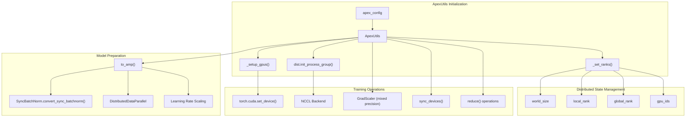
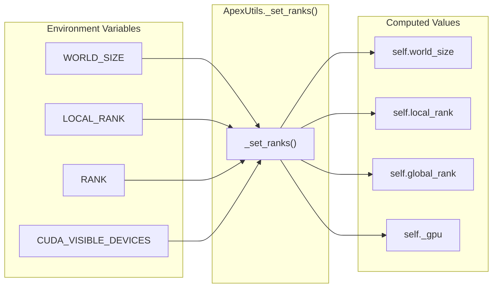
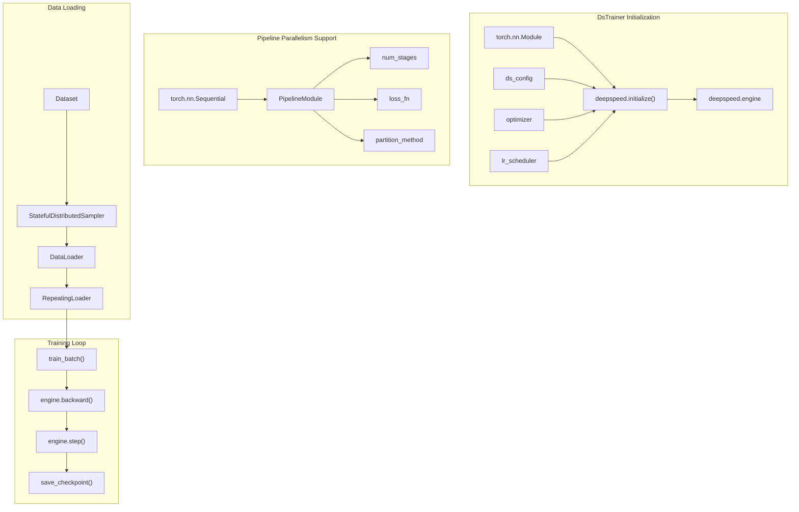
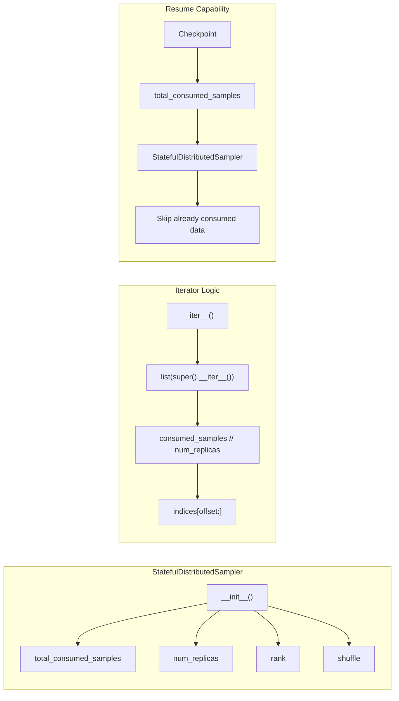
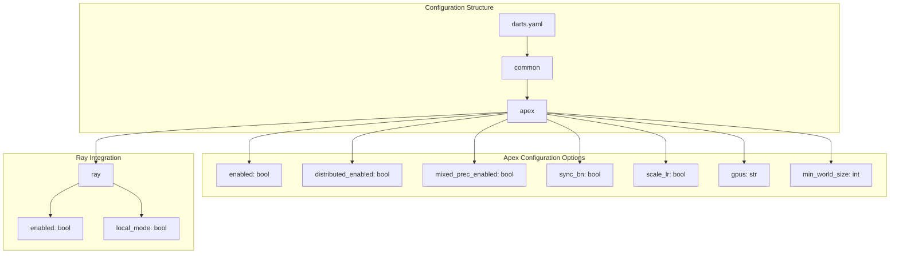
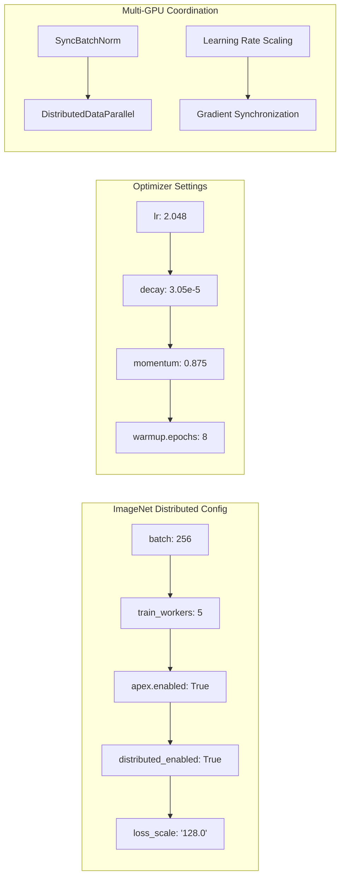
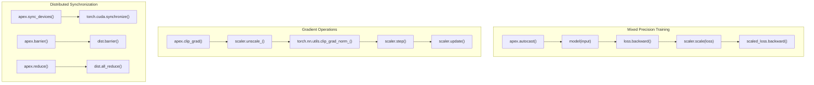
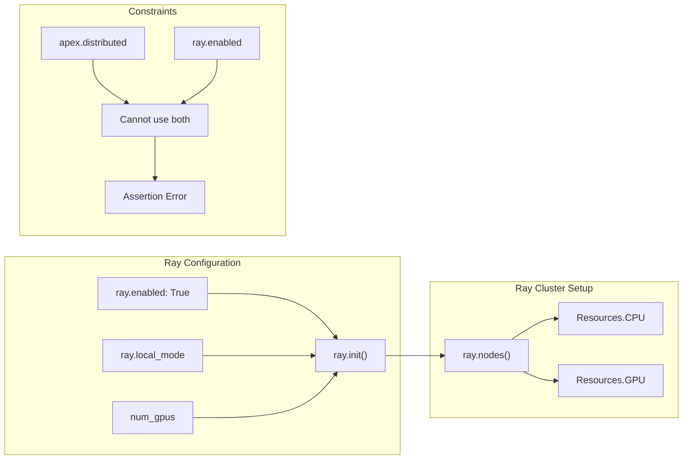
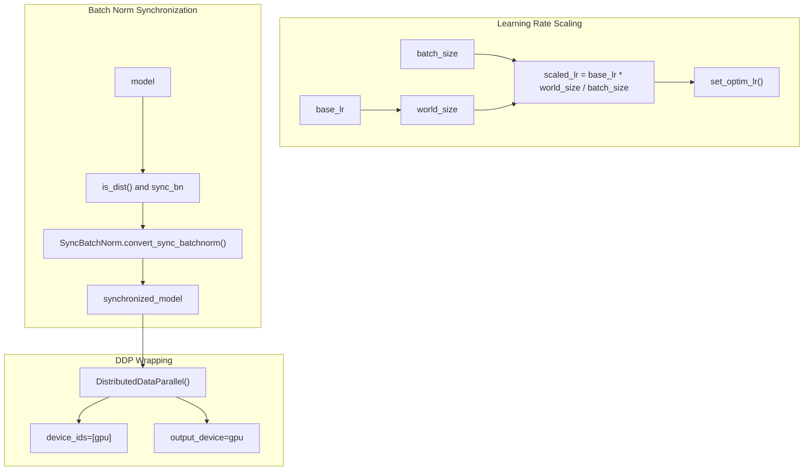

<!-- source: DeepWiki mcp.deepwiki.com · repo microsoft/archai · page 7.3 Distributed Training and Execution · fetched 2026-10-26 -->

# Distributed Training and Execution

<details>
<summary>Relevant source files</summary>

The following files were used as context for generating this wiki page:

- [archai/common/apex_utils.py](archai/common/apex_utils.py)
- [archai/common/common.py](archai/common/common.py)
- [archai/common/ml_utils.py](archai/common/ml_utils.py)
- [archai/common/utils.py](archai/common/utils.py)
- [archai/discrete_search/search_spaces/nlp/tfpp/modeling_codegen_flash.py](archai/discrete_search/search_spaces/nlp/tfpp/modeling_codegen_flash.py)
- [archai/trainers/nlp/ds_trainer.py](archai/trainers/nlp/ds_trainer.py)
- [archai/trainers/nlp/ds_training_args.py](archai/trainers/nlp/ds_training_args.py)
- [confs/algos/darts.yaml](confs/algos/darts.yaml)
- [confs/datasets/imagenet.yaml](confs/datasets/imagenet.yaml)
- [confs/datasets/size_224x224_base.yaml](confs/datasets/size_224x224_base.yaml)
- [docker/Dockerfile.flash](docker/Dockerfile.flash)
- [scripts/eval/README.md](scripts/eval/README.md)
- [scripts/eval/deepspeed/evaluate_human_eval.py](scripts/eval/deepspeed/evaluate_human_eval.py)
- [scripts/eval/hf/evaluate_human_eval.py](scripts/eval/hf/evaluate_human_eval.py)
- [scripts/eval/requirements.txt](scripts/eval/requirements.txt)
- [scripts/trainers/README.md](scripts/trainers/README.md)
- [scripts/trainers/deepspeed/.gitignore](scripts/trainers/deepspeed/.gitignore)
- [scripts/trainers/deepspeed/ds_config.json](scripts/trainers/deepspeed/ds_config.json)
- [scripts/trainers/deepspeed/train_codegen.py](scripts/trainers/deepspeed/train_codegen.py)
- [scripts/trainers/hf/train_codegen.py](scripts/trainers/hf/train_codegen.py)
- [scripts/trainers/hf/train_opt.py](scripts/trainers/hf/train_opt.py)
- [scripts/trainers/nvidia/train_gpt2.py](scripts/trainers/nvidia/train_gpt2.py)
- [setup.cfg](setup.cfg)

</details>


## Purpose and Scope

This page documents Archai's distributed training and execution capabilities, covering multi-GPU and multi-node training infrastructure, data parallelism, pipeline parallelism, and integration with distributed computing frameworks. The distributed training system supports neural architecture search across multiple compute nodes and enables efficient training of large models.

For Azure ML-specific distributed execution, see [Azure ML Integration](#7.1). For distributed state management and job coordination, see [Storage and State Management](#7.2).

## Core Distributed Training Infrastructure

### ApexUtils - Distributed Training Coordinator

The `ApexUtils` class serves as the central coordinator for distributed training operations, handling GPU allocation, process synchronization, and mixed precision training across multiple devices.



**Sources:** [archai/common/apex_utils.py:26-281]()

### Environment-Based Rank Detection

The distributed setup automatically detects ranks and world size from environment variables set by distributed launchers:



**Sources:** [archai/common/apex_utils.py:139-170]()

## DeepSpeed Distributed Training

### DsTrainer Architecture

The `DsTrainer` provides distributed training capabilities with DeepSpeed integration, supporting both data parallelism and pipeline parallelism:



**Sources:** [archai/trainers/nlp/ds_trainer.py:73-395]()

### Stateful Distributed Sampling

The `StatefulDistributedSampler` enables resuming distributed training from checkpoints by tracking consumed samples:



**Sources:** [archai/trainers/nlp/ds_trainer.py:38-71]()

## Multi-Node Training Configuration

### YAML Configuration for Distributed Training

The configuration system supports distributed training through the `apex` section:



**Sources:** [confs/algos/darts.yaml:22-34](), [confs/datasets/imagenet.yaml:56-84]()

### ImageNet Distributed Training Setup

For large-scale datasets like ImageNet, specific distributed configurations optimize training performance:



**Sources:** [confs/datasets/imagenet.yaml:47-84]()

## Mixed Precision and Gradient Operations

### Autocast and Gradient Scaling

The distributed training system integrates mixed precision training with proper gradient scaling across devices:



**Sources:** [archai/common/apex_utils.py:218-281]()

## Ray Integration for Distributed Computing

### Ray-Based Distributed Execution

Archai supports Ray as an alternative to native PyTorch distributed training:



**Sources:** [archai/common/apex_utils.py:84-94]()

## Practical Training Execution

### DeepSpeed Launch Commands

The training scripts demonstrate distributed execution using DeepSpeed launcher:

```bash
deepspeed train_codegen.py \
    --ds_config_path ds_config.json \
    --pipe_parallel_size 4 \
    --output_dir ./checkpoints
```

### Hugging Face Distributed Training

For Hugging Face-based training, PyTorch's distributed launcher is used:

```bash
python -m torch.distributed.run \
    --nproc_per_node=4 \
    train_codegen.py \
    --per_device_train_batch_size 64
```

**Sources:** [scripts/trainers/deepspeed/train_codegen.py:86-144](), [scripts/trainers/hf/train_codegen.py:54-104]()

### Environment Variable Setup

Common environment variables for distributed training include:

| Variable | Purpose | Example |
|----------|---------|---------|
| `WORLD_SIZE` | Total number of processes | `4` |
| `LOCAL_RANK` | Local process rank on node | `0`, `1`, `2`, `3` |
| `RANK` | Global process rank | `0`, `1`, `2`, `3` |
| `MASTER_ADDR` | Master node address | `localhost` |
| `MASTER_PORT` | Master node port | `29500` |
| `CUDA_VISIBLE_DEVICES` | Visible GPU devices | `0,1,2,3` |

**Sources:** [archai/common/apex_utils.py:143-157]()

## Performance Optimization Features

### Learning Rate Scaling and Batch Norm Synchronization

The distributed training system automatically scales learning rates and synchronizes batch normalization statistics:



**Sources:** [archai/common/apex_utils.py:240-261]()

---

