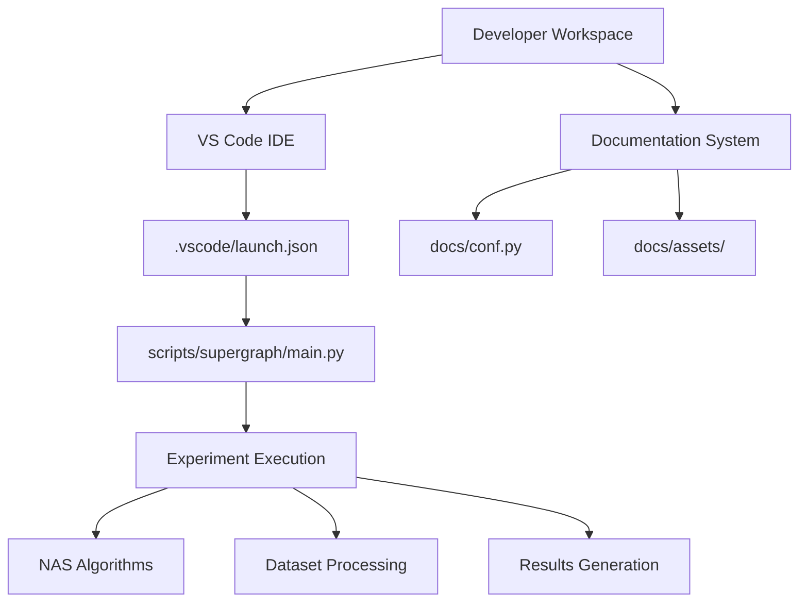
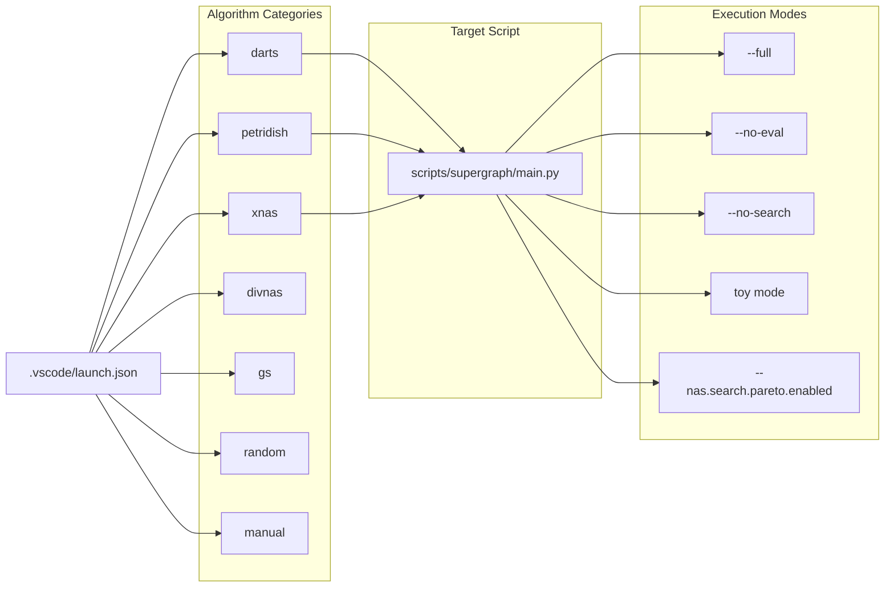
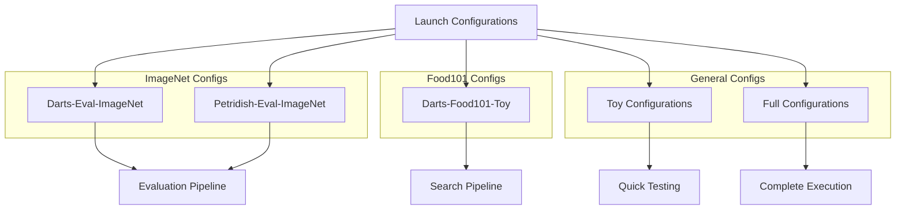
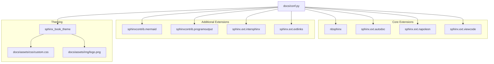
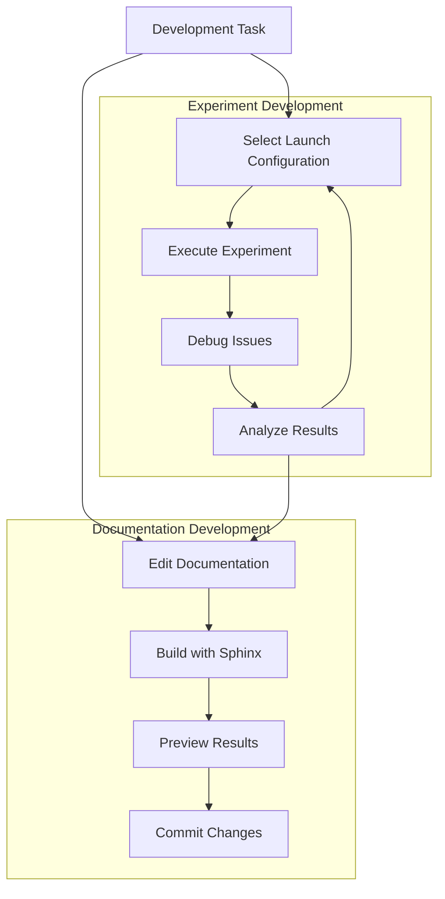

<!-- source: DeepWiki mcp.deepwiki.com · repo microsoft/archai · page 8 Development and Tooling · fetched 2026-10-26 -->

# Development and Tooling

<details>
<summary>Relevant source files</summary>

The following files were used as context for generating this wiki page:

- [.vscode/launch.json](.vscode/launch.json)
- [docs/assets/css/custom.css](docs/assets/css/custom.css)
- [docs/assets/img/favicon.ico](docs/assets/img/favicon.ico)
- [docs/assets/img/logo.png](docs/assets/img/logo.png)
- [docs/assets/img/logo_white.png](docs/assets/img/logo_white.png)
- [docs/assets/img/logo_white_sm.png](docs/assets/img/logo_white_sm.png)
- [docs/conf.py](docs/conf.py)
- [docs/getting_started/installation.rst](docs/getting_started/installation.rst)
- [docs/reference/changelog.rst](docs/reference/changelog.rst)
- [docs/reference/roadmap.rst](docs/reference/roadmap.rst)

</details>


This page covers the developer tools, debugging capabilities, and development workflow support provided by Archai. It focuses on the VS Code integration with pre-configured launch settings and the Sphinx-based documentation system that enables efficient development and experimentation workflows.

For information about cloud-based development and distributed execution, see [Cloud and Distributed Computing](#7). For details about the package structure and distribution, see [Package Structure and Distribution](#3.1).

## Development Environment Overview

Archai provides comprehensive development tooling centered around VS Code integration and automated documentation generation. The development environment supports rapid experimentation with neural architecture search algorithms through pre-configured launch settings and maintains comprehensive documentation through a Sphinx-based system.



**Development Workflow Architecture**

Sources: [.vscode/launch.json:1-269](), [docs/conf.py:1-73]()

## VS Code Launch Configurations

The VS Code integration provides extensive pre-configured launch settings for different experimental scenarios. These configurations enable developers to quickly run specific algorithms, datasets, and execution modes without manually constructing complex command-line arguments.

### Launch Configuration Structure



**VS Code Launch Configuration Categories**

Sources: [.vscode/launch.json:1-269]()

### Key Launch Configurations

| Configuration Name | Algorithm | Mode | Purpose |
|-------------------|-----------|------|---------|
| `Darts-Full` | darts | `--full` | Complete DARTS pipeline |
| `Darts-Search-Toy` | darts | `--no-eval` | Search phase only |
| `Darts-Eval-Toy` | darts | `--no-search` | Evaluation phase only |
| `Petridish-Full` | petridish | `--full` | Complete Petridish pipeline |
| `Random-Toy` | random | toy | Quick random search test |
| `All-Toy-Pareto` | all | `--nas.search.pareto.enabled` | Pareto frontier analysis |

### Command Line Argument Structure

The launch configurations use a standardized argument pattern targeting `scripts/supergraph/main.py`:

- `--algos`: Specifies the algorithm (darts, petridish, xnas, etc.)
- `--datasets`: Target dataset (imagenet, food101, cifar10)
- `--full`: Enables complete pipeline execution
- `--no-search`: Skips search phase
- `--no-eval`: Skips evaluation phase
- `--nas.search.pareto.enabled`: Enables Pareto optimization
- `--nas.eval.final_desc_filename`: Specifies model description file

Sources: [.vscode/launch.json:17-19](), [.vscode/launch.json:27-27](), [.vscode/launch.json:35-35]()

### Dataset-Specific Configurations



**Dataset-Specific Launch Configuration Flow**

Sources: [.vscode/launch.json:54-60](), [.vscode/launch.json:94-100](), [.vscode/launch.json:70-76]()

## Documentation System

Archai uses Sphinx for automated documentation generation with extensive plugin support and custom styling. The documentation system supports multiple formats including notebooks, API references, and custom CSS styling.

### Sphinx Configuration Structure



**Sphinx Documentation System Architecture**

Sources: [docs/conf.py:17-29](), [docs/conf.py:44-62]()

### Documentation Extensions and Features

| Extension | Purpose | Configuration |
|-----------|---------|---------------|
| `nbsphinx` | Jupyter notebook integration | `nbsphinx_execute = "never"` |
| `sphinxcontrib.mermaid` | Diagram rendering | Enabled by default |
| `sphinx.ext.autodoc` | API documentation generation | `autodoc_member_order = "bysource"` |
| `sphinx.ext.napoleon` | Google/NumPy docstring support | Enabled |
| `sphinx.ext.viewcode` | Source code linking | Enabled |

### Custom Styling System

The documentation uses custom CSS with brand-specific colors and styling:

```css
:root {
    --primary: #623eb2;
    --secondary: #8776ae;
}
```

The styling system includes:
- Custom navigation styling
- Tab interface support
- Brand-consistent color scheme
- Responsive table formatting

Sources: [docs/conf.py:64-67](), [docs/assets/css/custom.css:1-39]()

### Build Exclusions and Filtering

The documentation system excludes specific directories from processing:

- `confs/**`: Configuration files
- `docker/**`: Docker-related files  
- `research/**`: Research experiments
- `scripts/**`: Utility scripts
- `tasks/**`: Task-specific implementations
- `tests/**`: Test suites

Sources: [docs/conf.py:30-37]()

## Development Workflow Integration

The development tooling provides integrated workflows for common development tasks including experimentation, debugging, and documentation generation.



**Integrated Development Workflow**

### Quick Start Development Process

1. **Algorithm Selection**: Choose appropriate launch configuration from `.vscode/launch.json`
2. **Execution Mode**: Select between full pipeline, search-only, or evaluation-only modes
3. **Dataset Configuration**: Specify target dataset through command-line arguments
4. **Debugging Support**: Use VS Code integrated terminal and debugging features
5. **Results Analysis**: Examine outputs and modify configurations as needed

### Debugging Capabilities

The VS Code integration provides comprehensive debugging support:

- **Integrated Terminal**: All configurations use `"console": "integratedTerminal"`
- **Current File Execution**: Generic `CurrentFile` configuration for ad-hoc script execution
- **Argument Customization**: Easy modification of command-line arguments
- **Real-time Output**: Direct console output for monitoring experiment progress

Sources: [.vscode/launch.json:9-9](), [.vscode/launch.json:260-267]()

### Documentation Development Workflow

The Sphinx documentation system supports:

- **Automatic API Documentation**: Through `sphinx.ext.autodoc`
- **Notebook Integration**: Via `nbsphinx` for tutorial content
- **Cross-Reference Support**: Using `sphinx.ext.intersphinx`
- **Custom Styling**: Through modular CSS in `docs/assets/`
- **Multi-format Output**: HTML with optional PDF generation

Sources: [docs/conf.py:17-29](), [docs/conf.py:44-73]()

---

