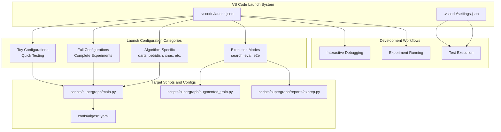
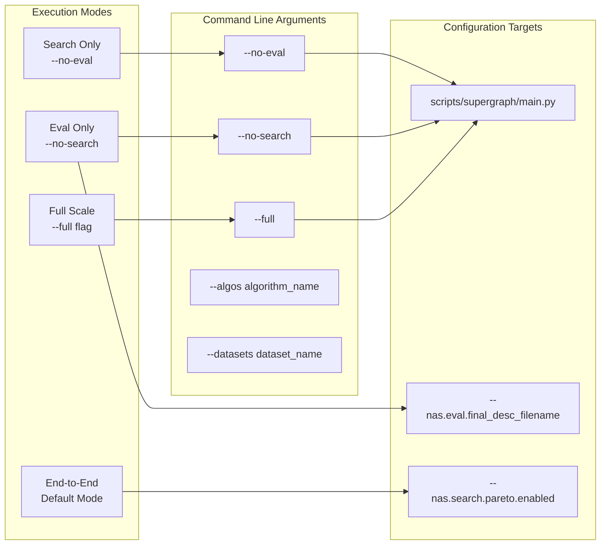
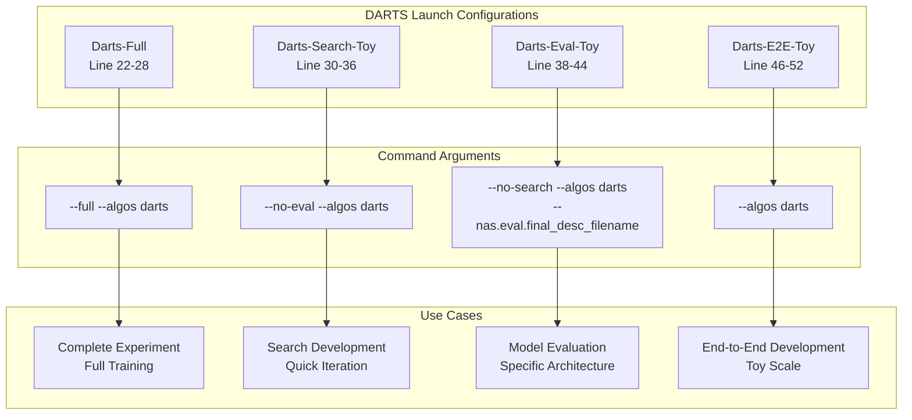
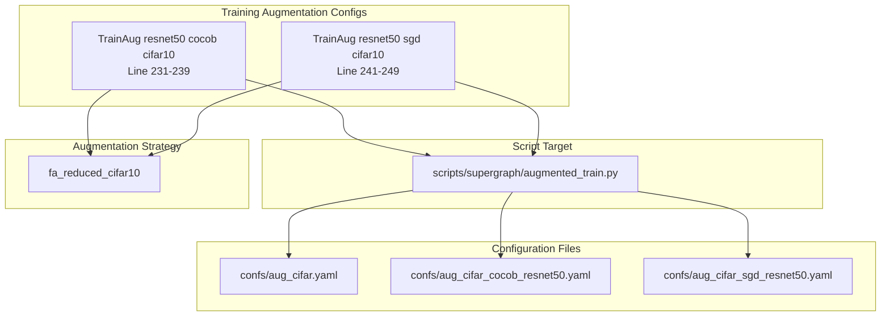
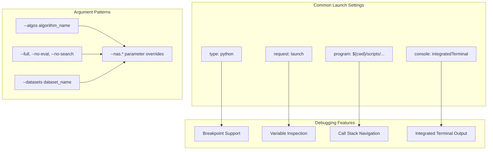
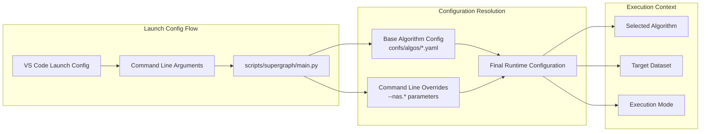

<!-- source: DeepWiki mcp.deepwiki.com · repo microsoft/archai · page 8.1 VS Code Integration and Launch Configurations · fetched 2026-10-26 -->

# VS Code Integration and Launch Configurations

<details>
<summary>Relevant source files</summary>

The following files were used as context for generating this wiki page:

- [.vscode/launch.json](.vscode/launch.json)
- [.vscode/settings.json](.vscode/settings.json)
- [confs/algos/petridish_toy.yaml](confs/algos/petridish_toy.yaml)

</details>


## Purpose and Scope

This document covers the Visual Studio Code integration provided by the Archai repository, specifically focusing on the launch configurations that enable streamlined development, debugging, and experimentation workflows. The launch configurations provide pre-configured setups for running different Neural Architecture Search algorithms, evaluation modes, and training scenarios directly from VS Code.

For information about the underlying NAS algorithms and their parameters, see [4.1](#4.1). For details about the configuration system that these launch configs utilize, see [3.2](#3.2).

## VS Code Development Environment Setup

The Archai repository includes comprehensive VS Code integration through configuration files in the `.vscode/` directory. This integration provides developers with ready-to-use launch configurations for running experiments, debugging code, and executing tests.

### Launch Configuration Architecture

The VS Code launch configurations are defined in [.vscode/launch.json:1-269]() and follow a structured pattern that maps different experiment scenarios to specific command-line invocations of the main supergraph script.



**Sources:** [.vscode/launch.json:1-269](), [.vscode/settings.json:1-9]()

## Launch Configuration Categories

### Algorithm-Specific Configurations

The launch configurations are organized by Neural Architecture Search algorithms, with each algorithm supporting multiple execution modes:

| Algorithm | Available Configurations | Description |
|-----------|-------------------------|-------------|
| `darts` | Full, Search-Toy, Eval-Toy, E2E-Toy, Eval-ImageNet | DARTS algorithm variants |
| `petridish` | Full, Eval-ImageNet, Toy | Petridish progressive search |
| `xnas` | Full, Search-Toy, E2E-Toy | XNAS implementation |
| `divnas` | Full, Search-Toy, Eval-Full, E2E-Toy | Diverse Neural Architecture Search |
| `gs` | Full, Search-Toy, E2E-Toy | Grid Search baseline |
| `random` | Full, Toy | Random search baseline |
| `manual` | Manual-E2E-Toy, Resnet-Toy, Resnet-Full | Manual architecture evaluation |

### Execution Mode Patterns



**Sources:** [.vscode/launch.json:17-19](), [.vscode/launch.json:35](), [.vscode/launch.json:43]()

### Example Launch Configuration Structure

The DARTS algorithm demonstrates the typical pattern used across all configurations:



**Sources:** [.vscode/launch.json:22-28](), [.vscode/launch.json:30-36](), [.vscode/launch.json:38-44](), [.vscode/launch.json:46-52]()

## Specialized Launch Configurations

### Pareto Optimization Configurations

Several configurations include Pareto frontier optimization settings for multi-objective search:

- **All-Toy-Pareto** [.vscode/launch.json:12-20](): Enables Pareto optimization with reduced training epochs
- **Petridish-Toy** [.vscode/launch.json:102-108](): Combines Petridish algorithm with Pareto optimization

### Dataset-Specific Configurations

Configurations support different datasets through the `--datasets` argument:

- **CIFAR-10**: Default dataset for toy configurations
- **ImageNet**: Full-scale evaluation configurations [.vscode/launch.json:54-60]()
- **Food101**: Specialized dataset testing [.vscode/launch.json:70-76]()

### Training Augmentation Configurations

Dedicated configurations for augmented training experiments:



**Sources:** [.vscode/launch.json:231-239](), [.vscode/launch.json:241-249]()

## VS Code Settings and Testing Integration

The VS Code settings configuration provides pytest integration for running tests directly from the editor:

### Pytest Configuration

The [.vscode/settings.json:1-9]() file configures pytest as the primary testing framework:

```json
{
    "python.testing.pytestArgs": ["tests"],
    "python.testing.unittestEnabled": false,
    "python.testing.nosetestsEnabled": false,
    "python.testing.pytestEnabled": true
}
```

This configuration enables:
- **Test Discovery**: Automatic discovery of tests in the `tests/` directory
- **Test Execution**: Direct execution of individual tests or test suites from VS Code
- **Debugging Support**: Integrated debugging for test cases

### Development Utilities

The launch configurations include utility configurations for development workflows:

- **CurrentFile** [.vscode/launch.json:260-267](): Executes the currently open Python file with debugging support
- **Exprep** [.vscode/launch.json:251-258](): Runs experiment report generation with specific result directories

**Sources:** [.vscode/settings.json:2-7](), [.vscode/launch.json:260-267](), [.vscode/launch.json:251-258]()

## Debugging Workflow Integration

### Common Configuration Patterns

All launch configurations share common patterns that support effective debugging:



### Configuration Override Patterns

Launch configurations demonstrate how to override YAML configuration parameters directly through command-line arguments:

- **Pareto Configuration**: `--nas.search.pareto.enabled True` [.vscode/launch.json:17]()
- **Training Epochs**: `--nas.search.seed_train.trainer.epochs 1` [.vscode/launch.json:18]()
- **Model Descriptor**: `--nas.eval.final_desc_filename models/darts/final_model_desc1.yaml` [.vscode/launch.json:43]()

**Sources:** [.vscode/launch.json:17-19](), [.vscode/launch.json:43](), [.vscode/launch.json:59]()

## Integration with Configuration System

The launch configurations integrate seamlessly with Archai's YAML-based configuration system by providing command-line overrides that merge with base algorithm configurations:



This integration allows developers to quickly experiment with different parameter combinations without modifying configuration files, making the development and debugging process more efficient.

**Sources:** [.vscode/launch.json:1-269](), [confs/algos/petridish_toy.yaml:1-9]()

---

