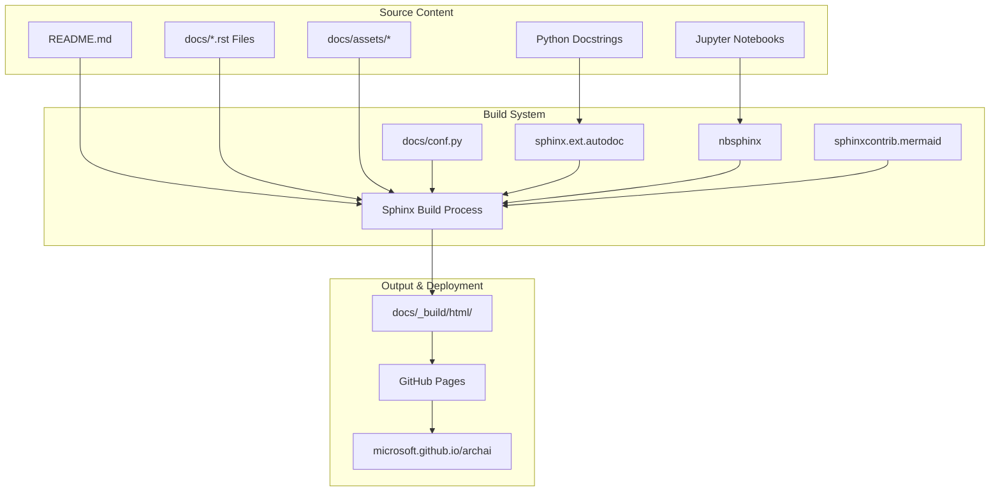
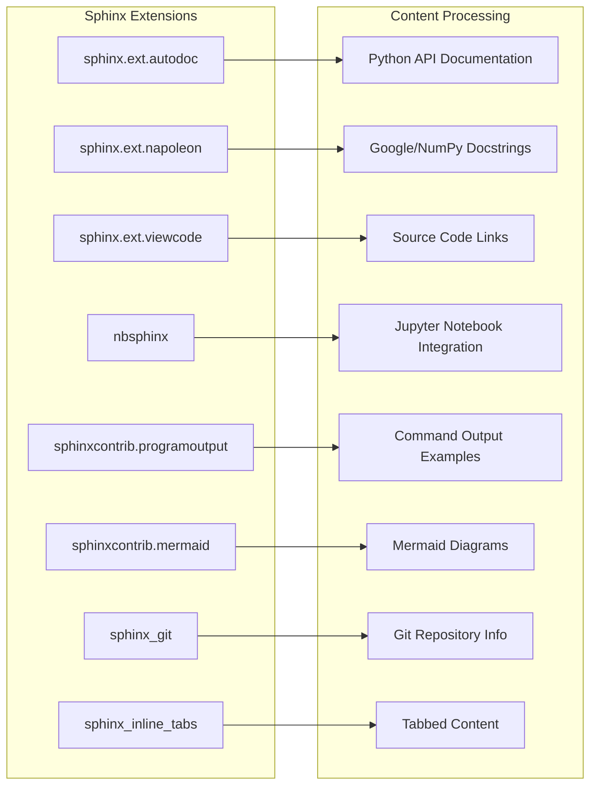
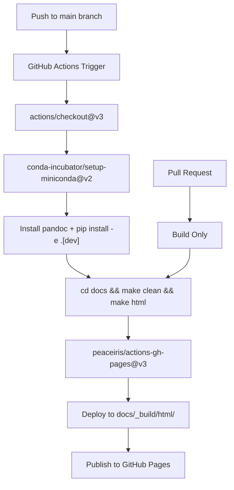

<!-- source: DeepWiki mcp.deepwiki.com · repo microsoft/archai · page 8.2 Documentation System · fetched 2026-10-26 -->

# Documentation System

<details>
<summary>Relevant source files</summary>

The following files were used as context for generating this wiki page:

- [.amltignore](.amltignore)
- [.gitattributes](.gitattributes)
- [.github/ISSUE_TEMPLATE/bug-report.md](.github/ISSUE_TEMPLATE/bug-report.md)
- [.github/ISSUE_TEMPLATE/feature-request.md](.github/ISSUE_TEMPLATE/feature-request.md)
- [.github/ISSUE_TEMPLATE/regular-issue.md](.github/ISSUE_TEMPLATE/regular-issue.md)
- [.github/workflows/build-publish-docs.yml](.github/workflows/build-publish-docs.yml)
- [.github/workflows/build-release-pypi.yml](.github/workflows/build-release-pypi.yml)
- [.github/workflows/check-with-codeql.yml](.github/workflows/check-with-codeql.yml)
- [.github/workflows/check-with-devskim.yml](.github/workflows/check-with-devskim.yml)
- [README.md](README.md)
- [docs/assets/css/custom.css](docs/assets/css/custom.css)
- [docs/assets/img/favicon.ico](docs/assets/img/favicon.ico)
- [docs/assets/img/logo.png](docs/assets/img/logo.png)
- [docs/assets/img/logo_white.png](docs/assets/img/logo_white.png)
- [docs/assets/img/logo_white_sm.png](docs/assets/img/logo_white_sm.png)
- [docs/conf.py](docs/conf.py)
- [docs/getting_started/installation.rst](docs/getting_started/installation.rst)
- [docs/reference/changelog.rst](docs/reference/changelog.rst)
- [docs/reference/roadmap.rst](docs/reference/roadmap.rst)
- [setup.py](setup.py)

</details>


## Purpose and Scope

The Documentation System provides comprehensive API reference generation, user guides, and developer documentation for the Archai Neural Architecture Search platform. This system uses Sphinx-based tooling to automatically generate documentation from source code docstrings, Jupyter notebooks, and reStructuredText files. The system handles both local development workflows and automated publishing to GitHub Pages.

For information about VS Code development workflows and launch configurations, see [VS Code Integration and Launch Configurations](#8.1).

## Architecture Overview

The documentation system is built around Sphinx with multiple extensions for handling different content types. The system automatically builds and deploys documentation using GitHub Actions when changes are pushed to the main branch.



**Sources:** [docs/conf.py:1-73](), [.github/workflows/build-publish-docs.yml:1-46](), [setup.py:91-104]()

## Sphinx Configuration System

The core documentation configuration is managed through `docs/conf.py`, which defines all Sphinx extensions, themes, and build parameters.

### Core Extensions Configuration

The system uses multiple Sphinx extensions to handle different content types:



**Sources:** [docs/conf.py:17-29](), [docs/conf.py:64-67]()

### Key Configuration Variables

| Configuration | Value | Purpose |
|---------------|--------|---------|
| `project` | "Archai" | Project display name |
| `html_theme` | "sphinx_book_theme" | Modern book-style theme |
| `html_baseurl` | "https://microsoft.github.io/archai" | Canonical URL |
| `autodoc_member_order` | "bysource" | API documentation ordering |
| `nbsphinx_execute` | "never" | Notebook execution policy |

**Sources:** [docs/conf.py:12-14](), [docs/conf.py:47](), [docs/conf.py:66](), [docs/conf.py:71]()

## Build and Deployment Pipeline

The documentation build process is automated through GitHub Actions, triggered on pushes to documentation files.

### GitHub Actions Workflow

The build pipeline follows these steps:

1. **Environment Setup**: Installs Python 3.8 and Conda environment
2. **Dependencies**: Installs Archai with development dependencies via `pip install -e .[dev]`
3. **Documentation Build**: Executes `make clean && make html` in docs directory
4. **Deployment**: Publishes to `gh-pages` branch using `peaceiris/actions-gh-pages@v3`



**Sources:** [.github/workflows/build-publish-docs.yml:19-46](), [.github/workflows/build-publish-docs.yml:30-39]()

### Documentation Dependencies

The `setup.py` defines documentation-specific dependencies in the `extras_require["docs"]` section:

| Package | Purpose |
|---------|---------|
| `sphinx` | Core documentation generator |
| `sphinx-book-theme` | Modern responsive theme |
| `nbsphinx` | Jupyter notebook integration |
| `sphinxcontrib-mermaid` | Diagram support |
| `sphinxcontrib-programoutput` | Command output inclusion |
| `pydata-sphinx-theme` | Alternative theme option |

**Sources:** [setup.py:91-104]()

## Extensions and Features

### Automatic API Documentation

The `sphinx.ext.autodoc` extension automatically generates API documentation from Python docstrings. Configuration excludes `__weakref__` members and mocks certain imports:

- `autodoc_default_options` excludes `__weakref__` 
- `autodoc_mock_imports` includes `["lmdb", "nats_bench", "ray.tune", "xautodl"]`

**Sources:** [docs/conf.py:65-67]()

### Notebook Integration

The `nbsphinx` extension processes Jupyter notebooks with specific configuration:
- `nbsphinx_execute = "never"` prevents notebook execution during build
- `nbsphinx_requirejs_path = ""` disables RequireJS to avoid conflicts with Mermaid

**Sources:** [docs/conf.py:71-72]()

### External Links and Git Integration

The configuration includes external link patterns and Git integration:
- `extlinks` defines GitHub links: `{"github": ("https://github.com/microsoft/archai/tree/main/%s", "%s")}`
- `sphinx_git` extension provides repository information

**Sources:** [docs/conf.py:38](), [docs/conf.py:26]()

## Theme and Styling

### Sphinx Book Theme Configuration

The documentation uses `sphinx_book_theme` with custom configuration:

```python
html_theme_options = {
    "repository_url": "https://github.com/microsoft/archai",
    "use_issues_button": True,
    "use_edit_page_button": False,
    "use_download_button": False,
    "use_fullscreen_button": False,
    "use_repository_button": True,
    "show_navbar_depth": 1,
    "toc_title": "Sections",
}
```

**Sources:** [docs/conf.py:53-62]()

### Custom CSS Styling

The system includes custom CSS at `docs/assets/css/custom.css` with Archai-specific styling:
- Primary color: `#623eb2`
- Secondary color: `#8776ae`
- Custom navigation styling and tab appearance

**Sources:** [docs/assets/css/custom.css:1-39](), [docs/conf.py:52]()

### Static Assets

Static assets are configured through:
- `html_static_path = ["assets"]`
- `html_logo = "assets/img/logo.png"`
- `html_favicon = "assets/img/favicon.ico"`

**Sources:** [docs/conf.py:48-52]()

## Documentation Structure and Exclusions

### File Organization

The documentation build excludes certain directories to focus on user-facing content:

```python
exclude_patterns = [
    "confs/**",
    "docker/**", 
    "research/**",
    "scripts/**",
    "tasks/**",
    "tests/**",
]
```

**Sources:** [docs/conf.py:30-37]()

### Multi-format Support

The system supports multiple source formats:
- `source_suffix = [".rst", ".md"]` enables both reStructuredText and Markdown
- `master_doc = "index"` sets the main documentation entry point

**Sources:** [docs/conf.py:39-40]()

## Contributing to Documentation

### Local Development

For local documentation development:

1. Install documentation dependencies: `pip install -e .[docs]`
2. Navigate to docs directory: `cd docs`
3. Build documentation: `make html`
4. View output in `docs/_build/html/`

### Adding New Documentation

- Add new `.rst` files to the `docs/` directory
- Include Jupyter notebooks that will be processed by `nbsphinx`
- Update navigation in appropriate index files
- Ensure proper docstring formatting in Python code for autodoc integration

**Sources:** [.github/workflows/build-publish-docs.yml:30-39](), [setup.py:91-104]()