# Page: Overview

# Overview

<details>
<summary>Relevant source files</summary>

The following files were used as context for generating this wiki page:

- [.amltignore](.amltignore)
- [.gitattributes](.gitattributes)
- [.github/ISSUE_TEMPLATE/bug-report.md](.github/ISSUE_TEMPLATE/bug-report.md)
- [.github/ISSUE_TEMPLATE/feature-request.md](.github/ISSUE_TEMPLATE/feature-request.md)
- [.github/ISSUE_TEMPLATE/regular-issue.md](.github/ISSUE_TEMPLATE/regular-issue.md)
- [.github/workflows/build-publish-docs.yml](.github/workflows/build-publish-docs.yml)
- [.github/workflows/build-release-pypi.yml](.github/workflows/build-release-pypi.yml)
- [.github/workflows/check-with-codeql.yml](.github/workflows/check-with-codeql.yml)
- [.github/workflows/check-with-devskim.yml](.github/workflows/check-with-devskim.yml)
- [.vscode/launch.json](.vscode/launch.json)
- [README.md](README.md)
- [archai/discrete_search/__init__.py](archai/discrete_search/__init__.py)
- [archai/discrete_search/algos/bananas.py](archai/discrete_search/algos/bananas.py)
- [archai/discrete_search/algos/evolution_pareto.py](archai/discrete_search/algos/evolution_pareto.py)
- [archai/discrete_search/algos/local_search.py](archai/discrete_search/algos/local_search.py)
- [archai/discrete_search/algos/random_search.py](archai/discrete_search/algos/random_search.py)
- [archai/discrete_search/algos/regularized_evolution.py](archai/discrete_search/algos/regularized_evolution.py)
- [archai/discrete_search/algos/successive_halving.py](archai/discrete_search/algos/successive_halving.py)
- [archai/discrete_search/api/model_evaluator.py](archai/discrete_search/api/model_evaluator.py)
- [archai/discrete_search/api/search_objectives.py](archai/discrete_search/api/search_objectives.py)
- [archai/discrete_search/api/search_results.py](archai/discrete_search/api/search_results.py)
- [archai/discrete_search/api/searcher.py](archai/discrete_search/api/searcher.py)
- [archai/discrete_search/evaluators/functional.py](archai/discrete_search/evaluators/functional.py)
- [archai/discrete_search/evaluators/onnx_model.py](archai/discrete_search/evaluators/onnx_model.py)
- [archai/discrete_search/evaluators/progressive_training.py](archai/discrete_search/evaluators/progressive_training.py)
- [archai/discrete_search/evaluators/ray.py](archai/discrete_search/evaluators/ray.py)
- [setup.py](setup.py)

</details>


## Purpose and Scope

Archai is a comprehensive Neural Architecture Search (NAS) platform designed to accelerate the discovery of efficient deep neural network architectures through fast, reproducible, and modular research. This document provides a high-level overview of the Archai system architecture, core components, and key capabilities.

Archai enables researchers and practitioners to:
- Define and explore custom neural architecture search spaces
- Apply various search algorithms (evolutionary, Bayesian optimization, random search)
- Evaluate architectures using multiple objectives (accuracy, latency, memory, parameters)
- Deploy and scale experiments using cloud infrastructure
- Integrate with existing ML workflows and frameworks

For detailed information about specific algorithms, see [Search Algorithms](#4.1). For task-specific implementations, see [Tasks and Applications](#6). For cloud deployment guidance, see [Cloud and Distributed Computing](#7).

## System Architecture

The Archai platform follows a modular architecture that separates search algorithms, evaluation objectives, search spaces, and infrastructure concerns:

### Core System Components

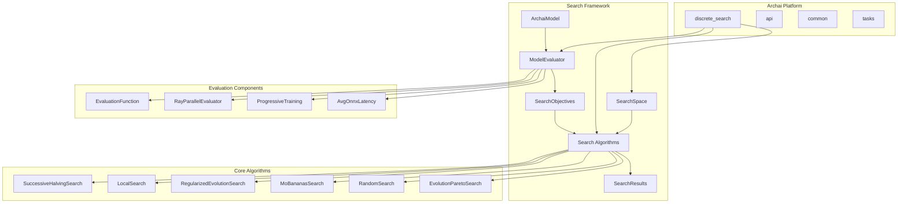

Sources: [setup.py:7](), [archai/discrete_search/api/searcher.py:11-47](), [archai/discrete_search/api/search_objectives.py:33-397](), [archai/discrete_search/algos/evolution_pareto.py:21-309](), [archai/discrete_search/evaluators/onnx_model.py:16-91]()

### Package Distribution and Dependencies

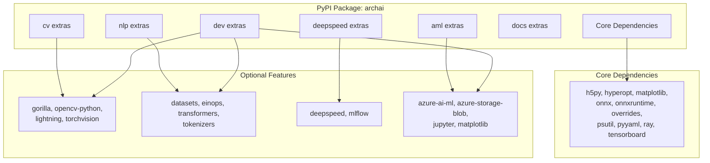

Sources: [setup.py:9-188]()

## Neural Architecture Search Workflow

The core NAS workflow in Archai follows a standardized pattern across different search algorithms:

### Search Algorithm Execution Flow

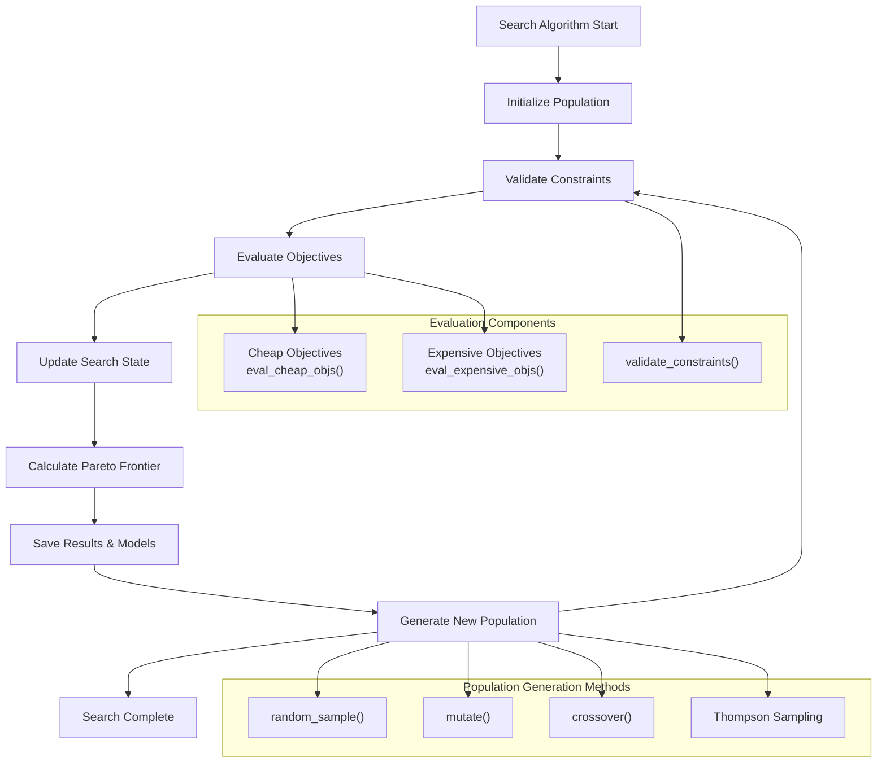

Sources: [archai/discrete_search/algos/evolution_pareto.py:223-308](), [archai/discrete_search/api/search_objectives.py:260-361](), [archai/discrete_search/algos/bananas.py:248-312]()

### Multi-Objective Evaluation System

The `SearchObjectives` class coordinates evaluation of multiple criteria:

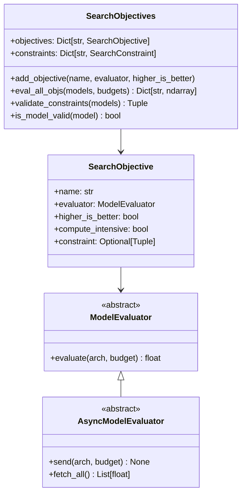

Sources: [archai/discrete_search/api/search_objectives.py:24-397](), [archai/discrete_search/api/model_evaluator.py:13-139]()

## Development and Execution Environment

### VS Code Integration and Launch Configurations

Archai provides extensive VS Code integration through predefined launch configurations for different NAS experiments:

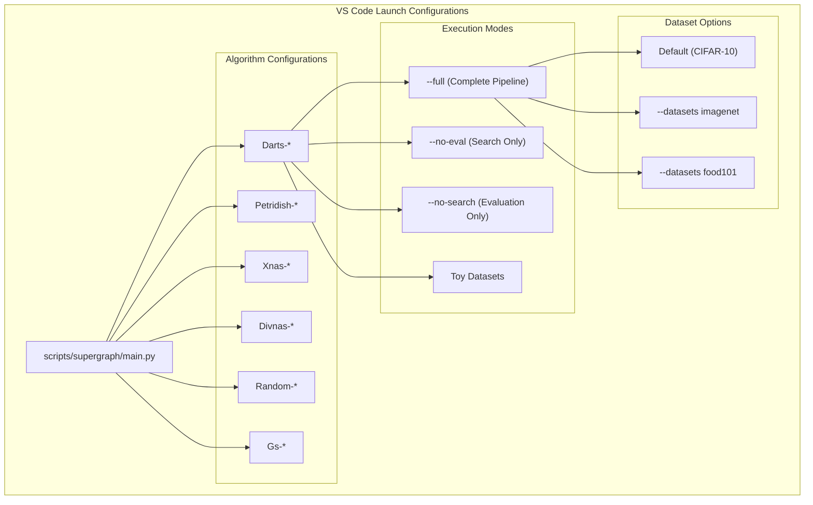

Sources: [.vscode/launch.json:1-269]()

### Package Installation and Development Setup

The platform supports multiple installation modes through setuptools configuration:

| Installation Mode | Command | Components Included |
|------------------|---------|-------------------|
| Core | `pip install archai` | Basic NAS functionality, ONNX evaluation |
| Computer Vision | `pip install archai[cv]` | + OpenCV, Lightning, torchvision |
| Natural Language Processing | `pip install archai[nlp]` | + Transformers, datasets, tokenizers |
| Azure ML | `pip install archai[aml]` | + Azure ML SDK, Jupyter notebooks |
| Development | `pip install archai[dev]` | All extras except DeepSpeed (Windows) |

Sources: [setup.py:76-144](), [README.md:30-43]()

## Integration Capabilities

### Cloud Infrastructure Support

Archai integrates with cloud platforms for distributed execution and storage:

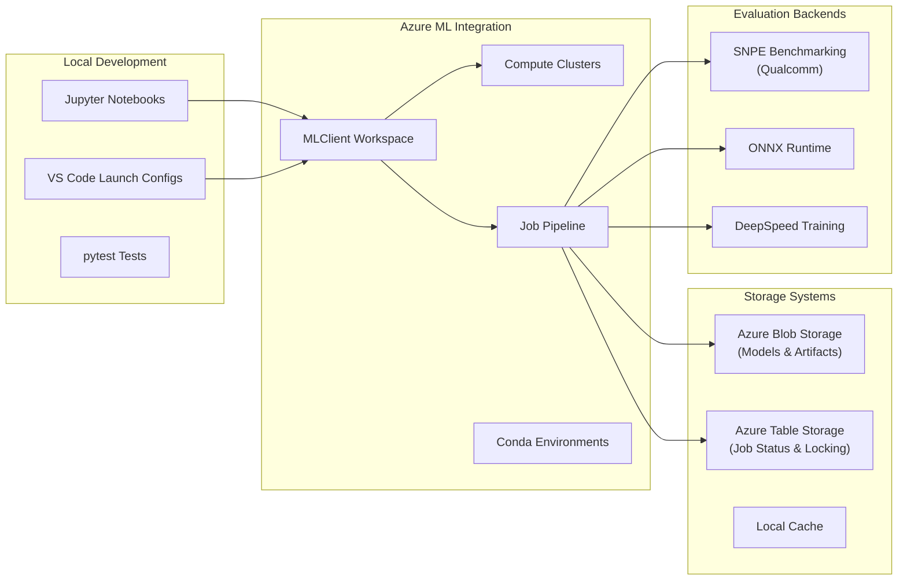

Sources: [setup.py:114-127](), [.amltignore:1-12](), [.github/workflows/build-publish-docs.yml:1-46]()

### Evaluation and Benchmarking Framework

The platform provides multiple evaluation backends for comprehensive architecture assessment:

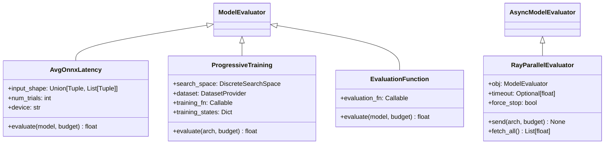

Sources: [archai/discrete_search/evaluators/onnx_model.py:16-91](), [archai/discrete_search/evaluators/progressive_training.py:29-158](), [archai/discrete_search/evaluators/ray.py:23-91](), [archai/discrete_search/evaluators/functional.py:13-34]()

---

# Page: Getting Started

# Getting Started

<details>
<summary>Relevant source files</summary>

The following files were used as context for generating this wiki page:

- [.amltignore](.amltignore)
- [.gitattributes](.gitattributes)
- [.github/ISSUE_TEMPLATE/bug-report.md](.github/ISSUE_TEMPLATE/bug-report.md)
- [.github/ISSUE_TEMPLATE/feature-request.md](.github/ISSUE_TEMPLATE/feature-request.md)
- [.github/ISSUE_TEMPLATE/regular-issue.md](.github/ISSUE_TEMPLATE/regular-issue.md)
- [.github/workflows/build-publish-docs.yml](.github/workflows/build-publish-docs.yml)
- [.github/workflows/build-release-pypi.yml](.github/workflows/build-release-pypi.yml)
- [.github/workflows/check-with-codeql.yml](.github/workflows/check-with-codeql.yml)
- [.github/workflows/check-with-devskim.yml](.github/workflows/check-with-devskim.yml)
- [README.md](README.md)
- [docs/advanced_guide/cloud/azure/notebooks/quickstart/conda.yaml](docs/advanced_guide/cloud/azure/notebooks/quickstart/conda.yaml)
- [docs/advanced_guide/cloud/azure/notebooks/quickstart/main.py](docs/advanced_guide/cloud/azure/notebooks/quickstart/main.py)
- [docs/advanced_guide/cloud/azure/notebooks/quickstart/quickstart.ipynb](docs/advanced_guide/cloud/azure/notebooks/quickstart/quickstart.ipynb)
- [docs/advanced_guide/cloud/azure/notebooks/text_generation/conda.yaml](docs/advanced_guide/cloud/azure/notebooks/text_generation/conda.yaml)
- [docs/advanced_guide/cloud/azure/notebooks/text_generation/src/generate_text.py](docs/advanced_guide/cloud/azure/notebooks/text_generation/src/generate_text.py)
- [docs/advanced_guide/cloud/azure/notebooks/text_generation/src/generate_text.yaml](docs/advanced_guide/cloud/azure/notebooks/text_generation/src/generate_text.yaml)
- [docs/advanced_guide/cloud/azure/notebooks/text_generation/src/search.py](docs/advanced_guide/cloud/azure/notebooks/text_generation/src/search.py)
- [docs/advanced_guide/cloud/azure/notebooks/text_generation/src/search.yaml](docs/advanced_guide/cloud/azure/notebooks/text_generation/src/search.yaml)
- [docs/advanced_guide/cloud/azure/notebooks/text_generation/src/train.py](docs/advanced_guide/cloud/azure/notebooks/text_generation/src/train.py)
- [docs/advanced_guide/cloud/azure/notebooks/text_generation/src/train.yaml](docs/advanced_guide/cloud/azure/notebooks/text_generation/src/train.yaml)
- [docs/advanced_guide/cloud/azure/notebooks/text_generation/text_generation.ipynb](docs/advanced_guide/cloud/azure/notebooks/text_generation/text_generation.ipynb)
- [docs/getting_started/notebooks/discrete_search.rst](docs/getting_started/notebooks/discrete_search.rst)
- [docs/getting_started/notebooks/discrete_search/algos.ipynb](docs/getting_started/notebooks/discrete_search/algos.ipynb)
- [docs/getting_started/notebooks/discrete_search/config_search.ipynb](docs/getting_started/notebooks/discrete_search/config_search.ipynb)
- [docs/getting_started/notebooks/discrete_search/evaluators.ipynb](docs/getting_started/notebooks/discrete_search/evaluators.ipynb)
- [docs/getting_started/notebooks/discrete_search/search_space.ipynb](docs/getting_started/notebooks/discrete_search/search_space.ipynb)
- [docs/getting_started/notebooks/discrete_search/ss_example.png](docs/getting_started/notebooks/discrete_search/ss_example.png)
- [setup.py](setup.py)

</details>


This document provides an introduction to using Archai, Microsoft's Neural Architecture Search (NAS) platform. It covers installation, core concepts, and your first NAS experiment. For detailed information about specific algorithms and search spaces, see [Neural Architecture Search](#4). For cloud deployment and distributed execution, see [Cloud and Distributed Computing](#7).

## Overview

Archai is a modular platform for Neural Architecture Search that enables researchers and practitioners to discover efficient neural network architectures through automated search. The platform supports both computer vision and natural language processing tasks, with capabilities for multi-objective optimization, distributed execution, and cloud integration.

The system is built around four key abstractions:
- **Search Spaces**: Define the universe of possible architectures
- **Search Algorithms**: Explore the search space efficiently  
- **Evaluators**: Assess architecture quality across multiple objectives
- **Search Objectives**: Define optimization goals with constraints

Sources: [README.md:1-158](), [setup.py:166-188]()

## Installation

### Basic Installation

Archai requires Python 3.8+ and PyTorch 1.7.0+. Install the core package via PyPI:

```bash
pip install archai
```

### Optional Dependencies

Archai uses a modular dependency system allowing you to install only the components you need:

| Extra | Purpose | Install Command |
|-------|---------|-----------------|
| `cv` | Computer Vision tasks | `pip install archai[cv]` |
| `nlp` | Natural Language Processing | `pip install archai[nlp]` |
| `aml` | Azure Machine Learning integration | `pip install archai[aml]` |
| `deepspeed` | Distributed training support | `pip install archai[deepspeed]` |
| `dev` | Development tools and testing | `pip install archai[dev]` |

For development with all features:
```bash
pip install archai[dev]
```

Sources: [setup.py:74-145](), [README.md:30-42]()

## Core Architecture

### Package Structure

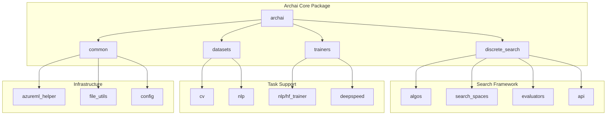

Sources: [setup.py:7-63](), [docs/getting_started/notebooks/discrete_search/search_space.ipynb:52-53]()

### Key Classes and Components

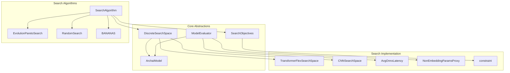

Sources: [docs/getting_started/notebooks/discrete_search/search_space.ipynb:42-53](), [docs/getting_started/notebooks/discrete_search/algos.ipynb:453-456]()

## Your First NAS Experiment

### Quick Start Example

The simplest way to get started is with the transformer search example from the README:

```python
from archai.discrete_search.search_spaces.nlp.transformer_flex.search_space import TransformerFlexSearchSpace
from archai.discrete_search.api.search_objectives import SearchObjectives
from archai.discrete_search.evaluators.nlp.parameters import NonEmbeddingParamsProxy
from archai.discrete_search.evaluators.nlp.transformer_flex_latency import TransformerFlexOnnxLatency
from archai.discrete_search.evaluators.nlp.transformer_flex_memory import TransformerFlexOnnxMemory
from archai.discrete_search.algos.evolution_pareto import EvolutionParetoSearch

# Create search space
space = TransformerFlexSearchSpace("gpt2")

# Define objectives
search_objectives = SearchObjectives()
search_objectives.add_objective(
    "non_embedding_params",
    NonEmbeddingParamsProxy(),
    higher_is_better=True,
    compute_intensive=False,
    constraint=(1e6, 1e9),
)

# Initialize algorithm and run search
algo = EvolutionParetoSearch(
    space, search_objectives, None, "output_dir",
    num_iters=5, init_num_models=10, seed=1234,
)
algo.search()
```

This example demonstrates the core workflow: define a search space, specify optimization objectives, choose an algorithm, and execute the search.

Sources: [README.md:53-115](), [docs/advanced_guide/cloud/azure/notebooks/quickstart/main.py:10-53]()

### Search Workflow

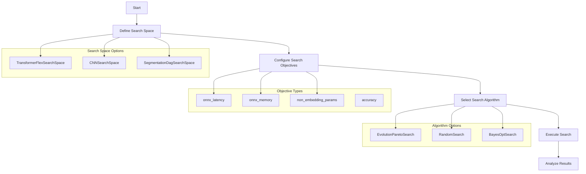

Sources: [docs/getting_started/notebooks/discrete_search/algos.ipynb:483-530](), [docs/getting_started/notebooks/discrete_search/search_space.ipynb:283-334]()

## Development Environment Setup

### VS Code Integration

Archai provides extensive VS Code integration for development and debugging:

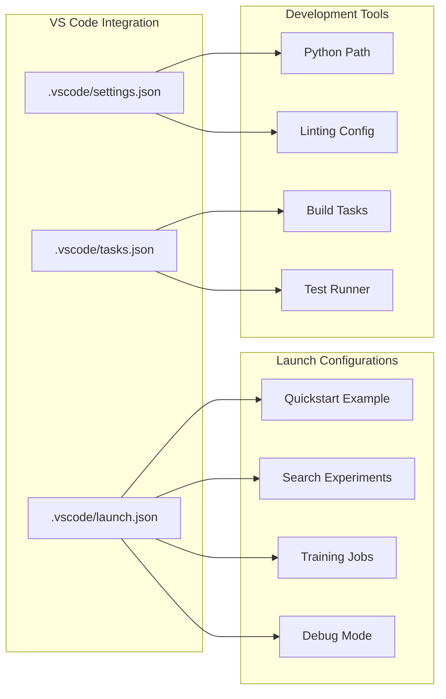

### Jupyter Notebooks

Interactive examples are provided through Jupyter notebooks:

| Notebook | Purpose | Location |
|----------|---------|----------|
| Search Spaces | Define custom architectures | `docs/getting_started/notebooks/discrete_search/search_space.ipynb` |
| Evaluators | Model assessment | `docs/getting_started/notebooks/discrete_search/evaluators.ipynb` |
| Algorithms | Search algorithm usage | `docs/getting_started/notebooks/discrete_search/algos.ipynb` |
| Config Search | Configuration-based spaces | `docs/getting_started/notebooks/discrete_search/config_search.ipynb` |

Sources: [docs/getting_started/notebooks/discrete_search.rst:1-11](), [.github/workflows/build-publish-docs.yml:19-45]()

## Cloud Integration

### Azure Machine Learning

Archai provides first-class Azure ML integration for distributed search:

```python
import archai.common.azureml_helper as aml_helper

# Get ML client
ml_client = aml_helper.get_aml_client_from_file("config.json")

# Create compute cluster  
compute_cluster = aml_helper.create_compute_cluster(
    ml_client, "nas-cpu-cluster-D14-v2"
)

# Submit search job
job = ml_client.create_or_update(search_job)
```

### Environment Configuration

Cloud environments are defined using conda YAML files:

```yaml
name: nas-env
channels:
  - conda-forge
dependencies:
  - python=3.10
  - pip
  - pip:
    - "archai[cv,nlp] @ git+https://github.com/microsoft/archai.git"
```

Sources: [docs/advanced_guide/cloud/azure/notebooks/quickstart/quickstart.ipynb:27-41](), [docs/advanced_guide/cloud/azure/notebooks/quickstart/conda.yaml:1-8]()

## Next Steps

After completing your first experiment, explore these areas:

1. **Custom Search Spaces**: Learn to define domain-specific architectures in [Search Spaces and Architecture Definitions](#4.2)
2. **Multi-Objective Optimization**: Understand Pareto frontier search in [Evaluators and Search Objectives](#4.3)  
3. **Distributed Execution**: Scale experiments using [Distributed Training and Execution](#7.3)
4. **Task Applications**: Apply to specific domains in [Tasks and Applications](#6)

For comprehensive examples, see the task implementations:
- **Text Generation**: [tasks/text_generation]()
- **Face Segmentation**: [tasks/face_segmentation]()

Sources: [README.md:119-125](), [docs/advanced_guide/cloud/azure/notebooks/text_generation/text_generation.ipynb:17-37]()

---

# Page: Core Framework

# Core Framework

<details>
<summary>Relevant source files</summary>

The following files were used as context for generating this wiki page:

- [archai/common/__init__.py](archai/common/__init__.py)
- [archai/common/apex_utils.py](archai/common/apex_utils.py)
- [archai/common/common.py](archai/common/common.py)
- [archai/common/config.py](archai/common/config.py)
- [archai/common/distributed_utils.py](archai/common/distributed_utils.py)
- [archai/common/file_utils.py](archai/common/file_utils.py)
- [archai/common/ml_utils.py](archai/common/ml_utils.py)
- [archai/common/ordered_dict_logger.py](archai/common/ordered_dict_logger.py)
- [archai/common/timing.py](archai/common/timing.py)
- [archai/common/utils.py](archai/common/utils.py)
- [archai/datasets/cv/face_synthetics.py](archai/datasets/cv/face_synthetics.py)
- [archai/datasets/nlp/nvidia_dataset_provider.py](archai/datasets/nlp/nvidia_dataset_provider.py)
- [archai/datasets/nlp/nvidia_dataset_provider_utils.py](archai/datasets/nlp/nvidia_dataset_provider_utils.py)
- [archai/datasets/nlp/tokenizer_utils/bbpe_tokenizer.py](archai/datasets/nlp/tokenizer_utils/bbpe_tokenizer.py)
- [archai/datasets/nlp/tokenizer_utils/gpt2_tokenizer.py](archai/datasets/nlp/tokenizer_utils/gpt2_tokenizer.py)
- [archai/datasets/nlp/tokenizer_utils/tokenizer_base.py](archai/datasets/nlp/tokenizer_utils/tokenizer_base.py)
- [archai/datasets/nlp/tokenizer_utils/word_tokenizer.py](archai/datasets/nlp/tokenizer_utils/word_tokenizer.py)
- [archai/trainers/nlp/nvidia_trainer.py](archai/trainers/nlp/nvidia_trainer.py)
- [archai/trainers/nlp/nvidia_training_args.py](archai/trainers/nlp/nvidia_training_args.py)
- [confs/algos/darts.yaml](confs/algos/darts.yaml)
- [confs/datasets/imagenet.yaml](confs/datasets/imagenet.yaml)
- [confs/datasets/size_224x224_base.yaml](confs/datasets/size_224x224_base.yaml)

</details>


## Purpose and Scope

The Core Framework provides the foundational infrastructure that underpins all Archai functionality. It encompasses system initialization, configuration management, distributed training support, logging infrastructure, and common utilities. This framework serves as the base layer that enables neural architecture search algorithms, training pipelines, and task-specific applications to operate consistently across different environments and hardware configurations.

For information about specific NAS algorithms and search spaces built on this framework, see [Neural Architecture Search](#4). For details about training implementations and dataset handling, see [Data and Training](#5). For cloud deployment and distributed execution capabilities, see [Cloud and Distributed Computing](#7).

## Configuration System Architecture

The configuration system in Archai is built around hierarchical YAML files with support for includes, environment variable expansion, and command-line overrides. The `Config` class provides the core functionality for loading and managing these configurations.

### Configuration Hierarchy and Resolution

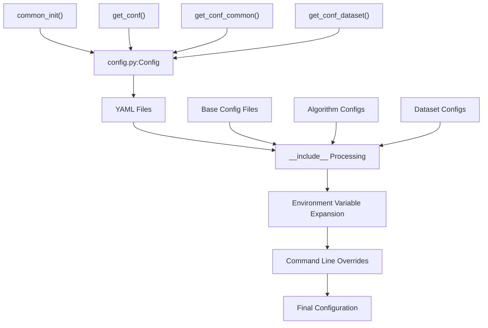

**Configuration Processing Flow**

Sources: [archai/common/config.py:32-178](), [archai/common/common.py:111-127]()

The `Config` class extends `UserDict` and supports hierarchical configuration loading with multiple inheritance levels. Key configuration files include algorithm-specific settings like [confs/algos/darts.yaml:1-277]() and dataset configurations like [confs/datasets/imagenet.yaml:1-84]().

### Configuration Access Patterns

| Function | Purpose | Return Type |
|----------|---------|-------------|
| `get_conf()` | Get global config instance | `Config` |
| `get_conf_common()` | Get common section | `Config` |
| `get_conf_dataset()` | Get dataset section | `Config` |
| `get_experiment_name()` | Get experiment identifier | `str` |
| `get_expdir()` | Get experiment directory | `str` |

Sources: [archai/common/common.py:36-54]()

## System Initialization and Infrastructure

The core framework provides centralized system initialization through the `common_init()` function, which sets up all necessary components for consistent execution across different environments.

### System Initialization Flow

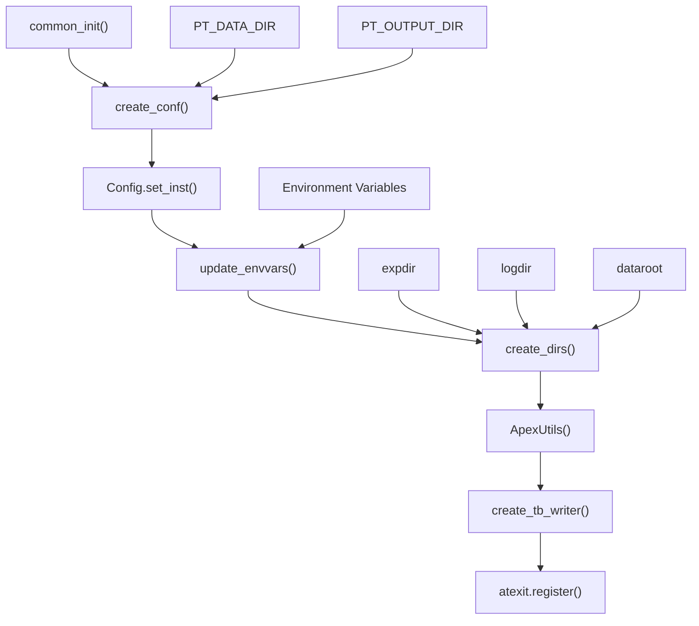

**Core System Setup Process**

Sources: [archai/common/common.py:132-167]()

The initialization process handles both local development and cloud infrastructure environments, automatically detecting PT (PyTorch/Azure ML) infrastructure through environment variables and adjusting paths accordingly.

### Directory Structure Management

The framework automatically creates and manages a standardized directory structure:

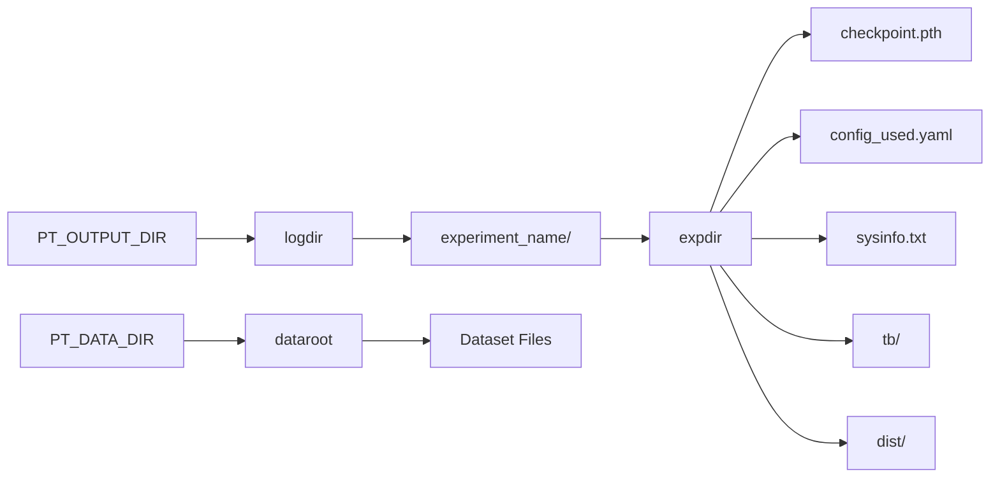

**Directory Organization and Path Resolution**

Sources: [archai/common/common.py:182-290](), [archai/common/utils.py:136-144]()

## Distributed Training and Hardware Support

The `ApexUtils` class provides comprehensive support for distributed training, mixed precision, and hardware optimization across different deployment scenarios.

### Distributed Training Architecture

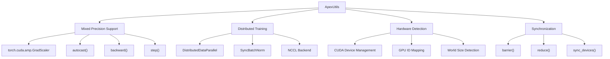

**ApexUtils Hardware and Distribution Management**

Sources: [archai/common/apex_utils.py:26-281]()

### Multi-GPU Training Configuration

The framework supports multiple distributed training strategies through environment variable detection and automatic configuration:

| Environment Variable | Purpose | Effect |
|---------------------|---------|---------|
| `WORLD_SIZE` | Total number of processes | Enables distributed mode |
| `LOCAL_RANK` | Local process rank | GPU assignment |
| `RANK` | Global process rank | Process identification |
| `CUDA_VISIBLE_DEVICES` | Available GPUs | Device filtering |

Sources: [archai/common/apex_utils.py:139-170]()

## Machine Learning Infrastructure

The framework provides standardized components for model training, optimization, and evaluation that work consistently across different algorithms and tasks.

### Training Component Factory System

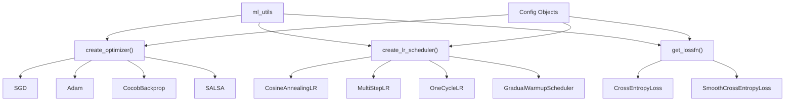

**ML Component Creation and Configuration**

Sources: [archai/common/ml_utils.py:24-154]()

### Model Utilities and Evaluation

The framework includes utilities for model analysis, parameter counting, and performance evaluation:

```python
# Example usage patterns from the codebase
param_size(model, ignore_aux=True)  # Parameter counting
accuracy(output, target, topk=(1,5))  # Top-k accuracy
drop_path_(tensor, drop_prob, training)  # DropPath regularization
```

Sources: [archai/common/ml_utils.py:157-206]()

## Logging and Development Infrastructure

Archai provides structured logging through the `OrderedDictLogger` class, which supports hierarchical logging with automatic YAML serialization for experiment tracking.

### Structured Logging Architecture

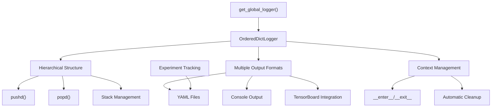

**Structured Logging System**

Sources: [archai/common/ordered_dict_logger.py:20-318]()

### Development and Debugging Support

The framework includes debugging detection, process management, and development environment support:

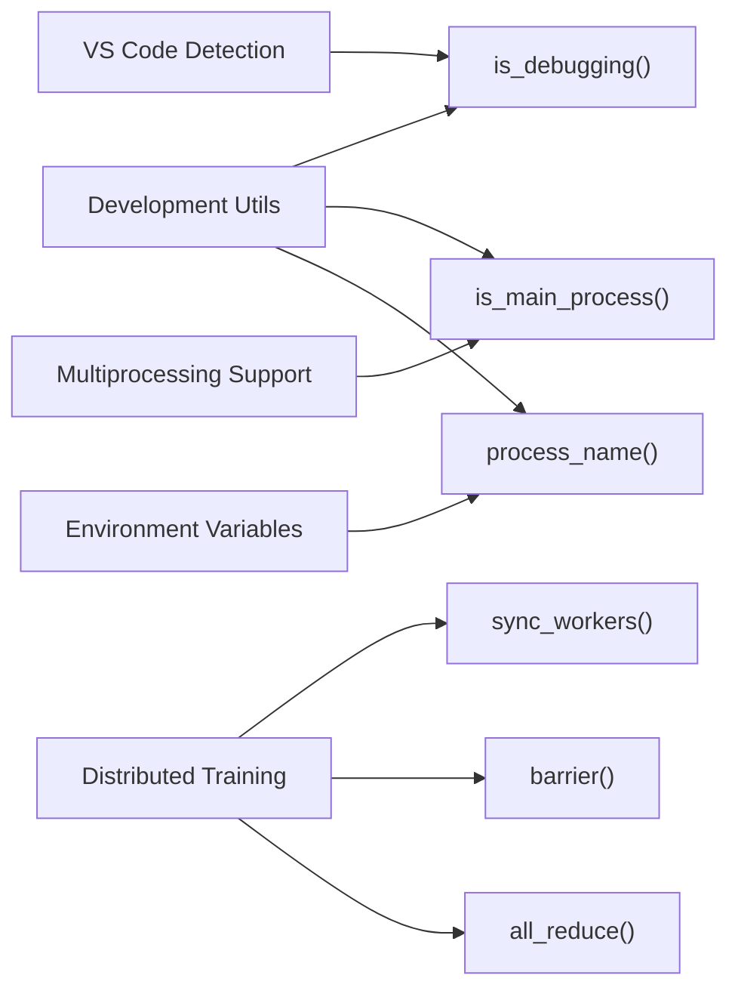

**Development and Process Management**

Sources: [archai/common/utils.py:124-389](), [archai/common/distributed_utils.py:12-153]()

## File and Storage Management

The framework provides comprehensive file handling utilities that work consistently across different storage backends and operating systems.

### File Operations Infrastructure

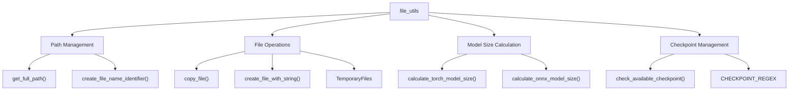

**File System Utilities and Management**

Sources: [archai/common/file_utils.py:15-215]()

The framework handles platform-specific file system differences and provides robust file operations that work across Azure blob storage, local filesystems, and networked storage systems.

# Core Framework

The Core Framework provides the foundational infrastructure that underpins all Archai functionality. It encompasses system initialization, configuration management, distributed training support, logging infrastructure, and common utilities. This framework serves as the base layer that enables neural architecture search algorithms, training pipelines, and task-specific applications to operate consistently across different environments and hardware configurations.

For information about specific NAS algorithms and search spaces built on this framework, see [Neural Architecture Search](#4). For details about training implementations and dataset handling, see [Data and Training](#5). For cloud deployment and distributed execution capabilities, see [Cloud and Distributed Computing](#7).

## Configuration System Architecture

The configuration system in Archai is built around hierarchical YAML files with support for includes, environment variable expansion, and command-line overrides. The `Config` class provides the core functionality for loading and managing these configurations.

### Configuration Hierarchy and Resolution

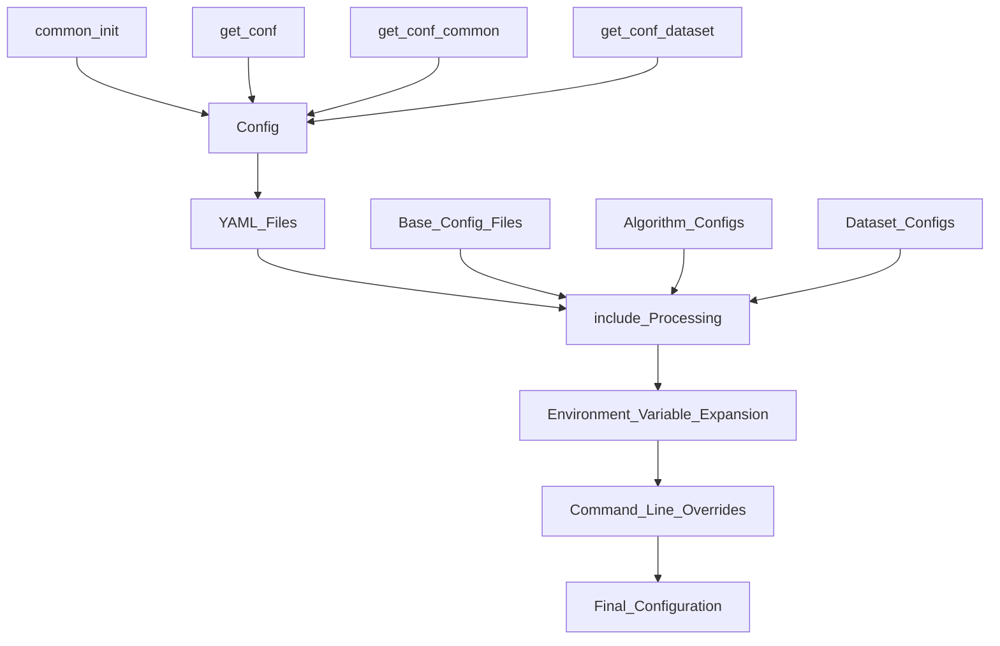

The `Config` class extends `UserDict` and supports hierarchical configuration loading with multiple inheritance levels. Key configuration files include algorithm-specific settings and dataset configurations that can be composed through the `__include__` mechanism.

### Configuration Access Patterns

| Function | Purpose | Return Type |
|----------|---------|-------------|
| `get_conf()` | Get global config instance | `Config` |
| `get_conf_common()` | Get common section | `Config` |
| `get_conf_dataset()` | Get dataset section | `Config` |
| `get_experiment_name()` | Get experiment identifier | `str` |
| `get_expdir()` | Get experiment directory | `str` |

Sources: [archai/common/config.py:32-178](), [archai/common/common.py:36-54](), [confs/algos/darts.yaml:1-277]()

## System Initialization and Infrastructure

The core framework provides centralized system initialization through the `common_init()` function, which sets up all necessary components for consistent execution across different environments.

### System Initialization Flow

```mermaid
graph TD
    A["common_init"] --> B["create_conf"]
    B --> C["Config_set_inst"]
    C --> D["update_envvars"]
    D --> E["create_dirs"]
    E --> F["ApexUtils"]
    F --> G["create_tb_writer"]
    G --> H["atexit_register"]
    
    I["PT_DATA_DIR"] --> B
    J["PT_OUTPUT_DIR"] --> B
    K["Environment_Variables"] --> D
    
    L["expdir"] --> E
    M["logdir"] --> E
    N["dataroot"] --> E
```

The initialization process handles both local development and cloud infrastructure environments, automatically detecting PT (PyTorch/Azure ML) infrastructure through environment variables and adjusting paths accordingly.

### Directory Structure Management

The framework automatically creates and manages a standardized directory structure:

```mermaid
graph LR
    A["logdir"] --> B["experiment_name"]
    B --> C["expdir"]
    C --> D["checkpoint_pth"]
    C --> E["config_used_yaml"]
    C --> F["sysinfo_txt"]
    C --> G["tb_dir"]
    C --> H["dist_dir"]
    
    I["dataroot"] --> J["Dataset_Files"]
    
    K["PT_OUTPUT_DIR"] --> A
    L["PT_DATA_DIR"] --> I
```

Sources: [archai/common/common.py:132-167](), [archai/common/common.py:182-290](), [archai/common/utils.py:136-144]()

## Distributed Training and Hardware Support

The `ApexUtils` class provides comprehensive support for distributed training, mixed precision, and hardware optimization across different deployment scenarios.

### Distributed Training Architecture

```mermaid
graph TD
    A["ApexUtils"] --> B["Mixed_Precision_Support"]
    A --> C["Distributed_Training"]
    A --> D["Hardware_Detection"]
    A --> E["Synchronization"]
    
    B --> F["GradScaler"]
    B --> G["autocast"]
    B --> H["backward"]
    B --> I["step"]
    
    C --> J["DistributedDataParallel"]
    C --> K["SyncBatchNorm"]
    C --> L["NCCL_Backend"]
    
    D --> M["CUDA_Device_Management"]
    D --> N["GPU_ID_Mapping"]
    D --> O["World_Size_Detection"]
    
    E --> P["barrier"]
    E --> Q["reduce"]
    E --> R["sync_devices"]
```

### Multi-GPU Training Configuration

The framework supports multiple distributed training strategies through environment variable detection and automatic configuration:

| Environment Variable | Purpose | Effect |
|---------------------|---------|---------|
| `WORLD_SIZE` | Total number of processes | Enables distributed mode |
| `LOCAL_RANK` | Local process rank | GPU assignment |
| `RANK` | Global process rank | Process identification |
| `CUDA_VISIBLE_DEVICES` | Available GPUs | Device filtering |

Sources: [archai/common/apex_utils.py:26-281](), [archai/common/apex_utils.py:139-170]()

## Machine Learning Infrastructure

The framework provides standardized components for model training, optimization, and evaluation that work consistently across different algorithms and tasks.

### Training Component Factory System

```mermaid
graph TD
    A["ml_utils"] --> B["create_optimizer"]
    A --> C["create_lr_scheduler"]
    A --> D["get_lossfn"]
    
    B --> E["SGD"]
    B --> F["Adam"]
    B --> G["CocobBackprop"]
    B --> H["SALSA"]
    
    C --> I["CosineAnnealingLR"]
    C --> J["MultiStepLR"]
    C --> K["OneCycleLR"]
    C --> L["GradualWarmupScheduler"]
    
    D --> M["CrossEntropyLoss"]
    D --> N["SmoothCrossEntropyLoss"]
    
    O["Config_Objects"] --> B
    O --> C
    O --> D
```

### Model Utilities and Evaluation

The framework includes utilities for model analysis, parameter counting, and performance evaluation:

- `param_size()` for parameter counting with auxiliary tower handling
- `accuracy()` for top-k accuracy computation
- `drop_path_()` for DropPath regularization during training
- `clear_gpu_memory()` for memory management during long runs

Sources: [archai/common/ml_utils.py:24-154](), [archai/common/ml_utils.py:157-260]()

## Logging and Development Infrastructure

Archai provides structured logging through the `OrderedDictLogger` class, which supports hierarchical logging with automatic YAML serialization for experiment tracking.

### Structured Logging Architecture

```mermaid
graph TD
    A["OrderedDictLogger"] --> B["Hierarchical_Structure"]
    A --> C["Multiple_Output_Formats"]
    A --> D["Context_Management"]
    
    B --> E["pushd"]
    B --> F["popd"]
    B --> G["Stack_Management"]
    
    C --> H["YAML_Files"]
    C --> I["Console_Output"]
    C --> J["TensorBoard_Integration"]
    
    D --> K["enter_exit"]
    D --> L["Automatic_Cleanup"]
    
    M["get_global_logger"] --> A
    N["Experiment_Tracking"] --> H
```

### Development and Debugging Support

The framework includes debugging detection, process management, and development environment support:

```mermaid
graph LR
    A["Development_Utils"] --> B["is_debugging"]
    A --> C["is_main_process"]
    A --> D["process_name"]
    
    E["VS_Code_Detection"] --> B
    F["Multiprocessing_Support"] --> C
    G["Environment_Variables"] --> D
    
    H["Distributed_Training"] --> I["sync_workers"]
    H --> J["barrier"]
    H --> K["all_reduce"]
```

Sources: [archai/common/ordered_dict_logger.py:20-318](), [archai/common/utils.py:124-389](), [archai/common/distributed_utils.py:12-153]()

## File and Storage Management

The framework provides comprehensive file handling utilities that work consistently across different storage backends and operating systems.

### File Operations Infrastructure

```mermaid
graph TD
    A["file_utils"] --> B["Path_Management"]
    A --> C["File_Operations"]
    A --> D["Model_Size_Calculation"]
    A --> E["Checkpoint_Management"]
    
    B --> F["get_full_path"]
    B --> G["create_file_name_identifier"]
    
    C --> H["copy_file"]
    C --> I["create_file_with_string"]
    C --> J["TemporaryFiles"]
    
    D --> K["calculate_torch_model_size"]
    D --> L["calculate_onnx_model_size"]
    
    E --> M["check_available_checkpoint"]
    E --> N["CHECKPOINT_REGEX"]
```

The framework handles platform-specific file system differences and provides robust file operations that work across Azure blob storage, local filesystems, and networked storage systems. The `TemporaryFiles` context manager addresses Windows-specific file handling limitations.

Sources: [archai/common/file_utils.py:15-215](), [archai/common/utils.py:333-371]()

---

# Page: Package Structure and Distribution

# Package Structure and Distribution

<details>
<summary>Relevant source files</summary>

The following files were used as context for generating this wiki page:

- [.amltignore](.amltignore)
- [.gitattributes](.gitattributes)
- [.github/ISSUE_TEMPLATE/bug-report.md](.github/ISSUE_TEMPLATE/bug-report.md)
- [.github/ISSUE_TEMPLATE/feature-request.md](.github/ISSUE_TEMPLATE/feature-request.md)
- [.github/ISSUE_TEMPLATE/regular-issue.md](.github/ISSUE_TEMPLATE/regular-issue.md)
- [.github/workflows/build-publish-docs.yml](.github/workflows/build-publish-docs.yml)
- [.github/workflows/build-release-pypi.yml](.github/workflows/build-release-pypi.yml)
- [.github/workflows/check-with-codeql.yml](.github/workflows/check-with-codeql.yml)
- [.github/workflows/check-with-devskim.yml](.github/workflows/check-with-devskim.yml)
- [README.md](README.md)
- [setup.py](setup.py)

</details>


This document covers the structure of the Archai Python package, its distribution mechanism via PyPI, and the modular dependency system that allows users to install only the components they need. It explains how the package is organized, built, and published, along with the optional dependency groups that enable specific functionality.

For information about the internal code organization and module architecture, see [Common Utilities and Infrastructure](#3.3). For details about configuration files and YAML-based setup, see [Configuration System](#3.2).

## Package Overview

Archai is distributed as a single Python package named `archai` through PyPI, with a modular architecture that supports optional dependencies for different use cases. The package follows standard Python packaging conventions using setuptools.

```mermaid
graph TB
    subgraph "Archai Package Distribution"
        SETUP["setup.py<br/>Package Definition"] --> PYPI["PyPI Distribution<br/>archai==1.0.0"]
        PYPI --> INSTALL["pip install archai"]
    end
    
    subgraph "Core Package Structure"
        INSTALL --> CORE["archai/<br/>Main Package"]
        CORE --> DISCRETE["discrete_search/<br/>NAS Framework"]
        CORE --> DATASETS["datasets/<br/>Data Providers"]
        CORE --> COMMON["common/<br/>Shared Utilities"]
        CORE --> TRAINERS["trainers/<br/>Training Infrastructure"]
    end
    
    subgraph "Optional Components"
        EXTRAS["extras_require"] --> CV["cv: Computer Vision"]
        EXTRAS --> NLP["nlp: Natural Language Processing"]
        EXTRAS --> DEEPSPEED["deepspeed: Distributed Training"]
        EXTRAS --> AML["aml: Azure ML Integration"]
        EXTRAS --> DOCS["docs: Documentation Building"]
        EXTRAS --> TESTS["tests: Testing Framework"]
    end
    
    SETUP --> EXTRAS
    EXTRAS --> INSTALL
```

**Sources:** [setup.py:1-189](), [README.md:30-42]()

## Dependency Management System

The package implements a sophisticated dependency management system that allows users to install only the components they need. Dependencies are organized into core requirements and optional extras, with a helper function to manage version specifications.

### Core Dependencies

The base installation includes essential dependencies for the neural architecture search framework:

| Dependency Category | Key Packages | Purpose |
|-------------------|--------------|---------|
| NAS Framework | `hyperopt`, `ray`, `statopt` | Search algorithms and optimization |
| Model Operations | `onnx`, `onnxruntime` | Model export and inference |
| Utilities | `pyyaml`, `tqdm`, `psutil` | Configuration, progress, system monitoring |
| Visualization | `tensorboard`, `tensorwatch`, `matplotlib` | Experiment tracking and plotting |
| Storage | `h5py`, `send2trash` | Data persistence and file management |

**Sources:** [setup.py:146-161]()

### Optional Dependency Groups

The `extras_require` system provides modular installation options:

```mermaid
graph LR
    subgraph "Dependency Categories"
        FILTER["filter_dependencies()<br/>Version Management"] --> CV["cv<br/>Computer Vision"]
        FILTER --> NLP["nlp<br/>Natural Language Processing"]
        FILTER --> DEEPSPEED["deepspeed<br/>Distributed Training"]
        FILTER --> AML["aml<br/>Azure ML"]
        FILTER --> DOCS["docs<br/>Documentation"]
        FILTER --> TESTS["tests<br/>Testing"]
        FILTER --> TASKS["tasks<br/>Task Applications"]
    end
    
    subgraph "Package Groups"
        CV --> CV_PKGS["gorilla, opencv-python<br/>lightning, scikit-learn<br/>torchvision"]
        NLP --> NLP_PKGS["datasets, einops<br/>tokenizers, transformers<br/>opt_einsum"]
        DEEPSPEED --> DS_PKGS["deepspeed, mlflow"]
        AML --> AML_PKGS["azure-ai-ml, azure-storage-blob<br/>azureml-mlflow, jupyter<br/>mldesigner"]
    end
    
    subgraph "Meta Groups"
        DEV["dev<br/>Development Bundle"] --> CV
        DEV --> NLP
        DEV --> DOCS
        DEV --> TESTS
        DEV --> AML
        DEV --> TASKS
    end
```

**Sources:** [setup.py:67-145]()

### Platform-Specific Handling

The dependency system includes platform-specific logic to handle compatibility issues:

```python
# Windows compatibility handling
if os.name != "nt":
    # Support for DeepSpeed is not available on native Windows
    extras_require["dev"] += extras_require["deepspeed"]
```

**Sources:** [setup.py:142-144]()

## Distribution and Build Process

Archai is distributed through PyPI using automated GitHub Actions workflows that handle building, testing, and publishing.

```mermaid
graph TD
    subgraph "Development Workflow"
        COMMIT["Git Commit"] --> TAG["Version Tag"]
        TAG --> TRIGGER["GitHub Actions<br/>Triggered"]
    end
    
    subgraph "Build Process"
        TRIGGER --> CHECKOUT["checkout@v3<br/>Pull Repository"]
        CHECKOUT --> PYTHON["setup-python@v4<br/>Python 3.8"]
        PYTHON --> BUILD_DEPS["pip install build"]
        BUILD_DEPS --> BUILD_WHEEL["python -m build<br/>--sdist --wheel"]
    end
    
    subgraph "Publication"
        BUILD_WHEEL --> PUBLISH["gh-action-pypi-publish<br/>PyPI Release"]
        PUBLISH --> PYPI_PKG["PyPI Package<br/>archai==1.0.0"]
    end
    
    subgraph "Documentation Build"
        DOCS_TRIGGER["Docs Changes"] --> DOCS_BUILD["Sphinx Build"]
        DOCS_BUILD --> GH_PAGES["GitHub Pages<br/>Documentation Site"]
    end
```

**Sources:** [.github/workflows/build-release-pypi.yml:1-33](), [.github/workflows/build-publish-docs.yml:1-46]()

## Installation Options

Users can install Archai with different combinations of optional dependencies based on their specific needs:

### Basic Installation
```bash
pip install archai
```
Includes core NAS functionality with minimal dependencies.

### Domain-Specific Installations
```bash
# Computer Vision tasks
pip install archai[cv]

# Natural Language Processing tasks  
pip install archai[nlp]

# Azure ML integration
pip install archai[aml]
```

### Development Installation
```bash
# Full development environment
pip install archai[dev]

# Documentation building
pip install archai[docs]

# Testing framework
pip install archai[tests]
```

### Performance Optimizations
```bash
# DeepSpeed distributed training
pip install archai[deepspeed]

# Flash attention optimization
pip install archai[flash-attn]

# XFormers memory-efficient attention
pip install archai[xformers]
```

**Sources:** [setup.py:76-144](), [README.md:34-42]()

## Package Metadata and Classification

The package is configured with comprehensive metadata for PyPI distribution:

| Attribute | Value | Purpose |
|-----------|-------|---------|
| `name` | `"archai"` | PyPI package identifier |
| `version` | `"1.0.0"` | Current release version |
| `description` | `"Platform for Neural Architecture Search"` | Short description |
| `author` | `"Microsoft"` | Package maintainer |
| `license` | `"MIT"` | Open source license |
| `url` | `"https://github.com/microsoft/archai"` | Source repository |

The package includes comprehensive classifiers for PyPI categorization:
- **Audience:** Science/Research
- **License:** MIT License  
- **Development Status:** Production/Stable
- **Programming Language:** Python 3
- **Topic:** Software Development Libraries

**Sources:** [setup.py:166-188]()

## Excluded Components

Certain directories and files are excluded from different distribution contexts:

### Azure ML Exclusions
The `.amltignore` file excludes development and documentation files from Azure ML job uploads:
- `confs/` - Configuration files
- `devops/` - CI/CD scripts  
- `docs/` - Documentation source
- `research/` - Research code
- `scripts/` - Utility scripts
- `tasks/` - Task-specific implementations
- `tests/` - Test suites

**Sources:** [.amltignore:4-12]()

### Git Attributes
The `.gitattributes` file configures repository behavior:
- Documentation and notebooks excluded from language statistics
- Shell scripts use LF line endings
- Jupyter notebooks classified as Python for GitHub statistics

**Sources:** [.gitattributes:4-9]()

---

# Page: Configuration System

# Configuration System

<details>
<summary>Relevant source files</summary>

The following files were used as context for generating this wiki page:

- [archai/common/__init__.py](archai/common/__init__.py)
- [archai/common/config.py](archai/common/config.py)
- [archai/common/distributed_utils.py](archai/common/distributed_utils.py)
- [archai/common/file_utils.py](archai/common/file_utils.py)
- [archai/common/ordered_dict_logger.py](archai/common/ordered_dict_logger.py)
- [archai/common/timing.py](archai/common/timing.py)
- [archai/datasets/cv/face_synthetics.py](archai/datasets/cv/face_synthetics.py)
- [archai/datasets/nlp/nvidia_dataset_provider.py](archai/datasets/nlp/nvidia_dataset_provider.py)
- [archai/datasets/nlp/nvidia_dataset_provider_utils.py](archai/datasets/nlp/nvidia_dataset_provider_utils.py)
- [archai/datasets/nlp/tokenizer_utils/bbpe_tokenizer.py](archai/datasets/nlp/tokenizer_utils/bbpe_tokenizer.py)
- [archai/datasets/nlp/tokenizer_utils/gpt2_tokenizer.py](archai/datasets/nlp/tokenizer_utils/gpt2_tokenizer.py)
- [archai/datasets/nlp/tokenizer_utils/tokenizer_base.py](archai/datasets/nlp/tokenizer_utils/tokenizer_base.py)
- [archai/datasets/nlp/tokenizer_utils/word_tokenizer.py](archai/datasets/nlp/tokenizer_utils/word_tokenizer.py)
- [archai/trainers/nlp/nvidia_trainer.py](archai/trainers/nlp/nvidia_trainer.py)
- [archai/trainers/nlp/nvidia_training_args.py](archai/trainers/nlp/nvidia_training_args.py)
- [confs/algos/manual.yaml](confs/algos/manual.yaml)
- [confs/algos/petridish.yaml](confs/algos/petridish.yaml)

</details>


The Configuration System provides a hierarchical, YAML-based approach to configuring all aspects of the Archai framework. It enables reproducible experiments through structured configuration files, supports environment-specific overrides, and integrates with command-line arguments for flexible experiment management.

For information about VS Code integration and launch configurations, see [VS Code Integration and Launch Configurations](#8.1). For details about training infrastructure configuration, see [Training Infrastructure](#5.2).

## Core Configuration Architecture

The configuration system is built around the `Config` class which extends Python's `UserDict` to provide hierarchical configuration management with YAML file loading, include support, and runtime overrides.

```mermaid
graph TB
    subgraph "Config Class Architecture"
        Config["Config(UserDict)"] --> LoadYAML["_load_from_file()"]
        Config --> ProcessIncludes["_process_includes()"]
        Config --> UpdateArgs["_update_from_args()"]
        Config --> ResolveEnv["_process_envvars()"]
    end
    
    subgraph "Configuration Sources"
        YAMLFiles["YAML Files<br/>confs/algos/*.yaml"]
        CommandLine["Command Line Args<br/>--param.subparam value"]
        EnvVars["Environment Variables<br/>${ENV_VAR_NAME}"]
        Includes["Include Files<br/>__include__: 'base.yaml'"]
    end
    
    subgraph "Resolution Process"
        Load1["1. Load Base YAML"]
        Load2["2. Process Includes"]
        Load3["3. Apply Overrides"]
        Load4["4. Resolve Environment Variables"]
        Load5["5. Final Resolution"]
    end
    
    YAMLFiles --> LoadYAML
    Includes --> ProcessIncludes
    CommandLine --> UpdateArgs
    EnvVars --> ResolveEnv
    
    LoadYAML --> Load1
    Load1 --> Load2
    Load2 --> Load3
    Load3 --> Load4
    Load4 --> Load5
```

Sources: [archai/common/config.py:32-178]()

## YAML Configuration Structure

Algorithm configurations follow a hierarchical structure with support for inheritance through the `__include__` mechanism. The system uses a nested dictionary approach where configuration sections correspond to different framework components.

```mermaid
graph TD
    subgraph "Algorithm Configuration Hierarchy"
        PetridishYAML["confs/algos/petridish.yaml"] --> IncludeDarts["__include__: 'darts.yaml'"]
        ManualYAML["confs/algos/manual.yaml"] --> IncludeDarts2["__include__: 'darts.yaml'"]
        
        IncludeDarts --> DartsBase["darts.yaml<br/>(Base Configuration)"]
        IncludeDarts2 --> DartsBase
    end
    
    subgraph "Configuration Sections"
        Common["common:<br/>apex, ray settings"]
        NAS["nas:<br/>eval, search settings"]
        Trainer["trainer:<br/>epochs, optimizer"]
        Loader["loader:<br/>batch_size, transforms"]
        ModelDesc["model_desc:<br/>n_cells, n_reductions"]
    end
    
    subgraph "Search-Specific Config"
        Petridish["petridish:<br/>convex_hull_eps<br/>max_madd<br/>max_hull_points"]
        SeedTrain["seed_train:<br/>trainer, loader"]
        PostTrain["post_train:<br/>trainer, loader"]
    end
    
    DartsBase --> Common
    DartsBase --> NAS
    NAS --> Trainer
    NAS --> Loader
    NAS --> ModelDesc
    PetridishYAML --> Petridish
    PetridishYAML --> SeedTrain
    PetridishYAML --> PostTrain
```

Sources: [confs/algos/petridish.yaml:1-62](), [confs/algos/manual.yaml:1-62]()

## Configuration Loading and Processing

The `Config` class implements a sophisticated loading mechanism that processes includes, handles command-line overrides, and resolves environment variables in a specific order to ensure predictable configuration resolution.

```mermaid
sequenceDiagram
    participant User
    participant Config
    participant YAMLFiles
    participant Environment
    participant Args
    
    User->>Config: Config(config_filepath, use_args=True)
    Config->>YAMLFiles: _load_from_file(filepath)
    YAMLFiles-->>Config: config_yaml
    Config->>Config: _process_includes(config_yaml, filepath)
    loop For each include file
        Config->>YAMLFiles: _load_from_file(include_filepath)
        YAMLFiles-->>Config: include_config
        Config->>Config: deep_update(self, include_config)
    end
    Config->>Config: copy.deepcopy(self) → resolved_conf
    Config->>Config: yaml_utils.resolve_all(resolved_conf)
    Config->>Args: _update_from_args(param_args, resolved_conf)
    Config->>Args: _update_from_args(extra_args, resolved_conf)
    Config->>Environment: _process_envvars(self)
    Config->>Config: yaml_utils.resolve_all(self)
    Config-->>User: Fully resolved configuration
```

Sources: [archai/common/config.py:67-87](), [archai/common/config.py:119-164]()

## Component-Specific Training Arguments

Different training backends and components use specialized argument classes that integrate with the global configuration system while providing component-specific validation and defaults.

```mermaid
graph TB
    subgraph "Training Argument Classes"
        NvidiaArgs["NvidiaTrainingArguments"]
        BaseTrainer["TrainerBase"]
        DatasetProvider["DatasetProvider"]
        TokenizerArgs["Tokenizer Arguments"]
    end
    
    subgraph "NvidiaTrainingArguments Fields"
        ExperimentName["experiment_name: str"]
        DatasetConfig["dataset_name: str<br/>dataset_dir: str<br/>dataset_cache_dir: str"]
        TrainingConfig["max_steps: int<br/>learning_rate: float<br/>global_batch_size: int"]
        OptimConfig["optim: str<br/>lr_scheduler_type: str<br/>weight_decay: float"]
        DistributedConfig["strategy: str<br/>local_rank: int<br/>find_unused_parameters: bool"]
        QuantConfig["qat: bool<br/>mixed_qat: bool"]
    end
    
    subgraph "Configuration Methods"
        PostInit["__post_init__()<br/>Initialize distributed<br/>Create directories<br/>Set device"]
        ToDict["to_dict()<br/>Convert to dictionary"]
        DeviceProperty["device: torch.device<br/>@property"]
    end
    
    NvidiaArgs --> ExperimentName
    NvidiaArgs --> DatasetConfig
    NvidiaArgs --> TrainingConfig
    NvidiaArgs --> OptimConfig
    NvidiaArgs --> DistributedConfig
    NvidiaArgs --> QuantConfig
    
    NvidiaArgs --> PostInit
    NvidiaArgs --> ToDict
    NvidiaArgs --> DeviceProperty
    
    PostInit --> CreateDirs["_create_dirs()<br/>Dataset and output directories"]
    PostInit --> InitDistributed["init_distributed(True)<br/>Setup distributed training"]
```

Sources: [archai/trainers/nlp/nvidia_training_args.py:72-250]()

## Command Line Override System

The configuration system supports dot-notation command line overrides that can modify any nested configuration value while preserving type safety through the original configuration structure.

```mermaid
graph LR
    subgraph "Command Line Override Processing"
        CommandLine["--nas.trainer.epochs 100<br/>--common.apex.ray.enabled True"]
        ParseArgs["_update_from_args(args, resolved_section)"]
        PathSplit["path = arg[2:].split('.')"]
        UpdateSection["_update_section(section, path, val, resolved_section)"]
        TypeConversion["Convert value to original type"]
    end
    
    subgraph "Path Navigation"
        PathTraversal["for p in range(len(path)-1):<br/>  section = section[sub_path]"]
        LeafUpdate["section[key] = original_type(val)"]
        TypeCheck["if original_type == bool:<br/>  original_type = lambda x: strtobool(x) == 1"]
    end
    
    CommandLine --> ParseArgs
    ParseArgs --> PathSplit
    PathSplit --> UpdateSection
    UpdateSection --> PathTraversal
    PathTraversal --> TypeCheck
    TypeCheck --> LeafUpdate
```

Sources: [archai/common/config.py:119-164]()

## Environment Variable Resolution

The configuration system supports environment variable substitution using shell-style `${VAR_NAME}` syntax, enabling environment-specific configuration without modifying YAML files.

```mermaid
graph TD
    subgraph "Environment Variable Processing"
        ProcessEnvVars["_process_envvars(config_yaml)"]
        TraverseConfig["for key in config_yaml:<br/>  value = config_yaml[key]"]
        CheckType["isinstance(value, Config)<br/>isinstance(value, str)"]
        ExpandVars["os.path.expandvars(value)"]
    end
    
    subgraph "Variable Expansion Examples"
        Example1["'$expdir/model_desc_gallery'<br/>→ '/home/user/exp1/model_desc_gallery'"]
        Example2["'${AMLT_OUTPUT_DIR}/checkpoints'<br/>→ '/mnt/output/checkpoints'"]
        Example3["'~/dataroot'<br/>→ '/home/user/dataroot'"]
    end
    
    ProcessEnvVars --> TraverseConfig
    TraverseConfig --> CheckType
    CheckType --> ExpandVars
    ExpandVars --> Example1
    ExpandVars --> Example2
    ExpandVars --> Example3
```

Sources: [archai/common/config.py:111-118]()

## Configuration Integration Points

The configuration system integrates with multiple framework components through standardized interfaces and global configuration access patterns.

| Component | Configuration Method | Key Classes | Purpose |
|-----------|---------------------|-------------|---------|
| Trainers | Training Arguments Classes | `NvidiaTrainingArguments` | Training-specific parameters |
| Datasets | Provider Configuration | `NvidiaDatasetProvider`, `Corpus` | Dataset loading and caching |
| Tokenizers | Tokenizer-specific Args | `BbpeTokenizer`, `Gpt2Tokenizer`, `WordTokenizer` | Vocabulary and encoding |
| Distributed | Environment Variables | `distributed_utils` | Multi-node coordination |
| Logging | Logger Configuration | `OrderedDictLogger` | Structured logging |

Sources: [archai/trainers/nlp/nvidia_training_args.py:19-69](), [archai/datasets/nlp/nvidia_dataset_provider_utils.py:32-78](), [archai/datasets/nlp/tokenizer_utils/bbpe_tokenizer.py:28-92]()

## Global Configuration Access

The framework provides both instance-based and global configuration access patterns to support different usage scenarios while maintaining configuration consistency across components.

```mermaid
graph TB
    subgraph "Configuration Access Patterns"
        GlobalConfig["Config.get_inst()<br/>Global configuration instance"]
        LocalConfig["Config(config_filepath)<br/>Local configuration instance"]
        SetGlobal["Config.set_inst(instance)<br/>Set global instance"]
    end
    
    subgraph "Usage Examples"
        SearchAlgo["Search algorithms access<br/>global configuration"]
        TrainerLocal["Trainers use local<br/>training arguments"]
        ComponentShare["Components share<br/>configuration through globals"]
    end
    
    subgraph "Configuration Flow"
        LoadConfig["Load from YAML"]
        SetGlobalInst["Set as global instance"]
        ComponentAccess["Components access<br/>via Config.get_inst()"]
    end
    
    LoadConfig --> SetGlobalInst
    SetGlobalInst --> GlobalConfig
    GlobalConfig --> ComponentAccess
    LocalConfig --> TrainerLocal
    GlobalConfig --> SearchAlgo
    SetGlobal --> ComponentShare
```

Sources: [archai/common/config.py:169-178]()

---

# Page: Common Utilities and Infrastructure

# Common Utilities and Infrastructure

<details>
<summary>Relevant source files</summary>

The following files were used as context for generating this wiki page:

- [archai/common/apex_utils.py](archai/common/apex_utils.py)
- [archai/common/common.py](archai/common/common.py)
- [archai/common/delimited_text.py](archai/common/delimited_text.py)
- [archai/common/ml_utils.py](archai/common/ml_utils.py)
- [archai/common/utils.py](archai/common/utils.py)
- [confs/algos/darts.yaml](confs/algos/darts.yaml)
- [confs/datasets/cifar100.yaml](confs/datasets/cifar100.yaml)
- [confs/datasets/imagenet.yaml](confs/datasets/imagenet.yaml)
- [confs/datasets/size_224x224_base.yaml](confs/datasets/size_224x224_base.yaml)

</details>


This document covers the shared infrastructure components that provide foundational services across the Archai Neural Architecture Search framework. These utilities handle system initialization, configuration management, distributed training coordination, logging, and general-purpose functions that support all other Archai components.

For information about the package structure and distribution, see [Package Structure and Distribution](#3.1). For details about the YAML-based configuration system, see [Configuration System](#3.2).

## System Initialization and Startup

The Archai framework provides a centralized initialization system through the `common_init()` function, which coordinates the setup of all foundational components.

### Initialization Flow

```mermaid
flowchart TD
    A["common_init()"] --> B["create_conf()"]
    B --> C["Config.set_inst()"]
    C --> D["update_envvars()"]
    D --> E["create_dirs()"]
    E --> F["_create_sysinfo()"]
    F --> G["ApexUtils()"]
    G --> H["create_tb_writer()"]
    H --> I["atexit.register()"]
    
    B --> B1["_pt_params()"]
    B1 --> B2["pt_dirs()"]
    
    D --> D1["Set $logdir"]
    D1 --> D2["Set $dataroot"] 
    D2 --> D3["Set $expdir"]
    
    E --> E1["makedirs(dataroot)"]
    E1 --> E2["makedirs(expdir)"]
    E2 --> E3["makedirs(distdir)"]
    
    G --> G1["setup_cuda()"]
    G1 --> G2["Distributed Init"]
    G2 --> G3["Mixed Precision"]
```

The `common_init()` function in [archai/common/common.py:132-167]() orchestrates the initialization of:

- **Configuration Loading**: Creates and validates YAML configuration
- **Environment Setup**: Resolves paths and sets environment variables  
- **Directory Creation**: Ensures experiment and data directories exist
- **Distributed Training**: Initializes multi-GPU and distributed capabilities
- **Logging Infrastructure**: Sets up TensorBoard and structured logging
- **Cleanup Handlers**: Registers exit hooks for proper resource cleanup

### Configuration State Management

```mermaid
classDiagram
    class Config {
        +get_inst() Config
        +set_inst(conf)
        +to_dict() dict
    }
    
    class CommonState {
        +conf: Config
        +tb_writer: SummaryWriterAny
        +__init__()
    }
    
    class SummaryWriterAny {
        <<union>>
    }
    
    class SummaryWriter {
        +add_scalar()
        +flush()
    }
    
    class SummaryWriterDummy {
        +add_scalar()
        +flush()
    }
    
    Config --> CommonState
    CommonState --> SummaryWriterAny
    SummaryWriterAny --> SummaryWriter
    SummaryWriterAny --> SummaryWriterDummy
```

The framework uses singleton pattern for configuration management through [archai/common/common.py:36-55]() accessor functions like `get_conf()`, `get_conf_common()`, and `get_conf_dataset()`.

**Sources:** [archai/common/common.py:132-167](), [archai/common/common.py:36-55](), [archai/common/common.py:61-109]()

## Environment and Path Management

Archai provides robust path resolution and environment management to support both local development and cloud execution environments.

### Path Resolution System

The `full_path()` function in [archai/common/utils.py:136-144]() performs comprehensive path resolution:

- **Environment Variable Expansion**: Resolves `$VAR` and `${VAR}` syntax
- **User Home Expansion**: Handles `~` prefix for home directory
- **Absolute Path Conversion**: Converts to absolute paths
- **Optional Directory Creation**: Creates directories when `create=True`

### Environment Detection and Setup

| Function | Purpose | Location |
|----------|---------|----------|
| `is_debugging()` | Detects VS Code debugging mode | [archai/common/utils.py:132-134]() |
| `is_main_process()` | Identifies main vs child processes | [archai/common/utils.py:378-381]() |
| `is_pt()` | Detects PT infrastructure execution | [archai/common/common.py:200-202]() |
| `setup_cuda()` | Initializes CUDA and random seeds | [archai/common/utils.py:249-264]() |

### Directory Structure Management

```mermaid
graph TB
    A["logdir"] --> B["expdir"]
    A --> C["distdir"]
    B --> D["tb/"]
    B --> E["config_used.yaml"]
    B --> F["sysinfo.txt"]
    B --> G["checkpoint.pth"]
    B --> H["models/"]
    
    I["dataroot"] --> J["Dataset Files"]
    
    K["PT_OUTPUT_DIR"] --> A
    L["PT_DATA_DIR"] --> I
```

The `create_dirs()` function in [archai/common/common.py:262-289]() establishes the complete directory hierarchy with proper permissions and validation.

**Sources:** [archai/common/utils.py:136-144](), [archai/common/utils.py:132-134](), [archai/common/utils.py:378-381](), [archai/common/common.py:200-202](), [archai/common/common.py:262-289]()

## Distributed Training Infrastructure

The `ApexUtils` class provides comprehensive distributed training coordination, managing multi-GPU execution, mixed precision training, and process synchronization.

### ApexUtils Architecture

```mermaid
classDiagram
    class ApexUtils {
        -_enabled: bool
        -_distributed_enabled: bool
        -_mixed_prec_enabled: bool
        -_scaler: GradScaler
        +world_size: int
        +local_rank: int
        +global_rank: int
        +device: torch.device
        +is_mixed() bool
        +is_dist() bool
        +is_master() bool
        +autocast() contextmanager
        +backward(loss)
        +step(multi_optim)
        +to_amp(model, optim, batch_size) nn.Module
        +reduce(val, op) Tensor
        +barrier()
    }
    
    class GradScaler {
        +scale(loss)
        +step(optimizer)
        +update()
    }
    
    class DistributedDataParallel {
        +forward()
        +backward()
    }
    
    ApexUtils --> GradScaler
    ApexUtils --> DistributedDataParallel
```

### Mixed Precision Training Flow

```mermaid
sequenceDiagram
    participant T as Trainer
    participant A as ApexUtils
    participant S as GradScaler
    participant O as Optimizer
    
    T->>A: autocast()
    A->>T: context manager
    T->>T: forward pass
    T->>A: backward(loss)
    A->>S: scale(loss).backward()
    T->>A: clip_grad()
    A->>S: unscale_(optimizer)
    T->>A: step(multi_optim)
    A->>S: step(optimizer)
    A->>S: update()
```

The distributed training system supports:

- **Multi-GPU Training**: Automatic GPU detection and assignment via [archai/common/apex_utils.py:139-170]()
- **Mixed Precision**: PyTorch native AMP integration via [archai/common/apex_utils.py:67-70]()
- **Synchronized Batch Normalization**: Cross-GPU batch norm synchronization
- **Learning Rate Scaling**: Automatic LR adjustment for distributed training
- **Process Coordination**: Barrier synchronization and collective operations

**Sources:** [archai/common/apex_utils.py:26-281](), [archai/common/apex_utils.py:139-170](), [archai/common/apex_utils.py:67-70]()

## Machine Learning Utilities

The `ml_utils` module provides essential machine learning components and utilities for model training and evaluation.

### Optimizer and Scheduler Creation

```mermaid
flowchart LR
    A["create_optimizer()"] --> B{Optimizer Type}
    B -->|sgd| C["SGD"]
    B -->|adam| D["Adam"] 
    B -->|cocob| E["CocobBackprop"]
    B -->|salsa| F["SALSA"]
    
    G["create_lr_scheduler()"] --> H{Scheduler Type}
    H -->|cosine| I["CosineAnnealingLR"]
    H -->|multi_step| J["MultiStepLR"]
    H -->|step| K["StepLR"]
    H -->|one_cycle| L["OneCycleLR"]
    
    M["GradualWarmupScheduler"] --> H
```

### Model Evaluation Functions

| Function | Purpose | Location |
|----------|---------|----------|
| `accuracy()` | Computes top-k accuracy metrics | [archai/common/ml_utils.py:187-206]() |
| `param_size()` | Counts model parameters | [archai/common/ml_utils.py:157-163]() |
| `memory_allocated()` | Reports GPU memory usage | [archai/common/ml_utils.py:239-248]() |
| `clear_gpu_memory()` | Releases GPU memory | [archai/common/ml_utils.py:229-236]() |

The `create_optimizer()` function in [archai/common/ml_utils.py:24-44]() supports multiple optimizer types with parameter group customization for batch normalization layers.

**Sources:** [archai/common/ml_utils.py:24-44](), [archai/common/ml_utils.py:83-135](), [archai/common/ml_utils.py:187-206](), [archai/common/ml_utils.py:157-163]()

## Logging and Monitoring

Archai integrates structured logging with TensorBoard support for experiment monitoring and debugging.

### TensorBoard Integration

```mermaid
graph LR
    A["create_tb_writer()"] --> B{TB Enabled?}
    B -->|Yes| C["SummaryWriter"]
    B -->|No| D["SummaryWriterDummy"]
    
    C --> E["tb_dir"]
    D --> F["No-op Methods"]
    
    G["get_tb_writer()"] --> H["Global _tb_writer"]
    
    I["on_app_exit()"] --> J["writer.flush()"]
```

The TensorBoard system in [archai/common/common.py:186-198]() provides:

- **Conditional Logging**: Enables TensorBoard only on master processes
- **Automatic Cleanup**: Flushes logs on application exit
- **Dummy Implementation**: No-op writer when TensorBoard is disabled

### System Information Collection

The `_create_sysinfo()` function in [archai/common/common.py:169-180]() automatically captures:

- **Configuration Snapshot**: Saves `config_used.yaml` for reproducibility
- **System Information**: Executes `sysinfo.sh` script for environment details
- **Experiment Metadata**: Links configuration to experiment directory

**Sources:** [archai/common/common.py:186-198](), [archai/common/common.py:169-180](), [archai/common/common.py:67-70]()

## File and Data Handling Utilities

The utilities module provides comprehensive file operations and data processing capabilities.

### File Operations

| Function Category | Functions | Purpose |
|------------------|-----------|---------|
| **Path Utilities** | `full_path()`, `filepath_ext()`, `filepath_name_ext()` | Path manipulation and resolution |
| **Copy Operations** | `copy_file()`, `copy_dir()` | File system operations with fallbacks |
| **Archive Handling** | `extract_tar()`, `extract_zip()`, `download_and_extract_tar()` | Archive extraction and downloading |
| **File Management** | `zero_file()`, `write_string()`, `read_string()` | Basic file I/O operations |

### Data Processing Utilities

```mermaid
classDiagram
    class AverageMeter {
        +avg: float
        +sum: float 
        +cnt: int
        +last: float
        +reset()
        +update(val, n)
    }
    
    class DelimitedText {
        -_data: OrderedDict
        +add_from_file(filepath, has_header)
        +add_from_text(text, has_header) 
        +get_col(col_name) List[str]
        +save(filepath, has_header)
    }
    
    AverageMeter --> AverageMeter : "Track running averages"
    DelimitedText --> DelimitedText : "Process CSV/TSV data"
```

The `AverageMeter` class in [archai/common/utils.py:40-55]() provides efficient running average computation, while `DelimitedText` in [archai/common/delimited_text.py:9-64]() handles structured text data processing.

### Utility Functions

```mermaid
flowchart TD
    A["deep_update()"] --> B["Recursive dict merging"]
    C["deep_comp()"] --> D["Deep object comparison"] 
    E["zip_eq()"] --> F["Length-validated iteration"]
    G["append_csv_file()"] --> H["CSV file manipulation"]
    I["get_ranks()"] --> J["Ranking computation"]
```

**Sources:** [archai/common/utils.py:40-55](), [archai/common/delimited_text.py:9-64](), [archai/common/utils.py:333-371](), [archai/common/utils.py:420-425]()

---

# Page: Neural Architecture Search

# Neural Architecture Search

<details>
<summary>Relevant source files</summary>

The following files were used as context for generating this wiki page:

- [.vscode/launch.json](.vscode/launch.json)
- [archai/discrete_search/__init__.py](archai/discrete_search/__init__.py)
- [archai/discrete_search/algos/bananas.py](archai/discrete_search/algos/bananas.py)
- [archai/discrete_search/algos/evolution_pareto.py](archai/discrete_search/algos/evolution_pareto.py)
- [archai/discrete_search/algos/local_search.py](archai/discrete_search/algos/local_search.py)
- [archai/discrete_search/algos/random_search.py](archai/discrete_search/algos/random_search.py)
- [archai/discrete_search/algos/regularized_evolution.py](archai/discrete_search/algos/regularized_evolution.py)
- [archai/discrete_search/algos/successive_halving.py](archai/discrete_search/algos/successive_halving.py)
- [archai/discrete_search/api/model_evaluator.py](archai/discrete_search/api/model_evaluator.py)
- [archai/discrete_search/api/search_objectives.py](archai/discrete_search/api/search_objectives.py)
- [archai/discrete_search/api/search_results.py](archai/discrete_search/api/search_results.py)
- [archai/discrete_search/api/searcher.py](archai/discrete_search/api/searcher.py)
- [archai/discrete_search/evaluators/functional.py](archai/discrete_search/evaluators/functional.py)
- [archai/discrete_search/evaluators/onnx_model.py](archai/discrete_search/evaluators/onnx_model.py)
- [archai/discrete_search/evaluators/progressive_training.py](archai/discrete_search/evaluators/progressive_training.py)
- [archai/discrete_search/evaluators/ray.py](archai/discrete_search/evaluators/ray.py)

</details>


This document covers the discrete neural architecture search framework in Archai, which provides a unified platform for multi-objective architecture optimization. The framework supports various search algorithms, evaluation strategies, and objective functions for finding Pareto-optimal architectures.

For information about specific search spaces and architecture definitions, see [Search Spaces and Architecture Definitions](#4.2). For training infrastructure used during evaluation, see [Training Infrastructure](#5.2).

## Framework Architecture

The Archai discrete search framework is built around several core abstractions that work together to enable flexible multi-objective neural architecture search:

```mermaid
graph TB
    subgraph "Search Control"
        Searcher["Searcher<br/>(Base Class)"]
        EvolutionParetoSearch["EvolutionParetoSearch"]
        RandomSearch["RandomSearch"] 
        MoBananasSearch["MoBananasSearch"]
        RegularizedEvolutionSearch["RegularizedEvolutionSearch"]
        LocalSearch["LocalSearch"]
        SuccessiveHalvingSearch["SuccessiveHalvingSearch"]
    end
    
    subgraph "Objective Management"
        SearchObjectives["SearchObjectives"]
        SearchObjective["SearchObjective"]
        SearchConstraint["SearchConstraint"]
        ModelEvaluator["ModelEvaluator"]
        AsyncModelEvaluator["AsyncModelEvaluator"]
    end
    
    subgraph "Results & Analysis"
        SearchResults["SearchResults"]
        ParetoFrontier["get_pareto_frontier()"]
        Plots["save_all_2d_pareto_evolution_plots()"]
    end
    
    Searcher --> EvolutionParetoSearch
    Searcher --> RandomSearch
    Searcher --> MoBananasSearch
    Searcher --> RegularizedEvolutionSearch
    Searcher --> LocalSearch
    Searcher --> SuccessiveHalvingSearch
    
    EvolutionParetoSearch --> SearchObjectives
    RandomSearch --> SearchObjectives
    MoBananasSearch --> SearchObjectives
    
    SearchObjectives --> SearchObjective
    SearchObjectives --> SearchConstraint
    SearchObjective --> ModelEvaluator
    SearchConstraint --> ModelEvaluator
    SearchObjective --> AsyncModelEvaluator
    
    EvolutionParetoSearch --> SearchResults
    RandomSearch --> SearchResults
    MoBananasSearch --> SearchResults
    
    SearchResults --> ParetoFrontier
    SearchResults --> Plots
```

Sources: [archai/discrete_search/api/searcher.py:11-55](), [archai/discrete_search/api/search_objectives.py:33-397](), [archai/discrete_search/api/search_results.py:23-267]()

## Search Execution Flow

The framework follows a standardized execution pattern across all search algorithms:

```mermaid
flowchart TD
    Initialize["Initialize Searcher<br/>search_space, search_objectives, output_dir"]
    StartSearch["search() method called"]
    InitPop["Generate/Load Initial Population<br/>sample_models() or load from paths"]
    
    subgraph "Search Loop"
        EvalObjectives["Evaluate Search Objectives<br/>search_objectives.eval_all_objs()"]
        UpdateResults["Update Search State<br/>search_state.add_iteration_results()"]
        SaveState["Save Iteration Results<br/>save_search_state(), save_pareto_frontier_models()"]
        UpdatePareto["Update Pareto Frontier<br/>get_pareto_frontier()"]
        GenerateNext["Generate Next Population<br/>Algorithm-specific logic"]
    end
    
    EndSearch["Return SearchResults"]
    
    Initialize --> StartSearch
    StartSearch --> InitPop
    InitPop --> EvalObjectives
    EvalObjectives --> UpdateResults
    UpdateResults --> SaveState
    SaveState --> UpdatePareto
    UpdatePareto --> GenerateNext
    GenerateNext --> EvalObjectives
    GenerateNext --> EndSearch
```

Sources: [archai/discrete_search/algos/evolution_pareto.py:223-308](), [archai/discrete_search/algos/random_search.py:101-138](), [archai/discrete_search/algos/bananas.py:247-312]()

## Search Objectives System

The `SearchObjectives` class manages both optimization objectives and architectural constraints in a unified framework:

### Objective Types

| Objective Type | `compute_intensive` | Constraints Allowed | Use Case |
|---|---|---|---|
| Cheap Objectives | `False` | Yes | Model size, FLOPs, latency estimation |
| Expensive Objectives | `True` | No | Training accuracy, validation performance |

### Multi-Objective Evaluation Pipeline

```mermaid
sequenceDiagram
    participant SA as "Search Algorithm"
    participant SO as "SearchObjectives"
    participant ME as "ModelEvaluator"
    participant AME as "AsyncModelEvaluator"
    
    SA->>SO: "eval_all_objs(models, budgets)"
    SO->>SO: "Split objectives into sync/async"
    
    par Async Objectives
        SO->>AME: "send(model, budget)"
        Note over AME: "Dispatch jobs"
    and Sync Objectives  
        SO->>ME: "evaluate(model, budget)"
        Note over ME: "Compute immediately"
    end
    
    SO->>AME: "fetch_all()"
    AME-->>SO: "async_results"
    SO-->>SA: "combined_results"
```

The caching system uses tuples of `(obj_name, archid, budget)` as keys to avoid redundant evaluations:

```python
# Cache structure from SearchObjectives
self._cache: Dict[Tuple[str, str, Optional[float]], Optional[float]] = {}
```

Sources: [archai/discrete_search/api/search_objectives.py:33-397](), [archai/discrete_search/api/model_evaluator.py:13-139]()

## Search Algorithms

### Evolutionary Multi-Objective Search

The `EvolutionParetoSearch` algorithm implements a greedy evolutionary approach that maintains and evolves the Pareto frontier:

**Key Parameters:**
- `mutations_per_parent`: Number of mutations generated per Pareto frontier member
- `num_crossovers`: Number of crossover operations per iteration  
- `num_random_mix`: Random models added to prevent local minima
- `max_unseen_population`: Maximum models evaluated per iteration

**Algorithm Flow:**
1. Initialize with random population or provided architectures
2. Evaluate objectives and update Pareto frontier
3. Generate offspring through mutation and crossover of Pareto members
4. Mix with random samples and select subset for next iteration

Sources: [archai/discrete_search/algos/evolution_pareto.py:21-309]()

### Bayesian Optimization with BANANAS

The `MoBananasSearch` implements multi-objective BANANAS using surrogate models:

**Key Components:**
- `surrogate_model`: Predictor for expensive objectives (defaults to `PredictiveDNNEnsemble`)
- `thompson_sampling()`: Acquisition function for candidate selection
- `predict_expensive_objectives()`: Surrogate-based prediction

**Workflow:**
1. Train surrogate model on evaluated architectures
2. Generate mutations from non-dominated sorting parents
3. Predict expensive objectives using surrogate
4. Use Thompson sampling to select candidates for evaluation

Sources: [archai/discrete_search/algos/bananas.py:27-313]()

### Random Search Baseline

The `RandomSearch` provides a baseline by randomly sampling from the search space with constraint validation:

Sources: [archai/discrete_search/algos/random_search.py:20-139]()

## Model Evaluation Framework

### Synchronous Evaluators

The `ModelEvaluator` base class defines the interface for sequential evaluation:

```python
@abstractmethod
def evaluate(self, arch: ArchaiModel, budget: Optional[float] = None) -> float:
```

**Built-in Evaluators:**
- `AvgOnnxLatency`: ONNX inference latency measurement
- `EvaluationFunction`: Wrapper for custom evaluation functions
- `ProgressiveTraining`: Stateful training with budget progression

### Asynchronous Evaluators

The `AsyncModelEvaluator` enables parallel evaluation through a send/fetch pattern:

```python
@abstractmethod  
def send(self, arch: ArchaiModel, budget: Optional[float] = None) -> None:

@abstractmethod
def fetch_all(self) -> List[Optional[float]]:
```

**Implementations:**
- `RayParallelEvaluator`: Ray-based parallel execution
- `RayProgressiveTraining`: Distributed training with state synchronization

Sources: [archai/discrete_search/api/model_evaluator.py:13-139](), [archai/discrete_search/evaluators/onnx_model.py:16-91](), [archai/discrete_search/evaluators/ray.py:23-91]()

## Search Results and Analysis

The `SearchResults` class provides comprehensive tracking and visualization of the search process:

### Pareto Frontier Analysis

```mermaid
graph LR
    AllModels["All Evaluated Models<br/>self.results"]
    ParetoFilter["get_pareto_frontier()<br/>Non-dominated sorting"]
    ParetoSet["Pareto Frontier<br/>models, indices, evaluation_results"]
    
    subgraph "Analysis Outputs"
        StateDF["Search State DataFrame<br/>get_search_state_df()"]
        ParetoModels["Pareto Model Files<br/>save_pareto_frontier_models()"]
        ParetoPlots["2D Evolution Plots<br/>plot_2d_pareto_evolution()"]
    end
    
    AllModels --> ParetoFilter
    ParetoFilter --> ParetoSet
    ParetoSet --> StateDF
    ParetoSet --> ParetoModels
    ParetoSet --> ParetoPlots
```

### Key Methods

| Method | Purpose | Output |
|---|---|---|
| `add_iteration_results()` | Store evaluation results | Updates internal state |
| `get_pareto_frontier()` | Extract non-dominated solutions | Dictionary with models, results, indices |
| `save_search_state()` | Export complete search history | CSV file with all evaluations |
| `save_pareto_frontier_models()` | Save optimal architectures | Model files and optional weights |
| `plot_2d_pareto_evolution()` | Visualize frontier evolution | Matplotlib figure |

The search state tracking includes:
- Architecture IDs and iteration numbers
- All objective values and extra model data
- Pareto frontier membership flags
- Search walltime in hours

Sources: [archai/discrete_search/api/search_results.py:23-267]()

## Configuration and Execution

Search algorithms are typically configured through VS Code launch configurations that specify algorithm parameters:

**Example Launch Configuration:**
```json
{
    "name": "Darts-E2E-Toy",
    "type": "python", 
    "program": "${cwd}/scripts/supergraph/main.py",
    "args": ["--algos", "darts"]
}
```

**Pareto-Enabled Configuration:**
```json
{
    "name": "All-Toy-Pareto",
    "args": [
        "--nas.search.pareto.enabled", "True",
        "--nas.search.seed_train.trainer.epochs", "1",
        "--nas.search.post_train.trainer.epochs", "1"
    ]
}
```

The framework supports both search-only and evaluation-only modes through `--no-eval` and `--no-search` flags.

Sources: [.vscode/launch.json:1-269]()

---

# Page: Search Algorithms

# Search Algorithms

<details>
<summary>Relevant source files</summary>

The following files were used as context for generating this wiki page:

- [archai/discrete_search/__init__.py](archai/discrete_search/__init__.py)
- [archai/discrete_search/algos/bananas.py](archai/discrete_search/algos/bananas.py)
- [archai/discrete_search/algos/evolution_pareto.py](archai/discrete_search/algos/evolution_pareto.py)
- [archai/discrete_search/algos/local_search.py](archai/discrete_search/algos/local_search.py)
- [archai/discrete_search/algos/random_search.py](archai/discrete_search/algos/random_search.py)
- [archai/discrete_search/algos/regularized_evolution.py](archai/discrete_search/algos/regularized_evolution.py)
- [archai/discrete_search/algos/successive_halving.py](archai/discrete_search/algos/successive_halving.py)
- [archai/discrete_search/api/model_evaluator.py](archai/discrete_search/api/model_evaluator.py)
- [archai/discrete_search/api/search_objectives.py](archai/discrete_search/api/search_objectives.py)
- [archai/discrete_search/api/search_results.py](archai/discrete_search/api/search_results.py)
- [archai/discrete_search/api/searcher.py](archai/discrete_search/api/searcher.py)
- [archai/discrete_search/evaluators/functional.py](archai/discrete_search/evaluators/functional.py)
- [archai/discrete_search/evaluators/onnx_model.py](archai/discrete_search/evaluators/onnx_model.py)
- [archai/discrete_search/evaluators/progressive_training.py](archai/discrete_search/evaluators/progressive_training.py)
- [archai/discrete_search/evaluators/ray.py](archai/discrete_search/evaluators/ray.py)
- [docs/getting_started/notebooks/discrete_search.rst](docs/getting_started/notebooks/discrete_search.rst)
- [docs/getting_started/notebooks/discrete_search/algos.ipynb](docs/getting_started/notebooks/discrete_search/algos.ipynb)
- [docs/getting_started/notebooks/discrete_search/config_search.ipynb](docs/getting_started/notebooks/discrete_search/config_search.ipynb)
- [docs/getting_started/notebooks/discrete_search/evaluators.ipynb](docs/getting_started/notebooks/discrete_search/evaluators.ipynb)
- [docs/getting_started/notebooks/discrete_search/search_space.ipynb](docs/getting_started/notebooks/discrete_search/search_space.ipynb)
- [docs/getting_started/notebooks/discrete_search/ss_example.png](docs/getting_started/notebooks/discrete_search/ss_example.png)

</details>


This document covers the search algorithms available in Archai's discrete search framework, focusing on the implementations, interfaces, and usage patterns for Neural Architecture Search (NAS). For information about search spaces and architecture definitions, see [Search Spaces and Architecture Definitions](#4.2). For details about evaluation metrics and objectives, see [Evaluators and Search Objectives](#4.3).

## Purpose and Scope

The search algorithms module provides a collection of optimization algorithms for exploring discrete architecture search spaces. These algorithms operate on `ArchaiModel` instances and use `SearchObjectives` to evaluate and compare candidate architectures. The framework supports both single-objective and multi-objective optimization with constraints, and provides tools for tracking search progress and analyzing results.

## Core Architecture and Interfaces

### Base Searcher Interface

All search algorithms inherit from the `Searcher` abstract base class, which defines the common interface and provides iteration callback support.

```mermaid
classDiagram
    class Searcher {
        +iteration_callbacks: List
        +search() SearchResults*
        +subscribe_start_iteration(fn)
        +on_start_iteration(iteration)
    }
    
    class EvolutionParetoSearch {
        +search_space: EvolutionarySearchSpace
        +search_objectives: SearchObjectives
        +num_iters: int
        +mutations_per_parent: int
        +num_crossovers: int
        +sample_models(num_models)
        +mutate_parents(parents)
        +crossover_parents(parents)
    }
    
    class MoBananasSearch {
        +search_space: BayesOptSearchSpace
        +surrogate_model: Predictor
        +num_parents: int
        +mutations_per_parent: int
        +predict_expensive_objectives(archs)
        +thompson_sampling(archs, sample_size)
    }
    
    class RandomSearch {
        +samples_per_iter: int
        +sample_models(num_models)
    }
    
    class RegularizedEvolutionSearch {
        +history_size: int
        +pareto_sample_size: int
        +mutate_parents(parents)
    }
    
    class LocalSearch {
        +mutations_per_parent: int
        +mutate_parents(parents)
    }
    
    class SuccessiveHalvingSearch {
        +init_budget: float
        +budget_multiplier: float
    }
    
    Searcher <|-- EvolutionParetoSearch
    Searcher <|-- MoBananasSearch
    Searcher <|-- RandomSearch
    Searcher <|-- RegularizedEvolutionSearch
    Searcher <|-- LocalSearch
    Searcher <|-- SuccessiveHalvingSearch
```

Sources: [archai/discrete_search/api/searcher.py:11-55](), [archai/discrete_search/algos/evolution_pareto.py:21-309](), [archai/discrete_search/algos/bananas.py:27-313]()

### Search Algorithm Execution Flow

The following diagram shows how search algorithms interact with search spaces, objectives, and results during execution:

```mermaid
flowchart TD
    SS["search_space<br/>(DiscreteSearchSpace)"] --> SM["sample_models()"]
    SO["search_objectives<br/>(SearchObjectives)"] --> VC["validate_constraints()"]
    SO --> EO["eval_all_objs()"]
    
    SM --> POP["unseen_pop<br/>(List[ArchaiModel])"]
    VC --> POP
    POP --> EO
    EO --> RES["results<br/>(Dict[str, np.array])"]
    
    RES --> SR["search_state<br/>(SearchResults)"]
    SR --> AIR["add_iteration_results()"]
    SR --> GPF["get_pareto_frontier()"]
    SR --> SSS["save_search_state()"]
    
    GPF --> PARENTS["parents<br/>(List[ArchaiModel])"]
    PARENTS --> MUT["mutate_parents()"]
    PARENTS --> XO["crossover_parents()"]
    MUT --> NEWPOP["new_population"]
    XO --> NEWPOP
    NEWPOP --> POP
    
    subgraph "Algorithm Specific"
        MUT
        XO
        TS["thompson_sampling()"]
        PE["predict_expensive_objectives()"]
    end
```

Sources: [archai/discrete_search/algos/evolution_pareto.py:222-309](), [archai/discrete_search/api/search_results.py:23-267](), [archai/discrete_search/api/search_objectives.py:33-397]()

## Available Search Algorithms

### EvolutionParetoSearch

A multi-objective evolutionary algorithm that maintains and evolves a Pareto frontier of optimal architectures. This algorithm is particularly effective for problems with multiple conflicting objectives.

**Key Features:**
- Starts with random initial population
- Generates mutations and crossovers from Pareto frontier members
- Maintains diversity through random mixing
- Supports constraints through `SearchObjectives`

**Core Methods:**
- `sample_models(num_models)` - generates valid random architectures
- `mutate_parents(parents, mutations_per_parent)` - creates mutations from parent models
- `crossover_parents(parents, num_crossovers)` - generates crossover offspring
- `select_next_population(current_pop)` - controls population size

**Configuration Parameters:**
| Parameter | Purpose | Default |
|-----------|---------|---------|
| `num_iters` | Number of search iterations | 10 |
| `init_num_models` | Initial population size | 10 |
| `mutations_per_parent` | Mutations generated per parent | 1 |
| `num_crossovers` | Total crossovers per iteration | 5 |
| `max_unseen_population` | Maximum models evaluated per iteration | 100 |
| `num_random_mix` | Random models added each iteration | 5 |

Sources: [archai/discrete_search/algos/evolution_pareto.py:21-309]()

### MoBananasSearch (Multi-Objective BANANAS)

A Bayesian optimization algorithm that uses surrogate models to predict expensive objectives and Thompson sampling for acquisition. Efficient for expensive evaluations by learning from previous results.

**Key Features:**
- Uses `PredictiveDNNEnsemble` as default surrogate model
- Separates cheap and expensive objectives
- Thompson sampling for exploration-exploitation balance
- Non-dominated sorting for multi-objective optimization

**Core Methods:**
- `predict_expensive_objectives(archs)` - surrogate model predictions
- `thompson_sampling(archs, sample_size, pred_expensive_objs, cheap_objs)` - acquisition function
- `get_surrogate_iter_dataset(all_pop)` - prepares training data for surrogate

**Configuration Parameters:**
| Parameter | Purpose | Default |
|-----------|---------|---------|
| `num_parents` | Parents selected each iteration | 10 |
| `mutations_per_parent` | Mutations per parent | 5 |
| `num_candidates` | Models selected for next iteration | 10 |

Sources: [archai/discrete_search/algos/bananas.py:27-313]()

### RandomSearch

A baseline algorithm that randomly samples architectures from the search space. Useful for establishing performance baselines and exploring search space characteristics.

**Key Features:**
- Simple random sampling strategy
- Constraint validation through `SearchObjectives`
- Pareto frontier tracking and visualization
- Memory optimization options

**Configuration Parameters:**
| Parameter | Purpose | Default |
|-----------|---------|---------|
| `samples_per_iter` | Models sampled per iteration | 10 |
| `num_iters` | Number of iterations | 10 |

Sources: [archai/discrete_search/algos/random_search.py:20-139]()

### RegularizedEvolutionSearch

An evolutionary algorithm with aging that maintains a history buffer and regularly samples from it to prevent premature convergence. Based on the RegularizedEvolution paper.

**Key Features:**
- History buffer with configurable size
- Regular sampling from recent history
- Pareto frontier-based parent selection
- Mutation-only evolution (no crossover)

**Core Methods:**
- History buffer management through `history_size` parameter
- Pareto frontier sampling from history subset
- Single mutation per parent model

**Configuration Parameters:**
| Parameter | Purpose | Default |
|-----------|---------|---------|
| `history_size` | Models kept in history buffer | 100 |
| `pareto_sample_size` | Models sampled from history | 40 |

Sources: [archai/discrete_search/algos/regularized_evolution.py:22-230]()

### LocalSearch

A simple local search algorithm that iteratively mutates the current Pareto frontier to find better solutions. Effective for fine-tuning architectures in promising regions.

**Key Features:**
- Mutation-based exploration
- Pareto frontier maintenance
- No crossover operations
- Greedy local improvement

Sources: [archai/discrete_search/algos/local_search.py:21-206]()

### SuccessiveHalvingSearch

A budget-based search algorithm that progressively eliminates poor-performing architectures while increasing the evaluation budget for promising ones.

**Key Features:**
- Progressive budget increase
- Non-dominated sorting for selection
- Early termination when single architecture remains
- Budget-aware objective evaluation

**Configuration Parameters:**
| Parameter | Purpose | Default |
|-----------|---------|---------|
| `init_budget` | Starting evaluation budget | 1.0 |
| `budget_multiplier` | Budget increase factor | 2.0 |

Sources: [archai/discrete_search/algos/successive_halving.py:21-124]()

## Search Objectives and Multi-Objective Optimization

### SearchObjectives Framework

The `SearchObjectives` class manages evaluation metrics, constraints, and caching for search algorithms. It supports both cheap (fast to compute) and expensive (slow to compute) objectives.

```mermaid
classDiagram
    class SearchObjectives {
        +objectives: Dict[str, SearchObjective]
        +constraints: Dict[str, SearchConstraint] 
        +cache: Dict[Tuple, float]
        +add_objective(name, evaluator, higher_is_better, compute_intensive)
        +add_constraint(name, evaluator, constraint)
        +eval_cheap_objs(models)
        +eval_expensive_objs(models)
        +eval_all_objs(models)
        +validate_constraints(models)
        +is_model_valid(model)
    }
    
    class SearchObjective {
        +name: str
        +evaluator: ModelEvaluator
        +higher_is_better: bool
        +compute_intensive: bool
        +constraint: Tuple[float, float]
    }
    
    class SearchConstraint {
        +name: str
        +evaluator: ModelEvaluator
        +constraint: Tuple[float, float]
    }
    
    SearchObjectives --> SearchObjective
    SearchObjectives --> SearchConstraint
```

**Objective Types:**
- **Cheap objectives** (`compute_intensive=False`): Fast metrics like parameter count, FLOPs, latency
- **Expensive objectives** (`compute_intensive=True`): Slow metrics like accuracy requiring training
- **Constraints**: Filtering criteria with valid ranges

**Key Methods:**
- `add_objective(name, model_evaluator, higher_is_better, compute_intensive, constraint)` - registers optimization objectives
- `add_constraint(name, model_evaluator, constraint)` - adds filtering constraints  
- `validate_constraints(models)` - filters architectures meeting all constraints
- `eval_all_objs(models, budgets)` - evaluates all objectives with optional budget control

Sources: [archai/discrete_search/api/search_objectives.py:33-397]()

## Results Management and Analysis

### SearchResults Class

The `SearchResults` class tracks search progress, maintains evaluation history, and provides analysis tools including Pareto frontier computation and visualization.

**Key Features:**
- Iteration-based result storage
- Pareto frontier tracking and evolution plots
- Search state persistence to CSV
- Model architecture saving with optional weights

**Core Methods:**
- `add_iteration_results(models, evaluation_results, extra_model_data)` - stores iteration data
- `get_pareto_frontier(start_iteration, end_iteration)` - computes optimal architectures
- `save_search_state(file_path)` - exports complete search history
- `save_pareto_frontier_models(directory, save_weights)` - saves optimal models
- `plot_2d_pareto_evolution(objective_names)` - visualizes frontier evolution

**Output Files:**
- `search_state_{iteration}.csv` - complete evaluation history
- `pareto_models_iter_{iteration}/` - optimal architecture definitions
- `pareto_{obj1}_vs_{obj2}.png` - Pareto frontier evolution plots

Sources: [archai/discrete_search/api/search_results.py:23-267]()

## Algorithm Selection Guidelines

### When to Use Each Algorithm

| Algorithm | Best For | Characteristics |
|-----------|----------|-----------------|
| `EvolutionParetoSearch` | Multi-objective problems with moderate compute budgets | Balances exploration and exploitation, maintains diversity |
| `MoBananasSearch` | Expensive objectives requiring surrogate modeling | Sample-efficient, learns from evaluation history |
| `RandomSearch` | Baselines, search space exploration | Simple, good for understanding search space properties |
| `RegularizedEvolutionSearch` | Long-running searches, avoiding local optima | Prevents premature convergence through aging |
| `LocalSearch` | Fine-tuning promising regions | Fast convergence in local neighborhoods |
| `SuccessiveHalvingSearch` | Budget-constrained optimization | Progressive resource allocation to promising candidates |

### Search Space Compatibility

Different algorithms require specific search space interfaces:

- **Evolutionary algorithms** (`EvolutionParetoSearch`, `RegularizedEvolutionSearch`, `LocalSearch`): Require `EvolutionarySearchSpace` with `mutate()` and `crossover()` methods
- **Bayesian optimization** (`MoBananasSearch`): Requires `BayesOptSearchSpace` with `encode()` method for surrogate model training
- **General algorithms** (`RandomSearch`, `SuccessiveHalvingSearch`): Work with any `DiscreteSearchSpace`

Sources: [archai/discrete_search/algos/evolution_pareto.py:69-71](), [archai/discrete_search/algos/bananas.py:74-75](), [archai/discrete_search/algos/random_search.py:53-55]()

---

# Page: Search Spaces and Architecture Definitions

# Search Spaces and Architecture Definitions

<details>
<summary>Relevant source files</summary>

The following files were used as context for generating this wiki page:

- [archai/discrete_search/search_spaces/config/__init__.py](archai/discrete_search/search_spaces/config/__init__.py)
- [archai/discrete_search/search_spaces/config/arch_config.py](archai/discrete_search/search_spaces/config/arch_config.py)
- [archai/discrete_search/search_spaces/config/arch_param_tree.py](archai/discrete_search/search_spaces/config/arch_param_tree.py)
- [archai/discrete_search/search_spaces/config/discrete_choice.py](archai/discrete_search/search_spaces/config/discrete_choice.py)
- [archai/discrete_search/search_spaces/config/helpers.py](archai/discrete_search/search_spaces/config/helpers.py)
- [archai/discrete_search/search_spaces/config/search_space.py](archai/discrete_search/search_spaces/config/search_space.py)
- [archai/discrete_search/search_spaces/config/utils.py](archai/discrete_search/search_spaces/config/utils.py)
- [archai/discrete_search/search_spaces/nlp/tfpp/modeling_codegen_flash.py](archai/discrete_search/search_spaces/nlp/tfpp/modeling_codegen_flash.py)
- [archai/trainers/nlp/ds_trainer.py](archai/trainers/nlp/ds_trainer.py)
- [archai/trainers/nlp/ds_training_args.py](archai/trainers/nlp/ds_training_args.py)
- [docker/Dockerfile.flash](docker/Dockerfile.flash)
- [scripts/eval/README.md](scripts/eval/README.md)
- [scripts/eval/deepspeed/evaluate_human_eval.py](scripts/eval/deepspeed/evaluate_human_eval.py)
- [scripts/eval/hf/evaluate_human_eval.py](scripts/eval/hf/evaluate_human_eval.py)
- [scripts/eval/requirements.txt](scripts/eval/requirements.txt)
- [scripts/trainers/README.md](scripts/trainers/README.md)
- [scripts/trainers/deepspeed/.gitignore](scripts/trainers/deepspeed/.gitignore)
- [scripts/trainers/deepspeed/ds_config.json](scripts/trainers/deepspeed/ds_config.json)
- [scripts/trainers/deepspeed/train_codegen.py](scripts/trainers/deepspeed/train_codegen.py)
- [scripts/trainers/hf/train_codegen.py](scripts/trainers/hf/train_codegen.py)
- [scripts/trainers/hf/train_opt.py](scripts/trainers/hf/train_opt.py)
- [scripts/trainers/nvidia/train_gpt2.py](scripts/trainers/nvidia/train_gpt2.py)
- [setup.cfg](setup.cfg)

</details>


This document covers the core framework for defining neural architecture search spaces and architecture configurations in Archai. It explains how to parameterize model architectures, define search spaces, and integrate them with search algorithms. For information about specific search algorithms that operate on these spaces, see [Search Algorithms](#4.1). For details about evaluation and objectives used with these architectures, see [Evaluators and Search Objectives](#4.3).

## Core Architecture Configuration System

The foundation of Archai's search space system is the `ArchConfig` class, which provides a hierarchical way to store and access architecture parameters. This system enables tracking parameter usage, serialization, and flexible model construction.

```mermaid
graph TB
    subgraph "Configuration System"
        AC["ArchConfig"] --> NODES["nodes: OrderedDict"]
        AC --> USED["_used_params: set"]
        AC --> DICT["_config_dict: Dict"]
        
        NODES --> CHILD_AC["Child ArchConfig"]
        NODES --> PARAMS["Parameters (str, int, float)"]
        
        ACL["ArchConfigList"] --> AC
        ACL --> MAX_SIZE["max_size: int"]
        
        BUILD["build_arch_config()"] --> AC
        BUILD --> ACL
    end
    
    subgraph "Key Methods"
        PICK["pick(param_name)"] --> USED
        TO_DICT["to_dict()"] --> EXPORT["Export to Dict/JSON/YAML"]
        FROM_FILE["from_file()"] --> IMPORT["Import from JSON/YAML"]
    end
    
    AC --> PICK
    AC --> TO_DICT
    AC --> FROM_FILE
```

**Architecture Configuration Classes**

The `ArchConfig` class [archai/discrete_search/search_spaces/config/arch_config.py:30-179]() serves as a hierarchical container for architecture parameters. It maintains an ordered dictionary of nodes that can contain either nested `ArchConfig` objects or primitive values (strings, integers, floats).

Key features include:
- **Parameter tracking**: The `pick()` method [archai/discrete_search/search_spaces/config/arch_config.py:90-117]() records which parameters were accessed during model construction
- **Hierarchical structure**: Supports nested configurations through recursive `ArchConfig` nodes
- **Serialization**: Can export to and import from JSON/YAML formats [archai/discrete_search/search_spaces/config/arch_config.py:136-178]()

The `ArchConfigList` class [archai/discrete_search/search_spaces/config/arch_config.py:181-226]() extends this system to handle repeated architectural blocks, supporting indexing and iteration over configuration lists.

Sources: [archai/discrete_search/search_spaces/config/arch_config.py:1-226]()

## Search Space Framework

The `ConfigSearchSpace` class provides the primary interface for defining searchable architecture spaces that integrate with Archai's optimization algorithms.

```mermaid
graph TB
    subgraph "Search Space Components"
        CSS["ConfigSearchSpace"] --> MODEL_CLS["model_cls: Type[torch.nn.Module]"]
        CSS --> APT["arch_param_tree: ArchParamTree"]
        CSS --> KWARGS["model_kwargs: Dict"]
        
        CSS --> MUTATION["mutation_prob: float"]
        CSS --> TRACK["track_unused_params: bool"]
        CSS --> HASH["hash_archid: bool"]
    end
    
    subgraph "Core Operations"
        SAMPLE["random_sample()"] --> ARCHMODEL["ArchaiModel"]
        MUTATE["mutate()"] --> ARCHMODEL
        CROSSOVER["crossover()"] --> ARCHMODEL
        ENCODE["encode()"] --> VECTOR["np.ndarray"]
    end
    
    subgraph "Interfaces"
        EVS["EvolutionarySearchSpace"]
        BOS["BayesOptSearchSpace"]
        CSS --> EVS
        CSS --> BOS
    end
    
    CSS --> SAMPLE
    CSS --> MUTATE
    CSS --> CROSSOVER
    CSS --> ENCODE
```

**Search Space Operations**

The `ConfigSearchSpace` [archai/discrete_search/search_spaces/config/search_space.py:25-169]() implements both evolutionary and Bayesian optimization interfaces:

- **Sampling**: `random_sample()` generates random architectures by sampling from the parameter tree
- **Mutation**: `mutate()` modifies architectures by randomly changing parameters with specified probability
- **Crossover**: `crossover()` combines two parent architectures to create offspring
- **Encoding**: `encode()` converts architectures to fixed-length numerical vectors for optimization algorithms

Each operation returns an `ArchaiModel` object containing the PyTorch model, unique architecture ID, and metadata including the `ArchConfig`.

Sources: [archai/discrete_search/search_spaces/config/search_space.py:1-169]()

## Architecture Parameter Trees

The `ArchParamTree` class defines the structure and constraints of searchable architecture spaces through hierarchical parameter definitions.

```mermaid
graph TB
    subgraph "ArchParamTree Structure"
        APT["ArchParamTree"] --> CONFIG_TREE["config_tree: Dict"]
        APT --> PARAMS["params: OrderedDict"]
        APT --> CONSTANTS["constants: OrderedDict"]
        
        PARAMS --> DC["DiscreteChoice objects"]
        PARAMS --> CHILD_APT["Child ArchParamTree"]
        CONSTANTS --> VALUES["Fixed values"]
    end
    
    subgraph "Key Operations"
        SAMPLE_OP["sample_config()"] --> RANDOM["Random sampling"]
        ENCODE_OP["encode_config()"] --> FEATURES["Feature vector"]
        TO_DICT_OP["to_dict()"] --> FLATTEN["Flattened/Hierarchical"]
        NUM_ARCHS["num_archs"] --> COUNT["Total architecture count"]
    end
    
    APT --> SAMPLE_OP
    APT --> ENCODE_OP
    APT --> TO_DICT_OP
    APT --> NUM_ARCHS
```

**Parameter Tree Definition**

The `ArchParamTree` [archai/discrete_search/search_spaces/config/arch_param_tree.py:19-181]() organizes architecture parameters into a tree structure where:

- **Parameters**: `DiscreteChoice` objects defining searchable options
- **Constants**: Fixed values that don't change during search
- **Sub-trees**: Nested `ArchParamTree` objects for hierarchical architectures

Key capabilities:
- **Space size calculation**: `num_archs` property computes total number of possible architectures
- **Configuration sampling**: `sample_config()` generates random valid configurations [archai/discrete_search/search_spaces/config/arch_param_tree.py:113-128]()
- **Encoding**: `encode_config()` converts configurations to numerical features [archai/discrete_search/search_spaces/config/arch_param_tree.py:142-180]()
- **Parameter tracking**: Identifies unused parameters during encoding when `track_unused_params=True`

Sources: [archai/discrete_search/search_spaces/config/arch_param_tree.py:1-181]()

## Discrete Choice Parameters

The `DiscreteChoice` class defines individual searchable parameters with their valid options and encoding strategies.

```mermaid
graph TB
    subgraph "DiscreteChoice Components"
        DC["DiscreteChoice"] --> CHOICES["choices: List[Union[int,float,str]]"]
        DC --> PROBS["probabilities: List[float]"]
        DC --> ENCODE_STRAT["encode_strategy: str"]
    end
    
    subgraph "Encoding Strategies"
        AUTO["'auto'"] --> NUMERIC_CHECK{"All numeric?"}
        NUMERIC_CHECK -->|Yes| NUMERIC["'numeric'"]
        NUMERIC_CHECK -->|No| ONE_HOT["'one_hot'"]
        
        NUMERIC --> NUM_ENC["[float(value)]"]
        ONE_HOT --> OH_ENC["[0,0,1,0,0,...]"]
    end
    
    subgraph "Operations"
        RANDOM_SAMPLE["random_sample()"] --> RNG["Random choice"]
        ENCODE_METHOD["encode()"] --> VECTOR["List[float]"]
    end
    
    DC --> AUTO
    DC --> RANDOM_SAMPLE
    DC --> ENCODE_METHOD
```

**Parameter Definition and Encoding**

The `DiscreteChoice` class [archai/discrete_search/search_spaces/config/discrete_choice.py:10-78]() represents individual searchable parameters:

- **Choices**: List of valid options (integers, floats, or strings)
- **Probabilities**: Optional sampling weights for non-uniform distributions
- **Encoding strategies**: 
  - `'numeric'`: Direct value encoding for numerical choices
  - `'one_hot'`: Binary vector encoding for categorical choices
  - `'auto'`: Automatically selects based on choice types

The encoding strategy affects how parameters are converted to numerical features for optimization algorithms. Numeric encoding produces single-element vectors, while one-hot encoding creates binary vectors with length equal to the number of choices.

Sources: [archai/discrete_search/search_spaces/config/discrete_choice.py:1-78]()

## Search Space Implementation Examples

The codebase includes concrete implementations demonstrating how to define search spaces for different model types.

```mermaid
graph TB
    subgraph "NLP Search Space Example"
        CODEGEN_CONFIG["CodeGenFlashConfig"] --> VOCAB_SIZE["vocab_size: int"]
        CODEGEN_CONFIG --> N_EMBD["n_embd: int"]
        CODEGEN_CONFIG --> N_LAYER["n_layer: int"]
        CODEGEN_CONFIG --> N_HEAD["n_head: int"]
        CODEGEN_CONFIG --> ATTN_TYPE["attn_type: str"]
        CODEGEN_CONFIG --> USE_FUSED["use_fused_mlp: bool"]
    end
    
    subgraph "Model Implementation"
        CODEGEN_SEQ["CodeGenFlashSequential"] --> EMBEDDING["CodeGenFlashEmbedding"]
        CODEGEN_SEQ --> BLOCKS["CodeGenFlashBlock (x n_layer)"]
        CODEGEN_SEQ --> LM_HEAD["CodeGenFlashLMHead"]
        
        BLOCKS --> ATTN_IMPL["Attention Implementation"]
        ATTN_IMPL --> DEFAULT_ATTN["CodeGenAttention"]
        ATTN_IMPL --> FLASH_ATTN["MHA (Flash)"]
        ATTN_IMPL --> XFORMERS_ATTN["CodeGenXAttention"]
    end
    
    subgraph "Configuration Helpers"
        REPEAT_CONFIG["repeat_config()"] --> CONFIG_LIST["ArchConfigList"]
        CONFIG_LIST --> SHARED["share_arch: bool"]
        CONFIG_LIST --> REPEAT_TIMES["repeat_times: DiscreteChoice"]
    end
    
    CODEGEN_CONFIG --> CODEGEN_SEQ
```

**Transformer Architecture Search Space**

The NLP implementation demonstrates search space definition for transformer models [archai/discrete_search/search_spaces/nlp/tfpp/modeling_codegen_flash.py:23-249]():

- **Architecture parameters**: Model dimensions, layer counts, attention heads
- **Implementation variants**: Different attention mechanisms (default, flash, xformers)
- **Optimization features**: Fused MLP, vocabulary padding for efficiency

**Configuration Repetition**

The `repeat_config()` helper [archai/discrete_search/search_spaces/config/helpers.py:10-36]() enables defining repeated architectural blocks:
- Variable repetition counts through `DiscreteChoice`
- Shared vs. independent parameters across repetitions
- Support for heterogeneous block configurations

Sources: [archai/discrete_search/search_spaces/nlp/tfpp/modeling_codegen_flash.py:1-249](), [archai/discrete_search/search_spaces/config/helpers.py:1-37]()

## Integration with Search Algorithms

The search space framework integrates seamlessly with Archai's optimization algorithms through standardized interfaces.

```mermaid
graph LR
    subgraph "Search Algorithm Flow"
        SEARCH_ALG["Search Algorithm"] --> SAMPLE["sample()"]
        SEARCH_ALG --> MUTATE_OP["mutate()"]
        SEARCH_ALG --> CROSSOVER_OP["crossover()"]
        SEARCH_ALG --> ENCODE_OP["encode()"]
    end
    
    subgraph "ConfigSearchSpace"
        CSS_IMPL["ConfigSearchSpace"] --> MODEL_CREATION["Model Creation"]
        CSS_IMPL --> ARCHID_GEN["Architecture ID Generation"]
        CSS_IMPL --> METADATA["Metadata Tracking"]
    end
    
    subgraph "Generated Artifacts"
        ARCHMODEL["ArchaiModel"] --> PYTORCH_MODEL["arch: torch.nn.Module"]
        ARCHMODEL --> ARCHID["archid: str"]
        ARCHMODEL --> META["metadata: Dict"]
        META --> CONFIG["config: ArchConfig"]
    end
    
    SAMPLE --> CSS_IMPL
    MUTATE_OP --> CSS_IMPL
    CROSSOVER_OP --> CSS_IMPL
    ENCODE_OP --> CSS_IMPL
    
    CSS_IMPL --> ARCHMODEL
```

**Search Algorithm Integration**

The `ConfigSearchSpace` provides standardized methods that search algorithms can call:

- **Architecture generation**: Creates `ArchaiModel` instances with PyTorch models and metadata
- **Unique identification**: Generates deterministic architecture IDs based on parameter values [archai/discrete_search/search_spaces/config/search_space.py:70-87]()
- **Serialization support**: Saves and loads architecture configurations and model weights

**Parameter Usage Tracking**

The system tracks which parameters are actually used during model construction, enabling:
- Identification of irrelevant parameters for specific architectures
- Compact encoding that excludes unused parameters
- Validation of search space definitions

Sources: [archai/discrete_search/search_spaces/config/search_space.py:1-169](), [archai/discrete_search/search_spaces/config/utils.py:1-129]()

---

# Page: Evaluators and Search Objectives

# Evaluators and Search Objectives

<details>
<summary>Relevant source files</summary>

The following files were used as context for generating this wiki page:

- [archai/discrete_search/__init__.py](archai/discrete_search/__init__.py)
- [archai/discrete_search/algos/bananas.py](archai/discrete_search/algos/bananas.py)
- [archai/discrete_search/algos/evolution_pareto.py](archai/discrete_search/algos/evolution_pareto.py)
- [archai/discrete_search/algos/local_search.py](archai/discrete_search/algos/local_search.py)
- [archai/discrete_search/algos/random_search.py](archai/discrete_search/algos/random_search.py)
- [archai/discrete_search/algos/regularized_evolution.py](archai/discrete_search/algos/regularized_evolution.py)
- [archai/discrete_search/algos/successive_halving.py](archai/discrete_search/algos/successive_halving.py)
- [archai/discrete_search/api/model_evaluator.py](archai/discrete_search/api/model_evaluator.py)
- [archai/discrete_search/api/search_objectives.py](archai/discrete_search/api/search_objectives.py)
- [archai/discrete_search/api/search_results.py](archai/discrete_search/api/search_results.py)
- [archai/discrete_search/api/searcher.py](archai/discrete_search/api/searcher.py)
- [archai/discrete_search/evaluators/functional.py](archai/discrete_search/evaluators/functional.py)
- [archai/discrete_search/evaluators/nlp/__init__.py](archai/discrete_search/evaluators/nlp/__init__.py)
- [archai/discrete_search/evaluators/nlp/parameters.py](archai/discrete_search/evaluators/nlp/parameters.py)
- [archai/discrete_search/evaluators/nlp/transformer_flex_latency.py](archai/discrete_search/evaluators/nlp/transformer_flex_latency.py)
- [archai/discrete_search/evaluators/nlp/transformer_flex_memory.py](archai/discrete_search/evaluators/nlp/transformer_flex_memory.py)
- [archai/discrete_search/evaluators/onnx_model.py](archai/discrete_search/evaluators/onnx_model.py)
- [archai/discrete_search/evaluators/progressive_training.py](archai/discrete_search/evaluators/progressive_training.py)
- [archai/discrete_search/evaluators/ray.py](archai/discrete_search/evaluators/ray.py)
- [archai/onnx/__init__.py](archai/onnx/__init__.py)
- [archai/onnx/config_utils/__init__.py](archai/onnx/config_utils/__init__.py)
- [archai/onnx/config_utils/codegen_onnx_config.py](archai/onnx/config_utils/codegen_onnx_config.py)
- [archai/onnx/config_utils/gpt2_onnx_config.py](archai/onnx/config_utils/gpt2_onnx_config.py)
- [archai/onnx/config_utils/onnx_config_base.py](archai/onnx/config_utils/onnx_config_base.py)
- [archai/onnx/export.py](archai/onnx/export.py)
- [archai/onnx/export_utils.py](archai/onnx/export_utils.py)
- [archai/onnx/onnx_forward.py](archai/onnx/onnx_forward.py)
- [archai/onnx/onnx_loader.py](archai/onnx/onnx_loader.py)
- [archai/onnx/optimization.py](archai/onnx/optimization.py)
- [tasks/text_generation/README.md](tasks/text_generation/README.md)
- [tasks/text_generation/assets/pareto_zero_shot_eval.png](tasks/text_generation/assets/pareto_zero_shot_eval.png)
- [tasks/text_generation/generate_text.py](tasks/text_generation/generate_text.py)
- [tasks/text_generation/search.py](tasks/text_generation/search.py)
- [tasks/text_generation/train.py](tasks/text_generation/train.py)
- [tests/discrete_search/evaluators/nlp/test_parameters.py](tests/discrete_search/evaluators/nlp/test_parameters.py)
- [tests/discrete_search/evaluators/nlp/test_transformer_flex_latency.py](tests/discrete_search/evaluators/nlp/test_transformer_flex_latency.py)
- [tests/discrete_search/evaluators/nlp/test_transformer_flex_memory.py](tests/discrete_search/evaluators/nlp/test_transformer_flex_memory.py)

</details>


This document covers the evaluation framework used by Archai's Neural Architecture Search algorithms to assess model architectures across multiple criteria. The system enables multi-objective optimization by combining individual evaluators into a unified search objectives framework that handles evaluation orchestration, constraint validation, and Pareto frontier computation.

For information about search algorithms that use these objectives, see [Search Algorithms](#4.1). For details about search spaces and architecture definitions, see [Search Spaces and Architecture Definitions](#4.2).

## Overview

The evaluator system consists of two main components:
- **Model Evaluators**: Individual functions that assess specific aspects of architectures (latency, memory, accuracy, etc.)
- **Search Objectives**: Orchestrator that manages multiple evaluators, handles constraints, and coordinates multi-objective optimization

```mermaid
graph TB
    subgraph "Evaluation Framework"
        SO["SearchObjectives"] --> OBJ["Objectives"]
        SO --> CONS["Constraints"]
        SO --> CACHE["Evaluation Cache"]
        
        OBJ --> CHEAP["Cheap Objectives<br/>(compute_intensive=False)"]
        OBJ --> EXP["Expensive Objectives<br/>(compute_intensive=True)"]
        
        CHEAP --> SYNC["Synchronous Evaluators<br/>ModelEvaluator"]
        EXP --> ASYNC["Asynchronous Evaluators<br/>AsyncModelEvaluator"]
        
        CONS --> FILTER["Architecture Filtering"]
    end
    
    subgraph "Search Integration"
        ALG["Search Algorithms"] --> SO
        SO --> PARETO["Pareto Frontier Computation"]
        PARETO --> RESULTS["SearchResults"]
    end
```

Sources: [archai/discrete_search/api/search_objectives.py:1-397](), [archai/discrete_search/api/model_evaluator.py:1-139]()

## Model Evaluators

Model evaluators implement specific evaluation criteria for architectures. The system provides two base classes depending on execution requirements.

### Synchronous Evaluators

The `ModelEvaluator` base class is used for evaluations that can be computed sequentially:

```mermaid
graph TB
    subgraph "ModelEvaluator Hierarchy"
        ME["ModelEvaluator<br/>(abstract)"] --> PARAMS["NonEmbeddingParamsProxy"]
        ME --> LAT["TransformerFlexOnnxLatency"]
        ME --> MEM["TransformerFlexOnnxMemory"]
        ME --> ONNX["AvgOnnxLatency"]
        ME --> PROG["ProgressiveTraining"]
        ME --> FUNC["EvaluationFunction"]
    end
    
    subgraph "Evaluation Process"
        ARCH["ArchaiModel"] --> EVAL["evaluate(arch, budget)"]
        EVAL --> RESULT["float result"]
    end
```

Key implementations include:

| Evaluator | Purpose | File Location |
|-----------|---------|---------------|
| `NonEmbeddingParamsProxy` | Count non-embedding parameters | [archai/discrete_search/evaluators/nlp/parameters.py:13-47]() |
| `TransformerFlexOnnxLatency` | Measure ONNX inference latency | [archai/discrete_search/evaluators/nlp/transformer_flex_latency.py:29-147]() |
| `TransformerFlexOnnxMemory` | Measure ONNX model memory usage | [archai/discrete_search/evaluators/nlp/transformer_flex_memory.py:24-96]() |
| `AvgOnnxLatency` | Generic ONNX latency measurement | [archai/discrete_search/evaluators/onnx_model.py:16-91]() |

Sources: [archai/discrete_search/api/model_evaluator.py:13-75](), [archai/discrete_search/evaluators/nlp/parameters.py:13-47](), [archai/discrete_search/evaluators/nlp/transformer_flex_latency.py:29-147]()

### Asynchronous Evaluators

The `AsyncModelEvaluator` base class enables parallel evaluation through a send/fetch pattern:

```mermaid
graph LR
    subgraph "Async Evaluation Pattern"
        SEND1["send(model1, budget)"] --> QUEUE["Evaluation Queue"]
        SEND2["send(model2, budget)"] --> QUEUE
        SEND3["send(model3, budget)"] --> QUEUE
        QUEUE --> FETCH["fetch_all()"]
        FETCH --> RESULTS["List[float] results"]
    end
    
    subgraph "Implementations"
        RAY["RayParallelEvaluator"] --> WRAP["Wraps ModelEvaluator"]
        PROG_RAY["RayProgressiveTraining"] --> DISTRIBUTED["Distributed Training"]
    end
```

Key implementations:
- `RayParallelEvaluator`: Wraps synchronous evaluators for parallel execution using Ray [archai/discrete_search/evaluators/ray.py:23-91]()
- `RayProgressiveTraining`: Enables distributed progressive training [archai/discrete_search/evaluators/progressive_training.py:60-158]()

Sources: [archai/discrete_search/api/model_evaluator.py:77-139](), [archai/discrete_search/evaluators/ray.py:23-91]()

## Search Objectives Framework

The `SearchObjectives` class orchestrates multiple evaluators and manages the multi-objective optimization process:

```mermaid
graph TB
    subgraph "SearchObjectives Components"
        SO["SearchObjectives"] --> OBJS["objectives: Dict[str, SearchObjective]"]
        SO --> CONSTRAINTS["constraints: Dict[str, SearchConstraint]"]
        SO --> CACHE["evaluation cache: Dict[tuple, float]"]
        
        OBJS --> OBJ1["SearchObjective"]
        OBJ1 --> NAME["name: str"]
        OBJ1 --> EVAL["evaluator: ModelEvaluator"]
        OBJ1 --> HIB["higher_is_better: bool"]
        OBJ1 --> CI["compute_intensive: bool"]
        OBJ1 --> CONST["constraint: Optional[Tuple[float, float]]"]
    end
    
    subgraph "Evaluation Flow"
        MODELS["List[ArchaiModel]"] --> VALIDATE["validate_constraints()"]
        VALIDATE --> VALID["valid models"]
        VALID --> EVAL_ALL["eval_all_objs()"]
        EVAL_ALL --> SYNC_EVAL["eval synchronous"]
        EVAL_ALL --> ASYNC_EVAL["eval asynchronous"]
        SYNC_EVAL --> COMBINE["combine results"]
        ASYNC_EVAL --> COMBINE
        COMBINE --> CACHED["cache results"]
    end
```

Sources: [archai/discrete_search/api/search_objectives.py:33-397]()

### Adding Objectives and Constraints

Objectives are optimization targets that can be minimized or maximized:

```python
# From tasks/text_generation/search.py:105-124
search_objectives = SearchObjectives()
search_objectives.add_objective(
    "non_embedding_params",
    NonEmbeddingParamsProxy(),
    higher_is_better=True,  # Want more parameters (within constraints)
    compute_intensive=False,
    constraint=(1e6, 1e9),  # Must be between 1M and 1B parameters
)
search_objectives.add_objective(
    "onnx_latency",
    TransformerFlexOnnxLatency(space, seq_len=1024, n_trials=5),
    higher_is_better=False,  # Want lower latency
    compute_intensive=False,
)
```

Constraints filter out invalid architectures before expensive evaluation:

```python
# Constraints can be added separately or as part of objectives
search_objectives.add_constraint(
    "parameter_limit",
    NonEmbeddingParamsProxy(),
    constraint=(1e5, 1e8)  # Only evaluate models with 100K-100M parameters
)
```

Sources: [tasks/text_generation/search.py:105-124](), [archai/discrete_search/api/search_objectives.py:95-148]()

### Evaluation Categories

The system categorizes objectives based on computational cost:

| Category | Description | Usage |
|----------|-------------|-------|
| **Cheap Objectives** | Fast to compute, can be used for constraints | Parameter counting, simple metrics |
| **Expensive Objectives** | Computationally intensive | Training-based accuracy, complex benchmarks |

```mermaid
graph TD
    subgraph "Objective Categories"
        CHEAP["Cheap Objectives<br/>compute_intensive=False"] --> CONST_OK["Can have constraints"]
        CHEAP --> FREQ_EVAL["Evaluated frequently"]
        
        EXP["Expensive Objectives<br/>compute_intensive=True"] --> NO_CONST["Cannot have constraints"]
        EXP --> SURR["May use surrogate models"]
        EXP --> SELECTIVE["Evaluated selectively"]
    end
    
    subgraph "Algorithm Usage"
        BANANAS["BANANAS"] --> SURR_MODEL["Uses surrogates for expensive objectives"]
        EVOLUTION["EvolutionParetoSearch"] --> ALL_EVAL["Evaluates all objectives directly"]
    end
```

Sources: [archai/discrete_search/api/search_objectives.py:80-127](), [archai/discrete_search/algos/bananas.py:188-205]()

## Integration with Search Algorithms

Search algorithms use the evaluation framework through standardized interfaces:

### Constraint Validation

Algorithms validate architectures before expensive evaluation:

```python
# From archai/discrete_search/algos/evolution_pareto.py:119-123
_, valid_indices = self.so.validate_constraints(sample)
valid_sample += [sample[i] for i in valid_indices]
```

### Multi-Objective Evaluation

All objectives are evaluated together:

```python
# From archai/discrete_search/algos/evolution_pareto.py:245-256
results = self.so.eval_all_objs(unseen_pop)
self.search_state.add_iteration_results(
    unseen_pop,
    results,
    extra_model_data={
        "parent": [p.metadata.get("parent", None) for p in unseen_pop],
        "parents": [p.metadata.get("parents", None) for p in unseen_pop],
    },
)
```

Sources: [archai/discrete_search/algos/evolution_pareto.py:119-123](), [archai/discrete_search/algos/evolution_pareto.py:245-256]()

### Surrogate Model Integration

Advanced algorithms like BANANAS use surrogate models for expensive objectives:

```python
# From archai/discrete_search/algos/bananas.py:296-300
pred_expensive_objs = self.predict_expensive_objectives(mutated)
cheap_objs = self.so.eval_cheap_objs(mutated)
selected_indices = self.thompson_sampling(mutated, self.num_candidates, pred_expensive_objs, cheap_objs)
```

Sources: [archai/discrete_search/algos/bananas.py:296-300](), [archai/discrete_search/algos/bananas.py:188-205]()

## Caching and Performance

The system includes automatic caching to avoid redundant evaluations:

```mermaid
graph LR
    subgraph "Cache System"
        KEY["Cache Key<br/>(obj_name, archid, budget)"] --> LOOKUP["lookup_cache()"]
        LOOKUP --> HIT["Cache Hit"] 
        LOOKUP --> MISS["Cache Miss"]
        HIT --> CACHED_RESULT["Return cached result"]
        MISS --> EVALUATE["Evaluate and cache"]
        EVALUATE --> NEW_RESULT["Return new result"]
    end
    
    subgraph "Cache Management"
        SAVE["save_cache()"] --> YAML["YAML file"]
        YAML --> LOAD["load_cache()"]
    end
```

The cache uses a tuple of `(objective_name, architecture_id, budget)` as the key and can be persisted to disk for reuse across search sessions.

Sources: [archai/discrete_search/api/search_objectives.py:225-236](), [archai/discrete_search/api/search_objectives.py:362-396]()

## Example: Text Generation Multi-Objective Search

A complete example from the text generation task demonstrates the evaluation framework in practice:

```mermaid
graph TD
    subgraph "Text Generation Objectives"
        SPACE["TransformerFlexSearchSpace"] --> MODELS["Architecture Candidates"]
        
        MODELS --> PARAMS["NonEmbeddingParamsProxy<br/>1M-1B constraint"]
        MODELS --> LAT["TransformerFlexOnnxLatency<br/>minimize"]
        MODELS --> MEM["TransformerFlexOnnxMemory<br/>minimize"]
        
        PARAMS --> VALID["Valid Architectures"]
        VALID --> LAT
        VALID --> MEM
        
        LAT --> RESULTS["Multi-objective Results"]
        MEM --> RESULTS
        
        RESULTS --> PARETO["Pareto Frontier"]
    end
```

This setup evaluates transformer architectures across three dimensions:
- **Parameter efficiency**: Number of non-embedding parameters (with constraints)
- **Inference speed**: ONNX runtime latency  
- **Memory efficiency**: ONNX model size

The search finds architectures that optimally trade off between these competing objectives.

Sources: [tasks/text_generation/search.py:95-140](), [tasks/text_generation/README.md:34-73]()

---

# Page: Algorithm Configurations

# Algorithm Configurations

<details>
<summary>Relevant source files</summary>

The following files were used as context for generating this wiki page:

- [.vscode/settings.json](.vscode/settings.json)
- [confs/algos/divnas.yaml](confs/algos/divnas.yaml)
- [confs/algos/gs.yaml](confs/algos/gs.yaml)
- [confs/algos/manual.yaml](confs/algos/manual.yaml)
- [confs/algos/petridish.yaml](confs/algos/petridish.yaml)
- [confs/algos/petridish_toy.yaml](confs/algos/petridish_toy.yaml)

</details>


This document covers the YAML configuration files that define parameters and settings for different Neural Architecture Search (NAS) algorithms in Archai. These configuration files are located in the `confs/algos/` directory and provide algorithm-specific settings that control search behavior, model architecture parameters, training hyperparameters, and evaluation criteria.

For information about the actual algorithm implementations, see [Search Algorithms](#4.1). For details about search space definitions, see [Search Spaces and Architecture Definitions](#4.2). For the general YAML configuration system, see [Configuration System](#3.2).

## Configuration Structure and Inheritance

Archai uses a hierarchical configuration system where algorithm-specific configs inherit from base configurations using the `__include__` directive.

### Configuration Inheritance Hierarchy

```mermaid
graph TD
    darts_yaml["darts.yaml<br/>(Base Configuration)"]
    
    petridish_yaml["petridish.yaml<br/>__include__: darts.yaml"]
    divnas_yaml["divnas.yaml<br/>__include__: darts.yaml"] 
    gs_yaml["gs.yaml<br/>__include__: darts.yaml"]
    manual_yaml["manual.yaml<br/>__include__: darts.yaml"]
    
    toy_common_yaml["toy_common.yaml<br/>(Toy Mode Overrides)"]
    petridish_toy_yaml["petridish_toy.yaml<br/>__include__: [petridish.yaml, toy_common.yaml]"]
    
    darts_yaml --> petridish_yaml
    darts_yaml --> divnas_yaml
    darts_yaml --> gs_yaml
    darts_yaml --> manual_yaml
    
    petridish_yaml --> petridish_toy_yaml
    toy_common_yaml --> petridish_toy_yaml
```

**Sources:** [confs/algos/petridish.yaml:1](), [confs/algos/divnas.yaml:1](), [confs/algos/gs.yaml:1](), [confs/algos/manual.yaml:1](), [confs/algos/petridish_toy.yaml:3]()

### Core Configuration Sections

Each algorithm configuration contains nested sections that control different aspects of the NAS process:

```mermaid
graph LR
    config["Algorithm Config"]
    
    common["common:<br/>- apex.ray settings<br/>- yaml_log options"]
    
    nas["nas:"]
    nas_eval["eval:<br/>- model_desc<br/>- trainer<br/>- loader"]
    nas_search["search:<br/>- model_desc<br/>- trainer<br/>- loader<br/>- algorithm params"]
    
    config --> common
    config --> nas
    nas --> nas_eval
    nas --> nas_search
```

**Sources:** [confs/algos/petridish.yaml:3-62]()

## Algorithm-Specific Configurations

### Petridish Configuration

The Petridish algorithm configuration defines parameters for progressive search that builds architectures incrementally while maintaining a Pareto frontier.

#### Key Configuration Parameters

| Parameter | Location | Purpose |
|-----------|----------|---------|
| `convex_hull_eps` | `nas.search.petridish` | Tolerance for Pareto frontier computation |
| `max_madd` | `nas.search.petridish` | Maximum multiply-adds threshold for search termination |
| `max_hull_points` | `nas.search.petridish` | Maximum number of models in parent pool |
| `cell_count_scale` | `nas.eval.petridish` | Scaling factor for cell count during evaluation |

```mermaid
graph TD
    petridish_config["petridish.yaml"]
    
    search_params["Search Parameters"]
    eval_params["Eval Parameters"]
    model_desc["Model Description"]
    training_phases["Training Phases"]
    
    convex_hull["convex_hull_eps: 0.025"]
    max_madd["max_madd: 200000000"]
    max_hull["max_hull_points: 100"]
    
    cell_scale["cell_count_scale: 1.0"]
    n_cells["n_cells: 20"]
    
    seed_train["seed_train: 80 epochs"]
    search_train["search: 80 epochs"] 
    post_train["post_train: 80 epochs"]
    final_train["eval: 600 epochs"]
    
    petridish_config --> search_params
    petridish_config --> eval_params
    petridish_config --> model_desc
    petridish_config --> training_phases
    
    search_params --> convex_hull
    search_params --> max_madd
    search_params --> max_hull
    
    eval_params --> cell_scale
    eval_params --> n_cells
    
    training_phases --> seed_train
    training_phases --> search_train
    training_phases --> post_train
    training_phases --> final_train
```

**Sources:** [confs/algos/petridish.yaml:23-33](), [confs/algos/petridish.yaml:47-62]()

#### Pareto Frontier Configuration

The Petridish configuration includes specific settings for multi-objective optimization:

```yaml
pareto:
  max_cells: 8
  max_reductions: 3
  max_nodes: 3
  enabled: True
```

**Sources:** [confs/algos/petridish.yaml:35-39]()

### DivNAS Configuration

DivNAS (Diversity-based NAS) focuses on architectural diversity through mutual information-based selection.

#### Algorithm-Specific Parameters

| Parameter | Value | Purpose |
|-----------|-------|---------|
| `finalizer` | `'mi_ranked'` | Mutual information ranked selection |
| `sigma` | `168` | Diversity parameter |
| `archtrainer` | `'bilevel'` | Architecture training method |

```mermaid
graph LR
    divnas_config["divnas.yaml"]
    
    finalizer_opts["Finalizer Options"]
    mi["mi: Mutual Information"]
    mi_ranked["mi_ranked: MI + Ranking"]
    random["random: Random Selection"]
    default["default: DARTS Finalizer"]
    
    archtrainer_opts["Architecture Trainer"]
    bilevel["bilevel: Bilevel Optimization"]
    noalpha["noalpha: No Alpha Parameters"]
    
    divnas_config --> finalizer_opts
    divnas_config --> archtrainer_opts
    
    finalizer_opts --> mi
    finalizer_opts --> mi_ranked
    finalizer_opts --> random
    finalizer_opts --> default
    
    archtrainer_opts --> bilevel
    archtrainer_opts --> noalpha
```

**Sources:** [confs/algos/divnas.yaml:9-16]()

### Gradient-based Search (GS) Configuration

The GS configuration implements efficient gradient-based architecture search with minimal validation requirements.

```yaml
nas:
  search:
    loader:
      val_ratio: 0.0  # no validation needed during search
    trainer:
      epochs: 1       # single epoch search
    model_desc:
      max_final_edges: 1
      cell:
        gs:
          num_sample: 1
```

**Sources:** [confs/algos/gs.yaml:8-17]()

### Manual Configuration

The manual configuration supports baseline model evaluation and traditional training workflows.

#### Model Factory Integration

```yaml
nas:
  eval:
    model_factory_spec: 'resnet18'
```

#### Optimizer Configuration

| Parameter | Value | Purpose |
|-----------|-------|---------|
| `type` | `'sgd'` | Optimizer type |
| `lr` | `0.0333` | Initial learning rate |
| `decay` | `3.0e-4` | Weight decay |
| `momentum` | `0.9` | SGD momentum |

**Sources:** [confs/algos/manual.yaml:6](), [confs/algos/manual.yaml:17-22]()

## Toy Mode Configurations

Toy mode configurations provide reduced parameter settings for rapid testing and development.

### Petridish Toy Mode

```yaml
# petridish_toy.yaml
__include__: ['petridish.yaml', 'toy_common.yaml']

nas:
  search:
    petridish:
      sampling_max_try: 1
      max_hull_points: 2
```

This overrides the full Petridish configuration to use minimal settings suitable for quick validation.

**Sources:** [confs/algos/petridish_toy.yaml:1-9]()

## Configuration Parameter Categories

### Model Architecture Parameters

Common architecture parameters across algorithms:

| Parameter | Section | Purpose |
|-----------|---------|---------|
| `n_cells` | `model_desc` | Number of cells in architecture |
| `n_reductions` | `model_desc` | Number of reduction operations |
| `n_nodes` | `cell` | Number of nodes per cell |
| `num_edges_to_sample` | `model_desc` | Input edges per node |

### Training Configuration

Training parameters are organized into phases:

```mermaid
graph TB
    training_phases["Training Phases"]
    
    seed_phase["Seed Training<br/>seed_train.trainer.epochs"]
    search_phase["Search Training<br/>trainer.epochs"] 
    post_phase["Post Training<br/>post_train.trainer.epochs"]
    eval_phase["Final Evaluation<br/>eval.trainer.epochs"]
    
    training_phases --> seed_phase
    training_phases --> search_phase
    training_phases --> post_phase
    training_phases --> eval_phase
    
    seed_phase --> seed_80["80 epochs"]
    search_phase --> search_80["80 epochs"] 
    post_phase --> post_80["80 epochs"]
    eval_phase --> eval_600["600 epochs"]
```

**Sources:** [confs/algos/petridish.yaml:47-62]()

### Data Loading Configuration

Batch size and validation split settings:

| Parameter | Typical Values | Usage Context |
|-----------|----------------|---------------|
| `train_batch` | 96-128 | Training batch size |
| `val_ratio` | 0.0-0.2 | Validation split ratio |
| `cutout` | 0-16 | Cutout augmentation size |

**Sources:** [confs/algos/petridish.yaml:51](), [confs/algos/petridish.yaml:56](), [confs/algos/manual.yaml:11]()

---

# Page: Data and Training

# Data and Training

<details>
<summary>Relevant source files</summary>

The following files were used as context for generating this wiki page:

- [.github/workflows/lint-run-unit-tests.yaml](.github/workflows/lint-run-unit-tests.yaml)
- [.github/workflows/run-notebook-tests.yml](.github/workflows/run-notebook-tests.yml)
- [archai/datasets/cv/caltech_dataset_provider.py](archai/datasets/cv/caltech_dataset_provider.py)
- [archai/datasets/cv/cifar_dataset_provider.py](archai/datasets/cv/cifar_dataset_provider.py)
- [archai/datasets/cv/mnist_dataset_provider.py](archai/datasets/cv/mnist_dataset_provider.py)
- [archai/datasets/nlp/fast_hf_dataset_provider.py](archai/datasets/nlp/fast_hf_dataset_provider.py)
- [archai/datasets/nlp/fast_hf_dataset_provider_utils.py](archai/datasets/nlp/fast_hf_dataset_provider_utils.py)
- [archai/datasets/nlp/hf_dataset_provider_utils.py](archai/datasets/nlp/hf_dataset_provider_utils.py)
- [archai/discrete_search/search_spaces/nlp/tfpp/modeling_codegen_flash.py](archai/discrete_search/search_spaces/nlp/tfpp/modeling_codegen_flash.py)
- [archai/trainers/nlp/ds_trainer.py](archai/trainers/nlp/ds_trainer.py)
- [archai/trainers/nlp/ds_training_args.py](archai/trainers/nlp/ds_training_args.py)
- [docker/Dockerfile.flash](docker/Dockerfile.flash)
- [docs/contributing/unit_tests.rst](docs/contributing/unit_tests.rst)
- [scripts/eval/README.md](scripts/eval/README.md)
- [scripts/eval/deepspeed/evaluate_human_eval.py](scripts/eval/deepspeed/evaluate_human_eval.py)
- [scripts/eval/hf/evaluate_human_eval.py](scripts/eval/hf/evaluate_human_eval.py)
- [scripts/eval/requirements.txt](scripts/eval/requirements.txt)
- [scripts/trainers/README.md](scripts/trainers/README.md)
- [scripts/trainers/deepspeed/.gitignore](scripts/trainers/deepspeed/.gitignore)
- [scripts/trainers/deepspeed/ds_config.json](scripts/trainers/deepspeed/ds_config.json)
- [scripts/trainers/deepspeed/train_codegen.py](scripts/trainers/deepspeed/train_codegen.py)
- [scripts/trainers/hf/train_codegen.py](scripts/trainers/hf/train_codegen.py)
- [scripts/trainers/hf/train_opt.py](scripts/trainers/hf/train_opt.py)
- [scripts/trainers/nvidia/train_gpt2.py](scripts/trainers/nvidia/train_gpt2.py)
- [setup.cfg](setup.cfg)

</details>


This document covers Archai's data handling and training infrastructure, including dataset providers for NLP and computer vision tasks, and multiple training backends supporting distributed execution. The system provides optimized data loading with caching mechanisms and supports various training frameworks including DeepSpeed, HuggingFace, and NVIDIA.

For information about search algorithms and architecture definitions, see [Neural Architecture Search](#4). For cloud integration and distributed computing details, see [Cloud and Distributed Computing](#7).

## Dataset Infrastructure

Archai provides a unified dataset provider interface with specialized implementations for different domains. The core abstraction is the `DatasetProvider` base class, with domain-specific implementations for NLP and computer vision tasks.

### NLP Dataset Providers

The primary NLP dataset provider is `FastHfDatasetProvider`, which offers optimized loading and processing of text datasets from HuggingFace Hub or local storage.

```mermaid
graph TB
    subgraph "Data Sources"
        HF_HUB[HuggingFace Hub]
        LOCAL_DISK[Local Files]
        CACHE_DIR[Cache Directory]
    end
    
    subgraph "FastHfDatasetProvider"
        FROM_HUB["from_hub()"]
        FROM_DISK["from_disk()"]
        FROM_CACHE["from_cache()"]
    end
    
    subgraph "Processing Pipeline"
        TOKENIZE["tokenize_concatenated_dataset()"]
        MEMORY_PROC["process_with_shared_memory()"]
        MEMMAP_PROC["process_with_memory_map_files()"]
    end
    
    subgraph "Dataset Output"
        FAST_DATASET["FastHfDataset"]
        SHM_ARRAY["SHMArray"]
        NUMPY_MEMMAP["np.memmap"]
    end
    
    HF_HUB --> FROM_HUB
    LOCAL_DISK --> FROM_DISK
    CACHE_DIR --> FROM_CACHE
    
    FROM_HUB --> TOKENIZE
    FROM_DISK --> TOKENIZE
    FROM_CACHE --> FAST_DATASET
    
    TOKENIZE --> MEMORY_PROC
    TOKENIZE --> MEMMAP_PROC
    
    MEMORY_PROC --> SHM_ARRAY
    MEMMAP_PROC --> NUMPY_MEMMAP
    
    SHM_ARRAY --> FAST_DATASET
    NUMPY_MEMMAP --> FAST_DATASET
```

**Sources:** [archai/datasets/nlp/fast_hf_dataset_provider.py:41-435](), [archai/datasets/nlp/fast_hf_dataset_provider_utils.py:26-196]()

The `FastHfDatasetProvider` supports three initialization methods:
- `from_hub()`: Downloads and processes datasets from HuggingFace Hub
- `from_disk()`: Loads pre-saved datasets from local storage  
- `from_cache()`: Loads previously processed and cached datasets

Key optimization features include:
- **Shared Memory Processing**: Uses `SHMArray` for efficient multi-process data sharing
- **Memory Mapping**: Employs `np.memmap` for large datasets that don't fit in memory
- **Automatic Caching**: Saves processed datasets for fast reloading

### Computer Vision Dataset Providers

Archai includes several CV dataset providers that wrap torchvision datasets:

```mermaid
graph LR
    subgraph "CV Dataset Providers"
        MNIST_PROV["MnistDatasetProvider"]
        CIFAR_PROV["CifarDatasetProvider"] 
        CALTECH_PROV["CaltechDatasetProvider"]
    end
    
    subgraph "Supported Datasets"
        MNIST_DS["MNIST, FashionMNIST, KMNIST, QMNIST"]
        CIFAR_DS["CIFAR10, CIFAR100"]
        CALTECH_DS["Caltech101, Caltech256"]
    end
    
    MNIST_PROV --> MNIST_DS
    CIFAR_PROV --> CIFAR_DS
    CALTECH_PROV --> CALTECH_DS
```

**Sources:** [archai/datasets/cv/mnist_dataset_provider.py:17-82](), [archai/datasets/cv/cifar_dataset_provider.py:17-80](), [archai/datasets/cv/caltech_dataset_provider.py:17-75]()

## Training Infrastructure

Archai supports multiple training backends through a unified trainer interface. Each backend is optimized for different use cases and hardware configurations.

### Training Backends Architecture

```mermaid
graph TB
    subgraph "Trainer Implementations"
        DS_TRAINER["DsTrainer"]
        HF_TRAINER["HfTrainer"]
        NVIDIA_TRAINER["NvidiaTrainer"]
    end
    
    subgraph "Training Arguments"
        DS_ARGS["DsTrainingArguments"]
        HF_ARGS["TrainingArguments"]
        NVIDIA_ARGS["NvidiaTrainingArguments"]
    end
    
    subgraph "Frameworks"
        DEEPSPEED["DeepSpeed Engine"]
        HUGGINGFACE["HuggingFace Trainer"]
        NVIDIA_APEX["NVIDIA/Apex"]
    end
    
    subgraph "Model Configurations"
        CODEGEN_CONFIG["CodeGenFlashConfig"]
        GPT2_CONFIG["GPT2Config"]
        OPT_CONFIG["OPTConfig"]
    end
    
    DS_TRAINER --> DS_ARGS
    HF_TRAINER --> HF_ARGS
    NVIDIA_TRAINER --> NVIDIA_ARGS
    
    DS_TRAINER --> DEEPSPEED
    HF_TRAINER --> HUGGINGFACE
    NVIDIA_TRAINER --> NVIDIA_APEX
    
    DS_TRAINER --> CODEGEN_CONFIG
    HF_TRAINER --> CODEGEN_CONFIG
    NVIDIA_TRAINER --> GPT2_CONFIG
```

**Sources:** [archai/trainers/nlp/ds_trainer.py:73-395](), [archai/trainers/nlp/ds_training_args.py:16-102](), [scripts/trainers/deepspeed/train_codegen.py:22-144]()

### DeepSpeed Integration

The `DsTrainer` provides comprehensive DeepSpeed integration with support for:
- **Pipeline Parallelism**: Automatic model partitioning across devices
- **ZeRO Optimization**: Memory-efficient distributed training
- **Mixed Precision**: FP16 training with automatic loss scaling
- **Gradient Accumulation**: Effective large batch training

Key components:
- `StatefulDistributedSampler`: Resumable data sampling for distributed training
- `_create_base_config()`: Default DeepSpeed configuration factory
- Pipeline parallel loss functions for sequential models

**Sources:** [archai/trainers/nlp/ds_trainer.py:38-71](), [archai/trainers/nlp/ds_trainer.py:28-36]()

## Data Flow and Training Pipeline

The complete data and training pipeline integrates dataset providers with training backends:

```mermaid
flowchart TD
    subgraph "Data Loading"
        RAW_DATA["Raw Text/Images"]
        TOKENIZER["AutoTokenizer"]
        COLLATOR["FastDataCollatorForLanguageModeling"]
    end
    
    subgraph "Dataset Processing"
        DATASET_PROVIDER["FastHfDatasetProvider"]
        TRAIN_DS["FastHfDataset (train)"]
        VAL_DS["FastHfDataset (val)"]
        TEST_DS["FastHfDataset (test)"]
    end
    
    subgraph "Model Definition"
        MODEL_CONFIG["CodeGenFlashConfig"]
        MODEL["CodeGenFlashSequential"]
        FLASH_ATTN["Flash Attention"]
        FUSED_MLP["Fused MLP"]
    end
    
    subgraph "Training Execution"
        TRAINER["DsTrainer"]
        DEEPSPEED_ENGINE["DeepSpeed Engine"]
        DISTRIBUTED_SAMPLER["StatefulDistributedSampler"]
    end
    
    subgraph "Optimization"
        SHARED_MEM["Shared Memory"]
        MEMORY_MAP["Memory Mapping"]
        PIPELINE_PARALLEL["Pipeline Parallelism"]
    end
    
    RAW_DATA --> TOKENIZER
    TOKENIZER --> DATASET_PROVIDER
    DATASET_PROVIDER --> TRAIN_DS
    DATASET_PROVIDER --> VAL_DS
    DATASET_PROVIDER --> TEST_DS
    
    MODEL_CONFIG --> MODEL
    MODEL_CONFIG --> FLASH_ATTN
    MODEL_CONFIG --> FUSED_MLP
    
    TRAIN_DS --> TRAINER
    VAL_DS --> TRAINER
    MODEL --> TRAINER
    COLLATOR --> TRAINER
    
    TRAINER --> DEEPSPEED_ENGINE
    TRAINER --> DISTRIBUTED_SAMPLER
    
    DATASET_PROVIDER --> SHARED_MEM
    DATASET_PROVIDER --> MEMORY_MAP
    TRAINER --> PIPELINE_PARALLEL
```

**Sources:** [scripts/trainers/deepspeed/train_codegen.py:86-143](), [archai/discrete_search/search_spaces/nlp/tfpp/modeling_codegen_flash.py:23-249]()

### Performance Optimizations

The training pipeline includes several performance optimizations:

| Optimization | Component | Benefit |
|--------------|-----------|---------|
| Flash Attention | `CodeGenFlashBlock` | Reduced memory usage and faster attention |
| Fused MLP | `FusedMLP` | Optimized feedforward operations |
| Shared Memory | `SHMArray` | Efficient multi-process data sharing |
| Memory Mapping | `np.memmap` | Large dataset handling without OOM |
| Pipeline Parallelism | `PipelineModule` | Model parallelism across devices |
| Gradient Accumulation | `DsTrainer` | Effective large batch training |

**Sources:** [archai/discrete_search/search_spaces/nlp/tfpp/modeling_codegen_flash.py:120-177](), [archai/datasets/nlp/fast_hf_dataset_provider_utils.py:67-86]()

## Training Script Examples

Archai provides training scripts for different frameworks that demonstrate the complete training pipeline:

### DeepSpeed Training

The DeepSpeed training script showcases distributed training with optimizations:

```bash
deepspeed train_codegen.py --dataset_name wikitext --ds_config_path ds_config.json
```

Key features:
- Automatic model configuration with `CodeGenFlashConfig`
- DeepSpeed engine initialization with pipeline parallelism
- Checkpoint resuming and state management
- Multi-node distributed execution support

**Sources:** [scripts/trainers/deepspeed/train_codegen.py:1-144](), [scripts/trainers/deepspeed/ds_config.json:1-37]()

### HuggingFace Training

The HuggingFace integration provides familiar trainer interface:

```bash
python -m torch.distributed.run --nproc_per_node=4 train_codegen.py
```

**Sources:** [scripts/trainers/hf/train_codegen.py:1-104]()

### Configuration Management

Training configurations are managed through specialized argument classes that handle:
- DeepSpeed configuration loading and validation
- Distributed training setup and device assignment  
- Random seed management for reproducibility
- Output directory and checkpoint management

**Sources:** [archai/trainers/nlp/ds_training_args.py:78-91]()

---

# Page: Dataset Providers

# Dataset Providers

<details>
<summary>Relevant source files</summary>

The following files were used as context for generating this wiki page:

- [.github/workflows/lint-run-unit-tests.yaml](.github/workflows/lint-run-unit-tests.yaml)
- [.github/workflows/run-notebook-tests.yml](.github/workflows/run-notebook-tests.yml)
- [archai/common/delimited_text.py](archai/common/delimited_text.py)
- [archai/datasets/cv/caltech_dataset_provider.py](archai/datasets/cv/caltech_dataset_provider.py)
- [archai/datasets/cv/cifar_dataset_provider.py](archai/datasets/cv/cifar_dataset_provider.py)
- [archai/datasets/cv/mnist_dataset_provider.py](archai/datasets/cv/mnist_dataset_provider.py)
- [archai/datasets/nlp/fast_hf_dataset_provider.py](archai/datasets/nlp/fast_hf_dataset_provider.py)
- [archai/datasets/nlp/fast_hf_dataset_provider_utils.py](archai/datasets/nlp/fast_hf_dataset_provider_utils.py)
- [archai/datasets/nlp/hf_dataset_provider_utils.py](archai/datasets/nlp/hf_dataset_provider_utils.py)
- [confs/datasets/cifar100.yaml](confs/datasets/cifar100.yaml)
- [docs/contributing/unit_tests.rst](docs/contributing/unit_tests.rst)

</details>


Dataset providers in Archai implement a standardized interface for loading, preprocessing, and serving training data to neural architecture search algorithms and model training pipelines. They abstract away the complexities of different data formats and sources while providing optimized data loading capabilities for both computer vision and natural language processing tasks.

For information about training infrastructure that consumes these datasets, see [Training Infrastructure](#5.2). For details about how datasets are used in specific task implementations, see [Computer Vision Tasks](#6.1) and [Natural Language Processing Tasks](#6.2).

## Architecture Overview

The dataset provider system follows a layered architecture with specialized implementations for different domains and performance requirements:

```mermaid
graph TB
    subgraph "Dataset Provider Interface"
        DatasetProvider["DatasetProvider<br/>(Base Class)"]
        GetTrain["get_train_dataset()"]
        GetVal["get_val_dataset()"]
        GetTest["get_test_dataset()"]
    end
    
    subgraph "NLP Providers"
        FastHfProvider["FastHfDatasetProvider"]
        HfUtils["hf_dataset_provider_utils"]
        FastUtils["fast_hf_dataset_provider_utils"]
    end
    
    subgraph "Computer Vision Providers"
        CifarProvider["CifarDatasetProvider"]
        MnistProvider["MnistDatasetProvider"]
        CaltechProvider["CaltechDatasetProvider"]
    end
    
    subgraph "Data Sources"
        HfHub["Hugging Face Hub"]
        LocalFiles["Local Files"]
        TorchVision["Torchvision Datasets"]
    end
    
    subgraph "Output Datasets"
        FastHfDataset["FastHfDataset"]
        TorchDataset["torch.utils.data.Dataset"]
    end
    
    DatasetProvider --> GetTrain
    DatasetProvider --> GetVal
    DatasetProvider --> GetTest
    
    FastHfProvider --> DatasetProvider
    CifarProvider --> DatasetProvider
    MnistProvider --> DatasetProvider
    CaltechProvider --> DatasetProvider
    
    FastHfProvider --> FastUtils
    FastHfProvider --> HfUtils
    
    HfHub --> FastHfProvider
    LocalFiles --> FastHfProvider
    TorchVision --> CifarProvider
    TorchVision --> MnistProvider
    TorchVision --> CaltechProvider
    
    FastHfProvider --> FastHfDataset
    CifarProvider --> TorchDataset
    MnistProvider --> TorchDataset
    CaltechProvider --> TorchDataset
```

Sources: [archai/datasets/nlp/fast_hf_dataset_provider.py:41-66](), [archai/datasets/cv/cifar_dataset_provider.py:17-43](), [archai/datasets/cv/mnist_dataset_provider.py:17-44](), [archai/datasets/cv/caltech_dataset_provider.py:17-42]()

## Core Dataset Provider Interface

All dataset providers implement the abstract `DatasetProvider` interface, which defines three key methods for accessing different data splits:

| Method | Purpose | Returns |
|--------|---------|---------|
| `get_train_dataset()` | Provides training data | `torch.utils.data.Dataset` |
| `get_val_dataset()` | Provides validation data | `torch.utils.data.Dataset` |
| `get_test_dataset()` | Provides test data | `torch.utils.data.Dataset` |

The base interface ensures consistent behavior across different data domains while allowing specialized implementations to optimize for their specific requirements.

Sources: [archai/datasets/nlp/fast_hf_dataset_provider.py:21](), [archai/datasets/cv/cifar_dataset_provider.py:11]()

## NLP Dataset Providers

### FastHfDatasetProvider

The `FastHfDatasetProvider` is the primary dataset provider for natural language processing tasks, offering high-performance data loading with advanced memory management features:

```mermaid
graph TB
    subgraph "FastHfDatasetProvider Class Methods"
        FromHub["from_hub()<br/>Load from HF Hub"]
        FromDisk["from_disk()<br/>Load from local files"]
        FromCache["from_cache()<br/>Load from processed cache"]
        Constructor["__init__()<br/>Initialize with file paths"]
    end
    
    subgraph "Data Processing Pipeline"
        CreateSplits["_create_splits()<br/>Ensure train/val/test splits"]
        EncodeDataset["_encode_dataset()<br/>Tokenize and encode"]
        ProcessMemory["_process_dataset_to_memory()<br/>Memory mapping or shared memory"]
        SaveDataset["_save_dataset()<br/>Cache processed data"]
    end
    
    subgraph "Memory Management"
        SharedMem["process_with_shared_memory()"]
        MemMap["process_with_memory_map_files()"]
        SHMArray["SHMArray<br/>Shared memory numpy array"]
    end
    
    subgraph "Output Classes"
        FastHfDataset["FastHfDataset<br/>Optimized dataset wrapper"]
        DataCollator["FastDataCollatorForLanguageModeling"]
    end
    
    FromHub --> CreateSplits
    FromDisk --> CreateSplits
    CreateSplits --> EncodeDataset
    EncodeDataset --> ProcessMemory
    ProcessMemory --> SaveDataset
    
    ProcessMemory --> SharedMem
    ProcessMemory --> MemMap
    SharedMem --> SHMArray
    
    Constructor --> FastHfDataset
    FastHfDataset --> DataCollator
```

Sources: [archai/datasets/nlp/fast_hf_dataset_provider.py:41-435](), [archai/datasets/nlp/fast_hf_dataset_provider_utils.py:26-65]()

#### Key Features

**Memory Optimization**: The provider supports both shared memory (`multiprocessing.shared_memory`) and memory-mapped files for efficient data access across multiple processes [archai/datasets/nlp/fast_hf_dataset_provider_utils.py:88-131]().

**Automatic Data Splitting**: When validation or test splits are missing, the provider automatically creates them using configurable split ratios [archai/datasets/nlp/fast_hf_dataset_provider.py:73-91]().

**Flexible Data Sources**: Supports loading from:
- Hugging Face Hub datasets via `from_hub()` [archai/datasets/nlp/fast_hf_dataset_provider.py:277-387]()
- Local dataset files via `from_disk()` [archai/datasets/nlp/fast_hf_dataset_provider.py:176-275]()
- Pre-processed cache via `from_cache()` [archai/datasets/nlp/fast_hf_dataset_provider.py:389-416]()

**Advanced Tokenization**: Includes utilities for different tokenization strategies:
- `tokenize_concatenated_dataset()` for continuous text processing [archai/datasets/nlp/hf_dataset_provider_utils.py:75-107]()
- `tokenize_contiguous_dataset()` for fixed-length sequences [archai/datasets/nlp/hf_dataset_provider_utils.py:110-145]()
- `tokenize_nsp_dataset()` for next-sentence prediction tasks [archai/datasets/nlp/hf_dataset_provider_utils.py:148-188]()

### FastHfDataset Class

The `FastHfDataset` class provides optimized data access for language modeling tasks:

```mermaid
graph LR
    InputIds["input_ids<br/>numpy.ndarray"]
    SeqLen["seq_len<br/>sequence length"]
    
    GetItem["__getitem__(idx)<br/>Returns (input, labels)"]
    ContextMgr["Context Manager<br/>__enter__/__exit__"]
    
    InputIds --> GetItem
    SeqLen --> GetItem
    GetItem --> ContextMgr
    
    GetItem --> InputTensor["input_ids[:-1]<br/>Input tokens"]
    GetItem --> LabelTensor["input_ids[1:]<br/>Shifted labels"]
```

Sources: [archai/datasets/nlp/fast_hf_dataset_provider_utils.py:26-65]()

## Computer Vision Dataset Providers

The computer vision dataset providers offer simplified interfaces to standard torchvision datasets with consistent API patterns:

### Supported CV Datasets

| Provider Class | Supported Datasets | Base Library |
|---------------|-------------------|--------------|
| `CifarDatasetProvider` | CIFAR-10, CIFAR-100 | torchvision |
| `MnistDatasetProvider` | MNIST, Fashion-MNIST, KMNIST, QMNIST | torchvision |
| `CaltechDatasetProvider` | Caltech-101, Caltech-256 | torchvision |

### CV Provider Architecture

```mermaid
graph TB
    subgraph "CV Provider Pattern"
        CVProvider["CV DatasetProvider"]
        SupportedDatasets["SUPPORTED_DATASETS<br/>Class-level mapping"]
        Init["__init__(dataset, root)"]
        GetTrain["get_train_dataset()"]
        GetVal["get_val_dataset()"]
        GetTest["get_test_dataset()"]
    end
    
    subgraph "Torchvision Integration"
        TorchDatasets["torchvision.datasets"]
        CIFAR10["CIFAR10"]
        CIFAR100["CIFAR100"]
        MNIST["MNIST"]
        Caltech101["Caltech101"]
    end
    
    subgraph "Transform Pipeline"
        ToTensor["ToTensor()<br/>Default transform"]
        CustomTransform["Custom transforms<br/>(optional)"]
    end
    
    CVProvider --> SupportedDatasets
    Init --> GetTrain
    Init --> GetVal
    Init --> GetTest
    
    GetTrain --> TorchDatasets
    TorchDatasets --> CIFAR10
    TorchDatasets --> CIFAR100
    TorchDatasets --> MNIST
    TorchDatasets --> Caltech101
    
    GetTrain --> ToTensor
    GetVal --> ToTensor
    GetTest --> CustomTransform
```

Sources: [archai/datasets/cv/cifar_dataset_provider.py:17-79](), [archai/datasets/cv/mnist_dataset_provider.py:17-81](), [archai/datasets/cv/caltech_dataset_provider.py:17-74]()

### CV Provider Implementation Pattern

All CV providers follow a consistent implementation pattern:

1. **Dataset Mapping**: Each provider defines a `SUPPORTED_DATASETS` dictionary mapping string names to torchvision dataset classes [archai/datasets/cv/cifar_dataset_provider.py:20-23]()

2. **Initialization**: The constructor validates the dataset name and stores configuration [archai/datasets/cv/mnist_dataset_provider.py:27-44]()

3. **Fallback Behavior**: When validation or test splits are unavailable, providers return training data with appropriate warnings [archai/datasets/cv/caltech_dataset_provider.py:62-74]()

## Configuration and Usage

### Dataset Configuration Files

Dataset providers are typically configured through YAML files that specify dataset parameters:

```yaml
__include__: './dataroot.yaml'

dataset:
  name: 'cifar100'
  n_classes: 100
  channels: 3
  max_batches: -1
  storage_name: 'cifar-100-python'
```

Sources: [confs/datasets/cifar100.yaml:1-8]()

### Memory Management Configuration

The `FastHfDatasetProvider` includes sophisticated memory management options:

| Feature | Configuration | Purpose |
|---------|---------------|---------|
| Shared Memory | `use_shared_memory=True` | Multi-process data sharing |
| Memory Mapping | `mmap_mode="r"` | Efficient file access |
| Data Type Optimization | `dtype=np.uint16/np.int32` | Memory usage optimization |
| Cache Directory | `cache_dir="cache"` | Persistent storage location |

The provider automatically selects appropriate data types based on tokenizer vocabulary size [archai/datasets/nlp/fast_hf_dataset_provider.py:221]() and disables shared memory on Windows during testing [archai/datasets/nlp/fast_hf_dataset_provider.py:70]().

Sources: [archai/datasets/nlp/fast_hf_dataset_provider.py:176-275](), [archai/datasets/nlp/fast_hf_dataset_provider_utils.py:34-38]()

## Performance Optimizations

### Shared Memory Implementation

For high-performance scenarios, the `FastHfDatasetProvider` implements shared memory data access through the `SHMArray` class:

```mermaid
graph TB
    subgraph "Shared Memory Process"
        CreateSHM["SharedMemory.create()"]
        SHMBuffer["shared_memory.buf"]
        NumpyView["np.ndarray view"]
        SHMArray["SHMArray wrapper"]
        ProcessMap["Multi-process mapping"]
    end
    
    subgraph "Memory Map Alternative"
        CreateFile["Create .bin file"]
        MemMap["np.memmap()"]
        FileBuffer["File-backed buffer"]
    end
    
    CreateSHM --> SHMBuffer
    SHMBuffer --> NumpyView
    NumpyView --> SHMArray
    SHMArray --> ProcessMap
    
    CreateFile --> MemMap
    MemMap --> FileBuffer
```

Sources: [archai/datasets/nlp/fast_hf_dataset_provider_utils.py:67-86](), [archai/datasets/nlp/fast_hf_dataset_provider_utils.py:88-131]()

### Context Management

The `FastHfDataset` implements proper resource cleanup through context management, automatically closing memory maps when the dataset goes out of scope [archai/datasets/nlp/fast_hf_dataset_provider_utils.py:47-52]().

Sources: [archai/datasets/nlp/fast_hf_dataset_provider_utils.py:47-65](), [archai/datasets/nlp/fast_hf_dataset_provider.py:126-131]()

---

# Page: Training Infrastructure

# Training Infrastructure

<details>
<summary>Relevant source files</summary>

The following files were used as context for generating this wiki page:

- [.vscode/settings.json](.vscode/settings.json)
- [archai/common/__init__.py](archai/common/__init__.py)
- [archai/common/config.py](archai/common/config.py)
- [archai/common/distributed_utils.py](archai/common/distributed_utils.py)
- [archai/common/file_utils.py](archai/common/file_utils.py)
- [archai/common/ordered_dict_logger.py](archai/common/ordered_dict_logger.py)
- [archai/common/timing.py](archai/common/timing.py)
- [archai/datasets/cv/face_synthetics.py](archai/datasets/cv/face_synthetics.py)
- [archai/datasets/nlp/nvidia_dataset_provider.py](archai/datasets/nlp/nvidia_dataset_provider.py)
- [archai/datasets/nlp/nvidia_dataset_provider_utils.py](archai/datasets/nlp/nvidia_dataset_provider_utils.py)
- [archai/datasets/nlp/tokenizer_utils/bbpe_tokenizer.py](archai/datasets/nlp/tokenizer_utils/bbpe_tokenizer.py)
- [archai/datasets/nlp/tokenizer_utils/gpt2_tokenizer.py](archai/datasets/nlp/tokenizer_utils/gpt2_tokenizer.py)
- [archai/datasets/nlp/tokenizer_utils/tokenizer_base.py](archai/datasets/nlp/tokenizer_utils/tokenizer_base.py)
- [archai/datasets/nlp/tokenizer_utils/word_tokenizer.py](archai/datasets/nlp/tokenizer_utils/word_tokenizer.py)
- [archai/discrete_search/search_spaces/nlp/tfpp/modeling_codegen_flash.py](archai/discrete_search/search_spaces/nlp/tfpp/modeling_codegen_flash.py)
- [archai/trainers/nlp/ds_trainer.py](archai/trainers/nlp/ds_trainer.py)
- [archai/trainers/nlp/ds_training_args.py](archai/trainers/nlp/ds_training_args.py)
- [archai/trainers/nlp/nvidia_trainer.py](archai/trainers/nlp/nvidia_trainer.py)
- [archai/trainers/nlp/nvidia_training_args.py](archai/trainers/nlp/nvidia_training_args.py)
- [confs/algos/petridish_toy.yaml](confs/algos/petridish_toy.yaml)
- [docker/Dockerfile.flash](docker/Dockerfile.flash)
- [scripts/eval/README.md](scripts/eval/README.md)
- [scripts/eval/deepspeed/evaluate_human_eval.py](scripts/eval/deepspeed/evaluate_human_eval.py)
- [scripts/eval/hf/evaluate_human_eval.py](scripts/eval/hf/evaluate_human_eval.py)
- [scripts/eval/requirements.txt](scripts/eval/requirements.txt)
- [scripts/trainers/README.md](scripts/trainers/README.md)
- [scripts/trainers/deepspeed/.gitignore](scripts/trainers/deepspeed/.gitignore)
- [scripts/trainers/deepspeed/ds_config.json](scripts/trainers/deepspeed/ds_config.json)
- [scripts/trainers/deepspeed/train_codegen.py](scripts/trainers/deepspeed/train_codegen.py)
- [scripts/trainers/hf/train_codegen.py](scripts/trainers/hf/train_codegen.py)
- [scripts/trainers/hf/train_opt.py](scripts/trainers/hf/train_opt.py)
- [scripts/trainers/nvidia/train_gpt2.py](scripts/trainers/nvidia/train_gpt2.py)
- [setup.cfg](setup.cfg)

</details>


This document covers the training infrastructure within Archai, which provides multiple backends for training neural networks with support for distributed computing, mixed precision, and various optimization strategies. The training infrastructure is designed to support both Neural Architecture Search (NAS) experiments and standalone model training.

For information about dataset loading and preprocessing, see [Dataset Providers](#5.1). For details about specific NAS algorithms that utilize this training infrastructure, see [Search Algorithms](#4.1).

## Training Backend Architecture

Archai provides three main training backends, each optimized for different use cases and hardware configurations:

```mermaid
graph TB
    subgraph "Training Infrastructure"
        TrainerBase["TrainerBase<br/>(Abstract Base Class)"]
        
        subgraph "DeepSpeed Backend"
            DsTrainer["DsTrainer<br/>DeepSpeed Integration"]
            DsTrainingArguments["DsTrainingArguments<br/>Configuration"]
            PipelineModule["PipelineModule<br/>Pipeline Parallelism"]
        end
        
        subgraph "NVIDIA Backend"
            NvidiaTrainer["NvidiaTrainer<br/>Custom Implementation"]
            NvidiaTrainingArguments["NvidiaTrainingArguments<br/>Configuration"]
            MixedQAT["MixedQAT<br/>Quantization"]
        end
        
        subgraph "HuggingFace Backend"
            HfTrainer["HfTrainer<br/>HF Trainer Wrapper"]
            TrainingArguments["TrainingArguments<br/>HF Configuration"]
        end
        
        TrainerBase --> DsTrainer
        TrainerBase --> NvidiaTrainer
        TrainerBase --> HfTrainer
        
        DsTrainingArguments --> DsTrainer
        NvidiaTrainingArguments --> NvidiaTrainer
        TrainingArguments --> HfTrainer
    end
    
    subgraph "Configuration System"
        Config["Config<br/>YAML Configuration"]
        ConfigFiles["YAML Files<br/>Algorithm Configs"]
    end
    
    Config --> DsTrainingArguments
    Config --> NvidiaTrainingArguments
    ConfigFiles --> Config
```

Sources: [archai/api/trainer_base.py](), [archai/trainers/nlp/ds_trainer.py:73-140](), [archai/trainers/nlp/nvidia_trainer.py:108-152](), [archai/trainers/nlp/ds_training_args.py:15-77](), [archai/trainers/nlp/nvidia_training_args.py:72-249]()

## DeepSpeed Training Backend

The `DsTrainer` class provides integration with Microsoft DeepSpeed for large-scale distributed training with advanced optimization features:

```mermaid
graph LR
    subgraph "DeepSpeed Training Flow"
        Model["torch.nn.Module<br/>Model"]
        DsConfig["ds_config<br/>JSON Configuration"]
        DsEngine["deepspeed.initialize()<br/>DeepSpeed Engine"]
        
        subgraph "Training Components"
            StatefulSampler["StatefulDistributedSampler<br/>Resumable Sampling"]
            RepeatingLoader["RepeatingLoader<br/>Infinite Data Iterator"]
            MLFlow["mlflow<br/>Experiment Tracking"]
        end
        
        subgraph "Pipeline Parallelism"
            PipeCheck{"pipe_parallel_size > 0?"}
            PipelineModule["PipelineModule<br/>Pipeline Stages"]
            RegularTraining["Standard Training Loop"]
        end
        
        Model --> DsEngine
        DsConfig --> DsEngine
        DsEngine --> PipeCheck
        PipeCheck -->|Yes| PipelineModule
        PipeCheck -->|No| RegularTraining
        
        StatefulSampler --> RepeatingLoader
        MLFlow --> DsEngine
    end
```

Key features of the DeepSpeed backend:

- **Stateful Distributed Sampling**: The `StatefulDistributedSampler` class [archai/trainers/nlp/ds_trainer.py:38-71]() enables resuming training from checkpoints by tracking consumed samples
- **Pipeline Parallelism**: Automatic conversion to `PipelineModule` when `pipe_parallel_size > 0` [archai/trainers/nlp/ds_trainer.py:111-121]()
- **Mixed Precision**: Built-in FP16 support through DeepSpeed configuration [scripts/trainers/deepspeed/ds_config.json:2-5]()
- **Experiment Tracking**: Integration with MLFlow for logging metrics [archai/trainers/nlp/ds_trainer.py:134]()

Sources: [archai/trainers/nlp/ds_trainer.py:73-140](), [archai/trainers/nlp/ds_training_args.py:15-77](), [scripts/trainers/deepspeed/train_codegen.py:124-143]()

## NVIDIA Training Backend

The `NvidiaTrainer` provides a custom training implementation optimized for NVIDIA hardware with support for various quantization techniques:

```mermaid
graph TB
    subgraph "NVIDIA Training Pipeline"
        subgraph "Initialization"
            ModelSetup["Model Setup<br/>model.to(device)"]
            OptimizerCreation["_create_optimizer()<br/>SGD, Adam, LAMB, JITLamb"]
            SchedulerCreation["_create_scheduler()<br/>Cosine, InvSqrt, Constant"]
            ScalerCreation["_create_scaler()<br/>GradScaler for FP16"]
        end
        
        subgraph "Quantization Support"
            QATSetup["_setup_qat()<br/>prepare_with_qat()"]
            MixedQATSetup["MixedQAT<br/>Mixed Quantization"]
        end
        
        subgraph "Distributed Training"
            DDPSetup["DistributedDataParallel<br/>DDP Strategy"]
            DataParallelSetup["DataParallel<br/>DP Strategy"]
        end
        
        subgraph "Training Loop"
            DataLoader["_get_dataloader()<br/>LMOrderedIterator/LMMultiFileIterator"]
            TrainingStep["_training_step()<br/>Gradient Accumulation"]
            EvaluationStep["_evaluation_step()<br/>Validation"]
            CheckpointSave["save_checkpoint()<br/>Model State Persistence"]
        end
        
        ModelSetup --> OptimizerCreation
        OptimizerCreation --> SchedulerCreation
        SchedulerCreation --> ScalerCreation
        ScalerCreation --> QATSetup
        QATSetup --> MixedQATSetup
        MixedQATSetup --> DDPSetup
        DDPSetup --> DataParallelSetup
        DataParallelSetup --> DataLoader
        DataLoader --> TrainingStep
        TrainingStep --> EvaluationStep
        EvaluationStep --> CheckpointSave
    end
```

The NVIDIA backend includes specialized features:

- **Multiple Optimizers**: Support for `SGD`, `Adam`, `Adagrad`, `Lamb`, and `JITLamb` [archai/trainers/nlp/nvidia_trainer.py:213-232]()
- **Advanced Schedulers**: Cosine annealing, inverse square root, and cyclic cosine decay [archai/trainers/nlp/nvidia_trainer.py:239-275]()
- **Quantization Aware Training**: Full QAT and Mixed QAT support [archai/trainers/nlp/nvidia_trainer.py:276-282]()
- **Flexible Data Loading**: Specialized iterators for different dataset formats [archai/trainers/nlp/nvidia_trainer.py:185-211]()

Sources: [archai/trainers/nlp/nvidia_trainer.py:108-628](), [archai/trainers/nlp/nvidia_training_args.py:72-249](), [scripts/trainers/nvidia/train_gpt2.py:48-82]()

## Configuration System Integration

The training infrastructure integrates with Archai's hierarchical configuration system through YAML files and command-line arguments:

```mermaid
graph TD
    subgraph "Configuration Flow"
        YAMLFiles["YAML Configuration Files<br/>petridish.yaml, toy_common.yaml"]
        Config["Config Class<br/>Hierarchical Dictionary"]
        
        subgraph "Training Arguments"
            DsArgs["DsTrainingArguments<br/>DeepSpeed Configuration"]
            NvArgs["NvidiaTrainingArguments<br/>NVIDIA Configuration"]
            HfArgs["TrainingArguments<br/>HuggingFace Configuration"]
        end
        
        subgraph "Runtime Configuration"
            CLIArgs["Command Line Arguments<br/>--config, --param overrides"]
            EnvVars["Environment Variables<br/>AMLT_OUTPUT_DIR, LOCAL_RANK"]
            DSConfig["DeepSpeed JSON Config<br/>ds_config.json"]
        end
        
        YAMLFiles --> Config
        Config --> DsArgs
        Config --> NvArgs
        Config --> HfArgs
        
        CLIArgs --> Config
        EnvVars --> NvArgs
        DSConfig --> DsArgs
    end
```

The configuration system supports:

- **Hierarchical Includes**: YAML files can include other configurations using `__include__` [confs/algos/petridish_toy.yaml:3]()
- **Environment Variable Resolution**: Automatic expansion of environment variables in configuration values [archai/common/config.py:82-87]()
- **Command Line Overrides**: Runtime parameter modification through `--param` arguments [archai/common/config.py:79-80]()
- **Type-Safe Conversion**: Automatic type conversion based on original configuration values [archai/common/config.py:149-162]()

Sources: [archai/common/config.py:32-178](), [confs/algos/petridish_toy.yaml:1-9](), [archai/trainers/nlp/ds_training_args.py:78-92]()

## Model and Dataset Integration

The training infrastructure seamlessly integrates with various model architectures and dataset providers:

```mermaid
graph LR
    subgraph "Model Integration"
        subgraph "Model Types"
            CodeGenFlash["CodeGenFlashSequential<br/>Flash Attention Model"]
            HFModels["HuggingFace Models<br/>CodeGenForCausalLM, OPTForCausalLM"]
            CustomModels["Custom Models<br/>GPT2LMHeadModel"]
        end
        
        subgraph "Dataset Providers"
            FastHfProvider["FastHfDatasetProvider<br/>HuggingFace Datasets"]
            NvidiaProvider["NvidiaDatasetProvider<br/>Custom Text Datasets"]
        end
        
        subgraph "Training Integration"
            DataCollator["FastDataCollatorForLanguageModeling<br/>Batch Preparation"]
            Tokenizer["AutoTokenizer<br/>Text Preprocessing"]
        end
    end
    
    FastHfProvider --> DataCollator
    NvidiaProvider --> Tokenizer
    DataCollator --> CodeGenFlash
    Tokenizer --> HFModels
    HFModels --> CustomModels
```

Key integration components:

- **Flash Attention Models**: Optimized transformer implementations with `CodeGenFlashSequential` [archai/discrete_search/search_spaces/nlp/tfpp/modeling_codegen_flash.py:210-249]()
- **Fast Dataset Loading**: `FastHfDatasetProvider` for efficient HuggingFace dataset processing [scripts/trainers/deepspeed/train_codegen.py:92-98]()
- **Specialized Data Collators**: `FastDataCollatorForLanguageModeling` for language modeling tasks [scripts/trainers/hf/train_codegen.py:58]()

Sources: [scripts/trainers/deepspeed/train_codegen.py:86-144](), [scripts/trainers/hf/train_codegen.py:54-104](), [archai/discrete_search/search_spaces/nlp/tfpp/modeling_codegen_flash.py:210-249]()

## Distributed Training Capabilities

All training backends support distributed training with different strategies and optimizations:

| Backend | Distributed Strategy | Features |
|---------|---------------------|----------|
| DeepSpeed | Automatic via `deepspeed.initialize()` | ZeRO optimization, Pipeline parallelism, Mixed precision |
| NVIDIA | DDP, DataParallel | Custom distributed utilities, Manual synchronization |
| HuggingFace | Built-in HF Trainer | Automatic multi-GPU, Gradient accumulation |

The distributed training infrastructure includes:

- **Synchronization Utilities**: `sync_workers()` context manager for coordinating distributed operations [archai/common/distributed_utils.py:132-152]()
- **Collective Operations**: `all_reduce()` for aggregating metrics across processes [archai/common/distributed_utils.py:80-129]()
- **Environment Detection**: Automatic detection of distributed environment variables [archai/trainers/nlp/nvidia_training_args.py:219-239]()

Sources: [archai/common/distributed_utils.py:12-153](), [archai/trainers/nlp/nvidia_trainer.py:283-297](), [archai/trainers/nlp/ds_trainer.py:104]()

## Example Usage Patterns

The training infrastructure supports various usage patterns through the provided scripts:

```bash
# DeepSpeed training with pipeline parallelism
deepspeed scripts/trainers/deepspeed/train_codegen.py \
    --ds_config_path ds_config.json \
    --pipe_parallel_size 4

# NVIDIA distributed training
python -m torch.distributed.run --nproc_per_node=4 \
    scripts/trainers/nvidia/train_gpt2.py \
    --strategy ddp --global_batch_size 256

# HuggingFace training with evaluation
python scripts/trainers/hf/train_codegen.py \
    --max_steps 1000 --eval_steps 100
```

Each script demonstrates different aspects of the training infrastructure:

- **DeepSpeed Scripts**: Show pipeline parallelism and ZeRO optimization configuration [scripts/trainers/deepspeed/train_codegen.py:124-143]()
- **NVIDIA Scripts**: Demonstrate custom training loops with quantization support [scripts/trainers/nvidia/train_gpt2.py:48-82]()
- **HuggingFace Scripts**: Illustrate standard transformer training patterns [scripts/trainers/hf/train_codegen.py:54-104]()

Sources: [scripts/trainers/README.md:48-83](), [scripts/trainers/deepspeed/train_codegen.py:86-144](), [scripts/trainers/nvidia/train_gpt2.py:48-82](), [scripts/trainers/hf/train_codegen.py:54-104]()

---

# Page: Tasks and Applications

# Tasks and Applications

<details>
<summary>Relevant source files</summary>

The following files were used as context for generating this wiki page:

- [.gitignore](.gitignore)
- [archai/common/monitor.py](archai/common/monitor.py)
- [archai/discrete_search/evaluators/nlp/__init__.py](archai/discrete_search/evaluators/nlp/__init__.py)
- [archai/discrete_search/evaluators/nlp/parameters.py](archai/discrete_search/evaluators/nlp/parameters.py)
- [archai/discrete_search/evaluators/nlp/transformer_flex_latency.py](archai/discrete_search/evaluators/nlp/transformer_flex_latency.py)
- [archai/discrete_search/evaluators/nlp/transformer_flex_memory.py](archai/discrete_search/evaluators/nlp/transformer_flex_memory.py)
- [archai/discrete_search/evaluators/remote_azure_benchmark.py](archai/discrete_search/evaluators/remote_azure_benchmark.py)
- [archai/onnx/__init__.py](archai/onnx/__init__.py)
- [archai/onnx/config_utils/__init__.py](archai/onnx/config_utils/__init__.py)
- [archai/onnx/config_utils/codegen_onnx_config.py](archai/onnx/config_utils/codegen_onnx_config.py)
- [archai/onnx/config_utils/gpt2_onnx_config.py](archai/onnx/config_utils/gpt2_onnx_config.py)
- [archai/onnx/config_utils/onnx_config_base.py](archai/onnx/config_utils/onnx_config_base.py)
- [archai/onnx/export.py](archai/onnx/export.py)
- [archai/onnx/export_utils.py](archai/onnx/export_utils.py)
- [archai/onnx/onnx_forward.py](archai/onnx/onnx_forward.py)
- [archai/onnx/onnx_loader.py](archai/onnx/onnx_loader.py)
- [archai/onnx/optimization.py](archai/onnx/optimization.py)
- [docs/advanced_guide/cloud/azure/notebooks/multi_node_search/scripts/train.py](docs/advanced_guide/cloud/azure/notebooks/multi_node_search/scripts/train.py)
- [tasks/face_segmentation/.vscode/launch.json](tasks/face_segmentation/.vscode/launch.json)
- [tasks/face_segmentation/README.md](tasks/face_segmentation/README.md)
- [tasks/face_segmentation/aml.py](tasks/face_segmentation/aml.py)
- [tasks/face_segmentation/aml/azure/change_schema.py](tasks/face_segmentation/aml/azure/change_schema.py)
- [tasks/face_segmentation/aml/azure/loop.sh](tasks/face_segmentation/aml/azure/loop.sh)
- [tasks/face_segmentation/aml/azure/runner.py](tasks/face_segmentation/aml/azure/runner.py)
- [tasks/face_segmentation/aml/docker/quantizer/Dockerfile](tasks/face_segmentation/aml/docker/quantizer/Dockerfile)
- [tasks/face_segmentation/aml/docker/quantizer/quantizer.template.yaml](tasks/face_segmentation/aml/docker/quantizer/quantizer.template.yaml)
- [tasks/face_segmentation/aml/images/animation.gif](tasks/face_segmentation/aml/images/animation.gif)
- [tasks/face_segmentation/aml/images/final_results.png](tasks/face_segmentation/aml/images/final_results.png)
- [tasks/face_segmentation/aml/images/iteration10.png](tasks/face_segmentation/aml/images/iteration10.png)
- [tasks/face_segmentation/aml/images/pareto.gif](tasks/face_segmentation/aml/images/pareto.gif)
- [tasks/face_segmentation/aml/notebooks/results.ipynb](tasks/face_segmentation/aml/notebooks/results.ipynb)
- [tasks/face_segmentation/aml/readme.md](tasks/face_segmentation/aml/readme.md)
- [tasks/face_segmentation/aml/training/aml_training_evaluator.py](tasks/face_segmentation/aml/training/aml_training_evaluator.py)
- [tasks/face_segmentation/aml/training/onnx_latency.py](tasks/face_segmentation/aml/training/onnx_latency.py)
- [tasks/face_segmentation/aml/training/readme.md](tasks/face_segmentation/aml/training/readme.md)
- [tasks/face_segmentation/aml/training/training_pipeline.py](tasks/face_segmentation/aml/training/training_pipeline.py)
- [tasks/face_segmentation/aml/util/pareto.py](tasks/face_segmentation/aml/util/pareto.py)
- [tasks/face_segmentation/aml/util/setup.py](tasks/face_segmentation/aml/util/setup.py)
- [tasks/face_segmentation/assets/snp_pareto_evolution.png](tasks/face_segmentation/assets/snp_pareto_evolution.png)
- [tasks/face_segmentation/confs/aml_search.yaml](tasks/face_segmentation/confs/aml_search.yaml)
- [tasks/face_segmentation/search.py](tasks/face_segmentation/search.py)
- [tasks/face_segmentation/train.py](tasks/face_segmentation/train.py)
- [tasks/face_segmentation/train_pareto.py](tasks/face_segmentation/train_pareto.py)
- [tasks/facial_landmark_detection/README.md](tasks/facial_landmark_detection/README.md)
- [tasks/facial_landmark_detection/dataset.py](tasks/facial_landmark_detection/dataset.py)
- [tasks/facial_landmark_detection/latency.py](tasks/facial_landmark_detection/latency.py)
- [tasks/facial_landmark_detection/model.py](tasks/facial_landmark_detection/model.py)
- [tasks/facial_landmark_detection/quantizable_model.py](tasks/facial_landmark_detection/quantizable_model.py)
- [tasks/facial_landmark_detection/search.py](tasks/facial_landmark_detection/search.py)
- [tasks/facial_landmark_detection/search_config.yaml](tasks/facial_landmark_detection/search_config.yaml)
- [tasks/facial_landmark_detection/search_results_with_full_validation_error.csv](tasks/facial_landmark_detection/search_results_with_full_validation_error.csv)
- [tasks/facial_landmark_detection/search_space.py](tasks/facial_landmark_detection/search_space.py)
- [tasks/facial_landmark_detection/train.py](tasks/facial_landmark_detection/train.py)
- [tasks/facial_landmark_detection/train_candidate_models.py](tasks/facial_landmark_detection/train_candidate_models.py)
- [tasks/facial_landmark_detection/transforms.py](tasks/facial_landmark_detection/transforms.py)
- [tasks/facial_landmark_detection/utils.py](tasks/facial_landmark_detection/utils.py)
- [tasks/text_generation/README.md](tasks/text_generation/README.md)
- [tasks/text_generation/assets/pareto_zero_shot_eval.png](tasks/text_generation/assets/pareto_zero_shot_eval.png)
- [tasks/text_generation/generate_text.py](tasks/text_generation/generate_text.py)
- [tasks/text_generation/search.py](tasks/text_generation/search.py)
- [tasks/text_generation/train.py](tasks/text_generation/train.py)
- [tests/discrete_search/evaluators/nlp/test_parameters.py](tests/discrete_search/evaluators/nlp/test_parameters.py)
- [tests/discrete_search/evaluators/nlp/test_transformer_flex_latency.py](tests/discrete_search/evaluators/nlp/test_transformer_flex_latency.py)
- [tests/discrete_search/evaluators/nlp/test_transformer_flex_memory.py](tests/discrete_search/evaluators/nlp/test_transformer_flex_memory.py)

</details>


This page documents the specific application domains and task implementations built on the Archai framework. These tasks demonstrate how to apply neural architecture search to real-world problems across computer vision and natural language processing domains, providing concrete examples of multi-objective optimization for deployment-ready models.

For information about the core NAS algorithms and search spaces, see [Neural Architecture Search](#4). For details about data handling and training infrastructure, see [Data and Training](#5).

## Task Architecture Overview

Archai tasks are structured as complete applications that combine search spaces, algorithms, and evaluators to solve domain-specific problems. Each task demonstrates end-to-end workflows from architecture search through training and deployment.

### Task Integration with Core Framework

```mermaid
graph TB
    subgraph "Archai Core Framework"
        A["EvolutionParetoSearch"] --> B["SearchObjectives"]
        C["DiscreteSearchSpace"] --> D["ArchaiModel"]
        E["ModelEvaluator"] --> F["AsyncModelEvaluator"]
    end
    
    subgraph "Face Segmentation Task"
        G["HgnetSegmentationSearchSpace"] --> C
        H["PartialTrainingValIOU"] --> E
        I["RemoteAzureBenchmarkEvaluator"] --> F
        J["AmlPartialTrainingEvaluator"] --> F
        K["search.py"] --> A
        K --> B
    end
    
    subgraph "Facial Landmark Detection Task"
        L["ConfigSearchSpaceExt"] --> C
        M["ValidationErrorEvaluator"] --> E
        N["OnnxLatencyEvaluator"] --> E
        O["search.py"] --> A
        P["FaceLandmarkDataset"] --> Q["Dataset"]
    end
    
    subgraph "Text Generation Task"
        R["TransformerFlexSearchSpace"] --> C
        S["NonEmbeddingParamsProxy"] --> E
        T["TransformerFlexOnnxLatency"] --> E
        U["TransformerFlexOnnxMemory"] --> E
        V["search.py"] --> A
    end
```

Sources: [tasks/face_segmentation/search.py:15-34](), [tasks/facial_landmark_detection/search.py:15-24](), [tasks/text_generation/search.py:6-18]()

## Computer Vision Applications

### Face Segmentation

The face segmentation task demonstrates multi-objective NAS for semantic segmentation models targeting both accuracy and deployment efficiency across different hardware platforms.

#### Key Components and Workflow

```mermaid
graph TB
    subgraph "Search Configuration"
        A["confs/cpu_search.yaml"] --> B["search_config"]
        C["confs/snp_search.yaml"] --> B
        B --> D["HgnetSegmentationSearchSpace"]
    end
    
    subgraph "Search Process"
        D --> E["EvolutionParetoSearch"]
        F["SearchObjectives"] --> E
        G["PartialTrainingValIOU"] --> F
        H["AvgOnnxLatencyEvaluator"] --> F
        I["RemoteAzureBenchmarkEvaluator"] --> F
    end
    
    subgraph "Training Infrastructure"
        J["FaceSyntheticsDatasetProvider"] --> G
        K["AmlPartialTrainingEvaluator"] --> L["Azure ML Pipeline"]
        M["StackedHourglass"] --> N["model.arch"]
    end
    
    subgraph "Target Platforms"
        O["CPU Target"] --> H
        P["SNP Target"] --> I
        I --> Q["Qualcomm Hardware"]
    end
```

Sources: [tasks/face_segmentation/search.py:28-190](), [tasks/face_segmentation/confs/cpu_search.yaml](), [tasks/face_segmentation/confs/snp_search.yaml]()

The face segmentation task implements a comprehensive search targeting multiple objectives:

- **Validation IOU**: Measured using `PartialTrainingValIOU` with the Face Synthetics dataset
- **Model Size**: Constrained via `TorchNumParameters` evaluator  
- **CPU Latency**: Evaluated using `AvgOnnxLatencyEvaluator` for ONNX inference
- **SNP Latency**: Measured on Qualcomm hardware via `RemoteAzureBenchmarkEvaluator`

The search space is based on `HgnetSegmentationSearchSpace`, which implements a Stacked Hourglass architecture with configurable downsample, upsample, and skip operations.

#### Azure ML Integration

```mermaid
graph LR
    subgraph "Local Search"
        A["search.py"] --> B["AmlPartialTrainingEvaluator"]
    end
    
    subgraph "Azure ML"
        B --> C["training_pipeline.py"]
        C --> D["train.py"]
        D --> E["StackedHourglass"]
        F["JobCompletionMonitor"] --> G["ArchaiStore"]
    end
    
    subgraph "Remote Evaluation"
        H["RemoteAzureBenchmarkEvaluator"] --> I["azure/runner.py"]
        I --> J["Qualcomm Device"]
        I --> G
    end
```

Sources: [tasks/face_segmentation/aml/training/aml_training_evaluator.py:27-141](), [tasks/face_segmentation/aml/training/training_pipeline.py:54-99](), [archai/discrete_search/evaluators/remote_azure_benchmark.py:18-216]()

### Facial Landmark Detection

The facial landmark detection task focuses on efficient architectures for facial keypoint localization using MobileNetV2-based search spaces.

#### Search Space and Configuration

The task uses `ConfigSearchSpaceExt` which extends `DiscreteSearchSpaceMobileNetV2` with evolutionary operators. Key parameters include:

- **Architecture Parameters**: Expansion ratio (`e_range`), repetition (`r_range`), kernel size (`k_range`)
- **Scaling Parameters**: Channel and depth multipliers  
- **Training Configuration**: Defined in `search_config.yaml` with dataset paths and hyperparameters

```mermaid
graph TB
    subgraph "Search Configuration"
        A["search_config.yaml"] --> B["SearchFaceLandmarkModels"]
        B --> C["ConfigSearchSpaceExt"]
        B --> D["EvolutionParetoSearch"]
    end
    
    subgraph "Dataset Handling"
        E["FaceLandmarkDataset"] --> F["FaceLandmarkTransform"]
        F --> G["ExtractRegionOfInterest"]
        F --> H["NormalizeCoordinates"]
    end
    
    subgraph "Model Architecture"
        C --> I["CustomMobileNetV2"]
        J["CustomInvertedResidual"] --> I
        K["create_model_from_search_results"] --> I
    end
    
    subgraph "Evaluation"
        L["ValidationErrorEvaluator"] --> M["train.py"]
        N["OnnxLatencyEvaluator"] --> O["AvgOnnxLatency"]
    end
```

Sources: [tasks/facial_landmark_detection/search.py:57-139](), [tasks/facial_landmark_detection/search_space.py:111-308](), [tasks/facial_landmark_detection/dataset.py:17-90]()

#### Quantization-Aware Training

The task supports quantization-aware training (QAT) through `CustomQuantizableMobileNetV2`:

- **QAT Setup**: Implemented in `setup_qat()` function with `fbgemm` quantization config
- **Partial Quantization**: Supports skipping layers from quantization via `qat_skip_layers` parameter
- **Model Creation**: `create_model_from_search_results()` handles both regular and quantizable model instantiation

Sources: [tasks/facial_landmark_detection/train.py:153-166](), [tasks/facial_landmark_detection/search_space.py:92-108]()

## Natural Language Processing Applications

### Text Generation

The text generation task demonstrates architecture search for transformer-based language models with multi-objective optimization targeting parameter efficiency, latency, and memory usage.

#### TransformerFlex Search Space

```mermaid
graph TB
    subgraph "Search Configuration"
        A["search.py"] --> B["TransformerFlexSearchSpace"]
        B --> C["GPT2-based Architecture"]
        D["vocab_size: 50257"] --> B
        E["max_sequence_length: 1024"] --> B
    end
    
    subgraph "Multi-Objective Evaluation"
        F["SearchObjectives"] --> G["NonEmbeddingParamsProxy"]
        F --> H["TransformerFlexOnnxLatency"]  
        F --> I["TransformerFlexOnnxMemory"]
        G --> J["Parameter Constraint: 1e6-1e9"]
        H --> K["ONNX Runtime Latency"]
        I --> L["Memory Footprint"]
    end
    
    subgraph "Training Pipeline"
        M["train.py"] --> N["HfTrainer"]
        O["GPT2Config"] --> P["GPT2LMHeadModel"]
        Q["HfDiskDatasetProvider"] --> R["ThePile Dataset"]
    end
```

Sources: [tasks/text_generation/search.py:95-140](), [tasks/text_generation/train.py:41-108](), [archai/discrete_search/evaluators/nlp/parameters.py:13-47]()

The text generation task implements three key evaluators:

1. **`NonEmbeddingParamsProxy`**: Counts non-embedding parameters as a proxy for model perplexity
2. **`TransformerFlexOnnxLatency`**: Measures ONNX inference latency with configurable sequence lengths
3. **`TransformerFlexOnnxMemory`**: Evaluates memory footprint during ONNX inference

#### Model Training and Evaluation

The training pipeline supports:

- **Pre-encoded Datasets**: Uses `HfDiskDatasetProvider` for efficient data loading
- **Hugging Face Integration**: Leverages `HfTrainer` with custom training arguments
- **Text Generation**: Provides `generate_text.py` for inference with pre-trained models

```mermaid
graph LR
    subgraph "Training Data"
        A["HfDiskDatasetProvider"] --> B["ThePile Encoded"]
        B --> C["DataCollatorForLanguageModeling"]
    end
    
    subgraph "Model Pipeline"
        D["pareto_config.json"] --> E["GPT2Config"]
        E --> F["GPT2LMHeadModel"]
        C --> G["HfTrainer"]
        F --> G
    end
    
    subgraph "Inference"
        H["generate_text.py"] --> I["AutoModelForCausalLM"]
        I --> J["Text Generation"]
    end
```

Sources: [tasks/text_generation/train.py:60-108](), [tasks/text_generation/generate_text.py:26-51]()

## Task Execution Patterns

### Common Search Workflow

All tasks follow a consistent pattern using Archai's discrete search framework:

1. **Configuration Loading**: Tasks use YAML configuration files defining search parameters
2. **Search Space Instantiation**: Domain-specific search spaces extend base classes
3. **Objective Definition**: `SearchObjectives` combines multiple evaluators with constraints
4. **Algorithm Execution**: `EvolutionParetoSearch` drives the multi-objective optimization
5. **Result Processing**: Pareto-optimal architectures are saved for further training

### Distributed Execution Support

Tasks support distributed execution through:

- **Ray Integration**: `RayParallelEvaluator` enables parallel model evaluation
- **Azure ML Pipelines**: Cloud-based training and evaluation workflows
- **Remote Benchmarking**: Hardware-specific evaluation on target devices

Sources: [tasks/face_segmentation/search.py:51-189](), [tasks/facial_landmark_detection/search.py:87-139](), [tasks/text_generation/search.py:95-140]()

---

# Page: Computer Vision Tasks

# Computer Vision Tasks

<details>
<summary>Relevant source files</summary>

The following files were used as context for generating this wiki page:

- [.gitignore](.gitignore)
- [archai/common/monitor.py](archai/common/monitor.py)
- [archai/discrete_search/evaluators/remote_azure_benchmark.py](archai/discrete_search/evaluators/remote_azure_benchmark.py)
- [docs/advanced_guide/cloud/azure/notebooks/multi_node_search/scripts/train.py](docs/advanced_guide/cloud/azure/notebooks/multi_node_search/scripts/train.py)
- [tasks/face_segmentation/.vscode/launch.json](tasks/face_segmentation/.vscode/launch.json)
- [tasks/face_segmentation/README.md](tasks/face_segmentation/README.md)
- [tasks/face_segmentation/aml.py](tasks/face_segmentation/aml.py)
- [tasks/face_segmentation/aml/azure/change_schema.py](tasks/face_segmentation/aml/azure/change_schema.py)
- [tasks/face_segmentation/aml/azure/loop.sh](tasks/face_segmentation/aml/azure/loop.sh)
- [tasks/face_segmentation/aml/azure/runner.py](tasks/face_segmentation/aml/azure/runner.py)
- [tasks/face_segmentation/aml/docker/quantizer/Dockerfile](tasks/face_segmentation/aml/docker/quantizer/Dockerfile)
- [tasks/face_segmentation/aml/docker/quantizer/quantizer.template.yaml](tasks/face_segmentation/aml/docker/quantizer/quantizer.template.yaml)
- [tasks/face_segmentation/aml/images/animation.gif](tasks/face_segmentation/aml/images/animation.gif)
- [tasks/face_segmentation/aml/images/final_results.png](tasks/face_segmentation/aml/images/final_results.png)
- [tasks/face_segmentation/aml/images/iteration10.png](tasks/face_segmentation/aml/images/iteration10.png)
- [tasks/face_segmentation/aml/images/pareto.gif](tasks/face_segmentation/aml/images/pareto.gif)
- [tasks/face_segmentation/aml/notebooks/results.ipynb](tasks/face_segmentation/aml/notebooks/results.ipynb)
- [tasks/face_segmentation/aml/readme.md](tasks/face_segmentation/aml/readme.md)
- [tasks/face_segmentation/aml/training/aml_training_evaluator.py](tasks/face_segmentation/aml/training/aml_training_evaluator.py)
- [tasks/face_segmentation/aml/training/onnx_latency.py](tasks/face_segmentation/aml/training/onnx_latency.py)
- [tasks/face_segmentation/aml/training/readme.md](tasks/face_segmentation/aml/training/readme.md)
- [tasks/face_segmentation/aml/training/training_pipeline.py](tasks/face_segmentation/aml/training/training_pipeline.py)
- [tasks/face_segmentation/aml/util/pareto.py](tasks/face_segmentation/aml/util/pareto.py)
- [tasks/face_segmentation/aml/util/setup.py](tasks/face_segmentation/aml/util/setup.py)
- [tasks/face_segmentation/assets/snp_pareto_evolution.png](tasks/face_segmentation/assets/snp_pareto_evolution.png)
- [tasks/face_segmentation/confs/aml_search.yaml](tasks/face_segmentation/confs/aml_search.yaml)
- [tasks/face_segmentation/search.py](tasks/face_segmentation/search.py)
- [tasks/face_segmentation/train.py](tasks/face_segmentation/train.py)
- [tasks/face_segmentation/train_pareto.py](tasks/face_segmentation/train_pareto.py)
- [tasks/facial_landmark_detection/README.md](tasks/facial_landmark_detection/README.md)
- [tasks/facial_landmark_detection/dataset.py](tasks/facial_landmark_detection/dataset.py)
- [tasks/facial_landmark_detection/latency.py](tasks/facial_landmark_detection/latency.py)
- [tasks/facial_landmark_detection/model.py](tasks/facial_landmark_detection/model.py)
- [tasks/facial_landmark_detection/quantizable_model.py](tasks/facial_landmark_detection/quantizable_model.py)
- [tasks/facial_landmark_detection/search.py](tasks/facial_landmark_detection/search.py)
- [tasks/facial_landmark_detection/search_config.yaml](tasks/facial_landmark_detection/search_config.yaml)
- [tasks/facial_landmark_detection/search_results_with_full_validation_error.csv](tasks/facial_landmark_detection/search_results_with_full_validation_error.csv)
- [tasks/facial_landmark_detection/search_space.py](tasks/facial_landmark_detection/search_space.py)
- [tasks/facial_landmark_detection/train.py](tasks/facial_landmark_detection/train.py)
- [tasks/facial_landmark_detection/train_candidate_models.py](tasks/facial_landmark_detection/train_candidate_models.py)
- [tasks/facial_landmark_detection/transforms.py](tasks/facial_landmark_detection/transforms.py)
- [tasks/facial_landmark_detection/utils.py](tasks/facial_landmark_detection/utils.py)

</details>


This document covers the computer vision applications built on the Archai framework, focusing on Neural Architecture Search (NAS) implementations for image-based tasks. The primary computer vision tasks include face segmentation and facial landmark detection, both demonstrating multi-objective optimization for accuracy and deployment constraints.

For information about Natural Language Processing tasks, see [Natural Language Processing Tasks](#6.2). For details about the underlying NAS framework, see [Neural Architecture Search](#4).

## Overview

Archai provides two main computer vision task implementations that demonstrate practical applications of neural architecture search:

| Task | Description | Search Space | Key Objectives |
|------|-------------|--------------|----------------|
| Face Segmentation | Semantic segmentation of facial regions | HourglassNet-based | IoU accuracy, inference latency, model size |
| Facial Landmark Detection | Keypoint detection for facial landmarks | MobileNetV2-based | Validation error, ONNX latency |

Both tasks support local execution, distributed training via Ray, and cloud deployment through Azure ML integration.

Sources: [tasks/face_segmentation/README.md:1-97](), [tasks/facial_landmark_detection/README.md:1-82]()

## Face Segmentation

### Architecture Overview

The face segmentation task implements multi-objective NAS for semantic segmentation models using the Face Synthetics dataset. The system optimizes for Intersection Over Union (IoU), inference latency, and model parameters.

```mermaid
graph TB
    subgraph "Face Segmentation Pipeline"
        SearchConfig["confs/cpu_search.yaml<br/>confs/snp_search.yaml"] --> SearchScript["search.py"]
        SearchScript --> SearchSpace["HgnetSegmentationSearchSpace"]
        SearchScript --> Algorithms["EvolutionParetoSearch<br/>MoBananasSearch<br/>RandomSearch"]
        
        SearchSpace --> Models["StackedHourglass Models"]
        Models --> PartialTraining["PartialTrainingValIOU"]
        Models --> LatencyEval["AvgOnnxLatencyEvaluator"]
        Models --> RemoteBench["RemoteAzureBenchmarkEvaluator"]
        
        PartialTraining --> Results["Pareto Frontier Models"]
        LatencyEval --> Results
        RemoteBench --> Results
        
        Results --> FullTraining["train.py"]
        FullTraining --> FinalModels["Trained Segmentation Models"]
    end
    
    subgraph "Dataset"
        FaceSynthetics["FaceSyntheticsDatasetProvider"] --> PartialTraining
        FaceSynthetics --> FullTraining
    end
    
    subgraph "Cloud Integration"
        AzureML["aml.py"] --> AMLPipeline["Azure ML Pipeline"]
        AMLPipeline --> AMLTraining["AmlPartialTrainingEvaluator"]
        AMLTraining --> AzureStore["ArchaiStore"]
    end
```

### Search Space and Configuration

The face segmentation task uses a configurable HourglassNet-based search space with multiple block types:

- **Downsample blocks**: Control spatial resolution reduction and channel expansion
- **Skip blocks**: Provide residual connections across resolution levels  
- **Upsample blocks**: Restore spatial resolution for segmentation output
- **Operation choices**: `conv3x3`, `conv5x5`, `conv7x7` convolutions

Search parameters are defined in YAML configuration files:

```yaml
search_space:
  name: hgnet
  params:
    num_classes: 18
    img_size: [256, 256]
    num_blocks: 5
    downsample_block_max_ops: 4
    skip_block_max_ops: 2
    upsample_block_max_ops: 4
```

Sources: [tasks/face_segmentation/search.py:22-78](), [tasks/face_segmentation/confs/aml_search.yaml:1-26]()

### Search Algorithm and Objectives

The search process uses multiple algorithms with configurable objectives:

```mermaid
graph LR
    subgraph "Search Objectives"
        ModelSize["TorchNumParameters<br/>constraint: 1e6-5e7"]
        CPULatency["AvgOnnxLatencyEvaluator<br/>ONNX CPU inference"]
        SNPLatency["RemoteAzureBenchmarkEvaluator<br/>Qualcomm Snapdragon"]
        ValidationIOU["PartialTrainingValIOU<br/>Face Synthetics dataset"]
    end
    
    subgraph "Search Algorithms"
        EvolutionPareto["EvolutionParetoSearch"]
        MoBananas["MoBananasSearch"] 
        RandomSearch["RandomSearch"]
        LocalSearch["LocalSearch"]
    end
    
    SearchAlgorithms --> ModelSize
    SearchAlgorithms --> CPULatency
    SearchAlgorithms --> SNPLatency
    SearchAlgorithms --> ValidationIOU
```

The `SearchObjectives` system manages constraints and objectives:

- **Model Size Constraint**: 1M to 50M parameters
- **CPU Latency Objective**: ONNX inference time (max 0.3s for CPU, 0.185s for Snapdragon)
- **Validation IoU Objective**: Segmentation accuracy on Face Synthetics dataset

Sources: [tasks/face_segmentation/search.py:86-140](), [tasks/face_segmentation/search.py:28-34]()

### Training and Evaluation

The training pipeline supports both local and distributed execution:

```mermaid
graph TB
    subgraph "Local Training"
        LocalSearch["search.py --serial_training"] --> RayEval["RayParallelEvaluator"]
        RayEval --> PartialTrain["PartialTrainingValIOU"]
        PartialTrain --> LocalResults["Local Results"]
    end
    
    subgraph "Azure ML Training"
        AMLSearch["aml.py"] --> AMLPipeline["Azure ML Pipeline"]
        AMLPipeline --> AMLEvaluator["AmlPartialTrainingEvaluator"]
        AMLEvaluator --> GPUCluster["GPU Training Cluster"]
        GPUCluster --> AzureResults["Azure Storage Results"]
    end
    
    subgraph "Final Training"
        ParetoModels["Pareto Frontier Models"] --> TrainScript["train.py"]
        TrainScript --> FullyTrained["Fully Trained Models"]
        FullyTrained --> ONNXExport["ONNX Model Export"]
    end
```

Training components:

- **`PartialTrainingValIOU`**: Local partial training evaluator using Face Synthetics dataset
- **`AmlPartialTrainingEvaluator`**: Azure ML distributed training evaluator
- **`SegmentationTrainingLoop`**: PyTorch Lightning training module
- **MLflow integration**: Automatic logging and model registration

Sources: [tasks/face_segmentation/search.py:142-174](), [tasks/face_segmentation/train.py:80-140](), [tasks/face_segmentation/aml/training/aml_training_evaluator.py:27-146]()

## Facial Landmark Detection

### Architecture Overview

The facial landmark detection task demonstrates NAS for keypoint detection using a MobileNetV2-based search space. The system optimizes for validation error and ONNX inference latency.

```mermaid
graph TB
    subgraph "Landmark Detection Pipeline"
        ConfigFile["search_config.yaml"] --> SearchClass["SearchFaceLandmarkModels"]
        SearchClass --> SearchSpace["ConfigSearchSpaceExt"]
        SearchSpace --> MobileNetSpace["MobileNetV2 Search Space"]
        
        SearchClass --> EvolutionSearch["EvolutionParetoSearch"]
        EvolutionSearch --> ValidationEval["ValidationErrorEvaluator"]
        EvolutionSearch --> LatencyEval["OnnxLatencyEvaluator"]
        
        ValidationEval --> TrainingFunc["model_trainer.train"]
        LatencyEval --> AvgLatency["AvgOnnxLatency"]
        
        SearchClass --> Results["Search Results CSV"]
        Results --> CandidateTraining["train_candidate_models.py"]
    end
    
    subgraph "Dataset Processing"
        FaceDataset["FaceLandmarkDataset"] --> Transforms["FaceLandmarkTransform"]
        Transforms --> ROIExtract["ExtractRegionOfInterest"]
        Transforms --> Normalize["NormalizeCoordinates"]
        ROIExtract --> CroppedImages["128x128 Cropped Images"]
    end
```

### Search Space Configuration

The MobileNetV2-based search space allows fine-grained architecture control:

```yaml
# Search space parameters
r_range: [1, 2, 3, 4]           # repeat counts
e_range: [2, 3, 4, 5, 6]        # expansion ratios  
k_range: [3, 5, 7]              # kernel sizes
channel_mult_range: [0.25, 0.5, 0.75, 1.0, 1.25]
depth_mult_range: [0.25, 0.5, 0.75, 1.0, 1.25]
```

The `ConfigSearchSpaceExt` class implements evolutionary operations:

- **`random_sample()`**: Generates initial population with seed models
- **`mutate()`**: Modifies block configurations (expansion ratio, kernel size, repeats)
- **`crossover()`**: Combines architectures from parent models
- **`_create_uniq_arch()`**: Ensures unique architecture generation with SHA1 hashing

Sources: [tasks/facial_landmark_detection/search_space.py:111-355](), [tasks/facial_landmark_detection/search_config.yaml:19-27]()

### Data Processing Pipeline

The landmark detection system includes specialized data transformations:

```mermaid
graph LR
    subgraph "Data Pipeline"
        RawImage["Raw Face Image"] --> Sample["transforms.Sample"]
        Landmarks["Landmark Coordinates"] --> Sample
        
        Sample --> ROIExtract["ExtractRegionOfInterest"]
        ROIExtract --> Homography["Perspective Transform"]
        ROIExtract --> CroppedImage["Square ROI Crop"]
        
        CroppedImage --> ToTensor["SampleToTensor"]
        ToTensor --> NormCoords["NormalizeCoordinates"]
        NormCoords --> FinalSample["Processed Sample"]
    end
```

Key transformation classes:

- **`ExtractRegionOfInterest`**: Applies perspective transformation to crop face regions
- **`NormalizeCoordinates`**: Converts pixel coordinates to [-1, 1] range
- **`SampleToTensor`**: Converts NumPy arrays to PyTorch tensors
- **`FaceLandmarkDataset`**: Handles Face Synthetics dataset loading with automatic download

Sources: [tasks/facial_landmark_detection/transforms.py:24-137](), [tasks/facial_landmark_detection/dataset.py:17-89]()

### Training and Quantization Support

The training pipeline supports advanced features including Quantization Aware Training (QAT):

```mermaid
graph TB
    subgraph "Training Pipeline"
        SearchResults["search_results.csv"] --> ModelCreation["create_model_from_search_results"]
        ModelCreation --> QATCheck{"QAT Enabled?"}
        
        QATCheck -->|Yes| QATSetup["setup_qat()<br/>_replace_relu()<br/>prepare_qat()"]
        QATCheck -->|No| StandardModel["Standard Model"]
        
        QATSetup --> Training["Distributed Training"]
        StandardModel --> Training
        
        Training --> Validation["Model Evaluation"]
        Validation --> ModelSave["Checkpoint + ONNX Export"]
    end
    
    subgraph "Model Architecture"
        ConfigSpace["MobileNetV2 Config"] --> CustomModel["CustomMobileNetV2<br/>CustomQuantizableMobileNetV2"]
        CustomModel --> InvertedResidual["CustomInvertedResidual<br/>CustomQuantizableInvertedResidual"]
    end
```

Training features:

- **Distributed training**: Multi-GPU support via `torchrun`
- **Quantization support**: QAT with configurable layer skipping
- **Advanced optimizers**: AdamW, SGD, RMSprop with learning rate scheduling
- **Model export**: Automatic ONNX conversion for deployment

Sources: [tasks/facial_landmark_detection/train.py:153-496](), [tasks/facial_landmark_detection/search_space.py:92-108]()

## Azure ML Integration

Both computer vision tasks support cloud execution through Azure ML integration:

```mermaid
graph TB
    subgraph "Azure ML Infrastructure"
        LocalScript["aml.py"] --> MLClient["Azure MLClient"]
        MLClient --> ComputeClusters["CPU/GPU Clusters"]
        MLClient --> Datastores["Azure Blob Storage"]
        MLClient --> Environment["Conda Environment"]
        
        ComputeClusters --> SearchJob["Search Pipeline"]
        ComputeClusters --> TrainingJob["Training Pipeline"]
        
        SearchJob --> ArchaiStore["Azure Table Storage"]
        TrainingJob --> ArchaiStore
        
        ArchaiStore --> Monitor["JobCompletionMonitor"]
        Monitor --> Results["Training Results"]
    end
    
    subgraph "Remote Evaluation"
        RemoteBench["RemoteAzureBenchmarkEvaluator"] --> BlobUpload["Model Upload"]
        BlobUpload --> SNPERunner["SNPE Benchmark Runner"]
        SNPERunner --> QuantizedModels["Quantized .dlc Models"]
        QuantizedModels --> DeviceTesting["Qualcomm Device Testing"]
    end
```

Azure ML components:

- **`configure_store()`**: Sets up Azure Storage account connections
- **`start_training_pipeline()`**: Creates distributed training pipelines
- **`JobCompletionMonitor`**: Tracks distributed job completion
- **`RemoteAzureBenchmarkEvaluator`**: Manages remote device evaluation

Sources: [tasks/face_segmentation/aml.py:88-198](), [tasks/face_segmentation/aml/training/training_pipeline.py:54-162](), [archai/common/monitor.py:14-151]()

## Performance Results

### Face Segmentation Results

The face segmentation task achieves Pareto-optimal trade-offs between accuracy and latency:

| Model ID | Iteration | ONNX Latency (s) | Validation mIOU |
|----------|-----------|------------------|-----------------|
| d650d48b | 9 | 0.070 | 0.88 |
| 07d670b8 | 6 | 0.035 | 0.87 |
| 0cf21056 | 8 | 0.027 | 0.85 |
| 1531903d | 6 | 0.022 | 0.85 |

### Facial Landmark Detection Results

The landmark detection task demonstrates quantization-aware training effectiveness:

- **Floating-point model error**: 0.0197
- **Quantized model error**: 0.0203 (minimal degradation)
- **Search space coverage**: 4 seed models + evolutionary mutations
- **Multi-objective optimization**: Error vs. latency trade-offs

Sources: [tasks/face_segmentation/README.md:75-96](), [tasks/facial_landmark_detection/README.md:70-74]()

---

# Page: Natural Language Processing Tasks

# Natural Language Processing Tasks

<details>
<summary>Relevant source files</summary>

The following files were used as context for generating this wiki page:

- [archai/discrete_search/evaluators/nlp/__init__.py](archai/discrete_search/evaluators/nlp/__init__.py)
- [archai/discrete_search/evaluators/nlp/parameters.py](archai/discrete_search/evaluators/nlp/parameters.py)
- [archai/discrete_search/evaluators/nlp/transformer_flex_latency.py](archai/discrete_search/evaluators/nlp/transformer_flex_latency.py)
- [archai/discrete_search/evaluators/nlp/transformer_flex_memory.py](archai/discrete_search/evaluators/nlp/transformer_flex_memory.py)
- [archai/discrete_search/search_spaces/nlp/tfpp/modeling_codegen_flash.py](archai/discrete_search/search_spaces/nlp/tfpp/modeling_codegen_flash.py)
- [archai/onnx/__init__.py](archai/onnx/__init__.py)
- [archai/onnx/config_utils/__init__.py](archai/onnx/config_utils/__init__.py)
- [archai/onnx/config_utils/codegen_onnx_config.py](archai/onnx/config_utils/codegen_onnx_config.py)
- [archai/onnx/config_utils/gpt2_onnx_config.py](archai/onnx/config_utils/gpt2_onnx_config.py)
- [archai/onnx/config_utils/onnx_config_base.py](archai/onnx/config_utils/onnx_config_base.py)
- [archai/onnx/export.py](archai/onnx/export.py)
- [archai/onnx/export_utils.py](archai/onnx/export_utils.py)
- [archai/onnx/onnx_forward.py](archai/onnx/onnx_forward.py)
- [archai/onnx/onnx_loader.py](archai/onnx/onnx_loader.py)
- [archai/onnx/optimization.py](archai/onnx/optimization.py)
- [archai/trainers/nlp/ds_trainer.py](archai/trainers/nlp/ds_trainer.py)
- [archai/trainers/nlp/ds_training_args.py](archai/trainers/nlp/ds_training_args.py)
- [docker/Dockerfile.flash](docker/Dockerfile.flash)
- [scripts/eval/README.md](scripts/eval/README.md)
- [scripts/eval/deepspeed/evaluate_human_eval.py](scripts/eval/deepspeed/evaluate_human_eval.py)
- [scripts/eval/hf/evaluate_human_eval.py](scripts/eval/hf/evaluate_human_eval.py)
- [scripts/eval/requirements.txt](scripts/eval/requirements.txt)
- [scripts/trainers/README.md](scripts/trainers/README.md)
- [scripts/trainers/deepspeed/.gitignore](scripts/trainers/deepspeed/.gitignore)
- [scripts/trainers/deepspeed/ds_config.json](scripts/trainers/deepspeed/ds_config.json)
- [scripts/trainers/deepspeed/train_codegen.py](scripts/trainers/deepspeed/train_codegen.py)
- [scripts/trainers/hf/train_codegen.py](scripts/trainers/hf/train_codegen.py)
- [scripts/trainers/hf/train_opt.py](scripts/trainers/hf/train_opt.py)
- [scripts/trainers/nvidia/train_gpt2.py](scripts/trainers/nvidia/train_gpt2.py)
- [setup.cfg](setup.cfg)
- [tasks/text_generation/README.md](tasks/text_generation/README.md)
- [tasks/text_generation/assets/pareto_zero_shot_eval.png](tasks/text_generation/assets/pareto_zero_shot_eval.png)
- [tasks/text_generation/generate_text.py](tasks/text_generation/generate_text.py)
- [tasks/text_generation/search.py](tasks/text_generation/search.py)
- [tasks/text_generation/train.py](tasks/text_generation/train.py)
- [tests/discrete_search/evaluators/nlp/test_parameters.py](tests/discrete_search/evaluators/nlp/test_parameters.py)
- [tests/discrete_search/evaluators/nlp/test_transformer_flex_latency.py](tests/discrete_search/evaluators/nlp/test_transformer_flex_latency.py)
- [tests/discrete_search/evaluators/nlp/test_transformer_flex_memory.py](tests/discrete_search/evaluators/nlp/test_transformer_flex_memory.py)

</details>


This document covers the Natural Language Processing (NLP) capabilities within the Archai framework, focusing on neural architecture search for language models, training infrastructure, and evaluation methods. The primary NLP application is text generation using transformer-based architectures, with support for multi-objective optimization considering accuracy, latency, memory, and parameter efficiency.

For computer vision tasks, see [Computer Vision Tasks](#6.1). For general neural architecture search concepts, see [Neural Architecture Search](#4).

## Overview

Archai's NLP capabilities center around discovering optimal transformer architectures for text generation through the Lightweight Transformer Search (LTS) methodology. The framework supports end-to-end workflows from architecture search to training and deployment, with particular emphasis on finding Pareto-optimal solutions that balance multiple objectives.

```mermaid
graph TB
    subgraph "NLP Task Workflow"
        A["TransformerFlexSearchSpace"] --> B["EvolutionParetoSearch"]
        B --> C["Multi-Objective Evaluation"]
        C --> D["Pareto-Optimal Architectures"]
        D --> E["Training Pipeline"]
        E --> F["Deployment"]
    end
    
    subgraph "Evaluation Objectives"
        C --> G["NonEmbeddingParamsProxy"]
        C --> H["TransformerFlexOnnxLatency"]
        C --> I["TransformerFlexOnnxMemory"]
    end
    
    subgraph "Training Options"
        E --> J["DsTrainer"]
        E --> K["HfTrainer"] 
        E --> L["NvidiaTrainer"]
    end
    
    subgraph "Model Types"
        A --> M["GPT2Config"]
        A --> N["CodeGenFlashConfig"]
    end
```

**NLP Architecture Search and Training Workflow**

Sources: `tasks/text_generation/search.py:95-140`, `archai/discrete_search/search_spaces/nlp/transformer_flex/search_space.py`, `archai/discrete_search/algos/evolution_pareto.py`

## Text Generation Task

The primary NLP application implements Lightweight Transformer Search (LTS) for discovering efficient text generation architectures. The implementation provides a complete pipeline from architecture search to model deployment.

### Architecture Search Configuration

The text generation task uses `TransformerFlexSearchSpace` with `EvolutionParetoSearch` to find architectures optimized for multiple objectives:

```mermaid
graph LR
    subgraph "Search Configuration"
        A["search.py"] --> B["TransformerFlexSearchSpace"]
        B --> C["vocab_size=50257"]
        B --> D["max_sequence_length=1024"]
        B --> E["model_type=gpt2"]
    end
    
    subgraph "Search Algorithm"
        F["EvolutionParetoSearch"] --> G["num_iters=10"]
        F --> H["init_num_models=10"]
        F --> I["mutations_per_parent=1"]
        F --> J["num_crossovers=5"]
    end
    
    subgraph "Search Objectives"
        K["SearchObjectives"] --> L["NonEmbeddingParamsProxy"]
        K --> M["TransformerFlexOnnxLatency"]
        K --> N["TransformerFlexOnnxMemory"]
    end
    
    A --> F
    A --> K
```

**Text Generation Search Configuration**

The search process configures three main objectives with specific constraints:

| Objective | Evaluator Class | Constraint Range | Purpose |
|-----------|----------------|------------------|---------|
| Parameters | `NonEmbeddingParamsProxy` | 1M - 1B | Proxy for model complexity |
| Latency | `TransformerFlexOnnxLatency` | Lower is better | ONNX inference speed |
| Memory | `TransformerFlexOnnxMemory` | Lower is better | ONNX model size |

Sources: `tasks/text_generation/search.py:105-124`, `archai/discrete_search/evaluators/nlp/parameters.py:13-47`, `archai/discrete_search/evaluators/nlp/transformer_flex_latency.py:29-147`

### Model Gallery Results

The LTS process produces a gallery of Pareto-optimal architectures with varying trade-offs. The search results demonstrate architectures ranging from 1.06M to 49.85M non-embedding parameters, with corresponding latency measurements from 0.008s to 0.230s.

Notable results include `gpt2_ddf63c1125f1fed5a7dd3537f640834187719996` with 13.32M parameters achieving competitive performance with only one-third the resources of larger models.

Sources: `tasks/text_generation/README.md:9-31`

### Training Pipeline

The discovered architectures can be trained using multiple backends. The training process loads Pareto-optimal configurations and applies standard language modeling training:

```python
# Example configuration loading
with open(args.pareto_config_path, "r") as f:
    pareto_config = json.load(f)

config = GPT2Config(n_positions=1024, bos_token_id=0, eos_token_id=0, **pareto_config)
model = GPT2LMHeadModel(config=config)
```

The training script supports both pre-encoded datasets for efficiency and direct dataset loading through `HfDiskDatasetProvider` or `HfHubDatasetProvider`.

Sources: `tasks/text_generation/train.py:66-71`, `tasks/text_generation/train.py:89-98`

## Training Infrastructure

Archai provides multiple training backends to support different scales and deployment scenarios for NLP models.

### DeepSpeed Integration

The `DsTrainer` class provides DeepSpeed integration for large-scale distributed training with features including:

- **Pipeline Parallelism**: Automatic model partitioning across devices
- **Zero Redundancy Optimizer**: Memory-efficient training with ZeRO stages
- **Mixed Precision**: FP16 training with automatic scaling
- **Gradient Accumulation**: Configurable micro-batching

```mermaid
flowchart TD
    subgraph "DsTrainer Workflow"
        A["DsTrainingArguments"] --> B["deepspeed.initialize"]
        B --> C["PipelineModule"]
        C --> D["StatefulDistributedSampler"]
        D --> E["train_batch_without_pipe_parallel"]
        E --> F["Checkpoint Saving"]
    end
    
    subgraph "Configuration"
        G["ds_config.json"] --> A
        H["pipe_parallel_size"] --> C
        I["max_steps"] --> A
        J["save_steps"] --> A
    end
    
    subgraph "Data Flow"
        K["FastHfDatasetProvider"] --> D
        L["RepeatingLoader"] --> E
    end
```

**DeepSpeed Training Architecture**

The `DsTrainer` handles both pipeline and data parallel training modes, with automatic checkpoint management and MLflow integration for experiment tracking.

Sources: `archai/trainers/nlp/ds_trainer.py:73-141`, `archai/trainers/nlp/ds_training_args.py:15-76`, `scripts/trainers/deepspeed/train_codegen.py:124-143`

### HuggingFace Trainer Integration

The framework provides `HfTrainer` for standard transformer training workflows with seamless integration to the HuggingFace ecosystem:

```python
trainer = HfTrainer(
    model=model,
    args=training_args,
    data_collator=collator,
    train_dataset=encoded_train_dataset,
    eval_dataset=encoded_val_dataset,
)
```

Sources: `tasks/text_generation/train.py:89-95`, `scripts/trainers/hf/train_codegen.py:95-103`

## Model Architectures

### CodeGen Flash Implementation

The `CodeGenFlashSequential` model provides an optimized implementation with multiple attention backends and fused operations:

```mermaid
classDiagram
    class CodeGenFlashConfig {
        +str attn_type
        +bool use_fused_mlp
        +int pad_vocab_size_multiple
    }
    
    class CodeGenFlashSequential {
        +layers: nn.Sequential
        +loss: LMHeadLoss
        +forward()
        +prepare_inputs_for_generation()
    }
    
    class CodeGenFlashBlock {
        +attn_type: str
        +attn: Union[CodeGenAttention, MHA, CodeGenXAttention]
        +mlp: Union[CodeGenMLP, FusedMLP]
        +forward()
    }
    
    class CodeGenFlashEmbedding {
        +wte: nn.Embedding
        +drop: nn.Dropout
    }
    
    class CodeGenFlashLMHead {
        +ln_f: nn.LayerNorm
        +lm_head: nn.Linear
    }
    
    CodeGenFlashConfig --> CodeGenFlashSequential
    CodeGenFlashSequential --> CodeGenFlashBlock
    CodeGenFlashSequential --> CodeGenFlashEmbedding
    CodeGenFlashSequential --> CodeGenFlashLMHead
```

**CodeGen Flash Model Architecture**

The implementation supports three attention types:
- **default**: Standard `CodeGenAttention`
- **flash**: Optimized `MHA` with flash attention
- **xformers**: Memory-efficient attention via `CodeGenXAttention`

The model architecture enables efficient training and inference through fused operations and optimized attention mechanisms.

Sources: `archai/discrete_search/search_spaces/nlp/tfpp/modeling_codegen_flash.py:23-44`, `archai/discrete_search/search_spaces/nlp/tfpp/modeling_codegen_flash.py:120-177`, `archai/discrete_search/search_spaces/nlp/tfpp/modeling_codegen_flash.py:210-248`

## Evaluation Framework

### Multi-Objective Evaluation

The NLP evaluation framework implements several specialized evaluators for assessing transformer architectures:

```mermaid
graph TB
    subgraph "Evaluation Pipeline"
        A["ArchaiModel"] --> B["NonEmbeddingParamsProxy"]
        A --> C["TransformerFlexOnnxLatency"]
        A --> D["TransformerFlexOnnxMemory"]
    end
    
    subgraph "ONNX Export Process"
        C --> E["prepare_model_for_onnx"]
        D --> E
        E --> F["export_to_onnx"]
        F --> G["optimize_onnx"]
        G --> H["load_from_onnx"]
    end
    
    subgraph "Benchmarking"
        H --> I["InferenceSession"]
        I --> J["timer.timeit"]
        J --> K["latency_measurement"]
    end
    
    subgraph "Memory Analysis"
        G --> L["pathlib.Path.stat"]
        L --> M["memory_in_mb"]
    end
```

**NLP Model Evaluation Workflow**

### Parameter Counting

The `NonEmbeddingParamsProxy` evaluator counts trainable parameters excluding embedding layers, serving as a proxy for model perplexity:

```python
def evaluate(self, model: ArchaiModel, budget: Optional[float] = None) -> float:
    total_params = sum(
        param.numel() for param in model.arch.parameters() if not self.trainable_only or param.requires_grad
    )
    
    embed_params = sum(
        sum(param.numel() for param in module.parameters())
        for module in model.arch.modules()
        if isinstance(module, tuple(self.exclude_cls))
    )
    
    return total_params - embed_params
```

Sources: `archai/discrete_search/evaluators/nlp/parameters.py:35-47`

### ONNX-Based Performance Evaluation

The framework provides ONNX-based latency and memory evaluation for deployment-focused optimization:

- **`TransformerFlexOnnxLatency`**: Measures inference latency using ONNX Runtime
- **`TransformerFlexOnnxMemory`**: Calculates model file size after ONNX export and optimization

Both evaluators support GPU acceleration and various optimization levels.

Sources: `archai/discrete_search/evaluators/nlp/transformer_flex_latency.py:89-147`, `archai/discrete_search/evaluators/nlp/transformer_flex_memory.py:70-96`

### HumanEval Code Generation Assessment

For code generation tasks, the framework integrates HumanEval evaluation:

```python
results = evaluate(
    lm=hf_model,
    task_dict={
        "human_eval": HumanEval(
            n_samples=args.n_samples,
            temperature=args.temperature,
            pass_at_k=args.pass_at_k,
        )
    },
)
```

Sources: `scripts/eval/deepspeed/evaluate_human_eval.py:119-128`, `scripts/eval/hf/evaluate_human_eval.py:91-100`

## Data Processing

### Fast Dataset Providers

The `FastHfDatasetProvider` enables efficient dataset loading and preprocessing for large-scale training:

```python
dataset_provider = FastHfDatasetProvider.from_hub(
    "wikitext",
    dataset_config_name="wikitext-103-raw-v1",
    tokenizer=tokenizer,
)
train_dataset = dataset_provider.get_train_dataset(seq_len=2048)
```

The provider supports caching, distributed loading, and automatic tokenization for improved training efficiency.

Sources: `scripts/trainers/deepspeed/train_codegen.py:92-98`, `scripts/trainers/hf/train_codegen.py:60-67`

## Text Generation and Deployment

### Inference Pipeline

The framework supports text generation using discovered architectures through the standard HuggingFace interface:

```python
model = AutoModelForCausalLM.from_pretrained(
    args.pre_trained_model_path, 
    subfolder=args.pre_trained_model_subfolder
)
outputs = model.generate(
    inputs["input_ids"],
    attention_mask=inputs["attention_mask"],
    do_sample=True,
    temperature=0.8,
    top_p=0.95,
    max_new_tokens=128,
)
```

### ONNX Export and Optimization

Models can be exported to ONNX format for deployment optimization with support for:
- Weight sharing between embedding and output layers
- Graph optimization using ONNX Runtime
- Multiple precision formats (FP16, INT32)

Sources: `tasks/text_generation/generate_text.py:34-48`, `archai/onnx/export.py:112-174`, `archai/onnx/optimization.py:20-102`

---

# Page: Cloud and Distributed Computing

# Cloud and Distributed Computing

<details>
<summary>Relevant source files</summary>

The following files were used as context for generating this wiki page:

- [archai/common/store.py](archai/common/store.py)
- [docs/advanced_guide/cloud/azure/notebooks/quickstart/conda.yaml](docs/advanced_guide/cloud/azure/notebooks/quickstart/conda.yaml)
- [docs/advanced_guide/cloud/azure/notebooks/quickstart/main.py](docs/advanced_guide/cloud/azure/notebooks/quickstart/main.py)
- [docs/advanced_guide/cloud/azure/notebooks/quickstart/quickstart.ipynb](docs/advanced_guide/cloud/azure/notebooks/quickstart/quickstart.ipynb)
- [docs/advanced_guide/cloud/azure/notebooks/text_generation/conda.yaml](docs/advanced_guide/cloud/azure/notebooks/text_generation/conda.yaml)
- [docs/advanced_guide/cloud/azure/notebooks/text_generation/src/generate_text.py](docs/advanced_guide/cloud/azure/notebooks/text_generation/src/generate_text.py)
- [docs/advanced_guide/cloud/azure/notebooks/text_generation/src/generate_text.yaml](docs/advanced_guide/cloud/azure/notebooks/text_generation/src/generate_text.yaml)
- [docs/advanced_guide/cloud/azure/notebooks/text_generation/src/search.py](docs/advanced_guide/cloud/azure/notebooks/text_generation/src/search.py)
- [docs/advanced_guide/cloud/azure/notebooks/text_generation/src/search.yaml](docs/advanced_guide/cloud/azure/notebooks/text_generation/src/search.yaml)
- [docs/advanced_guide/cloud/azure/notebooks/text_generation/src/train.py](docs/advanced_guide/cloud/azure/notebooks/text_generation/src/train.py)
- [docs/advanced_guide/cloud/azure/notebooks/text_generation/src/train.yaml](docs/advanced_guide/cloud/azure/notebooks/text_generation/src/train.yaml)
- [docs/advanced_guide/cloud/azure/notebooks/text_generation/text_generation.ipynb](docs/advanced_guide/cloud/azure/notebooks/text_generation/text_generation.ipynb)
- [tests/common/test_store.py](tests/common/test_store.py)

</details>


This document covers Archai's cloud computing and distributed execution capabilities, focusing on Azure Machine Learning integration, distributed storage systems, and job coordination mechanisms. These features enable researchers to scale Neural Architecture Search experiments across multiple compute resources and manage large-scale distributed workloads.

For information about the core NAS algorithms that can be distributed using these systems, see [Search Algorithms](#4.1). For details about local training infrastructure, see [Training Infrastructure](#5.2). For specific cloud-enabled applications, see [Tasks and Applications](#6).

## Architecture Overview

Archai's cloud and distributed computing system is built around three main components: Azure ML integration for compute orchestration, a distributed storage system for job coordination, and mechanisms for parallel execution across multiple nodes.

```mermaid
graph TB
    subgraph "Azure ML Platform"
        AMLWorkspace["MLClient"] --> ComputeClusters["Compute Clusters"]
        AMLWorkspace --> Environments["Container Environments"]
        AMLWorkspace --> Jobs["Job Pipeline"]
    end
    
    subgraph "Storage & Coordination"
        ArchaiStore["ArchaiStore"] --> BlobStorage["Azure Blob Storage"]
        ArchaiStore --> TableStorage["Azure Table Storage"]
        TableStorage --> JobLocking["Job Locking System"]
    end
    
    subgraph "Distributed Execution"
        Jobs --> ParallelSearch["Parallel NAS Search"]
        Jobs --> DistributedTraining["Distributed Training"]
        ParallelSearch --> ArchaiStore
        DistributedTraining --> ArchaiStore
    end
    
    subgraph "Development Interface"
        Notebooks["Jupyter Notebooks"] --> AMLWorkspace
        YamlConfigs["YAML Job Configs"] --> Jobs
        LocalScripts["Python Scripts"] --> AMLWorkspace
    end
```

Sources: [archai/common/store.py:1-737](), [docs/advanced_guide/cloud/azure/notebooks/quickstart/quickstart.ipynb:1-567](), [docs/advanced_guide/cloud/azure/notebooks/text_generation/text_generation.ipynb:1-559]()

## Core Storage and Coordination System

The `ArchaiStore` class provides the foundation for distributed job coordination by combining Azure Blob Storage for artifacts with Azure Table Storage for job status management and distributed locking.

```mermaid
graph LR
    subgraph "ArchaiStore Components"
        StoreClass["ArchaiStore"] --> ConnectionMgmt["Connection Management"]
        StoreClass --> EntityOps["Entity Operations"]
        StoreClass --> BlobOps["Blob Operations"]
        StoreClass --> LockingOps["Locking Operations"]
    end
    
    subgraph "Azure Storage Services"
        BlobContainer["Blob Container"] --> ModelArtifacts["Model Files"]
        BlobContainer --> Results["Search Results"]
        StatusTable["Status Table"] --> JobEntities["Job Status Entities"]
        StatusTable --> LockEntities["Lock Information"]
    end
    
    subgraph "Distributed Coordination"
        MultipleNodes["Node 1, Node 2, Node N"] --> LockingOps
        LockingOps --> StatusTable
        BlobOps --> BlobContainer
        EntityOps --> StatusTable
    end
```

The `ArchaiStore` implements a distributed job queue system where each job corresponds to a row in the Azure Table Storage with associated files in Blob Storage. The system uses node-based locking to coordinate work across multiple machines.

Sources: [archai/common/store.py:23-737](), [archai/common/store.py:290-363]()

## Job Lifecycle and State Management

Jobs in the distributed system follow a well-defined lifecycle managed through the table storage entities, with atomic operations ensuring consistency across distributed workers.

```mermaid
stateDiagram-v2
    [*] --> new: get_status()
    new --> uploading: lock()
    uploading --> uploaded: upload_blob()
    uploaded --> running: lock_entity()
    running --> complete: unlock_entity()
    running --> failed: unlock_entity()
    complete --> [*]
    failed --> reset: reset()
    reset --> new
    
    note right of uploading: Node locked during upload
    note right of running: Node locked during execution
    note right of complete: Unlocked, results available
```

The state transitions are managed through key methods in `ArchaiStore`:
- `get_status()` creates or retrieves job entities
- `lock()` and `unlock()` provide distributed coordination  
- `upload_blob()` and `download()` handle artifact management
- `update_status_entity()` tracks job progress

Sources: [archai/common/store.py:170-258](), [archai/common/store.py:290-363](), [archai/common/store.py:274-289]()

## Azure ML Integration Workflow

The Azure ML integration provides a complete workflow for submitting and managing distributed NAS experiments through programmatic APIs and declarative YAML configurations.

```mermaid
flowchart TD
    subgraph "Job Definition"
        YamlJob["search.yaml / train.yaml"] --> JobConfig["Job Configuration"]
        PythonScript["search.py / train.py"] --> CodeAssets["Code Assets"]
    end
    
    subgraph "Azure ML Resources"
        MLClient["aml_helper.get_aml_client_from_file()"] --> Workspace["ML Workspace"]
        ComputeCluster["create_compute_cluster()"] --> CPUCluster["nas-cpu-cluster-D14-v2"]
        ComputeCluster --> GPUCluster["nas-gpu-cluster-NC6"]
        Environment["create_environment_from_file()"] --> CondaEnv["aml-archai:0.0.1"]
    end
    
    subgraph "Job Execution"
        JobSubmission["ml_client.create_or_update()"] --> RunningJob["Job Execution"]
        RunningJob --> Outputs["Job Outputs"]
        Outputs --> Download["download_job_output()"]
    end
    
    JobConfig --> JobSubmission
    CodeAssets --> JobSubmission
    CPUCluster --> JobSubmission
    GPUCluster --> JobSubmission
    CondaEnv --> JobSubmission
```

Sources: [docs/advanced_guide/cloud/azure/notebooks/quickstart/quickstart.ipynb:69-286](), [docs/advanced_guide/cloud/azure/notebooks/text_generation/src/search.yaml:1-29](), [docs/advanced_guide/cloud/azure/notebooks/text_generation/src/train.yaml:1-17]()

## Distributed Search Execution Example

A typical distributed NAS workflow combines the storage coordination system with Azure ML's compute resources to enable parallel architecture evaluation across multiple nodes.

```mermaid
sequenceDiagram
    participant User
    participant AzureML
    participant ArchaiStore
    participant ComputeNode1
    participant ComputeNode2
    
    User->>AzureML: Submit search job via YAML
    AzureML->>ComputeNode1: Allocate compute resources
    AzureML->>ComputeNode2: Allocate compute resources
    
    ComputeNode1->>ArchaiStore: lock("arch_001", "evaluating")
    ComputeNode2->>ArchaiStore: lock("arch_002", "evaluating")
    
    ComputeNode1->>ComputeNode1: Evaluate architecture
    ComputeNode2->>ComputeNode2: Evaluate architecture
    
    ComputeNode1->>ArchaiStore: upload_blob("arch_001", results)
    ComputeNode2->>ArchaiStore: upload_blob("arch_002", results)
    
    ComputeNode1->>ArchaiStore: unlock("arch_001")
    ComputeNode2->>ArchaiStore: unlock("arch_002")
    
    User->>AzureML: download_job_output()
    AzureML->>User: Return aggregated results
```

This pattern enables fault-tolerant distributed execution where nodes can crash and restart without losing work, as the locking mechanism in `ArchaiStore` prevents duplicate work and enables recovery.

Sources: [docs/advanced_guide/cloud/azure/notebooks/quickstart/main.py:1-56](), [docs/advanced_guide/cloud/azure/notebooks/text_generation/src/search.py:1-132](), [archai/common/store.py:290-315]()

## Configuration and Environment Management

Cloud deployments use standardized configuration patterns to ensure reproducible execution across different environments and compute targets.

| Component | Configuration File | Purpose |
|-----------|-------------------|---------|
| Conda Environment | `conda.yaml` | Python dependencies and package versions |
| Search Job | `search.yaml` | NAS algorithm parameters and compute resources |
| Training Job | `train.yaml` | Model training configuration and GPU allocation |
| Azure ML Workspace | `config.json` | Workspace connection and authentication |

The environment specification in `conda.yaml` ensures consistent package versions across all compute nodes:

```yaml
name: nas-env
channels:
  - conda-forge
dependencies:
  - python=3.10
  - pip
  - pip:
    - "archai[cv,nlp] @ git+https://github.com/microsoft/archai.git"
```

Sources: [docs/advanced_guide/cloud/azure/notebooks/quickstart/conda.yaml:1-8](), [docs/advanced_guide/cloud/azure/notebooks/text_generation/conda.yaml:1-8](), [docs/advanced_guide/cloud/azure/notebooks/text_generation/src/search.yaml:1-29]()

## Command-Line Interface for Storage Operations

The `ArchaiStore` provides a comprehensive command-line interface for managing distributed jobs and artifacts, enabling both programmatic and manual interaction with the storage system.

```mermaid
graph TB
    subgraph "CLI Commands"
        StatusCmd["python store.py status"] --> ListJobs["List job status"]
        UploadCmd["python store.py upload"] --> UploadArtifacts["Upload model files"]
        DownloadCmd["python store.py download"] --> DownloadResults["Download results"]
        LockCmd["python store.py lock/unlock"] --> ManageLocks["Manage job locks"]
        ResetCmd["python store.py reset"] --> ResetJobs["Reset job state"]
    end
    
    subgraph "Storage Operations"
        ListJobs --> QueryTable["Query Azure Table"]
        UploadArtifacts --> BlobUpload["Azure Blob Upload"]
        DownloadResults --> BlobDownload["Azure Blob Download"]
        ManageLocks --> TableUpdate["Table Entity Update"]
        ResetJobs --> EntityReset["Reset Entity Properties"]
    end
```

The CLI supports operations like `python store.py status --locked` to find locked jobs, `python store.py upload model.onnx` to upload artifacts, and `python store.py unlock --node nodename` to release locks from failed nodes.

Sources: [archai/common/store.py:569-736](), [archai/common/store.py:600-627](), [archai/common/store.py:654-691]()

## Testing and Validation

The distributed storage system includes comprehensive tests that validate the core coordination mechanisms using real Azure Storage services.

Key test scenarios in `test_store()` include:
- Entity lifecycle management through `get_status()` and `update_status_entity()`
- Blob upload/download operations via `upload_blob()` and `download()`
- Distributed locking behavior with `lock()`, `unlock()`, and lock ownership checks
- Concurrent access patterns and conflict resolution

Sources: [tests/common/test_store.py:1-72](), [tests/common/test_store.py:44-63]()

# Cloud and Distributed Computing

This document covers Archai's cloud computing and distributed execution capabilities, focusing on Azure Machine Learning integration, distributed storage systems, and job coordination mechanisms. These features enable researchers to scale Neural Architecture Search experiments across multiple compute resources and manage large-scale distributed workloads.

For information about the core NAS algorithms that can be distributed using these systems, see [Search Algorithms](#4.1). For details about local training infrastructure, see [Training Infrastructure](#5.2). For specific cloud-enabled applications, see [Tasks and Applications](#6).

## Architecture Overview

Archai's cloud and distributed computing system is built around three main components: Azure ML integration for compute orchestration, a distributed storage system for job coordination, and mechanisms for parallel execution across multiple nodes.

**High-Level Cloud Architecture**
```mermaid
graph TB
    subgraph "Azure ML Platform"
        AMLWorkspace["MLClient"] --> ComputeClusters["Compute Clusters"]
        AMLWorkspace --> Environments["Container Environments"]
        AMLWorkspace --> Jobs["Job Pipeline"]
    end
    
    subgraph "Storage & Coordination"
        ArchaiStore["ArchaiStore"] --> BlobStorage["Azure Blob Storage"]
        ArchaiStore --> TableStorage["Azure Table Storage"]
        TableStorage --> JobLocking["Job Locking System"]
    end
    
    subgraph "Distributed Execution"
        Jobs --> ParallelSearch["Parallel NAS Search"]
        Jobs --> DistributedTraining["Distributed Training"]
        ParallelSearch --> ArchaiStore
        DistributedTraining --> ArchaiStore
    end
    
    subgraph "Development Interface"
        Notebooks["Jupyter Notebooks"] --> AMLWorkspace
        YamlConfigs["YAML Job Configs"] --> Jobs
        LocalScripts["Python Scripts"] --> AMLWorkspace
    end
```

Sources: [archai/common/store.py:1-737](), [docs/advanced_guide/cloud/azure/notebooks/quickstart/quickstart.ipynb:1-567](), [docs/advanced_guide/cloud/azure/notebooks/text_generation/text_generation.ipynb:1-559]()

## Core Storage and Coordination System

The `ArchaiStore` class provides the foundation for distributed job coordination by combining Azure Blob Storage for artifacts with Azure Table Storage for job status management and distributed locking.

**ArchaiStore Component Architecture**
```mermaid
graph LR
    subgraph "ArchaiStore Components"
        StoreClass["ArchaiStore"] --> ConnectionMgmt["Connection Management"]
        StoreClass --> EntityOps["Entity Operations"]
        StoreClass --> BlobOps["Blob Operations"]
        StoreClass --> LockingOps["Locking Operations"]
    end
    
    subgraph "Azure Storage Services"
        BlobContainer["Blob Container"] --> ModelArtifacts["Model Files"]
        BlobContainer --> Results["Search Results"]
        StatusTable["Status Table"] --> JobEntities["Job Status Entities"]
        StatusTable --> LockEntities["Lock Information"]
    end
    
    subgraph "Distributed Coordination"
        MultipleNodes["Node 1, Node 2, Node N"] --> LockingOps
        LockingOps --> StatusTable
        BlobOps --> BlobContainer
        EntityOps --> StatusTable
    end
```

The `ArchaiStore` implements a distributed job queue system where each job corresponds to a row in the Azure Table Storage with associated files in Blob Storage. The system uses node-based locking to coordinate work across multiple machines.

Sources: [archai/common/store.py:23-737](), [archai/common/store.py:290-363]()

## Job Lifecycle and State Management

Jobs in the distributed system follow a well-defined lifecycle managed through the table storage entities, with atomic operations ensuring consistency across distributed workers.

**Job State Transition Diagram**
```mermaid
stateDiagram-v2
    [*] --> new: get_status()
    new --> uploading: lock()
    uploading --> uploaded: upload_blob()
    uploaded --> running: lock_entity()
    running --> complete: unlock_entity()
    running --> failed: unlock_entity()
    complete --> [*]
    failed --> reset: reset()
    reset --> new
    
    note right of uploading: Node locked during upload
    note right of running: Node locked during execution
    note right of complete: Unlocked, results available
```

The state transitions are managed through key methods in `ArchaiStore`:
- `get_status()` creates or retrieves job entities
- `lock()` and `unlock()` provide distributed coordination  
- `upload_blob()` and `download()` handle artifact management
- `update_status_entity()` tracks job progress

Sources: [archai/common/store.py:170-258](), [archai/common/store.py:290-363](), [archai/common/store.py:274-289]()

## Azure ML Integration Workflow

The Azure ML integration provides a complete workflow for submitting and managing distributed NAS experiments through programmatic APIs and declarative YAML configurations.

**Azure ML Job Submission Flow**
```mermaid
flowchart TD
    subgraph "Job Definition"
        YamlJob["search.yaml / train.yaml"] --> JobConfig["Job Configuration"]
        PythonScript["search.py / train.py"] --> CodeAssets["Code Assets"]
    end
    
    subgraph "Azure ML Resources"
        MLClient["aml_helper.get_aml_client_from_file()"] --> Workspace["ML Workspace"]
        ComputeCluster["create_compute_cluster()"] --> CPUCluster["nas-cpu-cluster-D14-v2"]
        ComputeCluster --> GPUCluster["nas-gpu-cluster-NC6"]
        Environment["create_environment_from_file()"] --> CondaEnv["aml-archai:0.0.1"]
    end
    
    subgraph "Job Execution"
        JobSubmission["ml_client.create_or_update()"] --> RunningJob["Job Execution"]
        RunningJob --> Outputs["Job Outputs"]
        Outputs --> Download["download_job_output()"]
    end
    
    JobConfig --> JobSubmission
    CodeAssets --> JobSubmission
    CPUCluster --> JobSubmission
    GPUCluster --> JobSubmission
    CondaEnv --> JobSubmission
```

Sources: [docs/advanced_guide/cloud/azure/notebooks/quickstart/quickstart.ipynb:69-286](), [docs/advanced_guide/cloud/azure/notebooks/text_generation/src/search.yaml:1-29](), [docs/advanced_guide/cloud/azure/notebooks/text_generation/src/train.yaml:1-17]()

## Distributed Search Execution Example

A typical distributed NAS workflow combines the storage coordination system with Azure ML's compute resources to enable parallel architecture evaluation across multiple nodes.

**Distributed NAS Execution Sequence**
```mermaid
sequenceDiagram
    participant User
    participant AzureML
    participant ArchaiStore
    participant ComputeNode1
    participant ComputeNode2
    
    User->>AzureML: Submit search job via YAML
    AzureML->>ComputeNode1: Allocate compute resources
    AzureML->>ComputeNode2: Allocate compute resources
    
    ComputeNode1->>ArchaiStore: lock("arch_001", "evaluating")
    ComputeNode2->>ArchaiStore: lock("arch_002", "evaluating")
    
    ComputeNode1->>ComputeNode1: Evaluate architecture
    ComputeNode2->>ComputeNode2: Evaluate architecture
    
    ComputeNode1->>ArchaiStore: upload_blob("arch_001", results)
    ComputeNode2->>ArchaiStore: upload_blob("arch_002", results)
    
    ComputeNode1->>ArchaiStore: unlock("arch_001")
    ComputeNode2->>ArchaiStore: unlock("arch_002")
    
    User->>AzureML: download_job_output()
    AzureML->>User: Return aggregated results
```

This pattern enables fault-tolerant distributed execution where nodes can crash and restart without losing work, as the locking mechanism in `ArchaiStore` prevents duplicate work and enables recovery.

Sources: [docs/advanced_guide/cloud/azure/notebooks/quickstart/main.py:1-56](), [docs/advanced_guide/cloud/azure/notebooks/text_generation/src/search.py:1-132](), [archai/common/store.py:290-315]()

## Configuration and Environment Management

Cloud deployments use standardized configuration patterns to ensure reproducible execution across different environments and compute targets.

| Component | Configuration File | Purpose |
|-----------|-------------------|---------|
| Conda Environment | `conda.yaml` | Python dependencies and package versions |
| Search Job | `search.yaml` | NAS algorithm parameters and compute resources |
| Training Job | `train.yaml` | Model training configuration and GPU allocation |
| Azure ML Workspace | `config.json` | Workspace connection and authentication |

The environment specification in `conda.yaml` ensures consistent package versions across all compute nodes:

```yaml
name: nas-env
channels:
  - conda-forge
dependencies:
  - python=3.10
  - pip
  - pip:
    - "archai[cv,nlp] @ git+https://github.com/microsoft/archai.git"
```

Sources: [docs/advanced_guide/cloud/azure/notebooks/quickstart/conda.yaml:1-8](), [docs/advanced_guide/cloud/azure/notebooks/text_generation/conda.yaml:1-8](), [docs/advanced_guide/cloud/azure/notebooks/text_generation/src/search.yaml:1-29]()

## Command-Line Interface for Storage Operations

The `ArchaiStore` provides a comprehensive command-line interface for managing distributed jobs and artifacts, enabling both programmatic and manual interaction with the storage system.

**Storage CLI Command Structure**
```mermaid
graph TB
    subgraph "CLI Commands"
        StatusCmd["python store.py status"] --> ListJobs["List job status"]
        UploadCmd["python store.py upload"] --> UploadArtifacts["Upload model files"]
        DownloadCmd["python store.py download"] --> DownloadResults["Download results"]
        LockCmd["python store.py lock/unlock"] --> ManageLocks["Manage job locks"]
        ResetCmd["python store.py reset"] --> ResetJobs["Reset job state"]
    end
    
    subgraph "Storage Operations"
        ListJobs --> QueryTable["Query Azure Table"]
        UploadArtifacts --> BlobUpload["Azure Blob Upload"]
        DownloadResults --> BlobDownload["Azure Blob Download"]
        ManageLocks --> TableUpdate["Table Entity Update"]
        ResetJobs --> EntityReset["Reset Entity Properties"]
    end
```

The CLI supports operations like `python store.py status --locked` to find locked jobs, `python store.py upload model.onnx` to upload artifacts, and `python store.py unlock --node nodename` to release locks from failed nodes.

Sources: [archai/common/store.py:569-736](), [archai/common/store.py:600-627](), [archai/common/store.py:654-691]()

## Testing and Validation

The distributed storage system includes comprehensive tests that validate the core coordination mechanisms using real Azure Storage services.

Key test scenarios in `test_store()` include:
- Entity lifecycle management through `get_status()` and `update_status_entity()`
- Blob upload/download operations via `upload_blob()` and `download()`
- Distributed locking behavior with `lock()`, `unlock()`, and lock ownership checks
- Concurrent access patterns and conflict resolution

Sources: [tests/common/test_store.py:1-72](), [tests/common/test_store.py:44-63]()

---

# Page: Azure ML Integration

# Azure ML Integration

<details>
<summary>Relevant source files</summary>

The following files were used as context for generating this wiki page:

- [archai/common/azureml_helper.py](archai/common/azureml_helper.py)
- [archai/common/notebook_helper.py](archai/common/notebook_helper.py)
- [docs/advanced_guide/cloud/azure/notebooks/quickstart/conda.yaml](docs/advanced_guide/cloud/azure/notebooks/quickstart/conda.yaml)
- [docs/advanced_guide/cloud/azure/notebooks/quickstart/main.py](docs/advanced_guide/cloud/azure/notebooks/quickstart/main.py)
- [docs/advanced_guide/cloud/azure/notebooks/quickstart/quickstart.ipynb](docs/advanced_guide/cloud/azure/notebooks/quickstart/quickstart.ipynb)
- [docs/advanced_guide/cloud/azure/notebooks/text_generation/conda.yaml](docs/advanced_guide/cloud/azure/notebooks/text_generation/conda.yaml)
- [docs/advanced_guide/cloud/azure/notebooks/text_generation/src/generate_text.py](docs/advanced_guide/cloud/azure/notebooks/text_generation/src/generate_text.py)
- [docs/advanced_guide/cloud/azure/notebooks/text_generation/src/generate_text.yaml](docs/advanced_guide/cloud/azure/notebooks/text_generation/src/generate_text.yaml)
- [docs/advanced_guide/cloud/azure/notebooks/text_generation/src/search.py](docs/advanced_guide/cloud/azure/notebooks/text_generation/src/search.py)
- [docs/advanced_guide/cloud/azure/notebooks/text_generation/src/search.yaml](docs/advanced_guide/cloud/azure/notebooks/text_generation/src/search.yaml)
- [docs/advanced_guide/cloud/azure/notebooks/text_generation/src/train.py](docs/advanced_guide/cloud/azure/notebooks/text_generation/src/train.py)
- [docs/advanced_guide/cloud/azure/notebooks/text_generation/src/train.yaml](docs/advanced_guide/cloud/azure/notebooks/text_generation/src/train.yaml)
- [docs/advanced_guide/cloud/azure/notebooks/text_generation/text_generation.ipynb](docs/advanced_guide/cloud/azure/notebooks/text_generation/text_generation.ipynb)

</details>


This document covers Archai's integration with Azure Machine Learning (Azure ML) for distributed neural architecture search workloads. The integration provides compute orchestration, job management, environment provisioning, and result collection capabilities for running NAS experiments at scale in the cloud.

For storage and state management components that work with Azure ML, see [Storage and State Management](#7.2). For distributed training implementations, see [Distributed Training and Execution](#7.3).

## Core Integration Components

The Azure ML integration is built around several key components that handle different aspects of cloud-based NAS execution:

```mermaid
graph TB
    subgraph "Client Management"
        MLClientFactory["get_aml_client_from_file()"]
        ConfigFile["config.json"]
        Credentials["DefaultAzureCredential"]
    end
    
    subgraph "Resource Provisioning"
        ComputeManager["create_compute_cluster()"]
        EnvManager["create_environment_from_file()"]
        AmlCompute["AmlCompute"]
        Environment["Environment"]
    end
    
    subgraph "Job Orchestration"
        JobYAML["search.yaml\ntrain.yaml\ngenerate_text.yaml"]
        JobScripts["search.py\ntrain.py\ngenerate_text.py"]
        OutputManager["download_job_output()"]
    end
    
    subgraph "Notebook Interface"
        NotebookHelpers["get_search_csv()\nget_arch_abs_path()"]
        QuickstartNB["quickstart.ipynb"]
        TextGenNB["text_generation.ipynb"]
    end
    
    ConfigFile --> MLClientFactory
    Credentials --> MLClientFactory
    MLClientFactory --> ComputeManager
    MLClientFactory --> EnvManager
    ComputeManager --> AmlCompute
    EnvManager --> Environment
    JobYAML --> JobScripts
    JobScripts --> OutputManager
    OutputManager --> NotebookHelpers
    NotebookHelpers --> QuickstartNB
    NotebookHelpers --> TextGenNB
```

Sources: [archai/common/azureml_helper.py:11-27](), [archai/common/azureml_helper.py:30-73](), [archai/common/azureml_helper.py:76-116](), [archai/common/notebook_helper.py:9-28]()

## Client Authentication and Configuration

Azure ML operations are managed through the `MLClient` interface, with authentication handled via Azure's default credential chain:

| Component | Function | Location |
|-----------|----------|----------|
| **MLClient Factory** | `get_aml_client_from_file()` | [archai/common/azureml_helper.py:11-27]() |
| **Credential Provider** | `DefaultAzureCredential` | [archai/common/azureml_helper.py:20]() |
| **Configuration Source** | `config.json` workspace file | [docs/advanced_guide/cloud/azure/notebooks/quickstart/quickstart.ipynb:69]() |

The client factory creates authenticated connections to Azure ML workspaces using configuration files that specify subscription, resource group, and workspace details.

Sources: [archai/common/azureml_helper.py:11-27](), [docs/advanced_guide/cloud/azure/notebooks/quickstart/quickstart.ipynb:69-71]()

## Compute and Environment Management

### Compute Cluster Provisioning

Azure ML compute clusters are provisioned dynamically with configurable specifications:

```mermaid
graph LR
    subgraph "Compute Configuration"
        ComputeName["compute_name"]
        VMSize["size: Standard_D14_v2"]
        Instances["min_instances: 0\nmax_instances: 4"]
        ScaleDown["idle_time_before_scale_down: 180"]
        Tier["tier: Dedicated"]
    end
    
    subgraph "Cluster Types"
        CPUCluster["nas-cpu-cluster-D14-v2"]
        GPUCluster["nas-gpu-cluster-NC6"]
    end
    
    subgraph "AmlCompute Creation"
        CreateFunction["create_compute_cluster()"]
        AmlComputeEntity["AmlCompute"]
        ClientOp["ml_client.compute.begin_create_or_update()"]
    end
    
    ComputeName --> CreateFunction
    VMSize --> CreateFunction
    Instances --> CreateFunction
    ScaleDown --> CreateFunction
    Tier --> CreateFunction
    CreateFunction --> AmlComputeEntity
    AmlComputeEntity --> ClientOp
    ClientOp --> CPUCluster
    ClientOp --> GPUCluster
```

Sources: [archai/common/azureml_helper.py:30-73](), [docs/advanced_guide/cloud/azure/notebooks/text_generation/text_generation.ipynb:111-115]()

### Environment Configuration

Environments are created from Conda specifications with base Docker images:

| Parameter | Default Value | Purpose |
|-----------|---------------|---------|
| **custom_env_name** | `"aml-archai"` | Environment identifier |
| **conda_file** | `"conda.yaml"` | Dependency specification |
| **image** | `"mcr.microsoft.com/azureml/openmpi3.1.2-ubuntu18.04:latest"` | Base Docker image |
| **version** | `"0.1.0"` | Environment version |

The environment creation process uses the `Environment` entity with Conda file specifications that include Archai installation with optional dependencies:

```yaml
name: nas-env
channels:
  - conda-forge
dependencies:
  - python=3.10
  - pip
  - pip:
    - "archai[cv,nlp] @ git+https://github.com/microsoft/archai.git"
```

Sources: [archai/common/azureml_helper.py:76-116](), [docs/advanced_guide/cloud/azure/notebooks/quickstart/conda.yaml:1-8]()

## Job Workflow Orchestration

### NAS Pipeline Components

The Azure ML integration supports multi-stage NAS workflows through YAML job definitions and corresponding Python execution scripts:

```mermaid
flowchart TD
    subgraph "Search Stage"
        SearchYAML["search.yaml"]
        SearchScript["search.py"]
        SearchObjectives["SearchObjectives\nNonEmbeddingParamsProxy\nTransformerFlexOnnxLatency\nTransformerFlexOnnxMemory"]
        EvolutionAlgo["EvolutionParetoSearch"]
    end
    
    subgraph "Training Stage"
        TrainYAML["train.yaml"]
        TrainScript["train.py"]
        GPT2Config["GPT2Config"]
        HfTrainer["HfTrainer"]
    end
    
    subgraph "Generation Stage"
        GenYAML["generate_text.yaml"]
        GenScript["generate_text.py"]
        AutoModel["AutoModelForCausalLM"]
        AutoTokenizer["AutoTokenizer"]
    end
    
    SearchYAML --> SearchScript
    SearchScript --> SearchObjectives
    SearchObjectives --> EvolutionAlgo
    EvolutionAlgo --> TrainYAML
    
    TrainYAML --> TrainScript
    TrainScript --> GPT2Config
    GPT2Config --> HfTrainer
    HfTrainer --> GenYAML
    
    GenYAML --> GenScript
    GenScript --> AutoModel
    GenScript --> AutoTokenizer
```

Sources: [docs/advanced_guide/cloud/azure/notebooks/text_generation/src/search.yaml:1-29](), [docs/advanced_guide/cloud/azure/notebooks/text_generation/src/search.py:91-131](), [docs/advanced_guide/cloud/azure/notebooks/text_generation/src/train.py:36-89]()

### Job Parameter Configuration

Each job stage accepts configurable parameters through Azure ML's input system:

**Search Stage Parameters:**
- `model_type`: Model architecture type (e.g., "gpt2")
- `num_iters`: Number of search iterations 
- `init_num_models`: Initial population size
- `max_unseen_population`: Maximum unseen models per iteration
- `mutations_per_parent`: Mutations generated per Pareto member
- `num_crossovers`: Crossovers generated per iteration

**Training Stage Parameters:**
- `arch_config_path`: Path to architecture configuration file
- `output_dir`: Training output directory

**Generation Stage Parameters:**
- `pre_trained_model_path`: Path to trained model
- `hub_tokenizer_path`: Hugging Face tokenizer identifier
- `prompt`: Text generation prompt

Sources: [docs/advanced_guide/cloud/azure/notebooks/text_generation/src/search.yaml:4-12](), [docs/advanced_guide/cloud/azure/notebooks/text_generation/src/train.yaml:4-7](), [docs/advanced_guide/cloud/azure/notebooks/text_generation/src/generate_text.yaml:4-9]()

## Output and Artifact Management

### Job Output Collection

Azure ML job outputs are collected through the `download_job_output()` function, which handles job completion verification and artifact retrieval:

```mermaid
graph TB
    subgraph "Output Download Process"
        JobName["job_name"]
        OutputName["output_name"]
        DownloadPath["download_path"]
        GetJob["ml_client.jobs.get()"]
        StatusCheck["target_job.status == 'Completed'"]
        Download["ml_client.jobs.download()"]
    end
    
    subgraph "Artifact Types"
        SearchResults["search_state_*.csv"]
        ParetoModels["pareto_models_iter_*"]
        TrainedModels["checkpoint-*"]
        GeneratedText["output_path"]
    end
    
    JobName --> GetJob
    OutputName --> GetJob
    DownloadPath --> GetJob
    GetJob --> StatusCheck
    StatusCheck --> Download
    Download --> SearchResults
    Download --> ParetoModels
    Download --> TrainedModels
    Download --> GeneratedText
```

Sources: [archai/common/azureml_helper.py:120-145](), [archai/common/notebook_helper.py:9-28]()

### Notebook Integration Helpers

The `notebook_helper` module provides utilities for processing downloaded artifacts in Jupyter environments:

| Function | Purpose | Key Parameters |
|----------|---------|----------------|
| `get_search_csv()` | Extracts search state from CSV files | `output_path`, `iteration_num` |
| `get_arch_abs_path()` | Resolves architecture file paths | `archid`, `downloaded_folder`, `iteration_num` |

These functions automatically locate the latest iteration results when `iteration_num=-1` is specified, supporting iterative NAS workflows.

Sources: [archai/common/notebook_helper.py:9-28](), [archai/common/notebook_helper.py:31-51]()

## Example Workflow Implementation

### Quickstart Example

The quickstart notebook demonstrates a basic NAS workflow using Azure ML:

```mermaid
sequenceDiagram
    participant User
    participant MLClient
    participant Compute
    participant Job
    participant Output
    
    User->>MLClient: get_aml_client_from_file()
    User->>Compute: create_compute_cluster()
    User->>MLClient: create_environment_from_file()
    User->>Job: ml_client.create_or_update(command)
    Job->>Job: TransformerFlexSearchSpace execution
    Job->>Job: EvolutionParetoSearch.search()
    Job->>Output: Save pareto_models and search_state
    User->>Output: download_job_output()
    User->>Output: Display Pareto frontiers
```

The quickstart executes a simplified NAS workflow with `TransformerFlexSearchSpace`, `EvolutionParetoSearch`, and multi-objective optimization using `NonEmbeddingParamsProxy`, `TransformerFlexOnnxLatency`, and `TransformerFlexOnnxMemory` evaluators.

Sources: [docs/advanced_guide/cloud/azure/notebooks/quickstart/quickstart.ipynb:202-211](), [docs/advanced_guide/cloud/azure/notebooks/quickstart/main.py:10-54]()

### Text Generation Pipeline

The text generation notebook implements a complete three-stage pipeline:

1. **Architecture Search**: Uses `EvolutionParetoSearch` with `TransformerFlexSearchSpace`
2. **Model Training**: Employs `HfTrainer` with `GPT2LMHeadModel` 
3. **Text Generation**: Utilizes `AutoModelForCausalLM` for inference

Each stage operates as an independent Azure ML job with defined inputs and outputs, enabling modular execution and result sharing between stages.

Sources: [docs/advanced_guide/cloud/azure/notebooks/text_generation/text_generation.ipynb:205-207](), [docs/advanced_guide/cloud/azure/notebooks/text_generation/src/search.py:117-131](), [docs/advanced_guide/cloud/azure/notebooks/text_generation/src/train.py:79-89]()

---

# Page: Storage and State Management

# Storage and State Management

<details>
<summary>Relevant source files</summary>

The following files were used as context for generating this wiki page:

- [.gitignore](.gitignore)
- [archai/common/monitor.py](archai/common/monitor.py)
- [archai/common/store.py](archai/common/store.py)
- [archai/discrete_search/evaluators/remote_azure_benchmark.py](archai/discrete_search/evaluators/remote_azure_benchmark.py)
- [docs/advanced_guide/cloud/azure/notebooks/multi_node_search/scripts/train.py](docs/advanced_guide/cloud/azure/notebooks/multi_node_search/scripts/train.py)
- [tasks/face_segmentation/.vscode/launch.json](tasks/face_segmentation/.vscode/launch.json)
- [tasks/face_segmentation/README.md](tasks/face_segmentation/README.md)
- [tasks/face_segmentation/aml.py](tasks/face_segmentation/aml.py)
- [tasks/face_segmentation/aml/azure/change_schema.py](tasks/face_segmentation/aml/azure/change_schema.py)
- [tasks/face_segmentation/aml/azure/loop.sh](tasks/face_segmentation/aml/azure/loop.sh)
- [tasks/face_segmentation/aml/azure/runner.py](tasks/face_segmentation/aml/azure/runner.py)
- [tasks/face_segmentation/aml/docker/quantizer/Dockerfile](tasks/face_segmentation/aml/docker/quantizer/Dockerfile)
- [tasks/face_segmentation/aml/docker/quantizer/quantizer.template.yaml](tasks/face_segmentation/aml/docker/quantizer/quantizer.template.yaml)
- [tasks/face_segmentation/aml/images/animation.gif](tasks/face_segmentation/aml/images/animation.gif)
- [tasks/face_segmentation/aml/images/final_results.png](tasks/face_segmentation/aml/images/final_results.png)
- [tasks/face_segmentation/aml/images/iteration10.png](tasks/face_segmentation/aml/images/iteration10.png)
- [tasks/face_segmentation/aml/images/pareto.gif](tasks/face_segmentation/aml/images/pareto.gif)
- [tasks/face_segmentation/aml/notebooks/results.ipynb](tasks/face_segmentation/aml/notebooks/results.ipynb)
- [tasks/face_segmentation/aml/readme.md](tasks/face_segmentation/aml/readme.md)
- [tasks/face_segmentation/aml/training/aml_training_evaluator.py](tasks/face_segmentation/aml/training/aml_training_evaluator.py)
- [tasks/face_segmentation/aml/training/onnx_latency.py](tasks/face_segmentation/aml/training/onnx_latency.py)
- [tasks/face_segmentation/aml/training/readme.md](tasks/face_segmentation/aml/training/readme.md)
- [tasks/face_segmentation/aml/training/training_pipeline.py](tasks/face_segmentation/aml/training/training_pipeline.py)
- [tasks/face_segmentation/aml/util/pareto.py](tasks/face_segmentation/aml/util/pareto.py)
- [tasks/face_segmentation/aml/util/setup.py](tasks/face_segmentation/aml/util/setup.py)
- [tasks/face_segmentation/assets/snp_pareto_evolution.png](tasks/face_segmentation/assets/snp_pareto_evolution.png)
- [tasks/face_segmentation/confs/aml_search.yaml](tasks/face_segmentation/confs/aml_search.yaml)
- [tasks/face_segmentation/search.py](tasks/face_segmentation/search.py)
- [tasks/face_segmentation/train.py](tasks/face_segmentation/train.py)
- [tasks/face_segmentation/train_pareto.py](tasks/face_segmentation/train_pareto.py)
- [tests/common/test_store.py](tests/common/test_store.py)

</details>


This section documents Archai's distributed storage and state management system, which provides unified access to Azure cloud storage services for coordinating neural architecture search experiments across multiple machines. The system handles model artifact storage, job state tracking, and distributed coordination through a combination of Azure Table Storage and Blob Storage.

For information about Azure ML pipeline orchestration, see [Azure ML Integration](#7.1). For distributed training execution details, see [Distributed Training and Execution](#7.3).

## Core Architecture

The storage system is built around the `ArchaiStore` class, which provides a unified interface to Azure storage services and implements distributed coordination patterns for multi-node NAS experiments.

### ArchaiStore Class Design

```mermaid
graph TB
    subgraph "ArchaiStore Core"
        AS["ArchaiStore"]
        AS --> TSC["TableServiceClient"]
        AS --> BCC["BlobContainerClient"] 
        AS --> BC["BlobClient"]
    end
    
    subgraph "Storage Backends"
        ATS["Azure Table Storage<br/>Status & Metadata"]
        ABS["Azure Blob Storage<br/>Model Artifacts"]
    end
    
    subgraph "Key Operations"
        LOCK["lock/unlock_entity"]
        STATUS["get/update_status"]
        UPLOAD["upload/download_blob"]
        MONITOR["get_all_status_entities"]
    end
    
    TSC --> ATS
    BCC --> ABS
    BC --> ABS
    
    AS --> LOCK
    AS --> STATUS  
    AS --> UPLOAD
    AS --> MONITOR
```

Sources: [archai/common/store.py:23-737]()

The `ArchaiStore` class serves as the primary interface for all storage operations, combining Azure Table Storage for metadata and Azure Blob Storage for binary artifacts. The class implements retry logic, connection management, and distributed locking mechanisms.

### Storage Schema and Organization

```mermaid
graph LR
    subgraph "Table Storage Schema"
        TE["Table Entity"]
        TE --> PK["PartitionKey: 'main'"]
        TE --> RK["RowKey: model_id"] 
        TE --> NAME["name: model_id"]
        TE --> STATUS["status: new/training/complete/failed"]
        TE --> NODE["node: worker_identity"]
        TE --> METRICS["metrics: val_acc, latency, etc."]
    end
    
    subgraph "Blob Storage Organization"
        CONTAINER["Container: experiment_name"]
        CONTAINER --> FOLDER["Folder: model_id/"]
        FOLDER --> ONNX["model.onnx"]
        FOLDER --> JSON["config.json"]
        FOLDER --> DLC["model.dlc"]
        FOLDER --> CSV["results.csv"]
    end
```

Sources: [archai/common/store.py:171-185](), [archai/common/store.py:274-289]()

## Distributed Coordination and Locking

The system implements a distributed locking mechanism using the `node` field in table entities to coordinate work across multiple machines.

### Locking Mechanism

```mermaid
graph TD
    W1["Worker 1"] --> CHECK1["Check entity lock"]
    W2["Worker 2"] --> CHECK2["Check entity lock"]
    
    CHECK1 --> LOCK1["lock_entity()"]
    CHECK2 --> LOCK2["lock_entity()"]
    
    LOCK1 --> SET1["Set node = platform.node()"]
    LOCK2 --> FAIL["Lock acquisition fails"]
    
    SET1 --> WORK["Perform work"]
    WORK --> UNLOCK["unlock_entity()"]
    UNLOCK --> CLEAR["Clear node field"]
    
    FAIL --> RETRY["Retry later"]
```

Sources: [archai/common/store.py:290-357]()

The locking system prevents multiple workers from processing the same model simultaneously. Each worker identifies itself using `platform.node()` and atomically claims work by setting the `node` field in table entities.

### Key Locking Methods

| Method | Purpose |
|--------|---------|
| `lock_entity(entity, status)` | Acquire exclusive lock on entity |
| `unlock_entity(entity)` | Release lock and update status |
| `is_locked_by_self(name)` | Check if current worker owns lock |
| `is_locked_by_other(name)` | Check if another worker owns lock |

Sources: [archai/common/store.py:301-363]()

## Integration with Search Pipelines

The storage system integrates with Archai's search algorithms and evaluators to provide persistent state management across distributed experiments.

### Search Integration Pattern

```mermaid
graph TD
    SEARCH["EvolutionParetoSearch"] --> EVAL["RemoteAzureBenchmarkEvaluator"]
    EVAL --> SEND["send(arch)"]
    SEND --> STORE1["store.get_status(archid)"]
    STORE1 --> UPLOAD["store.upload_blob(model)"]
    UPLOAD --> STATUS1["store.unlock_entity()"]
    
    REMOTE["Remote Worker"] --> FETCH["store.get_all_status_entities()"]
    FETCH --> PROCESS["Process model"]
    PROCESS --> UPDATE["store.merge_status_entity()"]
    
    EVAL --> FETCHALL["fetch_all()"]
    FETCHALL --> POLL["Poll for completion"]
    POLL --> RESULTS["Return metrics"]
```

Sources: [archai/discrete_search/evaluators/remote_azure_benchmark.py:87-155](), [tasks/face_segmentation/search.py:105-140]()

### Training Pipeline Integration

The storage system coordinates distributed training jobs through the `AmlPartialTrainingEvaluator` and `JobCompletionMonitor` classes.

```mermaid
graph TD
    ATE["AmlPartialTrainingEvaluator"] --> SEND2["send(models)"]
    SEND2 --> PIPELINE["start_training_pipeline()"]
    PIPELINE --> JOBS["Launch Azure ML jobs"]
    
    JOBS --> TRAIN1["Training Job 1"]
    JOBS --> TRAIN2["Training Job 2"] 
    JOBS --> TRAINN["Training Job N"]
    
    TRAIN1 --> LOCK1["store.lock(model_id)"]
    TRAIN2 --> LOCK2["store.lock(model_id)"]
    TRAINN --> LOCKN["store.lock(model_id)"]
    
    LOCK1 --> UPDATE1["store.merge_status_entity()"]
    LOCK2 --> UPDATE2["store.merge_status_entity()"]
    LOCKN --> UPDATEN["store.merge_status_entity()"]
    
    MONITOR["JobCompletionMonitor"] --> WAIT["wait(model_ids)"]
    WAIT --> POLL2["Poll status table"]
    POLL2 --> COMPLETE["All jobs complete"]
```

Sources: [tasks/face_segmentation/aml/training/aml_training_evaluator.py:59-146](), [archai/common/monitor.py:101-151]()

## State Management Patterns

The system implements several patterns for managing job state and coordination across distributed workers.

### Entity Status Lifecycle

```mermaid
stateDiagram-v2
    [*] --> new
    new --> uploading : store.lock()
    uploading --> uploaded : store.unlock_entity()
    uploaded --> training : worker claims
    training --> complete : training succeeds
    training --> failed : training fails
    complete --> [*]
    failed --> [*]
    
    new --> preparing : AML pipeline
    preparing --> training : GPU cluster
```

Sources: [archai/common/store.py:247-258](), [tasks/face_segmentation/train.py:66-128]()

### Retry and Error Handling

The storage layer implements comprehensive retry logic and error handling patterns:

| Pattern | Implementation |
|---------|----------------|
| Table Operations | `_retry_table_operation()` with exponential backoff |
| Connection Failures | Automatic service client recreation |
| Lock Contention | Graceful failure with retry hints |
| Partial Failures | Individual entity error tracking |

Sources: [archai/common/store.py:124-143]()

## Configuration and Setup

### Connection String Configuration

The system uses Azure storage connection strings for authentication and endpoint configuration:

```python
# Environment-based configuration
connection_string = os.getenv('MODEL_STORAGE_CONNECTION_STRING')
storage_account_name, storage_account_key = ArchaiStore.parse_connection_string(connection_string)
store = ArchaiStore(storage_account_name, storage_account_key, 
                   blob_container_name='models', 
                   table_name='experiment_name')
```

Sources: [archai/common/store.py:50-72](), [tasks/face_segmentation/aml/util/setup.py:16-28]()

### Container and Table Organization

| Component | Purpose | Naming Pattern |
|-----------|---------|----------------|
| Table Name | Experiment identifier | `experiment_name` (e.g., "facesynthetics") |
| Container Name | Artifact storage | `blob_container_name` (e.g., "models") |
| Blob Paths | Model organization | `{experiment_name}/{model_id}/file` |
| Partition Key | Table partitioning | Fixed value: "main" |

Sources: [archai/common/store.py:39-48](), [tasks/face_segmentation/confs/aml_search.yaml:56-63]()

### Command Line Interface

The `ArchaiStore` class provides a comprehensive CLI for manual operations:

```bash
# Check status of all entities
python -m archai.common.store status

# Upload model artifacts  
python -m archai.common.store upload model_name /path/to/files

# Download results
python -m archai.common.store download --name model_name

# Reset failed jobs
python -m archai.common.store reset model_name
```

Sources: [archai/common/store.py:569-736]()

The storage and state management system provides the foundation for Archai's distributed neural architecture search capabilities, enabling coordination across multiple Azure resources while maintaining consistency and reliability through proper locking and retry mechanisms.

---

# Page: Distributed Training and Execution

# Distributed Training and Execution

<details>
<summary>Relevant source files</summary>

The following files were used as context for generating this wiki page:

- [archai/common/apex_utils.py](archai/common/apex_utils.py)
- [archai/common/common.py](archai/common/common.py)
- [archai/common/ml_utils.py](archai/common/ml_utils.py)
- [archai/common/utils.py](archai/common/utils.py)
- [archai/discrete_search/search_spaces/nlp/tfpp/modeling_codegen_flash.py](archai/discrete_search/search_spaces/nlp/tfpp/modeling_codegen_flash.py)
- [archai/trainers/nlp/ds_trainer.py](archai/trainers/nlp/ds_trainer.py)
- [archai/trainers/nlp/ds_training_args.py](archai/trainers/nlp/ds_training_args.py)
- [confs/algos/darts.yaml](confs/algos/darts.yaml)
- [confs/datasets/imagenet.yaml](confs/datasets/imagenet.yaml)
- [confs/datasets/size_224x224_base.yaml](confs/datasets/size_224x224_base.yaml)
- [docker/Dockerfile.flash](docker/Dockerfile.flash)
- [scripts/eval/README.md](scripts/eval/README.md)
- [scripts/eval/deepspeed/evaluate_human_eval.py](scripts/eval/deepspeed/evaluate_human_eval.py)
- [scripts/eval/hf/evaluate_human_eval.py](scripts/eval/hf/evaluate_human_eval.py)
- [scripts/eval/requirements.txt](scripts/eval/requirements.txt)
- [scripts/trainers/README.md](scripts/trainers/README.md)
- [scripts/trainers/deepspeed/.gitignore](scripts/trainers/deepspeed/.gitignore)
- [scripts/trainers/deepspeed/ds_config.json](scripts/trainers/deepspeed/ds_config.json)
- [scripts/trainers/deepspeed/train_codegen.py](scripts/trainers/deepspeed/train_codegen.py)
- [scripts/trainers/hf/train_codegen.py](scripts/trainers/hf/train_codegen.py)
- [scripts/trainers/hf/train_opt.py](scripts/trainers/hf/train_opt.py)
- [scripts/trainers/nvidia/train_gpt2.py](scripts/trainers/nvidia/train_gpt2.py)
- [setup.cfg](setup.cfg)

</details>


## Purpose and Scope

This page documents Archai's distributed training and execution capabilities, covering multi-GPU and multi-node training infrastructure, data parallelism, pipeline parallelism, and integration with distributed computing frameworks. The distributed training system supports neural architecture search across multiple compute nodes and enables efficient training of large models.

For Azure ML-specific distributed execution, see [Azure ML Integration](#7.1). For distributed state management and job coordination, see [Storage and State Management](#7.2).

## Core Distributed Training Infrastructure

### ApexUtils - Distributed Training Coordinator

The `ApexUtils` class serves as the central coordinator for distributed training operations, handling GPU allocation, process synchronization, and mixed precision training across multiple devices.

```mermaid
graph TB
    subgraph "ApexUtils Initialization"
        CONFIG["apex_config"] --> APEX["ApexUtils"]
        APEX --> RANKS["_set_ranks()"]
        APEX --> SETUP["_setup_gpus()"]
        APEX --> DIST["dist.init_process_group()"]
    end
    
    subgraph "Distributed State Management"
        RANKS --> WORLD_SIZE["world_size"]
        RANKS --> LOCAL_RANK["local_rank"] 
        RANKS --> GLOBAL_RANK["global_rank"]
        RANKS --> GPU_IDS["gpu_ids"]
    end
    
    subgraph "Training Operations"
        SETUP --> DEVICE["torch.cuda.set_device()"]
        DIST --> NCCL["NCCL Backend"]
        APEX --> SCALER["GradScaler (mixed precision)"]
        APEX --> SYNC["sync_devices()"]
        APEX --> REDUCE["reduce() operations"]
    end
    
    subgraph "Model Preparation"
        APEX --> AMP["to_amp()"]
        AMP --> SYNC_BN["SyncBatchNorm.convert_sync_batchnorm()"]
        AMP --> DDP["DistributedDataParallel"]
        AMP --> LR_SCALE["Learning Rate Scaling"]
    end
```

**Sources:** [archai/common/apex_utils.py:26-281]()

### Environment-Based Rank Detection

The distributed setup automatically detects ranks and world size from environment variables set by distributed launchers:

```mermaid
graph LR
    subgraph "Environment Variables"
        WORLD_SIZE_ENV["WORLD_SIZE"] 
        LOCAL_RANK_ENV["LOCAL_RANK"]
        RANK_ENV["RANK"]
        CUDA_VISIBLE["CUDA_VISIBLE_DEVICES"]
    end
    
    subgraph "ApexUtils._set_ranks()"
        SET_RANKS["_set_ranks()"]
        WORLD_SIZE_ENV --> SET_RANKS
        LOCAL_RANK_ENV --> SET_RANKS  
        RANK_ENV --> SET_RANKS
        CUDA_VISIBLE --> SET_RANKS
    end
    
    subgraph "Computed Values"
        SET_RANKS --> WORLD_SIZE_VAL["self.world_size"]
        SET_RANKS --> LOCAL_RANK_VAL["self.local_rank"]
        SET_RANKS --> GLOBAL_RANK_VAL["self.global_rank"]
        SET_RANKS --> GPU_VAL["self._gpu"]
    end
```

**Sources:** [archai/common/apex_utils.py:139-170]()

## DeepSpeed Distributed Training

### DsTrainer Architecture

The `DsTrainer` provides distributed training capabilities with DeepSpeed integration, supporting both data parallelism and pipeline parallelism:

```mermaid
graph TB
    subgraph "DsTrainer Initialization" 
        MODEL["torch.nn.Module"] --> DS_INIT["deepspeed.initialize()"]
        DS_CONFIG["ds_config"] --> DS_INIT
        OPTIMIZER["optimizer"] --> DS_INIT
        LR_SCHED["lr_scheduler"] --> DS_INIT
        DS_INIT --> ENGINE["deepspeed.engine"]
    end
    
    subgraph "Pipeline Parallelism Support"
        SEQUENTIAL["torch.nn.Sequential"] --> PIPELINE_MOD["PipelineModule"]
        PIPELINE_MOD --> STAGES["num_stages"]
        PIPELINE_MOD --> LOSS_FN["loss_fn"]
        PIPELINE_MOD --> PARTITION["partition_method"]
    end
    
    subgraph "Data Loading"
        DATASET["Dataset"] --> SAMPLER["StatefulDistributedSampler"]
        SAMPLER --> DATALOADER["DataLoader"]
        DATALOADER --> REPEATING["RepeatingLoader"]
    end
    
    subgraph "Training Loop"
        REPEATING --> TRAIN_BATCH["train_batch()"]
        TRAIN_BATCH --> BACKWARD["engine.backward()"]
        BACKWARD --> STEP["engine.step()"]
        STEP --> CHECKPOINT["save_checkpoint()"]
    end
```

**Sources:** [archai/trainers/nlp/ds_trainer.py:73-395]()

### Stateful Distributed Sampling

The `StatefulDistributedSampler` enables resuming distributed training from checkpoints by tracking consumed samples:

```mermaid
graph LR
    subgraph "StatefulDistributedSampler"
        INIT["__init__()"] --> CONSUMED["total_consumed_samples"]
        INIT --> NUM_REPLICAS["num_replicas"]
        INIT --> RANK["rank"] 
        INIT --> SHUFFLE["shuffle"]
    end
    
    subgraph "Iterator Logic"
        ITER["__iter__()"] --> INDICES["list(super().__iter__())"]
        INDICES --> OFFSET["consumed_samples // num_replicas"]
        OFFSET --> SLICE["indices[offset:]"]
    end
    
    subgraph "Resume Capability"
        CHECKPOINT["Checkpoint"] --> RESTORE_SAMPLES["total_consumed_samples"]
        RESTORE_SAMPLES --> SAMPLER_INIT["StatefulDistributedSampler"]
        SAMPLER_INIT --> CORRECT_POSITION["Skip already consumed data"]
    end
```

**Sources:** [archai/trainers/nlp/ds_trainer.py:38-71]()

## Multi-Node Training Configuration

### YAML Configuration for Distributed Training

The configuration system supports distributed training through the `apex` section:

```mermaid
graph TB
    subgraph "Configuration Structure"
        YAML["darts.yaml"] --> COMMON["common"]
        COMMON --> APEX_CONFIG["apex"]
    end
    
    subgraph "Apex Configuration Options"
        APEX_CONFIG --> ENABLED["enabled: bool"]
        APEX_CONFIG --> DIST_ENABLED["distributed_enabled: bool"] 
        APEX_CONFIG --> MIXED_PREC["mixed_prec_enabled: bool"]
        APEX_CONFIG --> SYNC_BN["sync_bn: bool"]
        APEX_CONFIG --> SCALE_LR["scale_lr: bool"]
        APEX_CONFIG --> GPUS["gpus: str"]
        APEX_CONFIG --> MIN_WORLD["min_world_size: int"]
    end
    
    subgraph "Ray Integration"
        APEX_CONFIG --> RAY["ray"]
        RAY --> RAY_ENABLED["enabled: bool"]
        RAY --> RAY_LOCAL["local_mode: bool"]
    end
```

**Sources:** [confs/algos/darts.yaml:22-34](), [confs/datasets/imagenet.yaml:56-84]()

### ImageNet Distributed Training Setup

For large-scale datasets like ImageNet, specific distributed configurations optimize training performance:

```mermaid
graph LR
    subgraph "ImageNet Distributed Config"
        BATCH_SIZE["batch: 256"] --> WORKERS["train_workers: 5"]
        WORKERS --> APEX_ENABLED["apex.enabled: True"]
        APEX_ENABLED --> DIST_ENABLED["distributed_enabled: True"]
        DIST_ENABLED --> LOSS_SCALE["loss_scale: '128.0'"]
    end
    
    subgraph "Optimizer Settings"
        LR["lr: 2.048"] --> DECAY["decay: 3.05e-5"]
        DECAY --> MOMENTUM["momentum: 0.875"]
        MOMENTUM --> WARMUP["warmup.epochs: 8"]
    end
    
    subgraph "Multi-GPU Coordination"
        SYNC_BN_CONV["SyncBatchNorm"] --> DDP_WRAPPER["DistributedDataParallel"]
        LR_SCALING["Learning Rate Scaling"] --> GRAD_SYNC["Gradient Synchronization"]
    end
```

**Sources:** [confs/datasets/imagenet.yaml:47-84]()

## Mixed Precision and Gradient Operations

### Autocast and Gradient Scaling

The distributed training system integrates mixed precision training with proper gradient scaling across devices:

```mermaid
graph TB
    subgraph "Mixed Precision Training"
        AUTOCAST["apex.autocast()"] --> FORWARD["model(input)"]
        FORWARD --> LOSS["loss.backward()"]
        LOSS --> SCALE["scaler.scale(loss)"]
        SCALE --> BACKWARD["scaled_loss.backward()"]
    end
    
    subgraph "Gradient Operations"
        CLIP_GRAD["apex.clip_grad()"] --> UNSCALE["scaler.unscale_()"]
        UNSCALE --> CLIP_NORM["torch.nn.utils.clip_grad_norm_()"]
        CLIP_NORM --> STEP["scaler.step()"]
        STEP --> UPDATE["scaler.update()"]
    end
    
    subgraph "Distributed Synchronization"
        SYNC_DEVICES["apex.sync_devices()"] --> CUDA_SYNC["torch.cuda.synchronize()"]
        BARRIER["apex.barrier()"] --> DIST_BARRIER["dist.barrier()"]
        REDUCE["apex.reduce()"] --> ALL_REDUCE["dist.all_reduce()"]
    end
```

**Sources:** [archai/common/apex_utils.py:218-281]()

## Ray Integration for Distributed Computing

### Ray-Based Distributed Execution

Archai supports Ray as an alternative to native PyTorch distributed training:

```mermaid
graph LR
    subgraph "Ray Configuration"
        RAY_CONFIG["ray.enabled: True"] --> RAY_INIT["ray.init()"]
        RAY_LOCAL["ray.local_mode"] --> RAY_INIT
        RAY_GPUS["num_gpus"] --> RAY_INIT
    end
    
    subgraph "Ray Cluster Setup"
        RAY_INIT --> RAY_NODES["ray.nodes()"]
        RAY_NODES --> CPU_RESOURCES["Resources.CPU"]
        RAY_NODES --> GPU_RESOURCES["Resources.GPU"]
    end
    
    subgraph "Constraints"
        APEX_DIST["apex.distributed"] --> EXCLUSIVE["Cannot use both"]
        RAY_ENABLED["ray.enabled"] --> EXCLUSIVE
        EXCLUSIVE --> ERROR["Assertion Error"]
    end
```

**Sources:** [archai/common/apex_utils.py:84-94]()

## Practical Training Execution

### DeepSpeed Launch Commands

The training scripts demonstrate distributed execution using DeepSpeed launcher:

```bash
deepspeed train_codegen.py \
    --ds_config_path ds_config.json \
    --pipe_parallel_size 4 \
    --output_dir ./checkpoints
```

### Hugging Face Distributed Training

For Hugging Face-based training, PyTorch's distributed launcher is used:

```bash
python -m torch.distributed.run \
    --nproc_per_node=4 \
    train_codegen.py \
    --per_device_train_batch_size 64
```

**Sources:** [scripts/trainers/deepspeed/train_codegen.py:86-144](), [scripts/trainers/hf/train_codegen.py:54-104]()

### Environment Variable Setup

Common environment variables for distributed training include:

| Variable | Purpose | Example |
|----------|---------|---------|
| `WORLD_SIZE` | Total number of processes | `4` |
| `LOCAL_RANK` | Local process rank on node | `0`, `1`, `2`, `3` |
| `RANK` | Global process rank | `0`, `1`, `2`, `3` |
| `MASTER_ADDR` | Master node address | `localhost` |
| `MASTER_PORT` | Master node port | `29500` |
| `CUDA_VISIBLE_DEVICES` | Visible GPU devices | `0,1,2,3` |

**Sources:** [archai/common/apex_utils.py:143-157]()

## Performance Optimization Features

### Learning Rate Scaling and Batch Norm Synchronization

The distributed training system automatically scales learning rates and synchronizes batch normalization statistics:

```mermaid
graph TB
    subgraph "Learning Rate Scaling"
        BASE_LR["base_lr"] --> WORLD_SIZE["world_size"]
        BATCH_SIZE["batch_size"] --> LR_CALC["scaled_lr = base_lr * world_size / batch_size"]
        WORLD_SIZE --> LR_CALC
        LR_CALC --> SET_LR["set_optim_lr()"]
    end
    
    subgraph "Batch Norm Synchronization"
        MODEL["model"] --> SYNC_BN_CHECK["is_dist() and sync_bn"]
        SYNC_BN_CHECK --> CONVERT["SyncBatchNorm.convert_sync_batchnorm()"]
        CONVERT --> SYNC_MODEL["synchronized_model"]
    end
    
    subgraph "DDP Wrapping"
        SYNC_MODEL --> DDP_WRAP["DistributedDataParallel()"]
        DDP_WRAP --> DEVICE_IDS["device_ids=[gpu]"]
        DDP_WRAP --> OUTPUT_DEVICE["output_device=gpu"]
    end
```

**Sources:** [archai/common/apex_utils.py:240-261]()

---

# Page: Development and Tooling

# Development and Tooling

<details>
<summary>Relevant source files</summary>

The following files were used as context for generating this wiki page:

- [.vscode/launch.json](.vscode/launch.json)
- [docs/assets/css/custom.css](docs/assets/css/custom.css)
- [docs/assets/img/favicon.ico](docs/assets/img/favicon.ico)
- [docs/assets/img/logo.png](docs/assets/img/logo.png)
- [docs/assets/img/logo_white.png](docs/assets/img/logo_white.png)
- [docs/assets/img/logo_white_sm.png](docs/assets/img/logo_white_sm.png)
- [docs/conf.py](docs/conf.py)
- [docs/getting_started/installation.rst](docs/getting_started/installation.rst)
- [docs/reference/changelog.rst](docs/reference/changelog.rst)
- [docs/reference/roadmap.rst](docs/reference/roadmap.rst)

</details>


This page covers the developer tools, debugging capabilities, and development workflow support provided by Archai. It focuses on the VS Code integration with pre-configured launch settings and the Sphinx-based documentation system that enables efficient development and experimentation workflows.

For information about cloud-based development and distributed execution, see [Cloud and Distributed Computing](#7). For details about the package structure and distribution, see [Package Structure and Distribution](#3.1).

## Development Environment Overview

Archai provides comprehensive development tooling centered around VS Code integration and automated documentation generation. The development environment supports rapid experimentation with neural architecture search algorithms through pre-configured launch settings and maintains comprehensive documentation through a Sphinx-based system.

```mermaid
graph TD
    DEV["Developer Workspace"]
    VSCODE["VS Code IDE"]
    LAUNCH[".vscode/launch.json"]
    SCRIPTS["scripts/supergraph/main.py"]
    
    DOC_SYS["Documentation System"]
    SPHINX["docs/conf.py"]
    ASSETS["docs/assets/"]
    
    DEV --> VSCODE
    VSCODE --> LAUNCH
    LAUNCH --> SCRIPTS
    
    DEV --> DOC_SYS
    DOC_SYS --> SPHINX
    DOC_SYS --> ASSETS
    
    SCRIPTS --> EXP["Experiment Execution"]
    EXP --> ALGOS["NAS Algorithms"]
    EXP --> DATASETS["Dataset Processing"]
    EXP --> RESULTS["Results Generation"]
```

**Development Workflow Architecture**

Sources: [.vscode/launch.json:1-269](), [docs/conf.py:1-73]()

## VS Code Launch Configurations

The VS Code integration provides extensive pre-configured launch settings for different experimental scenarios. These configurations enable developers to quickly run specific algorithms, datasets, and execution modes without manually constructing complex command-line arguments.

### Launch Configuration Structure

```mermaid
graph LR
    LAUNCH[".vscode/launch.json"]
    
    subgraph "Algorithm Categories"
        DARTS["darts"]
        PETRIDISH["petridish"] 
        XNAS["xnas"]
        DIVNAS["divnas"]
        GS["gs"]
        RANDOM["random"]
        MANUAL["manual"]
    end
    
    subgraph "Execution Modes"
        FULL["--full"]
        SEARCH["--no-eval"]
        EVAL["--no-search"]
        TOY["toy mode"]
        PARETO["--nas.search.pareto.enabled"]
    end
    
    subgraph "Target Script"
        MAIN["scripts/supergraph/main.py"]
    end
    
    LAUNCH --> DARTS
    LAUNCH --> PETRIDISH
    LAUNCH --> XNAS
    LAUNCH --> DIVNAS
    LAUNCH --> GS
    LAUNCH --> RANDOM
    LAUNCH --> MANUAL
    
    DARTS --> MAIN
    PETRIDISH --> MAIN
    XNAS --> MAIN
    
    MAIN --> FULL
    MAIN --> SEARCH
    MAIN --> EVAL
    MAIN --> TOY
    MAIN --> PARETO
```

**VS Code Launch Configuration Categories**

Sources: [.vscode/launch.json:1-269]()

### Key Launch Configurations

| Configuration Name | Algorithm | Mode | Purpose |
|-------------------|-----------|------|---------|
| `Darts-Full` | darts | `--full` | Complete DARTS pipeline |
| `Darts-Search-Toy` | darts | `--no-eval` | Search phase only |
| `Darts-Eval-Toy` | darts | `--no-search` | Evaluation phase only |
| `Petridish-Full` | petridish | `--full` | Complete Petridish pipeline |
| `Random-Toy` | random | toy | Quick random search test |
| `All-Toy-Pareto` | all | `--nas.search.pareto.enabled` | Pareto frontier analysis |

### Command Line Argument Structure

The launch configurations use a standardized argument pattern targeting `scripts/supergraph/main.py`:

- `--algos`: Specifies the algorithm (darts, petridish, xnas, etc.)
- `--datasets`: Target dataset (imagenet, food101, cifar10)
- `--full`: Enables complete pipeline execution
- `--no-search`: Skips search phase
- `--no-eval`: Skips evaluation phase
- `--nas.search.pareto.enabled`: Enables Pareto optimization
- `--nas.eval.final_desc_filename`: Specifies model description file

Sources: [.vscode/launch.json:17-19](), [.vscode/launch.json:27-27](), [.vscode/launch.json:35-35]()

### Dataset-Specific Configurations

```mermaid
graph TD
    CONFIG["Launch Configurations"]
    
    subgraph "ImageNet Configs"
        DARTS_IMG["Darts-Eval-ImageNet"]
        PETRIDISH_IMG["Petridish-Eval-ImageNet"]
    end
    
    subgraph "Food101 Configs"
        DARTS_FOOD["Darts-Food101-Toy"]
    end
    
    subgraph "General Configs"
        TOY["Toy Configurations"]
        FULL["Full Configurations"]
    end
    
    CONFIG --> DARTS_IMG
    CONFIG --> PETRIDISH_IMG
    CONFIG --> DARTS_FOOD
    CONFIG --> TOY
    CONFIG --> FULL
    
    DARTS_IMG --> EVAL_PIPELINE["Evaluation Pipeline"]
    PETRIDISH_IMG --> EVAL_PIPELINE
    DARTS_FOOD --> SEARCH_PIPELINE["Search Pipeline"]
    
    TOY --> QUICK_TEST["Quick Testing"]
    FULL --> COMPLETE_RUN["Complete Execution"]
```

**Dataset-Specific Launch Configuration Flow**

Sources: [.vscode/launch.json:54-60](), [.vscode/launch.json:94-100](), [.vscode/launch.json:70-76]()

## Documentation System

Archai uses Sphinx for automated documentation generation with extensive plugin support and custom styling. The documentation system supports multiple formats including notebooks, API references, and custom CSS styling.

### Sphinx Configuration Structure

```mermaid
graph TD
    CONF["docs/conf.py"]
    
    subgraph "Core Extensions"
        NBSPHINX["nbsphinx"]
        AUTODOC["sphinx.ext.autodoc"]
        NAPOLEON["sphinx.ext.napoleon"]
        VIEWCODE["sphinx.ext.viewcode"]
    end
    
    subgraph "Additional Extensions"
        MERMAID["sphinxcontrib.mermaid"]
        PROGRAMOUTPUT["sphinxcontrib.programoutput"]
        INTERSPHINX["sphinx.ext.intersphinx"]
        EXTLINKS["sphinx.ext.extlinks"]
    end
    
    subgraph "Theming"
        THEME["sphinx_book_theme"]
        CSS["docs/assets/css/custom.css"]
        LOGO["docs/assets/img/logo.png"]
    end
    
    CONF --> NBSPHINX
    CONF --> AUTODOC
    CONF --> NAPOLEON
    CONF --> VIEWCODE
    CONF --> MERMAID
    CONF --> PROGRAMOUTPUT
    CONF --> INTERSPHINX
    CONF --> EXTLINKS
    
    CONF --> THEME
    THEME --> CSS
    THEME --> LOGO
```

**Sphinx Documentation System Architecture**

Sources: [docs/conf.py:17-29](), [docs/conf.py:44-62]()

### Documentation Extensions and Features

| Extension | Purpose | Configuration |
|-----------|---------|---------------|
| `nbsphinx` | Jupyter notebook integration | `nbsphinx_execute = "never"` |
| `sphinxcontrib.mermaid` | Diagram rendering | Enabled by default |
| `sphinx.ext.autodoc` | API documentation generation | `autodoc_member_order = "bysource"` |
| `sphinx.ext.napoleon` | Google/NumPy docstring support | Enabled |
| `sphinx.ext.viewcode` | Source code linking | Enabled |

### Custom Styling System

The documentation uses custom CSS with brand-specific colors and styling:

```css
:root {
    --primary: #623eb2;
    --secondary: #8776ae;
}
```

The styling system includes:
- Custom navigation styling
- Tab interface support
- Brand-consistent color scheme
- Responsive table formatting

Sources: [docs/conf.py:64-67](), [docs/assets/css/custom.css:1-39]()

### Build Exclusions and Filtering

The documentation system excludes specific directories from processing:

- `confs/**`: Configuration files
- `docker/**`: Docker-related files  
- `research/**`: Research experiments
- `scripts/**`: Utility scripts
- `tasks/**`: Task-specific implementations
- `tests/**`: Test suites

Sources: [docs/conf.py:30-37]()

## Development Workflow Integration

The development tooling provides integrated workflows for common development tasks including experimentation, debugging, and documentation generation.

```mermaid
flowchart TD
    START["Development Task"]
    
    subgraph "Experiment Development"
        SELECT_CONFIG["Select Launch Configuration"]
        RUN_EXP["Execute Experiment"]
        DEBUG["Debug Issues"]
        ANALYZE["Analyze Results"]
    end
    
    subgraph "Documentation Development"
        EDIT_DOCS["Edit Documentation"]
        BUILD_DOCS["Build with Sphinx"]
        PREVIEW["Preview Results"]
        COMMIT["Commit Changes"]
    end
    
    START --> SELECT_CONFIG
    SELECT_CONFIG --> RUN_EXP
    RUN_EXP --> DEBUG
    DEBUG --> ANALYZE
    ANALYZE --> SELECT_CONFIG
    
    START --> EDIT_DOCS
    EDIT_DOCS --> BUILD_DOCS
    BUILD_DOCS --> PREVIEW
    PREVIEW --> COMMIT
    
    ANALYZE --> EDIT_DOCS
```

**Integrated Development Workflow**

### Quick Start Development Process

1. **Algorithm Selection**: Choose appropriate launch configuration from `.vscode/launch.json`
2. **Execution Mode**: Select between full pipeline, search-only, or evaluation-only modes
3. **Dataset Configuration**: Specify target dataset through command-line arguments
4. **Debugging Support**: Use VS Code integrated terminal and debugging features
5. **Results Analysis**: Examine outputs and modify configurations as needed

### Debugging Capabilities

The VS Code integration provides comprehensive debugging support:

- **Integrated Terminal**: All configurations use `"console": "integratedTerminal"`
- **Current File Execution**: Generic `CurrentFile` configuration for ad-hoc script execution
- **Argument Customization**: Easy modification of command-line arguments
- **Real-time Output**: Direct console output for monitoring experiment progress

Sources: [.vscode/launch.json:9-9](), [.vscode/launch.json:260-267]()

### Documentation Development Workflow

The Sphinx documentation system supports:

- **Automatic API Documentation**: Through `sphinx.ext.autodoc`
- **Notebook Integration**: Via `nbsphinx` for tutorial content
- **Cross-Reference Support**: Using `sphinx.ext.intersphinx`
- **Custom Styling**: Through modular CSS in `docs/assets/`
- **Multi-format Output**: HTML with optional PDF generation

Sources: [docs/conf.py:17-29](), [docs/conf.py:44-73]()

---

# Page: VS Code Integration and Launch Configurations

# VS Code Integration and Launch Configurations

<details>
<summary>Relevant source files</summary>

The following files were used as context for generating this wiki page:

- [.vscode/launch.json](.vscode/launch.json)
- [.vscode/settings.json](.vscode/settings.json)
- [confs/algos/petridish_toy.yaml](confs/algos/petridish_toy.yaml)

</details>


## Purpose and Scope

This document covers the Visual Studio Code integration provided by the Archai repository, specifically focusing on the launch configurations that enable streamlined development, debugging, and experimentation workflows. The launch configurations provide pre-configured setups for running different Neural Architecture Search algorithms, evaluation modes, and training scenarios directly from VS Code.

For information about the underlying NAS algorithms and their parameters, see [4.1](#4.1). For details about the configuration system that these launch configs utilize, see [3.2](#3.2).

## VS Code Development Environment Setup

The Archai repository includes comprehensive VS Code integration through configuration files in the `.vscode/` directory. This integration provides developers with ready-to-use launch configurations for running experiments, debugging code, and executing tests.

### Launch Configuration Architecture

The VS Code launch configurations are defined in [.vscode/launch.json:1-269]() and follow a structured pattern that maps different experiment scenarios to specific command-line invocations of the main supergraph script.

```mermaid
graph TB
    subgraph "VS Code Launch System"
        LAUNCH_JSON[".vscode/launch.json"]
        SETTINGS_JSON[".vscode/settings.json"]
    end
    
    subgraph "Launch Configuration Categories"
        TOY["Toy Configurations<br/>Quick Testing"]
        FULL["Full Configurations<br/>Complete Experiments"]
        ALGORITHM["Algorithm-Specific<br/>darts, petridish, xnas, etc."]
        MODE["Execution Modes<br/>search, eval, e2e"]
    end
    
    subgraph "Target Scripts and Configs"
        MAIN_SCRIPT["scripts/supergraph/main.py"]
        AUG_SCRIPT["scripts/supergraph/augmented_train.py"]
        REPORT_SCRIPT["scripts/supergraph/reports/exprep.py"]
        ALGO_CONFIGS["confs/algos/*.yaml"]
    end
    
    subgraph "Development Workflows"
        DEBUG["Interactive Debugging"]
        PYTEST["Test Execution"]
        EXPERIMENT["Experiment Running"]
    end
    
    LAUNCH_JSON --> TOY
    LAUNCH_JSON --> FULL
    LAUNCH_JSON --> ALGORITHM
    LAUNCH_JSON --> MODE
    
    TOY --> MAIN_SCRIPT
    FULL --> MAIN_SCRIPT
    ALGORITHM --> MAIN_SCRIPT
    MODE --> AUG_SCRIPT
    MODE --> REPORT_SCRIPT
    
    MAIN_SCRIPT --> ALGO_CONFIGS
    SETTINGS_JSON --> PYTEST
    
    LAUNCH_JSON --> DEBUG
    LAUNCH_JSON --> EXPERIMENT
    SETTINGS_JSON --> PYTEST
```

**Sources:** [.vscode/launch.json:1-269](), [.vscode/settings.json:1-9]()

## Launch Configuration Categories

### Algorithm-Specific Configurations

The launch configurations are organized by Neural Architecture Search algorithms, with each algorithm supporting multiple execution modes:

| Algorithm | Available Configurations | Description |
|-----------|-------------------------|-------------|
| `darts` | Full, Search-Toy, Eval-Toy, E2E-Toy, Eval-ImageNet | DARTS algorithm variants |
| `petridish` | Full, Eval-ImageNet, Toy | Petridish progressive search |
| `xnas` | Full, Search-Toy, E2E-Toy | XNAS implementation |
| `divnas` | Full, Search-Toy, Eval-Full, E2E-Toy | Diverse Neural Architecture Search |
| `gs` | Full, Search-Toy, E2E-Toy | Grid Search baseline |
| `random` | Full, Toy | Random search baseline |
| `manual` | Manual-E2E-Toy, Resnet-Toy, Resnet-Full | Manual architecture evaluation |

### Execution Mode Patterns

```mermaid
graph LR
    subgraph "Execution Modes"
        SEARCH_ONLY["Search Only<br/>--no-eval"]
        EVAL_ONLY["Eval Only<br/>--no-search"]
        E2E["End-to-End<br/>Default Mode"]
        FULL["Full Scale<br/>--full flag"]
    end
    
    subgraph "Command Line Arguments"
        NO_EVAL["--no-eval"]
        NO_SEARCH["--no-search"]
        FULL_FLAG["--full"]
        ALGOS["--algos algorithm_name"]
        DATASETS["--datasets dataset_name"]
    end
    
    subgraph "Configuration Targets"
        MAIN_PY["scripts/supergraph/main.py"]
        FINAL_DESC["--nas.eval.final_desc_filename"]
        PARETO["--nas.search.pareto.enabled"]
    end
    
    SEARCH_ONLY --> NO_EVAL
    EVAL_ONLY --> NO_SEARCH
    FULL --> FULL_FLAG
    
    NO_EVAL --> MAIN_PY
    NO_SEARCH --> MAIN_PY
    FULL_FLAG --> MAIN_PY
    
    EVAL_ONLY --> FINAL_DESC
    E2E --> PARETO
```

**Sources:** [.vscode/launch.json:17-19](), [.vscode/launch.json:35](), [.vscode/launch.json:43]()

### Example Launch Configuration Structure

The DARTS algorithm demonstrates the typical pattern used across all configurations:

```mermaid
graph TD
    subgraph "DARTS Launch Configurations"
        DARTS_FULL["Darts-Full<br/>Line 22-28"]
        DARTS_SEARCH["Darts-Search-Toy<br/>Line 30-36"]
        DARTS_EVAL["Darts-Eval-Toy<br/>Line 38-44"]
        DARTS_E2E["Darts-E2E-Toy<br/>Line 46-52"]
    end
    
    subgraph "Command Arguments"
        FULL_ARG["--full --algos darts"]
        SEARCH_ARG["--no-eval --algos darts"]
        EVAL_ARG["--no-search --algos darts<br/>--nas.eval.final_desc_filename"]
        E2E_ARG["--algos darts"]
    end
    
    subgraph "Use Cases"
        FULL_EXP["Complete Experiment<br/>Full Training"]
        SEARCH_DEV["Search Development<br/>Quick Iteration"]
        EVAL_TEST["Model Evaluation<br/>Specific Architecture"]
        E2E_DEV["End-to-End Development<br/>Toy Scale"]
    end
    
    DARTS_FULL --> FULL_ARG
    DARTS_SEARCH --> SEARCH_ARG
    DARTS_EVAL --> EVAL_ARG
    DARTS_E2E --> E2E_ARG
    
    FULL_ARG --> FULL_EXP
    SEARCH_ARG --> SEARCH_DEV
    EVAL_ARG --> EVAL_TEST
    E2E_ARG --> E2E_DEV
```

**Sources:** [.vscode/launch.json:22-28](), [.vscode/launch.json:30-36](), [.vscode/launch.json:38-44](), [.vscode/launch.json:46-52]()

## Specialized Launch Configurations

### Pareto Optimization Configurations

Several configurations include Pareto frontier optimization settings for multi-objective search:

- **All-Toy-Pareto** [.vscode/launch.json:12-20](): Enables Pareto optimization with reduced training epochs
- **Petridish-Toy** [.vscode/launch.json:102-108](): Combines Petridish algorithm with Pareto optimization

### Dataset-Specific Configurations

Configurations support different datasets through the `--datasets` argument:

- **CIFAR-10**: Default dataset for toy configurations
- **ImageNet**: Full-scale evaluation configurations [.vscode/launch.json:54-60]()
- **Food101**: Specialized dataset testing [.vscode/launch.json:70-76]()

### Training Augmentation Configurations

Dedicated configurations for augmented training experiments:

```mermaid
graph TB
    subgraph "Training Augmentation Configs"
        COCOB["TrainAug resnet50 cocob cifar10<br/>Line 231-239"]
        SGD["TrainAug resnet50 sgd cifar10<br/>Line 241-249"]
    end
    
    subgraph "Script Target"
        AUG_SCRIPT["scripts/supergraph/augmented_train.py"]
    end
    
    subgraph "Configuration Files"
        AUG_CIFAR["confs/aug_cifar.yaml"]
        COCOB_CONFIG["confs/aug_cifar_cocob_resnet50.yaml"]
        SGD_CONFIG["confs/aug_cifar_sgd_resnet50.yaml"]
    end
    
    subgraph "Augmentation Strategy"
        FA_REDUCED["fa_reduced_cifar10"]
    end
    
    COCOB --> AUG_SCRIPT
    SGD --> AUG_SCRIPT
    
    AUG_SCRIPT --> AUG_CIFAR
    AUG_SCRIPT --> COCOB_CONFIG
    AUG_SCRIPT --> SGD_CONFIG
    
    COCOB --> FA_REDUCED
    SGD --> FA_REDUCED
```

**Sources:** [.vscode/launch.json:231-239](), [.vscode/launch.json:241-249]()

## VS Code Settings and Testing Integration

The VS Code settings configuration provides pytest integration for running tests directly from the editor:

### Pytest Configuration

The [.vscode/settings.json:1-9]() file configures pytest as the primary testing framework:

```json
{
    "python.testing.pytestArgs": ["tests"],
    "python.testing.unittestEnabled": false,
    "python.testing.nosetestsEnabled": false,
    "python.testing.pytestEnabled": true
}
```

This configuration enables:
- **Test Discovery**: Automatic discovery of tests in the `tests/` directory
- **Test Execution**: Direct execution of individual tests or test suites from VS Code
- **Debugging Support**: Integrated debugging for test cases

### Development Utilities

The launch configurations include utility configurations for development workflows:

- **CurrentFile** [.vscode/launch.json:260-267](): Executes the currently open Python file with debugging support
- **Exprep** [.vscode/launch.json:251-258](): Runs experiment report generation with specific result directories

**Sources:** [.vscode/settings.json:2-7](), [.vscode/launch.json:260-267](), [.vscode/launch.json:251-258]()

## Debugging Workflow Integration

### Common Configuration Patterns

All launch configurations share common patterns that support effective debugging:

```mermaid
graph TB
    subgraph "Common Launch Settings"
        TYPE["type: python"]
        REQUEST["request: launch"]
        CONSOLE["console: integratedTerminal"]
        PROGRAM["program: ${cwd}/scripts/..."]
    end
    
    subgraph "Debugging Features"
        BREAKPOINTS["Breakpoint Support"]
        VARIABLES["Variable Inspection"]
        CALL_STACK["Call Stack Navigation"]
        TERMINAL["Integrated Terminal Output"]
    end
    
    subgraph "Argument Patterns"
        ALGOS_ARG["--algos algorithm_name"]
        MODE_FLAGS["--full, --no-eval, --no-search"]
        CONFIG_OVERRIDES["--nas.* parameter overrides"]
        DATASET_SELECTION["--datasets dataset_name"]
    end
    
    TYPE --> BREAKPOINTS
    REQUEST --> VARIABLES
    CONSOLE --> TERMINAL
    PROGRAM --> CALL_STACK
    
    ALGOS_ARG --> CONFIG_OVERRIDES
    MODE_FLAGS --> CONFIG_OVERRIDES
    DATASET_SELECTION --> CONFIG_OVERRIDES
```

### Configuration Override Patterns

Launch configurations demonstrate how to override YAML configuration parameters directly through command-line arguments:

- **Pareto Configuration**: `--nas.search.pareto.enabled True` [.vscode/launch.json:17]()
- **Training Epochs**: `--nas.search.seed_train.trainer.epochs 1` [.vscode/launch.json:18]()
- **Model Descriptor**: `--nas.eval.final_desc_filename models/darts/final_model_desc1.yaml` [.vscode/launch.json:43]()

**Sources:** [.vscode/launch.json:17-19](), [.vscode/launch.json:43](), [.vscode/launch.json:59]()

## Integration with Configuration System

The launch configurations integrate seamlessly with Archai's YAML-based configuration system by providing command-line overrides that merge with base algorithm configurations:

```mermaid
graph LR
    subgraph "Launch Config Flow"
        LAUNCH["VS Code Launch Config"]
        ARGS["Command Line Arguments"]
        MAIN_SCRIPT["scripts/supergraph/main.py"]
    end
    
    subgraph "Configuration Resolution"
        BASE_CONFIG["Base Algorithm Config<br/>confs/algos/*.yaml"]
        OVERRIDES["Command Line Overrides<br/>--nas.* parameters"]
        FINAL_CONFIG["Final Runtime Configuration"]
    end
    
    subgraph "Execution Context"
        ALGORITHM["Selected Algorithm"]
        DATASET["Target Dataset"]
        MODE["Execution Mode"]
    end
    
    LAUNCH --> ARGS
    ARGS --> MAIN_SCRIPT
    MAIN_SCRIPT --> BASE_CONFIG
    MAIN_SCRIPT --> OVERRIDES
    BASE_CONFIG --> FINAL_CONFIG
    OVERRIDES --> FINAL_CONFIG
    
    FINAL_CONFIG --> ALGORITHM
    FINAL_CONFIG --> DATASET
    FINAL_CONFIG --> MODE
```

This integration allows developers to quickly experiment with different parameter combinations without modifying configuration files, making the development and debugging process more efficient.

**Sources:** [.vscode/launch.json:1-269](), [confs/algos/petridish_toy.yaml:1-9]()

---

# Page: Documentation System

# Documentation System

<details>
<summary>Relevant source files</summary>

The following files were used as context for generating this wiki page:

- [.amltignore](.amltignore)
- [.gitattributes](.gitattributes)
- [.github/ISSUE_TEMPLATE/bug-report.md](.github/ISSUE_TEMPLATE/bug-report.md)
- [.github/ISSUE_TEMPLATE/feature-request.md](.github/ISSUE_TEMPLATE/feature-request.md)
- [.github/ISSUE_TEMPLATE/regular-issue.md](.github/ISSUE_TEMPLATE/regular-issue.md)
- [.github/workflows/build-publish-docs.yml](.github/workflows/build-publish-docs.yml)
- [.github/workflows/build-release-pypi.yml](.github/workflows/build-release-pypi.yml)
- [.github/workflows/check-with-codeql.yml](.github/workflows/check-with-codeql.yml)
- [.github/workflows/check-with-devskim.yml](.github/workflows/check-with-devskim.yml)
- [README.md](README.md)
- [docs/assets/css/custom.css](docs/assets/css/custom.css)
- [docs/assets/img/favicon.ico](docs/assets/img/favicon.ico)
- [docs/assets/img/logo.png](docs/assets/img/logo.png)
- [docs/assets/img/logo_white.png](docs/assets/img/logo_white.png)
- [docs/assets/img/logo_white_sm.png](docs/assets/img/logo_white_sm.png)
- [docs/conf.py](docs/conf.py)
- [docs/getting_started/installation.rst](docs/getting_started/installation.rst)
- [docs/reference/changelog.rst](docs/reference/changelog.rst)
- [docs/reference/roadmap.rst](docs/reference/roadmap.rst)
- [setup.py](setup.py)

</details>


## Purpose and Scope

The Documentation System provides comprehensive API reference generation, user guides, and developer documentation for the Archai Neural Architecture Search platform. This system uses Sphinx-based tooling to automatically generate documentation from source code docstrings, Jupyter notebooks, and reStructuredText files. The system handles both local development workflows and automated publishing to GitHub Pages.

For information about VS Code development workflows and launch configurations, see [VS Code Integration and Launch Configurations](#8.1).

## Architecture Overview

The documentation system is built around Sphinx with multiple extensions for handling different content types. The system automatically builds and deploys documentation using GitHub Actions when changes are pushed to the main branch.

```mermaid
graph TB
    subgraph "Source Content"
        A["README.md"]
        B["Python Docstrings"]
        C["docs/*.rst Files"] 
        D["Jupyter Notebooks"]
        E["docs/assets/*"]
    end
    
    subgraph "Build System"
        F["docs/conf.py"]
        G["Sphinx Build Process"]
        H["sphinx.ext.autodoc"]
        I["nbsphinx"]
        J["sphinxcontrib.mermaid"]
    end
    
    subgraph "Output & Deployment"
        K["docs/_build/html/"]
        L["GitHub Pages"]
        M["microsoft.github.io/archai"]
    end
    
    A --> G
    B --> H
    C --> G
    D --> I
    E --> G
    F --> G
    H --> G
    I --> G
    J --> G
    G --> K
    K --> L
    L --> M
```

**Sources:** [docs/conf.py:1-73](), [.github/workflows/build-publish-docs.yml:1-46](), [setup.py:91-104]()

## Sphinx Configuration System

The core documentation configuration is managed through `docs/conf.py`, which defines all Sphinx extensions, themes, and build parameters.

### Core Extensions Configuration

The system uses multiple Sphinx extensions to handle different content types:

```mermaid
graph LR
    subgraph "Sphinx Extensions"
        A["sphinx.ext.autodoc"]
        B["sphinx.ext.napoleon"] 
        C["sphinx.ext.viewcode"]
        D["nbsphinx"]
        E["sphinxcontrib.programoutput"]
        F["sphinxcontrib.mermaid"]
        G["sphinx_git"]
        H["sphinx_inline_tabs"]
    end
    
    subgraph "Content Processing"
        I["Python API Documentation"]
        J["Google/NumPy Docstrings"]
        K["Source Code Links"]
        L["Jupyter Notebook Integration"]
        M["Command Output Examples"]
        N["Mermaid Diagrams"]
        O["Git Repository Info"]
        P["Tabbed Content"]
    end
    
    A --> I
    B --> J
    C --> K
    D --> L
    E --> M
    F --> N
    G --> O
    H --> P
```

**Sources:** [docs/conf.py:17-29](), [docs/conf.py:64-67]()

### Key Configuration Variables

| Configuration | Value | Purpose |
|---------------|--------|---------|
| `project` | "Archai" | Project display name |
| `html_theme` | "sphinx_book_theme" | Modern book-style theme |
| `html_baseurl` | "https://microsoft.github.io/archai" | Canonical URL |
| `autodoc_member_order` | "bysource" | API documentation ordering |
| `nbsphinx_execute` | "never" | Notebook execution policy |

**Sources:** [docs/conf.py:12-14](), [docs/conf.py:47](), [docs/conf.py:66](), [docs/conf.py:71]()

## Build and Deployment Pipeline

The documentation build process is automated through GitHub Actions, triggered on pushes to documentation files.

### GitHub Actions Workflow

The build pipeline follows these steps:

1. **Environment Setup**: Installs Python 3.8 and Conda environment
2. **Dependencies**: Installs Archai with development dependencies via `pip install -e .[dev]`
3. **Documentation Build**: Executes `make clean && make html` in docs directory
4. **Deployment**: Publishes to `gh-pages` branch using `peaceiris/actions-gh-pages@v3`

```mermaid
flowchart TD
    A["Push to main branch"] --> B["GitHub Actions Trigger"]
    B --> C["actions/checkout@v3"]
    C --> D["conda-incubator/setup-miniconda@v2"]
    D --> E["Install pandoc + pip install -e .[dev]"]
    E --> F["cd docs && make clean && make html"]
    F --> G["peaceiris/actions-gh-pages@v3"]
    G --> H["Deploy to docs/_build/html/"]
    H --> I["Publish to GitHub Pages"]
    
    J["Pull Request"] --> K["Build Only"]
    K --> F
```

**Sources:** [.github/workflows/build-publish-docs.yml:19-46](), [.github/workflows/build-publish-docs.yml:30-39]()

### Documentation Dependencies

The `setup.py` defines documentation-specific dependencies in the `extras_require["docs"]` section:

| Package | Purpose |
|---------|---------|
| `sphinx` | Core documentation generator |
| `sphinx-book-theme` | Modern responsive theme |
| `nbsphinx` | Jupyter notebook integration |
| `sphinxcontrib-mermaid` | Diagram support |
| `sphinxcontrib-programoutput` | Command output inclusion |
| `pydata-sphinx-theme` | Alternative theme option |

**Sources:** [setup.py:91-104]()

## Extensions and Features

### Automatic API Documentation

The `sphinx.ext.autodoc` extension automatically generates API documentation from Python docstrings. Configuration excludes `__weakref__` members and mocks certain imports:

- `autodoc_default_options` excludes `__weakref__` 
- `autodoc_mock_imports` includes `["lmdb", "nats_bench", "ray.tune", "xautodl"]`

**Sources:** [docs/conf.py:65-67]()

### Notebook Integration

The `nbsphinx` extension processes Jupyter notebooks with specific configuration:
- `nbsphinx_execute = "never"` prevents notebook execution during build
- `nbsphinx_requirejs_path = ""` disables RequireJS to avoid conflicts with Mermaid

**Sources:** [docs/conf.py:71-72]()

### External Links and Git Integration

The configuration includes external link patterns and Git integration:
- `extlinks` defines GitHub links: `{"github": ("https://github.com/microsoft/archai/tree/main/%s", "%s")}`
- `sphinx_git` extension provides repository information

**Sources:** [docs/conf.py:38](), [docs/conf.py:26]()

## Theme and Styling

### Sphinx Book Theme Configuration

The documentation uses `sphinx_book_theme` with custom configuration:

```python
html_theme_options = {
    "repository_url": "https://github.com/microsoft/archai",
    "use_issues_button": True,
    "use_edit_page_button": False,
    "use_download_button": False,
    "use_fullscreen_button": False,
    "use_repository_button": True,
    "show_navbar_depth": 1,
    "toc_title": "Sections",
}
```

**Sources:** [docs/conf.py:53-62]()

### Custom CSS Styling

The system includes custom CSS at `docs/assets/css/custom.css` with Archai-specific styling:
- Primary color: `#623eb2`
- Secondary color: `#8776ae`
- Custom navigation styling and tab appearance

**Sources:** [docs/assets/css/custom.css:1-39](), [docs/conf.py:52]()

### Static Assets

Static assets are configured through:
- `html_static_path = ["assets"]`
- `html_logo = "assets/img/logo.png"`
- `html_favicon = "assets/img/favicon.ico"`

**Sources:** [docs/conf.py:48-52]()

## Documentation Structure and Exclusions

### File Organization

The documentation build excludes certain directories to focus on user-facing content:

```python
exclude_patterns = [
    "confs/**",
    "docker/**", 
    "research/**",
    "scripts/**",
    "tasks/**",
    "tests/**",
]
```

**Sources:** [docs/conf.py:30-37]()

### Multi-format Support

The system supports multiple source formats:
- `source_suffix = [".rst", ".md"]` enables both reStructuredText and Markdown
- `master_doc = "index"` sets the main documentation entry point

**Sources:** [docs/conf.py:39-40]()

## Contributing to Documentation

### Local Development

For local documentation development:

1. Install documentation dependencies: `pip install -e .[docs]`
2. Navigate to docs directory: `cd docs`
3. Build documentation: `make html`
4. View output in `docs/_build/html/`

### Adding New Documentation

- Add new `.rst` files to the `docs/` directory
- Include Jupyter notebooks that will be processed by `nbsphinx`
- Update navigation in appropriate index files
- Ensure proper docstring formatting in Python code for autodoc integration

**Sources:** [.github/workflows/build-publish-docs.yml:30-39](), [setup.py:91-104]()