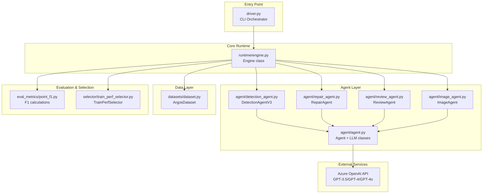
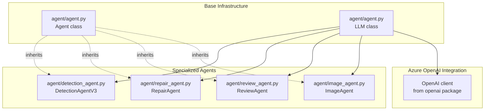
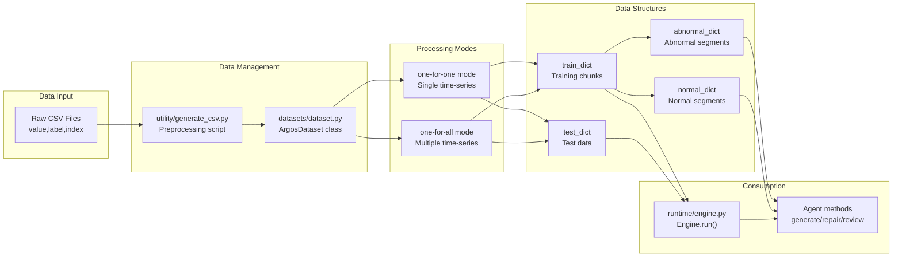
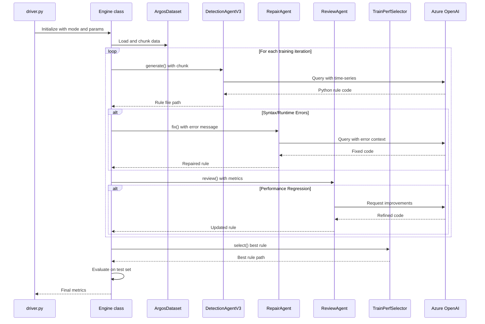

<!-- source: DeepWiki mcp.deepwiki.com · repo microsoft/argos · page 1 Argos Overview · fetched 2026-10-26 -->

# Argos Overview

<details>
<summary>Relevant source files</summary>

The following files were used as context for generating this wiki page:

- [README.md](README.md)
- [requirements.txt](requirements.txt)

</details>


**Purpose and Scope**: This document provides a high-level introduction to Argos, an agentic system for autonomous time-series anomaly detection using Large Language Models (LLMs). It covers the system's purpose, key capabilities, architecture overview, and major components. For detailed setup instructions, see [Getting Started](#2). For in-depth technical documentation of individual components, see [Core Components](#4). For architectural details, see [Architecture](#3).

## What is Argos

Argos is an agentic time-series anomaly detection system that leverages LLMs to autonomously generate explainable, reproducible Python-based detection rules for monitoring cloud infrastructure. Unlike traditional machine learning approaches that produce opaque models, Argos generates human-readable code that can be reviewed, modified, and deployed by domain experts.

The system employs a multi-agent architecture where specialized agents collaborate to iteratively generate, repair, and refine detection rules. Argos operates through [driver.py]() as its command-line interface, which orchestrates the [runtime/engine.py]() training and evaluation engine.

**Key Characteristics**:
- **Agentic Design**: Multiple specialized agents (detection, repair, review, image analysis) work collaboratively
- **Explainable Output**: Generates Python code rather than black-box models
- **Autonomous Operation**: Automatically handles code errors and iteratively refines rules
- **Flexible Modes**: Supports both standalone operation and integration with existing anomaly detection models

**Sources**: [README.md:1-30](), [README.md:95-108]()

## System Capabilities

| Capability | Description | Implementation |
|------------|-------------|----------------|
| **Rule Generation** | Generates Python-based anomaly detection rules using LLM prompting | `DetectionAgentV3` in [agent/detection_agent.py]() |
| **Error Repair** | Automatically fixes syntax and runtime errors in generated code | `RepairAgent` in [agent/repair_agent.py]() |
| **Performance Review** | Evaluates rule performance and triggers refinement when needed | `ReviewAgent` in [agent/review_agent.py]() |
| **Visual Analysis** | Analyzes time-series plots to extract anomaly characteristics | `ImageAgent` in [agent/image_agent.py]() |
| **Iterative Refinement** | Continuously improves rules through multiple training iterations | [runtime/engine.py]() orchestration |
| **Multi-Mode Training** | Supports 8 operational modes for different use cases | Mode handling in [runtime/engine.py]() |
| **Dataset Flexibility** | Processes data in one-for-one or one-for-all modes | `ArgosDataset` in [datasets/dataset.py]() |

**Sources**: [README.md:9-20](), High-level architecture diagrams

## High-Level Architecture



**Architecture Overview**: Argos follows a layered architecture with clear separation of concerns. The `driver.py` module serves as the CLI entry point, accepting command-line arguments and initializing the system. The `Engine` class in [runtime/engine.py]() orchestrates all training and evaluation workflows. Four specialized agents inherit from the base `Agent` class and handle specific tasks: `DetectionAgentV3` generates rules, `RepairAgent` fixes code errors, `ReviewAgent` evaluates performance, and `ImageAgent` performs visual analysis. The `ArgosDataset` class manages data loading and chunking, while `TrainPerfSelector` identifies the best rules across iterations.

**Sources**: [README.md:95-108](), [driver.py](), [runtime/engine.py](), Architecture Diagram 1

## Agent Ecosystem



**Agent Architecture**: All agents inherit from the `Agent` base class defined in [agent/agent.py](), which provides common functionality for managing conversations and tracking iterations. Each agent composes an `LLM` instance (also in [agent/agent.py]()) that handles Azure OpenAI API interactions. The `DetectionAgentV3` class supports four training modes and generates initial detection rules. The `RepairAgent` fixes syntax and runtime errors through iterative LLM queries. The `ReviewAgent` evaluates rule performance and requests improvements when detecting regressions. The `ImageAgent` analyzes time-series visualization images to extract anomaly characteristics. For detailed agent documentation, see [Agent Ecosystem](#3.2) and [Core Components](#4).

**Sources**: [agent/agent.py](), [agent/detection_agent.py](), [agent/repair_agent.py](), [agent/review_agent.py](), [agent/image_agent.py](), Architecture Diagram 2

## Operational Modes

Argos supports eight distinct operational modes that determine how the system trains and evaluates detection rules:

| Mode | Purpose | Use Case |
|------|---------|----------|
| `train-LLM-only` | Pure LLM-based rule generation | Standalone anomaly detection without existing models |
| `train-LLM-only-image` | Image-guided rule generation | Leveraging visual patterns in time-series plots |
| `train-combined-fp` | Target false positives from existing model | Reducing false alarms in deployed systems |
| `train-combined-fn` | Target false negatives from existing model | Improving recall for missed anomalies |
| `eval-LLM-only` | Evaluate standalone rules | Testing LLM-generated rules on test data |
| `eval-combined` | Evaluate combined with base model | Assessing improvement over existing model |
| `baseline-LLMAD` | Run LLMAD baseline | Comparative evaluation against baseline |
| `ablation-detection-only` | Detection without review | Studying impact of review agent |

The mode is specified via the `--mode` argument in [driver.py](). Combined modes require an additional `--model_res_path` argument pointing to false positive/negative indices from existing models. For detailed mode descriptions and when to use each, see [Operational Modes](#3.3).

**Sources**: [README.md:114-158](), [driver.py](), [runtime/engine.py](), Architecture Diagram 6

## Data Processing Pipeline



**Data Flow**: Time-series data flows through a multi-stage pipeline. Raw CSV files containing `value,label,index` columns are preprocessed using [utility/generate_csv.py]() into a standardized format. The `ArgosDataset` class in [datasets/dataset.py]() loads data and splits it into training (`train_dict`) and test (`test_dict`) dictionaries. Training data is further chunked into fixed-size segments. The dataset supports two modes: one-for-one (individual time-series) and one-for-all (aggregated metrics). The `Engine` iterates over training chunks, invoking agents to generate and refine rules. For combined modes, `ArgosDataset` filters training data based on false positive/negative indices from `--model_res_path`. For complete data flow details, see [Data Flow Pipeline](#3.4) and [Dataset Management](#4.8).

**Sources**: [README.md:63-94](), [datasets/dataset.py](), [utility/generate_csv.py](), [runtime/engine.py](), Architecture Diagram 4

## Training and Evaluation Workflow



**Workflow**: The training workflow begins when [driver.py]() initializes the `Engine` with a specified mode and parameters. The `Engine.run()` method loads data through `ArgosDataset` and iterates over training chunks. For each iteration, `DetectionAgentV3.generate()` queries Azure OpenAI to produce a Python detection rule. If syntax or runtime errors occur, `RepairAgent.fix()` automatically corrects them. The `ReviewAgent.review()` method evaluates performance metrics; if it detects regression, it requests rule improvements from the LLM. After all iterations complete, `TrainPerfSelector.select()` identifies the best-performing rule. The `Engine` then evaluates this rule on the test set and returns final metrics. For implementation details, see [Engine](#4.2), [Detection Agent](#4.4), [Repair Agent](#4.5), and [Review Agent](#4.6).

**Sources**: [runtime/engine.py](), [agent/detection_agent.py](), [agent/repair_agent.py](), [agent/review_agent.py](), [selector/train_perf_selector.py](), Architecture Diagram 3

## Core Components Summary

| Component | File Path | Primary Class/Function | Purpose |
|-----------|-----------|------------------------|---------|
| **CLI Driver** | [driver.py]() | `main()` | Command-line interface and parameter parsing |
| **Runtime Engine** | [runtime/engine.py]() | `Engine` | Orchestrates training/evaluation workflows |
| **Base Agent** | [agent/agent.py]() | `Agent`, `LLM` | Base class for agents and LLM client wrapper |
| **Detection** | [agent/detection_agent.py]() | `DetectionAgentV3` | Generates Python anomaly detection rules |
| **Repair** | [agent/repair_agent.py]() | `RepairAgent` | Fixes code errors automatically |
| **Review** | [agent/review_agent.py]() | `ReviewAgent` | Evaluates and refines rule performance |
| **Image Analysis** | [agent/image_agent.py]() | `ImageAgent` | Analyzes time-series visualizations |
| **Dataset** | [datasets/dataset.py]() | `ArgosDataset` | Loads, chunks, and manages training/test data |
| **Metrics** | [eval_metrics/point_f1.py]() | `point_f1()`, `event_based_f1()` | Computes F1, precision, recall metrics |
| **Selector** | [selector/train_perf_selector.py]() | `TrainPerfSelector` | Selects best rule from iterations |
| **Baseline** | [baseline/llmad.py]() | `LLMAD` | LLMAD baseline implementation |
| **Common Utils** | [common/common.py]() | Various utility functions | Token counting, label processing, execution |
| **Exceptions** | [common/exception.py]() | `SyntaxException`, `RuntimeException`, `TimeoutException` | Custom exception types |

Each component is documented in detail in the [Core Components](#4) section.

**Sources**: [README.md:95-108](), All component files listed in table

## Technology Stack

Argos is built on Python 3.10 and integrates with Azure OpenAI services:

**LLM Integration**:
- **Azure OpenAI API**: Primary LLM service (requires `OPENAI_AZURE_ENDPOINT`, `OPENAI_AZURE_API_KEY`, `OPENAI_AZURE_API_VERSION` environment variables)
- **Supported Models**: GPT-3.5-Turbo, GPT-4-32k, GPT-4o (with vision capabilities)
- **Python Client**: `openai` package version 1.35.9

**Core Dependencies** (from [requirements.txt]()):

| Package | Version | Purpose |
|---------|---------|---------|
| `openai` | 1.35.9 | Azure OpenAI API client |
| `pandas` | 2.2.2 | Time-series data manipulation |
| `numpy` | 1.26.4 | Numerical computations |
| `scikit-learn` | 1.5.1 | Machine learning utilities |
| `matplotlib` | 3.9.0 | Visualization for image agent |
| `statsmodels` | 0.14.2 | Statistical analysis |
| `requests` | 2.32.4 | HTTP requests |
| `tqdm` | 4.66.4 | Progress bars |

For complete dependency list and installation instructions, see [Installation](#2.1) and [Dependencies](#7.1).

**Sources**: [requirements.txt:1-41](), [README.md:37-61]()

## Dataset Requirements

Argos expects time-series datasets structured with the following hierarchy:

```
dataset_name/
├── metric_1/
│   ├── time_series_1.csv
│   ├── time_series_2.csv
│   └── ...
└── metric_2/
    ├── time_series_1.csv
    └── ...
```

Each CSV file must contain three columns:
- `value`: Numeric metric value
- `label`: Binary anomaly label (0 = normal, 1 = anomaly)
- `index`: Sequential index of the data point

The preprocessing script [utility/generate_csv.py]() converts KPI and Yahoo datasets into this format. For combined modes (train-combined-fp/fn), additional model result files containing false positive/negative indices must be provided via `--model_res_path`. For detailed dataset preparation instructions, see [Dataset Preparation](#2.2).

**Sources**: [README.md:63-83](), [utility/generate_csv.py](), [datasets/dataset.py]()

## Use Cases and Limitations

**Intended Uses**:
- Generating explainable anomaly detection rules for human review in cloud monitoring systems
- Research and experimentation with LLM-based anomaly detection approaches
- Complementing existing anomaly detection models by targeting specific error types (false positives/negatives)

**Out-of-Scope Uses**:
- Direct deployment in production systems without human oversight
- Highly regulated domains (healthcare, finance, law enforcement) where errors have severe consequences
- Non-English time-series data (system designed and tested in English)

**Limitations**:
- Research prototype requiring further testing for commercial applications
- Inherits biases and limitations from underlying LLM (Azure OpenAI models)
- Requires domain expertise to evaluate generated rule quality
- Performance varies with choice of base LLM model

For complete guidance on responsible use, see [Best Practices](#8) and [README.md:182-211]().

**Sources**: [README.md:16-30](), [README.md:182-191](), [README.md:193-211]()

## Next Steps

To start using Argos:
1. Set up your Python environment and install dependencies - see [Installation](#2.1)
2. Configure Azure OpenAI API credentials - see [Installation](#2.1)
3. Prepare your time-series dataset - see [Dataset Preparation](#2.2)
4. Run your first training task - see [Running Argos](#2.3)

For understanding the system architecture in depth, proceed to [Architecture](#3). For detailed component documentation, see [Core Components](#4).

**Sources**: [README.md:32-108]()

---

