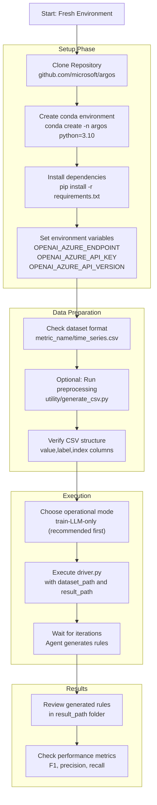
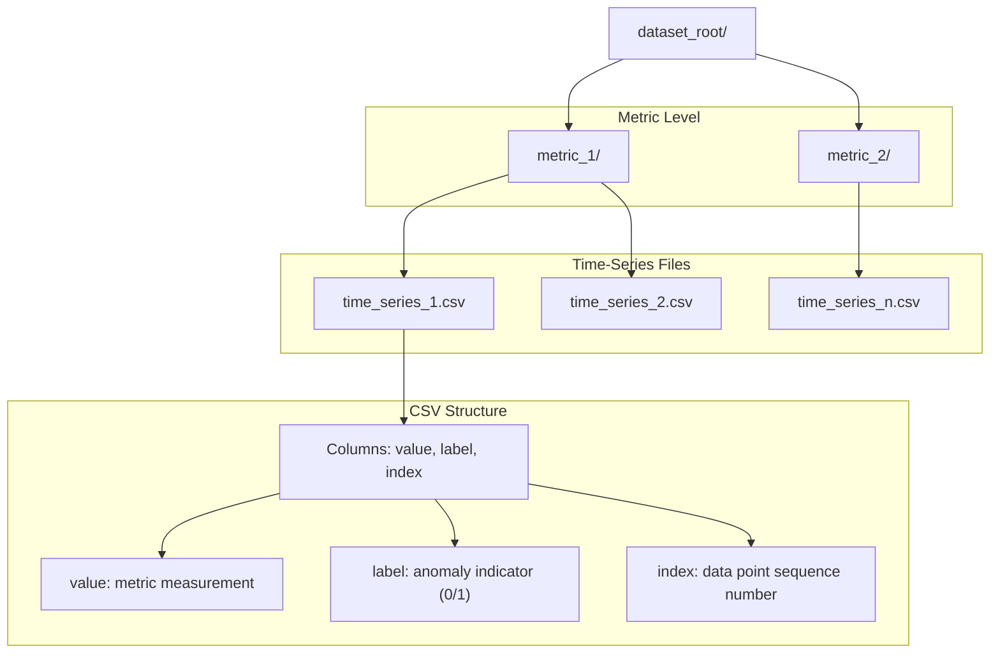
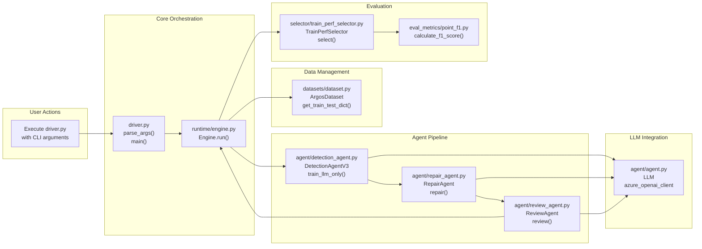
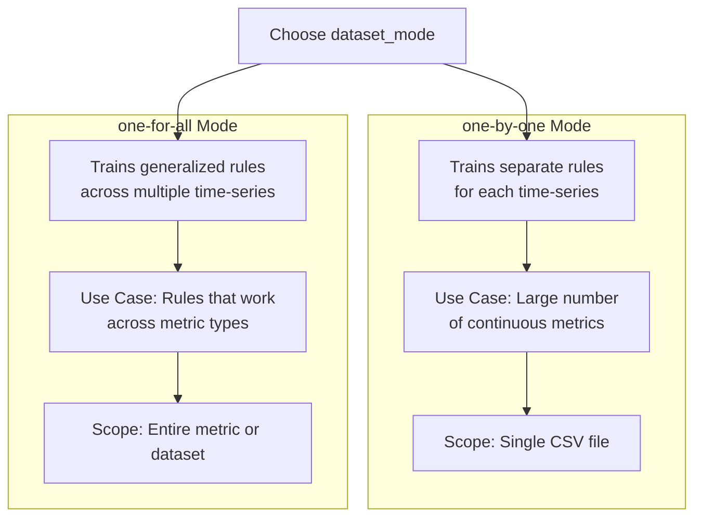

<!-- source: DeepWiki mcp.deepwiki.com · repo microsoft/argos · page 2 Getting Started · fetched 2026-10-26 -->

# Getting Started

<details>
<summary>Relevant source files</summary>

The following files were used as context for generating this wiki page:

- [README.md](README.md)
- [env.sh](env.sh)
- [requirements.txt](requirements.txt)

</details>


This document provides a quick start guide for setting up and running Argos for the first time. It covers the essential prerequisites, the basic workflow, and simple usage examples to help you start generating anomaly detection rules using LLM agents.

For detailed information about specific setup steps, see:
- [Installation](#2.1) - Complete Python environment and Azure OpenAI API setup
- [Dataset Preparation](#2.2) - Dataset structure requirements and preprocessing
- [Running Argos](#2.3) - Comprehensive command-line reference and operational modes

For information about Argos's architecture and design, see [Architecture](#3).

**Sources:** [README.md:1-265]()

## Prerequisites Overview

Before running Argos, you must have the following components configured:

| Component | Requirement | Details |
|-----------|------------|---------|
| Python Environment | Python 3.10 | Conda virtual environment recommended |
| Dependencies | All packages in requirements.txt | Includes numpy, pandas, scikit-learn, openai, statsmodels |
| Azure OpenAI API | Valid endpoint, API key, and version | Required for LLM interaction |
| Dataset | Structured time-series CSV files | Must follow Argos's dataset format specification |

All Python dependencies are specified in [requirements.txt:1-41]() and include core scientific computing libraries (numpy, pandas, scikit-learn), visualization tools (matplotlib), statistical analysis (statsmodels), and the OpenAI API client.

**Sources:** [README.md:37-61](), [requirements.txt:1-41]()

## Quick Start Workflow

The following diagram illustrates the high-level workflow for getting started with Argos, from initial setup through rule generation:



**Sources:** [README.md:32-157]()

## Environment Configuration

Argos requires three environment variables to authenticate with Azure OpenAI services. These must be set before running any Argos commands.

### Setting Environment Variables

The repository includes a template file [env.sh:1-3]() that demonstrates the required configuration:

```bash
export OPENAI_AZURE_ENDPOINT=YOUR_ENDPOINT
export OPENAI_AZURE_API_KEY=YOUR_API_KEY
export OPENAI_AZURE_API_VERSION=YOUR_API_VERSION
```

These variables are consumed by the `LLM` class in [agent/agent.py](), which creates an Azure OpenAI client for interacting with GPT models. The system supports multiple model types including GPT-3.5-Turbo, GPT-4-32k, and GPT-4o.

**Sources:** [README.md:51-61](), [env.sh:1-3]()

## Dataset Structure Requirements

Argos expects time-series data organized in a specific hierarchical structure:



Each CSV file must contain exactly three columns:
- `value`: The time-series metric value
- `label`: Binary anomaly label (0 for normal, 1 for anomalous)
- `index`: Sequential index of the data point

The preprocessing script [utility/generate_csv.py]() can convert KPI and Yahoo datasets into this format.

**Sources:** [README.md:63-82]()

## Basic Usage Example: Training Without Aggregator

The simplest way to start using Argos is the `train-LLM-only` mode, which generates anomaly detection rules using only LLM agents without requiring an existing model.

### Command Structure

The primary entry point is [driver.py](), which orchestrates the entire training and evaluation pipeline:

```bash
python3 driver.py \
  --dataset_path=$dataset_path \
  --mode=train-LLM-only \
  --result_path=$result_path \
  --chunk_size=2500 \
  --top_k=5 \
  --dataset_mode="one-by-one"
```

### Parameter Explanation

| Parameter | Description | Typical Values |
|-----------|-------------|----------------|
| `--dataset_path` | Root directory containing metric folders | Path to prepared dataset |
| `--mode` | Operational mode | `train-LLM-only`, `train-combined-fp`, `train-combined-fn`, `eval-LLM-only` |
| `--result_path` | Output directory for generated rules and metrics | Any writable path |
| `--chunk_size` | Size of data chunks for training iterations | 2500 (without aggregator), 1000 (with aggregator) |
| `--top_k` | Number of best rules to select | 1-5, depending on use case |
| `--dataset_mode` | Training scope | `one-by-one` (per time-series), `one-for-all` (across metrics) |

The `driver.py` script creates an `Engine` instance from [runtime/engine.py]() and executes the training loop. During execution, the `DetectionAgentV3` from [agent/detection_agent.py]() generates Python code for anomaly detection rules, which are then refined by `RepairAgent` and `ReviewAgent`.

**Sources:** [README.md:119-133]()

## Basic Usage Example: Training With Aggregator

If you have an existing anomaly detection model and want to improve it by fixing specific error types, use the combined modes:

### Fixing False Positives

```bash
python3 driver.py \
  --dataset_path=$dataset_path \
  --mode=train-combined-fp \
  --result_path=$result_path \
  --chunk_size=1000 \
  --top_k=1 \
  --dataset_mode="one-by-one" \
  --model_res_path=$model_res_path
```

### Fixing False Negatives

```bash
python3 driver.py \
  --dataset_path=$dataset_path \
  --mode=train-combined-fn \
  --result_path=$result_path \
  --chunk_size=1000 \
  --top_k=1 \
  --dataset_mode="one-by-one" \
  --model_res_path=$model_res_path
```

The `--model_res_path` parameter points to preprocessed results from your existing model, containing indices of false positive or false negative predictions. The `ArgosDataset` class from [datasets/dataset.py]() uses these indices to filter training data, focusing the LLM on examples where the existing model failed.

**Sources:** [README.md:135-156]()

## System Component Mapping

The following diagram maps the workflow steps to the actual code components that implement them:



**Sources:** [README.md:95-108]()

## Expected Output

After running Argos, the `result_path` directory will contain:

| Output Type | Description | Location Pattern |
|-------------|-------------|------------------|
| Generated Rules | Python code files for anomaly detection | `iteration_N/rule_*.py` |
| Training Metrics | Performance on training set | `iteration_N/train_metrics.json` |
| Test Metrics | Performance on test set | `iteration_N/test_metrics.json` |
| Selected Rule | Best-performing rule across iterations | `selected_rule.py` |
| Summary | Overall performance summary | `summary.json` |

The `TrainPerfSelector` class from [selector/train_perf_selector.py]() analyzes all generated rules and selects the one with the highest F1 score. Performance metrics are calculated using the functions in [eval_metrics/point_f1.py](), including point-based and event-based F1 scores.

**Sources:** [README.md:133-134]()

## Dataset Modes Comparison

Argos supports two distinct dataset modes that determine the scope of rule generation:



The mode is specified using the `--dataset_mode` command-line argument and affects how the `ArgosDataset` class partitions and provides data to the training engine.

**Sources:** [README.md:84-93]()

## Next Steps

Once you have successfully run your first Argos training session, explore the following:

1. **Deep-dive into installation details**: See [Installation](#2.1) for comprehensive environment setup, including conda configuration and troubleshooting.

2. **Prepare your own datasets**: See [Dataset Preparation](#2.2) for preprocessing scripts, format specifications, and handling different dataset types.

3. **Explore operational modes**: See [Running Argos](#2.3) for detailed explanations of all eight operational modes and their specific use cases.

4. **Understand the architecture**: See [Architecture](#3) to learn how the agent ecosystem, engine orchestration, and data pipelines work together.

5. **Review core components**: See [Core Components](#4) for detailed documentation of each agent type, the dataset manager, evaluation metrics, and rule selection logic.

**Sources:** [README.md:111-157]()

---

