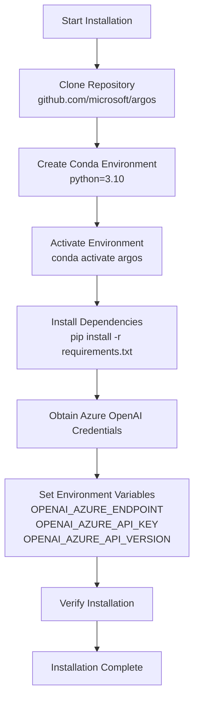
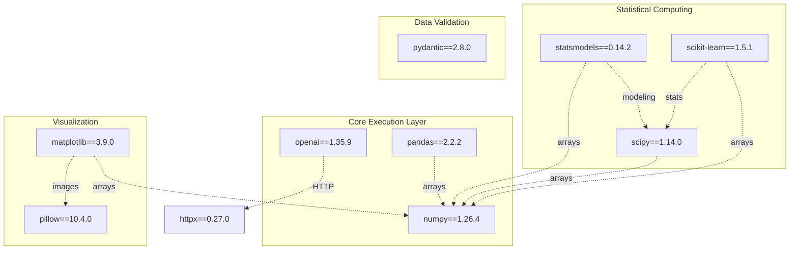
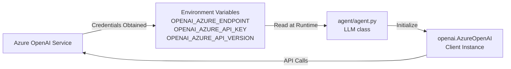

<!-- source: DeepWiki mcp.deepwiki.com · repo microsoft/argos · page 2.1 Installation · fetched 2026-10-26 -->

# Installation

<details>
<summary>Relevant source files</summary>

The following files were used as context for generating this wiki page:

- [README.md](README.md)
- [env.sh](env.sh)
- [requirements.txt](requirements.txt)

</details>


This page details the steps required to install and configure Argos on your system, including Python environment setup, dependency installation, and Azure OpenAI API configuration. For information about preparing datasets after installation, see [Dataset Preparation](#2.2). For instructions on running Argos after installation, see [Running Argos](#2.3).

## Prerequisites

Before installing Argos, ensure you have:
- Python 3.10 or compatible version
- Conda package manager (recommended for virtual environment management)
- An active Azure OpenAI service account with API credentials
- Access to the Argos repository at https://github.com/microsoft/argos

**Sources**: [README.md:37-42]()

## Installation Flow

The installation process follows a sequential three-stage workflow:



**Sources**: [README.md:32-61]()

## Python Environment Setup

### Creating the Virtual Environment

Argos requires Python 3.10 and uses Conda for virtual environment management. Navigate to the cloned repository and execute the following commands:

```sh
cd argos
conda create -n argos python=3.10
conda activate argos
```

The virtual environment isolates Argos dependencies from your system Python installation, preventing version conflicts with other projects.

**Sources**: [README.md:44-48]()

### Installing Dependencies

After activating the virtual environment, install all required Python packages from `requirements.txt`:

```sh
pip install -r requirements.txt
```

This single command installs all 41 dependencies listed in [requirements.txt:1-41]().

**Sources**: [README.md:48-49]()

## Dependency Categories

The `requirements.txt` file specifies dependencies across multiple functional categories:

| Category | Packages | Purpose |
|----------|----------|---------|
| **LLM Integration** | `openai`, `httpx`, `httpcore`, `h11` | Azure OpenAI API client and HTTP communication |
| **Data Processing** | `pandas`, `numpy` | Time-series data manipulation and numerical computation |
| **Statistical Analysis** | `statsmodels`, `scipy`, `arch` | Statistical modeling and analysis for anomaly detection |
| **Machine Learning** | `scikit-learn`, `joblib` | ML algorithms and model persistence |
| **Visualization** | `matplotlib`, `pillow`, `contourpy`, `fonttools`, `kiwisolver`, `cycler` | Plotting time-series data and generating visual outputs |
| **Validation** | `pydantic`, `pydantic_core`, `annotated-types` | Data validation and schema enforcement |
| **Utilities** | `requests`, `tqdm`, `toml`, `distro` | HTTP requests, progress bars, configuration parsing |
| **Type Support** | `typing_extensions` | Enhanced type hints for Python 3.10 |
| **Date/Time** | `python-dateutil`, `pytz`, `tzdata` | Timezone handling and date manipulation |
| **Core Dependencies** | `certifi`, `charset-normalizer`, `idna`, `urllib3`, `anyio`, `sniffio`, `exceptiongroup` | SSL certificates, character encoding, async I/O |
| **Math/Parsing** | `pyparsing`, `patsy`, `six`, `packaging`, `threadpoolctl` | Expression parsing, formula handling, compatibility utilities |

**Sources**: [requirements.txt:1-41]()

### Key Dependencies



**Sources**: [requirements.txt:1-41]()

## Azure OpenAI API Configuration

Argos requires an active Azure OpenAI service connection. The system authenticates using three environment variables that must be set before running any Argos commands.

### Required Environment Variables

| Variable | Description | Example Format |
|----------|-------------|----------------|
| `OPENAI_AZURE_ENDPOINT` | Azure OpenAI service endpoint URL | `https://your-resource.openai.azure.com/` |
| `OPENAI_AZURE_API_KEY` | Authentication key for Azure OpenAI | 32-character hexadecimal string |
| `OPENAI_AZURE_API_VERSION` | API version string | `2023-05-15` or similar date format |

**Sources**: [README.md:52-61](), [env.sh:1-3]()

### Setting Environment Variables

#### Linux/macOS

Export the variables in your shell session:

```sh
export OPENAI_AZURE_ENDPOINT=YOUR_AZURE_ENDPOINT
export OPENAI_AZURE_API_KEY=YOUR_API_KEY
export OPENAI_AZURE_API_VERSION=YOUR_API_VERSION
```

For persistent configuration, add these lines to your shell profile (`~/.bashrc`, `~/.zshrc`, etc.).

**Sources**: [README.md:57-61](), [env.sh:1-3]()

#### Using env.sh Template

Argos provides an `env.sh` template file at the repository root. You can:

1. Copy the template: `cp env.sh env.local.sh`
2. Edit `env.local.sh` with your actual credentials
3. Source the file: `source env.local.sh`

**Note**: Never commit files containing actual credentials to version control.

**Sources**: [env.sh:1-3]()

### Environment Variable Flow



The `LLM` class in [agent/agent.py]() reads these environment variables at initialization to create an `openai.AzureOpenAI` client instance. All agents inherit from the base `Agent` class and use this `LLM` instance for API communication. For more details on LLM integration architecture, see [Base Agent and LLM Integration](#4.3).

**Sources**: [README.md:52-61]()

## Supported Models

Argos has been tested with the following Azure OpenAI models:

- **GPT-3.5-Turbo**: Cost-effective model suitable for initial experimentation
- **GPT-4-32k**: Large context window model for processing extensive time-series data
- **GPT-4o**: Vision-capable model supporting image-based anomaly analysis

The model selection affects system behavior in image-enabled modes. See [Operational Modes](#3.3) for details on when each model is appropriate.

**Sources**: [README.md:172-173]()

## Installation Verification

After completing the installation steps, verify your setup:

### 1. Verify Python Environment

```sh
conda activate argos
python --version  # Should show Python 3.10.x
```

### 2. Verify Package Installation

```sh
python -c "import openai, pandas, numpy, matplotlib, statsmodels; print('All core packages imported successfully')"
```

### 3. Verify Environment Variables

```sh
python -c "import os; assert os.getenv('OPENAI_AZURE_ENDPOINT'), 'OPENAI_AZURE_ENDPOINT not set'; print('Environment variables configured')"
```

### 4. Test Azure OpenAI Connection

While Argos does not include a dedicated connection test utility, you can verify connectivity by attempting to run a simple detection task (see [Running Argos](#2.3)) with a small dataset.

**Sources**: [README.md:32-61]()

## Common Installation Issues

| Issue | Symptom | Solution |
|-------|---------|----------|
| Missing Conda | `conda: command not found` | Install Miniconda or Anaconda from official sources |
| Python Version Mismatch | ImportError with type hints | Ensure Python 3.10+ is used; recreate environment |
| Dependency Conflicts | Package installation failures | Create fresh virtual environment; avoid mixing pip/conda installs |
| Missing Environment Variables | Runtime errors about Azure credentials | Verify all three `OPENAI_AZURE_*` variables are set and exported |
| Network Issues | Connection timeouts to Azure | Check firewall settings; verify endpoint URL format |

**Sources**: [README.md:37-61](), [requirements.txt:1-41]()

## Next Steps

After successful installation:

1. **Dataset Preparation**: See [Dataset Preparation](#2.2) to structure your time-series data in the required format
2. **Running Argos**: See [Running Argos](#2.3) to execute your first anomaly detection task
3. **Understanding Dependencies**: See [Dependencies](#7.1) for detailed information about each package and version management

**Sources**: [README.md:32-61]()

---

