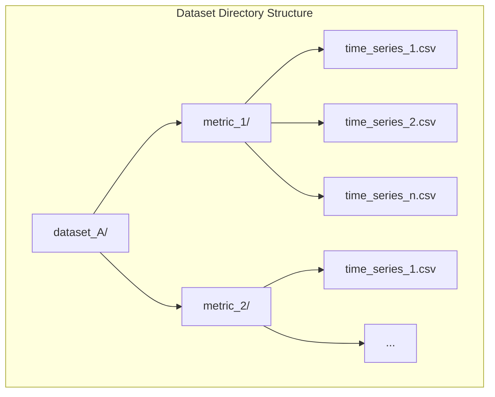
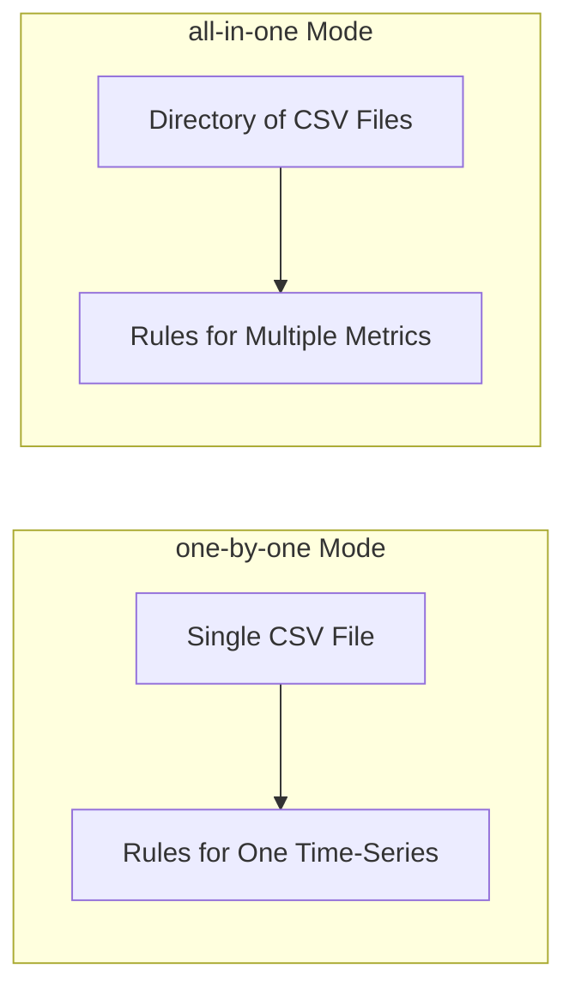
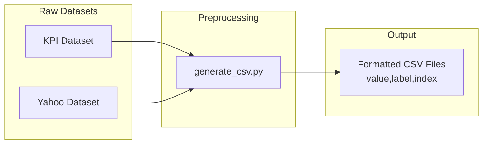
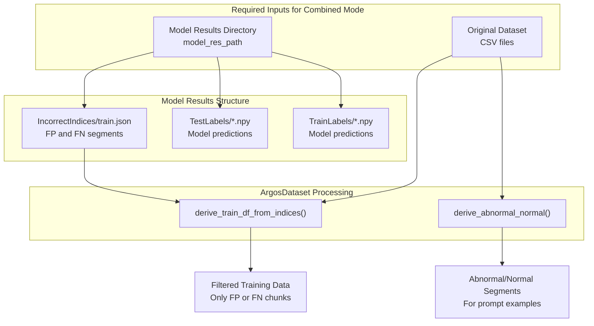
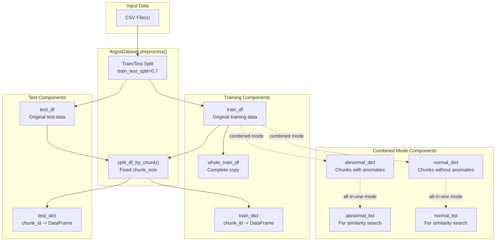
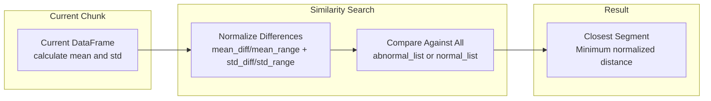

<!-- source: DeepWiki mcp.deepwiki.com · repo microsoft/argos · page 2.2 Dataset Preparation · fetched 2026-10-26 -->

# Dataset Preparation

<details>
<summary>Relevant source files</summary>

The following files were used as context for generating this wiki page:

- [README.md](README.md)
- [datasets/dataset.py](datasets/dataset.py)

</details>


This document explains how to prepare time-series datasets for use with Argos, including the required directory structure, CSV file format, dataset modes, and preprocessing utilities. For information about running Argos after dataset preparation, see [Running Argos](#2.3). For details on how the Engine consumes prepared datasets during training, see [Dataset Management](#4.8).

## Purpose and Scope

Dataset preparation is the process of organizing and formatting time-series anomaly detection data for consumption by Argos. This includes:
- Understanding the required directory structure and file format
- Choosing between one-by-one and all-in-one dataset modes
- Using preprocessing scripts for standard datasets (KPI, Yahoo)
- Preparing model results for combined training modes

The `ArgosDataset` class [datasets/dataset.py:10-560]() handles all dataset loading, validation, and segmentation operations.

## Dataset Structure Requirements

Argos expects a hierarchical directory structure where datasets contain metrics, and each metric contains multiple time-series CSV files.

### Directory Layout



**Sources:** [README.md:63-79]()

For **one-by-one mode**, the dataset path should point directly to a single CSV file:
```
/path/to/dataset/metric_1/time_series_1.csv
```

For **all-in-one mode**, the dataset path should point to a directory containing multiple CSV files:
```
/path/to/dataset/metric_1/
```

**Sources:** [datasets/dataset.py:39-41](), [datasets/dataset.py:91-94]()

## CSV File Format

Each CSV file must contain exactly three columns in the following order:

| Column | Type | Description |
|--------|------|-------------|
| `value` | float | The metric value at each time point |
| `label` | int | Binary anomaly label (0 = normal, 1 = anomaly) |
| `index` | int | Sequential index of the data point |

### Example CSV Content

```
value,label,index
42.351,0,0
43.127,0,1
44.892,0,2
89.234,1,3
91.445,1,4
43.556,0,5
```

The `label` column provides ground truth annotations for training and evaluation. The `index` column tracks the sequential position of each data point, which is critical for identifying false positive and false negative segments in combined modes.

**Sources:** [README.md:67-67](), [datasets/dataset.py:45-46]()

## Dataset Modes

Argos supports two operational dataset modes that determine the scope of rule generation.



**Sources:** [README.md:84-93]()

### one-by-one Mode

In `one-by-one` mode (also called "one-for-one"), Argos trains a separate set of anomaly detection rules for each individual time-series. This mode is suitable when:
- You have a large number of continuous metrics with distinct characteristics
- Each time-series requires specialized detection logic
- Metrics cannot be generalized across a common rule set

The dataset path must point to a single CSV file. The `ArgosDataset` validates this constraint at initialization:

```python
assert self.dataset_path.endswith(".csv"), "Dataset should be a csv file"
```

**Sources:** [datasets/dataset.py:39-41](), [README.md:88-90]()

### all-in-one Mode

In `all-in-one` mode (also called "one-for-all"), Argos trains a single set of rules that generalize across multiple time-series or metrics. This mode is useful when:
- You want rules that work across a family of related metrics
- Multiple time-series share similar anomaly patterns
- You need to minimize the number of rule sets to maintain

The dataset path must point to a directory containing multiple CSV files. The system loads all CSV files in the directory:

**Sources:** [datasets/dataset.py:91-110](), [README.md:91-93]()

## Preprocessing Standard Datasets

Argos provides a preprocessing utility to convert standard benchmark datasets into the required format.



**Sources:** [README.md:81-82]()

### Preprocessing Script

The preprocessing script is located at `argos/utility/generate_csv.py`. Currently supported datasets are:
- **KPI Dataset**: Time-series data from the NetManAIOps KPI Anomaly Detection benchmark
- **Yahoo Dataset**: Time-series data from the Yahoo Webscope S5 benchmark

To preprocess a dataset, run the script with the appropriate dataset type and input/output paths. The script converts the original format into the standardized three-column CSV structure required by Argos.

**Sources:** [README.md:81-82]()

## Combined Mode Requirements

Combined training modes (`train-combined-fp` and `train-combined-fn`) require additional inputs from an existing anomaly detection model. These modes allow Argos to generate rules that fix specific types of errors made by a base model.



**Sources:** [datasets/dataset.py:59-83](), [datasets/dataset.py:284-386]()

### Model Results Directory Structure

When running in combined mode, provide a `model_res_path` that contains:

| Directory/File | Purpose |
|----------------|---------|
| `IncorrectIndices/train.json` | JSON file containing FP and FN segment indices |
| `TestLabels/{curve_name}.npy` | NumPy array of model predictions on test set |
| `TrainLabels/{curve_name}.npy` | NumPy array of model predictions on training set |

The `train.json` file must have the following structure:
```json
{
  "FP": {
    "curve_name_1": [[start_idx, end_idx], ...],
    "curve_name_2": [[start_idx, end_idx], ...]
  },
  "FN": {
    "curve_name_1": [[start_idx, end_idx], ...],
    "curve_name_2": [[start_idx, end_idx], ...]
  }
}
```

**Sources:** [datasets/dataset.py:302-306](), [datasets/dataset.py:338-342](), [datasets/dataset.py:388-398]()

### False Positive Mode (train-combined-fp)

In `train-combined-fp` mode, Argos trains rules to reduce false positives from the base model. The system:
1. Loads FP segments from `IncorrectIndices/train.json`
2. Filters training data to only include chunks containing FP segments
3. Validates that filtered chunks contain no actual anomalies (`label.sum() == 0`)
4. Trains detection rules that will NOT trigger on these false positive segments

**Sources:** [datasets/dataset.py:336-385]()

### False Negative Mode (train-combined-fn)

In `train-combined-fn` mode, Argos trains rules to catch false negatives missed by the base model. The system:
1. Loads FN segments from `IncorrectIndices/train.json`
2. Filters training data to only include chunks containing FN segments
3. Validates that filtered chunks contain actual anomalies (`label.sum() > 0`)
4. Trains detection rules that WILL trigger on these false negative segments

**Sources:** [datasets/dataset.py:300-335]()

## Data Segmentation and Chunking

The `ArgosDataset` class automatically segments loaded data into multiple components for training and evaluation.



**Sources:** [datasets/dataset.py:35-201]()

### Train/Test Split

By default, Argos uses a 70/30 train/test split (configurable via `train_test_split` parameter):
- **Training set**: First 70% of the time-series data
- **Test set**: Last 30% of the time-series data

This temporal split ensures that the model is evaluated on future data, simulating real-world deployment scenarios.

**Sources:** [datasets/dataset.py:18-19](), [datasets/dataset.py:49-57]()

### Chunking Strategy

Data is split into fixed-size chunks specified by the `chunk_size` parameter (typically 1000-2500 data points). The chunking serves two purposes:

1. **Iteration Management**: Each training iteration processes one chunk, allowing progressive rule refinement
2. **Context Window Limits**: Chunks fit within LLM token limits while providing sufficient context

The `split_df_by_chunk()` method creates a dictionary mapping chunk IDs to DataFrame objects:

**Sources:** [datasets/dataset.py:400-411]()

### Abnormal and Normal Segment Derivation

For combined modes, the system derives abnormal and normal segments:

**Abnormal segments**: Chunks containing at least one anomaly label
- Identified by scanning for contiguous anomaly regions
- Expanded to include complete chunks that overlap the anomaly
- Used as positive examples in prompts for `train-combined-fn` mode

**Normal segments**: Chunks containing no anomaly labels
- Identified as regions between anomaly segments
- Must exceed minimum chunk size to be included
- Used as negative examples in prompts for `train-combined-fp` mode

**Sources:** [datasets/dataset.py:203-282]()

### Image Chunk Size

For `train-LLM-only-image` mode, an optional `image_chunk_size` parameter creates a separate chunking of the training data optimized for visualization:

```python
if self.image_chunk_size:
    self.train_dict_image = self.split_df_by_chunk(
        self.train_df, self.image_chunk_size
    )
```

This allows different granularities for visual analysis versus numerical analysis.

**Sources:** [datasets/dataset.py:86-89]()

## Dataset Access Methods

The `ArgosDataset` class provides accessor methods for retrieving data during training and evaluation:

| Method | Purpose |
|--------|---------|
| `get_train_df_by_iter(iter_num)` | Get training chunk for iteration (cycles through chunks) |
| `get_test_df_by_iter(iter_num)` | Get test chunk for iteration |
| `get_train_image_df_by_iter(iter_num)` | Get image-sized training chunk |
| `get_abnormal_df_by_iter(iter_num)` | Get abnormal segment for combined mode |
| `get_normal_df_by_iter(iter_num)` | Get normal segment for combined mode |
| `get_closest_abnormal_df(df)` | Find most similar abnormal segment (all-in-one mode) |
| `get_closest_normal_df(df)` | Find most similar normal segment (all-in-one mode) |
| `get_model_test_labels(curve_name)` | Get base model predictions on test set |
| `get_model_train_labels(curve_name)` | Get base model predictions on training set |

The iterator-based methods use modulo arithmetic to cycle through chunks, ensuring that training continues even if the number of iterations exceeds the number of chunks.

**Sources:** [datasets/dataset.py:413-553]()

## Validation and Error Handling

The `ArgosDataset` class performs several validation checks during preprocessing:

**one-by-one mode validations:**
- Dataset path must end with `.csv` [datasets/dataset.py:41]()
- Model results required for combined modes [datasets/dataset.py:63-65]()

**all-in-one mode validations:**
- Dataset path must be a directory [datasets/dataset.py:93]()
- Combined FN mode: Each training chunk must contain anomalies [datasets/dataset.py:175-177]()
- Combined FP mode: Each training chunk must contain no anomalies [datasets/dataset.py:178-181]()

**combined mode validations:**
- FN segments must contain actual anomalies [datasets/dataset.py:320-324]()
- FP segments must not contain actual anomalies [datasets/dataset.py:355-359]()
- FP segment chunks must not overlap with actual anomalies [datasets/dataset.py:365-372]()

**Sources:** [datasets/dataset.py:39-201]()

## Similarity-Based Segment Selection

For `all-in-one` mode with combined training, the system supports similarity-based selection of example segments. This is used when prompting the LLM with relevant examples.



**Sources:** [datasets/dataset.py:438-495]()

The similarity metric normalizes both mean and standard deviation differences to account for varying scales:
1. Calculate mean and std of current chunk
2. For each candidate segment, compute normalized distance:
   ```
   distance = |mean - candidate_mean| / mean_range + |std - candidate_std| / std_range
   ```
3. Return segment with minimum distance

This ensures that the LLM receives contextually relevant examples during prompt construction.

**Sources:** [datasets/dataset.py:438-495]()

---

