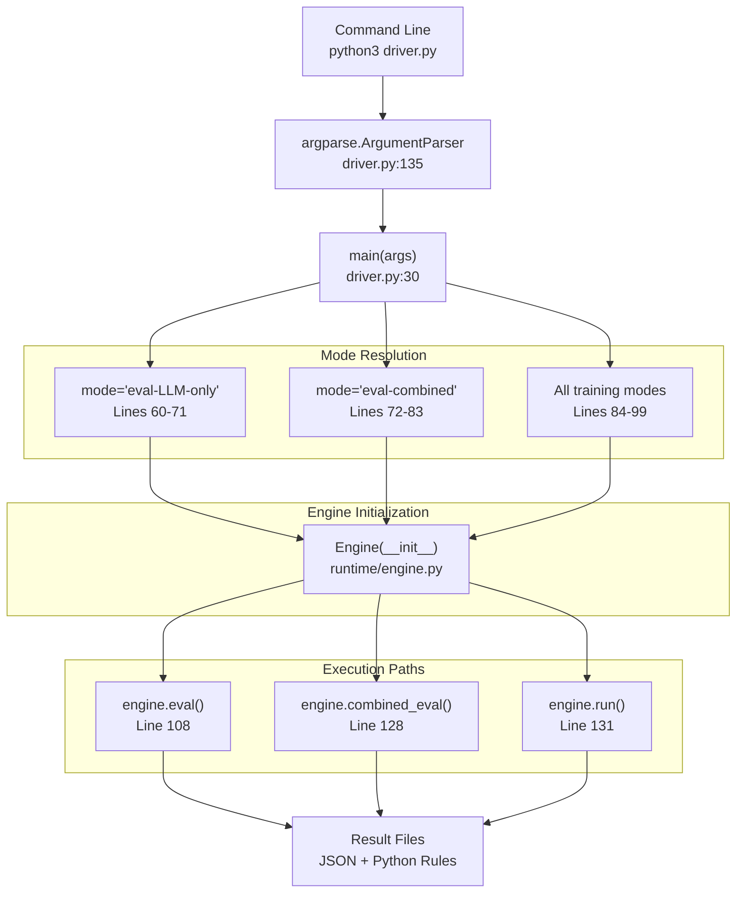
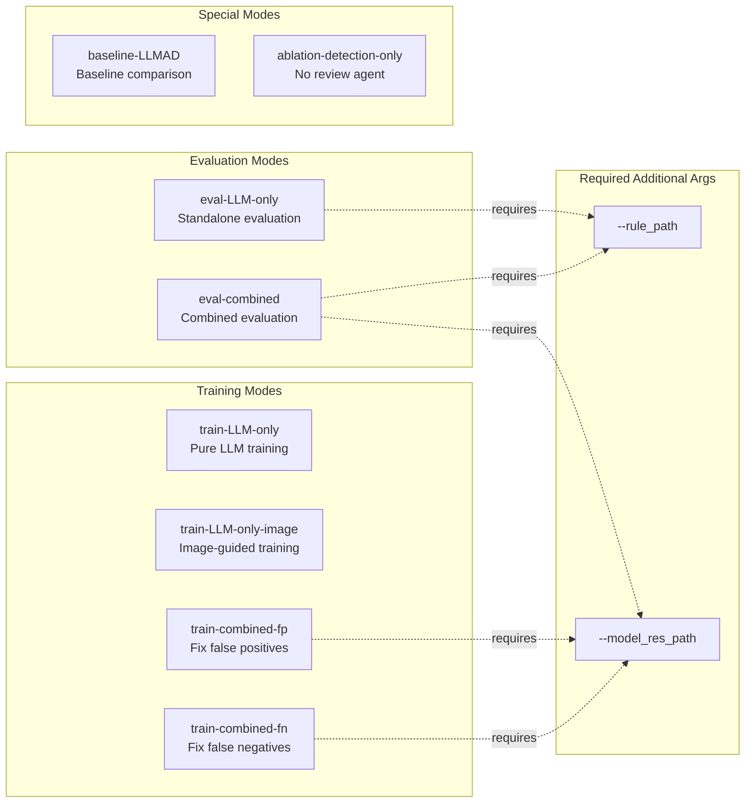
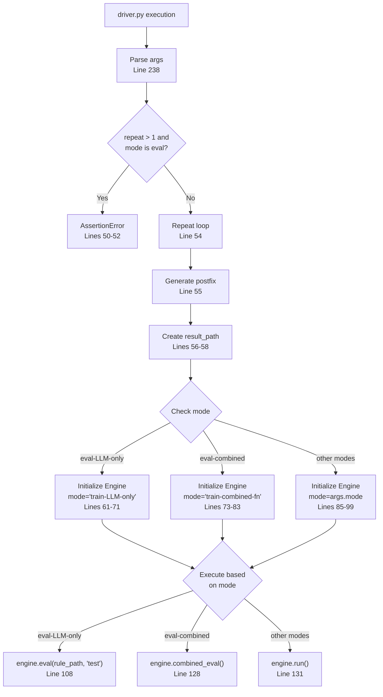
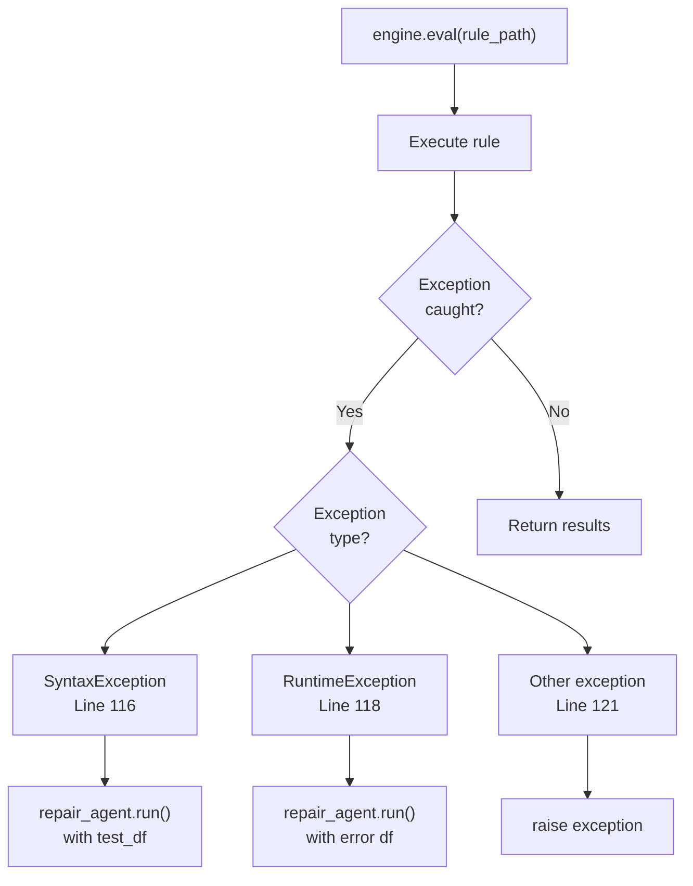

<!-- source: DeepWiki mcp.deepwiki.com · repo microsoft/argos · page 2.3 Running Argos · fetched 2026-10-26 -->

# Running Argos

<details>
<summary>Relevant source files</summary>

The following files were used as context for generating this wiki page:

- [README.md](README.md)
- [driver.py](driver.py)

</details>


This page explains how to execute Argos using the `driver.py` command-line interface. It covers all available command-line arguments, operational modes, and common usage patterns for training and evaluation tasks.

For information about installation and environment setup, see [Installation](#2.1). For dataset structure and preparation, see [Dataset Preparation](#2.2). For detailed explanations of the eight operational modes, see [Operational Modes](#3.3).

---

## Overview

Argos is executed through a single entry point: `driver.py`. This script orchestrates the entire anomaly detection workflow by:

1. Parsing command-line arguments to configure the system
2. Initializing the `Engine` with specified parameters
3. Running training iterations or evaluation tasks based on the selected mode
4. Saving generated rules and performance metrics to the result path

The execution flow varies depending on whether you're training new rules, evaluating existing rules, or running baseline comparisons.

**Sources:** [driver.py:1-240](), [README.md:111-157]()

---

## Execution Architecture



**Sources:** [driver.py:30-132]()

---

## Command-Line Arguments

All arguments are passed to `driver.py` using standard command-line flag syntax. The argument parser is defined in [driver.py:135-238]().

### Required Arguments

| Argument | Type | Description | Default |
|----------|------|-------------|---------|
| `--dataset_path` | `str` | Path to the time-series dataset (CSV file or directory) | See note below |
| `--result_path` | `str` | Directory where generated rules and results will be saved | See note below |
| `--mode` | `str` | Operational mode (see [Operational Modes](#operational-modes)) | `train-LLM-only` |

**Note:** The defaults in [driver.py:139-146]() are placeholder paths and must be overridden for actual use.

### Optional Configuration Arguments

| Argument | Type | Choices/Range | Default | Description |
|----------|------|---------------|---------|-------------|
| `--rule_path` | `str` | Any path | `""` | Path to pre-existing rule for evaluation modes |
| `--dataset_mode` | `str` | `one-by-one`, `all-in-one` | `one-by-one` | Dataset processing mode (see [Dataset Preparation](#2.2)) |
| `--train_test_split` | `float` | 0.0-1.0 | `0.7` | Ratio for train/test split (last portion used for test) |
| `--model_res_path` | `str` | Any path | See note | Path to existing model results (required for combined modes) |
| `--chunk_size` | `int` | > 0 | `1000` | Size of data chunks for training iterations |
| `--image_chunk_size` | `int` | > 0 | `10000` | Size of chunks for image-based training mode |
| `--image_subplots` | `tuple` | Format: (x,",",y) | `(1,",",1)` | Subplot layout for image generation |
| `--repeat` | `int` | > 0 | `1` | Number of training repetitions (not supported for eval modes) |
| `--top_k` | `int` | > 0 | `5` | Number of top-performing rules to select |
| `--llm_engine` | `str` | `gpt-4-32k`, `gpt-4o`, `gpt-35-turbo-16k` | `gpt-4-32k` | Azure OpenAI model to use |
| `--timeout` | `int` | > 0 | `150` | Training timeout in minutes |
| `--sample_per_prompt` | `int` | > 0 | `1` | Number of samples to generate per LLM prompt |

**Sources:** [driver.py:136-237]()

---

## Operational Modes

The `--mode` argument determines which workflow Argos executes. The mode string is passed directly to the `Engine` initialization [driver.py:67, 79, 91]().



**Sources:** [driver.py:155-168]()

### Mode Descriptions

| Mode | Purpose | Required Args | Output |
|------|---------|---------------|--------|
| `train-LLM-only` | Train rules using LLM on full dataset | None | Rules + metrics for each iteration |
| `train-LLM-only-image` | Train rules using image analysis | None | Rules + metrics for each iteration |
| `train-combined-fp` | Generate rules to fix false positives from existing model | `--model_res_path` | FP-focused rules + metrics |
| `train-combined-fn` | Generate rules to fix false negatives from existing model | `--model_res_path` | FN-focused rules + metrics |
| `eval-LLM-only` | Evaluate existing rule on test set | `--rule_path` | Performance metrics (JSON) |
| `eval-combined` | Evaluate rule combined with base model | `--rule_path`, `--model_res_path` | Combined performance metrics |
| `baseline-LLMAD` | Run LLMAD baseline for comparison | None | Baseline results |
| `ablation-detection-only` | Train without review agent (ablation study) | None | Rules without iterative refinement |

For detailed mode workflows, see [Operational Modes](#3.3).

**Sources:** [driver.py:155-168](), [README.md:119-157]()

---

## Common Usage Examples

### Example 1: Training Without Aggregator (LLM-Only)

This is the most common starting point. It trains anomaly rules using only LLM agents on the full training dataset.

```bash
python3 driver.py \
  --dataset_path=./datasets/KPI/metric_1 \
  --mode=train-LLM-only \
  --result_path=./results/kpi_experiment \
  --chunk_size=2500 \
  --top_k=5 \
  --dataset_mode=one-by-one \
  --llm_engine=gpt-4-32k
```

**What happens:**
1. Dataset is loaded from `./datasets/KPI/metric_1`
2. Data is split 70/30 (train/test) based on default `--train_test_split`
3. Training data is chunked into 2500-point segments
4. For each chunk, the `DetectionAgentV3` generates rules
5. `ReviewAgent` evaluates and refines rules iteratively
6. Top 5 rules are selected based on training performance
7. Results saved to `./results/kpi_experiment/YYYY-MM-DD_HH-MM-SS_*`

**Sources:** [README.md:121-133](), [driver.py:84-99]()

---

### Example 2: Training With Aggregator (Fix False Positives)

This mode requires results from an existing anomaly detection model and focuses on generating rules to reduce false positives.

```bash
python3 driver.py \
  --dataset_path=./datasets/KPI/metric_1 \
  --mode=train-combined-fp \
  --result_path=./results/kpi_fp_fix \
  --chunk_size=1000 \
  --top_k=1 \
  --dataset_mode=one-by-one \
  --model_res_path=./model_outputs/existing_model
```

**What happens:**
1. System loads false positive indices from `--model_res_path`
2. Training data is filtered to focus on FP regions
3. Smaller chunks (1000 points) are used for targeted learning
4. Rules are optimized to reduce false alarms
5. Top 1 rule is selected (common for combined modes)

**Sources:** [README.md:143-157](), [driver.py:146-153]()

---

### Example 3: Evaluating an Existing Rule

To evaluate a previously trained rule on test data:

```bash
python3 driver.py \
  --dataset_path=./datasets/KPI/metric_1 \
  --mode=eval-LLM-only \
  --rule_path=./results/previous_run/iteration_3/rule.py \
  --result_path=./results/evaluation
```

**What happens:**
1. Engine loads in train mode internally [driver.py:67]()
2. The specified rule is executed against test data
3. Performance metrics (F1, precision, recall) are calculated
4. Results saved as `eval_result.json`
5. If the rule has errors, `RepairAgent` attempts to fix them [driver.py:114-121]()

**Sources:** [driver.py:104-121]()

---

### Example 4: Image-Based Training

Uses vision-capable LLM (GPT-4o) to analyze time-series plots:

```bash
python3 driver.py \
  --dataset_path=./datasets/Yahoo/metric_A \
  --mode=train-LLM-only-image \
  --result_path=./results/image_training \
  --image_chunk_size=10000 \
  --image_subplots=2,2 \
  --llm_engine=gpt-4o \
  --chunk_size=2500
```

**What happens:**
1. System generates visualizations of time-series data
2. `ImageAgent` analyzes plots to identify anomaly patterns
3. Extracted patterns guide `DetectionAgentV3` in rule generation
4. Standard training loop proceeds with image-informed context

**Sources:** [driver.py:196-205]()

---

## Argument Resolution Flow



**Sources:** [driver.py:30-132]()

---

## Output Structure

When Argos completes execution, it creates a timestamped directory structure containing all generated artifacts.

### Directory Layout

```
result_path/
└── YYYY-MM-DD_HH-MM-SS_<dataset_postfix>/
    ├── iteration_0/
    │   ├── rule.py                    # Generated detection rule
    │   ├── train_performance.json     # Training metrics
    │   └── test_performance.json      # Test metrics
    ├── iteration_1/
    │   ├── rule.py
    │   ├── train_performance.json
    │   └── test_performance.json
    ├── ...
    ├── iteration_N/
    ├── best_rule.py                   # Top-k selected rule
    ├── eval_result.json               # Final evaluation (eval modes only)
    └── selection_results.json         # Rule selection details
```

**Sources:** [driver.py:56-58]()

### Performance Metrics Format

Each `train_performance.json` and `test_performance.json` contains:

```json
{
  "point_f1": 0.85,
  "event_f1": 0.82,
  "precision": 0.88,
  "recall": 0.83,
  "true_positives": 120,
  "false_positives": 18,
  "false_negatives": 25,
  "true_negatives": 1837
}
```

For evaluation modes, `eval_result.json` is created directly in the result path [driver.py:109-111]().

**Sources:** [driver.py:108-111]()

---

## Error Handling

The driver includes error recovery mechanisms, particularly for evaluation modes.

### Automatic Rule Repair

When evaluating a rule, if syntax or runtime errors occur, the system automatically invokes the `RepairAgent`:



**Sources:** [driver.py:108-121]()

### Validation Checks

The driver performs validation before execution:

1. **Repeat validation**: Evaluation modes (`eval-LLM-only`, `eval-combined`) cannot use `--repeat > 1` [driver.py:49-52]()
2. **Rule path validation**: Evaluation modes require `--rule_path` to be provided [driver.py:105, 123]()
3. **Model result validation**: Combined modes require `--model_res_path` [driver.py:124-126]()

**Sources:** [driver.py:49-126]()

---

## Advanced Configuration

### Multi-Run Experiments

The `--repeat` argument enables running multiple training experiments sequentially:

```bash
python3 driver.py \
  --dataset_path=./datasets/KPI/metric_1 \
  --mode=train-LLM-only \
  --result_path=./results/experiments \
  --repeat=10 \
  --chunk_size=2500
```

Each run creates a separate timestamped directory. This is useful for:
- Measuring consistency across LLM generations
- Gathering statistics on rule quality
- A/B testing different hyperparameters

**Note:** Not supported for evaluation modes [driver.py:49-52]().

**Sources:** [driver.py:43-58]()

---

### Timeout Management

The `--timeout` parameter (in minutes) prevents indefinite execution during training [driver.py:226-230](). If exceeded, the system raises a `TimeoutException`. The default is 150 minutes.

```bash
python3 driver.py \
  --dataset_path=./datasets/large_metric \
  --mode=train-LLM-only \
  --result_path=./results \
  --timeout=300  # 5 hours for large datasets
```

**Sources:** [driver.py:46, 226-230]()

---

## Next Steps

After running Argos successfully:

1. **Review Results**: Examine generated rules in the output directory to understand detection logic
2. **Evaluate Performance**: Check performance metrics to assess rule quality
3. **Iterate**: Adjust `--chunk_size`, `--top_k`, or `--llm_engine` parameters to optimize results
4. **Deploy Rules**: Extract the best rule from `best_rule.py` for integration into monitoring systems

For understanding what happens during execution, see [Engine](#4.2). For details on how rules are generated, see [Detection Agent](#4.4).

**Sources:** [README.md:111-157](), [driver.py:1-240]()

---

