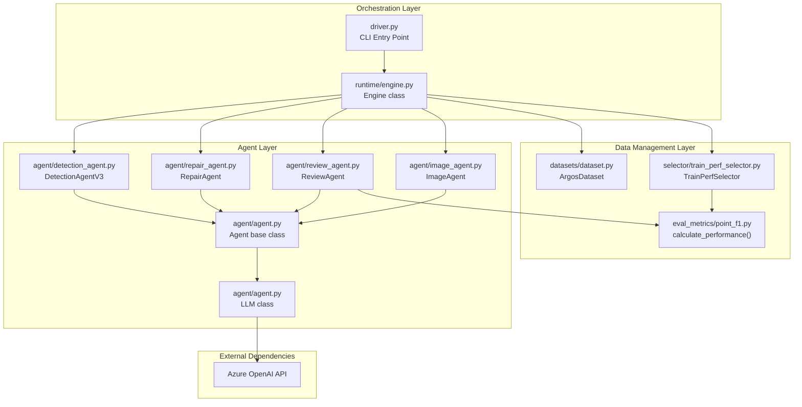
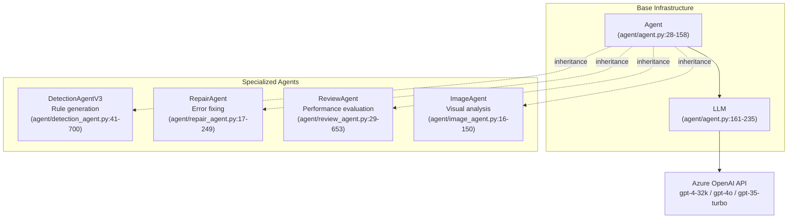
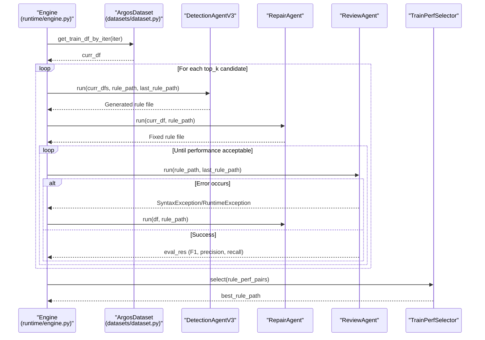
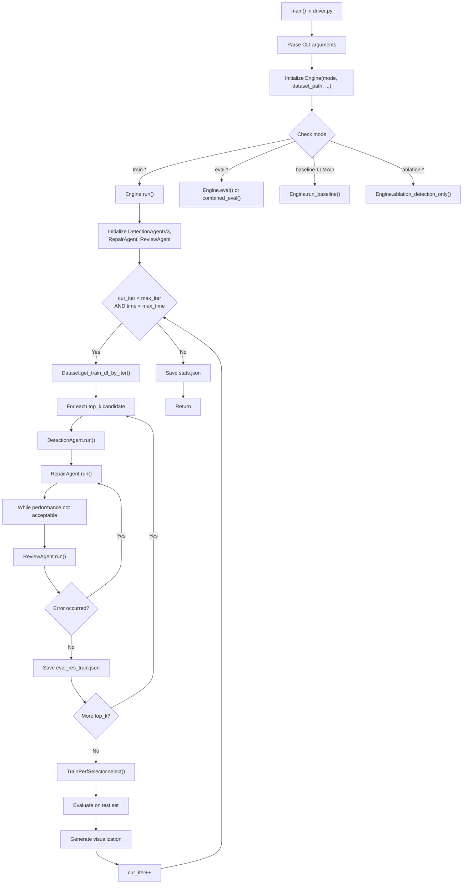
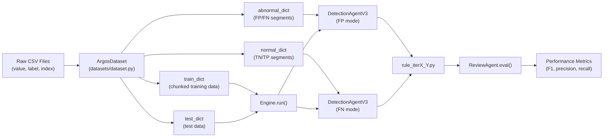

<!-- source: DeepWiki mcp.deepwiki.com · repo microsoft/argos · page 3 Architecture · fetched 2026-10-26 -->

# Architecture

Relevant source files

The following files were used as context for generating this wiki page:

- [README.md](README.md)
- [driver.py](driver.py)
- [runtime/engine.py](runtime/engine.py)

## Purpose and Scope

This document describes the high-level architecture of the Argos system, including its layered structure, core components, and execution flow. It provides a foundation for understanding how the system orchestrates LLM-based agents to generate time-series anomaly detection rules.

For detailed information about specific components, see:
- System component interactions: [System Overview](#3.1)
- Agent design patterns and types: [Agent Ecosystem](#3.2)
- Training and evaluation modes: [Operational Modes](#3.3)
- Data processing pipeline: [Data Flow Pipeline](#3.4)

For implementation details of individual components, see [Core Components](#4).

---

## Architectural Overview

Argos implements a **three-layer architecture** consisting of an orchestration layer, an agent layer, and a data management layer. The system follows an **agentic design pattern** where specialized agents collaborate to generate, repair, and refine anomaly detection rules through iterative interaction with LLMs.

### Layered Architecture

**Sources:** [README.md:95-108](), [driver.py:1-240](), [runtime/engine.py:28-128]()

---

## Core Architectural Patterns

### 1. Command-Line Orchestration

The system uses `driver.py` as a **CLI orchestrator** that parses command-line arguments and delegates execution to the `Engine` class. This separation allows the engine to remain independent of the interface layer.

| Component | Responsibility | Key Parameters |
|-----------|---------------|----------------|
| `driver.py` | Parse CLI arguments, initialize Engine, handle top-level exceptions | `--mode`, `--dataset_path`, `--chunk_size`, `--top_k` |
| `runtime/engine.py::Engine` | Orchestrate training/evaluation workflow, manage agent lifecycle | `mode`, `dataset_mode`, `chunk_size`, `top_k` |

**Sources:** [driver.py:30-132](), [runtime/engine.py:28-128]()

### 2. Agent-Based Design

All agents inherit from a common `Agent` base class that provides LLM interaction capabilities through composition with an `LLM` client instance. Each agent specializes in a specific task within the rule generation pipeline.

**Agent Responsibilities:**

| Agent | Purpose | Input | Output |
|-------|---------|-------|--------|
| `DetectionAgentV3` | Generate Python detection rules from time-series data | Time-series chunks, optional context | Python rule file (`.py`) |
| `RepairAgent` | Fix syntax and runtime errors in generated rules | DataFrame, rule file path, error message | Corrected rule file |
| `ReviewAgent` | Evaluate rule performance and trigger refinements | Rule file path, test DataFrame | Performance metrics (F1, precision, recall) |
| `ImageAgent` | Extract anomaly types from time-series visualizations | Image path, previous anomaly types | List of anomaly types |

**Sources:** [agent/agent.py:28-235](), [agent/detection_agent.py:41-700](), [agent/repair_agent.py:17-249](), [agent/review_agent.py:29-653](), [agent/image_agent.py:16-150]()

### 3. Iterative Refinement Loop

The `Engine` class implements an **iterative training loop** where rules are generated, evaluated, and refined until a maximum iteration count or timeout is reached. The loop includes error handling and recovery mechanisms.

**Sources:** [runtime/engine.py:129-453]()

---

## System Components

The following table summarizes the major components and their locations in the codebase:

| Component | File Path | Primary Class/Function | Purpose |
|-----------|-----------|------------------------|---------|
| **CLI Entry Point** | `driver.py` | `main()` | Parse arguments, initialize Engine, handle evaluation modes |
| **Training Engine** | `runtime/engine.py` | `Engine` | Orchestrate training/evaluation, manage iteration loop |
| **Base Agent** | `agent/agent.py` | `Agent`, `LLM` | Provide LLM interaction, message management, token counting |
| **Detection Agent** | `agent/detection_agent.py` | `DetectionAgentV3` | Generate detection rules in 4 modes (LLM-only, combined FP/FN, image) |
| **Repair Agent** | `agent/repair_agent.py` | `RepairAgent` | Fix syntax and runtime errors in generated code |
| **Review Agent** | `agent/review_agent.py` | `ReviewAgent` | Evaluate performance, detect regressions, trigger refinements |
| **Image Agent** | `agent/image_agent.py` | `ImageAgent` | Extract anomaly types from time-series plots |
| **Dataset Manager** | `datasets/dataset.py` | `ArgosDataset` | Load data, chunk segmentation, train/test splitting |
| **Rule Selector** | `selector/train_perf_selector.py` | `TrainPerfSelector` | Select best rule based on training performance |
| **Metrics** | `eval_metrics/point_f1.py` | `calculate_performance()` | Compute F1, precision, recall with point adjustment |
| **Baseline** | `baseline/llmad.py` | `LLMAD` | Baseline implementation for comparison |

**Sources:** [README.md:95-108](), [driver.py:1-240](), [runtime/engine.py:1-830]()

---

## Execution Flow

### Training Mode Execution

The following diagram illustrates the control flow during training mode (`train-LLM-only`, `train-combined-fp`, `train-combined-fn`, `train-LLM-only-image`):

**Key Control Flow Points:**

1. **Initialization** ([driver.py:85-99]()): CLI arguments are parsed and an `Engine` instance is created with the specified mode and parameters.

2. **Agent Setup** ([runtime/engine.py:104-127]()): The Engine initializes specialized agents based on the operational mode.

3. **Iteration Loop** ([runtime/engine.py:203-434]()): The main training loop iterates until `MAX_ITER` or timeout is reached.

4. **Data Chunking** ([runtime/engine.py:217-220]()): For each iteration, random training chunks are selected from the dataset.

5. **Top-K Generation** ([runtime/engine.py:224-363]()): Multiple rule candidates are generated and evaluated to select the best performer.

6. **Error Recovery** ([runtime/engine.py:293-314]()): If `ReviewAgent` raises `SyntaxException` or `RuntimeException`, the `RepairAgent` attempts to fix the rule.

7. **Rule Selection** ([runtime/engine.py:371-372]()): `TrainPerfSelector` chooses the best rule based on training performance metrics.

8. **Final Evaluation** ([runtime/engine.py:378-430]()): The selected rule is evaluated on the test set and results are visualized.

**Sources:** [driver.py:30-132](), [runtime/engine.py:129-453]()

---

## Configuration and Modes

The system supports **eight operational modes** that determine the training and evaluation behavior:

### Training Modes

| Mode | Description | Required Parameters | Agent Workflow |
|------|-------------|---------------------|----------------|
| `train-LLM-only` | Pure LLM-based rule generation | `dataset_path`, `chunk_size` | Detection → Repair → Review |
| `train-LLM-only-image` | Image-guided rule generation | `dataset_path`, `image_chunk_size`, `image_subplots` | Image → Detection → Repair → Review |
| `train-combined-fp` | Fix false positives from existing model | `dataset_path`, `model_res_path` | Detection (with abnormal context) → Repair → Review |
| `train-combined-fn` | Fix false negatives from existing model | `dataset_path`, `model_res_path` | Detection (with normal context) → Repair → Review |

### Evaluation Modes

| Mode | Description | Required Parameters |
|------|-------------|---------------------|
| `eval-LLM-only` | Evaluate existing rule standalone | `rule_path`, `dataset_path` |
| `eval-combined` | Evaluate rule combined with base model | `rule_path`, `model_res_path` |

### Special Modes

| Mode | Description | Purpose |
|------|-------------|---------|
| `baseline-LLMAD` | Run LLMAD baseline | Performance comparison |
| `ablation-detection-only` | Detection without review | Ablation study |

**Sources:** [driver.py:155-169](), [runtime/engine.py:50-128](), [README.md:114-157]()

---

## Data Flow Architecture

Time-series data flows through the system in the following stages:

**Data Processing Stages:**

1. **Loading** ([datasets/dataset.py:55-125]()): `ArgosDataset` loads CSV files and creates pandas DataFrames.

2. **Chunking** ([datasets/dataset.py:127-200]()): Data is segmented into fixed-size chunks (`chunk_size` parameter).

3. **Train/Test Split** ([datasets/dataset.py:170-200]()): Data is split according to `train_test_split` ratio (default 0.7).

4. **Mode-Specific Filtering** ([datasets/dataset.py:201-350]()): For combined modes, data is filtered based on model results (FP/FN indices).

5. **Agent Consumption** ([runtime/engine.py:217-289]()): Agents receive data chunks and generate detection rules.

6. **Evaluation** ([agent/review_agent.py:100-653]()): Generated rules are executed on test data to produce labels.

7. **Metric Calculation** ([eval_metrics/point_f1.py]()): Performance metrics are computed with point adjustment.

**Sources:** [datasets/dataset.py:1-450](), [runtime/engine.py:80-88]()

---

## External Dependencies

The system relies on the following external services and libraries:

### Azure OpenAI Integration

Argos requires Azure OpenAI API credentials configured via environment variables:

- `OPENAI_AZURE_ENDPOINT`: Azure OpenAI service endpoint
- `OPENAI_AZURE_API_KEY`: API authentication key  
- `OPENAI_AZURE_API_VERSION`: API version string

The `LLM` class ([agent/agent.py:161-235]()) wraps the Azure OpenAI client and supports three model options:
- `gpt-4-32k`: Large context window for complex rules
- `gpt-4o`: Vision-enabled for image analysis
- `gpt-35-turbo-16k`: Cost-effective option

**Sources:** [README.md:51-61](), [agent/agent.py:161-235](), [driver.py:220-225]()

### Python Dependencies

Key libraries used throughout the system:

| Library | Purpose | Usage |
|---------|---------|-------|
| `pandas` | DataFrame operations | Data loading, manipulation, filtering |
| `numpy` | Numerical operations | Array operations, label processing |
| `matplotlib` | Visualization | Generate time-series plots for ImageAgent |
| `scikit-learn` | ML utilities | Performance metric calculations |

**Sources:** [README.md:43-49](), [runtime/engine.py:11-13]()

---

## Performance and Constraints

### Iteration Limits

The system enforces two types of iteration limits:

1. **Maximum Iterations** (`MAX_ITER`): Default configured in [agent/agent.py:26]()
2. **Timeout** ([runtime/engine.py:69-71]()): Specified in minutes via `--timeout` parameter (default: 150 minutes)

The training loop terminates when either limit is reached ([runtime/engine.py:203-204]()).

### Resource Management

- **Token Counting** ([agent/agent.py:138-158]()): Each agent tracks token usage for cost monitoring
- **Execution Timeout** ([agent/agent.py:73-86]()): Individual agent operations have configurable timeouts
- **Memory Management**: Dataset chunking prevents loading entire datasets into memory

**Sources:** [agent/agent.py:26-158](), [runtime/engine.py:66-71]()

---

For detailed implementation of specific components, refer to:
- [System Overview](#3.1) - Component interaction details
- [Agent Ecosystem](#3.2) - Agent design and specialization
- [Operational Modes](#3.3) - Mode-specific workflows
- [Data Flow Pipeline](#3.4) - Data transformation details
- [Core Components](#4) - Individual component documentation

---

