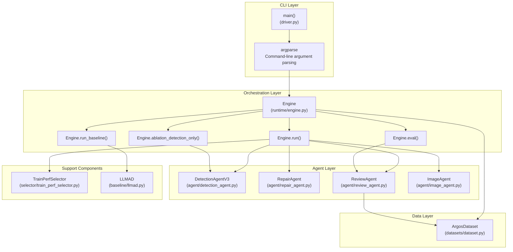
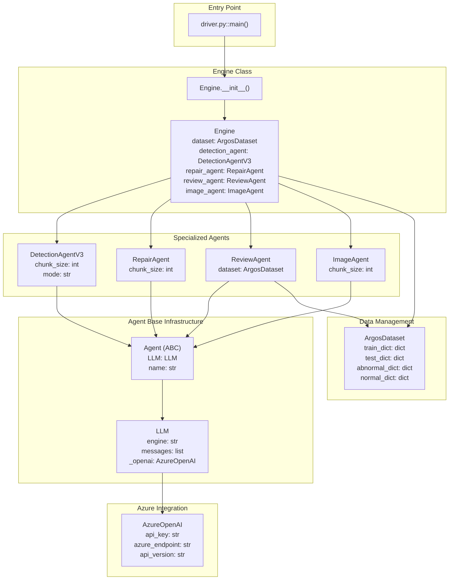
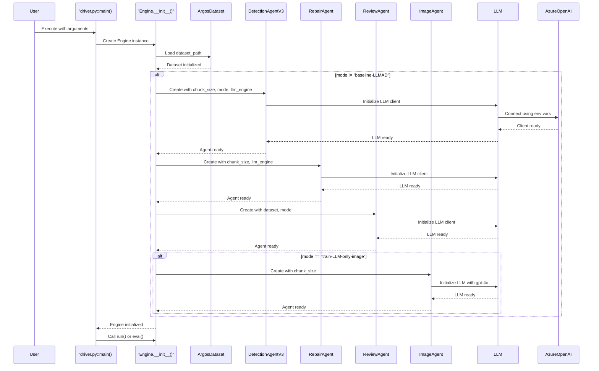
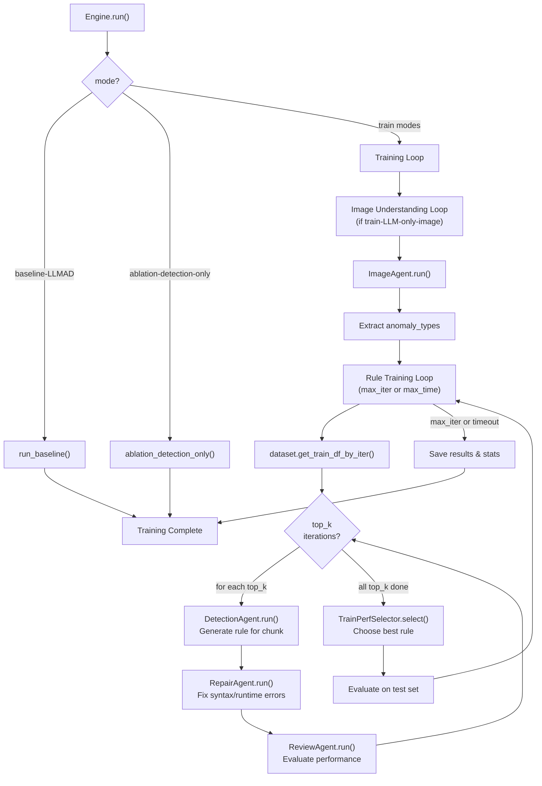
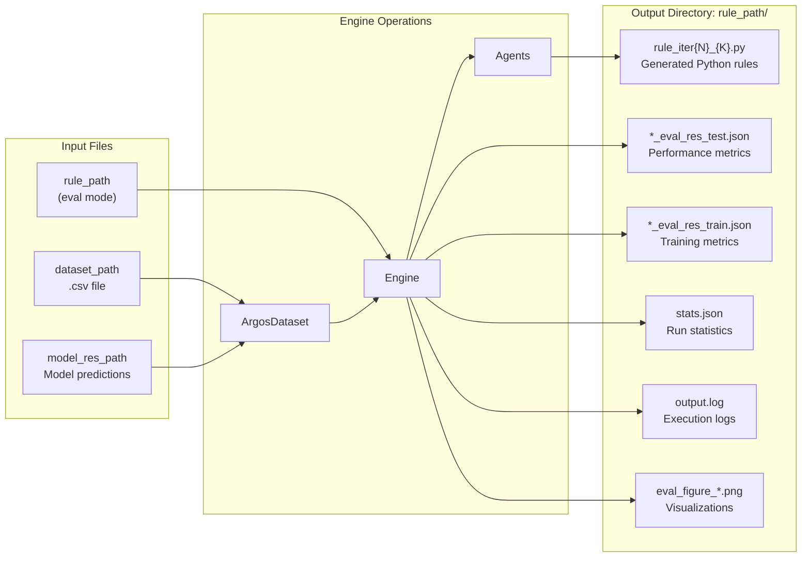
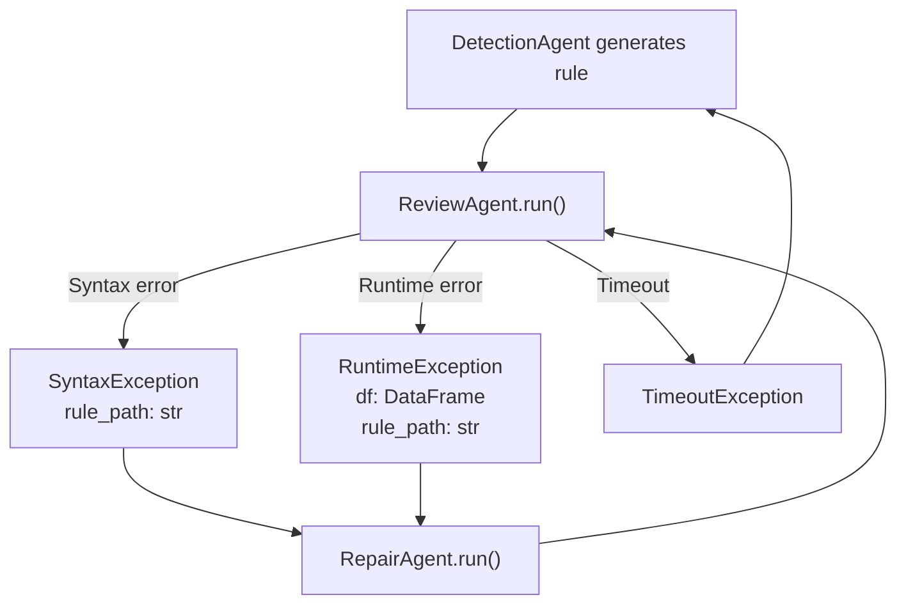
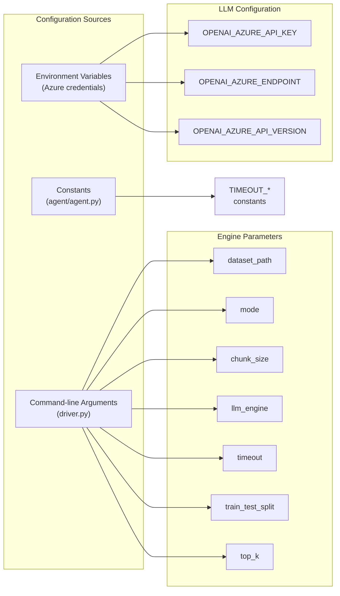

<!-- source: DeepWiki mcp.deepwiki.com · repo microsoft/argos · page 3.1 System Overview · fetched 2026-10-26 -->

# System Overview

Relevant source files

The following files were used as context for generating this wiki page:

- [agent/agent.py](agent/agent.py)
- [driver.py](driver.py)
- [runtime/engine.py](runtime/engine.py)

## Purpose and Scope

This document describes the high-level architecture of Argos, explaining how the major components interact to implement agentic time-series anomaly detection. It covers the system's layered structure, the relationships between core classes, and the orchestration flow from CLI invocation through rule generation and evaluation.

For detailed information about specific agents, see [Agent Ecosystem](#3.2). For operational mode behavior, see [Operational Modes](#3.3). For data processing details, see [Data Flow Pipeline](#3.4).

## Architectural Layers

Argos follows a three-tier architecture where the CLI layer delegates to an orchestration layer, which in turn coordinates specialized agents:

**Sources:** [driver.py:1-240](), [runtime/engine.py:1-830]()

## Core Component Relationships

The following diagram shows the key classes and their dependencies:

**Sources:** [driver.py:30-132](), [runtime/engine.py:28-128](), [agent/agent.py:26-213]()

## Component Responsibilities

| Component | Class/File | Primary Responsibilities |
|-----------|-----------|-------------------------|
| **CLI Driver** | `driver.py::main()` | Parse command-line arguments, initialize Engine, invoke training or evaluation modes |
| **Orchestrator** | `Engine` (runtime/engine.py) | Manage training iterations, coordinate agent lifecycle, handle timeouts, save results |
| **Base Agent** | `Agent` (agent/agent.py:174-213) | Define agent interface with abstract `run()` method, provide code extraction utilities |
| **LLM Client** | `LLM` (agent/agent.py:26-172) | Manage Azure OpenAI connections, maintain message history, track token usage |
| **Detection Agent** | `DetectionAgentV3` | Generate Python anomaly detection rules using LLM prompts |
| **Repair Agent** | `RepairAgent` | Fix syntax and runtime errors in generated Python code |
| **Review Agent** | `ReviewAgent` | Evaluate rule performance, trigger iterative refinements, prevent regressions |
| **Image Agent** | `ImageAgent` | Extract anomaly types from time-series visualizations using GPT-4o vision |
| **Dataset Manager** | `ArgosDataset` | Load CSV data, perform train/test splitting, chunk data, filter by model results |
| **Rule Selector** | `TrainPerfSelector` | Select best-performing rule from multiple training iterations |
| **Baseline** | `LLMAD` | Provide LLMAD baseline implementation for comparative evaluation |

**Sources:** [driver.py:30-132](), [runtime/engine.py:28-128](), [agent/agent.py:26-213]()

## Initialization Sequence

The system initializes components in a specific order to establish dependencies:

**Sources:** [driver.py:30-132](), [runtime/engine.py:28-128](), [agent/agent.py:26-63]()

## Core Orchestration Flow

The `Engine.run()` method implements the main training loop:

**Sources:** [runtime/engine.py:129-453]()

## File System Integration

Argos interacts extensively with the file system during execution:

**Sources:** [runtime/engine.py:73-94](), [runtime/engine.py:199-202](), [runtime/engine.py:436-449]()

## Key Design Patterns

### Composition Over Inheritance

Each specialized agent composes an `LLM` instance rather than inheriting LLM functionality:

| Agent Class | LLM Engine | Purpose |
|-------------|-----------|---------|
| `DetectionAgentV3` | Configurable (gpt-4-32k, gpt-4o, gpt-35-turbo-16k) | Rule generation |
| `RepairAgent` | Configurable | Code repair |
| `ReviewAgent` | Configurable | Performance evaluation |
| `ImageAgent` | gpt-4o (required) | Visual analysis |

**Sources:** [runtime/engine.py:104-127](), [agent/agent.py:26-63]()

### Iterative Refinement Loop

The training process implements an iterative refinement pattern:

1. **Generate**: `DetectionAgentV3.run()` creates initial rule
2. **Repair**: `RepairAgent.run()` fixes code errors
3. **Review**: `ReviewAgent.run()` evaluates performance
4. **Refine**: If performance regresses, ReviewAgent requests improvements from LLM
5. **Select**: `TrainPerfSelector.select()` chooses best rule across iterations

**Sources:** [runtime/engine.py:203-433]()

### Timeout and Error Handling

The system implements multiple timeout layers:

| Timeout | Location | Duration | Purpose |
|---------|----------|----------|---------|
| `TIMEOUT` | agent/agent.py:18 | 90,000s (25h) | Overall execution limit |
| `TIMEOUT_LLM` | agent/agent.py:20 | 300s (5min) | Individual LLM query |
| `TIMEOUT_FIRST_REVIEW` | agent/agent.py:19 | 120s (2min) | First review iteration |
| `TIMEOUT_PER_REVIEW` | agent/agent.py:21 | 120s (2min) | Subsequent review iterations |
| `TIMEOUT_IMAGE` | agent/agent.py:22 | 600s (10min) | Image understanding |
| `TIMEOUT_INFERENCE` | agent/agent.py:23 | 60s (1min) | Rule execution |
| `max_time` | runtime/engine.py:70 | Configurable | Engine timeout (minutes * 60) |

**Sources:** [agent/agent.py:17-23](), [runtime/engine.py:69-71]()

### Exception-Based Control Flow

Custom exceptions coordinate error recovery:

**Sources:** [runtime/engine.py:293-314](), [common/exception.py]()

## State Management

The `Engine` class maintains execution state through instance variables:

| Variable | Type | Purpose |
|----------|------|---------|
| `cur_iter` | int | Current iteration number |
| `max_iter` | int | Maximum iterations (MAX_ITER = 100) |
| `max_time` | float | Maximum execution time in seconds |
| `rule_path` | str | Output directory path |
| `dataset` | ArgosDataset | Data manager instance |
| `detection_agent` | DetectionAgentV3 | Rule generator |
| `repair_agent` | RepairAgent | Code fixer |
| `review_agent` | ReviewAgent | Performance evaluator |
| `image_agent` | ImageAgent | Visual analyzer (optional) |

**Sources:** [runtime/engine.py:29-128]()

## Configuration Sources

Engine behavior is configured through multiple sources:

**Sources:** [driver.py:135-238](), [agent/agent.py:58-62](), [agent/agent.py:17-23]()

---

