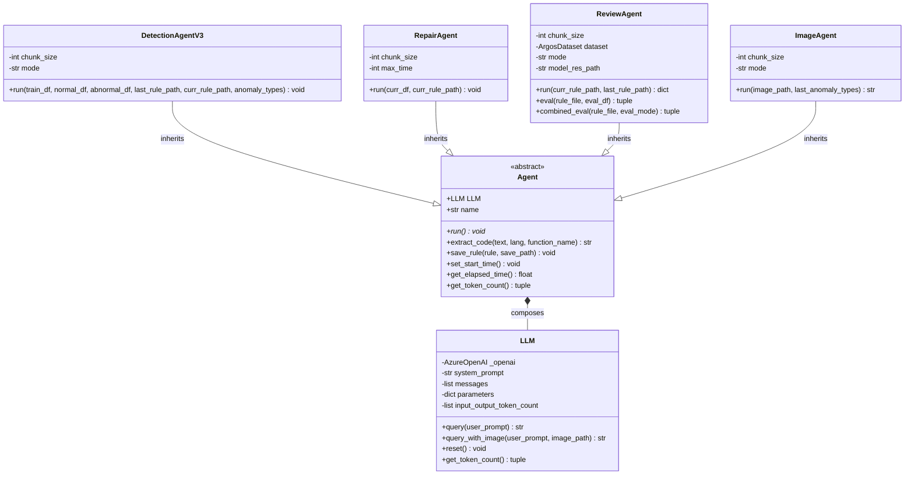
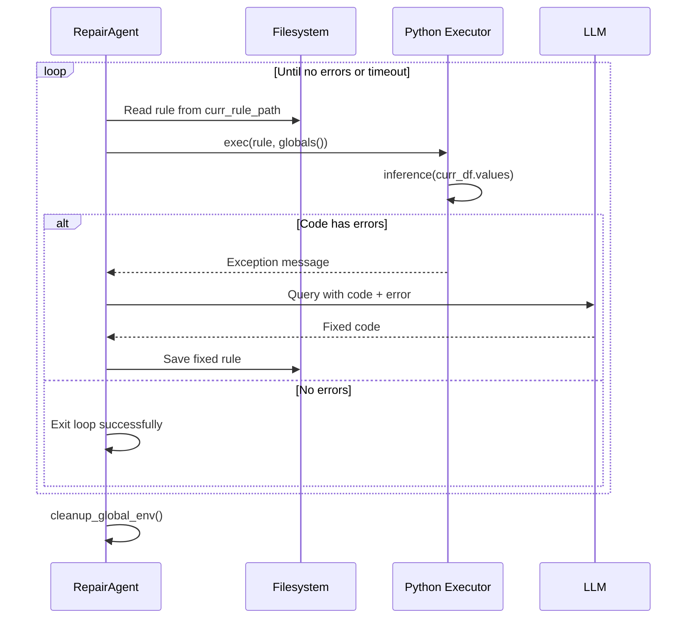
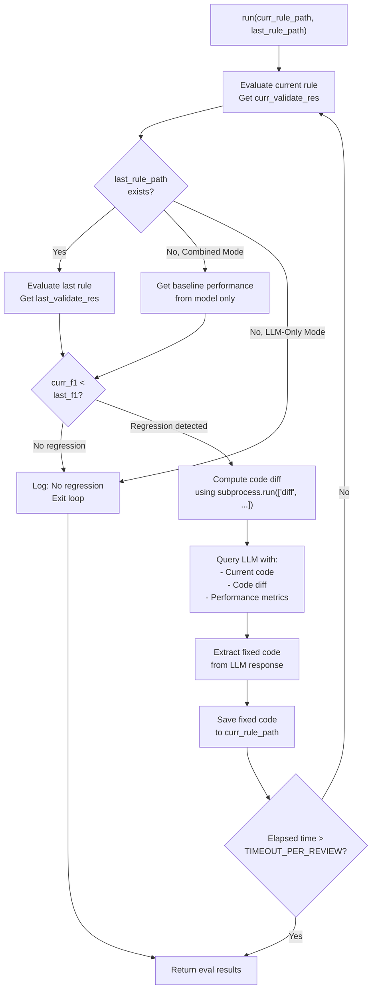
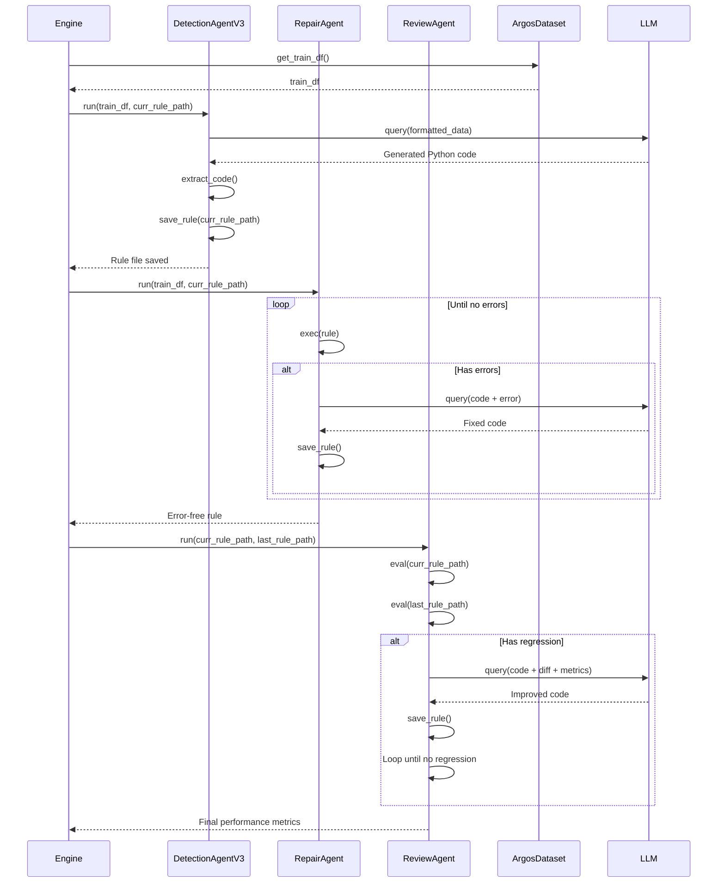
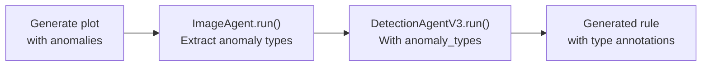

<!-- source: DeepWiki mcp.deepwiki.com · repo microsoft/argos · page 3.2 Agent Ecosystem · fetched 2026-10-26 -->

# Agent Ecosystem

<details>
<summary>Relevant source files</summary>

The following files were used as context for generating this wiki page:

- [agent/agent.py](agent/agent.py)
- [agent/detection_agent.py](agent/detection_agent.py)
- [agent/image_agent.py](agent/image_agent.py)
- [agent/repair_agent.py](agent/repair_agent.py)
- [agent/review_agent.py](agent/review_agent.py)

</details>


The agent ecosystem implements Argos's core intelligent capabilities through a modular, composition-based architecture. This page documents the base `Agent` class, the `LLM` client wrapper, and the four specialized agents that perform rule generation, error repair, performance review, and visual analysis. For information about how these agents are orchestrated during training and evaluation, see [Engine](#4.2).

---

## Base Infrastructure

### Architecture Overview

The agent ecosystem follows a composition pattern where all specialized agents inherit from an abstract `Agent` base class and compose an `LLM` instance for AI capabilities.



**Sources:** [agent/agent.py:26-213](), [agent/detection_agent.py:513-700](), [agent/repair_agent.py:12-117](), [agent/review_agent.py:25-667](), [agent/image_agent.py:13-97]()

---

### LLM Class

The `LLM` class wraps the Azure OpenAI API and manages conversation state for iterative interactions with language models.

#### Initialization Parameters

| Parameter | Type | Default | Description |
|-----------|------|---------|-------------|
| `system_prompt` | str | "You are an AI assistant..." | System-level instructions that define agent behavior |
| `engine` | str | "gpt-4o" | Azure OpenAI model name (gpt-3.5-turbo, gpt-4-32k, gpt-4o) |
| `temperature` | float | 0.1 | Controls response randomness (0.0-1.0) |
| `past_message_num` | int | sys.maxsize | Number of historical messages to retain in context |

#### Key Methods

**`query(user_prompt: str) -> str`**  
Sends a text prompt to the LLM and returns the response. Automatically manages message history and token counting.

**`query_with_image(user_prompt: str, image_path: str) -> str`**  
Sends a prompt with an embedded image (base64-encoded). Only supported for `gpt-4o` engine. Used by `ImageAgent` for visual analysis.

**`reset() -> None`**  
Clears conversation history except the system prompt. Used between iterations to prevent context pollution.

**`get_token_count() -> tuple`**  
Returns `(input_output_token_count_list, total_input_tokens, total_output_tokens)` for cost tracking and monitoring.

#### Message Management

The `LLM` class maintains a conversation history in the `messages` list with the format:
```python
[
    {"role": "system", "content": system_prompt},
    {"role": "user", "content": user_prompt_1},
    {"role": "assistant", "content": response_1},
    ...
]
```

The `update_messages()` method enforces the `past_message_num` limit by retaining only the most recent user-assistant exchanges while preserving the system prompt at position 0.

#### Timeout and Retry Logic

The `send_messages()` method implements exponential backoff with a maximum timeout of `TIMEOUT_LLM` (5 minutes). If the API call fails, it retries with increasing delays (2, 3, 4, 5, 10, 20... seconds).

**Sources:** [agent/agent.py:26-172]()

---

### Agent Abstract Base Class

The `Agent` class provides common functionality for all specialized agents:

**Core Responsibilities:**
- Code extraction from LLM responses using regex patterns
- Rule saving to filesystem
- Time tracking for timeout enforcement
- Token count aggregation

**Abstract Method:**
- `run(*args, **kwargs)` - Must be implemented by subclasses to define agent-specific behavior

**Helper Methods:**

| Method | Purpose |
|--------|---------|
| `extract_code(text, lang, function_name)` | Extracts code blocks from markdown-formatted LLM responses. Searches for ` ```{lang}...``` ` patterns containing the specified function name. |
| `save_rule(rule, save_path)` | Writes generated Python code to the specified file path. |
| `set_start_time()` | Records the current timestamp for timeout calculations. |
| `get_elapsed_time()` | Returns seconds elapsed since `set_start_time()` was called. |
| `get_token_count()` | Delegates to `LLM.get_token_count()` for token usage tracking. |

**Sources:** [agent/agent.py:174-213]()

---

## Specialized Agents

### DetectionAgentV3

`DetectionAgentV3` is the primary rule generation agent. It queries the LLM to produce Python `inference` functions that detect anomalies in time-series data.

#### Initialization

```python
DetectionAgentV3(
    chunk_size: int,
    mode: str = "train-LLM-only",
    llm_engine: str = "gpt-4o",
    timeout: int = 150
)
```

**Mode-Specific Prompts:**

The agent's behavior varies significantly based on the `mode` parameter:

| Mode | Prompt Focus | Target Data |
|------|--------------|-------------|
| `train-LLM-only` | Generate rules from scratch using labeled data | All abnormal/normal samples |
| `train-LLM-only-image` | Incorporate anomaly types from visual analysis | All samples + anomaly type descriptions |
| `train-combined-fp` | Fix false positives from existing models | Normal samples misclassified as abnormal |
| `train-combined-fn` | Fix false negatives from existing models | Abnormal samples misclassified as normal |

#### Generated Function Signature

All modes produce functions with this signature:
```python
def inference(sample: np.ndarray) -> np.ndarray:
    """
    Args:
        sample: Shape (X, 2) where each row is (value, index)
    
    Returns:
        labels: Shape (X,) where 1=abnormal, 0=normal
    """
```

#### Run Method

```python
run(
    train_df: pd.DataFrame,
    normal_df: pd.DataFrame = None,
    abnormal_df: pd.DataFrame = None,
    last_rule_path: str = None,
    curr_rule_path: str = None,
    anomaly_types: str = None
) -> None
```

**Workflow:**
1. Formats training data as a string representation with (value, label, index) tuples
2. Optionally includes previous iteration's code for refinement
3. For image-guided mode, prepends anomaly type descriptions
4. Queries LLM and extracts Python code from markdown response
5. Saves rule to `curr_rule_path`

**Timeout:** Continues generating rules until `TIMEOUT` (30 minutes × 5 = 150 minutes) is reached.

**Sources:** [agent/detection_agent.py:513-1140]()

---

### RepairAgent

`RepairAgent` automatically fixes syntax and runtime errors in generated code through iterative refinement.

#### Initialization

```python
RepairAgent(
    chunk_size: int,
    llm_engine: str = "gpt-4o",
    timeout: int = 150
)
```

The agent's system prompt explicitly instructs the LLM to:
- Focus only on error correction
- Preserve unrelated logic
- Maintain the same code format

#### Run Method

```python
run(curr_df: pd.DataFrame, curr_rule_path: str) -> None
```

**Repair Loop:**



**Error Detection:**
1. Attempts to execute the code using `exec(rule, globals())`
2. Calls the `inference` function with timeout enforcement (`TIMEOUT_INFERENCE` = 1 minute)
3. Validates output format using `format_check()`
4. Cleans up global namespace with `cleanup_global_env()`

**Exception Types:**
- **SyntaxException:** Python syntax errors detected during `exec()`
- **RuntimeException:** Execution failures (e.g., undefined variables, type mismatches)
- **TimeoutException:** Inference exceeds `TIMEOUT_INFERENCE`

**Sources:** [agent/repair_agent.py:12-117]()

---

### ReviewAgent

`ReviewAgent` monitors performance metrics across iterations and triggers refinements when regressions are detected.

#### Initialization

```python
ReviewAgent(
    chunk_size: int,
    dataset: ArgosDataset,
    dataset_name: str = None,
    model_res_path: str = None,
    mode: str = "train-LLM-only",
    llm_engine: str = "gpt-4o",
    timeout: int = 150
)
```

The agent's behavior differs based on `mode`:

**LLM-Only Modes (`train-LLM-only`, `train-LLM-only-image`, `eval-LLM-only`):**
- Compares current rule performance against previous iteration
- No dependency on external model results

**Combined Modes (`train-combined-fp`, `train-combined-fn`):**
- Evaluates rules in combination with base model predictions
- First iteration compares against baseline model performance
- Subsequent iterations compare against previous combined performance

#### Run Method

```python
run(curr_rule_path: str, last_rule_path: str = None) -> tuple
```

**Regression Detection Logic:**



**Performance Metrics:**

The agent uses F1 score as the primary regression indicator but tracks multiple metrics:
- **f1:** Harmonic mean of precision and recall
- **precision:** True positives / (True positives + False positives)
- **recall:** True positives / (True positives + False negatives)
- **threshold:** Optimal threshold for converting scores to binary labels

#### Evaluation Methods

**`eval(rule_file: str, eval_df: pd.DataFrame) -> tuple`**

Evaluates a rule on a single DataFrame:
1. Executes rule code and extracts `inference` function
2. Processes data in chunks of size `chunk_size`
3. Applies `smooth_labels()` with window_size=3 to reduce noise
4. Calculates performance metrics using `calculate_point_f1()`
5. Returns `(final_res_dict, labels, scores)`

**`eval_all_in_one(rule_file: str, df_dict: dict) -> tuple`**

Aggregates evaluation across multiple datasets (for `all-in-one` mode):
1. Calls `eval()` for each DataFrame in `df_dict`
2. Concatenates all scores and ground truth labels
3. Computes combined performance metrics
4. Returns aggregated results

**`combined_eval(rule_file: str, eval_mode: str) -> tuple`**

Evaluates rules in combination with base model predictions:
1. Retrieves model labels from dataset (train or test split)
2. Generates rule labels from `eval()`
3. Combines labels using mode-specific logic:
   - **train-combined-fp:** Rule labels override model labels to 0 (normal)
   - **train-combined-fn:** Rule labels override model labels to 1 (abnormal)
4. Calculates performance against ground truth
5. Returns combined results

**Sources:** [agent/review_agent.py:25-667]()

---

### ImageAgent

`ImageAgent` performs visual analysis of time-series plots to extract high-level anomaly type descriptions. This provides semantic guidance for `DetectionAgentV3` in the `train-LLM-only-image` mode.

#### Initialization

```python
ImageAgent(
    chunk_size: int,
    mode: str = "train-LLM-only",
    llm_engine: str = "gpt-4o"
)
```

**Requirements:**
- Must use `gpt-4o` engine for vision capabilities
- Images must be PNG format with red dots marking anomalies

#### Run Method

```python
run(image_path: str, last_anomaly_types: str = None) -> str
```

**Workflow:**
1. Optionally includes anomaly types from previous iteration for refinement
2. Calls `LLM.query_with_image()` with the plot image
3. Extracts structured anomaly type descriptions between markers:
   ```
   ### Anomaly Types BEGIN ###
   1. AnomalyType1: Explanation1
   2. AnomalyType2: Explanation2
   ...
   ### Anomaly Types END ###
   ```
4. Returns the extracted text for use by `DetectionAgentV3`

**Prompt Guidelines:**

The system prompt instructs the LLM to:
- Identify distinct anomaly patterns (spikes, drops, plateaus, etc.)
- Provide concrete value examples without timestamp information
- Merge duplicate anomaly types across figures
- Update existing types when seeing new examples
- Remove types that reflect normal patterns

**Timeout:** Continues attempting generation until `TIMEOUT_IMAGE` (10 minutes) is reached.

**Sources:** [agent/image_agent.py:13-97]()

---

## Agent Interaction Patterns

### Training Pipeline Integration

The following sequence shows how agents collaborate during a typical training iteration:



**Sources:** [runtime/engine.py:100-269]() (referenced from context), [agent/detection_agent.py:513-1140](), [agent/repair_agent.py:12-117](), [agent/review_agent.py:25-667]()

---

### Image-Guided Training

For the `train-LLM-only-image` mode, an additional `ImageAgent` preprocessing step occurs:



The extracted anomaly types are embedded in the generated rule's comments:
```python
def inference(sample: np.ndarray) -> np.ndarray:
    ##### Anomaly Types BEGIN #####
    # 1. SuddenSpike: Sharp increase in value by >50% from baseline
    # 2. GradualDrift: Sustained upward trend over 20+ samples
    ##### Anomaly Types END #####
    
    # Normal Rule 1: Values remain within ±20% of mean
    # Abnormal Rule 1: Handles SuddenSpike pattern
    if ...:
        ...
```

**Sources:** [agent/image_agent.py:13-97](), [agent/detection_agent.py:603-648]()

---

## Prompt Engineering

### Prompt Structure

All agents use structured prompts with consistent formatting conventions:

**Common Elements:**
- **Role Definition:** "You are an AI assistant that helps people..."
- **Task Description:** Detailed explanation of the agent's objective
- **Input Format:** Markdown headers like `##### DATA`, `##### CODE`
- **Output Format:** Explicit instructions with example structure
- **Constraints:** IMPORTANT sections highlighting critical requirements

**Code Wrapping Convention:**

All agents enforce consistent code extraction by requiring:
```markdown
##### CODE
```python
# code here
```
```

The `extract_code()` method uses regex to locate blocks matching ` ```{lang}...``` ` patterns containing the target function name (e.g., `def inference`).

### Temperature Settings

| Agent | Temperature | Rationale |
|-------|-------------|-----------|
| DetectionAgentV3 | 0.75 | Encourages creative rule patterns while maintaining coherence |
| RepairAgent | 0.75 | Balances fix creativity with code stability |
| ReviewAgent | 0.75 | Allows flexible performance improvement strategies |
| ImageAgent | 0.75 | Promotes diverse anomaly type identification |

**Sources:** [agent/agent.py:42-45](), [agent/detection_agent.py:514-648](), [agent/repair_agent.py:38-43](), [agent/review_agent.py:122-127](), [agent/image_agent.py:46-51]()

---

## Error Handling and Timeouts

### Timeout Constants

| Constant | Value | Usage |
|----------|-------|-------|
| `TIMEOUT` | 150 minutes | Overall agent execution limit |
| `TIMEOUT_LLM` | 5 minutes | Single LLM API call |
| `TIMEOUT_INFERENCE` | 1 minute | Generated rule execution |
| `TIMEOUT_FIRST_REVIEW` | 2 minutes | First iteration of ReviewAgent |
| `TIMEOUT_PER_REVIEW` | 2 minutes | Subsequent ReviewAgent iterations |
| `TIMEOUT_IMAGE` | 10 minutes | ImageAgent visual analysis |

### Global Environment Cleanup

To prevent namespace pollution from `exec()` calls, the system uses `cleanup_global_env()` after each code execution:

```python
# Typical pattern
try:
    exec(rule, globals())
    result = inference(data)
except Exception as e:
    cleanup_global_env()
    raise
finally:
    cleanup_global_env()
```

This removes dynamically defined functions and variables to ensure isolation between iterations.

**Sources:** [agent/agent.py:17-23](), [common/common.py]() (referenced for cleanup_global_env)

---

## Agent Capabilities Summary

| Agent | Primary Function | Input | Output | Key Features |
|-------|-----------------|--------|--------|--------------|
| **DetectionAgentV3** | Rule generation | Time-series data, labels, optional anomaly types | Python inference function | Multi-mode support, iterative refinement, image guidance |
| **RepairAgent** | Error correction | Broken code, error messages | Fixed code | Iterative fixing, timeout enforcement, format validation |
| **ReviewAgent** | Performance monitoring | Current/previous rules, dataset | Performance metrics, refined code | Regression detection, diff-based refinement, combined evaluation |
| **ImageAgent** | Visual analysis | Time-series plots (PNG) | Anomaly type descriptions | GPT-4o vision, iterative type refinement, overfitting prevention |

**Sources:** [agent/detection_agent.py:513-1140](), [agent/repair_agent.py:12-117](), [agent/review_agent.py:25-667](), [agent/image_agent.py:13-97]()

---

