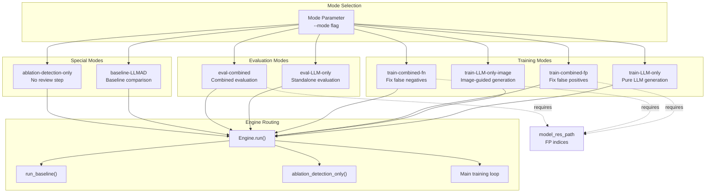
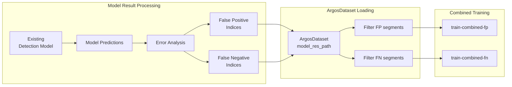
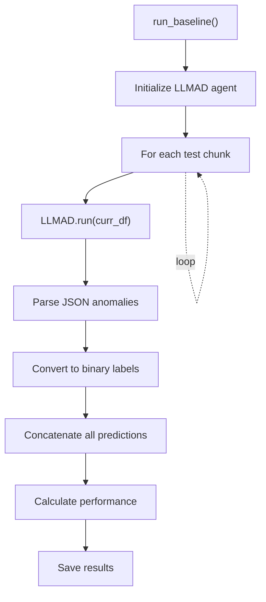
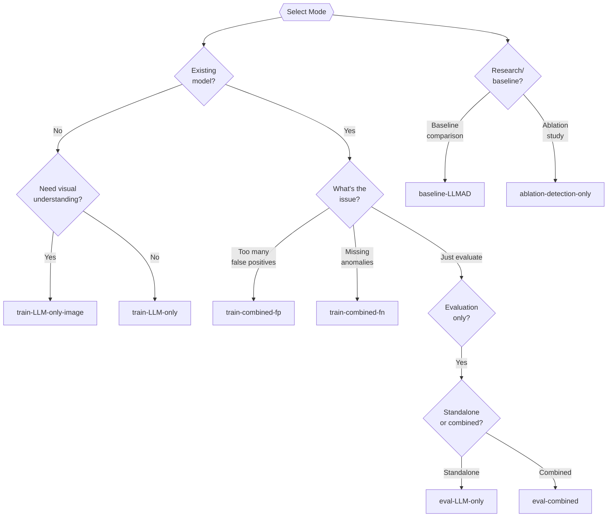
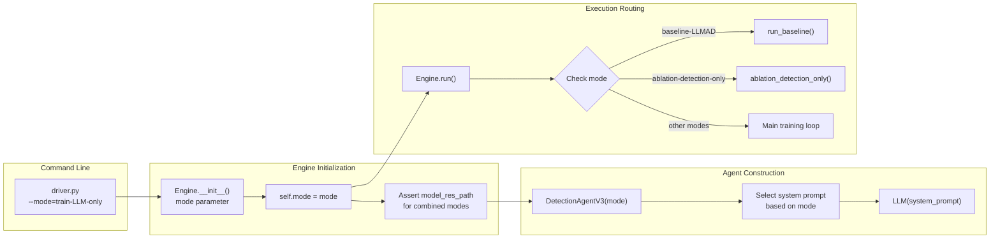

<!-- source: DeepWiki mcp.deepwiki.com · repo microsoft/argos · page 3.3 Operational Modes · fetched 2026-10-26 -->

# Operational Modes

<details>
<summary>Relevant source files</summary>

The following files were used as context for generating this wiki page:

- [README.md](README.md)
- [agent/detection_agent.py](agent/detection_agent.py)
- [runtime/engine.py](runtime/engine.py)

</details>


This page documents the eight operational modes supported by Argos, explaining their purposes, implementation details, and when to use each. Operational modes control how Argos generates and evaluates anomaly detection rules, and how it interacts with existing detection models.

For information about running Argos with specific modes, see [Running Argos](#2.3). For details on the training pipeline implementation, see [Engine](#4.2).

---

## Overview

Argos supports eight distinct operational modes organized into three categories:

| Category | Mode | Purpose |
|----------|------|---------|
| **Training** | `train-LLM-only` | Generate rules using only LLM and time-series data |
| | `train-LLM-only-image` | Generate rules guided by visual anomaly type analysis |
| | `train-combined-fp` | Generate rules to fix false positives from existing models |
| | `train-combined-fn` | Generate rules to fix false negatives from existing models |
| **Evaluation** | `eval-LLM-only` | Evaluate generated rules standalone |
| | `eval-combined` | Evaluate rules combined with existing model outputs |
| **Special** | `baseline-LLMAD` | Run LLMAD baseline for comparison |
| | `ablation-detection-only` | Train detection rules without review agent |

The mode is specified via the `--mode` argument in [driver.py]() and controls the entire execution flow through the [runtime/engine.py:29-128]() initialization and [runtime/engine.py:129-453]() execution.

**Sources:** [README.md:114-157](), [runtime/engine.py:29-100]()

---

## Mode Architecture



**Sources:** [runtime/engine.py:29-100](), [runtime/engine.py:129-453]()

---

## Training Modes

Training modes generate anomaly detection rules through iterative LLM interactions. All training modes use the `DetectionAgentV3` class but with different system prompts and data selection strategies.

### train-LLM-only

The `train-LLM-only` mode is the baseline training approach where Argos generates detection rules solely from time-series data without any external guidance or existing model integration.

**Implementation:**
- Uses default system prompt in [agent/detection_agent.py:656-689]()
- Iterates through data chunks from `ArgosDataset.get_train_df_by_iter()`
- Applies detection → repair → review agent pipeline
- Selects best rule using `TrainPerfSelector`

**System Prompt Structure:**
The prompt instructs the LLM to write an `inference(sample: np.ndarray) -> np.ndarray` function that:
- Takes time-series samples as (value, index) tuples
- Returns binary labels (0=normal, 1=abnormal)
- Describes patterns including average, trend, regression
- Does not hard-code indices or assume fixed sample sizes

**When to Use:**
- Starting anomaly detection from scratch
- No existing detection model available
- Want fully explainable, standalone rules
- Evaluating Argos capabilities independently

**Example Usage:**
```bash
python3 driver.py \
  --dataset_path=$dataset_path \
  --mode=train-LLM-only \
  --result_path=$result_path \
  --chunk_size=2500 \
  --top_k=5 \
  --dataset_mode="one-by-one"
```

**Sources:** [README.md:119-133](), [agent/detection_agent.py:656-689](), [runtime/engine.py:280-289]()

### train-LLM-only-image

The `train-LLM-only-image` mode enhances rule generation by first extracting high-level anomaly types from visualizations using the `ImageAgent`, then using these types to guide the `DetectionAgent`.

**Implementation:**
- Two-phase approach implemented in [runtime/engine.py:143-188]()
- **Phase 1 (Image Understanding):** `ImageAgent` analyzes time-series plots to extract anomaly types
- **Phase 2 (Rule Training):** `DetectionAgent` receives anomaly types as guidance in [agent/detection_agent.py:603-648]()

**System Prompt Enhancements:**
The detection prompt includes:
```
##### Anomaly Types BEGIN #####
# Anomaly Type 1: Description of anomaly type 1
# Anomaly Type 2: Description of anomaly type 2
##### Anomaly Types END #####
```

Instructions emphasize matching observed anomalies to the provided types and explaining which type each rule addresses.

**When to Use:**
- Complex datasets with multiple anomaly patterns
- Want human-interpretable anomaly categorization
- Visual patterns are clearer than numerical patterns
- Using GPT-4o or models with vision capabilities

**Example Usage:**
```bash
python3 driver.py \
  --dataset_path=$dataset_path \
  --mode=train-LLM-only-image \
  --result_path=$result_path \
  --chunk_size=2500 \
  --image_chunk_size=10000 \
  --llm_engine=gpt-4o
```

**Sources:** [agent/detection_agent.py:603-648](), [runtime/engine.py:124-127](), [runtime/engine.py:143-188]()

### train-combined-fp

The `train-combined-fp` mode trains compensating rules specifically to eliminate false positives produced by an existing anomaly detection model. This mode treats the existing model outputs as input and focuses on identifying normal patterns that were incorrectly flagged as anomalies.

**Implementation:**
- Requires `--model_res_path` containing false positive indices [runtime/engine.py:60-64]()
- Uses specialized prompt in [agent/detection_agent.py:561-602]()
- Loads FP data through `ArgosDataset` filtered mode
- Provides abnormal samples as validation constraints

**System Prompt Characteristics:**
```
Your task is to write compensated rules that detects and fixes false positives 
from the anomaly detection model. False positives are normal samples that are 
incorrectly detected as abnormal.
```

The prompt emphasizes:
- Writing rules that return all normal labels (0) for FP segments
- Not affecting existing true positive detections
- Receiving optional ABNORMAL DATA samples to validate against

**Data Flow:**
The mode feeds false positive segments as primary training data and true anomaly segments (if available) as constraints via [runtime/engine.py:248-272]():
```
##### DATA 0
<false positive segment>
##### ABNORMAL DATA 0
<true anomaly segment to preserve>
```

**When to Use:**
- Existing model has low precision (too many false alarms)
- Need to reduce alert fatigue
- Have labeled FP examples from production
- Want to complement rather than replace existing model

**Sources:** [agent/detection_agent.py:561-602](), [runtime/engine.py:60-64](), [runtime/engine.py:248-272](), [README.md:143-156]()

### train-combined-fn

The `train-combined-fn` mode trains compensating rules to detect false negatives missed by an existing anomaly detection model. This mode focuses on finding additional anomaly patterns not captured by the base model.

**Implementation:**
- Requires `--model_res_path` containing false negative indices [runtime/engine.py:60-64]()
- Uses specialized prompt in [agent/detection_agent.py:519-560]()
- Loads FN data through `ArgosDataset` filtered mode
- Provides normal samples as validation constraints

**System Prompt Characteristics:**
```
Your task is to write compensated rules that detects false negatives from 
the anomaly detection model.
```

The prompt emphasizes:
- Writing rules that detect missed anomalies
- Not affecting existing normal classifications
- Receiving optional NORMAL DATA samples to validate against

**Data Flow:**
The mode feeds false negative segments as primary training data and normal segments (if available) as constraints via [runtime/engine.py:225-247]():
```
##### DATA 0
<false negative segment>
##### NORMAL DATA 0
<normal segment to preserve>
```

**When to Use:**
- Existing model has low recall (missing real anomalies)
- Want to catch edge cases and rare patterns
- Have labeled FN examples from incident reviews
- Prioritize completeness over false alarm rate

**Sources:** [agent/detection_agent.py:519-560](), [runtime/engine.py:60-64](), [runtime/engine.py:225-247]()

---

## Combined Mode Data Requirements

Both `train-combined-fp` and `train-combined-fn` require pre-processed model results:



The `model_res_path` directory must contain:
- Time-series data with false positive/negative labels
- Structured in the same format as regular datasets
- Properly indexed to align with the base model outputs

**Sources:** [runtime/engine.py:60-64](), [datasets/dataset.py](), [README.md:139-156]()

---

## Evaluation Modes

Evaluation modes assess the performance of generated rules. While the exact implementation details of pure evaluation modes (`eval-LLM-only` and `eval-combined`) are not fully visible in the provided code excerpts, the evaluation infrastructure is present in the `ReviewAgent` class.

### eval-LLM-only

The `eval-LLM-only` mode evaluates generated detection rules in standalone fashion without combining them with any existing model outputs.

**Implementation:**
- Uses `ReviewAgent.eval()` method for one-by-one datasets
- Uses `ReviewAgent.eval_all_in_one()` for all-in-one datasets
- Calculates point-based F1, precision, and recall metrics
- Does not require model result path

**When to Use:**
- Assessing standalone rule performance
- Comparing different rule generation approaches
- Benchmarking against baselines
- Rules will be used independently

**Sources:** [runtime/engine.py:769-791]()

### eval-combined

The `eval-combined` mode evaluates rules when combined with an existing model's predictions, showing the improvement gained from the compensating rules.

**Implementation:**
- Uses `ReviewAgent.combined_eval()` for one-by-one datasets
- Uses `ReviewAgent.combined_eval_all_in_one()` for all-in-one datasets  
- Requires model result path to load base model predictions
- Calculates combined performance metrics

**When to Use:**
- Measuring incremental improvement over existing model
- Validating combined-fp/fn training effectiveness
- Determining deployment readiness for production integration

**Sources:** [runtime/engine.py:792-820]()

---

## Special Modes

### baseline-LLMAD

The `baseline-LLMAD` mode implements the LLMAD (Large Language Model for Anomaly Detection) baseline method for comparative evaluation.

**Implementation:**
- Uses dedicated `LLMAD` class instantiated in [runtime/engine.py:96-100]()
- Runs via specialized `run_baseline()` method [runtime/engine.py:454-523]()
- Iterates through test set chunks
- Outputs JSON predictions and performance metrics
- Uses GPT-4-32k model [runtime/engine.py:98]()

**Execution Flow:**


**Output Files:**
- `llmad_scores_test.npy`: Binary prediction labels
- `llmad_gt_test.npy`: Ground truth labels  
- `llmad_eval_res_test.json`: Performance metrics
- `llmad_{iter}.json`: Per-chunk JSON responses

**When to Use:**
- Comparing Argos against state-of-the-art LLM baselines
- Reproducing benchmark results from the Argos paper
- Understanding performance differences between approaches

**Sources:** [runtime/engine.py:96-100](), [runtime/engine.py:454-523](), [baseline/llmad.py]()

### ablation-detection-only

The `ablation-detection-only` mode is an ablation study configuration that generates rules using only the `DetectionAgent` without the iterative review and refinement process.

**Implementation:**
- Implemented in [runtime/engine.py:524-650]()
- Skips `RepairAgent` and `ReviewAgent` steps
- Evaluates generated rules directly after detection
- Used for ablation studies to measure review agent contribution

**Execution Differences:**

| Component | Normal Training | Ablation Mode |
|-----------|----------------|---------------|
| DetectionAgent | ✓ | ✓ |
| RepairAgent | ✓ | ✗ |
| ReviewAgent | ✓ (iterative) | ✓ (evaluation only) |
| Error Handling | Automatic retry | Best-effort |
| Rule Selection | Top-k selection | Single rule |

**When to Use:**
- Measuring impact of review-based refinement
- Understanding DetectionAgent standalone capabilities
- Reducing computational cost in exploratory experiments
- Debugging detection prompt effectiveness

**Sources:** [runtime/engine.py:137-139](), [runtime/engine.py:524-650]()

---

## Mode Selection Guide



**Decision Criteria:**

1. **No existing model + complex patterns** → `train-LLM-only-image`
2. **No existing model + straightforward data** → `train-LLM-only`
3. **Existing model with high FP rate** → `train-combined-fp`
4. **Existing model with high FN rate** → `train-combined-fn`
5. **Evaluate standalone rules** → `eval-LLM-only`
6. **Evaluate combined system** → `eval-combined`
7. **Research comparison** → `baseline-LLMAD`
8. **Measure review impact** → `ablation-detection-only`

**Sources:** [README.md:114-157]()

---

## Implementation Details

### Mode Parameter Flow



**Sources:** [runtime/engine.py:29-128](), [agent/detection_agent.py:514-700]()

### Mode-Specific Code Paths

The mode parameter affects execution at multiple levels:

**1. Dataset Loading** [runtime/engine.py:80-88]()
```python
self.dataset = ArgosDataset(
    dataset_path=dataset_path,
    dataset_mode=dataset_mode,
    engine_mode=mode,  # Used for filtering FP/FN data
    ...
)
```

**2. Agent Prompt Selection** [agent/detection_agent.py:519-689]()
- Lines 519-560: `train-combined-fn` prompt
- Lines 561-602: `train-combined-fp` prompt  
- Lines 603-648: `train-LLM-only-image` prompt
- Lines 656-689: Default prompt (train-LLM-only)

**3. Execution Flow** [runtime/engine.py:129-453]()
- Lines 130-132: `baseline-LLMAD` → `run_baseline()`
- Lines 137-139: `ablation-detection-only` → `ablation_detection_only()`
- Lines 143-188: `train-LLM-only-image` → Two-phase execution
- Lines 225-247: `train-combined-fn` → Provide normal data constraints
- Lines 248-272: `train-combined-fp` → Provide abnormal data constraints

**4. Evaluation Routing** [runtime/engine.py:324-431]()
```python
if self.mode == "train-combined-fn" or self.mode == "train-combined-fp":
    train_eval_res, _, _ = self.review_agent.combined_eval(...)
else:
    train_eval_res, _, _ = self.review_agent.eval(...)
```

**Sources:** [runtime/engine.py:29-453](), [agent/detection_agent.py:514-700]()

### Mode Validation

The Engine constructor validates mode compatibility:

```python
if mode == "train-combined-fp" or mode == "train-combined-fn":
    assert model_res_path is not None, \
        "Model result path must be provided for combined training mode"
```

This ensures combined modes cannot run without the required model results input.

**Sources:** [runtime/engine.py:60-64]()

---

## Timeout Behavior Across Modes

All modes respect the timeout parameter specified via `--timeout` (in minutes):

| Mode | Timeout Scope | Behavior on Timeout |
|------|--------------|---------------------|
| train-LLM-only | Total training time | Stop after current iteration |
| train-LLM-only-image | Per-phase (image + training) | Stop image or training phase |
| train-combined-fp/fn | Total training time | Stop after current iteration |
| eval-LLM-only | Evaluation execution | Best-effort completion |
| eval-combined | Evaluation execution | Best-effort completion |
| baseline-LLMAD | Total baseline execution | Save partial results |
| ablation-detection-only | Total training time | Stop after current iteration |

The timeout is converted to seconds and tracked via `time.time()` comparisons in the main loop [runtime/engine.py:203-204]():

```python
while self.cur_iter < self.max_iter and time.time() - start_time < self.max_time:
```

**Sources:** [runtime/engine.py:69-71](), [runtime/engine.py:203-204](), [runtime/engine.py:471](), [runtime/engine.py:535-536]()

---

