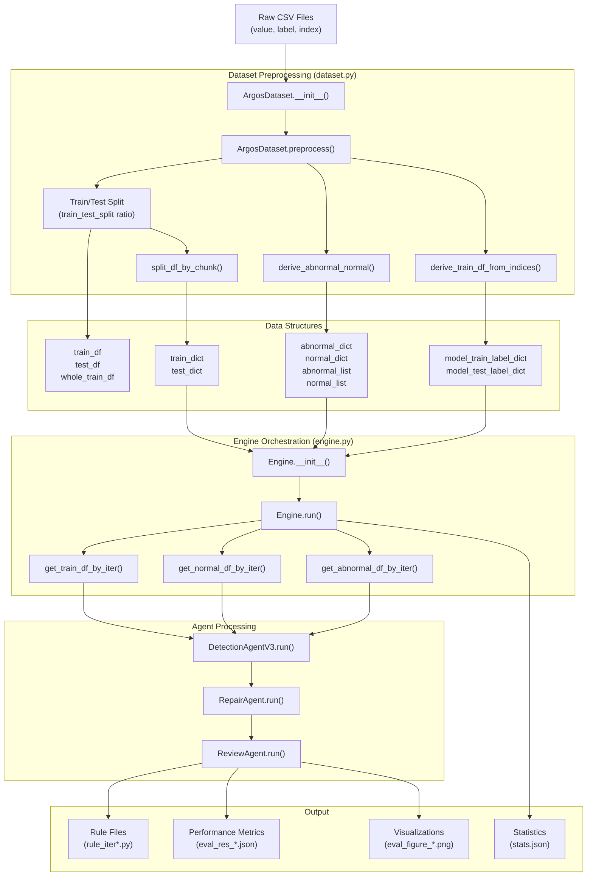
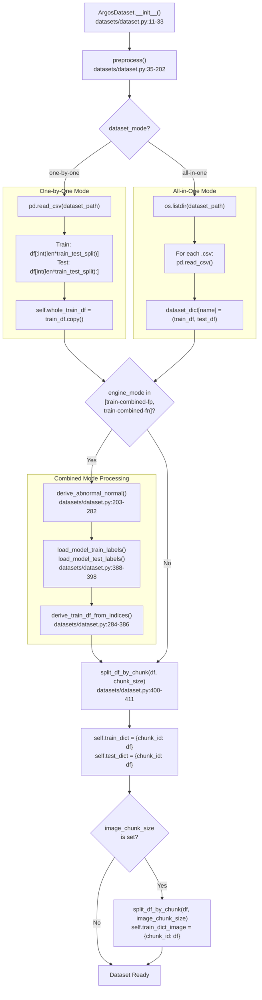
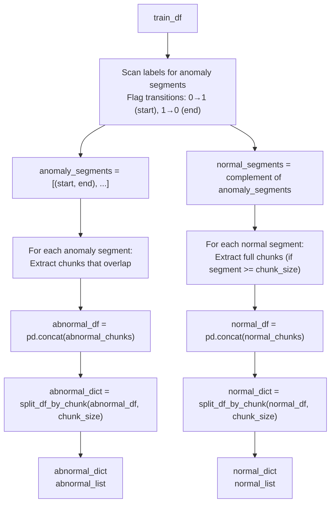
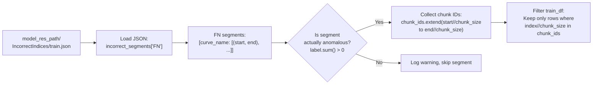
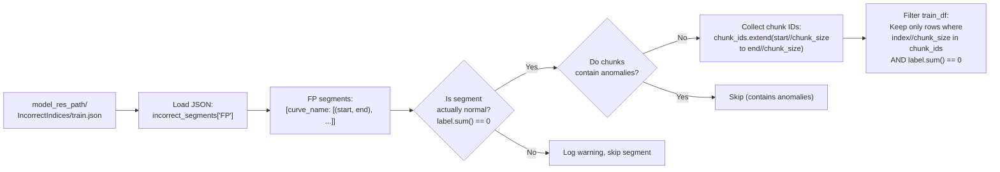
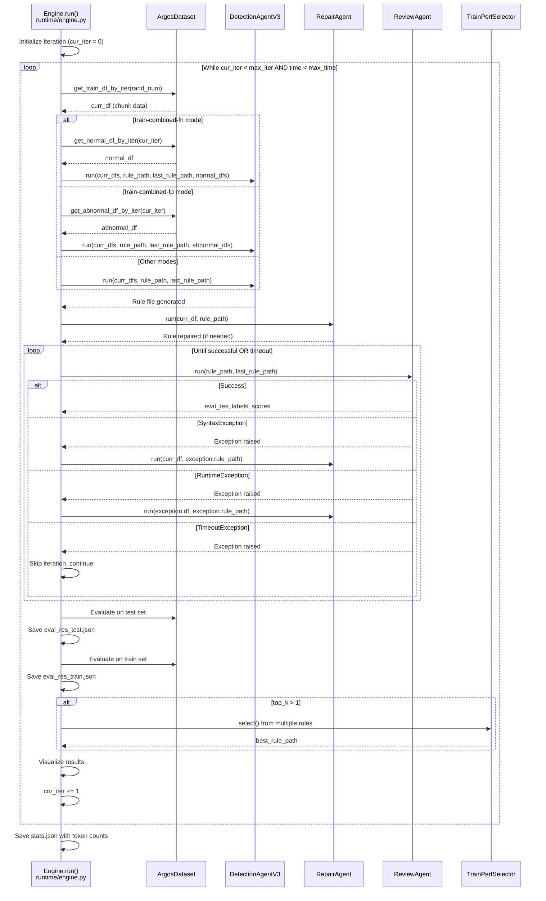

<!-- source: DeepWiki mcp.deepwiki.com · repo microsoft/argos · page 3.4 Data Flow Pipeline · fetched 2026-10-26 -->

# Data Flow Pipeline

<details>
<summary>Relevant source files</summary>

The following files were used as context for generating this wiki page:

- [common/common.py](common/common.py)
- [datasets/dataset.py](datasets/dataset.py)
- [runtime/engine.py](runtime/engine.py)

</details>


This document explains how data flows through the Argos system, from raw CSV input files through preprocessing, chunking, agent processing, and evaluation. It traces the complete pipeline showing how time-series data is transformed and consumed by different components.

For information about the overall system architecture and component interactions, see [System Overview](#3.1). For details on specific operational modes, see [Operational Modes](#3.3). For implementation details of the dataset management system, see [Dataset Management](#4.8).

## Overview

The data flow pipeline in Argos consists of several distinct stages:

1. **Input Loading**: Raw CSV files containing time-series data are read
2. **Preprocessing**: Data is split into train/test sets and validated
3. **Chunking**: Time-series are segmented into fixed-size chunks for processing
4. **Mode-Specific Filtering**: For combined modes, data is filtered based on model results
5. **Agent Processing**: Chunks are processed by detection, repair, and review agents
6. **Evaluation**: Generated rules are evaluated and metrics are calculated
7. **Output Generation**: Results, visualizations, and statistics are saved

The pipeline supports two dataset modes (`one-by-one` and `all-in-one`) and eight operational modes, each with different data processing requirements.

**Sources**: [datasets/dataset.py:1-560](), [runtime/engine.py:1-830]()

## End-to-End Data Flow

The following diagram shows the complete data flow from input to output, including all major transformations and components involved:



**Sources**: [datasets/dataset.py:10-202](), [runtime/engine.py:28-453]()

## Data Sources and Input Format

Argos expects time-series data in CSV format with three required columns:

| Column | Type | Description |
|--------|------|-------------|
| `value` | float | The time-series value at each point |
| `label` | int | Ground truth label (0=normal, 1=anomaly) |
| `index` | int | Sequential index for each data point |

Data can be provided in two modes:
- **one-by-one**: Single CSV file per time-series (e.g., `dataset.csv`)
- **all-in-one**: Directory containing multiple CSV files (e.g., `dataset_dir/*.csv`)

The system validates that input files meet these requirements during the preprocessing stage.

**Sources**: [datasets/dataset.py:39-48](), [datasets/dataset.py:91-109]()

## Dataset Preprocessing Pipeline

The `ArgosDataset` class handles all data preprocessing through its `preprocess()` method. The following diagram shows the detailed preprocessing flow with specific code entities:



**Sources**: [datasets/dataset.py:35-202](), [datasets/dataset.py:400-411]()

## Data Segmentation and Chunking

After the train/test split, data is segmented into fixed-size chunks to enable iterative processing. The `split_df_by_chunk()` method creates a dictionary mapping chunk IDs to dataframe segments:

### Chunking Process

1. **Calculate Number of Chunks**: `num_chunks = len(df) // chunk_size + (1 if len(df) % chunk_size != 0 else 0)`
2. **Create Chunk Dictionary**: For each chunk ID from 0 to num_chunks-1:
   - Extract segment: `df[i * chunk_size : min((i + 1) * chunk_size, len(df))]`
   - Store in dict: `chunk_dict[i] = segment`
3. **Sort by Key**: Ensure chunks are ordered sequentially

The resulting data structures are:

| Structure | Type | Description |
|-----------|------|-------------|
| `train_dict` | `dict[int, pd.DataFrame]` | Training chunks indexed by ID |
| `test_dict` | `dict[int, pd.DataFrame]` | Test chunks indexed by ID |
| `train_dict_image` | `dict[int, pd.DataFrame]` | Training chunks with larger size for image analysis (optional) |

During training iterations, the `Engine` retrieves chunks using:
- `dataset.get_train_df_by_iter(iter_num)`: Returns `train_dict[iter_num % len(train_dict)]`
- `dataset.get_test_df_by_iter(iter_num)`: Returns `test_dict[iter_num % len(test_dict)]`

**Sources**: [datasets/dataset.py:400-411](), [datasets/dataset.py:413-424]()

## Abnormal and Normal Segment Derivation

For combined modes (`train-combined-fp` and `train-combined-fn`), the system derives separate collections of abnormal and normal segments. This enables the detection agent to learn from both types of examples:



For `all-in-one` mode, the system also calculates mean and standard deviation for each chunk:
- `abnormal_avg_std`: List of `(mean, std)` tuples for abnormal chunks
- `normal_avg_std`: List of `(mean, std)` tuples for normal chunks

These statistics enable the `get_closest_abnormal_df()` and `get_closest_normal_df()` methods to find the most similar examples based on statistical properties.

**Sources**: [datasets/dataset.py:203-282](), [datasets/dataset.py:438-495]()

## Mode-Specific Data Filtering

Combined modes (`train-combined-fp` and `train-combined-fn`) require additional filtering based on model results. The system loads incorrect indices from a previous model run and filters training data to focus only on problematic segments:

### False Negative (FN) Mode Filtering

The `train-combined-fn` mode targets segments where the base model failed to detect actual anomalies:



### False Positive (FP) Mode Filtering

The `train-combined-fp` mode targets segments where the base model incorrectly flagged normal data as anomalous:



After filtering, the system sets `skip_training = True` if no problematic segments are found for the current dataset, allowing the engine to skip training for that specific time-series.

**Sources**: [datasets/dataset.py:284-386](), [datasets/dataset.py:302-335](), [datasets/dataset.py:336-385]()

## Agent Processing Flow

Once data is preprocessed and chunked, the `Engine` orchestrates iterative processing through multiple agents. The following diagram shows how data flows through the agent pipeline with specific method calls:



**Sources**: [runtime/engine.py:129-453](), [runtime/engine.py:203-433]()

## Data Transformations During Processing

As data flows through agents, it undergoes several transformations:

### Detection Agent Input/Output

**Input**:
- `curr_dfs`: List of dataframes (time-series chunks)
- `normal_dfs` or `abnormal_dfs`: Optional reference examples (combined modes)
- `last_rule_path`: Previous iteration's rule file (optional)

**Output**:
- Python rule file (`rule_iter*_*.py`) containing anomaly detection logic
- Rule exports a `run()` function that takes a dataframe and returns scores

### Repair Agent Input/Output

**Input**:
- `df`: Dataframe to test the rule against
- `rule_path`: Path to rule file that needs repair

**Output**:
- Modified rule file with syntax/runtime errors fixed
- Uses LLM to analyze errors and generate corrections

### Review Agent Input/Output

**Input**:
- `rule_path`: Path to rule file to evaluate
- `df` or `test_dict`: Test data for evaluation

**Output**:
- `eval_res`: Dictionary with `{"precision": float, "recall": float, "f1": float}`
- `labels`: Binary numpy array of predictions (0=normal, 1=anomaly)
- `scores`: Float numpy array of anomaly scores

**Sources**: [runtime/engine.py:242-292](), [runtime/engine.py:290-314](), [runtime/engine.py:295-322]()

## Performance Calculation

The `calculate_performance()` function in `common/common.py` computes evaluation metrics by comparing predicted labels against ground truth:

### Algorithm

1. **Identify Ground Truth Anomaly Segments**: Scan `gt_labels` for transitions (0→1 marks start, 1→0 marks end)
2. **Count Total Anomalies**: `tot_anomaly = number of anomaly segments` (event-based F1)
3. **Detect True Positives**: For each anomaly segment, check if `labels.sum() > 0` in that range
4. **Count False Positives**: `false_positives = sum(labels) - represented_positives`
5. **Calculate Metrics**:
   - Precision = `true_positives / (true_positives + false_positives)`
   - Recall = `true_positives / tot_anomaly`
   - F1 = `2 * precision * recall / (precision + recall)`

The system uses event-based F1 scoring where detecting at least one point in an anomaly segment counts as a successful detection, rather than requiring exact point-wise matches.

**Sources**: [common/common.py:218-277]()

## Combined Mode Label Integration

For combined modes, the system merges rule predictions with base model predictions using logical operations:

### False Negative Mode (train-combined-fn)

Combines labels using **OR** operation: `combined_labels = np.maximum(model_labels, rule_labels)`

This ensures that if either the model or rule detects an anomaly, it is flagged in the final result.

### False Positive Mode (train-combined-fp)

Combines labels using **AND** operation: `combined_labels = np.minimum(model_labels, rule_labels)`

This ensures that an anomaly is only flagged if both the model and rule agree, reducing false positives.

The `combine_labels()` function also logs explainability metrics showing the percentage of model predictions that can be explained by the rule.

**Sources**: [common/common.py:188-215]()

## Data Structures and Access Patterns

The following table summarizes key data structures used throughout the pipeline and their access methods:

| Data Structure | Type | Creation | Access Method | Purpose |
|----------------|------|----------|---------------|---------|
| `train_dict` | `dict[int, pd.DataFrame]` | `split_df_by_chunk()` | `get_train_df_by_iter(iter)` | Iterate through training chunks |
| `test_dict` | `dict[int, pd.DataFrame]` | `split_df_by_chunk()` | `get_test_df_by_iter(iter)` | Iterate through test chunks |
| `train_dict_image` | `dict[int, pd.DataFrame]` | `split_df_by_chunk()` | `get_train_image_df_by_iter(iter)` | Larger chunks for image analysis |
| `abnormal_dict` | `dict[int, pd.DataFrame]` | `derive_abnormal_normal()` | `get_abnormal_df_by_iter(iter)` | Abnormal training examples |
| `normal_dict` | `dict[int, pd.DataFrame]` | `derive_abnormal_normal()` | `get_normal_df_by_iter(iter)` | Normal training examples |
| `abnormal_list` | `list[pd.DataFrame]` | `derive_abnormal_normal()` | `get_closest_abnormal_df(df)` | Find similar abnormal chunks |
| `normal_list` | `list[pd.DataFrame]` | `derive_abnormal_normal()` | `get_closest_normal_df(df)` | Find similar normal chunks |
| `model_train_label_dict` | `dict[str, np.ndarray]` | `load_model_train_labels()` | `get_model_train_labels(curve_name)` | Base model training predictions |
| `model_test_label_dict` | `dict[str, np.ndarray]` | `load_model_test_labels()` | `get_model_test_labels(curve_name)` | Base model test predictions |
| `dataset_dict` | `dict[str, tuple]` | `preprocess()` | `get_dataset_dict()` | All-in-one mode datasets |

**Sources**: [datasets/dataset.py:84-197](), [datasets/dataset.py:413-560]()

## Output Generation

The pipeline produces multiple types of output files during and after processing:

### Rule Files

Generated by `DetectionAgentV3`, stored as `rule_iter{N}_{K}.py`:
- Contains Python code with a `run(df)` function
- Returns anomaly scores as numpy array
- Created at [runtime/engine.py:764-767]()

### Performance Metrics

Generated by `ReviewAgent`, stored as `*_eval_res_test.json` and `*_eval_res_train.json`:
```json
{
  "precision": 0.85,
  "recall": 0.92,
  "f1": 0.88,
  "threshold": 0.5
}
```

### Visualizations

Generated by `Engine.visualize()`, stored as `eval_figure_*.png`:
- Time-series plot with ground truth (red dots) and predictions (pink spans)
- Configurable subplots for large datasets
- Created at [runtime/engine.py:658-753]()

### Statistics

Generated at training completion, stored as `stats.json`:
```json
{
  "cur_iter": 42,
  "max_iter": 100,
  "max_time": 9000,
  "time_elapsed": 5234.56,
  "best_rule_path": "/path/to/rule_iter_41_1.py",
  "mode": "train-LLM-only",
  "token_count": {
    "DetectionAgentV3": 125000,
    "RepairAgent": 8500,
    "ReviewAgent": 12000
  }
}
```

**Sources**: [runtime/engine.py:317-322](), [runtime/engine.py:355-359](), [runtime/engine.py:435-453](), [runtime/engine.py:658-753]()

## Data Flow Modes Comparison

Different operational modes result in different data flows. The following table summarizes the key differences:

| Mode | Training Data | Additional Context | Label Combination |
|------|--------------|-------------------|------------------|
| `train-LLM-only` | Random chunks from `train_dict` | None | N/A |
| `train-LLM-only-image` | Random chunks + image analysis | Anomaly types from ImageAgent | N/A |
| `train-combined-fn` | FN-filtered chunks | `normal_df` examples | OR with model labels |
| `train-combined-fp` | FP-filtered chunks | `abnormal_df` examples | AND with model labels |
| `eval-LLM-only` | N/A (evaluation only) | None | N/A |
| `eval-combined` | N/A (evaluation only) | Model labels loaded | OR/AND based on context |
| `baseline-LLMAD` | Test chunks only | None | N/A |
| `ablation-detection-only` | Random chunks | None (no review) | N/A |

**Sources**: [runtime/engine.py:129-453](), [datasets/dataset.py:59-83](), [datasets/dataset.py:112-161]()

---

