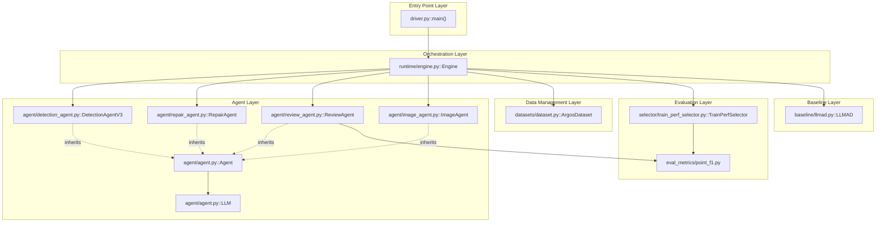
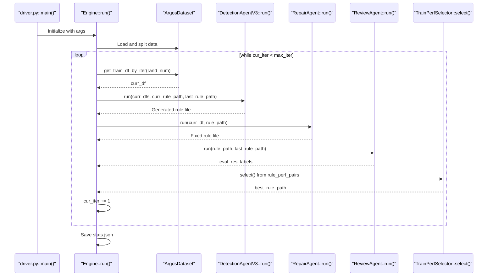
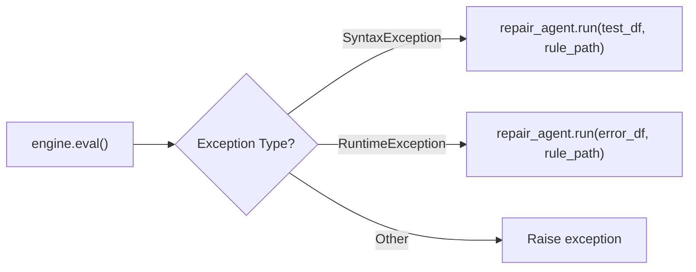
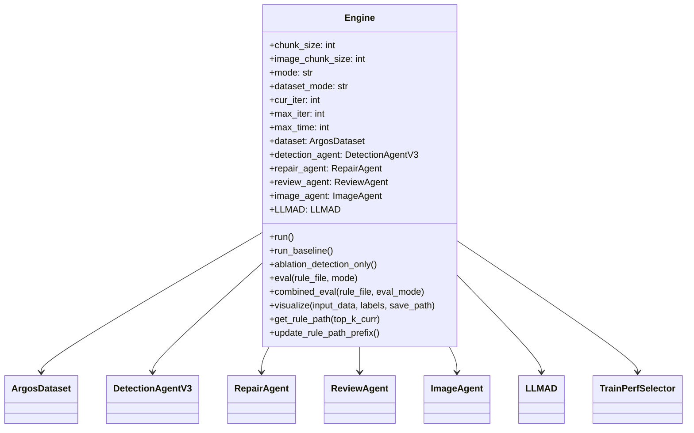
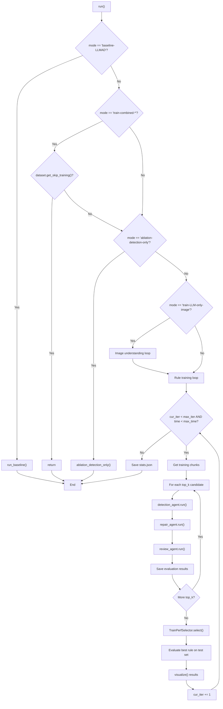
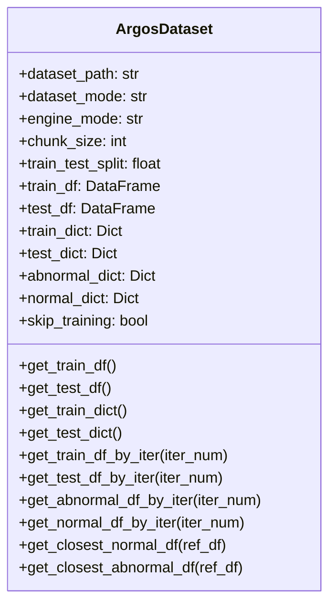
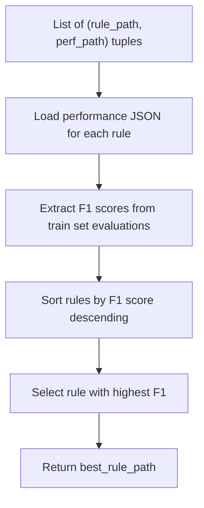
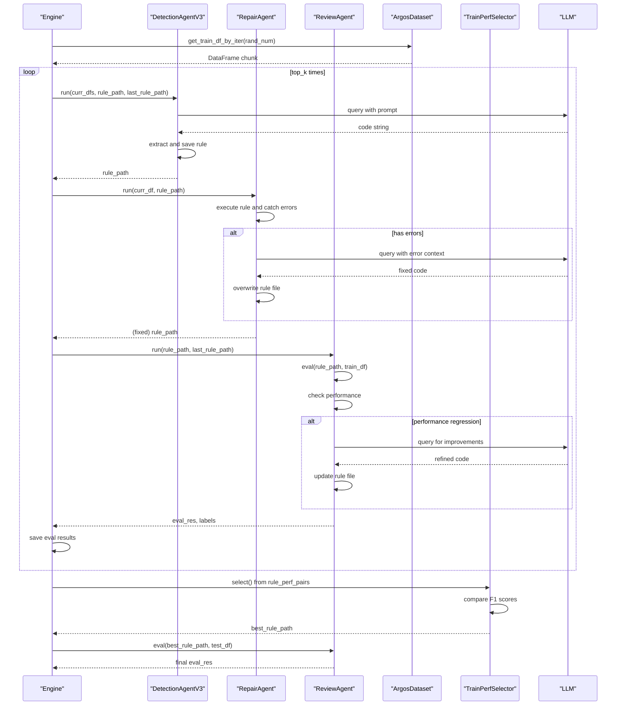
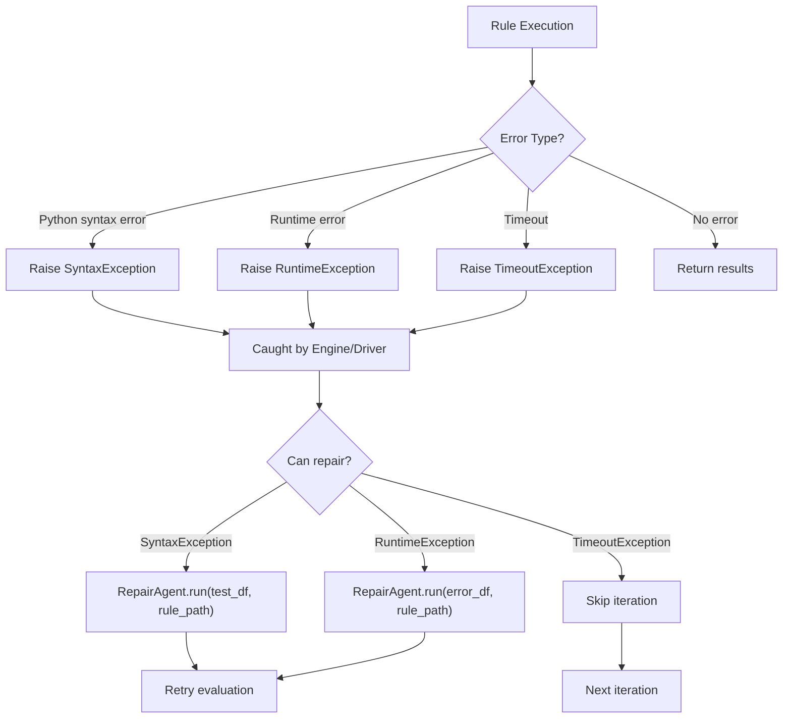

<!-- source: DeepWiki mcp.deepwiki.com · repo microsoft/argos · page 4 Core Components · fetched 2026-10-26 -->

# Core Components

<details>
<summary>Relevant source files</summary>

The following files were used as context for generating this wiki page:

- [driver.py](driver.py)
- [runtime/engine.py](runtime/engine.py)

</details>


This document provides detailed technical documentation for the major system components that comprise Argos. Each component is described with its role, key classes, methods, and interactions with other components. For information about how these components fit into the overall architecture, see [Architecture](#3). For setup and configuration details, see [Getting Started](#2).

## Overview

Argos consists of eleven major components that work together to enable agentic time-series anomaly detection. The system follows a layered architecture where a CLI driver orchestrates an engine, which manages specialized agents that operate on datasets and produce evaluated detection rules.

The following diagram shows the primary components and their corresponding code entities:



**Sources:** [driver.py:1-239](), [runtime/engine.py:1-830]()

## Component Interaction Flow

The following sequence diagram illustrates how the core components interact during a typical training iteration, using actual method names from the codebase:



**Sources:** [driver.py:30-132](), [runtime/engine.py:129-453]()

## Component Inventory

The following table provides a quick reference to each core component, its primary class, and location:

| Component | Primary Class/Module | File Path | Purpose |
|-----------|---------------------|-----------|---------|
| Driver | `main()` | `driver.py` | CLI entry point and argument parsing |
| Engine | `Engine` | `runtime/engine.py` | Orchestrates training and evaluation workflows |
| Base Agent | `Agent` | `agent/agent.py` | Base class for all agents |
| LLM Client | `LLM` | `agent/agent.py` | Azure OpenAI API client |
| Detection Agent | `DetectionAgentV3` | `agent/detection_agent.py` | Generates anomaly detection rules |
| Repair Agent | `RepairAgent` | `agent/repair_agent.py` | Fixes code errors in generated rules |
| Review Agent | `ReviewAgent` | `agent/review_agent.py` | Evaluates and refines rules |
| Image Agent | `ImageAgent` | `agent/image_agent.py` | Extracts anomaly types from visualizations |
| Dataset | `ArgosDataset` | `datasets/dataset.py` | Data loading and management |
| Metrics | Functions | `eval_metrics/point_f1.py` | Performance calculation |
| Selector | `TrainPerfSelector` | `selector/train_perf_selector.py` | Selects best rule from iterations |
| Baseline | `LLMAD` | `baseline/llmad.py` | Baseline comparison implementation |

**Sources:** [driver.py:1-239](), [runtime/engine.py:1-830]()

## Driver Component

The driver module serves as the command-line interface entry point for Argos, handling argument parsing, engine initialization, and execution mode routing.

### Key Functions

The `main()` function at [driver.py:30-132]() performs the following operations:

1. **Argument Processing** [driver.py:31-47](): Extracts all command-line arguments including paths, modes, and hyperparameters
2. **Engine Initialization** [driver.py:60-99](): Creates `Engine` instance with mode-specific configuration
3. **Execution Routing** [driver.py:104-131](): Routes to appropriate execution path based on mode

### Execution Modes

The driver supports eight operational modes defined at [driver.py:155-167]():

| Mode | Initialization Details | Execution Path |
|------|----------------------|----------------|
| `train-LLM-only` | Standard engine with mode | `engine.run()` |
| `train-LLM-only-image` | Includes image_subplots parameter | `engine.run()` |
| `train-combined-fn` | Requires model_res_path | `engine.run()` |
| `train-combined-fp` | Requires model_res_path | `engine.run()` |
| `eval-LLM-only` | Mode set to "train-LLM-only" | `engine.eval()` |
| `eval-combined` | Mode set to "train-combined-fn" | `engine.combined_eval()` |
| `baseline-LLMAD` | Standard engine | `engine.run()` |
| `ablation-detection-only` | Standard engine | `engine.run()` |

### Command-Line Arguments

The driver accepts the following arguments at [driver.py:135-237]():

**Path Arguments:**
- `--dataset_path`: Input CSV file path
- `--result_path`: Output directory for generated rules
- `--rule_path`: Pre-trained rule path (for evaluation modes)
- `--model_res_path`: Path to base model results (for combined modes)

**Configuration Arguments:**
- `--mode`: Operational mode selection
- `--dataset_mode`: "one-by-one" or "all-in-one"
- `--train_test_split`: Train/test split ratio (default: 0.7)
- `--chunk_size`: Data chunk size (default: 1000)
- `--image_chunk_size`: Image processing chunk size (default: 10000)
- `--image_subplots`: Subplot grid dimensions (default: (1,1))

**Hyperparameters:**
- `--repeat`: Number of training repetitions (default: 1)
- `--top_k`: Number of rule candidates per iteration (default: 5)
- `--llm_engine`: LLM model selection ("gpt-4-32k", "gpt-4o", "gpt-35-turbo-16k")
- `--timeout`: Maximum execution time in minutes (default: 150)
- `--sample_per_prompt`: Number of samples per LLM prompt (default: 1)

### Error Handling

For evaluation modes, the driver implements error recovery at [driver.py:112-121]():



**Sources:** [driver.py:1-239]()

## Engine Component

The `Engine` class at [runtime/engine.py:28-830]() serves as the central orchestrator for all Argos workflows, managing agent lifecycle, iteration logic, and result persistence.

### Class Structure



**Sources:** [runtime/engine.py:28-830]()

### Initialization

The `__init__()` method at [runtime/engine.py:29-127]() performs the following initialization steps:

1. **Parameter Storage** [runtime/engine.py:45-65](): Stores configuration parameters
2. **Random Seed** [runtime/engine.py:57-58](): Sets numpy random seed to 8 for reproducibility
3. **Timeout Configuration** [runtime/engine.py:69-71](): Converts timeout from minutes to seconds
4. **Directory Setup** [runtime/engine.py:73-76](): Creates output directory structure
5. **Dataset Loading** [runtime/engine.py:80-88](): Initializes `ArgosDataset` instance
6. **Logging Configuration** [runtime/engine.py:90-94](): Sets up file-based logging
7. **Agent Creation** [runtime/engine.py:104-127](): Instantiates all required agents

### Main Training Loop

The `run()` method at [runtime/engine.py:129-453]() implements the core training workflow:



**Sources:** [runtime/engine.py:129-453]()

### Iteration Management

Each training iteration processes data chunks and generates multiple rule candidates:

1. **Data Sampling** [runtime/engine.py:217-220](): Randomly selects training chunks for each prompt
2. **Top-K Generation** [runtime/engine.py:224-363](): Generates `top_k` rule candidates per iteration
3. **Rule Selection** [runtime/engine.py:371-376](): Uses `TrainPerfSelector` to identify best rule
4. **Test Evaluation** [runtime/engine.py:378-430](): Evaluates selected rule on test set
5. **Visualization** [runtime/engine.py:389-426](): Generates plots showing predictions

### Mode-Specific Behavior

The engine adapts its behavior based on the operational mode:

**Combined FN Mode** [runtime/engine.py:225-247]():
- Retrieves normal data segments via `dataset.get_normal_df_by_iter()` or `dataset.get_closest_normal_df()`
- Passes normal data to detection agent alongside abnormal training data

**Combined FP Mode** [runtime/engine.py:248-272]():
- Retrieves abnormal data segments via `dataset.get_abnormal_df_by_iter()` or `dataset.get_closest_abnormal_df()`
- Passes abnormal data to detection agent alongside false positive data

**Image Mode** [runtime/engine.py:143-188]():
- Executes image understanding phase before rule generation
- Calls `image_agent.run()` iteratively to extract anomaly types
- Passes extracted `final_anomaly_types` to detection agent

### Baseline Execution

The `run_baseline()` method at [runtime/engine.py:454-523]() implements LLMAD baseline execution:

1. **Initialization** [runtime/engine.py:456-464](): Sets up iteration tracking
2. **Per-Chunk Processing** [runtime/engine.py:471-502](): Calls `LLMAD.run()` for each test chunk
3. **Label Aggregation** [runtime/engine.py:504-508](): Concatenates predictions across all chunks
4. **Performance Calculation** [runtime/engine.py:520-522](): Computes final metrics using `calculate_performance()`

### Ablation Mode

The `ablation_detection_only()` method at [runtime/engine.py:524-650]() runs detection without repair or review:

- Skips `repair_agent` and `review_agent` steps
- Directly evaluates detection agent output
- Wraps evaluation in try-except to handle errors gracefully
- Records error information in results JSON

### Visualization

The `visualize()` method at [runtime/engine.py:658-753]() generates time-series plots:

**Input Parameters:**
- `input_data`: numpy array of shape (n, 3) containing value, label, and index
- `labels`: numpy array of shape (n,) containing predictions (0/1)
- `save_path`: output file path
- `image_subplots`: tuple specifying subplot grid dimensions

**Visual Elements:**
- Blue line plot for time-series values [runtime/engine.py:702]()
- Red dots for ground truth anomalies [runtime/engine.py:704-711]()
- Pink vertical spans for predicted anomaly segments [runtime/engine.py:730-736]()
- Configurable subplot grid [runtime/engine.py:673-677]()

### Evaluation Methods

The engine provides evaluation methods for debugging and testing:

**`eval(rule_file, mode)`** [runtime/engine.py:769-790]():
- Evaluates a rule on either train or test data
- Supports both "one-by-one" and "all-in-one" dataset modes
- Delegates to `review_agent.eval()` or `review_agent.eval_all_in_one()`

**`combined_eval(rule_file, eval_mode)`** [runtime/engine.py:792-796]():
- Evaluates combined mode rules with base model integration
- Delegates to `review_agent.combined_eval()`

**`combined_inference()`** [runtime/engine.py:798-808]():
- Performs inference with separate FN and FP rules
- Applies configurable thresholds to each rule type

**Sources:** [runtime/engine.py:28-830]()

## Agent Base Classes

All agents in Argos inherit from common base classes that provide LLM interaction capabilities and message management.

### Agent Base Class

The `Agent` class at `agent/agent.py` provides the foundation for all specialized agents:

**Key Attributes:**
- `name`: Agent identifier string
- `chunk_size`: Data chunk size for processing
- `mode`: Operational mode
- `llm`: `LLM` instance for API interaction
- `start_time`: Training start timestamp for timeout tracking
- `token_count`: Dictionary tracking token usage

**Key Methods:**
- `set_start_time()`: Initializes timing for timeout checks
- `get_token_count()`: Returns cumulative token usage
- `check_timeout()`: Validates execution time against limits

### LLM Client Class

The `LLM` class at `agent/agent.py` encapsulates Azure OpenAI API interaction:

**Core Functionality:**
- Message history management
- Token counting using `tiktoken`
- API call execution with error handling
- Response parsing and extraction

**Message Management:**
- Maintains conversation history as list of message dictionaries
- Supports system, user, and assistant message roles
- Provides methods to add messages and clear history

**Token Tracking:**
- Counts tokens in messages using `tiktoken.encoding_for_model()`
- Tracks both input and output tokens separately
- Aggregates total token usage across all API calls

**Sources:** Referenced from [runtime/engine.py:16-19](), implementation details from architecture overview

## Specialized Agents

Argos employs four specialized agents, each inheriting from the `Agent` base class and serving a distinct purpose in the anomaly detection pipeline.

### Detection Agent

`DetectionAgentV3` at `agent/detection_agent.py` generates Python-based anomaly detection rules using LLM prompts.

**Operational Modes:**

The detection agent supports four distinct modes at `agent/detection_agent.py:412-700`:

| Mode | Input Requirements | Prompt Strategy | Output |
|------|-------------------|-----------------|--------|
| `train-LLM-only` | Time-series data chunks | Asks LLM to generate rules from scratch | Python detection function |
| `train-LLM-only-image` | Image with anomaly types | Includes extracted anomaly descriptions | Python detection function |
| `train-combined-fn` | FN data + normal segments | Requests rules to catch missed anomalies | Python detection function |
| `train-combined-fp` | FP data + abnormal segments | Requests rules to reduce false alarms | Python detection function |

**Rule Generation Process:**

1. **Prompt Construction**: Builds mode-specific prompt with data and context
2. **LLM Query**: Calls Azure OpenAI API through `llm` instance
3. **Code Extraction**: Parses response to extract Python function
4. **File Writing**: Saves generated code to specified rule path

**Multi-Sample Support:**

When `sample_per_prompt > 1`, the agent:
- Concatenates multiple data chunks into single prompt
- Generates single rule that generalizes across samples
- Reduces API call overhead for batch processing

**Sources:** Referenced from [runtime/engine.py:104-109](), [runtime/engine.py:242-289]()

### Repair Agent

`RepairAgent` at `agent/repair_agent.py` automatically fixes syntax and runtime errors in generated Python code.

**Error Types Handled:**

1. **Syntax Errors** (`SyntaxException`):
   - Python parsing failures
   - Indentation issues
   - Invalid syntax constructs

2. **Runtime Errors** (`RuntimeException`):
   - Execution failures during rule evaluation
   - Type errors, attribute errors, etc.
   - Array index out of bounds

3. **Timeout Errors** (`TimeoutException`):
   - Execution exceeds time limit
   - May indicate infinite loops

**Repair Process:**

1. **Error Detection**: Catches exception during rule execution
2. **Context Assembly**: Packages error message, traceback, and data sample
3. **LLM Query**: Sends error context to LLM for fix suggestion
4. **Code Replacement**: Extracts fixed code and overwrites rule file
5. **Verification**: Returns to caller for re-evaluation

The agent supports multiple repair attempts with timeout checking at each step.

**Sources:** Referenced from [runtime/engine.py:111-113](), [runtime/engine.py:290-292](), [driver.py:114-120]()

### Review Agent

`ReviewAgent` at `agent/review_agent.py` evaluates rule performance and triggers iterative refinement.

**Evaluation Capabilities:**

**Single Dataset Mode** (`one-by-one`):
- `eval(rule_path, df)`: Evaluates rule on provided DataFrame
- Returns F1, precision, recall, and predicted labels
- Executes rule in subprocess for isolation

**Multiple Dataset Mode** (`all-in-one`):
- `eval_all_in_one(rule_path, df_dict)`: Evaluates across multiple series
- Aggregates performance metrics across all series
- Returns combined statistics

**Combined Mode Evaluation:**
- `combined_eval(rule_path, eval_mode)`: Integrates with base model predictions
- `combined_eval_all_in_one(rule_path, eval_mode)`: Combined mode for multiple series
- Requires model result path for FP/FN indices

**Performance Review Process:**

The `run()` method implements the following workflow:

1. **Initial Evaluation**: Executes rule on training data
2. **Performance Check**: Compares metrics to last iteration
3. **Regression Detection**: Identifies performance decreases
4. **LLM Consultation**: Queries for improvement suggestions if regression detected
5. **Rule Refinement**: Generates improved version if needed

**Metrics Integration:**

The review agent uses functions from `eval_metrics/point_f1.py` to calculate:
- Point-wise F1 score
- Point-wise precision and recall
- Event-based metrics (for contiguous anomaly segments)

**Sources:** Referenced from [runtime/engine.py:114-122](), [runtime/engine.py:295-314](), [runtime/engine.py:329-352]()

### Image Agent

`ImageAgent` at `agent/image_agent.py` performs visual analysis on time-series plots to extract anomaly type descriptions.

**Vision Model Integration:**

- Uses GPT-4o model exclusively for vision capabilities
- Processes PNG images generated by `Engine.visualize()`
- Supports multi-subplot analysis via `image_subplots` parameter

**Extraction Process:**

1. **Image Input**: Receives path to time-series visualization
2. **LLM Query**: Sends image to GPT-4o with analysis prompt
3. **Type Parsing**: Extracts structured anomaly type descriptions
4. **Iterative Refinement**: Compares with previous types to ensure consistency

**Output Format:**

Returns list of anomaly type strings, e.g.:
- "Sudden spike above normal range"
- "Gradual drift downward"
- "Periodic oscillations with increasing amplitude"

**Integration with Detection:**

Extracted anomaly types are passed to `DetectionAgentV3` in image mode at [runtime/engine.py:274-279](), enriching the prompt with visual context.

**Sources:** Referenced from [runtime/engine.py:124-127](), [runtime/engine.py:160-183]()

## Dataset Management

`ArgosDataset` at `datasets/dataset.py` handles data loading, preprocessing, and segmentation for both training and evaluation.

### Data Loading Modes

The dataset supports two fundamental modes:

**One-by-One Mode** (`one-by-one`):
- Loads single time-series from CSV file
- Splits into train/test based on `train_test_split` ratio
- Creates fixed-size chunks for iteration

**All-in-One Mode** (`all-in-one`):
- Loads multiple time-series files from directory
- Maintains separate dictionaries for each series
- Supports cross-series evaluation

### Data Structures



**Core Data Structures:**

- `train_df`, `test_df`: Single DataFrames for one-by-one mode
- `train_dict`, `test_dict`: Dictionaries mapping series names to DataFrames
- `abnormal_dict`: False negative segments from base model
- `normal_dict`: False positive segments from base model

**Sources:** Referenced from [runtime/engine.py:80-88]()

### CSV Format Requirements

Each CSV file must contain three columns:

| Column | Type | Description |
|--------|------|-------------|
| `value` | float | Time-series measurement value |
| `label` | int | Ground truth label (0=normal, 1=anomaly) |
| `index` | int | Temporal index or timestamp |

### Combined Mode Data Filtering

For modes `train-combined-fn` and `train-combined-fp`, the dataset:

1. **Loads Model Results**: Reads FP/FN indices from `model_res_path`
2. **Filters Train Data**: Creates `abnormal_dict` (FN) or `normal_dict` (FP)
3. **Skip Detection**: Sets `skip_training=True` if no errors found
4. **Segment Extraction**: Pulls contiguous segments around error indices

This enables targeted training on specific failure modes of base models.

### Data Access Methods

**Random Sampling:**
- `get_train_df_by_iter(iter_num)`: Returns chunk based on iteration number modulo total chunks
- Supports deterministic sampling for reproducibility

**Nearest Neighbor Search:**
- `get_closest_normal_df(ref_df)`: Finds most similar normal segment
- `get_closest_abnormal_df(ref_df)`: Finds most similar abnormal segment
- Used in all-in-one mode for contextual training

**Image Data:**
- `get_train_image_df_by_iter(iter_num)`: Returns larger chunks for visualization
- Uses `image_chunk_size` instead of standard `chunk_size`

**Sources:** Referenced from [runtime/engine.py:80-88](), [runtime/engine.py:217-220](), [runtime/engine.py:234-246]()

## Evaluation Metrics

The `eval_metrics/point_f1.py` module provides functions for calculating anomaly detection performance metrics.

### Metric Types

**Point-Based Metrics:**
- Treat each timestamp independently
- Calculate precision, recall, F1 at point level
- Standard classification metrics applied to time-series

**Event-Based Metrics:**
- Consider contiguous anomaly segments as single events
- Credit detection if any point in segment is predicted as anomaly
- More aligned with practical anomaly detection goals

### Core Functions

The module is used by `ReviewAgent` and `TrainPerfSelector` through the `calculate_performance()` function from `common/common.py`, which computes:

```python
{
    "f1": point_f1_score,
    "precision": point_precision,
    "recall": point_recall,
    "event_f1": event_f1_score,  # if applicable
    "event_precision": event_precision,
    "event_recall": event_recall
}
```

### Usage in Pipeline

1. **Review Agent**: Calls metrics after rule execution to assess performance
2. **Train Perf Selector**: Uses train set F1 scores to rank rule candidates
3. **Engine**: Reports final test set metrics in result JSON files

**Sources:** Referenced from [runtime/engine.py:21](), used implicitly through `ReviewAgent` and `TrainPerfSelector`

## Rule Selection

`TrainPerfSelector` at `selector/train_perf_selector.py` selects the best-performing rule from multiple candidates generated in a single iteration.

### Selection Strategy



### Input Format

Receives list of tuples from engine at [runtime/engine.py:361-363]():
```python
rule_perf_pairs = [
    (rule_path_1, eval_res_train_path_1),
    (rule_path_2, eval_res_train_path_2),
    ...
]
```

Each `eval_res_train_path` points to JSON file containing:
```json
{
    "f1": 0.85,
    "precision": 0.82,
    "recall": 0.88
}
```

### Selection Logic

The `select()` method:

1. **Load Results**: Reads all performance JSON files
2. **Extract F1**: Pulls F1 score from each result
3. **Handle Errors**: Assigns F1=-1 to rules with evaluation errors
4. **Rank**: Sorts candidates by F1 score
5. **Return Best**: Returns path to highest-scoring rule

This enables the engine to choose the best among `top_k` candidates at each iteration.

**Sources:** Referenced from [runtime/engine.py:25](), [runtime/engine.py:371-376]()

## Baseline LLMAD

The `LLMAD` class at `baseline/llmad.py` implements a baseline anomaly detection system for comparative evaluation.

### Purpose

Provides reference performance metrics to assess Argos improvements over standard LLM-based approaches. Used when `mode="baseline-LLMAD"`.

### Architecture Differences

Unlike Argos's agentic approach:

- **No Code Generation**: LLMAD works directly with data, not Python rules
- **Single-Stage**: No iterative refinement or repair loops
- **JSON Output**: Returns anomaly indices as structured JSON
- **Chunk-Based**: Processes fixed-size chunks independently

### Integration with Engine

The `Engine.run_baseline()` method at [runtime/engine.py:454-523]() orchestrates LLMAD execution:

1. **Initialization** [runtime/engine.py:456-464](): Creates LLMAD instance with GPT-4-32k
2. **Per-Chunk Processing** [runtime/engine.py:471-502]():
   - Loads test chunk via `dataset.get_test_df_by_iter()`
   - Calls `LLMAD.run()` with data (without labels)
   - Parses returned JSON for anomaly indices
3. **Aggregation** [runtime/engine.py:504-508](): Concatenates predictions across chunks
4. **Evaluation** [runtime/engine.py:520-522](): Calculates metrics and saves results

### Output Format

LLMAD generates JSON files at each iteration:
```json
{
    "anomalies": [12, 45, 67, 89],  // Indices of detected anomalies
    "reasoning": "..."  // Optional explanation
}
```

Final outputs:
- `llmad_scores_test.npy`: Binary predictions
- `llmad_gt_test.npy`: Ground truth labels
- `llmad_eval_res_test.json`: Performance metrics

**Sources:** Referenced from [runtime/engine.py:20](), [runtime/engine.py:96-99](), [runtime/engine.py:454-523]()

## Component Communication Patterns

The following diagram shows how data and control flow between components using actual method calls:



**Sources:** [runtime/engine.py:203-433]()

## Error Propagation

Custom exceptions defined in `common/exception.py` enable structured error handling across components:



**Exception Attributes:**

- `SyntaxException`: Includes `rule_path` for file location
- `RuntimeException`: Includes `df` (data that caused error) and `rule_path`
- `TimeoutException`: Includes timestamp and timeout limit

These exceptions are caught at [runtime/engine.py:299-314]() and [driver.py:112-121]() for appropriate recovery actions.

**Sources:** [driver.py:14](), [runtime/engine.py:22-23]()

## State Persistence

The engine persists various artifacts throughout execution:

### Iteration Artifacts

Each iteration generates:
- **Rule File**: `rule_iter{N}_{K}.py` - Generated Python detection function
- **Train Results**: `rule_iter{N}_{K}_eval_res_train.json` - Performance on training data
- **Test Results**: `rule_iter{N}_{K}_eval_res_test.json` - Performance on test data
- **Visualizations**: `eval_figure_rule_iter{N}_{K}.png` - Time-series plot with predictions

### Final Outputs

At completion, the engine writes:

**stats.json** at [runtime/engine.py:436-449]():
```json
{
    "cur_iter": 50,
    "max_iter": 100,
    "max_time": 9000,
    "time_elapsed": 3456.78,
    "best_rule_path": "/path/to/best/rule.py",
    "mode": "train-LLM-only",
    "token_count": {
        "detection_agent": {"input": 50000, "output": 10000},
        "repair_agent": {"input": 5000, "output": 1000},
        "review_agent": {"input": 8000, "output": 2000}
    }
}
```

**output.log** at [runtime/engine.py:90-94]():
- Timestamped log entries for all operations
- Agent outputs and decisions
- Error messages and stack traces

**Sources:** [runtime/engine.py:90-94](), [runtime/engine.py:436-449]()

---

