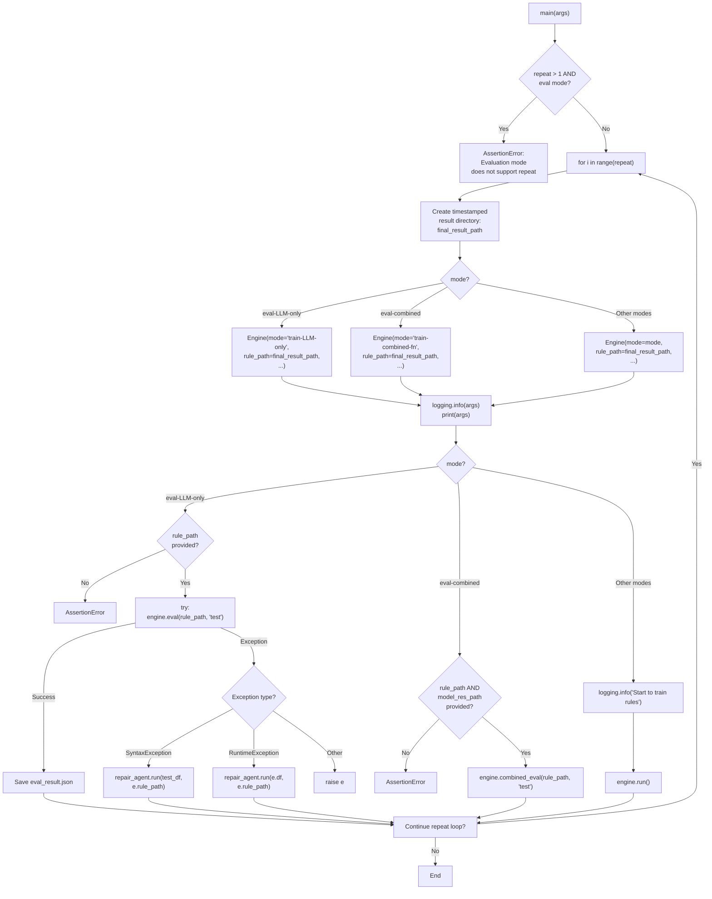
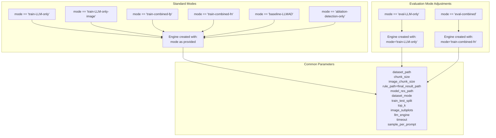
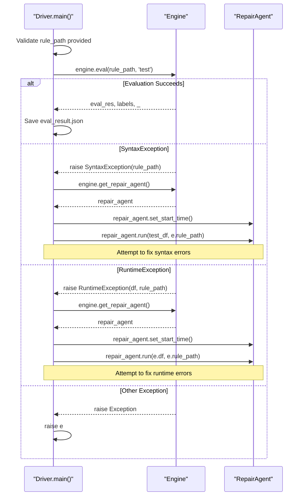
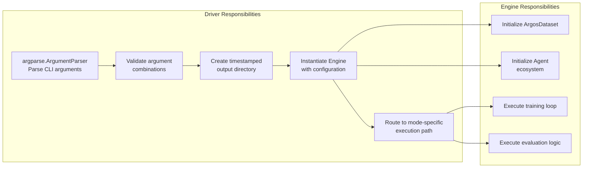

<!-- source: DeepWiki mcp.deepwiki.com · repo microsoft/argos · page 4.1 Driver · fetched 2026-10-26 -->

# Driver

<details>
<summary>Relevant source files</summary>

The following files were used as context for generating this wiki page:

- [driver.py](driver.py)
- [runtime/engine.py](runtime/engine.py)

</details>


The Driver module serves as the command-line interface (CLI) entry point for the Argos system. It parses user-provided arguments, initializes the Engine with appropriate configuration, and orchestrates execution based on the selected operational mode. The Driver handles mode-specific logic, manages repeated executions for training modes, and provides exception handling for evaluation workflows.

For information about the Engine's internal orchestration logic, see [Engine](#4.2). For details on operational modes and their purposes, see [Operational Modes](#3.3).

**Sources**: [driver.py:1-240]()

## Overview

The Driver is implemented in a single file `driver.py` that provides the `main()` function as the primary entry point. It uses Python's `argparse` module to define and parse 13 command-line arguments that control dataset selection, operational mode, LLM configuration, performance tuning, and output paths.

The Driver's responsibilities include:
- Parsing and validating command-line arguments
- Creating timestamped output directories for results
- Initializing the Engine with mode-specific configurations
- Managing repeated training executions
- Handling evaluation mode logic and exception recovery

**Sources**: [driver.py:4-16](), [driver.py:30-132]()

## Command-Line Arguments

The Driver accepts the following command-line arguments:

| Argument | Type | Default | Choices | Description |
|----------|------|---------|---------|-------------|
| `--dataset_path` | str | (example path) | - | Path to the time-series CSV dataset file |
| `--result_path` | str | (example path) | - | Directory path to save generated rules and results |
| `--rule_path` | str | "" | - | Path to existing rule file for evaluation mode (skips training) |
| `--mode` | str | "train-LLM-only" | train-LLM-only, train-LLM-only-image, train-combined-fn, train-combined-fp, eval-LLM-only, eval-combined, baseline-LLMAD, ablation-detection-only | Operational mode for the engine |
| `--dataset_mode` | str | "one-by-one" | one-by-one, all-in-one | Dataset processing mode (individual vs. aggregated) |
| `--train_test_split` | float | 0.7 | - | Ratio to split training and test data (last portion used for test) |
| `--model_res_path` | str | (example path) | - | Path to model results from external systems (required for combined modes) |
| `--chunk_size` | int | 1000 | - | Size of data chunks for raw data processing |
| `--image_chunk_size` | int | 10000 | - | Size of data chunks for image understanding |
| `--image_subplots` | tuple | (1, ",", 1) | - | Number of subplots for image visualization (parsed to (row, col)) |
| `--repeat` | int | 1 | - | Number of times to repeat training process (not supported for eval modes) |
| `--top_k` | int | 5 | - | Number of top-k rules to generate and select from per iteration |
| `--llm_engine` | str | "gpt-4-32k" | gpt-4-32k, gpt-4o, gpt-35-turbo-16k | Azure OpenAI model to use for LLM agents |
| `--timeout` | int | 150 | - | Timeout for the training/evaluation process in minutes |
| `--sample_per_prompt` | int | 1 | - | Number of data samples to include per prompt |

**Sources**: [driver.py:135-238]()

## Execution Flow



**Execution Flow Description**

The `main()` function orchestrates the following sequence:

1. **Argument Extraction**: Extract all arguments from the parsed `args` object [driver.py:31-47]()

2. **Repeat Validation**: Assert that evaluation modes do not specify `repeat > 1`, as evaluation does not support repeated execution [driver.py:49-52]()

3. **Repeat Loop**: Execute the main logic `repeat` times (default 1) [driver.py:54]()

4. **Output Path Creation**: For each iteration, create a timestamped directory using the pattern `YYYY-MM-DD_HH-MM-SS_<dataset_name>` under `result_path` [driver.py:55-58]()

5. **Engine Initialization**: Create an `Engine` instance with mode-specific configuration:
   - For `eval-LLM-only`: Uses `mode="train-LLM-only"` internally [driver.py:60-71]()
   - For `eval-combined`: Uses `mode="train-combined-fn"` internally [driver.py:72-83]()
   - For all other modes: Uses the provided `mode` directly [driver.py:84-99]()

6. **Argument Logging**: Log and print the full argument configuration [driver.py:101-102]()

7. **Mode Routing**: Execute mode-specific logic:
   - **eval-LLM-only**: Validate `rule_path` is provided, call `engine.eval()`, save results, and handle exceptions [driver.py:104-121]()
   - **eval-combined**: Validate both `rule_path` and `model_res_path` are provided, call `engine.combined_eval()` [driver.py:122-128]()
   - **All training modes**: Call `engine.run()` [driver.py:129-131]()

**Sources**: [driver.py:30-132]()

## Mode-Specific Engine Configuration

The Driver adjusts Engine initialization based on the operational mode to handle mode-specific requirements:



**Mode Override Rationale**

The Driver overrides the mode for evaluation scenarios because:

- `eval-LLM-only` evaluates a standalone rule, so it internally uses `train-LLM-only` mode to configure the Engine's agent ecosystem [driver.py:60-71]()
- `eval-combined` evaluates a rule in combination with base model results, so it uses `train-combined-fn` mode to enable combined evaluation logic [driver.py:72-83]()

These overrides ensure that the Engine initializes the correct dataset filtering and agent configurations even though no training will occur.

**Sources**: [driver.py:60-99]()

## Evaluation Mode Exception Handling

When running in `eval-LLM-only` mode, the Driver implements a repair mechanism for handling code execution errors:



**Exception Handling Logic**

The evaluation exception handler distinguishes between three error types:

1. **SyntaxException**: Indicates the rule file has Python syntax errors. The Driver invokes `RepairAgent.run()` with the test DataFrame and the rule path to attempt automated syntax correction [driver.py:116-117]()

2. **RuntimeException**: Indicates the rule file executes but throws runtime errors. The Driver invokes `RepairAgent.run()` with the specific DataFrame that caused the error and the rule path [driver.py:118-119]()

3. **Other Exceptions**: All other exception types are re-raised without handling [driver.py:120-121]()

This mechanism allows the system to automatically recover from common code generation issues during evaluation.

**Sources**: [driver.py:104-121](), [common/exception.py]()

## Repeat Execution and Output Organization

The Driver supports repeated execution of training workflows for experimental purposes:

| Feature | Behavior | Source |
|---------|----------|--------|
| **Repeat Loop** | Executes the entire training/evaluation process `repeat` times | [driver.py:54]() |
| **Evaluation Restriction** | Asserts that evaluation modes (`eval-LLM-only`, `eval-combined`) must have `repeat=1` | [driver.py:49-52]() |
| **Timestamped Directories** | Each iteration creates a new directory with timestamp and dataset name | [driver.py:55-58]() |
| **Independent Runs** | Each iteration is independent with separate output paths | [driver.py:56-58]() |

**Output Path Structure**

```
result_path/
├── 2024-01-15_14-30-22_dataset1/
│   ├── rule_iter0_1.py
│   ├── rule_iter0_1_eval_res_test.json
│   ├── output.log
│   └── stats.json
├── 2024-01-15_14-45-33_dataset1/
│   ├── rule_iter0_1.py
│   ├── rule_iter0_1_eval_res_test.json
│   ├── output.log
│   └── stats.json
└── 2024-01-15_15-02-18_dataset1/
    ├── rule_iter0_1.py
    ├── rule_iter0_1_eval_res_test.json
    ├── output.log
    └── stats.json
```

The timestamped directory structure ensures that repeated executions do not overwrite each other's results, enabling comparative analysis across multiple runs.

**Sources**: [driver.py:49-58]()

## Driver-Engine Interaction



**Separation of Concerns**

The Driver and Engine maintain clear separation of concerns:

**Driver Concerns**:
- Command-line interface and argument parsing [driver.py:135-239]()
- User-facing argument validation (e.g., repeat restrictions) [driver.py:49-52]()
- Output directory creation and naming [driver.py:55-58]()
- Mode-specific execution routing [driver.py:104-131]()
- Exception handling for evaluation mode [driver.py:112-121]()

**Engine Concerns**:
- Dataset loading and management via `ArgosDataset` [runtime/engine.py:80-88]()
- Agent initialization and lifecycle management [runtime/engine.py:104-127]()
- Training iteration logic [runtime/engine.py:129-453]()
- Evaluation execution [runtime/engine.py:769-796]()
- Performance metrics and visualization [runtime/engine.py:658-753]()

This separation allows the Driver to remain simple and focused on user interaction while the Engine handles complex orchestration logic.

**Sources**: [driver.py:30-132](), [runtime/engine.py:28-131]()

## Image Subplot Configuration

The Driver includes special handling for the `--image_subplots` argument, which configures visualization layout for image-based training modes:

```python
# Input format: --image_subplots "(1, ',', 1)"
# Parsed as tuple: (1, ',', 1)
# Processed to: (1, 1)
```

The Driver removes the comma separator from the parsed tuple to extract the row and column counts [driver.py:42](). This processed tuple is passed to the Engine, which uses it to configure matplotlib subplot layouts in the `visualize()` method [runtime/engine.py:658-753]().

**Example Configurations**:
- `(1, 1)`: Single plot, no subdivisions
- `(2, 2)`: 2x2 grid of subplots (4 total)
- `(3, 1)`: 3 rows, 1 column (vertical stack)

**Sources**: [driver.py:40-42](), [runtime/engine.py:658-677]()

## Entry Point

The Driver uses Python's standard entry point pattern:

```python
if __name__ == "__main__":
    parser = argparse.ArgumentParser()
    # ... argument definitions ...
    args = parser.parse_args()
    main(args)
```

This allows `driver.py` to be executed directly via:
```bash
python driver.py --dataset_path /path/to/data.csv --mode train-LLM-only --result_path /output
```

**Sources**: [driver.py:134-239]()

---

