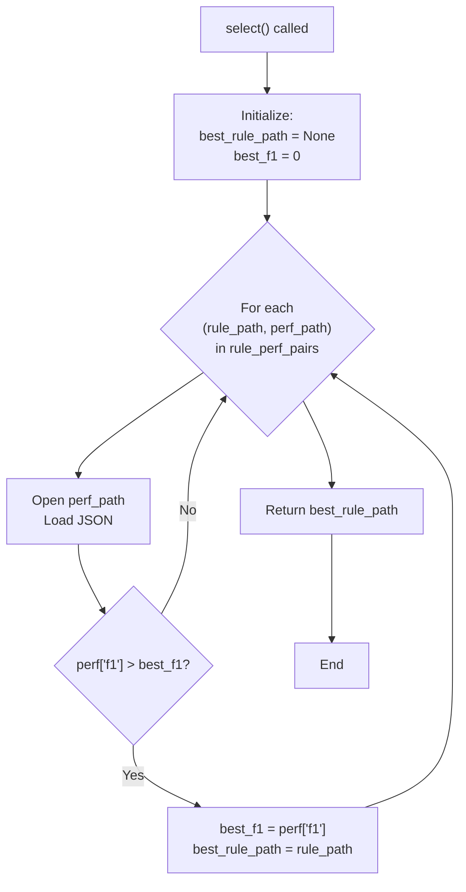
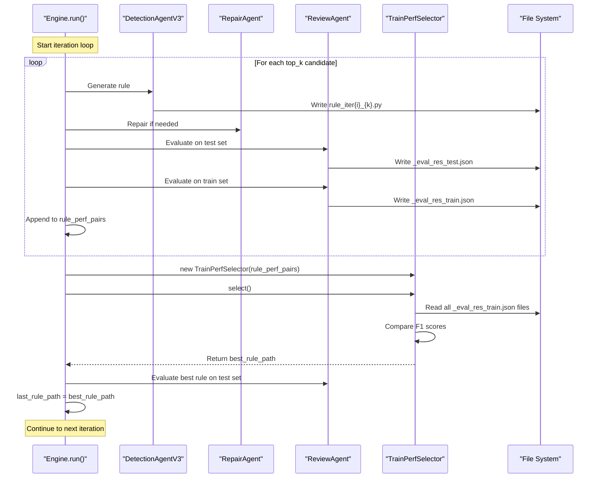

<!-- source: DeepWiki mcp.deepwiki.com · repo microsoft/argos · page 4.10 Rule Selection · fetched 2026-10-26 -->

# Rule Selection

<details>
<summary>Relevant source files</summary>

The following files were used as context for generating this wiki page:

- [runtime/engine.py](runtime/engine.py)
- [selector/train_perf_selector.py](selector/train_perf_selector.py)

</details>


## Purpose and Scope

This page documents the `TrainPerfSelector` class and its role in identifying the best-performing anomaly detection rule from multiple candidates generated during a single training iteration. Rule selection is a critical component of Argos's iterative training pipeline, ensuring that only the highest-quality rules progress through the refinement process.

For information about the overall training workflow, see [Engine](#4.2). For details about how rules are evaluated to produce the performance metrics used in selection, see [Evaluation Metrics](#4.9).

**Sources:** [selector/train_perf_selector.py:1-34](), [runtime/engine.py:25-25]()

---

## Overview

During each training iteration, Argos can generate multiple candidate detection rules (controlled by the `top_k` parameter). The `TrainPerfSelector` is responsible for comparing these candidates and selecting the single best-performing rule based on their training set performance. This selection occurs after each iteration's rules have been generated, repaired (if necessary), and evaluated on the training data.

The selector implements a simple but effective strategy: it compares rules using their F1 score on the training set and returns the path to the rule with the highest score. This ensures that subsequent iterations build upon the best available rule, enabling iterative refinement.

**Sources:** [selector/train_perf_selector.py:5-33](), [runtime/engine.py:361-376]()

---

## Architecture

### TrainPerfSelector Class

```mermaid
classDiagram
    class TrainPerfSelector {
        -List~Tuple[str, str]~ rule_perf_pairs
        +__init__(rule_perf_pairs)
        +select() str
    }
    
    class Engine {
        -TrainPerfSelector topk_selector
        -int top_k
        -int cur_iter
        +run()
        +get_rule_path(top_k_curr) str
    }
    
    class ReviewAgent {
        +eval(rule_path, df) dict
        +eval_all_in_one(rule_path, dict) dict
    }
    
    Engine ..> TrainPerfSelector : creates
    Engine --> ReviewAgent : evaluates rules
    TrainPerfSelector ..> "performance JSON files" : reads
```

**Diagram: Class relationships for rule selection**

The `TrainPerfSelector` is a standalone utility class that operates independently of the agent ecosystem. It receives performance data through file paths rather than direct object references, making it loosely coupled with other system components.

**Sources:** [selector/train_perf_selector.py:5-12](), [runtime/engine.py:104-122]()

---

## Selection Process

### Input Format

The `TrainPerfSelector` constructor accepts `rule_perf_pairs`, a list of tuples where each tuple contains:

| Element | Type | Description |
|---------|------|-------------|
| Rule Path | `str` | File path to the generated Python rule (e.g., `/tmp/rule_iter5_1.py`) |
| Performance Path | `str` | File path to the JSON file containing evaluation metrics (e.g., `/tmp/rule_iter5_1_eval_res_train.json`) |

**Sources:** [selector/train_perf_selector.py:6-12]()

### Performance JSON Structure

Each performance JSON file contains evaluation metrics calculated by the `ReviewAgent`:

```json
{
  "f1": 0.85,
  "precision": 0.90,
  "recall": 0.80
}
```

The selector reads these files and compares the `f1` field to determine the best rule.

**Sources:** [runtime/engine.py:355-359](), [selector/train_perf_selector.py:25-31]()

### Selection Algorithm



**Diagram: Rule selection decision flow**

The algorithm iterates through all candidate rules, maintaining the path to the rule with the highest F1 score. If no rule has a positive F1 score, the method returns the last evaluated rule path (or `None` if the list is empty).

**Sources:** [selector/train_perf_selector.py:14-33]()

---

## Integration with Engine

### Training Iteration Workflow



**Diagram: Rule selection within training iteration**

The `Engine` coordinates the entire process, creating multiple candidate rules per iteration when `top_k > 1`. After all candidates are generated and evaluated, the `TrainPerfSelector` determines which rule should serve as the basis for the next iteration.

**Sources:** [runtime/engine.py:203-376]()

### Code Flow in Engine.run()

The rule selection process occurs within the main training loop:

1. **Rule Generation Phase** [runtime/engine.py:224-363]()
   - For each `top_k_curr` in range `0` to `top_k`:
     - Generate rule: `DetectionAgentV3.run()` writes to `rule_iter{cur_iter}_{top_k_curr}.py`
     - Repair if needed: `RepairAgent.run()` modifies the rule file in place
     - Evaluate on test set: `ReviewAgent.run()` writes to `rule_iter{cur_iter}_{top_k_curr}_eval_res_test.json`
     - Evaluate on train set: `ReviewAgent.eval()` writes to `rule_iter{cur_iter}_{top_k_curr}_eval_res_train.json`
     - Append `(rule_path, train_perf_path)` to `rule_perf_pairs` list

2. **Selection Phase** [runtime/engine.py:371-376]()
   ```python
   topk_selector = TrainPerfSelector(rule_perf_pairs)
   best_rule_path = topk_selector.select()
   logging.info(f"Best rule path at iteration {self.cur_iter}: {best_rule_path}")
   ```

3. **Post-Selection** [runtime/engine.py:378-432]()
   - Evaluate best rule on test set for visualization
   - Set `last_rule_path = best_rule_path` for use in next iteration

**Sources:** [runtime/engine.py:222-376]()

---

## Selection Criteria

### F1 Score Priority

The selector uses F1 score as the sole criterion for rule comparison. F1 score is chosen because it balances precision and recall, making it suitable for anomaly detection scenarios where both false positives and false negatives are costly.

**F1 Score Formula:**

```
F1 = 2 × (precision × recall) / (precision + recall)
```

Where:
- **Precision** = True Positives / (True Positives + False Positives)
- **Recall** = True Positives / (True Positives + False Negatives)

**Sources:** [selector/train_perf_selector.py:29-31]()

### Training Set Evaluation

Rules are compared based on their performance on the **training set**, not the test set. This design choice has important implications:

- **Advantages:**
  - Rules are selected based on their ability to model the training data patterns
  - Selection happens before test evaluation, maintaining clean separation between training and testing
  - Enables the Engine to use the selected rule as context for subsequent iterations

- **Considerations:**
  - Risk of selecting overfitted rules if training data is not representative
  - Mitigated by the iterative refinement process where `ReviewAgent` detects performance regressions

**Sources:** [runtime/engine.py:324-359]()

---

## Configuration Parameters

### top_k Parameter

The `top_k` parameter in the `Engine` constructor controls how many candidate rules are generated per iteration:

| Value | Behavior |
|-------|----------|
| `1` (default) | Single rule per iteration, no selection needed (selector still runs but operates on one element) |
| `> 1` | Multiple rules per iteration, selector chooses the best performer |

**Example Configuration:**

```python
engine = Engine(
    dataset_path="/path/to/data.csv",
    top_k=3,  # Generate 3 candidates per iteration
    mode="train-LLM-only"
)
```

With `top_k=3`, the selector would compare:
- `rule_iter0_0.py` with `rule_iter0_0_eval_res_train.json`
- `rule_iter0_1.py` with `rule_iter0_1_eval_res_train.json`
- `rule_iter0_2.py` with `rule_iter0_2_eval_res_train.json`

**Sources:** [runtime/engine.py:29-44](), [runtime/engine.py:224-224]()

---

## File Naming Convention

The Engine generates consistent file paths that the selector uses to locate rules and their performance data:

| File Type | Pattern | Example |
|-----------|---------|---------|
| Rule File | `rule_iter{iteration}_{top_k_index}.py` | `rule_iter5_2.py` |
| Test Performance | `rule_iter{iteration}_{top_k_index}_eval_res_test.json` | `rule_iter5_2_eval_res_test.json` |
| Train Performance | `rule_iter{iteration}_{top_k_index}_eval_res_train.json` | `rule_iter5_2_eval_res_train.json` |

The train performance file is what the selector reads to make its decision.

**Sources:** [runtime/engine.py:764-767](), [runtime/engine.py:355-359]()

---

## Edge Cases

### No Rules with Positive F1

If all candidate rules have `f1 <= 0`, the selector will return the last rule it evaluated. This behavior is implicit in the implementation:

```python
best_rule_path = None  # Initial value
best_f1 = 0  # Threshold

for rule_path, perf_path in self.rule_perf_pairs:
    if perf["f1"] > best_f1:  # Strictly greater than
        best_f1 = perf["f1"]
        best_rule_path = rule_path

return best_rule_path  # Could be None if no rules exceed 0
```

**Sources:** [selector/train_perf_selector.py:22-33]()

### Empty Rule List

If `rule_perf_pairs` is empty, the selector returns `None`. The Engine does not explicitly handle this case, as it assumes at least one rule is generated per iteration (controlled by `top_k >= 1`).

**Sources:** [selector/train_perf_selector.py:14-33]()

### Tie in F1 Scores

If multiple rules have identical F1 scores, the selector returns the **last** rule encountered with that score due to the strict inequality check (`>`). This behavior is deterministic but arbitrary.

**Sources:** [selector/train_perf_selector.py:29-31]()

---

## Usage in Different Modes

The `TrainPerfSelector` is used in all training modes that involve iterative rule generation:

| Mode | Selection Behavior |
|------|-------------------|
| `train-LLM-only` | Select best rule from training chunks |
| `train-LLM-only-image` | Select best rule after image-guided generation |
| `train-combined-fp` | Select best rule for reducing false positives |
| `train-combined-fn` | Select best rule for reducing false negatives |
| `eval-*` | Not used (evaluation-only modes) |
| `baseline-LLMAD` | Not used (baseline doesn't generate rules) |
| `ablation-detection-only` | Not used (single rule per iteration, no selection) |

In the `ablation-detection-only` mode, selection is skipped because only one rule is generated per iteration without the refinement loop.

**Sources:** [runtime/engine.py:129-139](), [runtime/engine.py:524-650]()

---

## Performance Considerations

### File I/O Operations

The selector performs `O(n)` file read operations where `n = top_k`. For typical values of `top_k` (1-5), this overhead is negligible. Each JSON file is small (<1KB), making the I/O cost minimal.

### Memory Footprint

The selector maintains only the current best rule path and score in memory, not the entire performance data, making its memory footprint constant regardless of `top_k`.

**Sources:** [selector/train_perf_selector.py:22-33]()

---

## Extension Points

The `TrainPerfSelector` class inherits from `ABC` (Abstract Base Class) but does not declare any abstract methods. This suggests the class was designed with extensibility in mind, allowing for future alternative selection strategies such as:

- Weighted combinations of precision, recall, and F1
- Multi-objective optimization considering token usage or execution time
- Ensemble selection choosing multiple rules for voting

**Sources:** [selector/train_perf_selector.py:5-5]()

---

