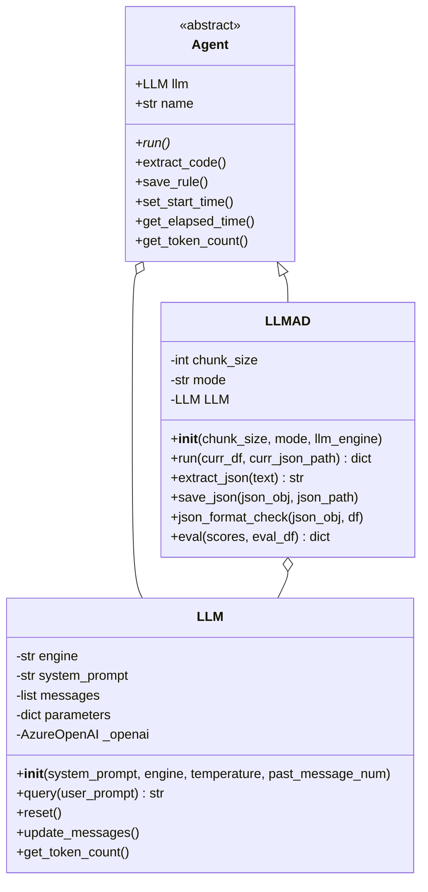
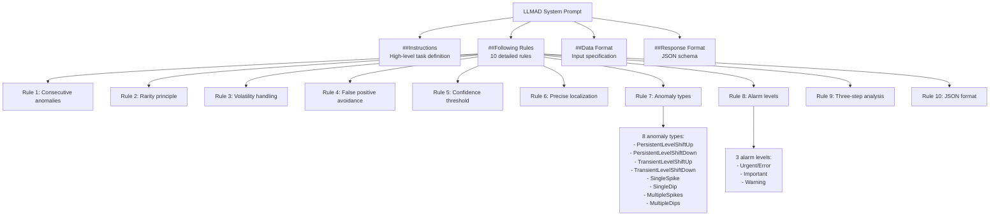
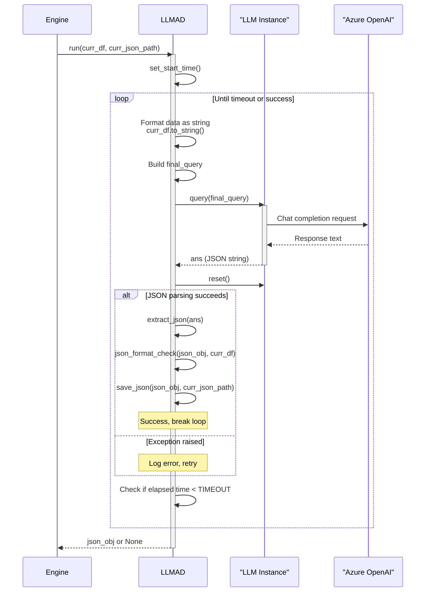
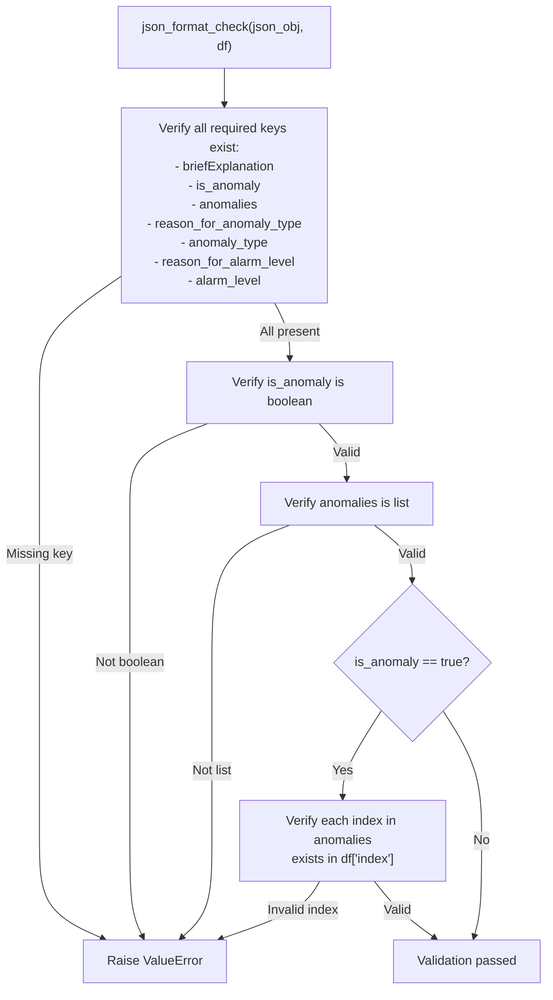
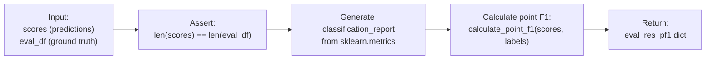
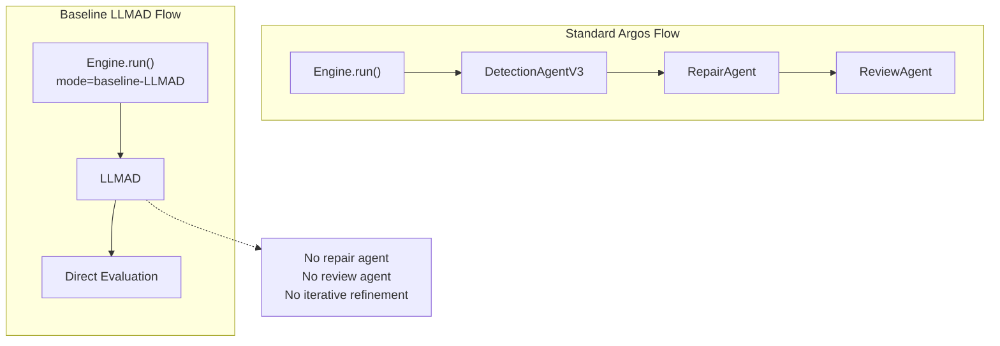
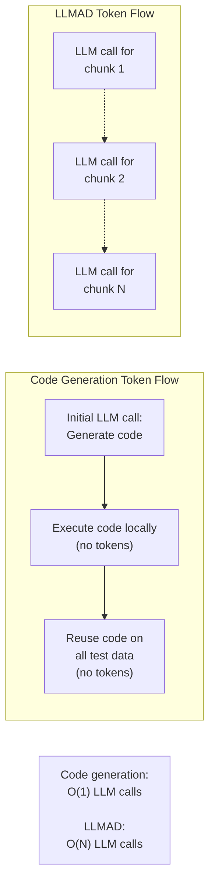

<!-- source: DeepWiki mcp.deepwiki.com · repo microsoft/argos · page 4.11 Baseline LLMAD · fetched 2026-10-26 -->

# Baseline LLMAD

<details>
<summary>Relevant source files</summary>

The following files were used as context for generating this wiki page:

- [agent/agent.py](agent/agent.py)
- [baseline/llmad.py](baseline/llmad.py)

</details>


## Purpose and Scope

This document describes the LLMAD (Large Language Model Anomaly Detection) baseline implementation used for comparative evaluation in Argos. LLMAD represents an alternative approach to anomaly detection where the LLM directly analyzes time-series data and returns structured JSON predictions, rather than generating executable Python code like the main Argos system.

This baseline is executed via the `baseline-LLMAD` operational mode. For information about other operational modes, see [Operational Modes](#3.3). For details about the main Argos detection approach using code generation, see [Detection Agent](#4.4).

**Sources:** [baseline/llmad.py:1-180]()

## Architecture Overview

### LLMAD vs. Argos Code Generation

LLMAD differs fundamentally from Argos's primary approach in how it leverages the LLM:

| Aspect | Argos (DetectionAgentV3) | LLMAD Baseline |
|--------|--------------------------|----------------|
| **Output Type** | Python code with `inference()` function | JSON object with anomaly predictions |
| **Execution** | Code is executed on time-series data | LLM directly analyzes data |
| **Iterative Refinement** | Repair and Review agents improve code | Single-pass LLM query |
| **Reusability** | Generated rules can be reused | Each chunk requires new LLM query |
| **Token Efficiency** | Code is compact, data processed locally | Entire data must be sent to LLM |

```mermaid
graph TB
    subgraph "Argos Approach"
        ArgosData["Time-Series Data"]
        ArgosAgent["DetectionAgentV3"]
        ArgosLLM["LLM Query"]
        ArgosCode["Python Code<br/>def inference()"]
        ArgosExec["Local Execution"]
        ArgosResult["Anomaly Labels"]
        
        ArgosData --> ArgosAgent
        ArgosAgent --> ArgosLLM
        ArgosLLM --> ArgosCode
        ArgosCode --> ArgosExec
        ArgosData --> ArgosExec
        ArgosExec --> ArgosResult
    end
    
    subgraph "LLMAD Baseline"
        LLMADData["Time-Series Data"]
        LLMADAgent["LLMAD"]
        LLMADQuery["LLM Query<br/>(with data)"]
        LLMADJson["JSON Response"]
        LLMADParse["Parse JSON"]
        LLMADResult["Anomaly Labels"]
        
        LLMADData --> LLMADAgent
        LLMADData --> LLMADQuery
        LLMADAgent --> LLMADQuery
        LLMADQuery --> LLMADJson
        LLMADJson --> LLMADParse
        LLMADParse --> LLMADResult
    end
```



**Sources:** [baseline/llmad.py:24-73](), [agent/detection_agent.py]()(for comparison)

## Class Structure

### LLMAD Class Hierarchy



**Sources:** [baseline/llmad.py:24-180](), [agent/agent.py:26-213]()

### Initialization Parameters

The `LLMAD` class is initialized with three parameters:

- `chunk_size` (int): Size of data chunks to process
- `mode` (str): Currently only `"baseline-LLMAD"` is supported
- `llm_engine` (str): LLM model to use (default: `"gpt-4o"`)

The initialization creates an `LLM` instance with:
- Custom LLMAD system prompt (see [Prompt Engineering](#prompt-engineering))
- Temperature: `0.75` (higher than Argos default for more diverse reasoning)
- `past_message_num`: `10` (maintains conversation context)

**Sources:** [baseline/llmad.py:25-73]()

## Prompt Engineering

### LLMAD System Prompt

The LLMAD baseline uses a comprehensive system prompt that defines detection rules, anomaly types, and response format. The prompt is structured as:



**Sources:** [baseline/llmad.py:28-63]()

### Anomaly Type Definitions

The prompt defines eight specific anomaly types with examples:

| Anomaly Type | Description | Example Pattern |
|--------------|-------------|-----------------|
| `PersistentLevelShiftUp` | Sustained increase, no return to baseline | `1 2 1 2 *500* *480* *510* *500*` |
| `PersistentLevelShiftDown` | Sustained decrease, no return to baseline | `1 2 1 2 *-100* *-102* *-104* *-110*` |
| `TransientLevelShiftUp` | Temporary increase, returns to baseline | `1 2 *500* *500* *499* *510* 1 2` |
| `TransientLevelShiftDown` | Temporary decrease, returns to baseline | `1 2 *-100* *-102* *-104* *-110* 1 2` |
| `SingleSpike` | Brief sharp rise, immediate return | `1 2 1 2 *200* *500* 1 2` |
| `SingleDip` | Brief sharp drop, immediate return | `1 2 *-500* *-200* 1 2` |
| `MultipleSpikes` | Multiple brief rises | `1 2 *500* 3 2 *510* *200* 1 2` |
| `MultipleDips` | Multiple brief drops | `1 2 *-100* 3 2 *-110* *-200* 1 2` |

**Sources:** [baseline/llmad.py:37-45]()

### Alarm Level Classification

Three alarm levels guide severity assessment:

- **Urgent/Error**: Severe risk, immediate damage potential
- **Important**: Moderate changes that could escalate, not immediately hazardous
- **Warning**: Noticeable deviations requiring monitoring, not yet critical

**Sources:** [baseline/llmad.py:46-49]()

## Detection Workflow

### Run Method Flow



**Sources:** [baseline/llmad.py:75-121]()

### Data Formatting

The `run()` method converts the DataFrame to a string format for the LLM:

1. Convert DataFrame using `to_string(index=False, header=False)`
2. Construct query with template:
   ```
   ##Data Please analyze the latest data with the highest level of diligence and caution:
   #####Data
   <data_string>
   ```
3. Send query to LLM
4. Reset LLM conversation history after each query

**Sources:** [baseline/llmad.py:80-93]()

### Timeout and Retry Logic

The detection process implements robust timeout handling:

- Maximum runtime: `TIMEOUT` (150 minutes as defined in `agent.py`)
- Continuous retry on JSON parsing failures
- LLM reset between attempts to ensure clean state
- Returns `None` if timeout exceeded

**Sources:** [baseline/llmad.py:78-121](), [agent/agent.py:18]()

## JSON Response Format

### Expected Schema

The LLMAD response must conform to this JSON schema:

```json
{
  "briefExplanation": {
    "step1_global": "string (overall trend assessment)",
    "step2_local": "string (local segment examination)",
    "step3_reassess": "string (confirmation of anomalies)"
  },
  "is_anomaly": true or false,
  "anomalies": [] or [index1, index2, ...],
  "reason_for_anomaly_type": "string or 'no'",
  "anomaly_type": "string or 'no'",
  "reason_for_alarm_level": "string or 'no'",
  "alarm_level": "string or 'no'"
}
```

**Sources:** [baseline/llmad.py:62]()

### Validation Process

The `json_format_check()` method validates responses:



**Sources:** [baseline/llmad.py:132-155]()

### JSON Extraction and Storage

- **Extraction**: `extract_json(text)` uses `json.loads()` to parse the LLM response
- **Storage**: `save_json(json_obj, json_path)` writes the validated JSON to disk

**Sources:** [baseline/llmad.py:123-130]()

## Evaluation Process

### Evaluation Method

The `eval()` method assesses LLMAD predictions against ground truth:



The method performs:

1. **Length validation**: Ensures predictions match ground truth size
2. **Classification report**: Uses sklearn to compute precision, recall, F1 for both classes (0, 1)
3. **Point F1 calculation**: Computes point-wise F1 score using the custom metric from `eval_metrics.point_f1`
4. **Result compilation**: Returns dictionary with point F1 metrics

**Sources:** [baseline/llmad.py:158-179]()

### Metric Integration

LLMAD uses the same evaluation metrics as the main Argos system:

- `classification_report` from sklearn: Standard precision/recall/F1 metrics
- `calculate_point_f1`: Point-wise F1 score calculation (see [Evaluation Metrics](#4.9))
- Zero division handling: `zero_division=0` prevents errors when no anomalies predicted

**Sources:** [baseline/llmad.py:169-175](), [common/common.py](), [eval_metrics/point_f1.py]()

## Integration with Engine

### Baseline Mode Execution

LLMAD is invoked when the Engine operates in `baseline-LLMAD` mode. The integration differs from standard Argos modes:



**Sources:** [runtime/engine.py](), [baseline/llmad.py:24-180]()

### Key Differences in Integration

| Aspect | Standard Argos | Baseline LLMAD |
|--------|----------------|----------------|
| **Agent Pipeline** | Detection → Repair → Review | LLMAD only |
| **Output Format** | Python file (.py) | JSON file (.json) |
| **Iteration Support** | Multiple iterations with refinement | Single-pass per chunk |
| **Error Handling** | RepairAgent fixes code errors | JSON validation retries |
| **Performance Feedback** | ReviewAgent monitors metrics | Post-hoc evaluation only |

**Sources:** [baseline/llmad.py:1-180](), [runtime/engine.py]()

## Token and Cost Implications

### Token Usage Characteristics

LLMAD's token consumption differs significantly from code-generation approaches:

- **Input tokens**: Entire time-series data must be sent with each query
- **Output tokens**: JSON response with explanations (verbose compared to code)
- **Context**: Maintains last 10 messages (`past_message_num=10`)
- **Per-chunk cost**: Each data chunk requires full LLM round-trip

The `get_token_count()` method tracks token usage, inherited from the base `Agent` class:

**Sources:** [baseline/llmad.py:67-72](), [agent/agent.py:211-212]()

### Comparison with Code Generation



**Sources:** [baseline/llmad.py:75-121]()

## Limitations and Trade-offs

### Architectural Limitations

1. **Scalability**: Each chunk requires separate LLM query, limiting throughput
2. **Context Window**: Data size constrained by model's context limit
3. **Reusability**: Generated predictions cannot be reused on new data
4. **Interpretability**: JSON explanations less actionable than executable code
5. **Cost**: Higher token consumption for large datasets

### Advantages as Baseline

1. **Simplicity**: No code execution, parsing, or error handling complexity
2. **Explainability**: Built-in three-step reasoning in `briefExplanation`
3. **Granularity**: Provides anomaly types and alarm levels
4. **Direct comparison**: Tests pure LLM reasoning without code generation overhead

**Sources:** [baseline/llmad.py:1-180]()

---

**Complete File Reference:**
- [baseline/llmad.py:1-180]()
- [agent/agent.py:1-213]()

---

