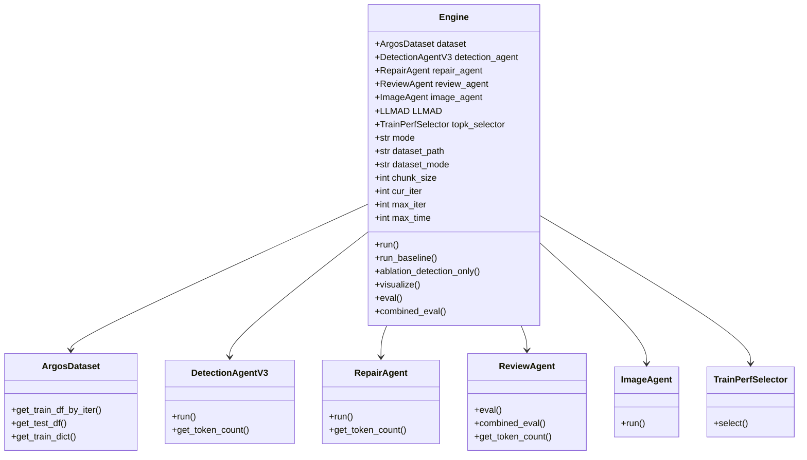
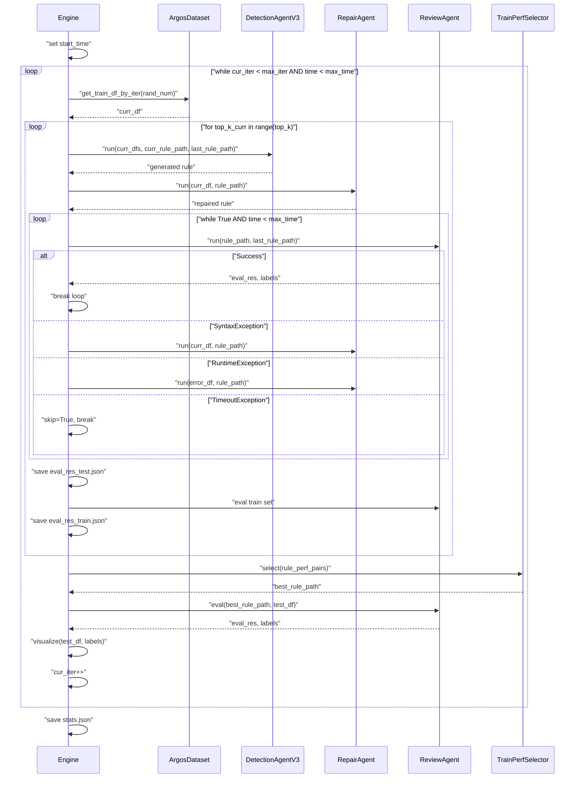
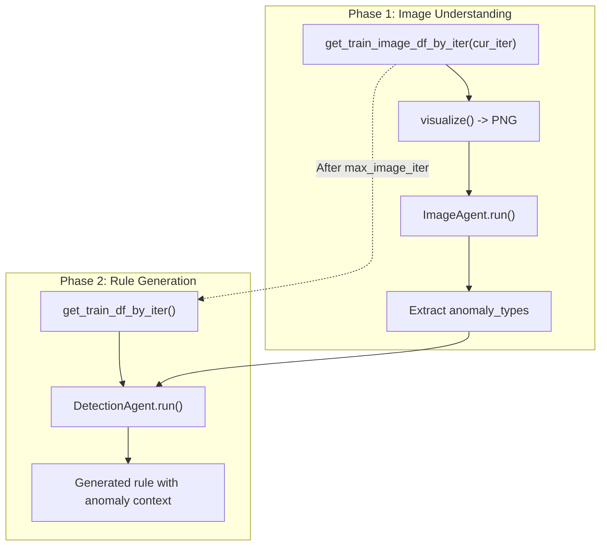
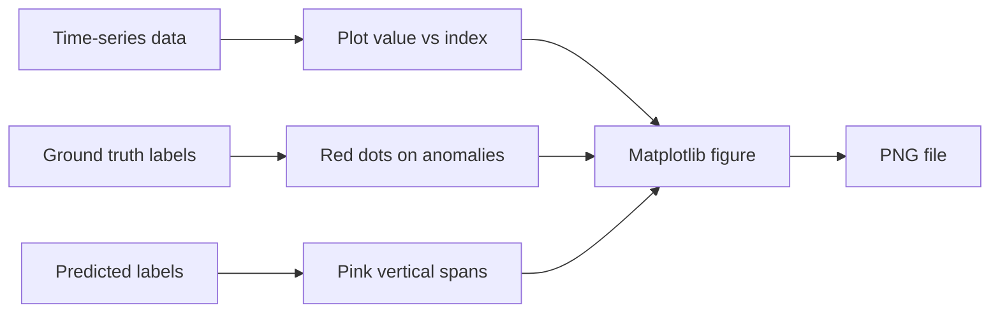

<!-- source: DeepWiki mcp.deepwiki.com · repo microsoft/argos · page 4.2 Engine · fetched 2026-10-26 -->

# Engine

<details>
<summary>Relevant source files</summary>

The following files were used as context for generating this wiki page:

- [agent/agent.py](agent/agent.py)
- [datasets/dataset.py](datasets/dataset.py)
- [runtime/engine.py](runtime/engine.py)

</details>


The Engine class serves as the central orchestration component for training and evaluation in Argos. It manages the lifecycle of specialized agents (Detection, Repair, Review, Image), coordinates data processing through ArgosDataset, implements the iterative training loop, and produces evaluation results. For information about the CLI entry point that invokes the Engine, see [Driver](#4.1). For details about the agents managed by Engine, see sections [4.4](#4.4) through [4.7](#4.7).

**Sources:** [runtime/engine.py:1-830]()

## Class Structure

The `Engine` class is defined as an abstract base class in [runtime/engine.py:28-830](). It initializes all necessary agents and orchestrates their interactions during training and evaluation.



**Sources:** [runtime/engine.py:28-128]()

## Initialization

The Engine is initialized with configuration parameters that control dataset processing, chunking, model selection, and timeout behavior.

### Constructor Parameters

| Parameter | Type | Default | Description |
|-----------|------|---------|-------------|
| `dataset_path` | str | required | Path to dataset CSV or directory |
| `chunk_size` | int | 1000 | Size of data chunks for training |
| `image_chunk_size` | int | 10000 | Size of chunks for image-based training |
| `image_subplots` | tuple | (1, 1) | Subplot grid dimensions for visualization |
| `rule_path` | str | "/tmp" | Directory to save generated rules |
| `model_res_path` | str | None | Path to model results (for combined modes) |
| `mode` | str | "train-LLM-only" | Operational mode |
| `dataset_mode` | str | "one-by-one" | Dataset processing mode |
| `train_test_split` | float | 0.7 | Train/test split ratio |
| `top_k` | int | 1 | Number of candidate rules per iteration |
| `llm_engine` | str | "gpt-4o" | Azure OpenAI model name |
| `timeout` | int | 150 | Maximum runtime in minutes |
| `sample_per_prompt` | int | 1 | Number of samples per detection prompt |

The initialization process performs the following steps:

1. **Random Seed Configuration** [runtime/engine.py:58](): Sets numpy random seed to 8 for reproducibility
2. **Dataset Initialization** [runtime/engine.py:80-88](): Creates `ArgosDataset` instance with specified parameters
3. **Logging Setup** [runtime/engine.py:90-94](): Configures file logging to `output.log` in the rule path
4. **Agent Instantiation** [runtime/engine.py:104-127](): Creates DetectionAgentV3, RepairAgent, ReviewAgent, and optionally ImageAgent based on mode
5. **Path Configuration** [runtime/engine.py:73-76](): Creates rule directory and sets up file paths

**Sources:** [runtime/engine.py:29-128]()

## Training Pipeline

The main training loop is implemented in the `run()` method [runtime/engine.py:129-453](). It orchestrates the iterative rule generation, repair, and review process.



**Sources:** [runtime/engine.py:129-453]()

### Training Loop Phases

#### Phase 1: Data Selection
For each iteration, the Engine randomly selects training data chunks [runtime/engine.py:217-220]():
- Generates random indices for data sampling
- Retrieves chunks via `dataset.get_train_df_by_iter(rand_num)`
- Supports multiple samples per prompt via `sample_per_prompt` parameter

#### Phase 2: Rule Generation
For each of the `top_k` candidates [runtime/engine.py:224-289]():
- Calls `detection_agent.run()` with training data and optional context (previous rule, normal/abnormal examples)
- Handles different modes: LLM-only, combined-fp, combined-fn, image-based
- Passes mode-specific data (normal segments for FN mode, abnormal segments for FP mode)

#### Phase 3: Code Repair
The RepairAgent fixes syntax and runtime errors [runtime/engine.py:290-292]():
- Invoked immediately after rule generation
- Continues in loop if ReviewAgent encounters errors [runtime/engine.py:303-314]()

#### Phase 4: Performance Review
The ReviewAgent evaluates rule performance [runtime/engine.py:293-322]():
- Runs evaluation on test set via `review_agent.run()`
- Handles exceptions by re-invoking RepairAgent
- Saves results to `*_eval_res_test.json`
- Also evaluates on training set for rule selection [runtime/engine.py:324-359]()

#### Phase 5: Rule Selection
After generating `top_k` candidates, TrainPerfSelector identifies the best rule [runtime/engine.py:371-376]():
- Compares training set performance across candidates
- Returns path to best-performing rule
- See [Rule Selection](#4.10) for details

#### Phase 6: Final Evaluation and Visualization
For the selected best rule [runtime/engine.py:378-432]():
- Evaluates on full test set
- Generates visualization via `visualize()` method
- Sets `last_rule_path` for next iteration context

**Sources:** [runtime/engine.py:192-453]()

## Operational Modes

The Engine supports multiple operational modes, each implementing different training strategies. The mode is set via the `mode` parameter during initialization.

### Standard Training Modes

#### train-LLM-only
Pure LLM-based rule generation without external model input [runtime/engine.py:284-289]().
- Detection agent generates rules from raw time-series data
- No requirement for model result path
- Default mode for standalone operation

#### train-LLM-only-image
Image-guided training that extracts anomaly types from visualizations [runtime/engine.py:124-189]().



Implementation details:
- First phase: Iterates through image chunks [runtime/engine.py:150-188]()
- ImageAgent analyzes visualizations to identify anomaly types
- Second phase: Uses extracted types to guide rule generation [runtime/engine.py:273-279]()
- Requires `llm_engine="gpt-4o"` for vision capabilities

**Sources:** [runtime/engine.py:124-189](), [runtime/engine.py:273-279]()

### Combined Modes

Combined modes target specific error types from existing models, requiring `model_res_path` to be set.

#### train-combined-fn (False Negative Correction)
Generates rules to detect anomalies missed by the base model [runtime/engine.py:225-247]().
- Filters training data to FN segments via `derive_train_df_from_indices()` in ArgosDataset
- Provides normal examples as additional context
- For "one-by-one" mode: uses `get_normal_df_by_iter()` [runtime/engine.py:236-238]()
- For "all-in-one" mode: uses `get_closest_normal_df()` [runtime/engine.py:239-240]()
- Evaluation combines LLM predictions with base model via ReviewAgent [runtime/engine.py:329-331](), [runtime/engine.py:380-382]()

#### train-combined-fp (False Positive Correction)
Generates rules to filter false positives from the base model [runtime/engine.py:248-272]().
- Filters training data to FP segments
- Provides abnormal examples as additional context
- For "one-by-one" mode: uses `get_abnormal_df_by_iter()` [runtime/engine.py:258-261]()
- For "all-in-one" mode: uses `get_closest_abnormal_df()` [runtime/engine.py:262-265]()
- Evaluation logic mirrors FN mode

**Sources:** [runtime/engine.py:60-64](), [runtime/engine.py:133-136](), [runtime/engine.py:225-272]()

### Special Modes

#### baseline-LLMAD
Runs the LLMAD baseline for comparison [runtime/engine.py:96-100](), [runtime/engine.py:454-523]().
- Uses LLMAD class instead of agent-based architecture
- Iterates through test chunks directly
- Saves predictions to `llmad_scores_test.npy` and results to `llmad_eval_res_test.json`
- See [Baseline LLMAD](#4.11) for implementation details

#### ablation-detection-only
Ablation study that skips the review agent [runtime/engine.py:524-650]().
- Only runs DetectionAgent without iterative refinement
- Evaluates generated rules directly on test set
- Handles errors gracefully, logging them to `eval_res_test.json`
- Used to measure the impact of ReviewAgent on performance

**Sources:** [runtime/engine.py:96-100](), [runtime/engine.py:137-139](), [runtime/engine.py:454-523](), [runtime/engine.py:524-650]()

## Iteration Control and Timeouts

The Engine implements multiple timeout mechanisms to ensure bounded execution:

| Constant | Value | Purpose |
|----------|-------|---------|
| `MAX_ITER` | 100 | Maximum training iterations (from agent.py) |
| `timeout` parameter | 150 min (default) | Total execution time limit |
| `max_time` | `timeout * 60` seconds | Converted timeout in seconds |

### Termination Conditions

The main training loop terminates when either condition is met [runtime/engine.py:203-204]():
```python
while self.cur_iter < self.max_iter and time.time() - start_time < self.max_time:
```

Individual agents also have their own timeout limits defined in [agent/agent.py:17-23]():
- `TIMEOUT_LLM`: 5 minutes per LLM query
- `TIMEOUT_FIRST_REVIEW`: 2 minutes for first review
- `TIMEOUT_PER_REVIEW`: 2 minutes per review iteration
- `TIMEOUT_IMAGE`: 10 minutes for image processing

**Sources:** [runtime/engine.py:66-71](), [runtime/engine.py:203-204](), [agent/agent.py:17-23]()

## Rule Management

The Engine maintains a structured approach to rule file management and selection.

### Rule Path Generation

Rule paths follow a consistent naming convention [runtime/engine.py:764-767]():
```
{rule_path}/rule_iter{cur_iter}_{top_k_curr}.py
```

The base path includes a timestamp prefix [runtime/engine.py:652-656]():
```
{rule_path}/{YYYY-MM-DD_HH-MM-SS}_{dataset_name}/rule_iter{N}_{K}.py
```

### Result Files

For each generated rule, the Engine creates:

| File Type | Naming Pattern | Content |
|-----------|----------------|---------|
| Rule File | `rule_iter{N}_{K}.py` | Generated Python detection code |
| Test Results | `rule_iter{N}_{K}_eval_res_test.json` | Test set performance metrics |
| Train Results | `rule_iter{N}_{K}_eval_res_train.json` | Training set performance metrics |
| Visualization | `eval_figure_rule_iter{N}_{K}.png` | Test set predictions plot |

**Sources:** [runtime/engine.py:317-322](), [runtime/engine.py:355-359](), [runtime/engine.py:388-394](), [runtime/engine.py:652-656](), [runtime/engine.py:764-767]()

## Evaluation Methods

The Engine provides multiple evaluation interfaces for debugging and result analysis.

### Primary Evaluation Method

`eval(rule_file, mode="test")` [runtime/engine.py:769-790]() - Evaluates a rule file on train or test data:
- Delegates to `review_agent.eval()` or `review_agent.eval_all_in_one()` depending on `dataset_mode`
- Returns `(eval_res, labels, scores)` tuple
- `eval_res`: dict with keys "f1", "precision", "recall"
- `labels`: numpy array of predicted binary labels
- `scores`: numpy array of anomaly scores

### Combined Mode Evaluation

`combined_eval(rule_file, eval_mode="train")` [runtime/engine.py:792-796]() - Evaluates combined modes:
- For use with "train-combined-fp" and "train-combined-fn" modes
- Merges LLM predictions with base model predictions
- Delegates to `review_agent.combined_eval()`

### Combined Inference

`combined_inference()` [runtime/engine.py:798-808]() and `combined_inference_all_in_one()` [runtime/engine.py:810-820]():
- Supports dual-rule inference (separate FP and FN rules)
- Takes threshold parameters for each rule type
- Useful for production deployment with both correction types

**Sources:** [runtime/engine.py:769-820]()

## Visualization

The `visualize()` method [runtime/engine.py:658-753]() generates matplotlib figures showing time-series data with anomaly annotations.

### Visualization Components



### Implementation Details

**Input Format** [runtime/engine.py:660-661]():
- `input_data`: numpy array with shape (n, 3) containing (value, label, index)
- `labels`: numpy array with shape (n,) containing predicted binary labels
- `save_path`: file path for output PNG

**Multi-Subplot Support** [runtime/engine.py:669-676]():
- Supports grid layouts via `image_subplots` parameter
- Figure size scales with data length: `min(30 * num_col * len(input_data) // 2500, 150)` width
- Height: `15 * num_row`
- Used for image-based training mode with large datasets

**Anomaly Annotation** [runtime/engine.py:704-736]():
- Ground truth anomalies: red dots on time-series line
- Predicted anomaly segments: pink vertical spans (`axvspan`)
- Segments calculated by identifying consecutive predictions

**Font Sizing** [runtime/engine.py:743-746]():
- Axis labels: 40pt font
- Tick labels: 40pt font
- Optimized for large figure exports

**Sources:** [runtime/engine.py:658-753]()

## Statistics and Output

Upon training completion, the Engine writes comprehensive statistics to `stats.json` [runtime/engine.py:436-449]().

### Statistics File Structure

```json
{
  "cur_iter": 45,
  "max_iter": 100,
  "max_time": 9000,
  "time_elapsed": 3847.2,
  "best_rule_path": "/path/to/rule_iter44_1.py",
  "mode": "train-LLM-only",
  "token_count": {
    "DetectionAgentV3": [
      [input_tokens, output_tokens],
      ...
    ],
    "RepairAgent": [...],
    "ReviewAgent": [...]
  }
}
```

### Token Count Tracking

The Engine collects token usage from all agents [runtime/engine.py:446-448]():
- Each agent's `get_token_count()` returns list of (input, output) token pairs
- Enables cost calculation and performance analysis
- See [Base Agent and LLM Integration](#4.3) for token counting details

### Logging

All execution logs are written to `output.log` in the rule path [runtime/engine.py:90-94]():
- Log level: INFO
- File mode: append ("a")
- Captures agent outputs, exceptions, and iteration summaries

**Sources:** [runtime/engine.py:90-94](), [runtime/engine.py:436-452]()

## Dataset Mode Handling

The Engine adapts its behavior based on the `dataset_mode` parameter, supporting both single time-series and multiple time-series datasets.

### one-by-one Mode

For single time-series datasets [runtime/engine.py:324-336](), [runtime/engine.py:378-394]():
- Evaluation: `review_agent.eval(rule_file, dataset.get_test_df())`
- Combined eval: `review_agent.combined_eval(rule_file, "test")`
- Direct access to train/test DataFrames via getter methods

### all-in-one Mode

For multiple time-series datasets [runtime/engine.py:337-352](), [runtime/engine.py:395-426]():
- Evaluation: `review_agent.eval_all_in_one(rule_file, test_dict)`
- Combined eval: `review_agent.combined_eval_all_in_one(rule_file, "test")`
- Data organized as dictionaries mapping chunk_id to DataFrame
- Test visualization concatenates all DataFrames [runtime/engine.py:405-423]()

**Sources:** [runtime/engine.py:324-430]()

## Error Handling

The Engine implements robust error handling throughout the training pipeline.

### Exception Types

The Engine handles three custom exception types from [common/exception.py]():

| Exception | Trigger | Handler |
|-----------|---------|---------|
| `SyntaxException` | Python syntax errors in generated rules | Invoke RepairAgent with original training data [runtime/engine.py:303-304]() |
| `RuntimeException` | Runtime errors during rule execution | Invoke RepairAgent with error-triggering data [runtime/engine.py:305-306]() |
| `TimeoutException` | Agent execution exceeds time limit | Skip current iteration, continue with next [runtime/engine.py:307-312]() |

### Recovery Loop

The review phase implements a recovery loop [runtime/engine.py:293-314]():
```python
while True and time.time() - start_time < self.max_time:
    try:
        eval_res, labels, _ = self.review_agent.run(rule_path, last_rule_path)
        break
    except Exception as e:
        # Handle exception types...
        if isinstance(e, TimeoutException):
            skip = True
            break
```

This ensures that transient errors are recovered automatically without terminating the entire training session.

**Sources:** [runtime/engine.py:293-316](), [common/exception.py]()

## Agent Access Methods

The Engine provides getter methods for agent access [runtime/engine.py:822-829]():

```python
def get_detection_agent(self):
    return self.detection_agent

def get_repair_agent(self):
    return self.repair_agent

def get_review_agent(self):
    return self.review_agent
```

These methods support:
- External testing and debugging
- Custom evaluation workflows
- Direct agent interaction for advanced use cases

**Sources:** [runtime/engine.py:822-829]()

## Configuration Files Integration

The Engine reads Azure OpenAI credentials from environment variables via the LLM class [agent/agent.py:58-62]():
- `OPENAI_AZURE_API_KEY`
- `OPENAI_AZURE_ENDPOINT`
- `OPENAI_AZURE_API_VERSION`

These must be configured before Engine initialization. See [Configuration Files](#6.2) for setup instructions.

**Sources:** [agent/agent.py:58-62]()

---

