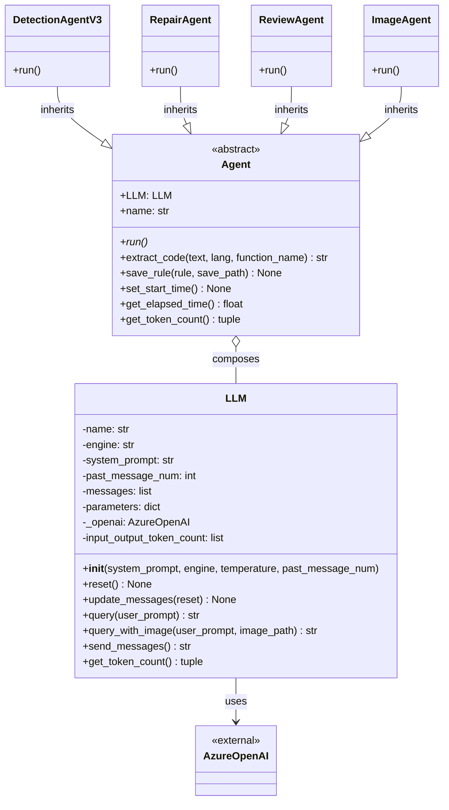
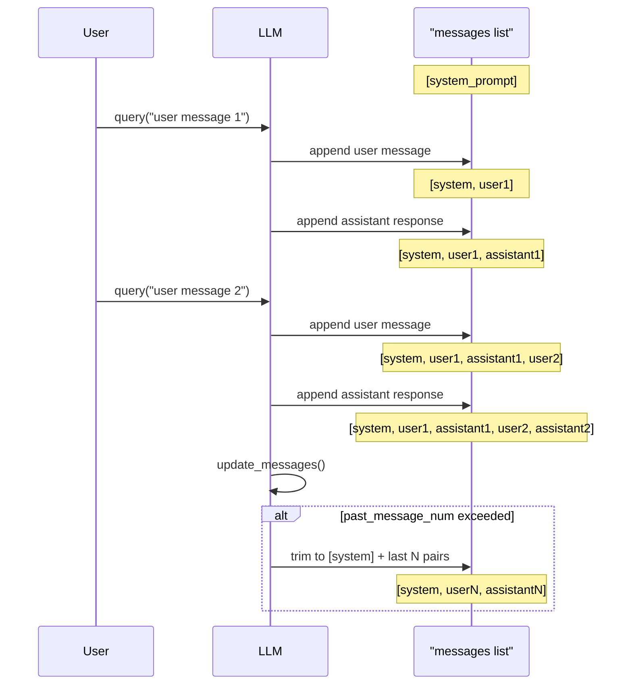
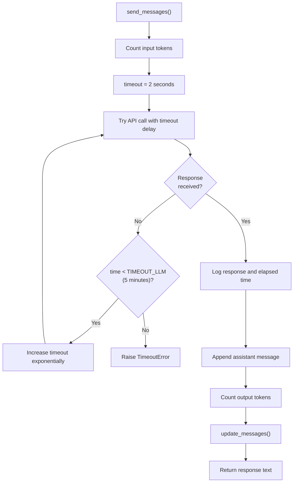
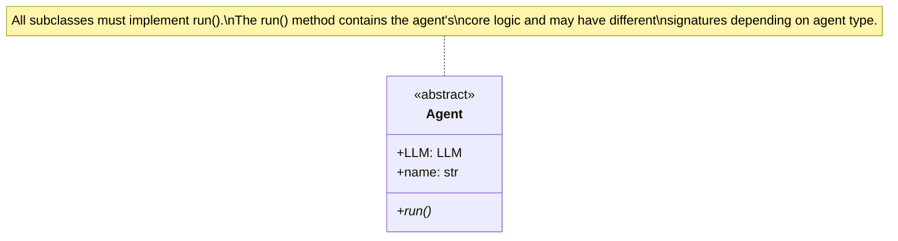
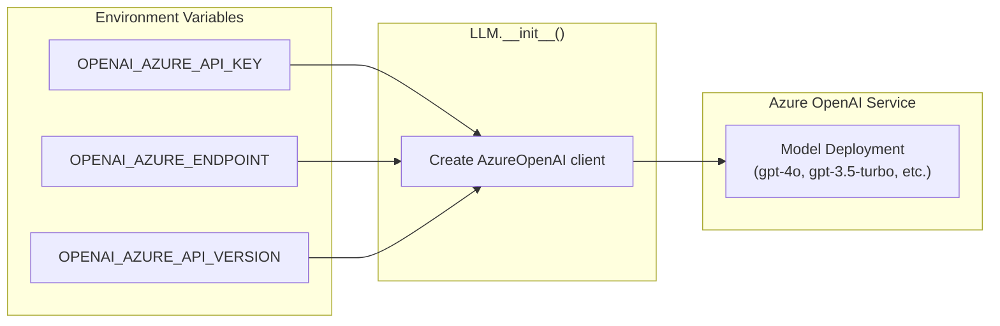
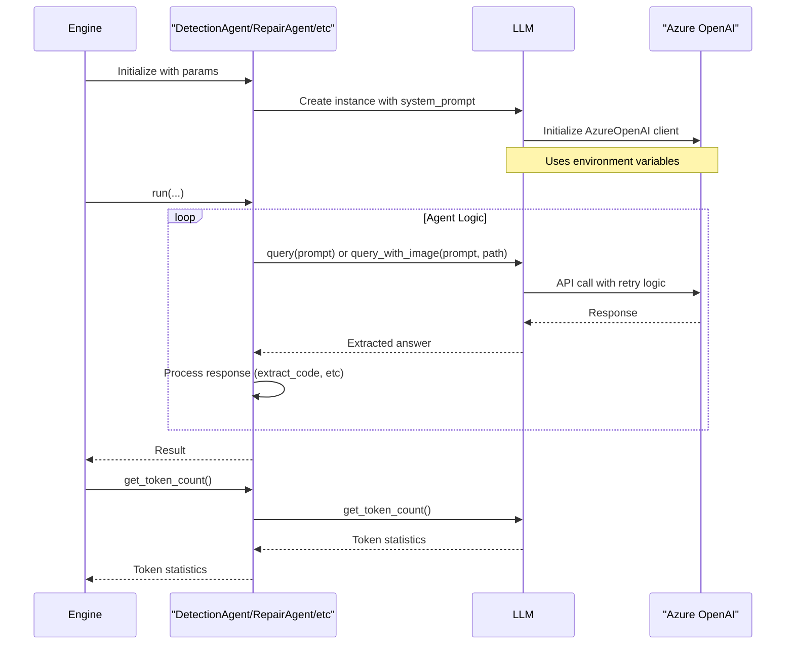

<!-- source: DeepWiki mcp.deepwiki.com · repo microsoft/argos · page 4.3 Base Agent and LLM Integration · fetched 2026-10-26 -->

# Base Agent and LLM Integration

<details>
<summary>Relevant source files</summary>

The following files were used as context for generating this wiki page:

- [agent/agent.py](agent/agent.py)
- [requirements.txt](requirements.txt)

</details>


## Purpose and Scope

This document details the foundational infrastructure that enables all Argos agents to interact with Azure OpenAI services. It covers the `LLM` class, which manages message conversations and API calls, and the `Agent` abstract base class, which provides a standard interface for all specialized agents in the system.

For information about specific agent implementations (DetectionAgent, RepairAgent, ReviewAgent, ImageAgent), see [4.4](#4.4), [4.5](#4.5), [4.6](#4.6), and [4.7](#4.7) respectively. For details about the orchestration layer that coordinates agents, see [4.2](#4.2).

**Sources**: [agent/agent.py:1-213]()

## Architecture Overview

The base agent infrastructure follows a composition pattern where each specialized agent inherits from the `Agent` abstract base class and composes an `LLM` instance to handle Azure OpenAI interactions. This separation ensures that LLM communication logic is centralized and reusable across all agent types.



**Sources**: [agent/agent.py:26-213]()

## LLM Class

The `LLM` class encapsulates all communication with Azure OpenAI services. It manages conversation context, handles API calls, tracks token usage, and provides both text-based and image-based query capabilities.

### Initialization and Configuration

The `LLM` class constructor accepts the following parameters:

| Parameter | Type | Default | Description |
|-----------|------|---------|-------------|
| `system_prompt` | `str` | "You are an AI assistant..." | The system message that sets the LLM's behavior |
| `engine` | `str` | "gpt-4o" | Azure OpenAI model deployment name (e.g., "gpt-4o", "gpt-3.5-turbo", "gpt-4-32k") |
| `temperature` | `float` | 0.1 | Sampling temperature (0-1), lower values are more deterministic |
| `past_message_num` | `int` | `sys.maxsize` | Number of past message pairs to retain in context |

The class initializes an `AzureOpenAI` client using three required environment variables:

- `OPENAI_AZURE_API_KEY`: Azure OpenAI API key
- `OPENAI_AZURE_ENDPOINT`: Azure OpenAI endpoint URL
- `OPENAI_AZURE_API_VERSION`: API version string

The model parameters are configured as follows:

```
{
    "model": engine,
    "temperature": temperature,
    "max_tokens": 2000,
    "top_p": 0.95,
    "frequency_penalty": 0,
    "presence_penalty": 0,
    "stop": None,
    "n": 1
}
```

**Sources**: [agent/agent.py:26-66](), [requirements.txt:19]()

### Message Management

The `LLM` class maintains a conversation history in the `messages` list, which always begins with the system prompt. The class implements a sliding window approach to manage context length:



Key methods:

- **`update_messages(reset=False)`**: Trims the message history to retain only the system prompt plus the last `past_message_num` user-assistant message pairs. If `reset=True`, clears all conversation history except the system prompt.
- **`reset()`**: Convenience method that calls `update_messages(reset=True)`.

This sliding window approach prevents token limits from being exceeded during long agent interactions while maintaining recent context.

**Sources**: [agent/agent.py:67-76]()

### Query Methods

The `LLM` class provides two query methods:

#### Text-based Queries

The `query(user_prompt: str)` method sends a text prompt to the LLM:

1. Appends the user prompt to `messages` with role "user"
2. Calls `send_messages()` to execute the API call
3. Appends the response with role "assistant"
4. Updates message history via `update_messages()`
5. Returns the response text

**Sources**: [agent/agent.py:78-86]()

#### Image-based Queries

The `query_with_image(user_prompt: str, image_path: str)` method sends both text and an image:

1. Asserts the engine is "gpt-4o" (only model supporting vision)
2. Encodes the image file as base64
3. Constructs a content array with text and image_url objects
4. Appends the multimodal message and processes the response

This enables agents like `ImageAgent` to analyze time-series visualizations.

**Sources**: [agent/agent.py:88-115]()

### API Communication

The `send_messages()` method handles the actual Azure OpenAI API call with retry logic:



The retry mechanism starts with a 2-second delay and increases exponentially (capped at doubling) until `TIMEOUT_LLM` (5 minutes) is reached. This handles transient API failures gracefully.

**Sources**: [agent/agent.py:117-159](), [agent/agent.py:17-23]()

### Token Counting and Tracking

The `LLM` class tracks token consumption for each API call by:

1. Counting input tokens before the API call using `num_tokens_from_messages()`
2. Counting output tokens after receiving the response
3. Storing the tuple `(input_token_count, output_token_count)` in `input_output_token_count`

The `get_token_count()` method returns:
- Complete list of per-call token counts
- Total input tokens across all calls
- Total output tokens across all calls

This enables cost tracking and performance analysis across agent operations.

**Sources**: [agent/agent.py:161-171](), [agent/agent.py:15]()

## Agent Abstract Base Class

The `Agent` class defines the interface that all specialized agents must implement. It provides common utility methods while requiring each agent to define its own `run()` logic.

### Abstract Interface



Each agent subclass:
1. Initializes an `LLM` instance with appropriate system prompts
2. Sets a descriptive `name` attribute
3. Implements `run()` with agent-specific parameters and logic

**Sources**: [agent/agent.py:174-183]()

### Utility Methods

The `Agent` base class provides utility methods used across all agent implementations:

#### Code Extraction

**`extract_code(text: str, lang: str = "python", function_name: str = "def inference")`**

Extracts Python code blocks from LLM responses using regex pattern matching. The method:
1. Searches for markdown code blocks delimited by triple backticks
2. Filters for blocks containing the specified `function_name`
3. Returns the extracted code with delimiters removed
4. Raises `ValueError` if no matching code block is found

This is critical for agents that generate Python detection rules, as LLMs often wrap code in markdown formatting.

**Sources**: [agent/agent.py:185-197]()

#### Rule Persistence

**`save_rule(rule: str, save_path: str)`**

Writes a detection rule to disk:
1. Opens the file at `save_path` in write mode
2. Writes the rule content
3. Logs the save operation

This standardizes how agents persist generated or repaired detection rules.

**Sources**: [agent/agent.py:199-202]()

#### Timing Utilities

**`set_start_time()`** and **`get_elapsed_time()`**

Track execution duration for performance monitoring:
- `set_start_time()` records the current timestamp
- `get_elapsed_time()` calculates the difference from the recorded start time

These methods enable timeout enforcement and performance measurement across agent operations.

**Sources**: [agent/agent.py:204-209]()

#### Token Count Access

**`get_token_count()`**

Delegates to the composed `LLM` instance's `get_token_count()` method, providing a unified interface for retrieving token usage statistics from the agent level.

**Sources**: [agent/agent.py:211-212]()

## Azure OpenAI Integration

The integration with Azure OpenAI services is established through the `openai` Python library and configured entirely via environment variables:



### Configuration Requirements

Before running Argos, users must configure these environment variables:

| Variable | Description | Example |
|----------|-------------|---------|
| `OPENAI_AZURE_API_KEY` | Azure OpenAI API authentication key | `"abc123..."` |
| `OPENAI_AZURE_ENDPOINT` | Azure OpenAI service endpoint URL | `"https://your-resource.openai.azure.com/"` |
| `OPENAI_AZURE_API_VERSION` | API version to use | `"2023-05-15"` |

The `AzureOpenAI` client initialization occurs at line 58-62 of [agent/agent.py:58-62](), using these environment variables directly with `os.environ`.

### Supported Models

While the code can work with any Azure OpenAI deployment, Argos is designed for:

- **gpt-3.5-turbo**: Fast, cost-effective option for basic rule generation
- **gpt-4-32k**: Extended context window for complex scenarios
- **gpt-4o**: Multimodal model supporting vision capabilities (required for image-based queries)

The model selection is specified via the `engine` parameter during `LLM` instantiation.

**Sources**: [agent/agent.py:58-62](), [requirements.txt:19]()

## Timeout Configuration

The module defines several timeout constants (in seconds) that govern agent execution:

| Constant | Value | Purpose |
|----------|-------|---------|
| `MAX_ITER` | 100 | Maximum iterations for agent loops |
| `TIMEOUT` | 9000 (2.5 hours) | Global timeout for agent operations |
| `TIMEOUT_FIRST_REVIEW` | 120 (2 minutes) | Initial review operation timeout |
| `TIMEOUT_LLM` | 300 (5 minutes) | Single LLM API call timeout with retries |
| `TIMEOUT_PER_REVIEW` | 120 (2 minutes) | Per-review-iteration timeout |
| `TIMEOUT_IMAGE` | 600 (10 minutes) | Image processing timeout |
| `TIMEOUT_INFERENCE` | 60 (1 minute) | Rule inference execution timeout |

These constants are imported and used by specialized agents to enforce execution limits and handle long-running operations. The `TIMEOUT_LLM` constant specifically governs the retry logic in `send_messages()`.

**Sources**: [agent/agent.py:17-23]()

## Usage Pattern

Specialized agents follow this initialization pattern:



Each specialized agent:
1. Defines an agent-specific system prompt
2. Initializes an `LLM` instance with the prompt and desired model
3. Implements `run()` to orchestrate LLM queries and response processing
4. Uses utility methods like `extract_code()` and `save_rule()`
5. Reports token usage via `get_token_count()`

This pattern ensures consistent LLM interaction across all agent types while allowing each agent to implement its specific detection, repair, review, or analysis logic.

**Sources**: [agent/agent.py:26-213]()

---

