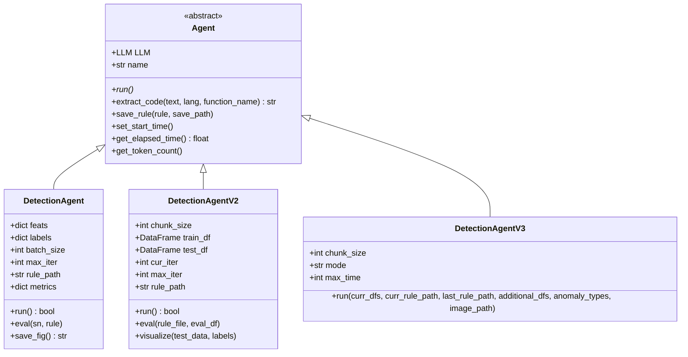
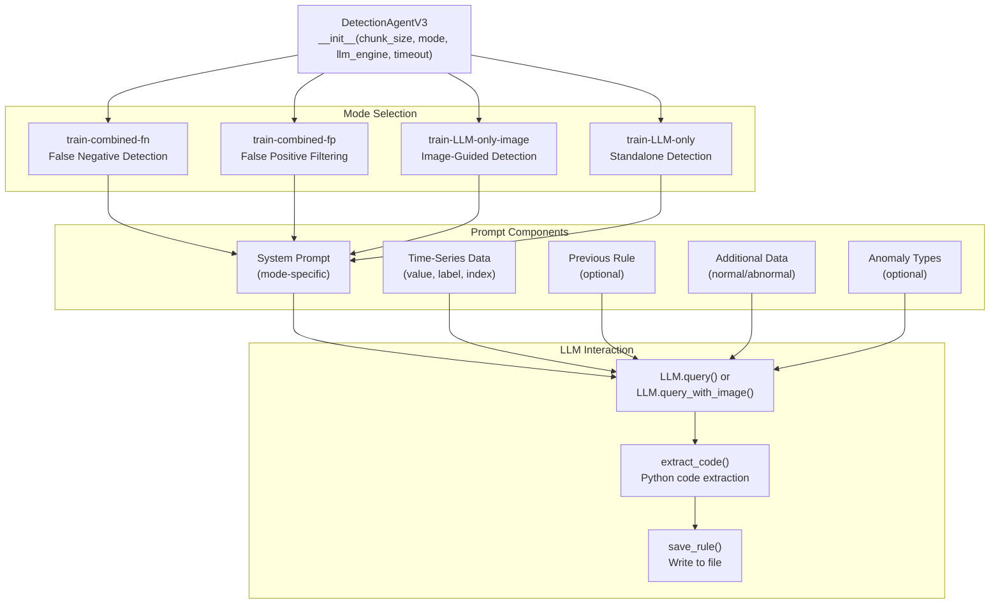
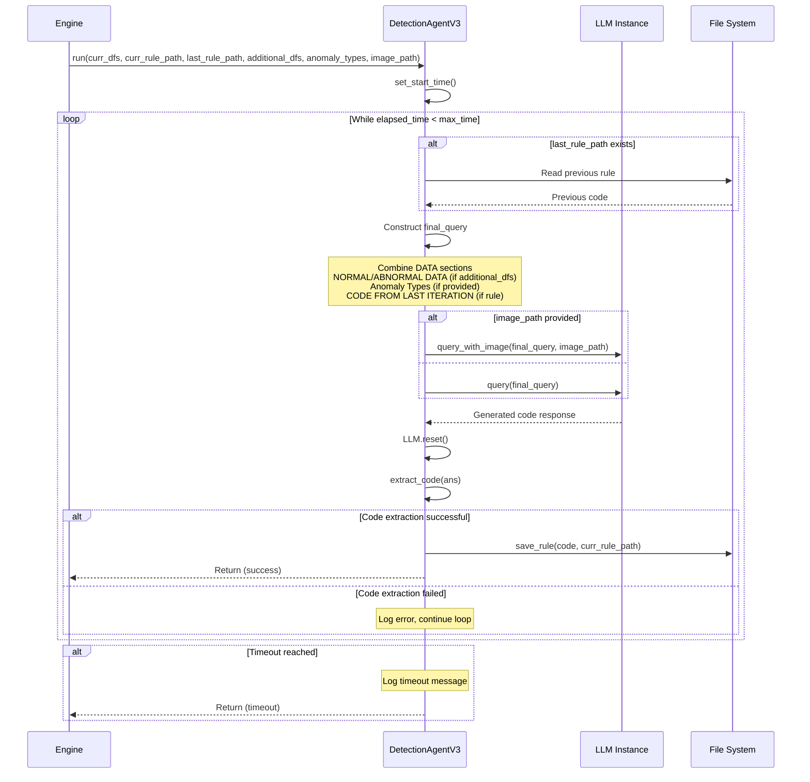

<!-- source: DeepWiki mcp.deepwiki.com · repo microsoft/argos · page 4.4 Detection Agent · fetched 2026-10-26 -->

# Detection Agent

<details>
<summary>Relevant source files</summary>

The following files were used as context for generating this wiki page:

- [agent/agent.py](agent/agent.py)
- [agent/detection_agent.py](agent/detection_agent.py)

</details>


The Detection Agent is the core component responsible for generating Python-based anomaly detection rules using Large Language Models (LLMs). It constructs specialized prompts for different operational modes, iteratively queries the LLM with time-series data, extracts generated Python code, and saves detection rules that implement the `inference` function. This agent is central to Argos's ability to translate natural language understanding into executable anomaly detection logic.

For information about executing and validating generated rules, see [Repair Agent](#4.5). For performance evaluation and iterative refinement, see [Review Agent](#4.6). For visual analysis capabilities, see [Image Agent](#4.7).

## Overview

The Detection Agent exists in three versions within [agent/detection_agent.py](), with `DetectionAgentV3` being the primary implementation used in production. All versions inherit from the base `Agent` class defined in [agent/agent.py:174-213]() and compose an `LLM` instance for Azure OpenAI interactions.



**Sources:** [agent/detection_agent.py:19-283](), [agent/detection_agent.py:285-509](), [agent/detection_agent.py:513-786](), [agent/agent.py:174-213]()

## DetectionAgentV3 Architecture

`DetectionAgentV3` is the current production implementation, initialized at [agent/detection_agent.py:513-700](). It supports four distinct operational modes, each with tailored prompt engineering to optimize rule generation for specific scenarios.

### Operational Modes

The agent's behavior is determined by the `mode` parameter, which configures specialized system prompts for different use cases:

| Mode | Purpose | Prompt Location | Key Characteristics |
|------|---------|----------------|---------------------|
| `train-LLM-only` | Standalone rule generation | [agent/detection_agent.py:657-686]() | Generates rules from scratch using only time-series data |
| `train-LLM-only-image` | Image-guided rule generation | [agent/detection_agent.py:604-648]() | Incorporates visual anomaly type descriptions to guide rule creation |
| `train-combined-fn` | False negative compensation | [agent/detection_agent.py:520-560]() | Creates rules to detect anomalies missed by existing models |
| `train-combined-fp` | False positive compensation | [agent/detection_agent.py:562-602]() | Creates rules to filter out false alarms from existing models |



**Sources:** [agent/detection_agent.py:513-700]()

### Prompt Engineering

Each operational mode constructs a specialized system prompt that defines the LLM's task, constraints, and expected output format. All modes share common requirements but emphasize different objectives:

#### Common Prompt Elements

All prompts include these standard components:

1. **Task Definition**: Determine if time-series patterns are abnormal (label=1) or normal (label=0)
2. **Data Format**: Each sample is a tuple of `(value, label, index)` with `chunk_size` continuous samples
3. **Function Signature**: Must generate `def inference(sample: np.ndarray) -> np.ndarray`
4. **Constraints**:
   - No hardcoding of label information [agent/detection_agent.py:553-554]()
   - No hardcoding of anomaly indices [agent/detection_agent.py:596-597]()
   - Must handle variable-size samples [agent/detection_agent.py:596-597]()
   - Code must be wrapped in ` ```python ` markers [agent/detection_agent.py:558-559]()

#### Mode-Specific Prompt Differences

**train-combined-fn** [agent/detection_agent.py:520-560]():
- Focuses on detecting false negatives from existing models
- Receives abnormal data that models missed
- Optionally receives normal data to avoid creating new false positives
- Emphasizes: "You should only write rules to detect false negatives"

**train-combined-fp** [agent/detection_agent.py:562-602]():
- Focuses on filtering false positives from existing models
- Receives normal data incorrectly flagged as abnormal
- Optionally receives abnormal data to avoid affecting true positives
- Emphasizes: "You should only write rules to detect false positives (i.e. returns normal labels)"

**train-LLM-only-image** [agent/detection_agent.py:604-648]():
- Incorporates high-level anomaly type descriptions from visual analysis
- Includes special section: `##### Anomaly Types BEGIN/END #####`
- Requires matching observed anomalies to predefined types
- Emphasizes: "You should think about which anomaly type this anomaly segment corresponds to"

**train-LLM-only** [agent/detection_agent.py:657-686]():
- Simplest prompt for standalone operation
- No additional context beyond time-series data
- Iteratively refines rules to reduce false positives

**Sources:** [agent/detection_agent.py:520-686]()

### Rule Generation Process

The `run()` method at [agent/detection_agent.py:701-786]() orchestrates the rule generation workflow:



**Sources:** [agent/detection_agent.py:701-786]()

#### Prompt Construction Logic

The query construction at [agent/detection_agent.py:722-758]() follows a structured approach:

1. **Primary Data** [agent/detection_agent.py:723-725](): Iterate through `curr_dfs`, format each as `##### DATA {i}` with DataFrame string representation
2. **Additional Context** [agent/detection_agent.py:726-742](): If `additional_dfs` provided:
   - For `train-combined-fn`: Add as `##### NORMAL DATA {i}`
   - For `train-combined-fp`: Add as `##### ABNORMAL DATA {i}`
3. **Anomaly Types** [agent/detection_agent.py:743-754](): If provided, wrap in `##### Anomaly Types BEGIN/END #####` markers
4. **Previous Rule** [agent/detection_agent.py:756-757](): If `last_rule_path` exists, append as `##### CODE FROM LAST ITERATION`

#### Code Extraction

The `extract_code()` method inherited from [agent/agent.py:185-197]() uses regex to extract Python code blocks:

- Searches for pattern: ` ```python ... ``` `
- Validates presence of `function_name` (default: `"def inference"`)
- Returns cleaned code without markdown delimiters
- Raises `ValueError` if function not found in extracted code

**Sources:** [agent/agent.py:185-197](), [agent/detection_agent.py:770-779]()

### Timeout and Iteration Control

The agent implements timeout protection to prevent infinite loops:

- `max_time` parameter (in seconds) set during initialization [agent/detection_agent.py:698]()
- Converted from minutes: `self.max_time = timeout * 60`
- Main loop condition: `while self.get_elapsed_time() < self.max_time` [agent/detection_agent.py:714]()
- On timeout, logs warning and returns without saving rule [agent/detection_agent.py:781-785]()

The `set_start_time()` and `get_elapsed_time()` methods from [agent/agent.py:204-209]() track execution duration.

**Sources:** [agent/detection_agent.py:698](), [agent/detection_agent.py:714](), [agent/detection_agent.py:781-785](), [agent/agent.py:204-209]()

## Previous Versions

### DetectionAgent (V1)

The original implementation at [agent/detection_agent.py:19-283]() was designed for specific InfiniBand network traffic anomaly detection. Key characteristics:

- **Domain-Specific**: Hardcoded for InfiniBand networking KBytes data (20 integer lists)
- **Validation-Based**: Split data into validation (70%) and test sets
- **Batch Processing**: Processes `batch_size=8` samples per iteration [agent/detection_agent.py:59]()
- **Base Model Integration**: Uses sklearn's `IsolationForest` as baseline [agent/detection_agent.py:116-121]()
- **Iterative Refinement**: Up to `max_iter=5` iterations [agent/detection_agent.py:60]()
- **Function Name**: Generates `is_negative(sample: np.ndarray) -> bool` (boolean return)
- **Visualization**: Creates performance plots with precision/recall metrics [agent/detection_agent.py:136-164]()

This version is deprecated but retained for reference.

**Sources:** [agent/detection_agent.py:19-283]()

### DetectionAgentV2

The intermediate version at [agent/detection_agent.py:285-509]() introduced several improvements:

- **Configurable Chunk Size**: `chunk_size=2500` parameter [agent/detection_agent.py:287]()
- **CSV-Based Input**: Reads from CSV files with DataFrame processing [agent/detection_agent.py:323-330]()
- **Chunked Processing**: Processes data in fixed-size segments [agent/detection_agent.py:378-380]()
- **Error Recovery**: Handles execution errors and retries [agent/detection_agent.py:401-408]()
- **Visualization**: Generates time-series plots with anomaly highlighting [agent/detection_agent.py:460-497]()
- **Function Signature**: Generates `inference(sample: np.ndarray) -> np.ndarray` (array return)

This version introduced the modern `inference` function signature but lacked multi-mode support. It serves as the foundation for V3's architecture.

**Sources:** [agent/detection_agent.py:285-509]()

## Integration with Other Components

The Detection Agent is invoked by the `Engine` during training iterations. The typical call pattern:

```python
# From Engine's perspective
detection_agent = DetectionAgentV3(
    chunk_size=chunk_size,
    mode=mode,  # e.g., "train-LLM-only"
    llm_engine="gpt-4o",
    timeout=150
)

detection_agent.set_start_time()
detection_agent.run(
    curr_dfs=[train_data_chunk],
    curr_rule_path="/path/to/rule.py",
    last_rule_path="/path/to/previous_rule.py",  # optional
    additional_dfs=[normal_or_abnormal_data],    # optional
    anomaly_types=image_agent_output,             # optional
    image_path="/path/to/chart.png"               # optional
)
```

The generated rule file contains a complete Python module with:
- Import statements for required libraries
- The `inference()` function definition
- Comments describing normal and abnormal patterns
- Conditional logic implementing detection rules

**Sources:** [agent/detection_agent.py:513-700](), [agent/detection_agent.py:701-786]()

## Configuration and Initialization

### Constructor Parameters

The `DetectionAgentV3.__init__()` at [agent/detection_agent.py:514-700]() accepts:

| Parameter | Type | Default | Description |
|-----------|------|---------|-------------|
| `chunk_size` | `int` | Required | Number of continuous samples in each data segment |
| `mode` | `str` | `"train-LLM-only"` | Operational mode determining prompt strategy |
| `llm_engine` | `str` | `"gpt-4o"` | Azure OpenAI model name |
| `timeout` | `int` | `150` | Maximum execution time in minutes |

### LLM Configuration

The agent creates an `LLM` instance with specific parameters at [agent/detection_agent.py:691-696]():

- `system_prompt`: Mode-specific prompt (see sections above)
- `temperature`: `0.75` for controlled creativity
- `past_message_num`: `10` messages retained in conversation history
- `engine`: Forwarded from constructor parameter

**Sources:** [agent/detection_agent.py:514-700](), [agent/detection_agent.py:691-696]()

## Key Methods Reference

### `run(curr_dfs, curr_rule_path, last_rule_path, additional_dfs, anomaly_types, image_path)`

Primary execution method at [agent/detection_agent.py:701-786]().

**Parameters:**
- `curr_dfs`: List of DataFrames containing current time-series data
- `curr_rule_path`: File path where generated rule will be saved
- `last_rule_path`: Optional path to previous iteration's rule for refinement
- `additional_dfs`: Optional list of normal/abnormal data for combined modes
- `anomaly_types`: Optional string with high-level anomaly descriptions
- `image_path`: Optional path to visualization for image-based mode

**Returns:** None (side effect: saves rule to `curr_rule_path`)

### `extract_code(text, lang, function_name)`

Inherited from base `Agent` class at [agent/agent.py:185-197]().

Extracts code blocks from LLM responses using regex pattern matching for markdown code fences.

### `save_rule(rule, save_path)`

Inherited from base `Agent` class at [agent/agent.py:199-202]().

Writes generated rule to specified file path and logs the action.

**Sources:** [agent/detection_agent.py:701-786](), [agent/agent.py:185-197](), [agent/agent.py:199-202]()

---

