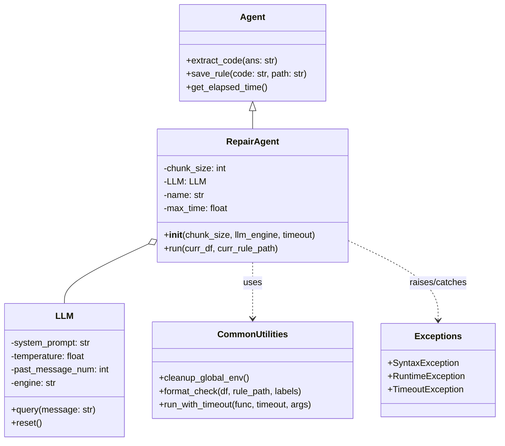
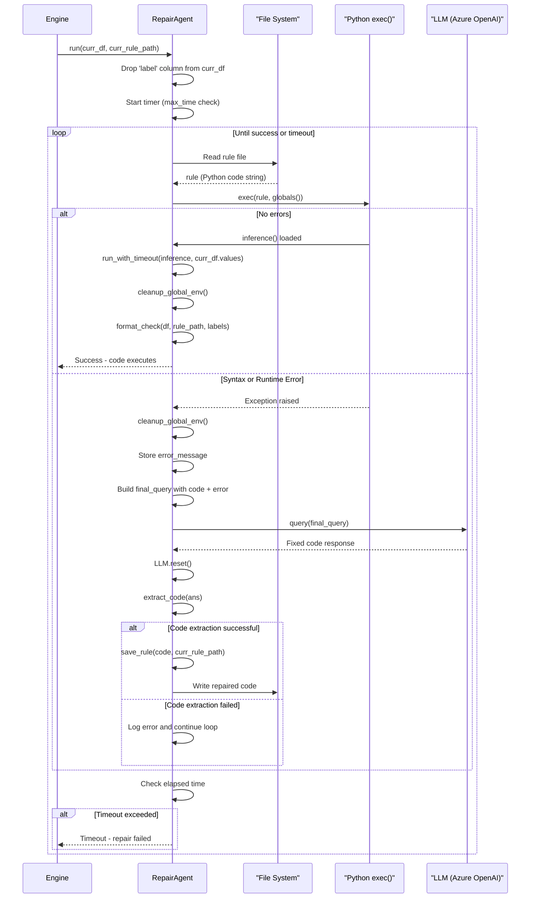
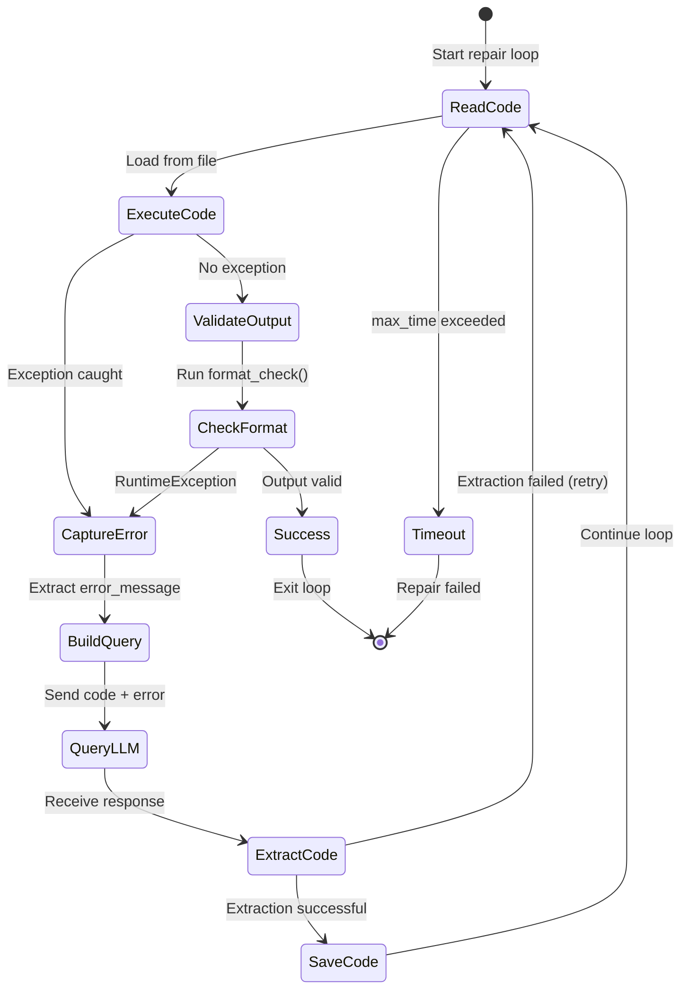
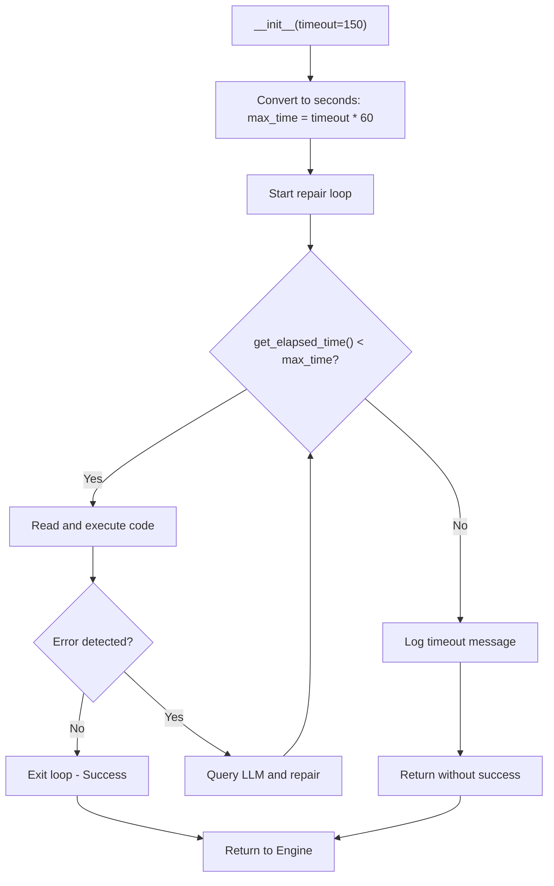
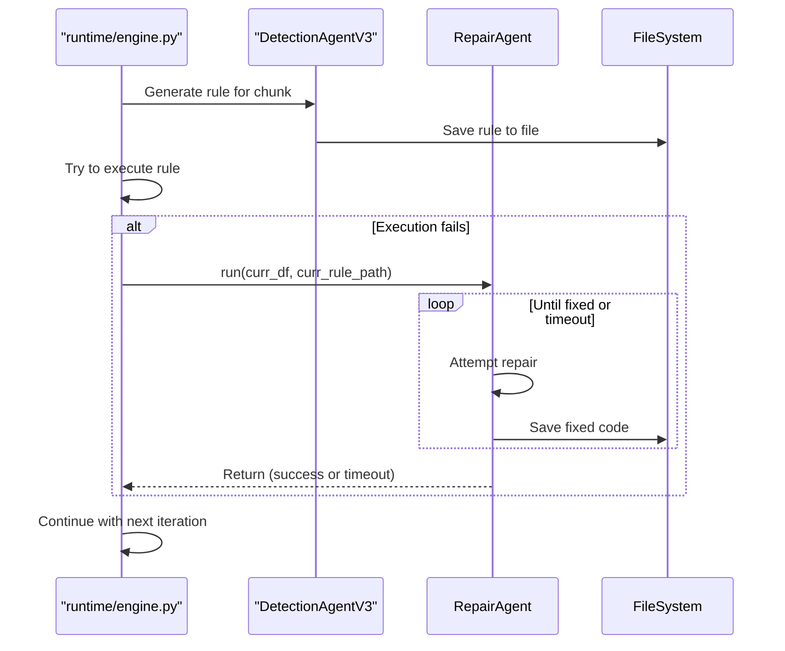

<!-- source: DeepWiki mcp.deepwiki.com · repo microsoft/argos · page 4.5 Repair Agent · fetched 2026-10-26 -->

# Repair Agent

<details>
<summary>Relevant source files</summary>

The following files were used as context for generating this wiki page:

- [agent/repair_agent.py](agent/repair_agent.py)
- [common/common.py](common/common.py)
- [common/exception.py](common/exception.py)

</details>


This document describes the `RepairAgent` class, which automatically detects and repairs syntax and runtime errors in Python code generated by the Detection Agent. The RepairAgent uses an LLM to iteratively fix code issues until the code executes successfully or a timeout is reached.

For information about the agent that generates the initial detection rules, see [Detection Agent](#4.4). For the base agent infrastructure, see [Base Agent and LLM Integration](#4.3). For error types handled by the repair process, see [Exception Types](#5.2).

## Overview

The `RepairAgent` is responsible for ensuring that generated detection rules are executable and produce valid output. When the Detection Agent generates a rule that contains syntax errors or raises runtime exceptions, the RepairAgent automatically attempts to fix these issues by:

1. Executing the code to detect errors
2. Extracting error messages and stack traces
3. Querying an LLM with the code and error details
4. Extracting and saving the repaired code
5. Re-validating the fixed code

This repair loop continues until either the code executes successfully or the maximum time limit is reached.

**Sources:** [agent/repair_agent.py:1-117]()

## Class Structure and Initialization



**Sources:** [agent/repair_agent.py:12-48](), [agent/agent.py:7](), [common/common.py:279-319](), [common/exception.py:1-18]()

### Initialization Parameters

The `RepairAgent.__init__` method accepts three parameters:

| Parameter | Type | Default | Description |
|-----------|------|---------|-------------|
| `chunk_size` | int | required | The size of data chunks processed by the inference function. Used in the system prompt to specify input shape. |
| `llm_engine` | str | `"gpt-4o"` | The Azure OpenAI model to use for code repair (e.g., `"gpt-4o"`, `"gpt-4-32k"`, `"gpt-35-turbo-16k"`). |
| `timeout` | int | `150` | Maximum time in minutes for the repair process. Converted to seconds and stored in `max_time`. |

The initialization process creates an `LLM` instance with a specialized system prompt that instructs the model on how to fix Python code for the `inference` function. The LLM is configured with:
- Temperature: `0.75` (moderate creativity for diverse repair strategies)
- Past message retention: `10` messages (maintains context of previous repair attempts)

**Sources:** [agent/repair_agent.py:13-48]()

### System Prompt Structure

The repair agent's system prompt [agent/repair_agent.py:15-37]() defines three key responsibilities:

1. **Function Specification**: Describes the expected signature `inference(sample: np.ndarray) -> np.ndarray` where input has shape `(chunk_size, 2)` and output has shape `(chunk_size,)`.

2. **Output Format Requirements**: Mandates that fixed code must be wrapped in triple backticks with `python` language specifier, used exactly once.

3. **Repair Constraints**: Instructs the LLM to only fix errors without changing unrelated logic, preserving the original detection intent.

**Sources:** [agent/repair_agent.py:15-37]()

## Repair Process Workflow

The `RepairAgent.run` method implements the core repair loop. The following sequence diagram illustrates the detailed workflow:



**Sources:** [agent/repair_agent.py:50-117](), [common/common.py:288-319]()

### Repair Loop Steps

The repair process [agent/repair_agent.py:60-116]() follows these steps:

1. **Data Preparation** [agent/repair_agent.py:54-56](): Removes the `label` column if present, since the inference function should only receive value and index columns.

2. **Code Loading** [agent/repair_agent.py:65-66](): Reads the current rule from the file system into a string.

3. **Code Execution** [agent/repair_agent.py:70-75](): 
   - Uses `exec(rule, globals())` to load the code into the Python runtime
   - Calls `run_with_timeout(inference, TIMEOUT_INFERENCE, curr_df.values)` to execute with timeout protection
   - Cleans up the global environment after execution

4. **Validation** [agent/repair_agent.py:75](): Calls `format_check(curr_df, curr_rule_path, labels)` to ensure output shape matches input.

5. **Error Handling** [agent/repair_agent.py:76-88](): If any exception occurs, captures the error message and proceeds to repair.

6. **LLM Query Construction** [agent/repair_agent.py:91-96](): Builds a query containing:
   ```
   ##### CODE
   [original code]
   ##### ERROR FROM EXECUTING CODE, PLEASE FIX IT
   [error message]
   ```

7. **Code Extraction** [agent/repair_agent.py:103-109](): Attempts to extract fixed code from the LLM response. If extraction fails, logs the failure and retries.

8. **Code Persistence** [agent/repair_agent.py:110](): Saves the repaired code back to the rule file.

**Sources:** [agent/repair_agent.py:50-117]()

## Error Detection and Validation

The RepairAgent handles three categories of errors during code execution:

### Error Detection Mechanism



**Sources:** [agent/repair_agent.py:60-116]()

### Error Categories

| Error Type | Detection Point | Handling |
|------------|----------------|----------|
| **Syntax Errors** | `exec(rule, globals())` [agent/repair_agent.py:70]() | Caught as generic exception, error message sent to LLM |
| **Runtime Errors** | `inference(curr_df.values)` [agent/repair_agent.py:72]() | Caught as generic exception, full traceback sent to LLM |
| **Format Errors** | `format_check()` [agent/repair_agent.py:75]() | Raises `RuntimeException` when output length ≠ input length |
| **Timeout Errors** | `run_with_timeout()` [agent/repair_agent.py:72]() | Currently returns None, but designed for timeout handling |

**Sources:** [agent/repair_agent.py:70-78](), [common/common.py:279-286](), [common/exception.py:1-18]()

### Format Validation

The `format_check` function [common/common.py:279-286]() ensures that:
- The output `labels` array has the same length as the input dataframe
- If validation fails, raises `RuntimeException` with diagnostic information including the dataframe and rule path

**Sources:** [common/common.py:279-286]()

### Environment Cleanup

The `cleanup_global_env` function [common/common.py:300-319]() is called after each execution attempt [agent/repair_agent.py:74]() to:
- Remove dynamically loaded functions and variables from the global namespace
- Prevent namespace pollution between repair iterations
- Ensure clean state for subsequent code execution

Note: The current implementation [common/common.py:300-301]() has an early return, effectively disabling cleanup. This appears to be a design decision to simplify debugging or avoid issues with essential global variables.

**Sources:** [common/common.py:300-319](), [agent/repair_agent.py:74]()

## LLM Integration

The RepairAgent's interaction with the LLM follows a specific pattern designed for effective code repair:

### Query Structure

The query sent to the LLM [agent/repair_agent.py:91-96]() consists of two sections:

1. **Code Section**: Prefixed with `##### CODE`, contains the full Python code that failed
2. **Error Section**: Prefixed with `##### ERROR FROM EXECUTING CODE, PLEASE FIX IT`, contains the exception message and traceback

This structured format helps the LLM understand both the code context and the specific issue to fix.

### Response Processing

After receiving the LLM's response [agent/repair_agent.py:98-109]():

1. **Query Execution**: Calls `self.LLM.query(final_query)` to get the fixed code
2. **Context Reset**: Calls `self.LLM.reset()` to clear conversation history (prevents message bloat)
3. **Code Extraction**: Uses inherited `self.extract_code(ans)` method to parse code blocks from markdown
4. **Error Recovery**: If extraction fails, logs the failure and continues the loop without saving

**Sources:** [agent/repair_agent.py:91-109]()

### LLM Configuration

The `LLM` instance is configured with specific parameters [agent/repair_agent.py:38-43]():

```python
self.LLM = LLM(
    system_prompt=repair_agent_prompt.strip(),
    temperature=0.75,
    past_message_num=10,
    engine=llm_engine,
)
```

- **Temperature 0.75**: Balances determinism with creativity, allowing diverse repair strategies
- **Past message retention 10**: Maintains limited conversation history to provide context without exceeding token limits
- **Engine flexibility**: Supports multiple models (gpt-4o, gpt-4-32k, gpt-35-turbo-16k)

**Sources:** [agent/repair_agent.py:38-43]()

## Timeout and Termination

The RepairAgent implements time-based termination to prevent infinite repair loops:

### Time Management



**Sources:** [agent/repair_agent.py:45-48](), [agent/repair_agent.py:60](), [agent/repair_agent.py:112-116]()

### Timeout Behavior

1. **Initialization** [agent/repair_agent.py:45](): The `timeout` parameter (in minutes) is converted to seconds: `self.max_time = timeout * 60`

2. **Loop Condition** [agent/repair_agent.py:60](): Each iteration checks `while self.get_elapsed_time() < self.max_time`

3. **Timeout Handling** [agent/repair_agent.py:112-116](): When time expires:
   - Logs: `"[RepairAgent] Time out to repair the code in {curr_rule_path}"`
   - Returns without raising an exception
   - The Engine must handle the case where the rule file still contains broken code

4. **Default Timeout**: 150 minutes (2.5 hours) provides ample time for complex repairs while preventing indefinite execution

**Sources:** [agent/repair_agent.py:45-48](), [agent/repair_agent.py:60](), [agent/repair_agent.py:112-116]()

### Success Conditions

The repair loop exits successfully when [agent/repair_agent.py:80-84]():
- No `error_message` is set (code executed without exceptions)
- `format_check` passed (output shape is valid)
- Logs: `"[RepairAgent] The code in {curr_rule_path} has no error."`

**Sources:** [agent/repair_agent.py:80-84]()

## Integration with Engine

The RepairAgent is invoked by the Engine during the training pipeline when generated rules fail to execute:

### Invocation Context



**Sources:** Based on system architecture from overview diagrams

### Data Flow

The RepairAgent receives two inputs from the Engine:

1. **`curr_df`** (pandas.DataFrame): The current data chunk being processed, containing:
   - `value` column: Time-series values
   - `index` column: Temporal indices
   - Optionally `label` column (removed by RepairAgent before execution)

2. **`curr_rule_path`** (str): File system path to the rule file that needs repair

The RepairAgent modifies the rule file in place, allowing the Engine to immediately re-execute the repaired code.

**Sources:** [agent/repair_agent.py:50-56]()

### Coordination with Other Agents

The RepairAgent operates between the Detection Agent and Review Agent in the pipeline:

| Agent | Relationship | Description |
|-------|--------------|-------------|
| **Detection Agent** | Predecessor | Generates initial rules that may contain errors |
| **Repair Agent** | Current | Fixes errors in generated code |
| **Review Agent** | Successor | Evaluates performance of successfully executing rules |

This separation of concerns ensures that each agent has a focused responsibility: generation, repair, or evaluation.

**Sources:** Based on architecture overview and [agent/repair_agent.py:1-117]()

---

