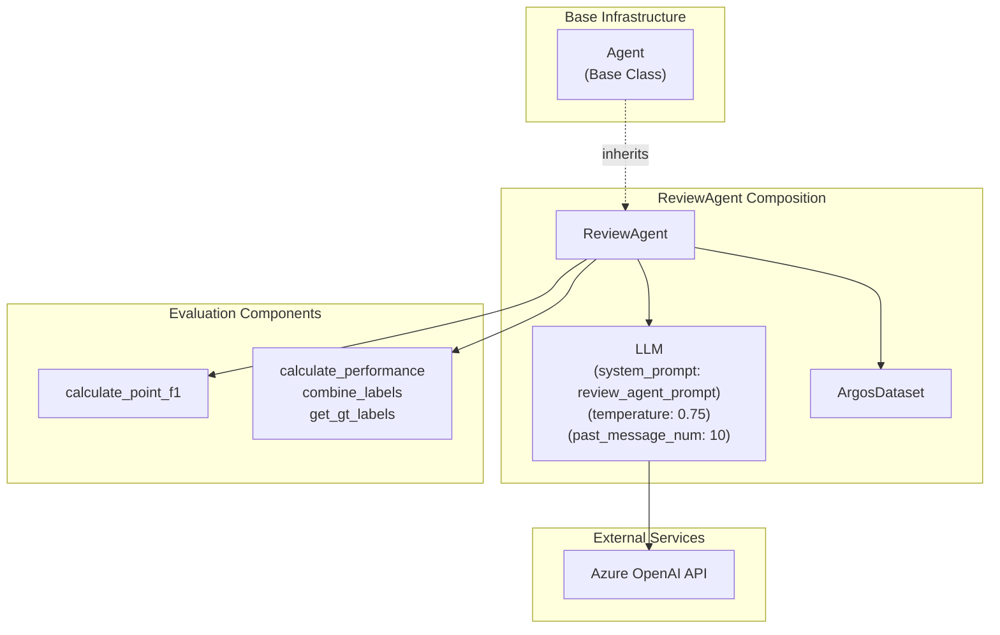
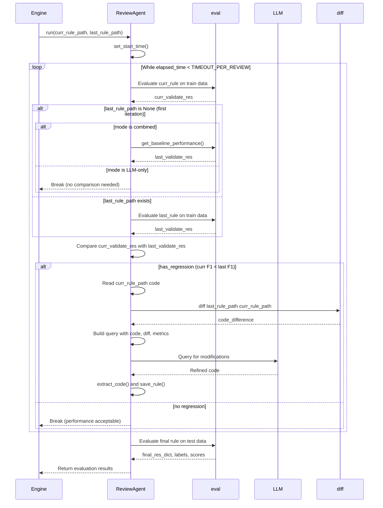
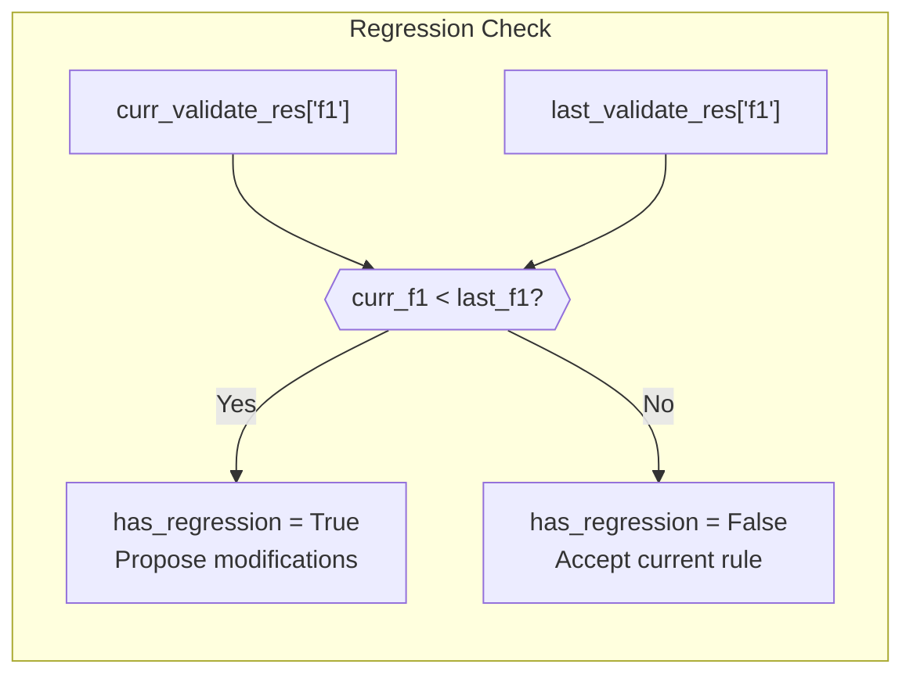
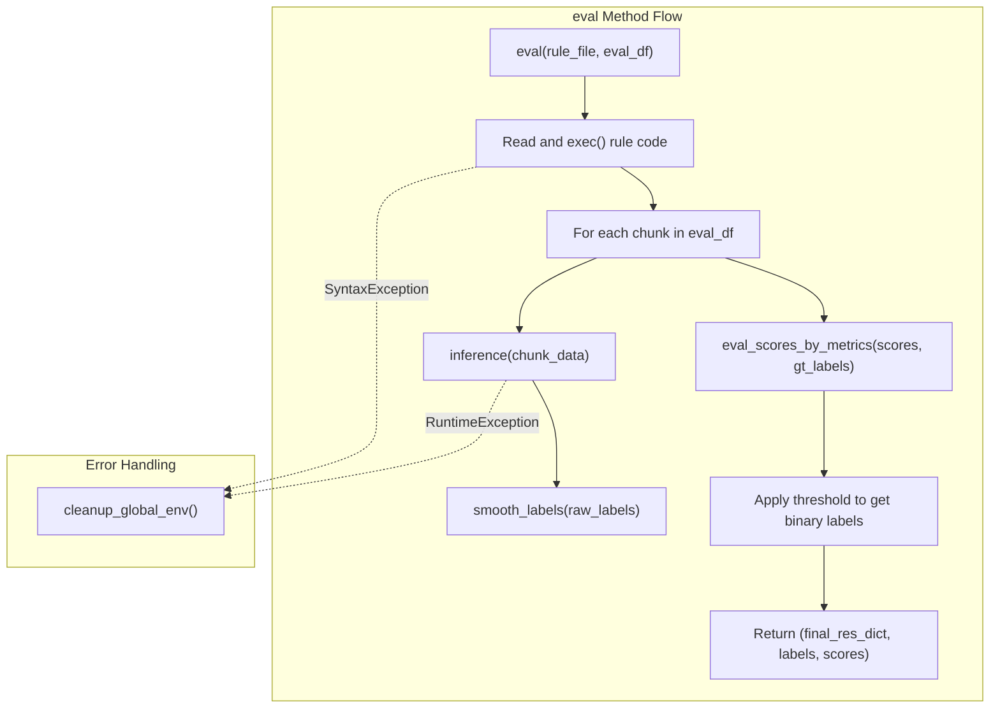
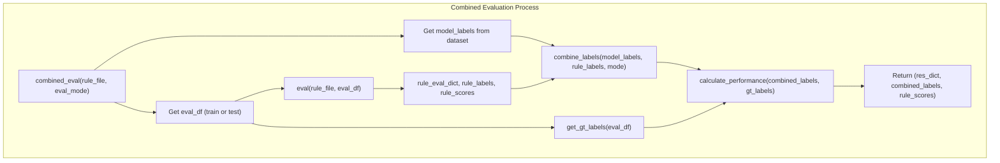
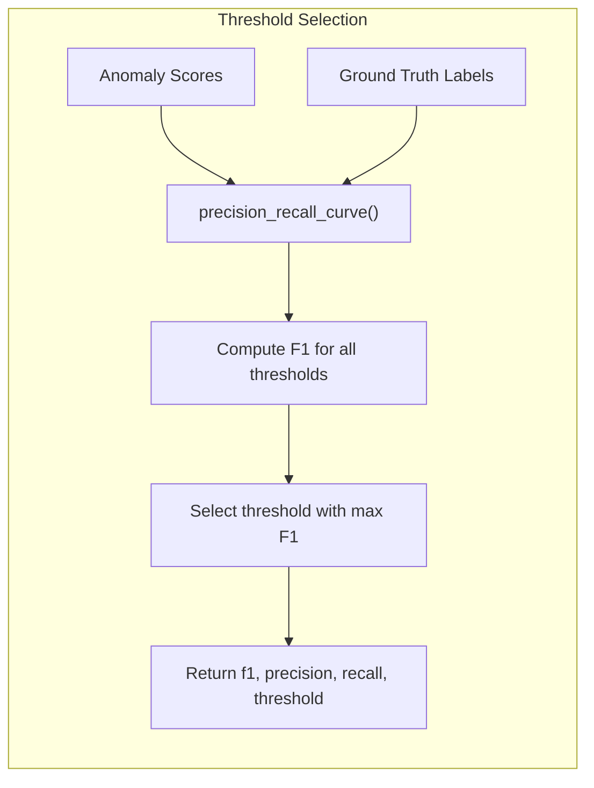
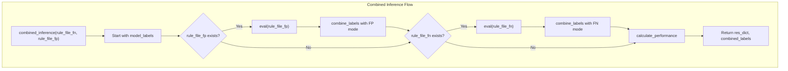

<!-- source: DeepWiki mcp.deepwiki.com · repo microsoft/argos · page 4.6 Review Agent · fetched 2026-10-26 -->

# Review Agent

Relevant source files

The following files were used as context for generating this wiki page:

- [agent/review_agent.py](agent/review_agent.py)
- [datasets/dataset.py](datasets/dataset.py)
- [eval_metrics/point_f1.py](eval_metrics/point_f1.py)

## Overview

The `ReviewAgent` is responsible for evaluating the performance of generated detection rules and implementing iterative refinement through LLM-based code modifications. Its primary function is to detect performance regressions during the rule generation process and automatically propose fixes to maintain or improve detection quality.

For information about how rules are initially generated, see [Detection Agent](#4.4). For information about how the best rule is selected after review, see [Rule Selection](#4.10).

**Sources:** [agent/review_agent.py:25-139]()

## Architecture

### Class Definition

The `ReviewAgent` class inherits from the base `Agent` class and composes an `LLM` instance specifically configured for code review tasks.

**Sources:** [agent/review_agent.py:25-139]()

### Initialization Parameters

The `ReviewAgent` is initialized with the following parameters:

| Parameter | Type | Purpose |
|-----------|------|---------|
| `chunk_size` | int | Size of data chunks for evaluation |
| `dataset` | ArgosDataset | Dataset instance providing train/test data |
| `dataset_name` | str | Name of the dataset (optional) |
| `model_res_path` | str | Path to model results for combined modes |
| `mode` | str | Operating mode (e.g., "train-LLM-only", "train-combined-fp") |
| `llm_engine` | str | LLM model to use (default: "gpt-4o") |
| `timeout` | int | Maximum time in minutes for review process |

**Sources:** [agent/review_agent.py:26-138]()

## Review Process

### Main Review Loop

The `run` method implements the core review loop that continuously evaluates and refines rules until no performance regression is detected or a timeout occurs.

**Sources:** [agent/review_agent.py:140-314]()

### Performance Regression Detection

The agent detects regression by comparing F1 scores between the current and previous rule versions:

The regression detection focuses exclusively on the F1 score to determine whether the current rule performs worse than the previous version.

**Sources:** [agent/review_agent.py:220-234]()

### LLM-Based Code Refinement

When regression is detected, the agent constructs a detailed query for the LLM containing:

1. **Current Code**: The complete rule code wrapped in `##### CODE`
2. **Code Difference**: Output from Unix `diff` command comparing previous and current rules
3. **Performance Metrics**: F1, precision, and recall with deltas from previous version

The LLM receives different system prompts based on the operational mode.

**Sources:** [agent/review_agent.py:236-280]()

## Evaluation Mechanisms

### Standalone Evaluation

The `eval` method evaluates a rule file on a given dataset and returns performance metrics.

The evaluation process:
1. Loads and executes the rule code using `exec(rule, globals())`
2. Iterates through data chunks of size `chunk_size`
3. Calls the `inference` function with `run_with_timeout` for each chunk
4. Applies label smoothing with a window size of 3
5. Calculates metrics using `calculate_point_f1`
6. Returns results with threshold applied

**Sources:** [agent/review_agent.py:317-382]()

### All-in-One Evaluation

For datasets in "all-in-one" mode, the `eval_all_in_one` method evaluates the rule across multiple time series and aggregates results.

**Sources:** [agent/review_agent.py:384-404]()

### Combined Evaluation

For combined modes (train-combined-fp/fn), the `combined_eval` method merges rule predictions with existing model predictions:

The `combine_labels` function merges predictions based on the mode:
- **train-combined-fp**: Rule labels override model labels to remove false positives (model predicted anomaly, rule predicts normal)
- **train-combined-fn**: Rule labels supplement model labels to add true positives (model predicted normal, rule predicts anomaly)

**Sources:** [agent/review_agent.py:423-462](), [agent/review_agent.py:464-505]()

## Operational Modes

### LLM-Only Modes

For standalone modes (`train-LLM-only`, `train-LLM-only-image`, `eval-LLM-only`, `ablation-detection-only`), the review agent uses a system prompt that focuses on ensuring rules correctly classify abnormal vs. normal samples without regression.

**System Prompt Characteristics:**
- Expects `inference` function that takes `np.ndarray` input
- Compares current performance against previous iteration
- Goal: maintain or improve F1 score
- Can revert changes to previous code in worst case

**Sources:** [agent/review_agent.py:36-73]()

### Combined Modes

For combined modes (`train-combined-fp`, `train-combined-fn`), the system prompt is adapted to account for the interaction between rules and the base deep learning model.

**System Prompt Characteristics:**
- First iteration compares against baseline model performance
- Subsequent iterations compare against previous rule versions
- Goal: ensure combined performance exceeds baseline
- Emphasizes complementary detection with base model

**Sources:** [agent/review_agent.py:74-118]()

## Metrics and Thresholding

### Point F1 Calculation

The agent uses `calculate_point_f1` from the evaluation metrics module to determine optimal thresholds:

The threshold is determined by maximizing the F1 score across all possible threshold values in the precision-recall curve.

**Sources:** [eval_metrics/point_f1.py:5-26](), [agent/review_agent.py:406-421]()

## Timeout Management

The review process implements multiple timeout constraints:

| Timeout Constant | Purpose | Default Value |
|------------------|---------|---------------|
| `TIMEOUT_FIRST_REVIEW` | Maximum time for first iteration review | Defined in agent.agent |
| `TIMEOUT_PER_REVIEW` | Maximum time for entire review process | Configurable at initialization |
| `TIMEOUT_INFERENCE` | Maximum time per inference call | Defined in agent.agent |

If `TIMEOUT_FIRST_REVIEW` is exceeded during the first iteration, a `TimeoutException` is raised. If `TIMEOUT_PER_REVIEW` is exceeded at any point, the review loop terminates with a `TimeoutException`.

**Sources:** [agent/review_agent.py:13-14](), [agent/review_agent.py:282-296]()

## Baseline Performance Retrieval

### One-by-One Mode

For one-by-one datasets in combined mode, `get_baseline_performance` retrieves model-only performance without any rule augmentation:

**Sources:** [agent/review_agent.py:579-598]()

### All-in-One Mode

For all-in-one datasets, `get_baseline_performance_all_in_one` aggregates model performance across all time series in the dataset:

**Sources:** [agent/review_agent.py:600-622]()

## Combined Inference

The `combined_inference` and `combined_inference_all_in_one` methods enable evaluation with both FP and FN rules simultaneously:

This allows the system to apply both false positive reduction and false negative recovery rules in sequence.

**Sources:** [agent/review_agent.py:624-666](), [agent/review_agent.py:507-577]()

## Integration with Dataset

The `ReviewAgent` relies on the `ArgosDataset` for:
- Train/test data splits
- Model predictions (for combined modes)
- Dataset mode detection (one-by-one vs. all-in-one)
- Chunk-based data retrieval

The dataset mode determines which evaluation methods are called:
- `one-by-one`: Uses `eval`, `combined_eval`, `get_baseline_performance`
- `all-in-one`: Uses `eval_all_in_one`, `combined_eval_all_in_one`, `get_baseline_performance_all_in_one`

**Sources:** [agent/review_agent.py:130-134](), [agent/review_agent.py:149-314]()

---

