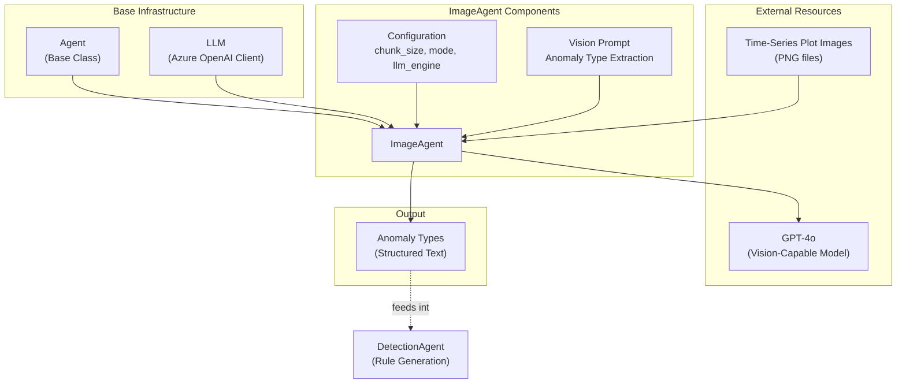
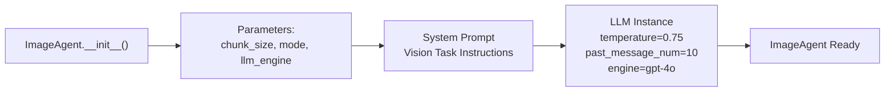
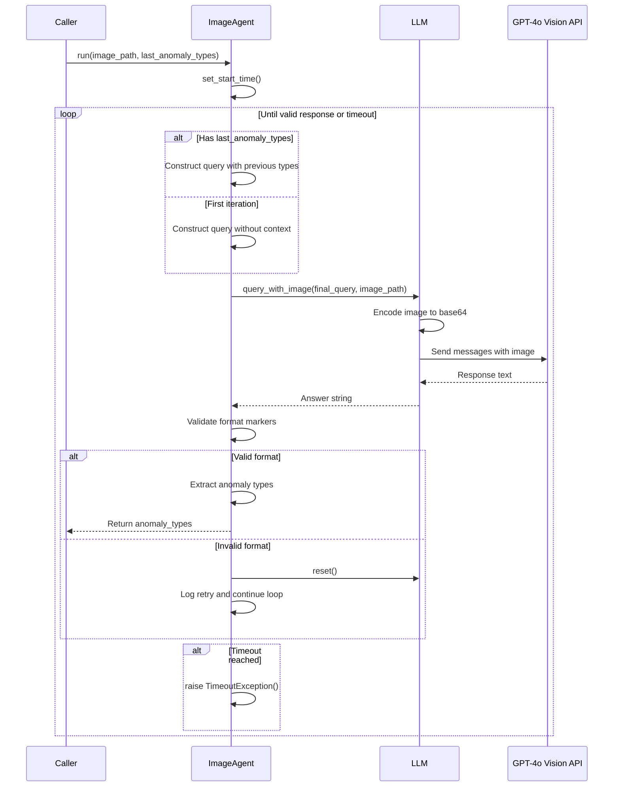
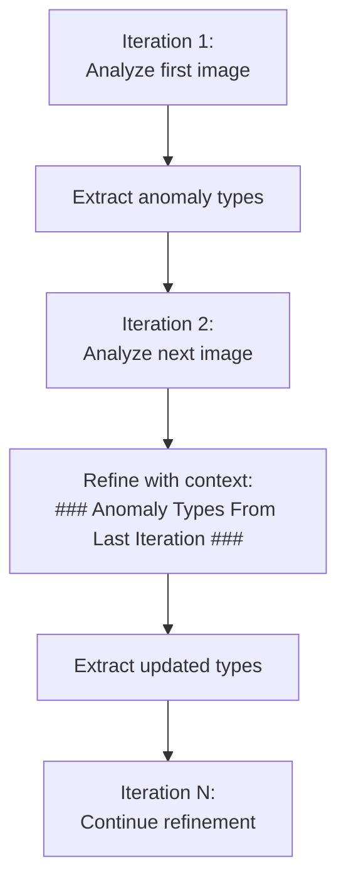
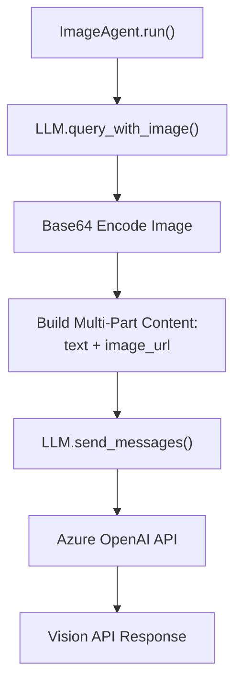
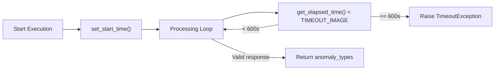

<!-- source: DeepWiki mcp.deepwiki.com · repo microsoft/argos · page 4.7 Image Agent · fetched 2026-10-26 -->

# Image Agent

<details>
<summary>Relevant source files</summary>

The following files were used as context for generating this wiki page:

- [agent/agent.py](agent/agent.py)
- [agent/image_agent.py](agent/image_agent.py)

</details>


## Purpose and Scope

The Image Agent (`ImageAgent`) is a specialized agent that performs visual analysis of time-series plots to extract anomaly type patterns. It uses vision-capable LLM models (GPT-4o) to analyze images of time-series data and generate structured descriptions of anomaly patterns observed in the plots. This agent is primarily used during the `train-LLM-only-image` operational mode to guide rule generation based on visual patterns.

For information about the base agent infrastructure and LLM integration, see [Base Agent and LLM Integration](#4.3). For information about how the Image Agent feeds into rule generation, see [Detection Agent](#4.4).

**Sources:** [agent/image_agent.py:1-97]()

---

## Architecture and Integration

### Position in Agent Ecosystem

The `ImageAgent` inherits from the base `Agent` class and composes an `LLM` instance configured specifically for vision tasks. It operates independently during the image-guided training mode, analyzing visualization plots before the Detection Agent generates rules.



**Sources:** [agent/image_agent.py:13-52](), [agent/agent.py:174-213]()

---

## ImageAgent Class

### Class Definition and Initialization

The `ImageAgent` class is defined in [agent/image_agent.py:13-97]() and implements the `Agent` abstract base class.

| Attribute | Type | Description |
|-----------|------|-------------|
| `chunk_size` | int | Size of the time-series data chunk being analyzed |
| `mode` | str | Operational mode (typically `"train-LLM-only"`) |
| `LLM` | LLM | Vision-capable LLM instance (GPT-4o) |
| `name` | str | Agent identifier: `"ImageAgent"` |

### Initialization Parameters



The initialization configures the LLM with specific parameters tailored for vision tasks:
- **Temperature:** 0.75 (higher than other agents to encourage diverse pattern recognition)
- **Past message number:** 10 (maintains conversation context for iterative refinement)
- **Engine:** `gpt-4o` (required for image input support)

**Sources:** [agent/image_agent.py:14-52]()

---

## Vision Prompt Engineering

### System Prompt Structure

The `ImageAgent` uses a carefully crafted system prompt that defines the vision task, input format, expected output format, and critical constraints. The prompt is constructed in [agent/image_agent.py:17-38]().

#### Prompt Components

| Component | Purpose | Lines |
|-----------|---------|-------|
| Task Definition | Explains the goal of analyzing time-series images | 17-19 |
| Image Format Specification | Describes the plot structure (blue line, red dots) | 19 |
| Output Format | Defines the structured response format with markers | 23-31 |
| Important Constraints | Prevents overfitting and guides pattern refinement | 33-36 |

#### Key Constraints

1. **Concrete Examples Required:** Explanations must include specific metric value changes, frequencies, or durations with concrete values
2. **No Index Information:** Prevents overfitting by prohibiting timestamp, mark, range, or index information in examples
3. **Iterative Refinement:** Supports updating anomaly types from previous iterations while preserving valid patterns
4. **Pattern Merging:** Instructs to consolidate instances of the same anomaly type across multiple figures

**Sources:** [agent/image_agent.py:17-38]()

---

## Execution Flow

### Run Method Workflow

The `run()` method in [agent/image_agent.py:54-96]() orchestrates the image analysis process with iterative refinement capability.



### Method Signature

```python
def run(self, image_path, last_anomaly_types=None) -> str
```

| Parameter | Type | Description |
|-----------|------|-------------|
| `image_path` | str | File path to the time-series plot image (PNG) |
| `last_anomaly_types` | str or None | Anomaly types from previous iteration for refinement |
| **Returns** | str | Extracted anomaly types in structured format |

**Sources:** [agent/image_agent.py:54-96]()

---

## Input and Output Format

### Image Input Requirements

The `ImageAgent` expects time-series plot images with the following characteristics:

- **Format:** PNG image file
- **X-axis:** Timestamp indices
- **Y-axis:** Metric values
- **Visualization:** Blue line for values, red dots marking anomalies
- **Size:** Corresponding to the configured `chunk_size`

The image is encoded to base64 before being sent to the vision API in [agent/agent.py:88-115]().

### Output Format

The agent returns a structured string containing numbered anomaly type descriptions:

```
1. AnomalyType1: Explanation1
2. AnomalyType2: Explanation2
3. AnomalyType3: Explanation3
...
```

#### Output Validation

The response must be wrapped in specific markers for validation:
- **Start marker:** `### Anomaly Types BEGIN ###`
- **End marker:** `### Anomaly Types END ###`

The extraction logic in [agent/image_agent.py:79-84]() parses the content between these markers:

```python
anomaly_types = (
    ans.split("### Anomaly Types BEGIN ###")[1]
    .split("### Anomaly Types END ###")[0]
    .strip()
)
```

**Sources:** [agent/image_agent.py:23-31](), [agent/image_agent.py:79-84](), [agent/agent.py:88-115]()

---

## Iterative Refinement

### Context Preservation

The `ImageAgent` supports iterative refinement through the `last_anomaly_types` parameter. When provided, the agent incorporates previously identified anomaly types into the query context:



### Context Construction

When `last_anomaly_types` is provided, the query is constructed with historical context:

```python
if last_anomaly_types is not None:
    final_query += (
        "### Anomaly Types From Last Iteration ###\n"
        + last_anomaly_types
        + "\n"
    )
```

This enables the LLM to:
- Validate existing anomaly types against new data
- Add examples to existing types
- Remove invalid types that reflect normal patterns
- Introduce new anomaly types from newly observed data

**Sources:** [agent/image_agent.py:62-67]()

---

## LLM Integration

### Vision-Specific Configuration

The `ImageAgent` requires the `gpt-4o` engine for vision capabilities. The base `LLM` class provides the `query_with_image()` method that handles image encoding and API communication.



### Engine Validation

The `query_with_image()` method enforces the GPT-4o requirement:

```python
assert self.engine == "gpt-4o", "Only gpt-4o engine supports image input."
```

This assertion in [agent/agent.py:90]() ensures that vision queries are only attempted with a vision-capable model.

**Sources:** [agent/agent.py:88-115](), [agent/image_agent.py:46-51]()

---

## Error Handling and Timeouts

### Timeout Management

The `ImageAgent` uses a dedicated timeout constant `TIMEOUT_IMAGE` set to 10 minutes (600 seconds) as defined in [agent/agent.py:22]().



### Response Validation Loop

The agent continuously retries until receiving a properly formatted response or reaching the timeout:

1. **Query LLM:** Send image and prompt to vision API
2. **Validate format:** Check for required markers (`### Anomaly Types BEGIN/END ###`)
3. **Extract or retry:** If valid, extract and return; otherwise, reset and retry
4. **Timeout check:** Raise `TimeoutException` if elapsed time exceeds `TIMEOUT_IMAGE`

### Exception Types

| Exception | Condition | Source |
|-----------|-----------|--------|
| `TimeoutException` | Elapsed time >= `TIMEOUT_IMAGE` | [agent/image_agent.py:96]() |
| `AssertionError` | Non-GPT-4o engine used | [agent/agent.py:90]() |

### LLM Reset Between Retries

After each unsuccessful attempt, the agent calls `self.LLM.reset()` in [agent/image_agent.py:72]() to clear the conversation history and start fresh, preventing context pollution from failed attempts.

**Sources:** [agent/image_agent.py:59-96](), [agent/agent.py:22](), [common/exception.py]()

---

## Integration with Detection Agent

### Anomaly Type Usage

The anomaly types extracted by `ImageAgent` are passed to the `DetectionAgent` during image-guided training mode. The Detection Agent incorporates these patterns into its rule generation prompts to create detection rules that align with visually observed anomaly patterns.

**Workflow Integration:**

1. **Image Analysis:** `ImageAgent` analyzes time-series plots
2. **Pattern Extraction:** Returns structured anomaly type descriptions
3. **Rule Generation:** `DetectionAgent` uses these types in its prompts
4. **Guided Detection:** Generated rules target the identified visual patterns

**Sources:** [agent/image_agent.py:54-85]()

---

## Configuration Summary

### Key Constants

| Constant | Value | Location | Purpose |
|----------|-------|----------|---------|
| `TIMEOUT_IMAGE` | 600 seconds | [agent/agent.py:22]() | Maximum execution time for image analysis |
| `temperature` | 0.75 | [agent/image_agent.py:48]() | LLM temperature for pattern diversity |
| `past_message_num` | 10 | [agent/image_agent.py:49]() | Context window for iterative refinement |
| `engine` | `"gpt-4o"` | [agent/image_agent.py:50]() | Vision-capable LLM model |

### Prompt Design Parameters

| Parameter | Value | Purpose |
|-----------|-------|---------|
| Chunk size reference | Dynamic (from init) | Contextualizes image scale |
| Format markers | Fixed strings | Enables reliable parsing |
| Constraint emphasis | IMPORTANT section | Prevents common failure modes |
| Iterative context | Optional section | Supports refinement workflow |

**Sources:** [agent/image_agent.py:14-52](), [agent/agent.py:22]()

---

