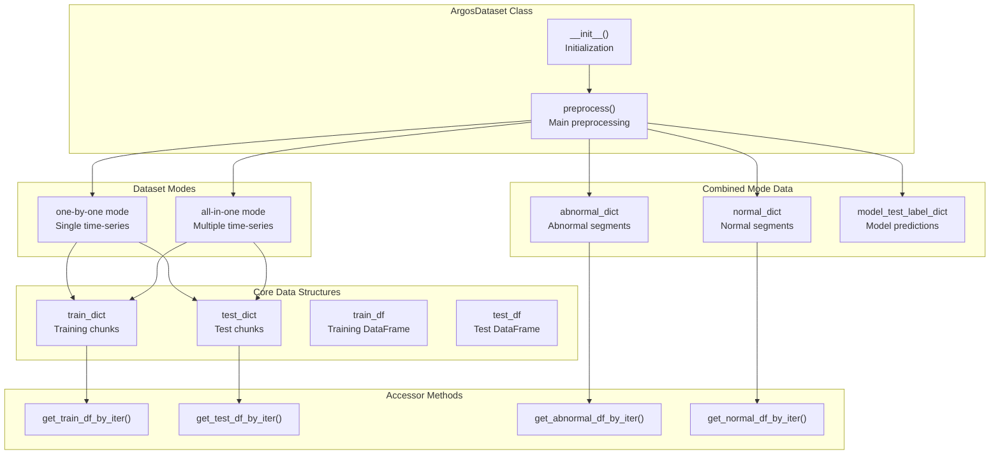
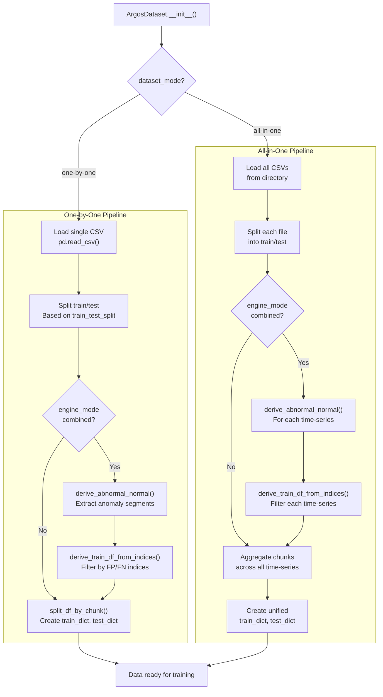
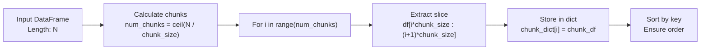
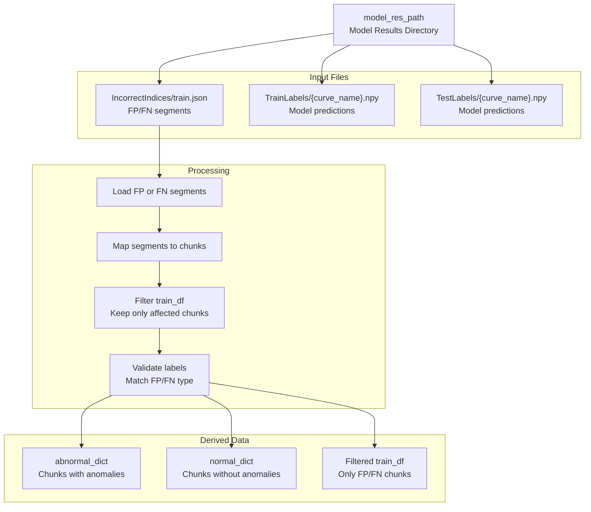
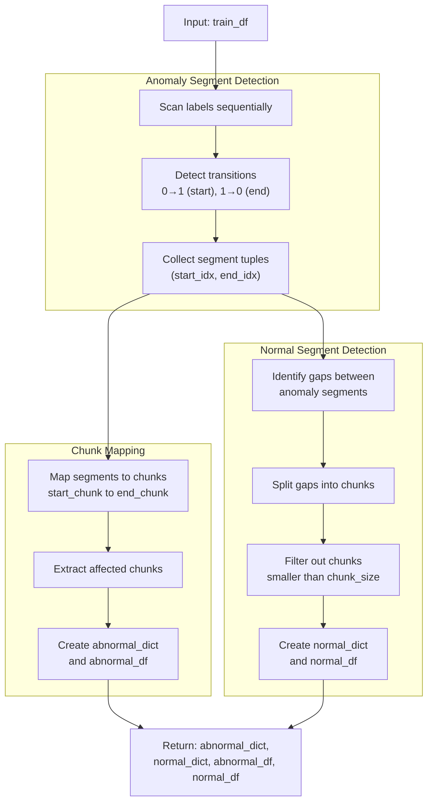

<!-- source: DeepWiki mcp.deepwiki.com · repo microsoft/argos · page 4.8 Dataset Management · fetched 2026-10-26 -->

# Dataset Management

<details>
<summary>Relevant source files</summary>

The following files were used as context for generating this wiki page:

- [README.md](README.md)
- [datasets/dataset.py](datasets/dataset.py)

</details>


## Purpose and Scope

The `ArgosDataset` class provides comprehensive data management capabilities for time-series anomaly detection workflows in Argos. It handles data loading, preprocessing, chunking, train/test splitting, and specialized filtering for combined training modes. This document describes the dataset management implementation, configuration options, and data access patterns.

For information about how datasets are used during training, see [Engine](#4.2). For dataset preparation and preprocessing scripts, see [Dataset Preparation](#2.2).

**Sources:** [datasets/dataset.py:1-560]()

---

## Dataset Structure Overview



**Sources:** [datasets/dataset.py:10-202]()

---

## Dataset Modes

The `ArgosDataset` class supports two distinct operational modes, controlled by the `dataset_mode` parameter:

| Mode | Input Type | Use Case | Training Scope |
|------|-----------|----------|----------------|
| `one-by-one` | Single CSV file | Individual time-series analysis | One rule set per time-series |
| `all-in-one` | Directory of CSVs | Metric-level or cross-metric analysis | One rule set across multiple time-series |

### One-by-One Mode

In `one-by-one` mode, the dataset path must point to a single CSV file containing time-series data with columns: `value`, `label`, and `index`.

```python
# Example initialization for one-by-one mode
dataset = ArgosDataset(
    dataset_path="/path/to/timeseries.csv",
    dataset_mode="one-by-one",
    chunk_size=2500,
    train_test_split=0.7
)
```

The class loads the single CSV file, splits it into training and test sets based on the `train_test_split` ratio, and chunks each set according to the `chunk_size` parameter.

**Sources:** [datasets/dataset.py:39-90](), [README.md:84-93]()

### All-in-One Mode

In `all-in-one` mode, the dataset path must point to a directory containing multiple CSV files. Each file is treated as a separate time-series, and data from all files is aggregated for training.

```python
# Example initialization for all-in-one mode
dataset = ArgosDataset(
    dataset_path="/path/to/metric_directory",
    dataset_mode="all-in-one",
    chunk_size=1000,
    train_test_split=0.7
)
```

The class loads all CSV files in the directory, splits each into training and test sets, and aggregates chunks across all time-series into unified training and test dictionaries.

**Sources:** [datasets/dataset.py:91-201](), [README.md:84-93]()

---

## Initialization Parameters

The `ArgosDataset` class constructor accepts the following parameters:

| Parameter | Type | Default | Description |
|-----------|------|---------|-------------|
| `dataset_path` | str | Required | Path to CSV file (one-by-one) or directory (all-in-one) |
| `dataset_mode` | str | `"one-by-one"` | Dataset mode: `"one-by-one"` or `"all-in-one"` |
| `engine_mode` | str | `"train-LLM-only"` | Engine operational mode (affects filtering) |
| `chunk_size` | int | `1000` | Size of data chunks for training |
| `image_chunk_size` | int | `None` | Optional separate chunk size for image-based training |
| `train_test_split` | float | `0.7` | Ratio for train/test split (0.0-1.0) |
| `model_res_path` | str | `None` | Path to model results for combined modes |

The `preprocess()` method is automatically called during initialization to perform all data loading and preparation.

**Sources:** [datasets/dataset.py:11-33]()

---

## Data Preprocessing Pipeline



**Sources:** [datasets/dataset.py:35-201]()

---

## Train/Test Splitting

The dataset is split into training and test sets based on the `train_test_split` parameter (default: 0.7 or 70% training). The split is performed chronologically, preserving temporal order:

- **Training set:** First `train_test_split * len(data)` data points
- **Test set:** Remaining data points

For `one-by-one` mode, the class maintains several dataframe references:

- `self.train_df`: Training portion (may be filtered in combined mode)
- `self.whole_train_df`: Complete unfiltered training portion
- `self.test_df`: Test portion

For `all-in-one` mode, each time-series in `self.dataset_dict` contains its own `(train_df, test_df)` tuple.

**Sources:** [datasets/dataset.py:49-57](), [datasets/dataset.py:107-109]()

---

## Chunking Strategy

The `split_df_by_chunk()` method divides dataframes into fixed-size chunks for iterative training. This is a core mechanism that enables Argos to process large time-series datasets in manageable segments.

### Chunking Implementation



The method creates a dictionary mapping chunk IDs to dataframe slices:

- **Chunk ID:** Integer index starting from 0
- **Chunk Size:** Fixed size specified by `chunk_size` parameter
- **Last Chunk:** May be smaller if data length is not divisible by chunk size

**Key Data Structures:**

- `self.train_dict`: Dictionary of training chunks (chunk_id → dataframe)
- `self.test_dict`: Dictionary of test chunks (chunk_id → dataframe)
- `self.train_dict_image`: Optional dictionary for image-based training with different chunk size

**Sources:** [datasets/dataset.py:400-411](), [datasets/dataset.py:84-89](), [datasets/dataset.py:186-197]()

---

## Combined Mode Operations

When `engine_mode` is set to `"train-combined-fp"` or `"train-combined-fn"`, the dataset class performs specialized filtering to focus training on false positive or false negative examples from an existing model.

### Combined Mode Architecture



### False Negative Mode (train-combined-fn)

In FN mode, the dataset filters training data to include only chunks containing false negative segments—anomalies that the base model failed to detect.

**Process:**

1. Load FN segments from `IncorrectIndices/train.json`
2. Map segment indices to chunk IDs using `start_chunk = start // chunk_size`
3. Filter `train_df` to retain only chunks containing FN segments
4. Validate that filtered chunks contain actual anomalies (`label.sum() > 0`)

**Sources:** [datasets/dataset.py:300-334]()

### False Positive Mode (train-combined-fp)

In FP mode, the dataset filters training data to include only chunks containing false positive segments—normal periods that the base model incorrectly flagged as anomalies.

**Process:**

1. Load FP segments from `IncorrectIndices/train.json`
2. Map segment indices to chunk IDs
3. Skip chunks that contain any actual anomalies
4. Filter `train_df` to retain only normal chunks with FP predictions
5. Validate that filtered chunks contain no anomalies (`label.sum() == 0`)

**Sources:** [datasets/dataset.py:336-385]()

### Skip Training Flag

The `skip_training` flag is set to `True` when a time-series has no FP or FN segments to train on. The engine checks this flag to avoid wasted computation.

**Sources:** [datasets/dataset.py:299](), [datasets/dataset.py:333-334](), [datasets/dataset.py:383-384]()

---

## Abnormal and Normal Segment Derivation

The `derive_abnormal_normal()` method extracts anomalous and normal segments from the training data, used for contextual examples in combined mode training.

### Segment Extraction Algorithm



### Abnormal Segments

Anomaly segments are identified by scanning for label transitions. Each continuous anomalous region is expanded to include all chunks that overlap with the segment.

**Example:** If an anomaly occurs at indices 1200-1300 with `chunk_size=1000`:
- Affected chunks: 1 (indices 1000-1999) and 2 (indices 2000-2999)
- Both chunks are included in `abnormal_dict`

**Sources:** [datasets/dataset.py:217-243]()

### Normal Segments

Normal segments are derived as the inverse of anomaly segments. The gaps between anomalies are chunked, and only chunks of sufficient size are retained.

**Process:**
1. Identify segments between anomalies and at the beginning/end
2. Split each segment into `chunk_size` pieces
3. Discard segments smaller than `chunk_size`
4. Concatenate into `normal_df` and create `normal_dict`

**Sources:** [datasets/dataset.py:245-281]()

### Closest Segment Matching

For `all-in-one` mode combined training, the class provides methods to find the closest abnormal or normal segment based on statistical similarity:

- `get_closest_abnormal_df()`: Finds the abnormal chunk with the most similar mean and standard deviation
- `get_closest_normal_df()`: Finds the normal chunk with the most similar mean and standard deviation

Both methods normalize differences by the range of values in the dataset before computing distance.

**Sources:** [datasets/dataset.py:438-495]()

---

## Data Access Methods

The `ArgosDataset` class provides a comprehensive set of accessor methods for retrieving data during training and evaluation:

### Iteration-Based Access

These methods use modulo arithmetic to cycle through chunks during multi-iteration training:

| Method | Returns | Purpose |
|--------|---------|---------|
| `get_train_df_by_iter(iter_num)` | Training chunk | Retrieve training chunk for iteration |
| `get_test_df_by_iter(iter_num)` | Test chunk | Retrieve test chunk for iteration |
| `get_train_image_df_by_iter(iter_num)` | Image training chunk | Retrieve chunk for image-based training |
| `get_abnormal_df_by_iter(iter_num)` | Abnormal chunk | Retrieve abnormal segment for examples |
| `get_normal_df_by_iter(iter_num)` | Normal chunk | Retrieve normal segment for examples |

**Implementation Pattern:**

```python
chunk_id = iter_num % len(self.train_dict)
return self.train_dict[chunk_id]
```

**Sources:** [datasets/dataset.py:413-436]()

### Direct Access

| Method | Returns | Mode | Purpose |
|--------|---------|------|---------|
| `get_train_df()` | Full training DataFrame | one-by-one | Access complete training data |
| `get_test_df()` | Full test DataFrame | one-by-one | Access complete test data |
| `get_whole_train_df()` | Unfiltered training DataFrame | one-by-one | Access original training data |
| `get_train_dict()` | Training chunk dictionary | Both | Access all training chunks |
| `get_test_dict()` | Test chunk dictionary | Both | Access all test chunks |
| `get_train_dict_image()` | Image training chunk dictionary | Both | Access image training chunks |
| `get_dataset_dict()` | Dataset dictionary | all-in-one | Access per-file train/test splits |

**Sources:** [datasets/dataset.py:497-559]()

### Model Label Access

For combined modes, these methods retrieve model predictions:

| Method | Returns | Purpose |
|--------|---------|---------|
| `get_model_test_labels(curve_name)` | NumPy array | Load model test predictions |
| `get_model_train_labels(curve_name)` | NumPy array | Load model train predictions |

Both methods load predictions from `.npy` files in the `model_res_path` directory.

**Sources:** [datasets/dataset.py:388-398](), [datasets/dataset.py:531-553]()

### Metadata Access

| Method | Returns | Purpose |
|--------|---------|---------|
| `get_dataset_mode()` | String | Get current dataset mode |
| `get_skip_training()` | Boolean | Check if training should be skipped |

**Sources:** [datasets/dataset.py:525-529]()

---

## CSV File Format Requirements

All input CSV files must follow this structure:

| Column | Type | Description |
|--------|------|-------------|
| `value` | float | Metric value at this timestamp |
| `label` | int | Anomaly label (0=normal, 1=anomaly) |
| `index` | int | Sequential index of the data point |

**Example CSV:**

```
value,label,index
42.31,0,0
42.45,0,1
43.12,0,2
89.34,1,3
91.23,1,4
42.67,0,5
```

Preprocessing scripts are available in [utility/generate_csv.py]() to convert datasets into this format.

**Sources:** [README.md:65-79](), [datasets/dataset.py:45-47]()

---

## Usage Patterns

### Pattern 1: Standard LLM-Only Training

```python
# Initialize dataset for LLM-only training
dataset = ArgosDataset(
    dataset_path="/path/to/metric.csv",
    dataset_mode="one-by-one",
    engine_mode="train-LLM-only",
    chunk_size=2500,
    train_test_split=0.7
)

# Access training chunks during iteration
for iter_num in range(num_iterations):
    train_chunk = dataset.get_train_df_by_iter(iter_num)
    # Process train_chunk...

# Evaluate on test data
test_dict = dataset.get_test_dict()
```

**Sources:** [datasets/dataset.py:11-90]()

### Pattern 2: Combined FP Mode Training

```python
# Initialize dataset for false positive correction
dataset = ArgosDataset(
    dataset_path="/path/to/metric.csv",
    dataset_mode="one-by-one",
    engine_mode="train-combined-fp",
    chunk_size=1000,
    train_test_split=0.7,
    model_res_path="/path/to/model/results"
)

# Check if training is needed
if dataset.get_skip_training():
    # No FP segments found, skip this time-series
    return

# Access filtered training chunks (only FP chunks)
for iter_num in range(num_iterations):
    train_chunk = dataset.get_train_df_by_iter(iter_num)
    normal_example = dataset.get_normal_df_by_iter(iter_num)
    # Train on FP correction...

# Get model predictions for evaluation
model_test_labels = dataset.get_model_test_labels()
```

**Sources:** [datasets/dataset.py:59-82](), [datasets/dataset.py:336-385]()

### Pattern 3: All-in-One Mode Training

```python
# Initialize dataset for cross-metric training
dataset = ArgosDataset(
    dataset_path="/path/to/metric/directory",
    dataset_mode="all-in-one",
    engine_mode="train-LLM-only",
    chunk_size=1000,
    train_test_split=0.7
)

# Access aggregated chunks across all time-series
train_dict = dataset.get_train_dict()
# train_dict contains chunks from all CSV files

for iter_num in range(num_iterations):
    train_chunk = dataset.get_train_df_by_iter(iter_num)
    # Process aggregated chunk...
```

**Sources:** [datasets/dataset.py:91-197]()

---

## Integration with Engine

The `ArgosDataset` class is instantiated by the `Engine` class during initialization. The engine uses the dataset's accessor methods to retrieve data for each training iteration:

1. Engine calls `get_train_df_by_iter(iter_num)` to get the current training chunk
2. Training chunk is passed to `DetectionAgent` for rule generation
3. After rule generation, engine evaluates on test data using `get_test_dict()`
4. For combined modes, engine uses `get_model_test_labels()` for aggregated evaluation

See [Engine](#4.2) for details on how the engine orchestrates dataset usage.

**Sources:** [datasets/dataset.py:1-560]()

---

