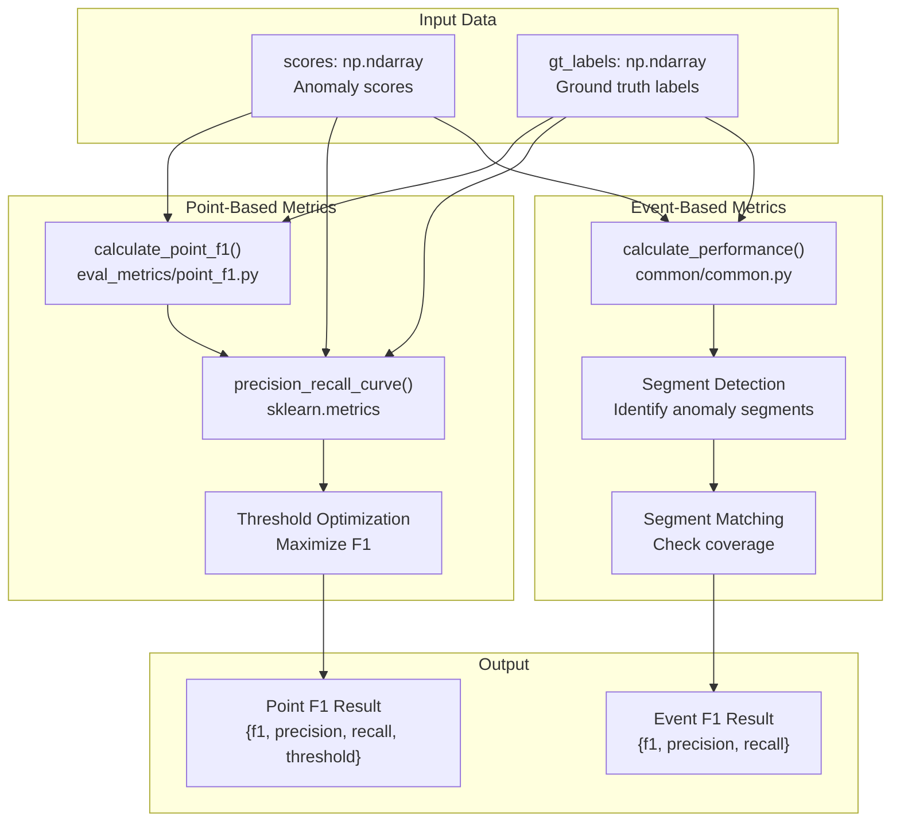
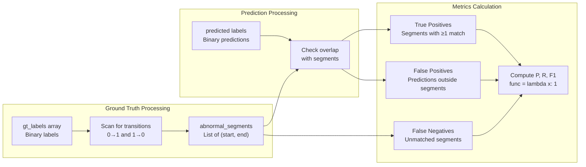
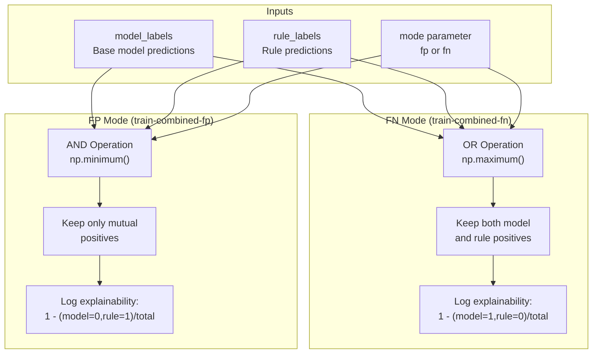
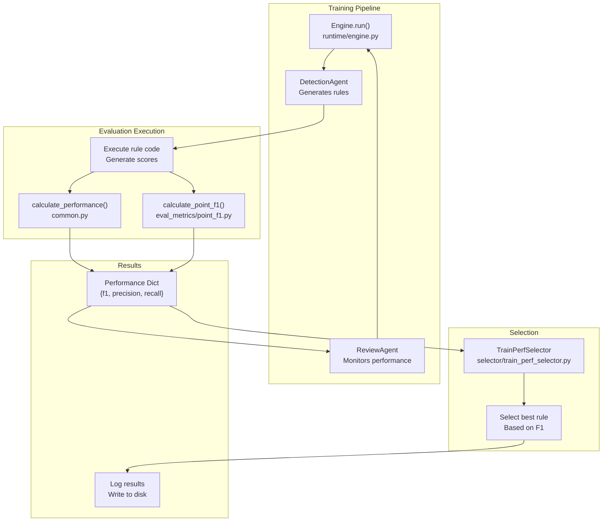

<!-- source: DeepWiki mcp.deepwiki.com · repo microsoft/argos · page 4.9 Evaluation Metrics · fetched 2026-10-26 -->

# Evaluation Metrics

<details>
<summary>Relevant source files</summary>

The following files were used as context for generating this wiki page:

- [README.md](README.md)
- [common/common.py](common/common.py)
- [eval_metrics/point_f1.py](eval_metrics/point_f1.py)

</details>


## Purpose and Scope

This document describes the evaluation metrics used by Argos to measure the performance of generated anomaly detection rules. The metrics quantify how well rules identify true anomalies while minimizing false positives and false negatives.

For information about how these metrics are used during training, see [Engine](#4.2). For details on rule selection based on these metrics, see [Rule Selection](#4.10). For performance monitoring during iterative refinement, see [Review Agent](#4.6).

**Sources:** [README.md:159-180](), [eval_metrics/point_f1.py](), [common/common.py:218-277]()

## Overview

Argos employs two primary evaluation approaches to assess anomaly detection performance:

1. **Point-Based F1 Score**: Evaluates detection accuracy at individual data points
2. **Event-Based F1 Score with Point Adjustment**: Evaluates detection accuracy at the anomaly segment level

Both metrics compute precision, recall, and F1 scores, but differ in their granularity and treatment of anomaly segments. The system dynamically determines optimal thresholds to maximize F1 scores for both anomaly scores and rule outputs.

**Sources:** [README.md:167](), [eval_metrics/point_f1.py:5-26](), [common/common.py:218-277]()

## Metric Types and Calculation Flow



**Sources:** [eval_metrics/point_f1.py:5-26](), [common/common.py:218-277]()

## Point-Based F1 Score

The point-based F1 score evaluation is implemented in `calculate_point_f1()` and treats each data point independently.

### Algorithm

The function performs the following steps:

1. **Precision-Recall Curve Generation**: Uses scikit-learn's `precision_recall_curve()` to compute precision and recall values across all possible thresholds
2. **F1 Score Calculation**: For each threshold, computes F1 = 2 × (precision × recall) / (precision + recall)
3. **Threshold Optimization**: Selects the threshold that maximizes the F1 score
4. **Result Assembly**: Returns the best F1, precision, recall, and corresponding threshold

### Implementation Details

| Component | Description | Location |
|-----------|-------------|----------|
| Function | `calculate_point_f1(scores, labels)` | [eval_metrics/point_f1.py:5-26]() |
| Input | `scores`: anomaly scores (np.ndarray)<br/>`labels`: ground truth binary labels (np.ndarray) | |
| Output | Dictionary with keys: `f1`, `precision`, `recall`, `threshold` | [eval_metrics/point_f1.py:19-24]() |
| Dependencies | `sklearn.metrics.precision_recall_curve` | [eval_metrics/point_f1.py:1]() |
| Epsilon | 1e-10 used to avoid division by zero | [eval_metrics/point_f1.py:9]() |

**Code Reference:**
```python
# From eval_metrics/point_f1.py:5-26
def calculate_point_f1(scores: np.ndarray, labels: np.ndarray):
    precision, recall, thresholds = precision_recall_curve(labels, scores)
    f1_scores = 2 * (precision * recall) / (precision + recall + 1e-10)
    best_idx = np.nanargmax(f1_scores)
    # Returns: {f1, precision, recall, threshold}
```

**Sources:** [eval_metrics/point_f1.py:5-26]()

## Event-Based F1 Score with Point Adjustment

The event-based evaluation, implemented in `calculate_performance()`, operates at the anomaly segment level rather than individual points. This approach is more lenient and aligns better with real-world anomaly detection requirements where detecting any point within an anomaly segment constitutes a successful detection.

### Segment Detection Logic



**Sources:** [common/common.py:218-277]()

### Algorithm Details

The `calculate_performance()` function implements event-based evaluation with these steps:

1. **Anomaly Segment Identification**: Scans ground truth labels to identify continuous anomaly segments
   - Detects transitions from 0→1 (anomaly start) and 1→0 (anomaly end)
   - Handles edge cases where anomalies extend to the end of the data
   - Stores segments as tuples: `(start_index, end_index)`

2. **True Positive Counting**: For each ground truth segment:
   - Checks if at least one predicted label within the segment is positive
   - If yes, counts the entire segment as one true positive (event-based)
   - Tracks represented positives (sum of predictions within true segments)

3. **False Positive Calculation**:
   - False positives = Total predictions - Represented positives
   - This counts all predictions outside true anomaly segments

4. **Metric Computation**:
   - Precision = TP / (TP + FP + ε)
   - Recall = TP / Total anomaly segments
   - F1 = 2 × Precision × Recall / (Precision + Recall + ε)
   - Uses `EPS = 1e-10` to prevent division by zero

### Mode Selection

The function includes a configurable weighting function:

```python
# Event-based F1 under PA with mode squeeze (default)
func = lambda x: 1  # Each segment counts as 1

# Alternative: Point F1 PA (commented out)
# func = lambda x: x  # Segment length affects weight
```

**Current Mode**: Event-based with mode "squeeze" (line 225), where each anomaly segment contributes 1 to the total count regardless of its length.

**Sources:** [common/common.py:218-277](), [common/common.py:13]()

## Label Processing and Combination

The system provides utilities for processing and combining labels from different sources:

### Label Retrieval Functions

| Function | Purpose | Location |
|----------|---------|----------|
| `get_gt_labels(train_df)` | Extract ground truth labels from DataFrame | [common/common.py:182-185]() |
| `get_model_labels(scores, dataset_name, eval_dict_path)` | Convert model scores to binary labels using stored threshold | [common/common.py:95-106]() |
| `get_rule_labels(eval_dict, rule_scores)` | Convert rule scores to binary labels using threshold | [common/common.py:109-119]() |

### Label Combination for Combined Modes

For combined training modes (train-combined-fp and train-combined-fn), the `combine_labels()` function merges model and rule predictions:



**Logic:**
- **FN Mode** (line 191): Uses `np.maximum()` (OR operation) to capture all anomalies detected by either the model or rule
- **FP Mode** (line 210): Uses `np.minimum()` (AND operation) to retain only anomalies confirmed by both model and rule

Both modes log explainability metrics indicating agreement between model and rule predictions.

**Sources:** [common/common.py:188-216]()

## Label Preprocessing and Validation

### Format Validation

The `format_check()` function ensures consistency between data and labels:

```python
# From common/common.py:279-285
def format_check(df, rule_path, labels):
    if len(df) != len(labels):
        raise RuntimeException(
            f"The length of the labels is not equal to the length of the data, "
            f"len(labels)={len(labels)}, len(data)={len(df)}",
            df, rule_path
        )
```

This validation prevents dimension mismatches that would cause incorrect metric calculations.

**Sources:** [common/common.py:279-286]()

### Label Preprocessing (Legacy)

The `preprocess_labels()` function at [common/common.py:122-179]() includes commented-out logic for margin-based label expansion. The current implementation focuses on basic validation:
- Type checking: Ensures scores are `np.ndarray`
- Dimension checking: Verifies 1D arrays
- Length validation: Ensures score and label arrays match
- Score normalization: Avoids negative values by subtracting minimum

**Sources:** [common/common.py:122-179]()

## Integration with Argos Pipeline

The evaluation metrics integrate with multiple components:

### Usage in Training and Evaluation



### Key Integration Points

| Component | How Metrics Are Used | Related Page |
|-----------|---------------------|--------------|
| Engine | Calls metrics after each rule generation iteration | [Engine](#4.2) |
| ReviewAgent | Uses metrics to detect performance regressions and trigger refinements | [Review Agent](#4.6) |
| TrainPerfSelector | Compares F1 scores across iterations to select best rule | [Rule Selection](#4.10) |
| Dataset | Provides ground truth labels for metric calculation | [Dataset Management](#4.8) |

**Sources:** [common/common.py:218-277](), [eval_metrics/point_f1.py:5-26]()

## Metric Constants and Utilities

### Constants

| Constant | Value | Purpose | Location |
|----------|-------|---------|----------|
| `EPS` | 1e-10 | Prevents division by zero in metric calculations | [common/common.py:13]() |

### Helper Functions

**Smooth Labels** ([common/common.py:74-86]()):
```python
def smooth_labels(labels: np.ndarray, window_size: int = 5) -> np.ndarray
```
Applies moving average smoothing to labels using a sliding window. Currently used for label preprocessing in specific scenarios.

**Get Model Scores** ([common/common.py:89-92]()):
```python
def get_model_scores(dataset_name, scores_dir_path)
```
Loads pre-computed anomaly scores from numpy files for combined mode evaluation.

**Sources:** [common/common.py:13](), [common/common.py:74-92]()

## Performance Metrics Summary

### Output Format

Both metric functions return dictionaries with consistent structure:

| Key | Type | Description |
|-----|------|-------------|
| `"f1"` | float | F1 score (harmonic mean of precision and recall) |
| `"precision"` | float | Precision (TP / (TP + FP)) |
| `"recall"` | float | Recall (TP / (TP + FN)) |
| `"threshold"` | float | Optimal threshold (point-based only) |

### Evaluation Context

The system typically uses **event-based F1 with point adjustment** as the primary metric, as indicated in the README:
> "We used event-based F1 score with point adjustment to measure Argos's performance." ([README.md:167]())

Point-based F1 is used as a complementary metric and for threshold determination in rule score conversion.

**Sources:** [README.md:167](), [eval_metrics/point_f1.py:19-24](), [common/common.py:276]()

---

