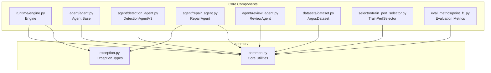
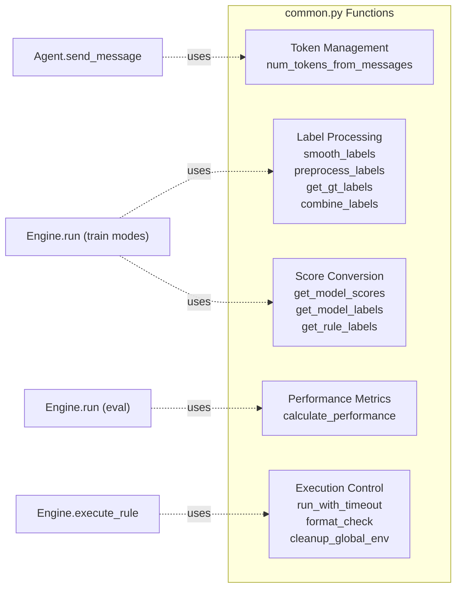
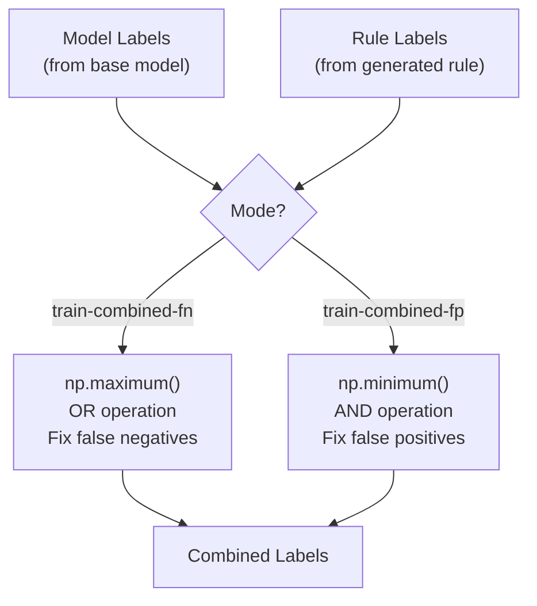
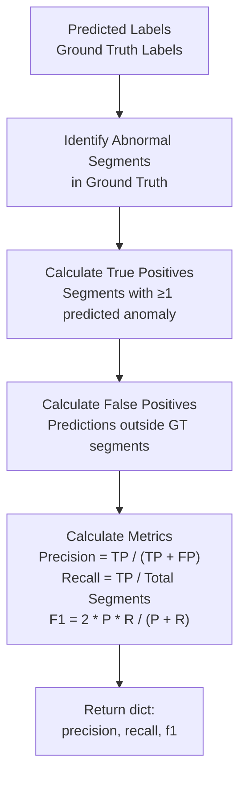
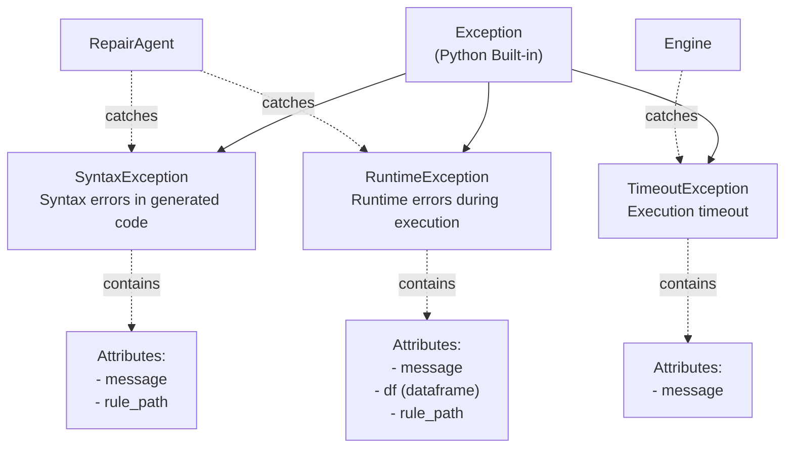

<!-- source: DeepWiki mcp.deepwiki.com · repo microsoft/argos · page 5 Utilities and Infrastructure · fetched 2026-10-26 -->

# Utilities and Infrastructure

Relevant source files

The following files were used as context for generating this wiki page:

- [common/common.py](common/common.py)
- [common/exception.py](common/exception.py)

This page documents the shared infrastructure components that support the entire Argos system. The `common/` directory provides foundational utilities for token counting, label processing, performance calculation, exception handling, and execution management. These utilities are consumed by all major system components including agents, the engine, dataset management, and evaluation metrics.

For detailed documentation of specific utility functions, see [Common Utilities](#5.1). For information about custom exception types, see [Exception Types](#5.2).

## Overview

The utilities infrastructure in Argos serves as a foundation layer that provides cross-cutting functionality to all system components. The infrastructure is organized into two primary modules within the `common/` directory:

| Module | Purpose | Key Consumers |
|--------|---------|---------------|
| `common.py` | Core utility functions for token counting, label processing, performance metrics | Engine, Agents, Dataset, Selector |
| `exception.py` | Custom exception types for structured error handling | Engine, Agents, RepairAgent |

These utilities enable consistent behavior across the system for critical operations such as LLM token management, label manipulation for combined modes, and standardized error reporting.

**Sources:** [common/common.py:1-320](), [common/exception.py:1-19]()

## Module Structure

**Utility Consumption Pattern:** All major system components import and utilize functions from `common.py` for operations like token counting, label processing, and performance calculation. Exception types from `exception.py` are primarily used by the engine and repair agent for structured error handling during rule execution.

**Sources:** [common/common.py:1-320](), [common/exception.py:1-19]()

## Utility Function Categories

The utility infrastructure provides five distinct categories of functionality:

**Sources:** [common/common.py:1-320]()

### Token Management

The `num_tokens_from_messages()` function provides accurate token counting for Azure OpenAI API messages. This is critical for managing context window limits across different GPT models.

| Model Family | Tokens Per Message | Tokens Per Name | Supported Models |
|--------------|-------------------|-----------------|------------------|
| GPT-3.5/GPT-4 Modern | 3 | 1 | `gpt-35-turbo-16k`, `gpt-4o`, `gpt-4-32k` |
| GPT-3.5 Legacy | 4 | -1 | `gpt-3.5-turbo-0301` |

The function uses the `tiktoken` library to encode messages and calculate token counts based on model-specific formatting rules [common/common.py:17-71](). When a model is not found in the registry, it falls back to `cl100k_base` encoding with a warning [common/common.py:24-25]().

**Primary Consumer:** The `Agent` class uses this function in its `send_message()` method to track cumulative token usage across conversations, enabling agents to stay within context limits.

**Sources:** [common/common.py:17-71]()

### Label Processing and Combination

Label processing utilities support both data preprocessing and the critical "combined" training modes that allow Argos to target specific error types from base models.

**Label Smoothing:** The `smooth_labels()` function applies a sliding window average to labels, useful for handling noisy ground truth annotations [common/common.py:74-86]().

**Label Preprocessing:** The `preprocess_labels()` function validates and aligns score and label arrays, ensuring they have matching lengths and no negative values [common/common.py:122-179]().

**Ground Truth Extraction:** The `get_gt_labels()` function extracts ground truth labels from training dataframes [common/common.py:182-185]().

**Combined Mode Logic:** The `combine_labels()` function implements the core logic for `train-combined-fp` and `train-combined-fn` modes:

For `train-combined-fn`, the function uses `np.maximum()` to perform an OR operation, ensuring any point marked anomalous by either the model or rule is labeled anomalous [common/common.py:191-200](). For `train-combined-fp`, it uses `np.minimum()` to perform an AND operation, only marking points anomalous when both model and rule agree [common/common.py:201-210]().

The function also logs explainability metrics, counting how many labels differ between model and rule predictions [common/common.py:197-199](), [common/common.py:207-209]().

**Sources:** [common/common.py:74-216]()

### Score and Label Conversion

These utilities bridge between continuous anomaly scores and binary labels, supporting both model-based and rule-based detection:

**Model Score Loading:** `get_model_scores()` loads pre-computed anomaly scores from `.npy` files for a given dataset [common/common.py:89-92]().

**Model Label Conversion:** `get_model_labels()` converts model scores to binary labels by loading the optimal threshold from an evaluation dictionary and applying it [common/common.py:95-106]().

**Rule Label Conversion:** `get_rule_labels()` converts rule scores to binary labels using a threshold from the rule's evaluation results [common/common.py:109-119]().

The threshold-based conversion pattern is consistent: `labels[scores >= threshold] = 1` [common/common.py:105](), [common/common.py:115]().

**Sources:** [common/common.py:89-119]()

### Performance Calculation

The `calculate_performance()` function implements event-based F1 score calculation with point adjustment (PA), the primary evaluation metric for Argos.

**Algorithm Flow:**

The function first identifies all abnormal segments in the ground truth by detecting transitions between normal and abnormal states [common/common.py:233-251](). For each segment, it checks if at least one predicted point falls within it to count as a true positive [common/common.py:258-264](). False positives are any predictions outside all ground truth segments [common/common.py:267]().

The implementation uses an epsilon value `EPS = 1e-10` to avoid division by zero in metric calculations [common/common.py:13](), [common/common.py:273-275]().

**Return Format:** The function returns a dictionary with keys `"precision"`, `"recall"`, and `"f1"` [common/common.py:276-277]().

**Sources:** [common/common.py:218-277]()

### Execution Control and Validation

**Format Validation:** The `format_check()` function validates that generated labels match the input data length, raising a `RuntimeException` if they don't [common/common.py:279-285]().

**Timeout Execution:** The `run_with_timeout()` function was designed to execute functions with a timeout limit, though the current implementation simply calls the function directly without timeout enforcement [common/common.py:288-297](). The commented-out code shows it was originally implemented using `concurrent.futures.ThreadPoolExecutor` [common/common.py:290-297]().

**Global Environment Cleanup:** The `cleanup_global_env()` function is designed to clean up the global namespace after executing user-generated code, though the current implementation is a no-op [common/common.py:300-318](). The commented implementation would preserve only essential built-in keys and remove all other globals [common/common.py:303-318]().

**Sources:** [common/common.py:279-318]()

## Exception Hierarchy and Usage

Argos defines three custom exception types for structured error handling during rule execution:

**SyntaxException:** Raised when generated rule code has syntax errors that prevent compilation. Stores the error message and rule file path for repair [common/exception.py:2-5]().

**RuntimeException:** Raised when rule code compiles but fails during execution on real data. Stores the error message, the dataframe being processed, and rule file path [common/exception.py:9-13]().

**TimeoutException:** Raised when rule execution exceeds time limits. Currently a simple exception with no additional attributes [common/exception.py:17-18]().

These exceptions enable the `RepairAgent` to distinguish between different error types and apply appropriate fixing strategies (see [Repair Agent](#4.5) for details).

**Sources:** [common/exception.py:1-19]()

## Dependency Management

The utilities infrastructure relies on several external Python packages:

| Package | Purpose | Key Functions Using It |
|---------|---------|------------------------|
| `tiktoken` | GPT tokenization | `num_tokens_from_messages()` |
| `numpy` | Numerical operations on labels/scores | `smooth_labels()`, `calculate_performance()`, label conversion functions |
| `pandas` | Dataframe operations | `get_gt_labels()`, various data processing |
| `json` | Loading evaluation dictionaries | `get_model_labels()` |
| `logging` | Informational logging | `combine_labels()` |
| `concurrent.futures` | Timeout execution (commented out) | `run_with_timeout()` |

**Sources:** [common/common.py:1-10]()

## Integration with System Components

The utilities infrastructure integrates with every major Argos component:

| Component | Primary Utility Usage |
|-----------|----------------------|
| **Agent** | `num_tokens_from_messages()` for tracking conversation token usage |
| **Engine** | `combine_labels()` for combined modes, `calculate_performance()` for evaluation, exception handling |
| **DetectionAgentV3** | Label processing functions for filtering training data in combined modes |
| **RepairAgent** | Custom exceptions for error classification and handling |
| **ReviewAgent** | `calculate_performance()` for monitoring regression during iterative refinement |
| **ArgosDataset** | Label extraction and preprocessing functions |
| **TrainPerfSelector** | `calculate_performance()` for comparing rule performance |
| **Evaluation Metrics** | Performance calculation functions |

The centralization of these utilities ensures consistent behavior across the system, particularly for critical operations like performance evaluation (all components use the same F1 calculation) and token management (all agents respect the same token limits).

**Sources:** [common/common.py:1-320](), [common/exception.py:1-19]()

---

