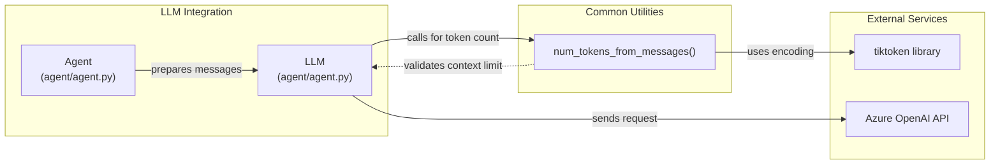
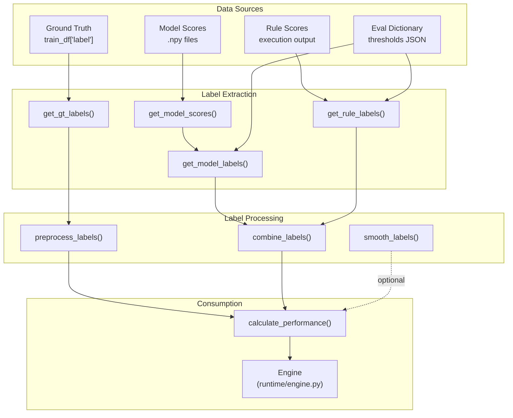
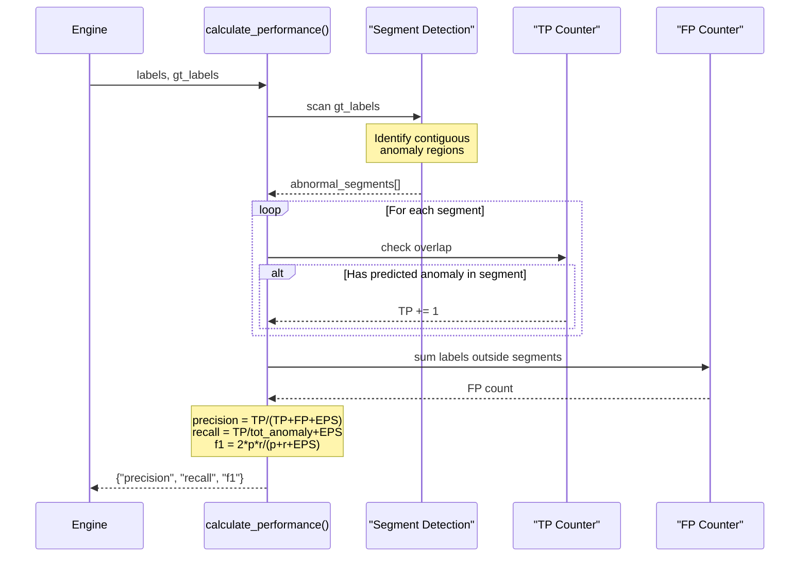
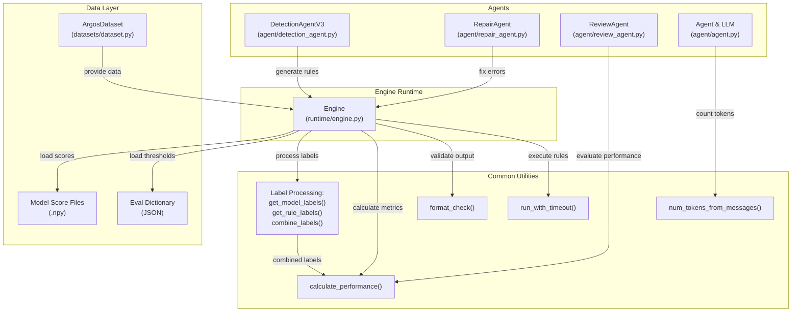

<!-- source: DeepWiki mcp.deepwiki.com · repo microsoft/argos · page 5.1 Common Utilities · fetched 2026-10-26 -->

# Common Utilities

<details>
<summary>Relevant source files</summary>

The following files were used as context for generating this wiki page:

- [common/common.py](common/common.py)
- [requirements.txt](requirements.txt)

</details>


This document describes the utility functions and constants provided by the `common` module. These utilities support core Argos operations including token counting for LLM API calls, label processing for anomaly detection evaluation, performance metric calculation, and execution management.

For information about custom exception types used throughout the system, see [Exception Types](#5.2). For details on specific evaluation metrics implementation, see [Evaluation Metrics](#4.9).

**Sources**: [common/common.py:1-320]()

## Overview

The `common/common.py` module provides a collection of reusable utility functions organized into five functional categories:

| Category | Functions | Purpose |
|----------|-----------|---------|
| Token Management | `num_tokens_from_messages()` | Calculate token counts for OpenAI API billing and context limits |
| Label Processing | `smooth_labels()`, `get_model_labels()`, `get_rule_labels()`, `get_gt_labels()`, `combine_labels()`, `preprocess_labels()` | Transform and combine anomaly labels from various sources |
| Model Integration | `get_model_scores()` | Load anomaly scores from baseline models |
| Performance Calculation | `calculate_performance()` | Compute precision, recall, and F1 scores |
| Execution Management | `format_check()`, `run_with_timeout()`, `cleanup_global_env()` | Validate execution and manage timeouts |

**Sources**: [common/common.py:1-320]()

## Token Counting

### num_tokens_from_messages()

The `num_tokens_from_messages()` function calculates the number of tokens consumed by a list of messages for OpenAI API calls. This is critical for managing API costs and ensuring messages fit within model context windows.

```python
num_tokens_from_messages(messages, model="gpt-3.5-turbo")
```

#### Supported Models

The function handles token counting for multiple model families:

| Model | Tokens per Message | Tokens per Name | Notes |
|-------|-------------------|-----------------|-------|
| `gpt-35-turbo-16k` | 3 | 1 | Azure OpenAI naming |
| `gpt-4o` | 3 | 1 | Vision-capable model |
| `gpt-4-32k` | 3 | 1 | Large context window |
| `gpt-3.5-turbo-0301` | 4 | -1 | Legacy format |
| Other `gpt-3.5-turbo` | Delegates to `gpt-3.5-turbo-0613` | - | With warning |
| Other `gpt-4` | Delegates to `gpt-4-0613` | - | With warning |

#### Implementation Details

The function uses the `tiktoken` library to obtain the appropriate encoding for each model. If a model is not found, it falls back to the `cl100k_base` encoding with a warning. Token calculation accounts for:

- Base tokens for each message structure (role/name/content)
- Encoded content length for each field
- Additional tokens for the assistant's reply initialization (+3)

**Sources**: [common/common.py:16-71](), [requirements.txt:9]()

### Usage Pattern



**Sources**: [common/common.py:16-71]()

## Label Processing

Label processing utilities handle the transformation and combination of anomaly labels from multiple sources including ground truth data, baseline model predictions, and LLM-generated rules.

### smooth_labels()

Applies a moving average smoothing operation to binary labels, producing floating-point confidence values.

```python
smooth_labels(labels: np.ndarray, window_size: int = 5) -> np.ndarray
```

The function computes, for each index position, the average of labels within a window centered at that position. The averaging contributes to neighboring positions, creating a smoothed confidence distribution.

**Sources**: [common/common.py:74-86]()

### get_model_scores()

Loads anomaly scores from a baseline model's output file.

```python
get_model_scores(dataset_name, scores_dir_path)
```

Returns a numpy array of anomaly scores loaded from `{scores_dir_path}/{dataset_name}.npy`.

**Sources**: [common/common.py:89-92]()

### get_model_labels()

Converts continuous anomaly scores to binary labels using a threshold stored in an evaluation dictionary.

```python
get_model_labels(scores, dataset_name, eval_dict_path)
```

The function:
1. Loads the evaluation dictionary from JSON
2. Retrieves the threshold for the specified dataset (using "event-based f1 under pa with mode squeeze" metric)
3. Applies threshold: labels[scores >= threshold] = 1

**Sources**: [common/common.py:95-106]()

### get_rule_labels()

Converts rule-generated anomaly scores to binary labels using a threshold from the evaluation dictionary.

```python
get_rule_labels(eval_dict, rule_scores)
```

Similar to `get_model_labels()`, but operates on rule scores rather than model scores, and receives the eval_dict directly rather than loading it from a file path.

**Sources**: [common/common.py:109-119]()

### get_gt_labels()

Extracts ground truth labels from a training DataFrame.

```python
get_gt_labels(train_df)
```

Returns a copy of the "label" column from the DataFrame as a numpy array.

**Sources**: [common/common.py:182-185]()

### combine_labels()

Combines model predictions with rule predictions for combined operational modes.

```python
combine_labels(model_labels, rule_labels, mode="train-combined-fn")
```

#### Mode-Specific Behavior

| Mode | Operation | Logic | Purpose |
|------|-----------|-------|---------|
| `train-combined-fn` | Maximum (OR) | `np.maximum(model_labels, rule_labels)` | Fix false negatives: rule detects anomalies missed by model |
| `train-combined-fp` | Minimum (AND) | `np.minimum(model_labels, rule_labels)` | Fix false positives: rule filters out model's incorrect detections |

The function also logs explainability metrics:
- For FN mode: counts where model=1 and rule=0 (anomalies rule fails to explain)
- For FP mode: counts where model=0 and rule=1 (rule adds unwanted detections)

**Sources**: [common/common.py:188-213]()

### preprocess_labels()

Validates and preprocesses labels for evaluation.

```python
preprocess_labels(scores, labels, margins=[0, 5])
```

The function performs validation checks:
- Ensures scores are a 1D numpy array
- Verifies scores length does not exceed labels length
- Truncates labels to match scores length if necessary
- Normalizes scores by subtracting minimum value

Note: The margin-based label expansion logic (lines 150-177) is commented out in the current implementation.

**Sources**: [common/common.py:122-179]()

## Label Processing Flow



**Sources**: [common/common.py:74-213]()

## Performance Calculation

### calculate_performance()

Computes precision, recall, and F1 score for anomaly detection evaluation.

```python
calculate_performance(labels, gt_labels)
```

#### Algorithm

The function implements event-based F1 calculation with point-adjustment (PA):

1. **Identify Abnormal Segments**: Scans `gt_labels` to identify contiguous anomaly segments
2. **Count True Positives**: For each abnormal segment, if any predicted point falls within it, count it as one true positive event
3. **Count False Positives**: Sum all predicted anomalies outside abnormal segments
4. **Calculate Metrics**:
   - Precision = TP / (TP + FP + ε)
   - Recall = TP / (Total Anomaly Events + ε)
   - F1 = 2 × Precision × Recall / (Precision + Recall + ε)

Where ε = 1e-10 (defined as `EPS`) prevents division by zero.

#### Event-Based vs Point-Based

The current implementation uses event-based F1 with "mode squeeze" (line 225: `func = lambda x: 1`), treating each anomaly segment as a single event. An alternative point-based approach (commented at line 227: `func = lambda x: x`) would weight segments by their length.

**Sources**: [common/common.py:13](), [common/common.py:218-277]()

### Performance Calculation Flow



**Sources**: [common/common.py:218-277]()

## Validation and Execution Management

### format_check()

Validates that generated labels match the input data length.

```python
format_check(df, rule_path, labels)
```

Raises `RuntimeException` if the length mismatch is detected, including the dataframe, rule path, and error message in the exception for debugging.

**Sources**: [common/common.py:279-285]()

### run_with_timeout()

Executes a function with optional timeout handling.

```python
run_with_timeout(func, timeout, *args, **kwargs)
```

**Current Implementation**: The timeout functionality is disabled (lines 290-297 commented out). The function currently just directly calls and returns `func(*args, **kwargs)`. The commented code shows it was previously implemented using `concurrent.futures.ThreadPoolExecutor` with a timeout parameter.

**Sources**: [common/common.py:288-297]()

### cleanup_global_env()

Cleans up the global execution environment.

```python
cleanup_global_env()
```

**Current Implementation**: This is a no-op function (lines 302-318 commented out). The commented code shows it was designed to remove all non-essential keys from the global namespace to prevent variable pollution between rule executions.

**Sources**: [common/common.py:300-319]()

## Integration with Core Components



**Sources**: [common/common.py:1-320]()

## Constants

The module defines one constant:

| Constant | Value | Purpose |
|----------|-------|---------|
| `EPS` | `1e-10` | Small epsilon value added to denominators in division operations to prevent numerical instability and division by zero errors |

**Sources**: [common/common.py:13]()

## Dependencies

The common utilities module relies on the following external packages:

| Package | Usage | Import Location |
|---------|-------|-----------------|
| `numpy` | Array operations and numerical computation | [common/common.py:7]() |
| `pandas` | DataFrame handling for label extraction | [common/common.py:8]() |
| `tiktoken` | OpenAI token encoding and counting | [common/common.py:9]() |
| `json` | Loading evaluation dictionaries | [common/common.py:3]() |
| `logging` | Status and debugging messages | [common/common.py:4]() |
| `concurrent.futures` | Timeout execution (currently unused) | [common/common.py:2]() |

**Sources**: [common/common.py:1-11](), [requirements.txt:18](), [requirements.txt:21]()

## Usage Examples by Component

### Engine Usage Pattern

The Engine uses common utilities throughout its training and evaluation workflow:

```
1. Load model scores: get_model_scores(dataset_name, scores_dir_path)
2. Convert to labels: get_model_labels(scores, dataset_name, eval_dict_path)
3. Execute rule and get rule labels: get_rule_labels(eval_dict, rule_scores)
4. Combine for training: combine_labels(model_labels, rule_labels, mode)
5. Calculate performance: calculate_performance(combined_labels, gt_labels)
```

**Sources**: [common/common.py:89-277]()

### Agent Usage Pattern

Agents use token counting to manage context windows:

```
1. Prepare message list for LLM
2. Check token count: num_tokens_from_messages(messages, model)
3. Truncate or chunk if exceeds limit
4. Send to Azure OpenAI API
```

**Sources**: [common/common.py:16-71]()

---

