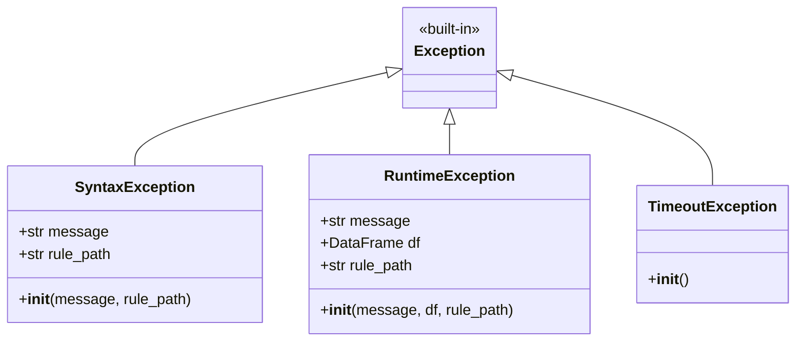
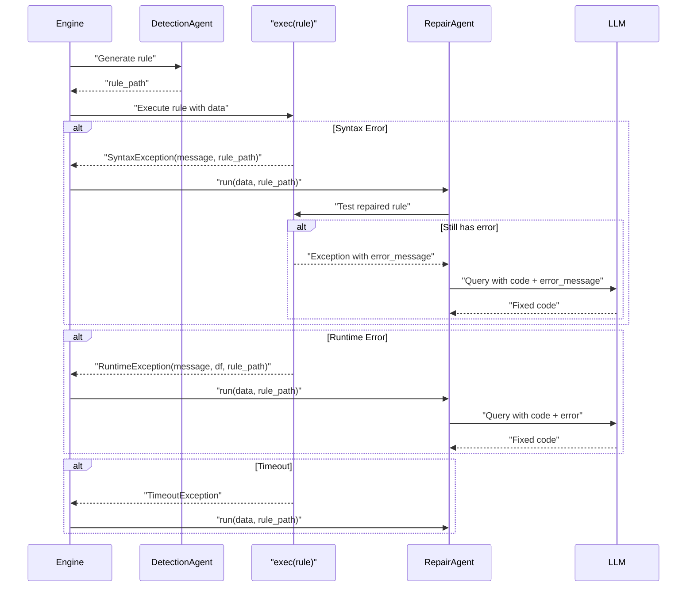
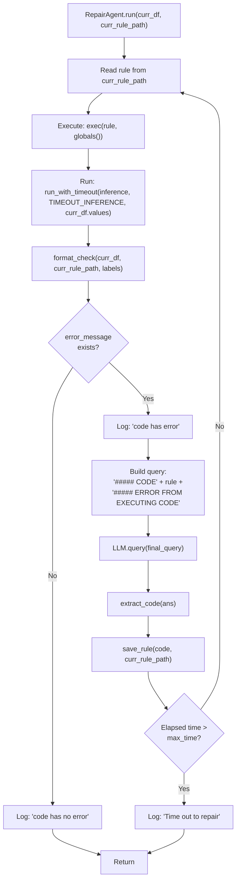

<!-- source: DeepWiki mcp.deepwiki.com · repo microsoft/argos · page 5.2 Exception Types · fetched 2026-10-26 -->

# Exception Types

<details>
<summary>Relevant source files</summary>

The following files were used as context for generating this wiki page:

- [agent/repair_agent.py](agent/repair_agent.py)
- [common/exception.py](common/exception.py)

</details>


## Purpose and Scope

This document describes the custom exception classes defined in Argos for handling errors during rule generation and execution. These exceptions provide structured error reporting with contextual information that enables automated error recovery through the RepairAgent.

For information about how these exceptions are handled and repaired, see [Repair Agent](#4.5). For general utility functions related to code execution, see [Common Utilities](#5.1).

**Sources:** [common/exception.py:1-19]()

## Overview

Argos defines three custom exception types to distinguish between different categories of errors that occur during the rule generation and execution pipeline:

| Exception Class | Purpose | Context Stored |
|----------------|---------|----------------|
| `SyntaxException` | Reports syntax errors in generated Python code | `rule_path` |
| `RuntimeException` | Reports runtime errors during rule execution | `message`, `df`, `rule_path` |
| `TimeoutException` | Signals execution timeout during rule evaluation | None (inherits from base Exception) |

These exceptions enable the system to categorize errors and apply appropriate repair strategies through the RepairAgent.

**Sources:** [common/exception.py:1-19]()

## Exception Class Hierarchy

The following diagram shows the inheritance structure and attributes of Argos exception classes:



**Sources:** [common/exception.py:1-19]()

## Exception Flow in the System

The following diagram illustrates how exceptions propagate through the Argos system and trigger repair workflows:



**Sources:** [common/exception.py:1-19](), [agent/repair_agent.py:50-117]()

## SyntaxException

The `SyntaxException` class is raised when generated Python code contains syntax errors that prevent it from being parsed or compiled.

### Class Definition

```
SyntaxException(Exception)
├── message: str - Description of the syntax error
└── rule_path: str - File path to the rule containing the syntax error
```

### Attributes

- **`message`**: Error message describing the syntax problem
- **`rule_path`**: Path to the file containing the malformed code

### Usage Context

`SyntaxException` is designed for "reporting syntax errors when running rule on dummy data" [common/exception.py:1](). This exception signals that the generated Python function `inference()` cannot be executed due to syntax issues such as:
- Invalid Python syntax
- Incorrect indentation
- Unclosed brackets or quotes
- Invalid function signatures

When this exception is raised, it provides the RepairAgent with both the error details and the location of the problematic rule, enabling targeted repair.

**Sources:** [common/exception.py:2-5]()

## RuntimeException

The `RuntimeException` class is raised when syntactically valid Python code encounters runtime errors during execution on actual data.

### Class Definition

```
RuntimeException(Exception)
├── message: str - Description of the runtime error
├── df: DataFrame - The data that caused the runtime error
└── rule_path: str - File path to the rule that failed
```

### Attributes

- **`message`**: Error message describing the runtime failure
- **`df`**: Pandas DataFrame containing the data being processed when the error occurred
- **`rule_path`**: Path to the file containing the rule that failed during execution

### Usage Context

`RuntimeException` is designed for "reporting runtime errors when running rule on real data" [common/exception.py:8](). This exception captures errors that occur during actual rule execution, such as:
- Array indexing errors
- Type mismatches
- Division by zero
- Invalid operations on data

The inclusion of the `df` attribute allows the RepairAgent to understand the data context that triggered the error, potentially enabling more informed repairs. The RepairAgent uses this information when querying the LLM for fixes [agent/repair_agent.py:76-78]().

**Sources:** [common/exception.py:9-13]()

## TimeoutException

The `TimeoutException` class is raised when rule execution exceeds the allowed time limit.

### Class Definition

```
TimeoutException(Exception)
└── (no additional attributes)
```

### Attributes

This exception has no additional attributes beyond those inherited from the base `Exception` class.

### Usage Context

`TimeoutException` is used "for timeout" scenarios [common/exception.py:16](). This exception is raised when:
- Rule execution takes longer than the configured timeout threshold
- Infinite loops or expensive computations are detected

The timeout mechanism is enforced through the `run_with_timeout()` utility function, which wraps rule execution with a time limit [agent/repair_agent.py:72](). The RepairAgent treats timeout errors similarly to other execution errors, attempting to optimize or fix the code to prevent future timeouts [agent/repair_agent.py:112-116]().

**Sources:** [common/exception.py:16-18]()

## Exception Handling in RepairAgent

The following diagram shows how the RepairAgent processes different exception types:



**Sources:** [agent/repair_agent.py:50-117]()

## Exception Handling Pattern

The RepairAgent implements a retry loop that catches all exceptions during rule execution [agent/repair_agent.py:76-78]():

1. **Execute the rule**: The agent runs `exec(rule, globals())` to load the function definition
2. **Run inference**: Calls `run_with_timeout(inference, TIMEOUT_INFERENCE, curr_df.values)` to execute with timeout protection
3. **Validate format**: Uses `format_check()` to ensure output matches expected shape
4. **Catch exceptions**: Any exception (including custom exceptions) is captured and stored in `error_message`
5. **Query LLM for repair**: The error message is sent to the LLM along with the problematic code [agent/repair_agent.py:91-98]()
6. **Extract and save**: Fixed code is extracted and written back to the rule file
7. **Repeat**: The loop continues until the code executes without errors or timeout is reached

This pattern allows the RepairAgent to handle all three exception types (SyntaxException, RuntimeException, and TimeoutException) with a unified repair workflow.

**Sources:** [agent/repair_agent.py:50-117](), [common/exception.py:1-19]()

## Integration with Error Recovery

The exception types are tightly integrated with Argos's automated error recovery system:

| Component | Role | Exception Interaction |
|-----------|------|----------------------|
| `format_check()` | Validates rule output format | May raise `SyntaxException` or `RuntimeException` |
| `run_with_timeout()` | Enforces execution time limits | Raises `TimeoutException` on timeout |
| `cleanup_global_env()` | Cleans up global namespace after execution | Called after exception handling [agent/repair_agent.py:74,77]() |
| `RepairAgent.run()` | Main error recovery loop | Catches all exceptions and triggers LLM-based repair |

The exception system enables graceful degradation: when rule generation produces imperfect code, the system can automatically detect, categorize, and repair errors without manual intervention.

**Sources:** [agent/repair_agent.py:8-9,50-117](), [common/exception.py:1-19]()

---

