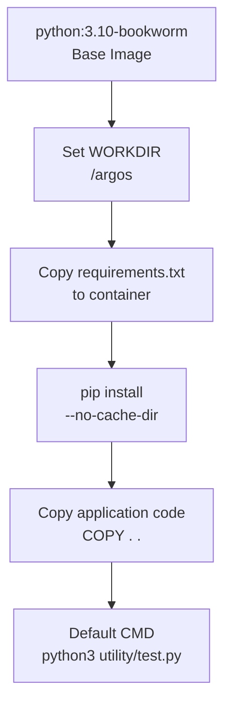
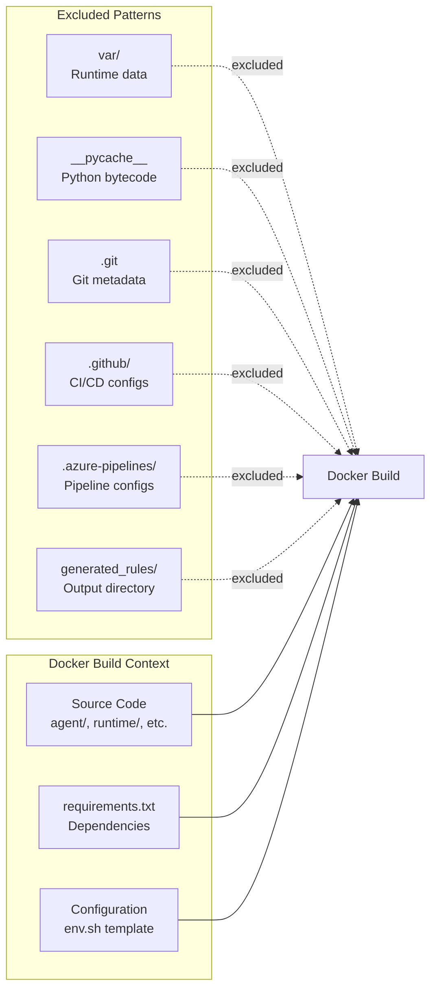
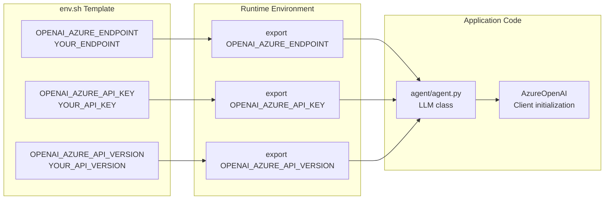
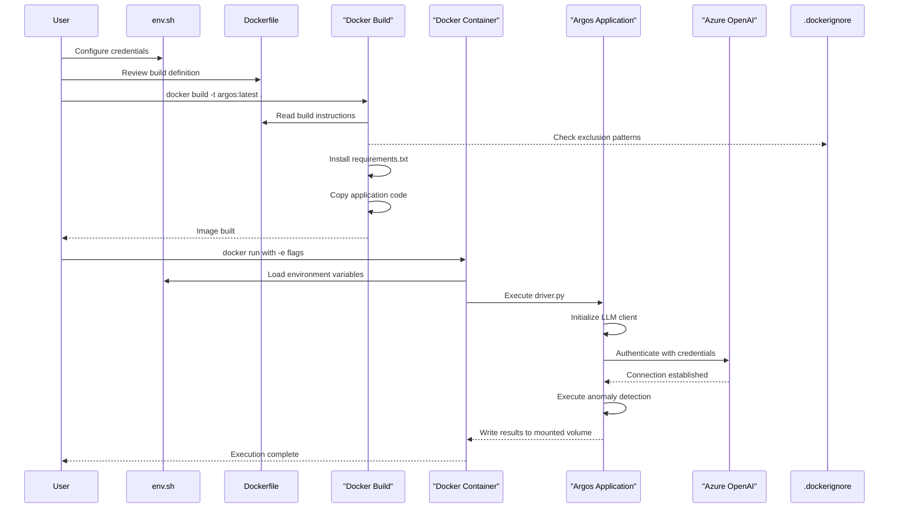

<!-- source: DeepWiki mcp.deepwiki.com · repo microsoft/argos · page 6 Deployment and Configuration · fetched 2026-10-26 -->

# Deployment and Configuration

<details>
<summary>Relevant source files</summary>

The following files were used as context for generating this wiki page:

- [.dockerignore](.dockerignore)
- [Dockerfile](Dockerfile)
- [env.sh](env.sh)

</details>


This document describes how to deploy Argos using Docker containerization and configure the system using environment variables. It covers the Docker build process, container execution, and the configuration of Azure OpenAI API credentials required for LLM integration.

For information about setting up the Python environment and installing dependencies locally (non-Docker), see [Installation](#2.1). For details about Azure OpenAI integration and LLM client usage, see [Base Agent and LLM Integration](#4.3).

## Overview

Argos supports two deployment approaches:

| Deployment Method | Use Case | Configuration Files |
|------------------|----------|-------------------|
| Local Python | Development and quick testing | `env.sh`, `requirements.txt` |
| Docker Container | Production deployment and reproducible environments | `Dockerfile`, `.dockerignore`, `env.sh` |

Both approaches require configuration of Azure OpenAI API credentials via environment variables defined in `env.sh`.

**Sources:** [Dockerfile:1-18](), [env.sh:1-3]()

## Docker Deployment

### Dockerfile Structure

The Argos Docker image is built from the official Python 3.10 base image running on Debian Bookworm. The build process follows a standard multi-step pattern:



The Dockerfile defines the following layers:

| Layer | Command | Purpose |
|-------|---------|---------|
| Base | `FROM python:3.10-bookworm` | Provides Python 3.10 runtime on Debian |
| Working Directory | `WORKDIR /argos` | Sets `/argos` as the container's working directory |
| Dependencies | `COPY requirements.txt` + `RUN pip install` | Installs Python packages without caching to reduce image size |
| Application | `COPY . .` | Copies all application code (filtered by `.dockerignore`) |
| Entrypoint | `CMD ["python3", "utility/test.py"]` | Default execution command (can be overridden) |

**Sources:** [Dockerfile:1-18]()

### Docker Ignore Patterns

The `.dockerignore` file excludes unnecessary files from the Docker build context, reducing image size and build time:



The exclusion patterns serve specific purposes:

| Pattern | File Type | Reason for Exclusion |
|---------|-----------|---------------------|
| `var/` | Runtime data | Environment-specific, should not be baked into image |
| `**/__pycache__`, `*.pyc`, `*.pyo`, `*.pyd` | Python bytecode | Regenerated at runtime, unnecessary in image |
| `**/.git`, `**/.gitmodules` | Git metadata | Not needed in production container |
| `.github/`, `.azure-pipelines/` | CI/CD configs | Infrastructure code, not application code |
| `generated_rules/` | Output artifacts | Generated during execution, not build time |

**Sources:** [.dockerignore:1-20]()

### Building and Running the Container

To build the Docker image:

```bash
docker build -t argos:latest .
```

This command creates an image tagged as `argos:latest` using the [Dockerfile:1-18]() in the current directory.

To run the container with custom command (overriding the default `CMD`):

```bash
docker run --rm \
  -e OPENAI_AZURE_ENDPOINT=${OPENAI_AZURE_ENDPOINT} \
  -e OPENAI_AZURE_API_KEY=${OPENAI_AZURE_API_KEY} \
  -e OPENAI_AZURE_API_VERSION=${OPENAI_AZURE_API_VERSION} \
  -v $(pwd)/data:/argos/data \
  -v $(pwd)/generated_rules:/argos/generated_rules \
  argos:latest \
  python3 driver.py --mode train-LLM-only --dataset_name example
```

Key runtime considerations:

- **Environment Variables**: Pass Azure OpenAI credentials via `-e` flags
- **Volume Mounts**: Mount `data/` for input datasets and `generated_rules/` for output persistence
- **Command Override**: Specify `python3 driver.py` with desired arguments to override default `utility/test.py`

**Sources:** [Dockerfile:1-18]()

## Configuration

### Environment Variables

Argos requires three environment variables for Azure OpenAI API authentication:



The `env.sh` file provides a template for configuring these variables:

| Variable | Purpose | Example Value |
|----------|---------|---------------|
| `OPENAI_AZURE_ENDPOINT` | Azure OpenAI service endpoint URL | `https://your-resource.openai.azure.com/` |
| `OPENAI_AZURE_API_KEY` | Authentication key for Azure OpenAI | `a1b2c3d4e5f6...` |
| `OPENAI_AZURE_API_VERSION` | API version string | `2023-05-15` or `2024-02-15-preview` |

To configure locally:

1. Copy `env.sh` to a local version (e.g., `env.local.sh`)
2. Replace placeholder values with actual credentials
3. Source the file: `source env.local.sh`
4. Run Argos: `python3 driver.py [arguments]`

**Important**: The `env.sh` file in the repository contains placeholder values (`YOUR_ENDPOINT`, `YOUR_API_KEY`, `YOUR_API_VERSION`) that must be replaced with valid credentials before use. Never commit actual credentials to version control.

**Sources:** [env.sh:1-3]()

### Configuration File Locations

The following table maps configuration aspects to their respective files:

| Configuration Aspect | File | Description |
|---------------------|------|-------------|
| Azure OpenAI Credentials | `env.sh` | Environment variable template for API authentication |
| Python Dependencies | `requirements.txt` | Package dependencies for pip installation |
| Docker Build Context | `.dockerignore` | Patterns for excluding files from Docker builds |
| Container Definition | `Dockerfile` | Docker image build instructions |

For detailed information about Python dependencies, see [Dependencies](#7.1). For editor and code style configuration (`.editorconfig`), see [Code Style and Standards](#7.3).

**Sources:** [env.sh:1-3](), [Dockerfile:1-18](), [.dockerignore:1-20]()

### Configuration Flow in Docker Deployment

The complete configuration and deployment flow when using Docker:



This flow demonstrates:

1. **Pre-Build**: User configures `env.sh` with actual Azure OpenAI credentials
2. **Build Time**: Docker reads `Dockerfile`, applies `.dockerignore` patterns, installs dependencies, and creates image
3. **Runtime**: Container receives environment variables, initializes the LLM client with credentials, and executes the anomaly detection workflow
4. **Output**: Results are persisted to mounted volumes for access outside the container

**Sources:** [env.sh:1-3](), [Dockerfile:1-18](), [.dockerignore:1-20]()

### Security Considerations

When deploying Argos, follow these security best practices:

| Practice | Implementation | Rationale |
|----------|----------------|-----------|
| Credential Management | Never commit `env.sh` with real credentials; use `.gitignore` | Prevents credential exposure in version control |
| Environment Isolation | Use separate Azure OpenAI keys for dev/staging/production | Limits blast radius of compromised credentials |
| Container Security | Run containers as non-root user (not implemented in current Dockerfile) | Reduces attack surface if container is compromised |
| Volume Permissions | Mount volumes with appropriate permissions | Prevents unauthorized access to input/output data |

For information about reporting security vulnerabilities, see [Security Policy](#8.2).

**Sources:** [env.sh:1-3](), [Dockerfile:1-18]()

---

