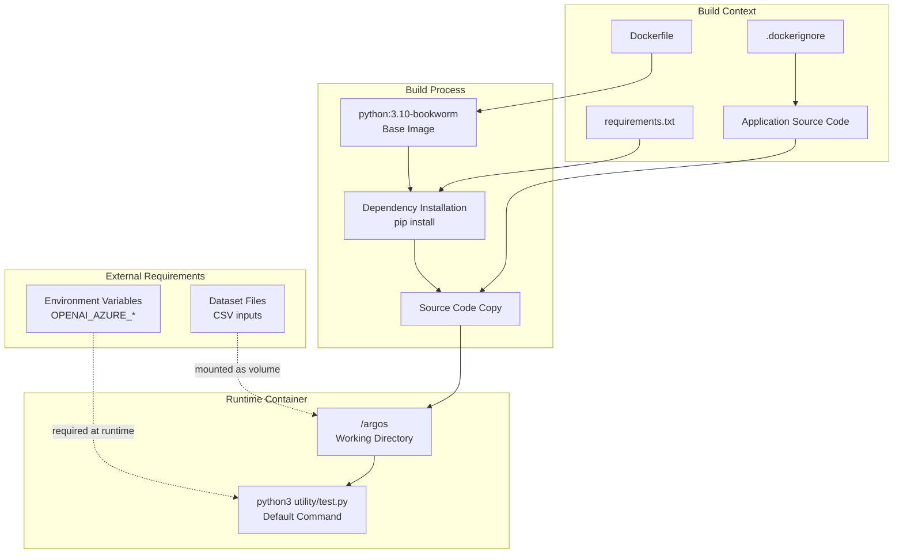
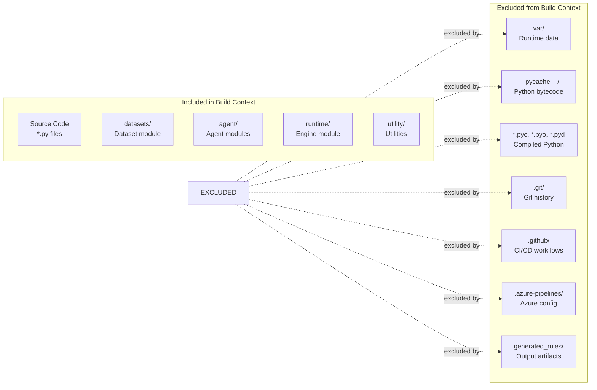
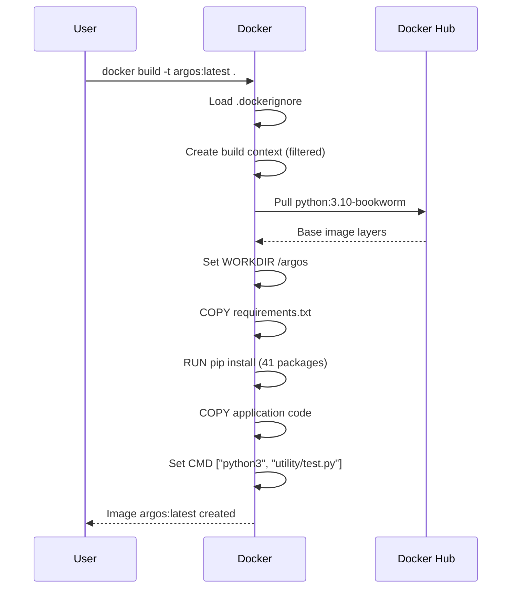
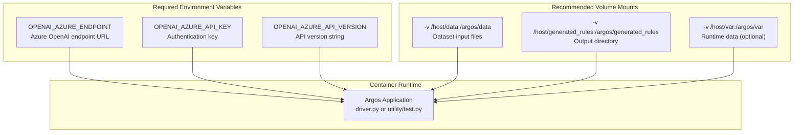

<!-- source: DeepWiki mcp.deepwiki.com · repo microsoft/argos · page 6.1 Docker Deployment · fetched 2026-10-26 -->

# Docker Deployment

<details>
<summary>Relevant source files</summary>

The following files were used as context for generating this wiki page:

- [.dockerignore](.dockerignore)
- [Dockerfile](Dockerfile)
- [requirements.txt](requirements.txt)

</details>


## Purpose and Scope

This document explains how to deploy Argos using Docker containerization. It covers the Dockerfile structure, build process, runtime configuration, and Docker-specific settings. For information about environment variables and general configuration settings, see [Configuration Files](#6.2). For details on Python dependencies installed in the Docker image, see [Dependencies](#7.1).

---

## Overview

Argos provides a Docker-based deployment option that packages the application and all its dependencies into a containerized environment. The Docker configuration is designed to create a reproducible runtime environment based on Python 3.10 running on Debian Bookworm.



**Sources**: [Dockerfile:1-18](), [.dockerignore:1-20]()

---

## Dockerfile Structure

The Dockerfile follows a straightforward multi-stage approach optimized for Python applications:

### Base Image Selection

```dockerfile
FROM python:3.10-bookworm
```

The container is built on the official Python 3.10 image based on Debian Bookworm. This provides:
- Python 3.10.x runtime (required for compatibility with dependencies)
- Debian stable base with security patches
- Standard system libraries needed by scientific Python packages

**Sources**: [Dockerfile:1-2]()

### Working Directory Setup

```dockerfile
WORKDIR /argos
```

All application code and operations execute within the `/argos` directory inside the container. This directory serves as the base path for all relative file operations performed by the application.

**Sources**: [Dockerfile:4-5]()

### Dependency Installation

```dockerfile
COPY requirements.txt .
RUN pip install --no-cache-dir -r requirements.txt
```

The dependency installation follows Docker best practices:

| Step | Purpose |
|------|---------|
| Copy `requirements.txt` first | Enables Docker layer caching - dependencies only rebuild when requirements change |
| Use `--no-cache-dir` flag | Reduces image size by not storing pip cache |
| Install before copying source | Source code changes don't trigger dependency reinstallation |

The `requirements.txt` file specifies 41 Python packages including core dependencies:

| Category | Key Packages |
|----------|-------------|
| Data Processing | `pandas==2.2.2`, `numpy==1.26.4` |
| Machine Learning | `scikit-learn==1.5.1`, `scipy==1.14.0` |
| Statistical Analysis | `statsmodels==0.14.2`, `arch==7.0.0` |
| Visualization | `matplotlib==3.9.0`, `pillow==10.4.0` |
| LLM Integration | `openai==1.35.9` |
| HTTP Client | `httpx==0.27.0`, `requests==2.32.4` |

**Sources**: [Dockerfile:7-11](), [requirements.txt:1-41]()

### Application Code Copy

```dockerfile
COPY . .
```

This command copies the entire application codebase into the `/argos` directory. Files and directories excluded by `.dockerignore` are not copied, reducing the final image size.

**Sources**: [Dockerfile:13-14]()

### Default Command

```dockerfile
CMD ["python3", "utility/test.py"]
```

The default command executes `utility/test.py` when the container starts. This can be overridden at runtime by providing a different command to `docker run`.

**Sources**: [Dockerfile:16-18]()

---

## Docker Context Management

The `.dockerignore` file controls which files are excluded from the Docker build context, reducing build time and image size:



### Exclusion Categories

| Pattern | Reason for Exclusion |
|---------|---------------------|
| `var/` | Runtime-generated data directory |
| `**/__pycache__`, `*.pyc`, `*.pyo`, `*.pyd` | Python bytecode - regenerated at runtime |
| `**/.git`, `**/.gitmodules` | Version control metadata - not needed in container |
| `.github/`, `.azure-pipelines/` | CI/CD configuration - only for repository workflows |
| `generated_rules` | Output directory - populated during runtime, not needed at build time |

**Note**: The line `!/.git` (line 11) appears to selectively include the `.git` directory at the root, though this is overridden by the earlier `**/.git` exclusion pattern. This may be vestigial configuration.

**Sources**: [.dockerignore:1-20]()

---

## Building the Docker Image

To build the Docker image, execute the following command from the repository root:

```bash
docker build -t argos:latest .
```

### Build Process Flow



### Build Options

| Flag | Purpose | Example |
|------|---------|---------|
| `-t` | Tag the image with a name | `-t argos:v1.0` |
| `--no-cache` | Force rebuild without using cache | `--no-cache` |
| `--build-arg` | Pass build-time variables | `--build-arg VERSION=1.0` |
| `-f` | Specify alternative Dockerfile | `-f Dockerfile.prod` |

**Sources**: [Dockerfile:1-18]()

---

## Running the Container

### Basic Execution

To run the container with default settings:

```bash
docker run argos:latest
```

This executes the default command `python3 utility/test.py`.

### Running with Driver.py

To run the main Argos application via `driver.py`, override the default command:

```bash
docker run \
  -e OPENAI_AZURE_ENDPOINT="https://your-endpoint.openai.azure.com/" \
  -e OPENAI_AZURE_API_KEY="your-api-key" \
  -e OPENAI_AZURE_API_VERSION="2024-02-15-preview" \
  -v $(pwd)/data:/argos/data \
  -v $(pwd)/generated_rules:/argos/generated_rules \
  argos:latest \
  python3 driver.py --mode train-LLM-only --dataset KPI
```

### Runtime Configuration Requirements



### Volume Mounting Strategy

| Mount Point | Purpose | Required |
|------------|---------|----------|
| `/argos/data` | Input dataset CSV files | Yes (for non-test modes) |
| `/argos/generated_rules` | Output directory for generated detection rules | Yes (for training modes) |
| `/argos/var` | Runtime data and intermediate results | Optional |

**Example with all mounts:**

```bash
docker run \
  -e OPENAI_AZURE_ENDPOINT="$OPENAI_AZURE_ENDPOINT" \
  -e OPENAI_AZURE_API_KEY="$OPENAI_AZURE_API_KEY" \
  -e OPENAI_AZURE_API_VERSION="$OPENAI_AZURE_API_VERSION" \
  -v $(pwd)/data:/argos/data \
  -v $(pwd)/generated_rules:/argos/generated_rules \
  -v $(pwd)/var:/argos/var \
  argos:latest \
  python3 driver.py \
    --mode train-LLM-only \
    --dataset KPI \
    --train_chunk_len 1000 \
    --num_iterations 5
```

**Sources**: [Dockerfile:16-18]()

---

## Environment Variable Configuration

The container requires Azure OpenAI API credentials to be passed as environment variables. These can be provided via:

### Option 1: Command Line (`-e` flag)

```bash
docker run \
  -e OPENAI_AZURE_ENDPOINT="https://your-endpoint.openai.azure.com/" \
  -e OPENAI_AZURE_API_KEY="your-api-key" \
  -e OPENAI_AZURE_API_VERSION="2024-02-15-preview" \
  argos:latest
```

### Option 2: Environment File (`--env-file`)

Create a file named `.env`:

```
OPENAI_AZURE_ENDPOINT=https://your-endpoint.openai.azure.com/
OPENAI_AZURE_API_KEY=your-api-key
OPENAI_AZURE_API_VERSION=2024-02-15-preview
```

Run with:

```bash
docker run --env-file .env argos:latest
```

### Option 3: Docker Compose

Create `docker-compose.yml`:

```yaml
version: '3.8'
services:
  argos:
    build: .
    environment:
      - OPENAI_AZURE_ENDPOINT=${OPENAI_AZURE_ENDPOINT}
      - OPENAI_AZURE_API_KEY=${OPENAI_AZURE_API_KEY}
      - OPENAI_AZURE_API_VERSION=${OPENAI_AZURE_API_VERSION}
    volumes:
      - ./data:/argos/data
      - ./generated_rules:/argos/generated_rules
    command: python3 driver.py --mode train-LLM-only --dataset KPI
```

Run with:

```bash
docker-compose up
```

**Sources**: [Dockerfile:1-18]()

---

## Image Size Optimization

The Docker image can be optimized by:

### Current Optimizations

| Technique | Implementation | Benefit |
|-----------|---------------|---------|
| `.dockerignore` exclusions | Excludes `__pycache__`, `.git`, `generated_rules` | Reduces build context size |
| `--no-cache-dir` pip flag | Disables pip cache storage | Reduces image size by ~100-200 MB |
| Layer caching | Copies `requirements.txt` before source code | Faster rebuilds when only code changes |

### Additional Optimization Opportunities

The current Dockerfile uses a full Python image (`python:3.10-bookworm`). For production deployments with size constraints, consider:

1. **Multi-stage build**: Build dependencies in one stage, copy only necessary artifacts to a slim runtime stage
2. **Alpine base**: Use `python:3.10-alpine` for smaller base image (requires compilation of some dependencies)
3. **Dependency audit**: Remove unused packages from `requirements.txt` if not needed for specific deployment scenarios

**Sources**: [Dockerfile:1-18](), [.dockerignore:1-20](), [requirements.txt:1-41]()

---

## Interactive Development Mode

For development and debugging, run the container in interactive mode with a shell:

```bash
docker run -it \
  -e OPENAI_AZURE_ENDPOINT="$OPENAI_AZURE_ENDPOINT" \
  -e OPENAI_AZURE_API_KEY="$OPENAI_AZURE_API_KEY" \
  -e OPENAI_AZURE_API_VERSION="$OPENAI_AZURE_API_VERSION" \
  -v $(pwd):/argos \
  argos:latest \
  /bin/bash
```

This mounts the entire current directory into `/argos`, allowing code changes on the host to be immediately reflected in the container without rebuilding.

**Sources**: [Dockerfile:4-5]()

---

## Troubleshooting

### Common Issues

| Problem | Cause | Solution |
|---------|-------|----------|
| `ModuleNotFoundError` | Dependencies not installed | Rebuild image: `docker build --no-cache -t argos:latest .` |
| `FileNotFoundError` for datasets | Dataset directory not mounted | Add volume mount: `-v $(pwd)/data:/argos/data` |
| Azure OpenAI authentication errors | Missing environment variables | Ensure all three `OPENAI_AZURE_*` variables are set |
| Permission denied writing outputs | Volume mount permissions | Run with user mapping: `--user $(id -u):$(id -g)` |
| Container exits immediately | Default command completes | Override CMD: `docker run argos:latest python3 driver.py ...` |

### Debugging Container State

To inspect a running or stopped container:

```bash
# View logs
docker logs <container_id>

# Execute commands in running container
docker exec -it <container_id> /bin/bash

# Inspect container configuration
docker inspect <container_id>

# View processes in container
docker top <container_id>
```

**Sources**: [Dockerfile:1-18]()

---

## Security Considerations

When deploying with Docker:

1. **Secret Management**: Never hardcode API keys in Dockerfile or commit them to version control. Always use environment variables or secret management tools.

2. **Base Image Updates**: The `python:3.10-bookworm` base image should be periodically updated to receive security patches. Rebuild the image regularly or use automated dependency scanning (see [CI/CD and Automation](#7.2)).

3. **Non-root User**: The current Dockerfile runs as root. For production deployments, consider adding:
   ```dockerfile
   RUN useradd -m -u 1000 argos
   USER argos
   ```

4. **Read-only Filesystem**: Mount source code as read-only if the application doesn't need to write to its own directory:
   ```bash
   docker run -v $(pwd):/argos:ro argos:latest
   ```

**Sources**: [Dockerfile:1-18]()

---

