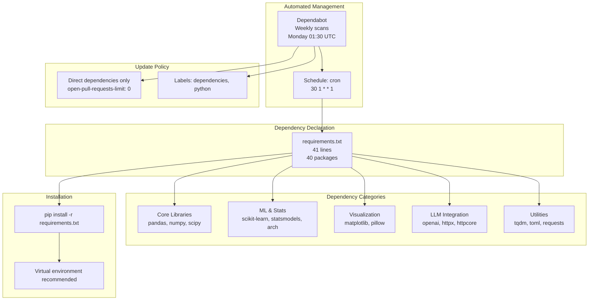
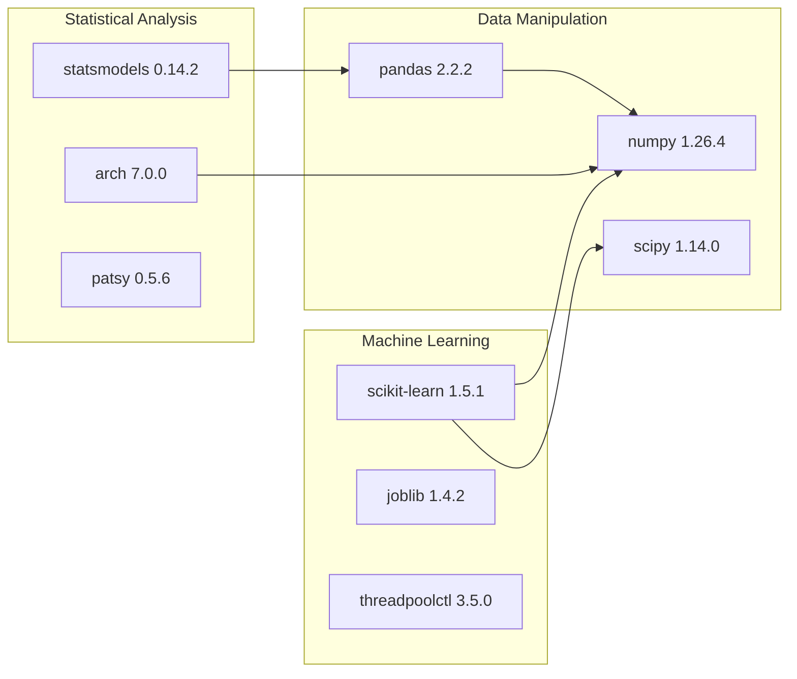
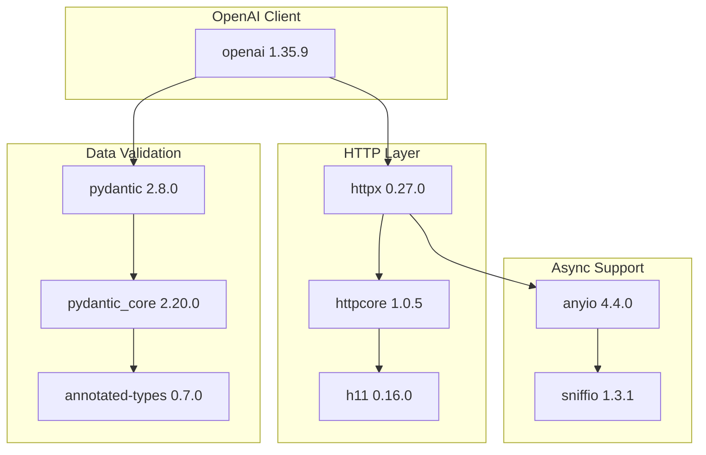
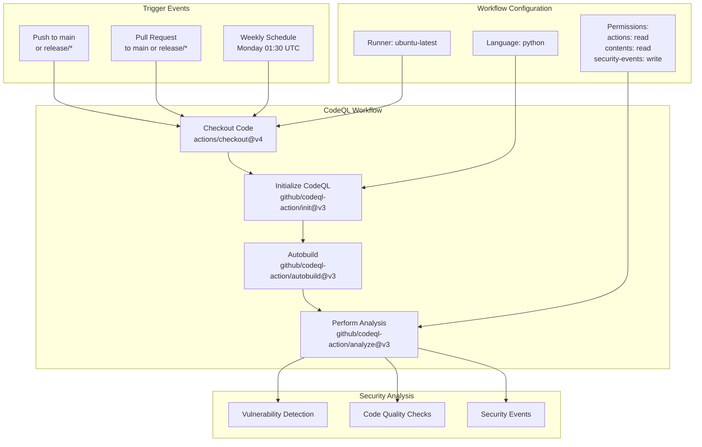
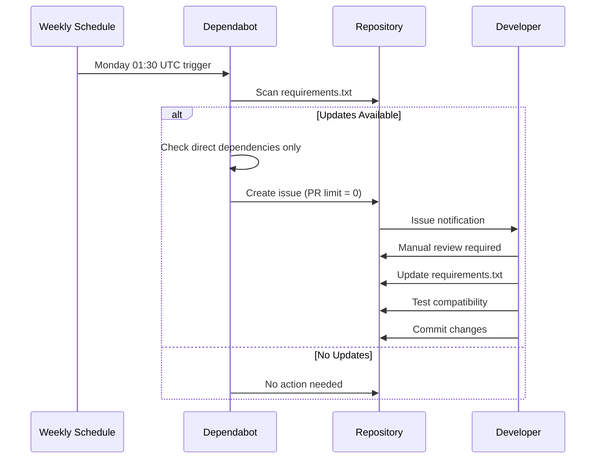
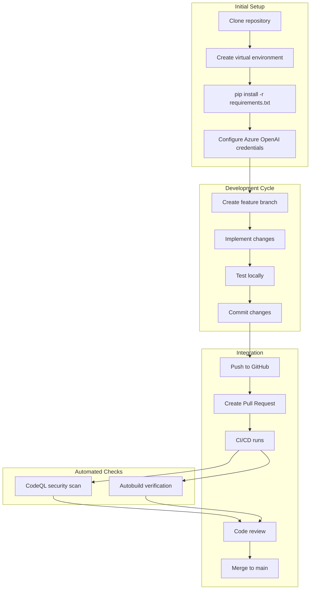
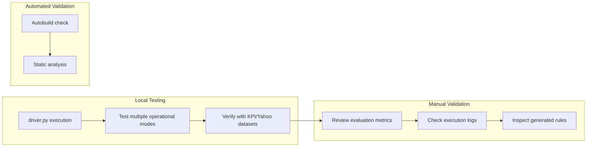

<!-- source: DeepWiki mcp.deepwiki.com · repo microsoft/argos · page 7 Development · fetched 2026-10-26 -->

# Development

<details>
<summary>Relevant source files</summary>

The following files were used as context for generating this wiki page:

- [.github/dependabot.yml](.github/dependabot.yml)
- [.github/workflows/codeql-analysis.yml](.github/workflows/codeql-analysis.yml)
- [requirements.txt](requirements.txt)

</details>


## Purpose and Scope

This document provides an overview of the development environment, tools, and practices for contributors working on the Argos codebase. It covers the general development setup, dependency management strategy, automated workflows, and quality assurance mechanisms.

For detailed information about specific topics:
- Python dependencies and their purposes: see [Dependencies](#7.1)
- GitHub Actions workflows and automation: see [CI/CD and Automation](#7.2)
- Coding standards and editor configuration: see [Code Style and Standards](#7.3)

**Sources**: [.github/dependabot.yml](), [.github/workflows/codeql-analysis.yml](), [requirements.txt]()

---

## Development Environment

Argos is a Python-based system that requires Python 3.x and a set of scientific computing and machine learning libraries. The development environment consists of:

| Component | Purpose |
|-----------|---------|
| Python 3.x | Runtime environment |
| pip | Package management |
| Azure OpenAI API | External LLM service integration |
| GitHub Actions | CI/CD automation |
| Dependabot | Automated dependency updates |
| CodeQL | Security vulnerability scanning |

The project maintains a minimal development setup focused on ensuring reproducible environments and maintaining dependency freshness through automation.

**Sources**: [requirements.txt](), [.github/dependabot.yml](), [.github/workflows/codeql-analysis.yml]()

---

## Dependency Management Architecture

The following diagram illustrates how dependencies are managed and updated in the Argos project:



**Dependency Management Strategy**

Argos uses a conservative dependency management approach configured in [.github/dependabot.yml:1-14]():

- **Package ecosystem**: pip (Python)
- **Scan frequency**: Weekly on Mondays at 01:30 UTC
- **Update scope**: Direct dependencies only (not transitive)
- **PR limit**: 0 (updates are tracked but PRs not automatically created)
- **Labels**: `dependencies` and `python` for organization

**Sources**: [.github/dependabot.yml:1-14](), [requirements.txt:1-41]()

---

## Core Dependencies

The [requirements.txt:1-41]() file specifies 40 pinned dependencies organized by functional category:

### Data Processing Stack



| Package | Version | Purpose |
|---------|---------|---------|
| `pandas` | 2.2.2 | Time-series data manipulation and CSV processing |
| `numpy` | 1.26.4 | Numerical array operations |
| `scipy` | 1.14.0 | Scientific computing functions |
| `scikit-learn` | 1.5.1 | Evaluation metrics (F1, precision, recall) |
| `statsmodels` | 0.14.2 | Statistical modeling and time-series analysis |
| `arch` | 7.0.0 | Advanced time-series models |

**Sources**: [requirements.txt:18-18](), [requirements.txt:21-21](), [requirements.txt:30-31](), [requirements.txt:34-34](), [requirements.txt:3-3]()

### LLM Integration Stack



| Package | Version | Purpose |
|---------|---------|---------|
| `openai` | 1.35.9 | Azure OpenAI API client |
| `httpx` | 0.27.0 | Modern HTTP client with async support |
| `httpcore` | 1.0.5 | Low-level HTTP transport |
| `pydantic` | 2.8.0 | Data validation for API responses |
| `anyio` | 4.4.0 | Async I/O abstraction layer |

**Sources**: [requirements.txt:19-19](), [requirements.txt:13-13](), [requirements.txt:12-12](), [requirements.txt:24-25](), [requirements.txt:2-2]()

### Visualization Stack

| Package | Version | Purpose |
|---------|---------|---------|
| `matplotlib` | 3.9.0 | Time-series plotting and visualization |
| `pillow` | 10.4.0 | Image processing for ImageAgent |
| `contourpy` | 1.2.1 | Contour calculations for plots |
| `fonttools` | 4.53.0 | Font rendering support |

**Sources**: [requirements.txt:17-17](), [requirements.txt:23-23](), [requirements.txt:6-6](), [requirements.txt:10-10]()

### Utility Dependencies

| Package | Version | Purpose |
|---------|---------|---------|
| `requests` | 2.32.4 | HTTP requests for data fetching |
| `tqdm` | 4.66.4 | Progress bar displays |
| `toml` | 0.10.2 | Configuration file parsing |

**Sources**: [requirements.txt:29-29](), [requirements.txt:37-37](), [requirements.txt:36-36]()

---

## Continuous Integration Pipeline

Argos employs GitHub Actions for automated quality assurance. The CI pipeline architecture:



**CodeQL Security Scanning**

The [.github/workflows/codeql-analysis.yml:1-39]() workflow provides automated security analysis:

**Trigger Conditions**:
- Push events to `main` or `release/*` branches
- Pull requests targeting `main` or `release/*` branches
- Weekly schedule: Mondays at 01:30 UTC

**Workflow Steps**:
1. **Checkout**: Uses `actions/checkout@v4` to retrieve code
2. **Initialize**: Configures CodeQL for Python analysis
3. **Autobuild**: Automatically builds the Python project
4. **Analyze**: Scans code for security vulnerabilities and quality issues

**Permissions**:
- `actions: read` - Read workflow information
- `contents: read` - Access repository contents
- `security-events: write` - Write security scan results

**Sources**: [.github/workflows/codeql-analysis.yml:1-39]()

---

## Dependency Update Workflow



**Dependabot Configuration**

The [.github/dependabot.yml:1-14]() file configures automated dependency scanning:

```yaml
package-ecosystem: "pip"
directory: "/"
schedule:
  interval: "cron"
  cronjob: "30 1 * * 1"
open-pull-requests-limit: 0
allow:
  - dependency-type: "direct"
labels:
  - "dependencies"
  - "python"
```

**Key Configuration Parameters**:
- **Ecosystem**: pip (Python package manager)
- **Directory**: Root directory scan
- **Schedule**: Cron expression `30 1 * * 1` (weekly Monday scan)
- **PR Limit**: 0 (notifications only, no automatic PRs)
- **Scope**: Direct dependencies only (excludes transitive dependencies)
- **Labels**: Automatically tags with `dependencies` and `python`

This configuration ensures dependency freshness is monitored without creating automatic pull requests, allowing developers to review and test updates manually before integration.

**Sources**: [.github/dependabot.yml:1-14]()

---

## Development Workflow

The typical development workflow for contributors:



**Development Steps**:

1. **Environment Setup**:
   - Clone the repository from `https://github.com/microsoft/argos`
   - Create a Python virtual environment
   - Install dependencies: `pip install -r requirements.txt`
   - Configure Azure OpenAI API credentials (see [Installation](#2.1))

2. **Code Development**:
   - Create a feature branch from `main`
   - Implement changes following code standards (see [Code Style and Standards](#7.3))
   - Test changes locally using [driver.py]()

3. **Submission**:
   - Push changes to GitHub
   - Create a Pull Request targeting `main` or `release/*`
   - Automated CI/CD workflows execute
   - Address code review feedback

4. **Automated Validation**:
   - CodeQL scans for security vulnerabilities
   - Autobuild verifies project buildability
   - Security events are logged if issues found

**Sources**: [.github/workflows/codeql-analysis.yml:1-39](), [requirements.txt:1-41]()

---

## Quality Assurance Mechanisms

Argos employs multiple layers of quality assurance:

| Mechanism | Frequency | Purpose | Configuration |
|-----------|-----------|---------|---------------|
| CodeQL Security Scanning | On push, PR, weekly | Detect security vulnerabilities | [.github/workflows/codeql-analysis.yml]() |
| Dependabot Monitoring | Weekly (Mon 01:30 UTC) | Track dependency updates | [.github/dependabot.yml]() |
| Autobuild Verification | On push, PR | Ensure project builds correctly | [.github/workflows/codeql-analysis.yml:36-36]() |
| Manual Testing | Developer-driven | Functional validation | Local execution via [driver.py]() |

**Security Analysis Details**:

The CodeQL workflow performs static analysis to identify:
- Common vulnerability patterns (SQL injection, XSS, etc.)
- Code quality issues (unused variables, unreachable code)
- Security best practice violations
- Potential runtime errors

Results are written to the repository's security events log with `security-events: write` permission [.github/workflows/codeql-analysis.yml:22-22]().

**Sources**: [.github/workflows/codeql-analysis.yml:19-22](), [.github/dependabot.yml:1-14]()

---

## Testing Strategy

While the repository does not include a dedicated test suite, Argos employs the following validation approaches:



**Validation Approaches**:

1. **Functional Testing**: Run [driver.py]() with various modes (train-LLM-only, eval-combined, etc.)
2. **Dataset Testing**: Validate using standard KPI and Yahoo benchmark datasets
3. **Metric Validation**: Verify F1 scores, precision, and recall calculations
4. **Build Verification**: Autobuild step ensures code compiles without errors
5. **Security Testing**: CodeQL identifies potential vulnerabilities

Developers should test their changes across multiple operational modes and datasets before submitting pull requests.

**Sources**: [.github/workflows/codeql-analysis.yml:36-38]()

---

## Contributing Guidelines

When contributing to Argos:

1. **Follow the existing architecture**: Maintain the agent-based design pattern (see [Agent Ecosystem](#3.2))
2. **Update dependencies carefully**: Test compatibility across the entire dependency stack
3. **Document changes**: Update relevant wiki pages when adding features
4. **Security-first**: Be mindful of LLM prompt injection and code execution risks
5. **Test thoroughly**: Validate changes across multiple datasets and operational modes

For support and community engagement guidelines, see [Support](#8.1). For code of conduct, see [Code of Conduct](#8.3).

**Sources**: [requirements.txt](), [.github/workflows/codeql-analysis.yml](), [.github/dependabot.yml]()

---

