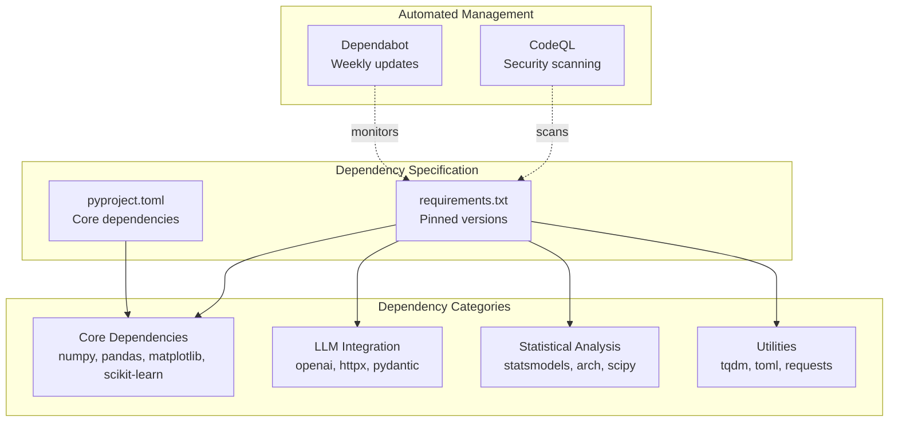
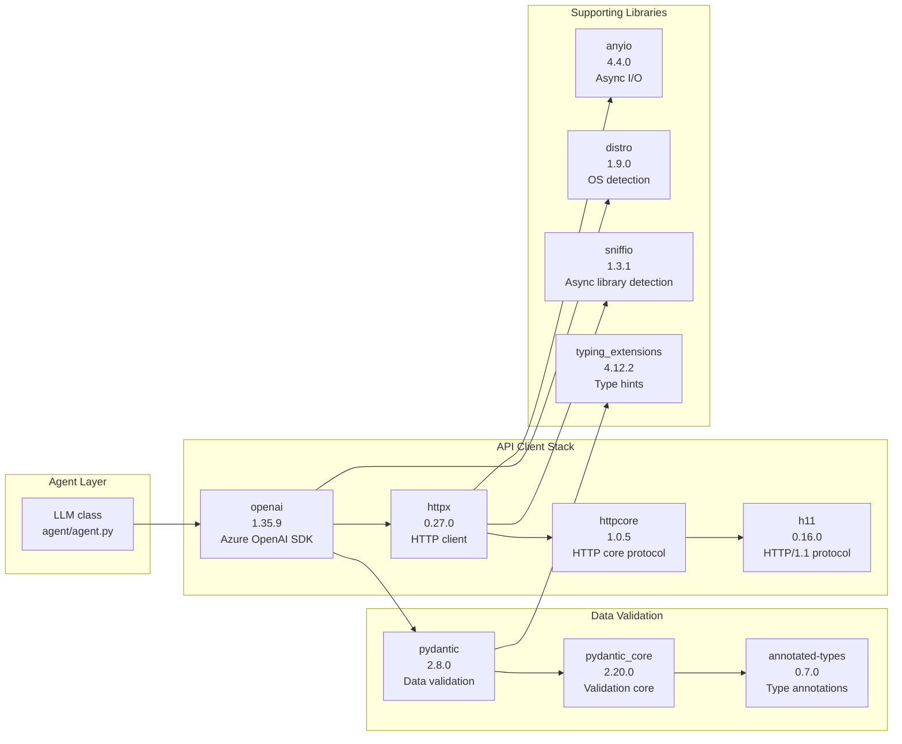
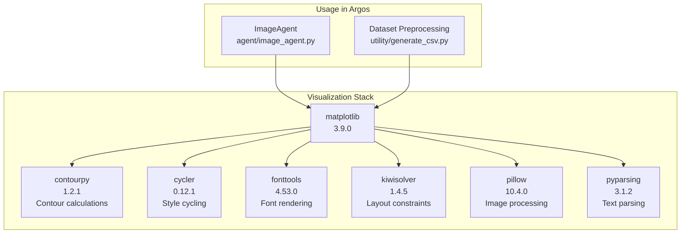

<!-- source: DeepWiki mcp.deepwiki.com · repo microsoft/argos · page 7.1 Dependencies · fetched 2026-10-26 -->

# Dependencies

<details>
<summary>Relevant source files</summary>

The following files were used as context for generating this wiki page:

- [pyproject.toml](pyproject.toml)
- [requirements.txt](requirements.txt)

</details>


This page documents the Python dependencies used by Argos, their purposes, and the dependency management strategy. Understanding these dependencies is essential for developers who need to maintain, extend, or troubleshoot the system.

For information about automated dependency updates and security scanning, see [CI/CD and Automation](#7.2). For instructions on installing these dependencies, see [Installation](#2.1).

**Sources**: [requirements.txt:1-41]()

## Dependency Management Strategy

Argos uses two files to manage its Python dependencies:

- **requirements.txt**: Contains the complete dependency tree with pinned versions for reproducible installations
- **pyproject.toml**: Defines core runtime dependencies and project metadata

The `requirements.txt` file pins exact versions of all dependencies and their transitive dependencies, ensuring that installations are reproducible across different environments. This approach prevents unexpected behavior from dependency updates while allowing controlled upgrades through automated tools like Dependabot.

The `pyproject.toml` file specifies only the top-level dependencies required for the core agent functionality: `matplotlib`, `numpy`, `pandas`, and `scikit-learn`. This minimal set represents the essential libraries needed to run the agent system.



**Sources**: [requirements.txt:1-41](), [pyproject.toml:1-39]()

## Core Dependencies

The following table categorizes the primary dependencies by their functional role in the system:

| Dependency | Version | Purpose | Used By |
|------------|---------|---------|---------|
| `openai` | 1.35.9 | Azure OpenAI API client | `agent/agent.py` (LLM class) |
| `pandas` | 2.2.2 | Time-series data manipulation | `datasets/dataset.py`, `common/common.py` |
| `numpy` | 1.26.4 | Numerical computing arrays | All agents, evaluation metrics |
| `matplotlib` | 3.9.0 | Time-series visualization | `agent/image_agent.py`, dataset preprocessing |
| `scikit-learn` | 1.5.1 | Machine learning utilities | `eval_metrics/point_f1.py` |
| `statsmodels` | 0.14.2 | Statistical models and analysis | Generated detection rules |
| `arch` | 7.0.0 | Time-series econometrics | Generated detection rules |
| `scipy` | 1.14.0 | Scientific computing | Statistical calculations |

**Sources**: [requirements.txt:18-34](), [pyproject.toml:30-35]()

## LLM Integration Dependencies

Argos communicates with Azure OpenAI services through a stack of HTTP and API client libraries:



The `openai` library (version 1.35.9) provides the primary interface for interacting with Azure OpenAI's GPT models. It uses `httpx` for HTTP communication, which in turn relies on `httpcore` and `h11` for low-level protocol handling. The `pydantic` library validates API request and response schemas, ensuring type safety in LLM interactions.

**Sources**: [requirements.txt:1-26]()

## Data Processing Dependencies

Argos processes time-series data using a comprehensive scientific Python stack:

| Dependency | Version | Primary Use Case | Key Features |
|------------|---------|------------------|--------------|
| `pandas` | 2.2.2 | Time-series data loading and manipulation | DataFrames, CSV I/O, data chunking |
| `numpy` | 1.26.4 | Numerical array operations | Array indexing, mathematical operations |
| `statsmodels` | 0.14.2 | Statistical modeling | Time-series analysis, regression models |
| `arch` | 7.0.0 | Econometric models | GARCH, volatility modeling |
| `scipy` | 1.14.0 | Scientific algorithms | Statistical tests, signal processing |
| `scikit-learn` | 1.5.1 | ML preprocessing and metrics | Normalization, evaluation metrics |

The `patsy` library (0.5.6) provides statistical formula parsing, typically used by `statsmodels` for model specification.

**Sources**: [requirements.txt:18-34]()

## Visualization Dependencies

Time-series visualization is supported through the `matplotlib` ecosystem:



The `ImageAgent` uses `matplotlib` to generate time-series plots that are then analyzed by GPT-4o vision models. The `pillow` library handles image format conversions and processing.

**Sources**: [requirements.txt:6-23]()

## Utility Dependencies

Supporting utilities provide essential functionality across the system:

| Dependency | Version | Purpose | Usage Pattern |
|------------|---------|---------|---------------|
| `tqdm` | 4.66.4 | Progress bar display | Long-running training loops |
| `requests` | 2.32.4 | HTTP requests | Alternative HTTP client |
| `toml` | 0.10.2 | TOML file parsing | Configuration file reading |
| `joblib` | 1.4.2 | Parallel processing | Efficient pickling/unpickling |
| `threadpoolctl` | 3.5.0 | Thread pool control | Limiting thread usage |
| `packaging` | 24.1 | Version parsing | Dependency version handling |

**Date/Time Handling**:
- `python-dateutil` (2.9.0.post0): Date parsing and manipulation
- `pytz` (2024.1): Timezone definitions
- `tzdata` (2024.1): Timezone database

**HTTP and Networking**:
- `certifi` (2024.7.4): SSL certificate bundle
- `charset-normalizer` (3.3.2): Character encoding detection
- `idna` (3.7): Internationalized domain name support
- `urllib3` (2.5.0): HTTP client library

**Compatibility**:
- `six` (1.16.0): Python 2/3 compatibility utilities
- `typing_extensions` (4.12.2): Backported type hints
- `exceptiongroup` (1.2.1): Exception group handling (Python 3.11+ feature backport)

**Sources**: [requirements.txt:8-40]()

## Dependency-to-Component Mapping

The following diagram maps major dependencies to the Argos components that use them:

```mermaid
graph TB
    subgraph "Agent Components"
        BASE["agent/agent.py<br/>Agent, LLM classes"]
        DETECTION["agent/detection_agent.py<br/>DetectionAgentV3"]
        REPAIR["agent/repair_agent.py<br/>RepairAgent"]
        REVIEW["agent/review_agent.py<br/>ReviewAgent"]
        IMAGE["agent/image_agent.py<br/>ImageAgent"]
    end
    
    subgraph "Data Components"
        DATASET["datasets/dataset.py<br/>ArgosDataset"]
        COMMON["common/common.py<br/>Utility functions"]
    end
    
    subgraph "Evaluation Components"
        METRICS["eval_metrics/point_f1.py<br/>Performance metrics"]
    end
    
    subgraph "Dependencies"
        OPENAI_DEP["openai"]
        PANDAS_DEP["pandas"]
        NUMPY_DEP["numpy"]
        MPL_DEP["matplotlib"]
        SKLEARN_DEP["scikit-learn"]
        STATS_DEP["statsmodels"]
        ARCH_DEP["arch"]
        TQDM_DEP["tqdm"]
    end
    
    BASE --> OPENAI_DEP
    BASE --> NUMPY_DEP
    
    DETECTION --> OPENAI_DEP
    DETECTION --> NUMPY_DEP
    DETECTION --> PANDAS_DEP
    
    REPAIR --> OPENAI_DEP
    
    REVIEW --> OPENAI_DEP
    REVIEW --> NUMPY_DEP
    
    IMAGE --> OPENAI_DEP
    IMAGE --> MPL_DEP
    IMAGE --> NUMPY_DEP
    
    DATASET --> PANDAS_DEP
    DATASET --> NUMPY_DEP
    
    COMMON --> PANDAS_DEP
    COMMON --> NUMPY_DEP
    COMMON --> TQDM_DEP
    
    METRICS --> NUMPY_DEP
    METRICS --> SKLEARN_DEP
    
    DETECTION -.generates_code_using.-> STATS_DEP
    DETECTION -.generates_code_using.-> ARCH_DEP
```



**Sources**: [requirements.txt:1-41]()

## Version Pinning Strategy

All dependencies in `requirements.txt` use exact version pinning (e.g., `numpy==1.26.4` rather than `numpy>=1.26.0`). This strategy provides several benefits:

1. **Reproducibility**: Ensures identical environments across development, testing, and production
2. **Stability**: Prevents unexpected breaking changes from dependency updates
3. **Security**: Allows controlled evaluation of security patches before deployment
4. **Debugging**: Simplifies troubleshooting by eliminating version variations

Dependencies are updated through Dependabot, which runs weekly on Monday at 01:30 UTC. This automated process creates pull requests for version updates, allowing review and testing before merging.

**Sources**: [requirements.txt:1-41]()

## Python Version Requirements

The project specifies Python 3.7 or higher as the minimum version:

```toml
requires-python = ">=3.7"
```

This requirement is declared in `pyproject.toml` and ensures compatibility with modern Python features while maintaining broad accessibility. The version range supports Python 3.7, 3.8, and 3.9 as explicitly listed in the classifiers.

**Sources**: [pyproject.toml:10-22]()

## Transitive Dependencies

Many dependencies in `requirements.txt` are transitive (indirect) dependencies that are automatically installed by top-level packages:

**OpenAI Stack Transitive Dependencies**:
- `httpx`, `httpcore`, `h11` - HTTP communication layers
- `pydantic`, `pydantic_core`, `annotated-types` - Data validation
- `anyio`, `sniffio` - Async I/O support

**Matplotlib Stack Transitive Dependencies**:
- `contourpy`, `cycler`, `fonttools`, `kiwisolver` - Rendering support
- `pillow` - Image processing
- `pyparsing` - Text parsing

**General Transitive Dependencies**:
- `certifi`, `charset-normalizer`, `idna`, `urllib3` - HTTP/networking utilities
- `python-dateutil`, `pytz`, `tzdata` - Date/time handling
- `joblib`, `threadpoolctl` - Parallel processing utilities
- `packaging` - Version parsing
- `six` - Python 2/3 compatibility

While these transitive dependencies are pinned in `requirements.txt`, they are not listed in `pyproject.toml` as they are automatically resolved by the package manager.

**Sources**: [requirements.txt:1-41](), [pyproject.toml:30-35]()

## Security Considerations

Security vulnerabilities in dependencies are monitored through two mechanisms:

1. **Dependabot Security Updates**: Automatically creates PRs for known security vulnerabilities
2. **CodeQL Analysis**: Scans for security issues in dependency usage patterns

When security updates are available, Dependabot prioritizes them over regular version updates, creating pull requests that should be reviewed and merged promptly.

For details on the security policy and vulnerability reporting, see [Security Policy](#8.2).

**Sources**: [requirements.txt:1-41]()

---

