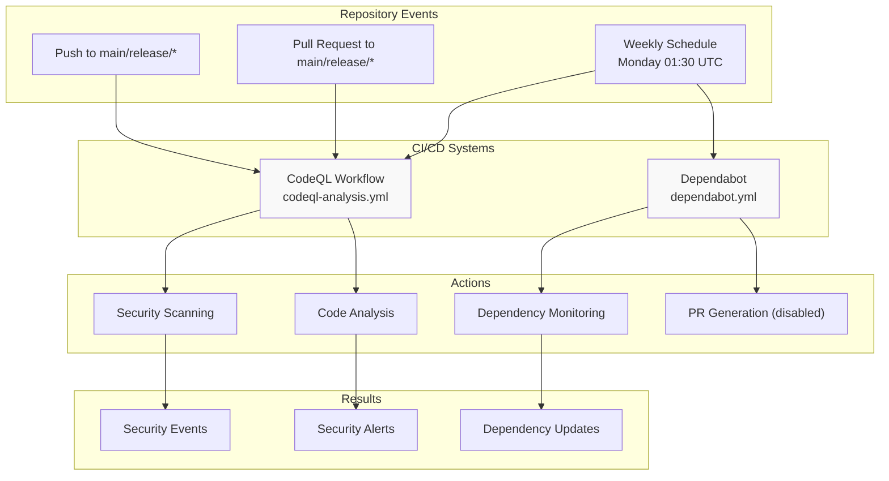
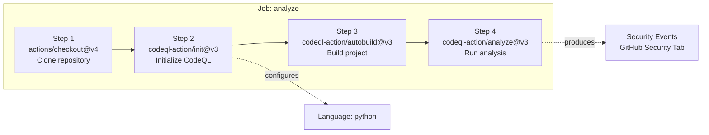
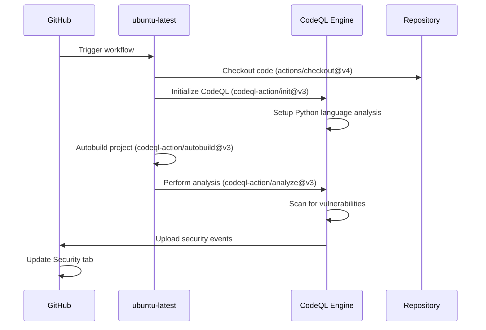
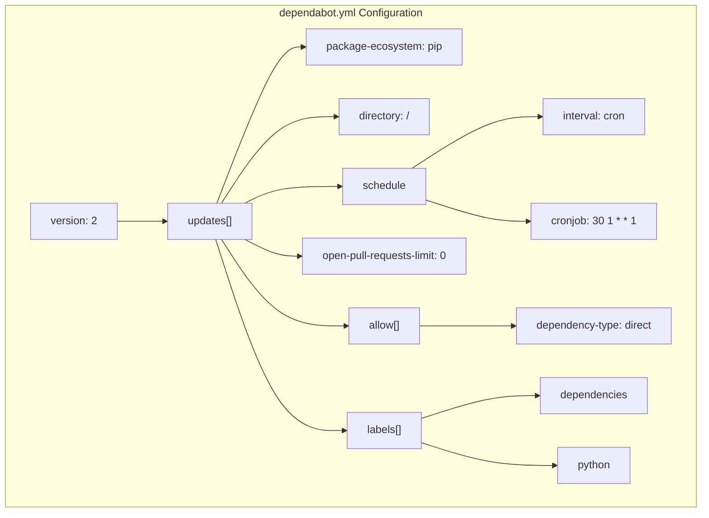
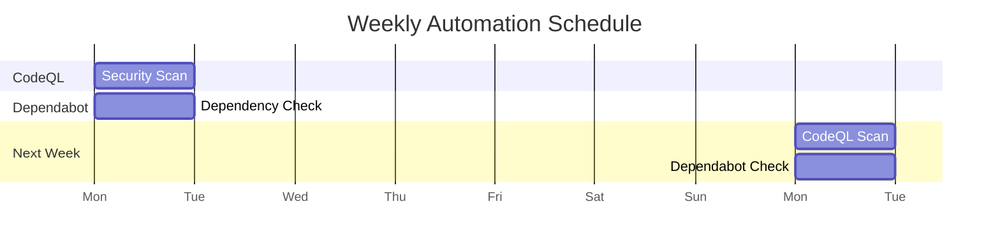
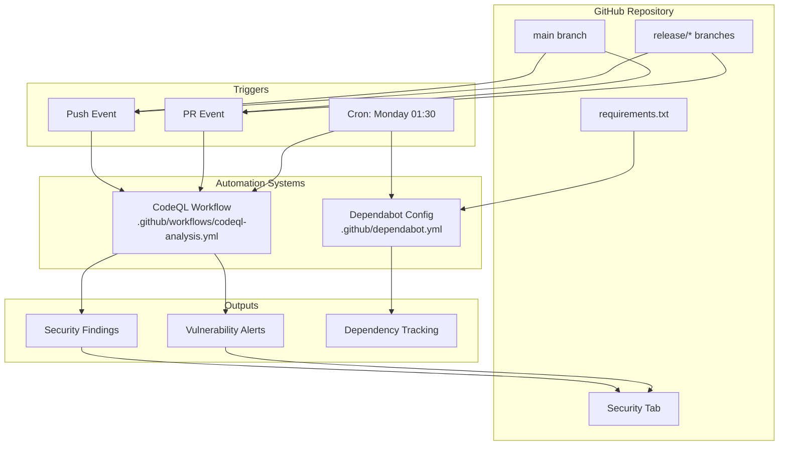

<!-- source: DeepWiki mcp.deepwiki.com · repo microsoft/argos · page 7.2 CI/CD and Automation · fetched 2026-10-26 -->

# CI/CD and Automation

<details>
<summary>Relevant source files</summary>

The following files were used as context for generating this wiki page:

- [.github/dependabot.yml](.github/dependabot.yml)
- [.github/workflows/codeql-analysis.yml](.github/workflows/codeql-analysis.yml)
- [requirements.txt](requirements.txt)

</details>


This document describes the continuous integration, continuous deployment (CI/CD), and automation infrastructure for the Argos project. It covers GitHub Actions workflows for security scanning and automated dependency management through Dependabot.

For information about project dependencies themselves, see [Dependencies](#7.1). For coding standards and development practices, see [Code Style and Standards](#7.3).

---

## Overview

Argos employs two primary automation systems:

1. **CodeQL Security Scanning** - Automated static analysis security testing (SAST) using GitHub's CodeQL engine
2. **Dependabot** - Automated dependency update monitoring and pull request generation

Both systems operate on automated schedules and respond to repository events, ensuring continuous security posture and dependency freshness.



**Sources:** [.github/workflows/codeql-analysis.yml:1-39](), [.github/dependabot.yml:1-14]()

---

## CodeQL Security Scanning

CodeQL performs automated security vulnerability detection through static code analysis. The workflow is defined in `.github/workflows/codeql-analysis.yml` and analyzes Python code for security issues.

### Workflow Triggers

The CodeQL workflow executes under three conditions:

| Trigger Type | Condition | Branch Pattern |
|-------------|-----------|----------------|
| `push` | Code pushed to repository | `main`, `release/*` |
| `pull_request` | Pull request opened/updated | `main`, `release/*` |
| `schedule` | Weekly cron schedule | All branches |

The scheduled execution runs at **01:30 UTC every Monday** (cron: `30 1 * * 1`).

**Sources:** [.github/workflows/codeql-analysis.yml:3-13]()

### Workflow Configuration



**Sources:** [.github/workflows/codeql-analysis.yml:28-38]()

### Permissions Model

The workflow operates with restricted permissions following the principle of least privilege:

```yaml
permissions:
  actions: read
  contents: read
  security-events: write
```

| Permission | Access Level | Purpose |
|-----------|-------------|---------|
| `actions` | `read` | Access workflow run metadata |
| `contents` | `read` | Read repository code |
| `security-events` | `write` | Write security findings to GitHub Security |

**Sources:** [.github/workflows/codeql-analysis.yml:19-22]()

### Execution Environment

The workflow runs on `ubuntu-latest` runners and uses a matrix strategy for language analysis:

```yaml
strategy:
  fail-fast: false
  matrix:
    language:
      - python
```

The `fail-fast: false` configuration ensures that analysis continues even if one matrix job fails, though in this case only Python is analyzed.

**Sources:** [.github/workflows/codeql-analysis.yml:18-27]()

### Analysis Steps



**Sources:** [.github/workflows/codeql-analysis.yml:28-38]()

The workflow executes four sequential steps:

1. **Checkout** - Uses `actions/checkout@v4` to clone the repository
2. **Initialize CodeQL** - Uses `github/codeql-action/init@v3` to set up the CodeQL environment with Python language support
3. **Autobuild** - Uses `github/codeql-action/autobuild@v3` to automatically build the project (no explicit build commands needed for Python)
4. **Analyze** - Uses `github/codeql-action/analyze@v3` to execute the security scan and upload results

**Sources:** [.github/workflows/codeql-analysis.yml:29-38]()

---

## Dependabot Dependency Management

Dependabot monitors Python dependencies declared in `requirements.txt` and checks for available updates. The configuration file `.github/dependabot.yml` defines the monitoring behavior.

### Configuration Structure



**Sources:** [.github/dependabot.yml:1-14]()

### Schedule Configuration

Dependabot runs on a weekly schedule, synchronized with the CodeQL workflow:

```yaml
schedule:
  interval: "cron"
  cronjob: "30 1 * * 1"
```

This executes at **01:30 UTC every Monday**, checking for dependency updates.

**Sources:** [.github/dependabot.yml:5-7]()

### Scope and Filtering

The configuration specifies which dependencies to monitor:

| Configuration Key | Value | Effect |
|------------------|-------|--------|
| `package-ecosystem` | `"pip"` | Monitor Python dependencies |
| `directory` | `"/"` | Check `requirements.txt` in root |
| `open-pull-requests-limit` | `0` | **Disable automatic PR generation** |
| `allow.dependency-type` | `"direct"` | Monitor only direct dependencies |
| `labels` | `["dependencies", "python"]` | Apply labels to generated PRs (if enabled) |

**Critical Note:** The `open-pull-requests-limit: 0` setting **disables automatic pull request creation**. Dependabot will monitor dependencies but will not generate PRs for updates. This appears to be an intentional configuration choice, possibly to reduce automated PR noise or maintain manual control over dependency updates.

**Sources:** [.github/dependabot.yml:3-13]()

### Monitored Dependencies

Dependabot monitors 40 direct dependencies specified in `requirements.txt`:

```mermaid
graph TB
    subgraph "Core Dependencies"
        OPENAI["openai==1.35.9<br/>Azure OpenAI client"]
        PANDAS["pandas==2.2.2<br/>Data processing"]
        NUMPY["numpy==1.26.4<br/>Numerical computing"]
        SKLEARN["scikit-learn==1.5.1<br/>ML algorithms"]
    end
    
    subgraph "Analysis Libraries"
        STATS["statsmodels==0.14.2<br/>Statistical models"]
        SCIPY["scipy==1.14.0<br/>Scientific computing"]
        ARCH["arch==7.0.0<br/>Time series analysis"]
    end
    
    subgraph "Visualization"
        MPL["matplotlib==3.9.0<br/>Plotting"]
        PILLOW["pillow==10.4.0<br/>Image processing"]
    end
    
    subgraph "Utilities"
        REQUESTS["requests==2.32.4<br/>HTTP client"]
        TQDM["tqdm==4.66.4<br/>Progress bars"]
        TOML["toml==0.10.2<br/>Config parsing"]
    end
    
    DEPENDABOT["Dependabot<br/>Monitoring"]
    
    DEPENDABOT -.monitors.-> OPENAI
    DEPENDABOT -.monitors.-> PANDAS
    DEPENDABOT -.monitors.-> NUMPY
    DEPENDABOT -.monitors.-> SKLEARN
    DEPENDABOT -.monitors.-> STATS
    DEPENDABOT -.monitors.-> SCIPY
    DEPENDABOT -.monitors.-> ARCH
    DEPENDABOT -.monitors.-> MPL
    DEPENDABOT -.monitors.-> PILLOW
    DEPENDABOT -.monitors.-> REQUESTS
    DEPENDABOT -.monitors.-> TQDM
    DEPENDABOT -.monitors.-> TOML
```



**Sources:** [requirements.txt:1-41](), [.github/dependabot.yml:10-11]()

The `allow.dependency-type: direct` filter means Dependabot only monitors the 40 packages explicitly listed in `requirements.txt`, ignoring transitive dependencies. This reduces monitoring scope to packages the project directly controls.

**Sources:** [.github/dependabot.yml:10-11]()

---

## Automation Schedule

Both automation systems operate on the same weekly schedule:



| System | Cron Expression | Schedule | Time (UTC) | Day |
|--------|----------------|----------|------------|-----|
| CodeQL | `30 1 * * 1` | Weekly | 01:30 | Monday |
| Dependabot | `30 1 * * 1` | Weekly | 01:30 | Monday |

Both systems execute at the same time (Monday 01:30 UTC) to consolidate maintenance windows and reduce disruption.

**Sources:** [.github/workflows/codeql-analysis.yml:12-13](), [.github/dependabot.yml:5-7]()

---

## Integration with Repository



**Sources:** [.github/workflows/codeql-analysis.yml:1-39](), [.github/dependabot.yml:1-14]()

### Event-Driven Triggers

CodeQL responds to repository events in addition to scheduled execution:

- **Push events** to `main` or `release/*` branches trigger immediate security scans
- **Pull request events** targeting `main` or `release/*` branches trigger scans before merge

This ensures that security analysis occurs both during development (PRs) and after integration (pushes).

**Sources:** [.github/workflows/codeql-analysis.yml:3-11]()

### Dependency Monitoring

Dependabot monitors `requirements.txt` for:
- Version updates for pinned dependencies
- Security advisories for vulnerable versions
- New releases of direct dependencies

However, with `open-pull-requests-limit: 0`, it performs monitoring only without automated remediation.

**Sources:** [.github/dependabot.yml:1-14]()

---

## Security Considerations

### CodeQL Coverage

The CodeQL workflow analyzes Python code for:
- SQL injection vulnerabilities
- Cross-site scripting (XSS) patterns
- Path traversal issues
- Code injection vulnerabilities
- Use of insecure cryptography
- Other common security anti-patterns

Results are uploaded to the repository's Security tab for review and remediation.

**Sources:** [.github/workflows/codeql-analysis.yml:1-39]()

### Dependabot Security

While Dependabot monitors for vulnerable dependencies, the `open-pull-requests-limit: 0` configuration means:
- Vulnerability alerts are generated
- **No automatic remediation PRs are created**
- Manual intervention is required to update vulnerable dependencies

This configuration requires active monitoring of the Security tab for dependency vulnerabilities.

**Sources:** [.github/dependabot.yml:8]()

---

## Action Versions

Both automation systems use specific versions of GitHub Actions:

| Action | Version | Purpose | Source File |
|--------|---------|---------|-------------|
| `actions/checkout` | `@v4` | Repository checkout | codeql-analysis.yml |
| `github/codeql-action/init` | `@v3` | CodeQL initialization | codeql-analysis.yml |
| `github/codeql-action/autobuild` | `@v3` | Project build | codeql-analysis.yml |
| `github/codeql-action/analyze` | `@v3` | Security analysis | codeql-analysis.yml |

These versions are managed through Dependabot (if enabled for GitHub Actions) or require manual updates.

**Sources:** [.github/workflows/codeql-analysis.yml:30-38]()

---

