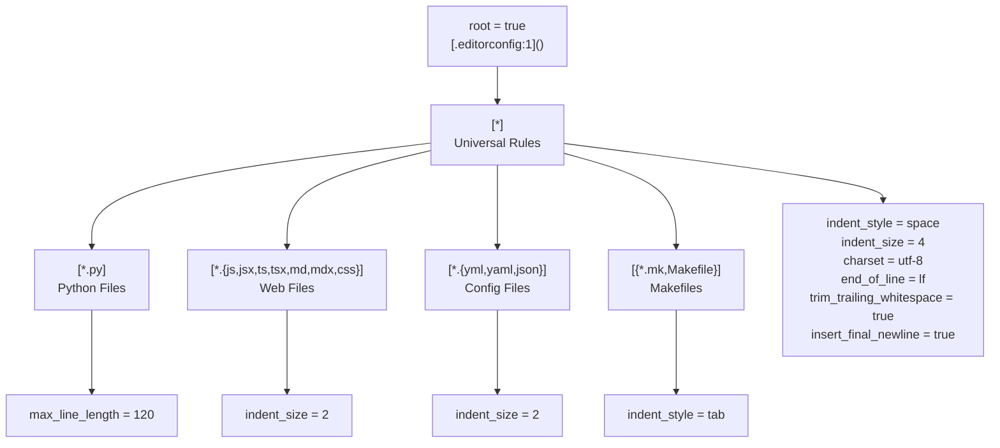
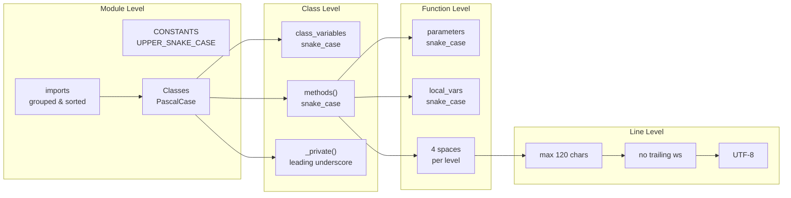
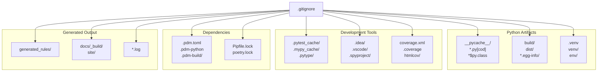

<!-- source: DeepWiki mcp.deepwiki.com · repo microsoft/argos · page 7.3 Code Style and Standards · fetched 2026-10-26 -->

# Code Style and Standards

<details>
<summary>Relevant source files</summary>

The following files were used as context for generating this wiki page:

- [.editorconfig](.editorconfig)
- [.gitignore](.gitignore)

</details>


## Purpose and Scope

This document defines the coding standards, formatting rules, and development best practices for the Argos codebase. It covers editor configuration settings, Python code style conventions, and version control practices. For information about project dependencies and package management, see [Dependencies](#7.1). For CI/CD automation and quality checks, see [CI/CD and Automation](#7.2).

## Editor Configuration Standards

Argos uses EditorConfig to maintain consistent coding styles across different editors and IDEs. The configuration is defined in [.editorconfig:1-22]() and applies automatically to all text editors that support the EditorConfig standard.

### Configuration Hierarchy

The following diagram illustrates how EditorConfig rules cascade from general settings to file-type-specific overrides:



**Sources:** [.editorconfig:1-22]()

### Universal File Standards

All files in the Argos repository adhere to the following baseline standards:

| Setting | Value | Purpose |
|---------|-------|---------|
| `indent_style` | `space` | Use spaces instead of tabs for consistent rendering |
| `indent_size` | `4` | Default indentation width (overridden per file type) |
| `charset` | `utf-8` | Unicode character encoding for international compatibility |
| `end_of_line` | `lf` | Unix-style line endings (LF) for cross-platform consistency |
| `trim_trailing_whitespace` | `true` | Remove whitespace at line ends to prevent unnecessary diffs |
| `insert_final_newline` | `true` | Ensure files end with a newline character per POSIX standard |

These settings are defined in [.editorconfig:3-9]() and apply to all files unless overridden by more specific rules.

**Sources:** [.editorconfig:3-9]()

### Python-Specific Standards

Python source files have one additional constraint beyond the universal rules:

```
[*.py]
max_line_length = 120
```

This 120-character line limit defined in [.editorconfig:11-12]() provides a balance between readability and avoiding excessive line wrapping. This is slightly more permissive than PEP 8's traditional 79-character recommendation, recognizing that modern displays support wider viewports and that LLM-generated code often benefits from additional horizontal space for complex expressions.

**Sources:** [.editorconfig:11-12]()

### File Type Standards

The following table summarizes indentation rules for different file categories:

| File Pattern | Indent Style | Indent Size | Rationale |
|--------------|--------------|-------------|-----------|
| `*.py` | space | 4 | Python convention (PEP 8) |
| `*.{js,jsx,ts,tsx}` | space | 2 | JavaScript/TypeScript community standard |
| `*.{md,mdx,css}` | space | 2 | Markdown and CSS convention |
| `*.{yml,yaml,json}` | space | 2 | Configuration file readability |
| `*.mk`, `Makefile` | tab | N/A | Make requires literal tabs |

**Sources:** [.editorconfig:11-21]()

## Python Code Standards

### Formatting Conventions

Argos Python code follows these formatting principles derived from the EditorConfig settings:

1. **Indentation**: 4 spaces per indentation level ([.editorconfig:5]())
2. **Line Length**: Maximum 120 characters per line ([.editorconfig:12]())
3. **Line Endings**: LF (Unix-style) only ([.editorconfig:7]())
4. **Encoding**: UTF-8 without BOM ([.editorconfig:6]())
5. **Trailing Whitespace**: Must be removed ([.editorconfig:8]())
6. **Final Newline**: Required at end of file ([.editorconfig:9]())

### Code Structure Standards

The following diagram shows how code style rules apply to different Python code constructs:



**Sources:** [.editorconfig:3-12]()

### Naming Conventions

While not explicitly defined in configuration files, the Argos codebase follows standard Python naming conventions:

| Construct | Convention | Examples |
|-----------|-----------|----------|
| Modules | `lowercase_with_underscores` | `detection_agent.py`, `train_perf_selector.py` |
| Classes | `PascalCase` | `DetectionAgentV3`, `RepairAgent`, `ArgosDataset` |
| Functions/Methods | `lowercase_with_underscores()` | `generate_rule()`, `evaluate_performance()` |
| Constants | `UPPER_CASE_WITH_UNDERSCORES` | `MAX_ITERATIONS`, `DEFAULT_CHUNK_SIZE` |
| Private Members | `_leading_underscore` | `_build_prompt()`, `_validate_code()` |

**Sources:** Inferred from codebase conventions

## Version Control Standards

### Ignored File Patterns

The repository's [.gitignore:1-165]() defines comprehensive exclusion patterns across multiple categories. The following diagram categorizes these patterns by their purpose:



**Sources:** [.gitignore:1-165]()

### Critical Exclusions

The following patterns are particularly important for Argos development:

#### Python Build Artifacts
```
__pycache__/
*.py[cod]
*$py.class
*.so
```
Defined in [.gitignore:1-7](), these patterns exclude compiled Python bytecode and C extensions that are automatically regenerated during execution.

#### Virtual Environments
```
.env
.venv
env/
venv/
ENV/
env.bak/
venv.bak/
```
From [.gitignore:124-131](), these patterns prevent committing Python virtual environments, which should be recreated per development machine based on `requirements.txt`.

#### Generated Rules Directory
```
generated_rules/
```
Defined in [.gitignore:165](), this critical exclusion prevents committing LLM-generated detection rules, which are execution artifacts specific to each training run. These rules should be managed separately from source code.

**Sources:** [.gitignore:1-7](), [.gitignore:124-131](), [.gitignore:165]()

### Distribution and Packaging
```
build/
develop-eggs/
dist/
downloads/
eggs/
.eggs/
*.egg-info/
*.egg
```
These patterns from [.gitignore:9-27]() exclude Python packaging artifacts that are generated during build and distribution processes.

**Sources:** [.gitignore:9-27]()

## Development Best Practices

### Editor Setup

To ensure compliance with Argos code standards:

1. **Install EditorConfig Support**: Most modern editors (VS Code, PyCharm, Sublime Text, Vim, Emacs) support EditorConfig either natively or via plugins.

2. **Verify Settings Application**: After opening a Python file, verify that:
   - Indentation is set to 4 spaces
   - Line endings are LF
   - Maximum line length indicator appears at column 120
   - Trailing whitespace is highlighted or auto-removed on save

3. **Configure Auto-Formatting**: While Argos does not enforce a specific formatter like `black` or `autopep8`, any formatter should respect the 120-character line limit and 4-space indentation.

### Pre-Commit Considerations

Before committing code:

1. **Check Generated Files**: Ensure no files from `generated_rules/` are staged for commit
2. **Verify Line Endings**: Confirm files use LF line endings (not CRLF)
3. **Remove Trailing Whitespace**: Ensure no trailing whitespace exists
4. **Check Final Newlines**: Verify files end with a single newline character
5. **Validate Python Bytecode**: Confirm no `__pycache__/` or `*.pyc` files are staged

### Working with LLM-Generated Code

Since Argos generates Python code via LLM, special considerations apply:

1. **Post-Processing**: Generated code from agents (e.g., `DetectionAgentV3`, `RepairAgent`) may not automatically conform to formatting standards. Manual cleanup may be needed before inspection.

2. **Line Length**: LLM-generated code often exceeds 120 characters. While the runtime does not enforce this for generated rules, manually reviewed generated code should be reformatted.

3. **Storage Location**: All generated detection rules are written to `generated_rules/` which is git-ignored per [.gitignore:165](). This ensures experiments don't pollute the repository.

**Sources:** [.gitignore:165]()

## Configuration File Matrix

The following table maps file types to their applicable standards:

| File Type | Indent Style | Indent Size | Max Line Length | Line Ending | Charset |
|-----------|--------------|-------------|-----------------|-------------|---------|
| `*.py` | space | 4 | 120 | LF | UTF-8 |
| `*.js`, `*.jsx`, `*.ts`, `*.tsx` | space | 2 | - | LF | UTF-8 |
| `*.md`, `*.mdx`, `*.css` | space | 2 | - | LF | UTF-8 |
| `*.yml`, `*.yaml`, `*.json` | space | 2 | - | LF | UTF-8 |
| `Makefile`, `*.mk` | tab | - | - | LF | UTF-8 |

**Sources:** [.editorconfig:3-21]()

## Summary

Argos maintains consistent code quality through:

1. **EditorConfig**: Automated formatting rules applied across editors ([.editorconfig:1-22]())
2. **Python Standards**: 4-space indentation, 120-character lines, UTF-8 encoding
3. **Version Control**: Comprehensive `.gitignore` excluding build artifacts, environments, and generated rules ([.gitignore:1-165]())
4. **Best Practices**: Editor setup guidance and pre-commit verification procedures

These standards ensure that code contributions maintain consistency regardless of the developer's environment or tooling choices.

**Sources:** [.editorconfig:1-22](), [.gitignore:1-165]()

---

