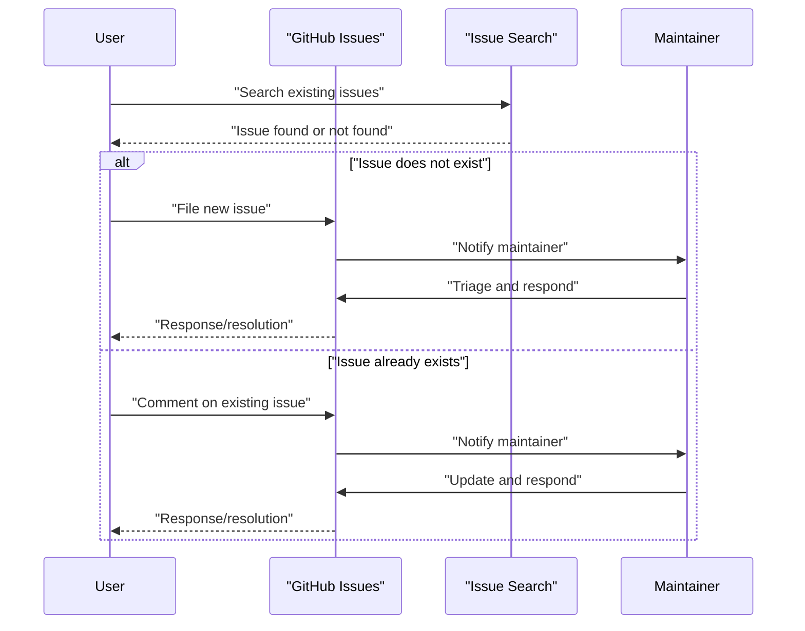
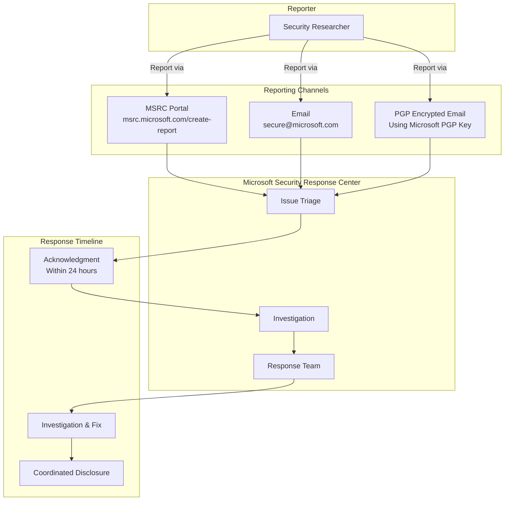
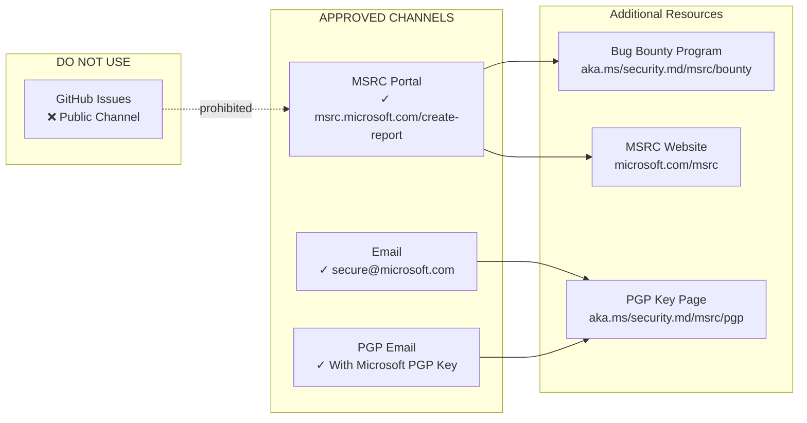
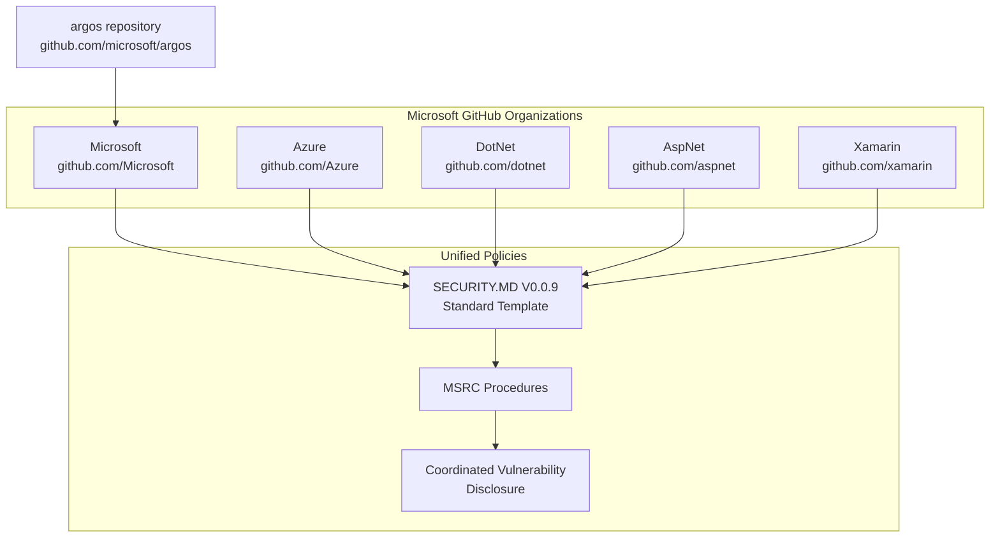

<!-- source: DeepWiki mcp.deepwiki.com · repo microsoft/argos · page 8 Project Governance · fetched 2026-10-26 -->

# Project Governance

<details>
<summary>Relevant source files</summary>

The following files were used as context for generating this wiki page:

- [SECURITY.md](SECURITY.md)
- [SUPPORT.md](SUPPORT.md)

</details>


## Purpose and Scope

This document outlines the governance structure, policies, and procedures for the Argos project. It covers support channels, security vulnerability reporting, community standards, and licensing terms. This page provides a high-level overview of project governance; detailed information about specific aspects can be found in the following subsections:

- For information about getting help and filing issues, see [Support](#8.1)
- For security vulnerability reporting procedures, see [Security Policy](#8.2)
- For community behavioral expectations, see [Code of Conduct](#8.3)
- For licensing and usage terms, see [License](#8.4)

## Project Ownership

Argos is maintained by Microsoft and hosted under the Microsoft GitHub organization. The project follows Microsoft's standard governance policies for open-source software, including security practices, support mechanisms, and community guidelines.

```mermaid
graph TB
    subgraph "Project Owner"
        MS["Microsoft"]
    end
    
    subgraph "Repository"
        REPO["github.com/microsoft/argos"]
        ISSUES["GitHub Issues"]
        PR["Pull Requests"]
    end
    
    subgraph "Governance Documents"
        SECURITY["SECURITY.md"]
        SUPPORT["SUPPORT.md"]
        COC["CODE_OF_CONDUCT.md"]
        LICENSE["LICENSE"]
    end
    
    subgraph "Community"
        USERS["Users"]
        CONTRIBUTORS["Contributors"]
        MAINTAINERS["Maintainers"]
    end
    
    MS --> REPO
    MS --> MAINTAINERS
    
    REPO --> ISSUES
    REPO --> PR
    REPO --> SECURITY
    REPO --> SUPPORT
    REPO --> COC
    REPO --> LICENSE
    
    USERS --> ISSUES
    USERS --> PR
    CONTRIBUTORS --> PR
    MAINTAINERS --> ISSUES
    MAINTAINERS --> PR
    
    SECURITY -.defines.-> "Security Policy"
    SUPPORT -.defines.-> "Support Policy"
    COC -.defines.-> "Conduct Standards"
    LICENSE -.defines.-> "Usage Terms"
```

**Sources**: [SUPPORT.md:1-26](), [SECURITY.md:1-42]()

## Support and Community Engagement

The project uses **GitHub Issues** as the primary mechanism for tracking bugs, feature requests, and user inquiries. The support policy is defined in `SUPPORT.md`, which provides guidance on:

- How to file issues and bug reports
- Where to search for existing issues before filing duplicates
- How to engage with project maintainers and the community

### Issue Reporting Workflow



**Sources**: [SUPPORT.md:15-17]()

| Support Channel | Purpose | Location |
|----------------|---------|----------|
| GitHub Issues | Bug reports, feature requests | `github.com/microsoft/argos/issues` |
| GitHub Discussions | General questions and discussions | Repository discussions (if enabled) |
| Repository README | Quick start and basic documentation | [README.md]() |

**Sources**: [SUPPORT.md:15-21]()

## Security Vulnerability Reporting

Microsoft takes security seriously across all repositories under its GitHub organizations, including Microsoft, Azure, DotNet, AspNet, and Xamarin. The security policy is defined in `SECURITY.md` and follows Microsoft Security Response Center (MSRC) procedures.

### Security Reporting Process

The project follows a **Coordinated Vulnerability Disclosure** policy. Security vulnerabilities must be reported through private channels, not through public GitHub Issues.



**Sources**: [SECURITY.md:9-17](), [SECURITY.md:37-40]()

### Required Information for Security Reports

When reporting a security vulnerability, include the following information to help with triage:

| Information Type | Description |
|-----------------|-------------|
| Issue Type | Type of vulnerability (e.g., buffer overflow, injection, XSS) |
| Source Files | Full paths of affected files |
| Location | Tag/branch/commit or direct URL to affected code |
| Configuration | Any special configuration needed to reproduce |
| Reproduction Steps | Step-by-step instructions to reproduce the issue |
| Proof-of-Concept | PoC or exploit code if available |
| Impact | Description of potential impact and exploitation method |

**Sources**: [SECURITY.md:19-29]()

### Security Channels and Contacts



**Sources**: [SECURITY.md:11-17](), [SECURITY.md:31]()

## Governance Policy Summary

The table below summarizes the key governance policies and where they are documented:

| Policy Area | Document | Key Principles | Reference |
|------------|----------|----------------|-----------|
| Support | `SUPPORT.md` | GitHub Issues for tracking, search before filing | [Support](#8.1) |
| Security | `SECURITY.md` | MSRC reporting, no public disclosure, 24hr response | [Security Policy](#8.2) |
| Community Standards | `CODE_OF_CONDUCT.md` | Behavioral expectations for contributors | [Code of Conduct](#8.3) |
| Licensing | `LICENSE` | Usage terms and legal rights | [License](#8.4) |

**Sources**: [SUPPORT.md:1-26](), [SECURITY.md:1-42]()

## Microsoft GitHub Organizations

Argos is part of the broader Microsoft open-source ecosystem. The security policy applies across multiple Microsoft-managed GitHub organizations:



**Sources**: [SECURITY.md:1](), [SECURITY.md:5]()

## Communication Preferences

All official project communication is conducted in **English**. This includes:

- GitHub Issues and Pull Requests
- Security vulnerability reports
- Documentation contributions
- Community discussions

**Sources**: [SECURITY.md:33-35]()

## Next Steps

For detailed information about specific governance aspects:

1. **Getting Help**: Review the [Support](#8.1) page for instructions on filing issues and engaging with maintainers
2. **Reporting Security Issues**: Read the [Security Policy](#8.2) page for detailed vulnerability reporting procedures
3. **Contributing**: See the [Code of Conduct](#8.3) page for community behavioral expectations
4. **Legal Information**: Consult the [License](#8.4) page for usage terms and legal rights

**Sources**: [SUPPORT.md:1-26](), [SECURITY.md:1-42]()

---

