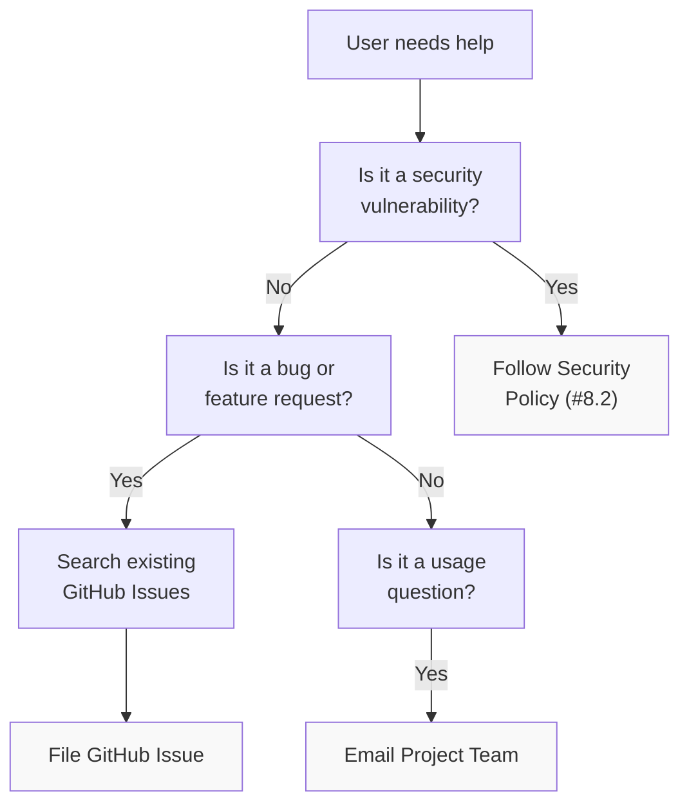
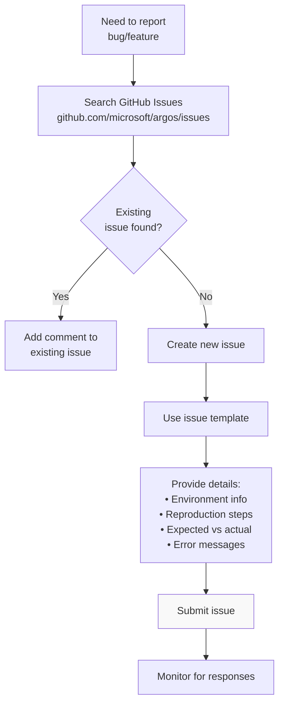
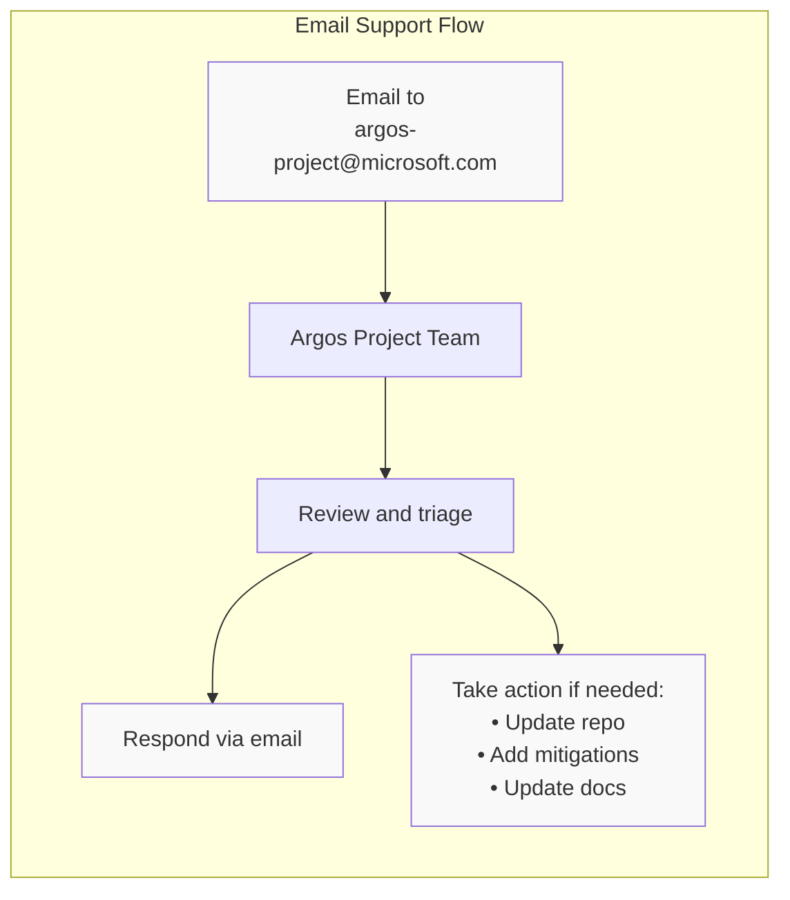
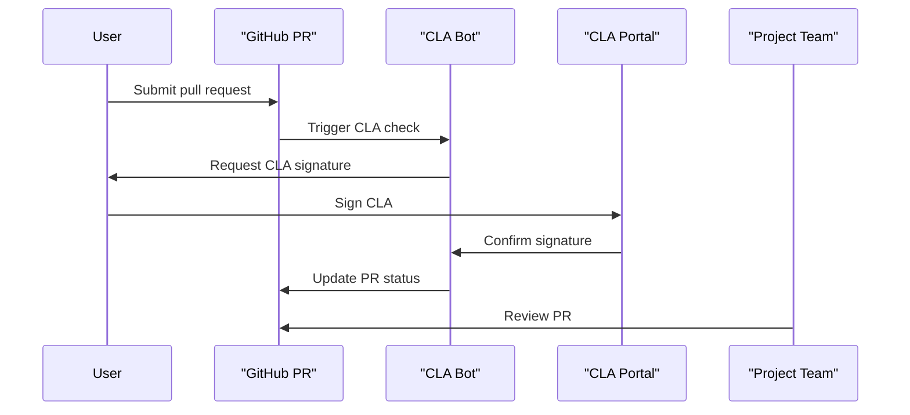
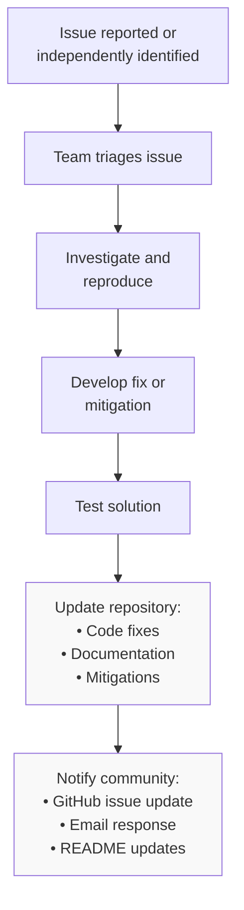

<!-- source: DeepWiki mcp.deepwiki.com · repo microsoft/argos · page 8.1 Support · fetched 2026-10-26 -->

# Support

Relevant source files

The following files were used as context for generating this wiki page:

- [README.md](README.md)
- [SUPPORT.md](SUPPORT.md)

## Purpose and Scope

This document explains how to obtain support for Argos, including how to file issues, report bugs, request features, and engage with the project community. It also clarifies the support limitations inherent to a research project.

For information about security vulnerability reporting, see [Security Policy](#8.2). For community standards and behavioral expectations, see [Code of Conduct](#8.3).

## Support Model

Argos is a **research project** released for academic and experimental purposes. Support is provided on a best-effort basis through community channels. The project does not offer commercial support, service-level agreements (SLAs), or guaranteed response times.

**Sources:** [README.md:228-232](), [SUPPORT.md:11-26]()

## GitHub Issues

The primary support channel for Argos is **GitHub Issues** at https://github.com/microsoft/argos/issues. Use this channel to:

- Report bugs or unexpected behavior
- Request new features or enhancements
- Suggest documentation improvements
- Discuss implementation details

### Issue Search and Filing Process

Before filing a new issue, search existing issues to avoid duplicates. The issue search functionality covers both open and closed issues.

**Sources:** [SUPPORT.md:15-17]()

### Issue Content Guidelines

When filing a bug report or feature request, include:

| Category | Information to Provide |
|----------|----------------------|
| **Environment** | Python version, OS, conda environment details from [README.md:44-48]() |
| **Azure OpenAI** | Model name (GPT-3.5/GPT-4-32k/GPT-4o), API version from [README.md:172-173]() |
| **Configuration** | Command-line arguments used with `driver.py` from [README.md:124-154]() |
| **Dataset** | Dataset mode (one-for-one/one-for-all), structure from [README.md:86-93]() |
| **Operational Mode** | Mode used (train-LLM-only, eval-combined, etc.) from [README.md:126-148]() |
| **Error Details** | Full error message, stack trace, exception type from [common/exception.py]() |
| **Reproduction** | Minimal steps to reproduce the issue |
| **Expected Behavior** | What you expected to happen |
| **Actual Behavior** | What actually happened |

**Sources:** [README.md:37-61](), [SUPPORT.md:15-17]()

## Email Contact

For questions, feedback, or issues that don't fit the GitHub Issues model, contact the project team via email:

**Email Address:** argos-project@microsoft.com

### Appropriate Email Topics

Use email for:

- General questions about Argos usage and capabilities
- Suggestions for improvements or new directions
- Reporting unexpected or offensive behavior
- Collaboration inquiries
- Questions about research methodology or evaluation

The team monitors this address and will respond on a best-effort basis. Response times may vary depending on team availability and query complexity.

**Sources:** [README.md:228-232]()

## Support Limitations

As a research project, Argos has specific support boundaries:

### Research Scope

Argos was developed for research and experimental purposes. The project team provides:

- ✓ Documentation of system architecture and components
- ✓ Guidance on reproduction of research results
- ✓ Best-effort responses to questions and issues
- ✓ Updates for reported bugs and security issues

The project team does **not** provide:

- ✗ Commercial support or SLAs
- ✗ Deployment assistance for production environments
- ✗ Custom development for specific use cases
- ✗ Training or consulting services
- ✗ Guaranteed response times or issue resolution

**Sources:** [README.md:22-30](), [README.md:182-191](), [SUPPORT.md:23-25]()

### Intended Use Constraints

Support is provided only for intended use cases as defined in [README.md:16-21]():

| Supported Use Cases | Out-of-Scope Use Cases |
|---------------------|------------------------|
| Research and experimentation | Real-world production deployment |
| Reproduction of published results | Commercial applications |
| Domain expert evaluation | Highly regulated domains (healthcare, finance, law) |
| Suggesting rules for human review | Automated decision-making without oversight |

Users attempting out-of-scope applications may not receive support, as these uses were not evaluated or validated by the research team.

**Sources:** [README.md:16-30]()

### Language Support

Argos was designed and tested using the **English language** only. Performance in other languages is undefined and not officially supported. Non-English usage should be assessed by domain experts who are native speakers of the target language.

**Sources:** [README.md:185-186]()

## Contributing to Support

The project team welcomes community contributions to improve support resources:

### Contributor License Agreement

Contributors must sign a Contributor License Agreement (CLA) before submitting pull requests. The CLA bot will automatically guide you through this process on your first contribution.

- **CLA Portal:** https://cla.opensource.microsoft.com
- **Process:** Automated via CLA bot on pull requests
- **Scope:** One-time agreement across all Microsoft open source repos

**Sources:** [README.md:213-222]()

### Code of Conduct

All contributors and community members must follow the Microsoft Open Source Code of Conduct. See [Code of Conduct](#8.3) for details.

**Sources:** [README.md:224-226]()

## Response and Update Process

When the team receives bug reports, feedback, or observes issues independently, the following process occurs:

1. **Triage:** Assess issue severity and scope
2. **Investigation:** Reproduce and analyze the problem
3. **Resolution:** Implement fixes or mitigations
4. **Communication:** Update the GitHub repository and notify reporters
5. **Documentation:** Update relevant documentation

For security issues or undesired behavior, the team will update the repository with appropriate mitigations and communicate through established channels.

**Sources:** [README.md:230-232]()

## Related Resources

For comprehensive support, consult these additional resources:

- **Documentation:** See [Getting Started](#2) for setup and usage instructions
- **Architecture:** See [Architecture](#3) for system design details
- **Security:** See [Security Policy](#8.2) for vulnerability reporting
- **Conduct:** See [Code of Conduct](#8.3) for community standards
- **License:** See [License](#8.4) for usage terms

**Sources:** [README.md:1-254](), [SUPPORT.md:1-26]()

---

