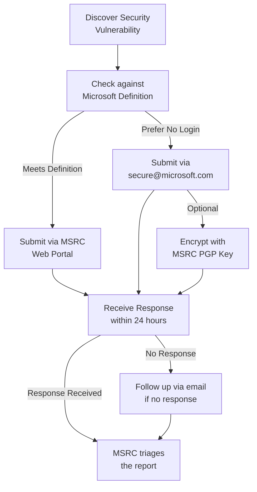
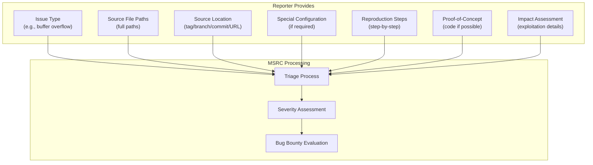
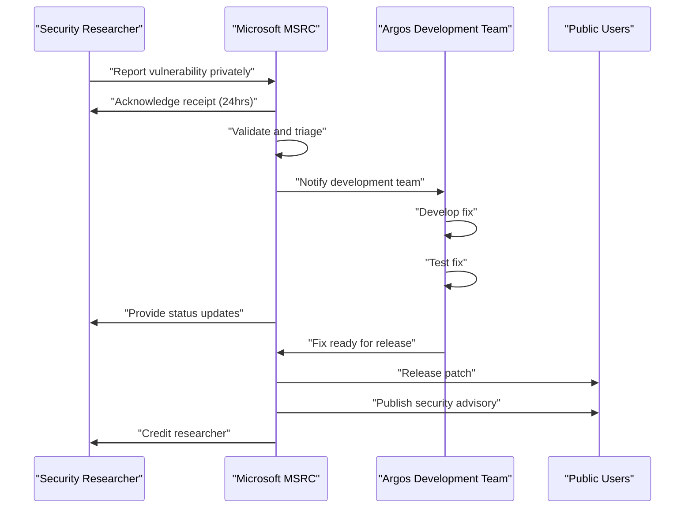

<!-- source: DeepWiki mcp.deepwiki.com · repo microsoft/argos · page 8.2 Security Policy · fetched 2026-10-26 -->

# Security Policy

Relevant source files

The following files were used as context for generating this wiki page:

- [SECURITY.md](SECURITY.md)

This document describes the security vulnerability reporting process for the Argos project. It outlines how to responsibly disclose security issues, what information to provide, and the expected response timeline. For general project support and non-security questions, see [Support](#8.1). For community standards and behavioral expectations, see [Code of Conduct](#8.3).

## Security Overview

Microsoft takes the security of all software products and services seriously, including all source code repositories managed through Microsoft GitHub organizations. The Argos project follows Microsoft's standard security policies and procedures for vulnerability disclosure and response.

**Sources:** [SECURITY.md:1-5]()

## Reporting Security Vulnerabilities

Security vulnerabilities must be reported through designated channels, not through public GitHub issues. This ensures that issues are handled responsibly and that users are protected while fixes are being developed.

### Reporting Channels

The primary method for reporting security vulnerabilities is through the Microsoft Security Response Center (MSRC):

| Channel | Method | Details |
|---------|--------|---------|
| **Web Portal** | MSRC Create Report | [https://msrc.microsoft.com/create-report](https://aka.ms/security.md/msrc/create-report) |
| **Email** | secure@microsoft.com | For submissions without logging in |
| **Encrypted Email** | PGP Key Available | Download from [MSRC PGP Key page](https://aka.ms/security.md/msrc/pgp) |

**Important:** Do not report security vulnerabilities through public GitHub issues, pull requests, or discussions.

**Sources:** [SECURITY.md:9-15]()

### Vulnerability Reporting Workflow

**Sources:** [SECURITY.md:9-17]()

### Response Timeline

Reporters should expect a response within 24 hours of submission. If no response is received within this timeframe, follow up via email to ensure the original message was received. Additional information about the Microsoft Security Response Center process is available at [microsoft.com/msrc](https://www.microsoft.com/msrc).

**Sources:** [SECURITY.md:17-17]()

## Required Information for Security Reports

To help Microsoft triage and respond to security reports effectively, include as much of the following information as possible:

### Information Checklist

| Category | Details |
|----------|---------|
| **Issue Type** | e.g., buffer overflow, SQL injection, cross-site scripting, code injection, authentication bypass |
| **Source File Paths** | Full paths of source files related to the vulnerability manifestation |
| **Source Location** | Tag/branch/commit or direct URL of the affected source code |
| **Configuration** | Any special configuration required to reproduce the issue |
| **Reproduction Steps** | Step-by-step instructions to reproduce the vulnerability |
| **Proof-of-Concept** | PoC or exploit code (if possible and safe to share) |
| **Impact Assessment** | Description of potential impact and how an attacker might exploit the issue |

More complete reports contribute to faster triage and, for eligible programs, may result in higher bug bounty awards.

**Sources:** [SECURITY.md:19-31]()

### Information Flow for Security Reports

**Sources:** [SECURITY.md:19-31]()

## Microsoft Bug Bounty Program

Security researchers reporting vulnerabilities may be eligible for rewards through the Microsoft Bug Bounty Program. Complete and detailed reports contribute to higher bounty awards. Visit the [Microsoft Bug Bounty Program](https://aka.ms/security.md/msrc/bounty) page for information about active programs, eligibility criteria, and reward structures.

**Sources:** [SECURITY.md:31-31]()

## Communication Guidelines

All security communications should be conducted in English. This is Microsoft's preferred language for security reports to ensure efficient processing and minimize miscommunication during the vulnerability disclosure process.

**Sources:** [SECURITY.md:33-35]()

## Coordinated Vulnerability Disclosure

Microsoft follows the principle of Coordinated Vulnerability Disclosure (CVD). This approach ensures that:

1. Vulnerabilities are disclosed to the vendor before public disclosure
2. Vendors have time to develop and test fixes
3. Patches are made available to users before vulnerability details are published
4. Security researchers receive appropriate credit for their discoveries

The CVD process protects users by ensuring that fixes are available before attackers can exploit publicly disclosed vulnerabilities.

**Sources:** [SECURITY.md:37-39]()

### Coordinated Vulnerability Disclosure Process

**Sources:** [SECURITY.md:37-39]()

## Security Policy File Structure

The Argos project's security policy is defined in a single markdown file following Microsoft's standard template (version 0.0.9). This file is located at the repository root for easy discovery by security researchers and automated security scanning tools.

| File Element | Purpose |
|--------------|---------|
| `SECURITY.md` | Contains the complete security policy |
| Microsoft Security.md Block | Standard template (v0.0.9) used across Microsoft repositories |
| Security Definition Link | References Microsoft's definition of security vulnerabilities |
| MSRC Links | Direct links to reporting portal, PGP key, and documentation |
| CVD Reference | Link to Coordinated Vulnerability Disclosure principles |

**Sources:** [SECURITY.md:1-41]()

## Related Policies

Microsoft maintains several related security resources that complement this policy:

- **Security Vulnerability Definition:** [https://aka.ms/security.md/definition](https://aka.ms/security.md/definition) defines what constitutes a security vulnerability eligible for reporting
- **MSRC Portal:** [https://www.microsoft.com/msrc](https://www.microsoft.com/msrc) provides additional security resources and documentation
- **PGP Key:** [https://aka.ms/security.md/msrc/pgp](https://aka.ms/security.md/msrc/pgp) for encrypted communications
- **Bug Bounty Program:** [https://aka.ms/security.md/msrc/bounty](https://aka.ms/security.md/msrc/bounty) for reward program details

**Sources:** [SECURITY.md:7-39]()

---

