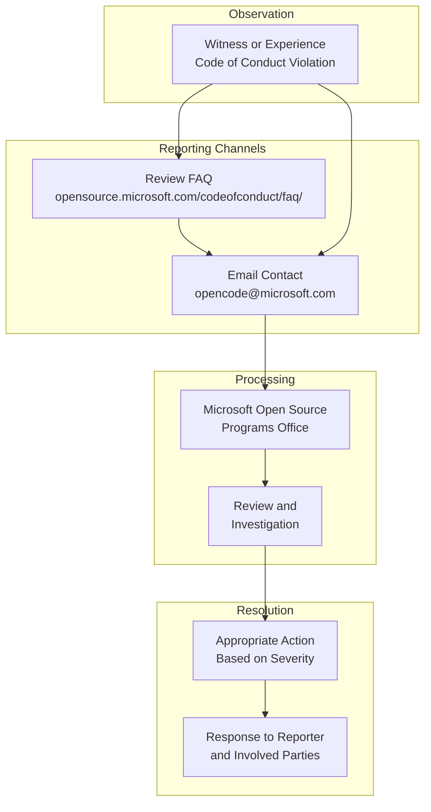
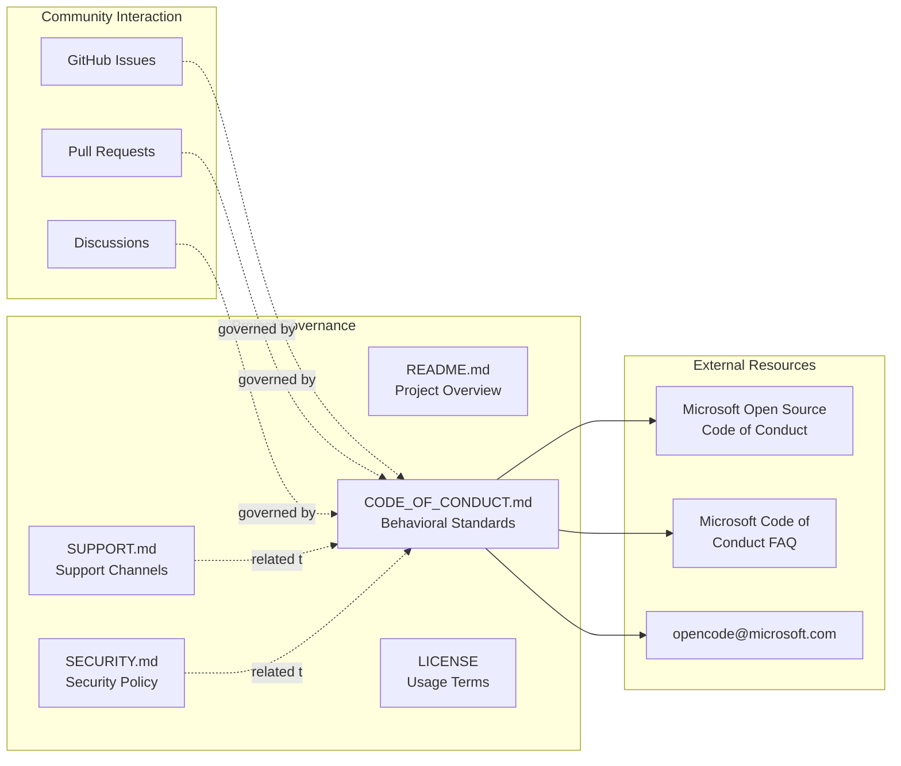
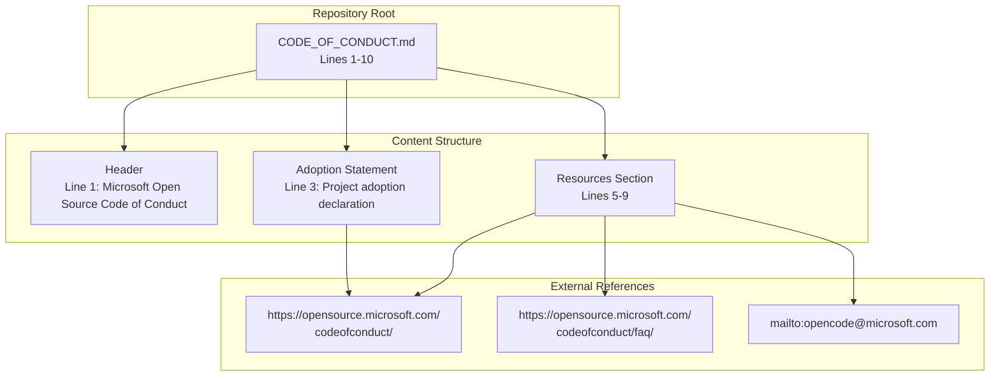

<!-- source: DeepWiki mcp.deepwiki.com · repo microsoft/argos · page 8.3 Code of Conduct · fetched 2026-10-26 -->

# Code of Conduct

Relevant source files

The following files were used as context for generating this wiki page:

- [CODE_OF_CONDUCT.md](CODE_OF_CONDUCT.md)

## Purpose and Scope

This document outlines the community standards and behavioral expectations for all contributors, maintainers, and participants in the Argos project. It describes the adopted code of conduct, available resources, and procedures for reporting concerns.

For information about security vulnerability reporting, see [Security Policy](#8.2). For general project support, see [Support](#8.1).

## Overview

The Argos project has adopted the Microsoft Open Source Code of Conduct as the standard for community interaction and collaboration. This code of conduct applies to all project spaces, including GitHub repositories, issue trackers, pull requests, documentation, and any other forums where the Argos community interacts.

**Sources:** [CODE_OF_CONDUCT.md:1-10]()

## Adopted Code of Conduct

### Microsoft Open Source Code of Conduct

Argos follows the [Microsoft Open Source Code of Conduct](https://opensource.microsoft.com/codeofconduct/), which establishes expectations for participation in Microsoft-supported open source communities. The adoption is formally declared in the project's root directory.

**Key Principles:**
- Treat all community members with respect and courtesy
- Welcome diverse perspectives and experiences
- Accept constructive criticism gracefully
- Focus on what is best for the community
- Show empathy towards other community members

**File Location:** The code of conduct declaration is located at `CODE_OF_CONDUCT.md` in the repository root.

**Sources:** [CODE_OF_CONDUCT.md:1-3]()

## Resources and Documentation

### Available Resources

The project provides access to comprehensive resources for understanding and applying the code of conduct:

| Resource | Purpose | Access |
|----------|---------|--------|
| Microsoft Open Source Code of Conduct | Full code of conduct text and principles | https://opensource.microsoft.com/codeofconduct/ |
| Microsoft Code of Conduct FAQ | Frequently asked questions and clarifications | https://opensource.microsoft.com/codeofconduct/faq/ |
| Contact Email | Direct communication for questions or concerns | opencode@microsoft.com |

**Sources:** [CODE_OF_CONDUCT.md:5-9]()

### FAQ Coverage

The Microsoft Code of Conduct FAQ addresses common questions including:
- What behavior is expected?
- What behavior is unacceptable?
- What happens if someone violates the code?
- How are reports handled?
- Who enforces the code of conduct?

**Sources:** [CODE_OF_CONDUCT.md:8]()

## Reporting Violations

### Contact Information

If you have questions, concerns, or need to report a code of conduct violation, contact the enforcement team at:

**Email:** opencode@microsoft.com

This email address is monitored by Microsoft's Open Source Programs Office, which handles code of conduct inquiries for all Microsoft open source projects.

**Sources:** [CODE_OF_CONDUCT.md:9]()

### Reporting Process Flow

**Diagram: Code of Conduct Violation Reporting Process**

This diagram shows the workflow for reporting and resolving code of conduct violations. All reports are handled by Microsoft's Open Source Programs Office with appropriate confidentiality and due process.

**Sources:** [CODE_OF_CONDUCT.md:5-9]()

## Integration with Project Governance

### Governance Structure

The Code of Conduct is part of the broader project governance framework:

**Diagram: Code of Conduct Integration with Project Governance**

The Code of Conduct works alongside other governance documents to ensure a safe, productive, and welcoming environment for all contributors.

**Sources:** [CODE_OF_CONDUCT.md:1-10]()

### Relationship to Other Policies

| Policy Document | Relationship to Code of Conduct |
|----------------|----------------------------------|
| Support (#8.1) | Defines technical support channels; Code of Conduct governs behavior in those channels |
| Security Policy (#8.2) | Defines vulnerability reporting; Code of Conduct governs respectful security disclosure |
| License (#8.4) | Defines legal usage terms; Code of Conduct governs community interactions |

**Sources:** [CODE_OF_CONDUCT.md:1-10]()

## File Structure and Implementation

### Code Entity Mapping

**Diagram: CODE_OF_CONDUCT.md File Structure and References**

This diagram maps the physical file structure to its semantic components and external references, showing how the code entity (`CODE_OF_CONDUCT.md`) connects to the broader Microsoft Open Source ecosystem.

**Sources:** [CODE_OF_CONDUCT.md:1-10]()

### File Contents

The `CODE_OF_CONDUCT.md` file contains three main sections:

1. **Title and Adoption Statement** [CODE_OF_CONDUCT.md:1-3]()
   - Declares adoption of Microsoft Open Source Code of Conduct
   - Links to the canonical code of conduct document

2. **Resources Section** [CODE_OF_CONDUCT.md:5-9]()
   - Provides links to the full code of conduct
   - Links to the FAQ for detailed guidance
   - Lists contact email for questions and reports

**Sources:** [CODE_OF_CONDUCT.md:1-10]()

## Practical Application

### For Contributors

When contributing to Argos, all contributors are expected to:

1. **Read and Understand:** Review the Microsoft Open Source Code of Conduct before participating
2. **Apply in Practice:** Follow the code of conduct in all project interactions
3. **Report Violations:** Report any observed violations to opencode@microsoft.com
4. **Consult FAQ:** Check the FAQ when questions arise about appropriate behavior

### For Maintainers

Project maintainers have additional responsibilities:

1. **Model Behavior:** Demonstrate adherence to the code of conduct
2. **Enforce Standards:** Apply the code of conduct fairly and consistently
3. **Respond to Reports:** Work with Microsoft's enforcement team on reported violations
4. **Educate Community:** Help community members understand behavioral expectations

**Sources:** [CODE_OF_CONDUCT.md:1-10]()

## Compliance and Enforcement

### Enforcement Authority

The Microsoft Open Source Programs Office serves as the enforcement authority for code of conduct matters in the Argos project. All reports are reviewed by this team, which has the authority to:

- Investigate reported violations
- Determine appropriate responses
- Take corrective actions when necessary
- Communicate with involved parties

### Scope of Application

The code of conduct applies to:

- GitHub repository interactions (issues, pull requests, discussions)
- Code reviews and technical discussions
- Documentation contributions
- Any public or private communication related to the project
- Representation of the project in public spaces

**Sources:** [CODE_OF_CONDUCT.md:1-10]()

---

