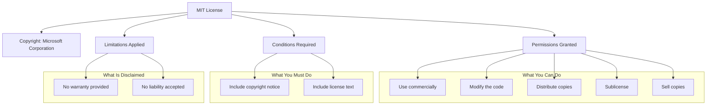
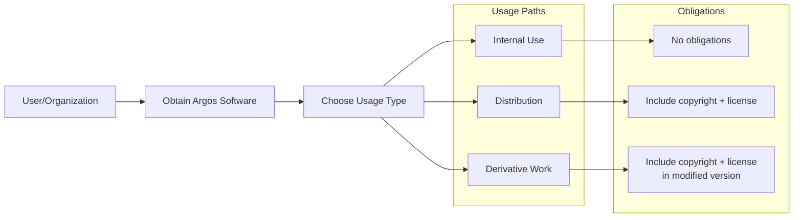
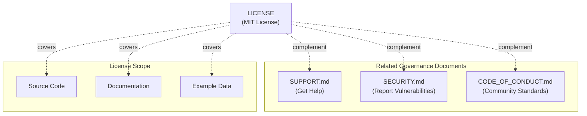

<!-- source: DeepWiki mcp.deepwiki.com · repo microsoft/argos · page 8.4 License · fetched 2026-10-26 -->

# License

<details>
<summary>Relevant source files</summary>

The following files were used as context for generating this wiki page:

- [LICENSE](LICENSE)

</details>


This page documents the licensing terms for the Argos project, including copyright information, permitted usage, and legal requirements for users and contributors.

## License Type

Argos is released under the **MIT License**, one of the most permissive open-source licenses. The MIT License is a short, simple license with clear terms that maximize freedom for users while protecting the copyright holder from liability.

The license is defined in [LICENSE:1-22]().

**Sources:** [LICENSE:1-22]()

## Copyright Holder

```
Copyright (c) Microsoft Corporation
```

Microsoft Corporation holds the copyright to the Argos codebase. This copyright notice must be included in all copies or substantial portions of the software as required by [LICENSE:12-13]().

**Sources:** [LICENSE:3]()

## License Structure



**Sources:** [LICENSE:1-22]()

## Permissions Granted

The MIT License grants extensive permissions to any person obtaining a copy of the software. The following table summarizes these rights:

| Permission | Description | Reference |
|------------|-------------|-----------|
| **Use** | Run the software for any purpose without restriction | [LICENSE:6-8]() |
| **Copy** | Make copies of the software | [LICENSE:6-8]() |
| **Modify** | Alter and create derivative works | [LICENSE:6-8]() |
| **Merge** | Combine with other software | [LICENSE:6-8]() |
| **Publish** | Make the software publicly available | [LICENSE:6-8]() |
| **Distribute** | Share copies with others | [LICENSE:6-8]() |
| **Sublicense** | Grant these same rights to others | [LICENSE:6-8]() |
| **Sell** | Distribute copies for commercial purposes | [LICENSE:6-8]() |

These permissions apply "without restriction" as stated in [LICENSE:7](), meaning there are no field-of-use limitations, territorial restrictions, or other common constraints found in other licenses.

**Sources:** [LICENSE:5-10]()

## Required Conditions

While the MIT License is permissive, it does impose two simple conditions on users:

### Copyright Notice Inclusion

The copyright notice must be included in all copies or substantial portions of the software:
```
Copyright (c) Microsoft Corporation.
```

This requirement is specified in [LICENSE:12-13]().

### License Text Inclusion

The full license text (all 22 lines from [LICENSE:1-22]()) must be included along with the copyright notice in all copies or substantial portions of the software.

**Sources:** [LICENSE:10-13]()

## Warranty Disclaimer and Liability Limitation

The MIT License includes explicit disclaimers that protect the copyright holder and contributors:

### No Warranty

The software is provided "AS IS" without any warranty, including but not limited to:

- **Merchantability**: No guarantee the software is fit for sale or use
- **Fitness for a particular purpose**: No guarantee it will work for your specific needs
- **Non-infringement**: No guarantee it doesn't violate third-party rights

This disclaimer is stated in [LICENSE:15-17]().

### No Liability

The copyright holders and contributors are not liable for any claims, damages, or other liability, whether arising from:

- **Contract**: Breach of agreement terms
- **Tort**: Negligence or other wrongful acts
- **Other causes**: Any connection with the software or its use

This limitation is defined in [LICENSE:17-21]().

**Sources:** [LICENSE:15-21]()

## Usage Workflow



**Sources:** [LICENSE:1-22]()

## Practical Implications

### For Users

If you are using Argos without distributing it:
- No obligations beyond respecting the copyright
- Can use for commercial or non-commercial purposes
- Can modify for internal use
- No requirement to share changes

### For Distributors

If you are distributing Argos or a modified version:
1. Include the full [LICENSE:1-22]() text
2. Include the copyright notice [LICENSE:3]()
3. May charge fees for distribution
4. May bundle with proprietary software
5. No requirement to release source code of modifications

### For Contributors

Contributors to the Argos project:
- Grant Microsoft Corporation rights to their contributions
- Contributions become part of the MIT-licensed codebase
- See [Code of Conduct](#8.3) for community standards
- See [Security Policy](#8.2) for vulnerability reporting

**Sources:** [LICENSE:1-22]()

## License File Location

The complete license text is located at the repository root:

```
argos/
├── LICENSE              # Full MIT License text (22 lines)
├── driver.py
├── runtime/
├── agent/
└── ...
```

The file can be referenced directly at [LICENSE:1-22]().

**Sources:** [LICENSE:1-22]()

## Relationship to Other Project Documents



The MIT License applies to all copyrightable content in the repository. For related information:
- **Support resources**: See [Support](#8.1)
- **Security reporting**: See [Security Policy](#8.2)
- **Community guidelines**: See [Code of Conduct](#8.3)

**Sources:** [LICENSE:1-22]()

## Summary Table

| Aspect | Details |
|--------|---------|
| **License** | MIT License |
| **Copyright Holder** | Microsoft Corporation |
| **File Location** | [LICENSE:1-22]() |
| **Permissions** | Use, copy, modify, merge, publish, distribute, sublicense, sell |
| **Conditions** | Include copyright notice and license text in distributions |
| **Warranty** | None - provided "AS IS" |
| **Liability** | None - copyright holder not liable for damages |
| **Commercial Use** | Permitted without restriction |
| **Source Code Release** | Not required for derivative works |

**Sources:** [LICENSE:1-22]()