<!-- source: DeepWiki mcp.deepwiki.com · repo microsoft/aspire-skills · page 1 Overview · fetched 2026-10-26 -->

# Overview

<details>
<summary>Relevant source files</summary>

The following files were used as context for generating this wiki page:

- [.github/plugins/aspire-skills/README.md](.github/plugins/aspire-skills/README.md)
- [.plugin/plugin.json](.plugin/plugin.json)
- [CHANGELOG.md](CHANGELOG.md)
- [CODE_OF_CONDUCT.md](CODE_OF_CONDUCT.md)
- [CONTRIBUTING.md](CONTRIBUTING.md)
- [LICENSE](LICENSE)
- [README.md](README.md)
- [SECURITY.md](SECURITY.md)

</details>


The `aspire-skills` plugin is a specialized skill pack designed for AI coding agents (such as GitHub Copilot, Claude Code, and Cursor) working within the **.NET Aspire** ecosystem [README.md:1-5](). It provides agents with the domain-specific knowledge, CLI tool definitions, and safety guardrails necessary to manage distributed applications effectively.

By installing this plugin, agents move away from generic shell commands and instead follow structured workflows for orchestration, deployment, and monitoring, aligned with the latest Aspire 13.4 patterns [CHANGELOG.md:8-11]().

## Purpose and Scope

The primary goal of `aspire-skills` is to bridge the gap between high-level natural language intent and the concrete execution of .NET Aspire commands and code modifications. It prevents agents from falling back to suboptimal `dotnet` or `docker` workarounds by providing a dedicated router and five specialized sub-skills [README.md:9-16]().

### Ecosystem Integration

The plugin fits into the .NET Aspire ecosystem through three main entry points:
1.  **First-party CLI integration**: Commands like `aspire agent init` install these skills directly into detected agent environments [README.md:24-35]().
2.  **Marketplace Plugins**: Pre-packaged manifests for popular agent hosts [README.md:37-69]().
3.  **MCP (Model Context Protocol)**: Support for MCP-compatible hosts via `.mcp.json` [README.md:93]().

### System Mapping: Natural Language to Code Entities

The following diagram illustrates how natural language requests are mapped to specific code entities and skills within the repository.

**Natural Language Mapping to Code Entities**

```mermaid
graph TD
    subgraph "Natural Language Space"
        A["'Add a database to my Aspire app'"]
        B["'Deploy my app to Azure'"]
        C["'Show me the logs for the API'"]
    end

    subgraph "Code Entity Space"
        A --> S1["aspireify skill"]
        S1 --> C1["skills/aspireify/SKILL.md"]
        
        B --> S2["aspire-deployment skill"]
        S2 --> C2["skills/aspire-deployment/SKILL.md"]
        
        C --> S3["aspire-monitoring skill"]
        S3 --> C3["skills/aspire-monitoring/SKILL.md"]
    end
    
    C1 -.-> R1["references/apphost-wiring.md"]
    C2 -.-> R2["references/azure.md"]
    C3 -.-> R3["references/opentelemetry.md"]
```

Sources: [README.md:9-16](), [CHANGELOG.md:18-22](), [CHANGELOG.md:43-46]()

## Core Skill Architecture

The plugin is structured around a central router that detects the workspace state and dispatches tasks to the appropriate specialized skill.

| Skill | Role | Key Code Entity |
|-------|------|-----------------|
| `aspire` | Top-level Router | `skills/aspire/SKILL.md` |
| `aspire-init` | Project Scaffolding | `skills/aspire-init/SKILL.md` |
| `aspireify` | AppHost Configuration | `skills/aspireify/SKILL.md` |
| `aspire-orchestration` | Resource Lifecycle | `skills/aspire-orchestration/SKILL.md` |
| `aspire-deployment` | Infrastructure Delivery | `skills/aspire-deployment/SKILL.md` |
| `aspire-monitoring` | Observability & Logs | `skills/aspire-monitoring/SKILL.md` |

**Plugin Routing Architecture**
```mermaid
graph TD
    "User Intent" --> R["aspire (Router)"]
    R -- "New Project" --> SI["aspire-init"]
    R -- "Wiring/Integrations" --> AF["aspireify"]
    R -- "Run/Stop/Status" --> AO["aspire-orchestration"]
    R -- "Publish/Deploy" --> AD["aspire-deployment"]
    R -- "Logs/Traces" --> AM["aspire-monitoring"]

    subgraph "Manifest System"
        M1[".plugin/plugin.json"]
        M2[".claude-plugin/"]
        M3[".cursor-plugin/"]
        M4["gemini-extension.json"]
    end

    R -.-> M1
```
Sources: [README.md:9-16](), [.plugin/plugin.json:1-4](), [CHANGELOG.md:70-75]()

## Child Pages

For detailed technical information on specific areas of the plugin, refer to the following pages:

### [Getting Started & Installation](#1.1)
Covers the installation process for various agent hosts, including GitHub Copilot CLI, Claude Code, and Cursor. It details the prerequisites like the .NET 10 SDK and Aspire CLI, and explains the `aspire agent init` workflow.
*For details, see [Getting Started & Installation](#1.1).*

### [Plugin Architecture & Manifest Files](#1.2)
Explains the multi-manifest system used to support different marketplaces. It details the mirroring strategy found in `.github/plugins/aspire-skills/` where symlinks are used to maintain a single source of truth for skill content.
*For details, see [Plugin Architecture & Manifest Files](#1.2).*

## Repository Organization

The repository is organized to separate runtime skill definitions from development and evaluation tooling [README.md:88-96]().

*   `skills/`: Contains the `SKILL.md` files and supporting `references/` for each skill.
*   `.plugin/`, `.claude-plugin/`, etc.: Metadata files required by different agent ecosystems.
*   `evals/`: Shared fixtures and test cases used by the **Vally** evaluation framework.
*   `.github/plugins/aspire-skills/`: A mirror of the plugin structure used for marketplace publishing [README.md:94](), [.github/plugins/aspire-skills/README.md:1-4]().

Sources: [README.md:88-96](), [.github/plugins/aspire-skills/README.md:1-23]()

---

